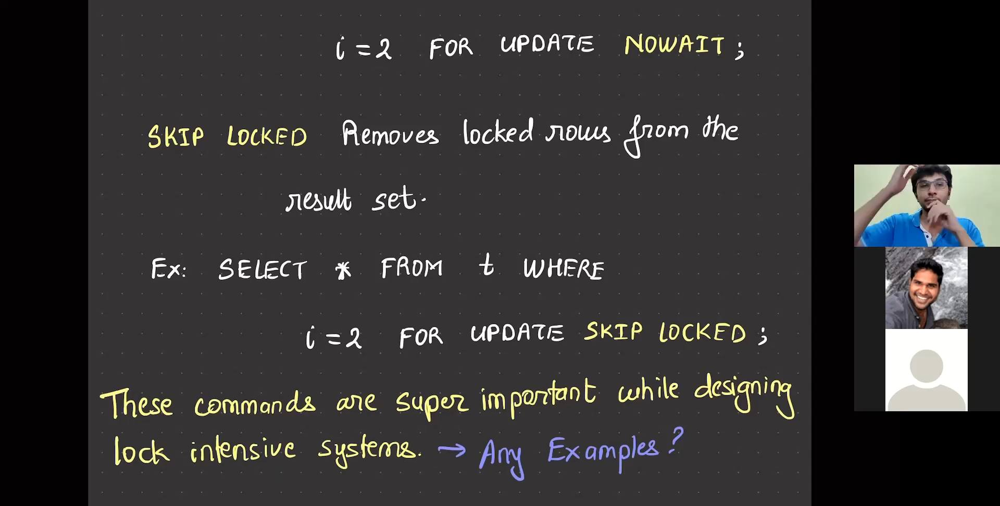
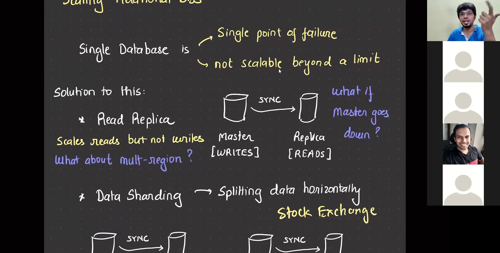
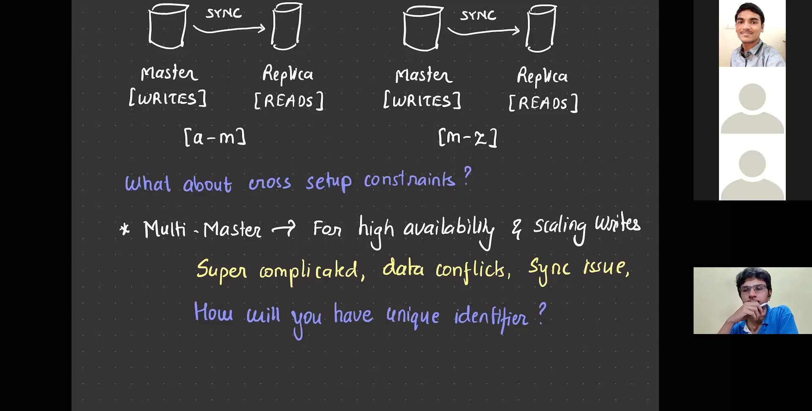
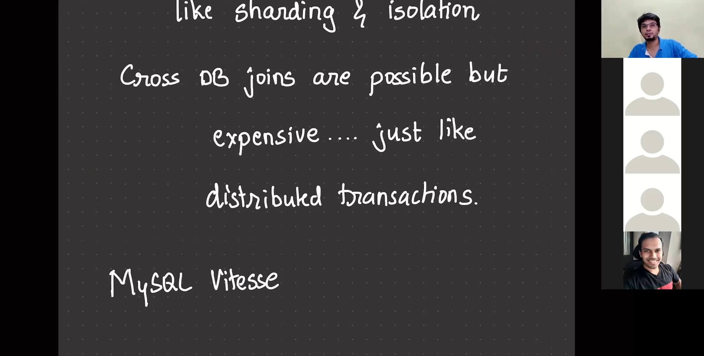
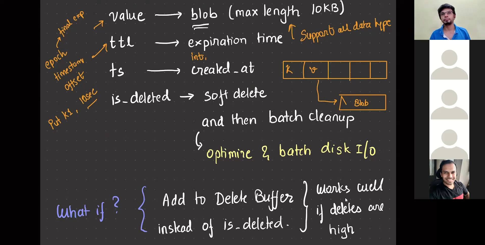

# 一、这一节做什么

这一节（P003，63:19–125:01）从“SQL 和 NoSQL 怎么选”开始，逐步把关系型数据库的扩展路径推了一遍：单库 → 读写分离 → 分片 → 多主，然后转成一个具体设计题——**用 SQL 数据库做一个可无限扩展的 Key-Value 存储**。讲师没有给可运行代码，给的是设计推导和取舍：REST 接口怎么定、表里放哪些列、TTL 存“偏移量”还是“最终过期时间”、value 为什么用 blob、删除为什么先软删再批删。

读完后你应该能复现出以下产物：一张读写分离/分片的架构草图、一张 `store` 表 DDL 草案、三个 REST 端点定义、一张 TTL 字段决策表、一张软删除/删除缓冲对比表，以及一份容量估算模板。注意：**课里没有给出可直接运行的完整项目代码**，第四章的 DDL 和接口是按讲师口述整理的示意草案，不是讲师逐字贴出的文件。



# 二、讲师原话

下面选几段能决定后续设计走向的原话，保留英文原句，并附中文解释。

> “if you're dealing it in scale with transactional data, specially payments information, or you need very high concurrency, SQL would do a far better job than a NoSQL.” —— p003 [63:19]

讲师的意思是：高并发、强一致、支付类事务数据，SQL 比 NoSQL 更合适；NoSQL 在分片和扩展上更容易，但一致性要额外付出代价。这一句定下了后面“不是不用 SQL，而是要想办法把 SQL 扩展出去”的基调。

> “Let's just have one database for write. Let's create another database that can serve reads... my reads are 99%, but my writes is just 1%.” —— p003 [80:47]

这是读写分离的起点：写库只承担写，读库承担读。讲师用“99% 读、1% 写”举例说明，把读流量从主库剥出去，主库就能多撑一段时间。注意这是课堂举例，不是要求你把业务固定成 99:1。

> “Cross-database joins are very expensive and almost needs to handle on the application side.” —— p003 [86:56]

分片之后，跨库 join 不能像单库那样做；要么应用层拼，要么别分片。讲师反复强调：**只有数据可分片时才能分片**，否则跨库一致性约束会非常昂贵。

> “RDAs do not scale because they guarantee ACID... foreign key constraints... you need all the data to reside on that one database.” —— p003 [98:30]

这里“RDAs”按上下文是 RDBMS。讲师把“关系库难扩展”归因于 ACID 和跨表约束：外键要求数据在同一节点，跨库约束检查又慢，所以单机容量成了天花板。

> “if I store the final expiration time, I can just do a range query on the TTL part... Full table scan versus index lookup.” —— p003 [115:01] / [117:54]

TTL 不存“还剩多少秒”，而存“最终过期时间点”，这样清理 job 可以直接对 TTL 列做范围查询走索引；存偏移量就得每次算 `created_ts + ttl`，退化成全表扫描。

> “We'll always do soft deletes and then do a batch cleanup, like a deep fragmentation job... batch the IO.” —— p003 [119:49]

删除不要每条都硬删，先标记 `is_deleted`，再批量硬删。这样 B-Tree 页重排次数少，IO 被批处理，数据库 CPU 不会浪费在频繁重平衡上。



# 三、从零复现

这一章按讲师的推导顺序复现，不是“他讲了哪几页”，而是“如果我要把这套设计做出来，应该按什么步骤走”。

## 步骤 1：先定需求

目标不是“做一个比 Redis 更好的缓存”，而是：**用 MySQL/Postgres 这类 SQL 数据库作为存储引擎，对外表现得像一个 Key-Value 存储，并且能横向扩展。** 讲师明确说，选 KV 是因为它简单，是数据库的“NAND 门”：MongoDB、DynamoDB、Redis 本质上都可以看作 KV 的衍生。把 KV 设计清楚，再往上做文档库、索引、TTL 都容易。

对外能力先定三个：
- `GET /key`：读一个 key 的 value。
- `POST /key`：写入 key 和 value，可带 TTL。
- `DELETE /key`：删除 key。
通信协议讲师选 REST，理由是“最简单”；他也提到可以换 TCP、gRPC，但课堂以 REST 为例。

## 步骤 2：列约束

1. **单库是单点**：单机纵向扩展有上限，到某个点必须横向扩展。
2. **SQL 的 ACID 和外键约束要求数据尽量在同一节点**：跨库 join、跨库一致性约束很贵。
3. **读多写少是常见形态**：讲师用 99% 读、1% 写举例，说明读副本可以独立扩展。
4. **分片的前提是数据可分片**：如果业务必须跨库 join，分片会很痛苦。
5. **多主会引入冲突**：两个 master 都能写，ID 生成、同一行并发写都可能冲突；讲师说通常要在应用层保证“不让数据库进入冲突状态”。

## 步骤 3：估算（课里没给具体数字，以下为复现用模板）

讲师在这一段没有给容量数字，只给了“读 99%、写 1%”这类比例举例。所以这里不编造具体 QPS，只给可套用的算式：

- 单库写上限 ≈ 单机磁盘/CPU 能承受的写事务数（T）。当写入达到 T 的 80% 时，开始考虑拆。
- 读副本数量 N ≈ 峰值读 QPS / 单副本可承受读 QPS。讲师说读副本不关心写锁，可以按需加。
- 分片数 S ≈ 总数据量 / 单分片可承受数据量；或 总写 QPS / 单分片写上限。分片后每个分片仍可配自己的读副本。
- TTL 清理 job 频率：讲师举例“每 5 秒跑一次”，但没说固定值；实际要按过期行数和索引范围扫描成本调。

把这些写成表，后面第四章会给模板。

## 步骤 4：方案演进与取舍

**方案 A：单库。** 简单，但单点，纵向扩展有天花板。适合早期流量。

**方案 B：一写多读（read replica）。** 主库只接写，读副本接读。讲师说读副本不关心锁，因为不在上面写，所以可以加很多个；主库只扛写，相当于把 99% 的读流量剥走。代价是复制延迟：主库挂掉时，异步复制可能丢最后一段写。讲师提到同步复制会让写变慢，异步复制在主库磁盘坏掉时可能丢数据；要按业务选。他还提到“write quorum”思路：写成功前必须落到另一个节点，但说这部分会在后面展开，这一节没细讲。

**方案 C：分片（sharding）。** 多个 master，数据互斥。讲师用股票交易所举例：A–M 的股票去一个 master，M–Z 去另一个，每个 master 再带自己的读副本。分片键按范围做 range partitioning；如果某个区间热，可以继续拆。代价是跨库 join 几乎不可做，跨库一致性约束也别想。

**方案 D：多主（multi-master）。** 两个 master 都能写，数据互相同步。讲师说这不是首选，很多公司不用；但数据迁移、多区域复制时可能被迫用。核心问题是冲突：两个 master 独立生成 ID 会撞，同一行两边写会冲突。通常要在应用层保证不冲突，而不是让数据库自己解。

**方案 E：反规范化。** 到了某个规模，3NF 的 join 会拖垮 CPU。讲师说要把最频繁查询涉及的字段冗余到一张表里，用空间换 join。NoSQL 本身就是这个思路：把异构数据放一起，减少 join。关系库后来也能扩展，是因为吸收了 NoSQL 的反规范化思路，再配合分片。

## 步骤 5：落到 KV 存储

讲师把前面所有取舍收束到 KV 设计：

- **接口**：REST 的 GET/POST/DELETE。
- **表**：`store`，列有 `key`、`value`、`TTL`、`TS`（创建时间），后面讨论再加 `is_deleted`。
- **key**：主键，必须唯一；讲师提到可加正则约束（他举例“0 到 9 之类”），但没给完整正则。
- **value**：用 blob，不把大 value 塞进行内，而是存引用/指针，避免单行过大，也方便存图片、视频这类大对象（讲师同时说“虽然不应该存这些”，但设计上要留能力）。
- **TTL**：存最终过期时间（epoch/时间戳），不存偏移量；这样清理 job 能走索引范围查询。
- **删除**：先软删 `is_deleted`，再批量硬删；如果删除不频繁，可以用外部删除缓冲（讲师提到“an sqsq”，疑似 SQS，课里没展开），把删除 key 推进去，再批量落库。



# 四、完整代码

> **说明：课里没有给出可运行的项目代码。** 下面是把讲师口述整理成可照着搭的“设计产物”：DDL 草案、接口表、决策表、估算表。DDL 是示意，不是讲师逐字贴出的文件；字段名以讲师提到的 `key`、`value`、`TTL`、`TS`、`is_deleted` 为准，类型是为可运行而补的示意。

## 4.1 数据模型草案（示意 DDL）

```sql
-- 课里没有可运行 DDL，以下为按讲师口述整理的示意草案
CREATE TABLE store (
    key         VARCHAR(255) PRIMARY KEY,
    value       BLOB,              -- 讲师说 value 用 blob，并讨论过存引用而不是大内容
    ttl         BIGINT,            -- 最终过期时间（epoch 秒/毫秒由你定），NULL 表示不过期
    created_ts  BIGINT NOT NULL,   -- 讲师提到的 TS：key 创建时间
    is_deleted  BOOLEAN NOT NULL DEFAULT FALSE
);

-- 讲师强调 TTL 要能走范围查询，示意索引：
CREATE INDEX idx_store_ttl ON store (ttl);
-- 软删除批量清理时按 is_deleted 过滤，示意索引：
CREATE INDEX idx_store_deleted ON store (is_deleted);
```

注意：讲师没有指定 `ttl` 用秒还是毫秒，只说“integer 更高效”“存最终过期时间”。`BIGINT` 是示意，实际以你的 epoch 单位为准。`value` 用 `BLOB` 是讲师明确讨论的；他也说过“value 可以存到别处，表里存引用”，所以真实实现可以把 `value` 改成指针列，课里没展开具体存储服务。

## 4.2 REST 接口草案

| 方法 | 路径 | 请求体 | 行为 | 讲师原话依据 |
|---|---|---|---|---|
| GET | `/key` | 无 | 返回 key 对应的 value；过期/软删则按未命中处理 | p003 [109:41] 提到 GET pay slash key |
| POST | `/key` | `{ "value": "...", "ttl": 10 }` | 写入 key/value，ttl 为秒；服务端换算成最终过期时间 | p003 [109:41]、[113:34] |
| DELETE | `/key` | 无 | 删除 key；按软删或删除缓冲策略处理 | p003 [109:41]、[119:49] |

讲师只给了 GET/POST/DELETE 三个动作，没有展开状态码、鉴权、批量接口；这些属于“课里没讲”。

## 4.3 设计决策表

| 决策点 | 讲师选择 | 理由 | 不这样会怎样 |
|---|---|---|---|
| SQL 还是 NoSQL | 事务/支付/高并发一致性选 SQL；可分片场景可用 NoSQL | SQL 强一致、约束多；NoSQL 分片容易但可能要靠日志/补偿 | 支付类用 NoSQL 可能数据损坏风险高 |
| 扩展第一步 | 读写分离，一写多读 | 读多写少，读副本不关心写锁，可独立加 | 单库同时扛读写，很快撞天花板 |
| 分片键 | 范围分片（如 A–M / M–Z） | 股票按公司天然可分；范围查询友好 | 哈希分片范围查询要扫所有分片 |
| 多主 | 不推荐，迁移/多区域时才用 | 冲突难解，ID 生成会撞 | 双写冲突会让数据库进不一致状态 |
| TTL 存什么 | 最终过期时间，不存偏移量 | 清理 job 可直接 `WHERE ttl < now` 走索引 | 存偏移量要算 `created_ts+ttl`，全表扫描 |
| TTL 不过期 | 存 NULL，不存超大值 | 超大值“那天也会到”，NULL 更安全 | 超大值仍会被 job 扫到，且语义不清 |
| value 存法 | blob/引用，不强行塞行内 | 避免单行巨大，支持大对象；查询只按 key | 行太大，页分裂、IO 变差 |
| 删除 | 软删 `is_deleted` + 批量硬删 | 减少 B-Tree 页重排，批量 IO | 每条硬删频繁重平衡，CPU 浪费 |
| 删除不频繁 | 外部删除缓冲（讲师提“sqsq”，疑似 SQS） | 省掉 `is_deleted` 列和索引空间 | 每行多一字节+索引，低删除率不划算 |

## 4.4 组件职责表

| 组件 | 职责 | 课里是否明确 |
|---|---|---|
| 主库（master） | 只接写；保证事务；产生 binlog/append log | 是，p003 [80:47] |
| 读副本（replica） | 接读；可多个；不处理写锁 | 是，p003 [81:41] |
| 分片路由 | 按 key 范围把请求送到对应 master | 是，p003 [85:28] 股票例子 |
| TTL 清理 job | 定期 `WHERE ttl < now` 批量删过期行 | 是，p003 [115:01] 提到 job |
| 删除缓冲 | 暂存待删 key，批量落库 | 是，p003 [123:07] 提到外部 buffer |
| 应用层 | 处理跨库 join、冲突避免、ID 生成 | 是，p003 [86:56]、[88:23] |

## 4.5 容量估算表（模板，课里未给数字）

| 指标 | 算式 | 备注 |
|---|---|---|
| 单库写上限 | 压测得到的 TPS 上限 × 80% 安全水位 | 讲师没给具体值，需实测 |
| 读副本数 | 峰值读 QPS / 单副本读 QPS | 读副本可线性加，直到主库复制带宽成瓶颈 |
| 分片数 | 总数据量 / 单分片容量；或 总写 QPS / 单分片写上限 | 分片后跨库 join 不可做 |
| TTL job 扫描量 | 每次 job 命中的过期行数 × 行大小 | 有 `ttl` 索引时是范围扫描，不是全表 |
| 软删膨胀率 | 已删未清行数 / 总行数 | 太高要调 job 频率或批大小 |



# 五、逐行解释

这一章逐条解释上一章每个决策“为什么这样定、不这样会怎样”。因为课里没有代码，所以解释的是设计行，不是代码行。

**1. `key` 做主键。** 讲师说 key 必须唯一，所有 GET/POST/DELETE 都围绕 key 走。主键让点查走聚簇索引/B-Tree，点查“lightning fast”。如果不把 key 设唯一，写入要额外查重，点查也可能命中多行。

**2. `value` 用 blob 或引用。** 讲师问“为什么用 blob”，答案是支持所有数据类型，并且不想让 key 和 value 有强亲和性：value 可以放到别的磁盘页，表里只存引用。这样单行不会因为 10KB 大 value 变得巨大；查询又只按 key，不按 value，所以把 value 挪走不影响索引。若强行把大 value 塞行内，行变大、页分裂多、缓存命中差。

**3. `ttl` 存最终过期时间。** 讲师对比了三种：存 epoch（最终时间）、存 offset（还剩多少秒）、存时间戳+offset。最终选 epoch，因为清理 job 可以直接 `WHERE ttl < now`，走 `ttl` 索引范围扫描；存 offset 就要每行算 `created_ts + ttl`，无法有效用索引，退化成全表扫描。讲师原话是“Full table scan versus index lookup”。

**4. `ttl` 不过期时存 NULL。** 讲师明确说不要存一个“足够大”的值：足够大的值也有到期那天，而且语义不清；NULL 表示永不清理，最安全。这是很细但很关键的 DB 设计决策。

**5. `created_ts` 保留。** 虽然 TTL 已经存最终时间，`created_ts` 仍可用于审计、调试、按创建时间分页/归档。讲师没有展开它的查询用途，但把它列进了表结构。

**6. `is_deleted` 软删。** 讲师用“四个页、删八个 key”的例子说明：每硬删一条，B-Tree 可能重排；批量硬删把同一页的多条删除合并成一次页重排，IO 被批处理。软删就是先标记，后台 job 再 `DELETE WHERE is_deleted = true`，把多次重排压成少量重排。不这样做，高删除率时数据库 CPU 会浪费在重平衡上。

**7. 删除缓冲替代 `is_deleted`。** 如果删除非常不频繁，`is_deleted` 每行多一字节，还要建一个低基数索引（true/false 两个值），浪费空间。讲师说可以把删除 key 推进外部 buffer（他提到“an sqsq”，疑似 SQS，课里没展开），再批量落库。代价是删除延迟变高，且要多维护一个组件；收益是省列省索引。这个取舍要看删除频率。

**8. 读写分离里读副本不加锁。** 因为读副本不接写，没有写锁竞争，所以可以按读流量加多个副本。讲师说“read replicas... don't really have to care about locks”。在 JS/Node 里对应：写请求走主库连接，读请求走只读连接；ORM 里通常配两个 datasource，读走 replica，写走 primary。课里没讲具体 ORM 配置。

**9. 分片按范围而不是哈希（讲师例子）。** 股票按公司名 A–M/M–Z 分，范围查询天然落在少数分片；哈希分片虽然均匀，但范围查询要扫所有分片。代价是可能热点：A–M 流量大就继续拆。讲师说可以“continuously create a tree of databases”。

**10. 多主必须应用层避冲突。** 两个 master 都能写，ID 生成会撞，同一行并发写会冲突。讲师说“你永远不会让数据库进入冲突状态”，也就是应用层保证同一 key 只路由到一个 master，或迁移时暂停双写。不这样做，数据库层冲突解决很复杂，甚至要用户手动解。

# 六、复现检查清单

照着下面逐项打勾，能确认你把这一节的设计复现出来了：

- [ ] 能画出“单库 → 一写多读 → 分片 → 多主”的演进图，并标注每步的瓶颈和代价。
- [ ] 能说出为什么 SQL 难扩展：ACID、外键、跨库 join/约束昂贵；能说出反规范化如何缓解。
- [ ] 能写出 `store` 表草案，至少含 `key`、`value`、`ttl`、`created_ts`、`is_deleted` 五列，并说明 `key` 是主键。
- [ ] 能解释 `ttl` 为什么存最终过期时间而不是 offset；能写出清理 job 的 `WHERE ttl < now` 范围查询思路。
- [ ] 能解释 `ttl` 为 NULL 表示不过期，而不是存一个超大值。
- [ ] 能解释 value 用 blob/引用的原因：避免大行、支持大对象、查询只按 key。
- [ ] 能解释软删除减少 B-Tree 重排、批量 IO；能说出删除缓冲适用于低删除率场景。
- [ ] 能列出 GET/POST/DELETE 三个端点及请求体。
- [ ] 能填容量估算表：写上限、读副本数、分片数、TTL 扫描量、软删膨胀率。
- [ ] 能指出多主的冲突点（ID 生成、同一行双写），并说明应用层如何避免。
- [ ] 能说出课里没给具体 QPS/容量数字，所有数字都要按自己业务实测替换。


# 七、课里没讲但你会撞上的

这一节列讲师没有展开、但真正落地会遇到的点。写“课里没讲”不是偷懒，是避免把没说的东西安到他头上。

1. **具体 DDL 和迁移工具**：讲师只口述表结构，没给 MySQL/Postgres 的完整 DDL、字符集、排序规则、迁移脚本。上面第四章的 DDL 是示意，实际要按数据库版本调整；`BLOB` 在 Postgres 里对应 `bytea`，课里没讲。
2. **`NOWAIT` / `SKIP LOCKED` 的方言差异**：讲师在 65:09–66:57 讨论了 no wait 和 skip locked 的语义，但没给具体 SQL 语法。Postgres 和 MySQL 8 的 `FOR UPDATE SKIP LOCKED` 写法有差异；在 Node/Prisma 里对应事务隔离级别和 raw query，课里没讲。
3. **同步复制/异步复制的配置**：讲师说同步写会慢、异步可能丢数据，也提到 write quorum，但没给 quorum 算法、没给复制参数。实际要配 `synchronous_commit`、半同步插件等，课里没展开。
4. **多主冲突解决算法**：讲师说应用层避免冲突，但没讲 Last-Write-Wins、向量时钟、CRDT 这些具体方案。真正多主迁移时你会撞上，课里没讲。
5. **分片再平衡（resharding）**：讲师说数据涨了要加 shard、要 reshard，但没给在线迁移、双写、切读的具体步骤。这是分片最疼的部分，课里只提了“要 reshard”。
6. **TTL 清理 job 的调度与限流**：讲师举例“每 5 秒跑一次”，但没说 job 用什么跑（cron、队列、分布式锁）、一次删多少行、怎么避免长事务。课里没讲。
7. **删除缓冲的具体选型**：讲师提到“an sqsq”，疑似 SQS，但没确认、没展开消息格式、重试、幂等。实际用 Kafka/SQS/RabbitMQ 都可以，课里没指定。
8. **value 的外部存储**：讲师说 value 可以存别处、表里存引用，但没讲引用指向哪里（对象存储？独立 blob 表？），也没讲一致性怎么保证。课里没讲。
9. **REST 细节**：状态码、错误格式、鉴权、幂等、批量接口，讲师只给了三个动作，其余没讲。
10. **前端/Node 落地**：读副本在 Node 里通常对应两个连接池（primary/replica），写走 primary、读走 replica；事务要显式走 primary。讲师没有讲 ORM/连接池配置，这一条是给前端转 AI 应用工程师的对应提醒，不是讲师原话。

