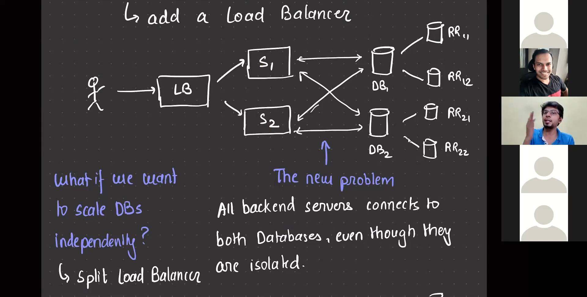
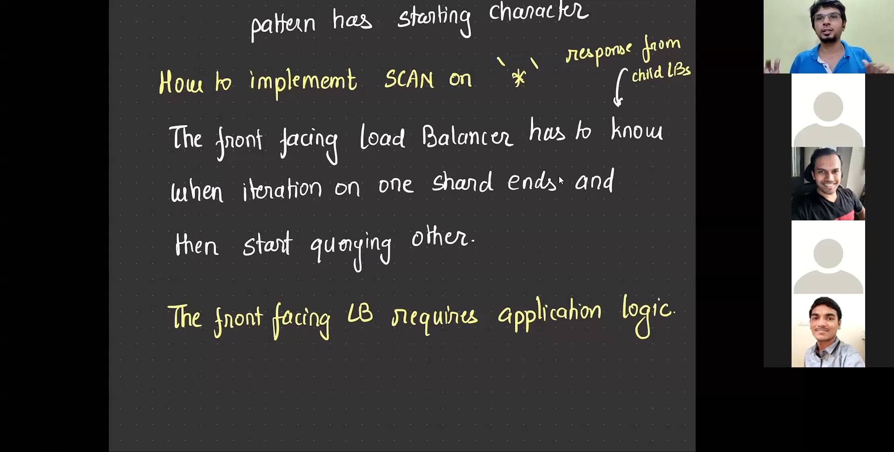
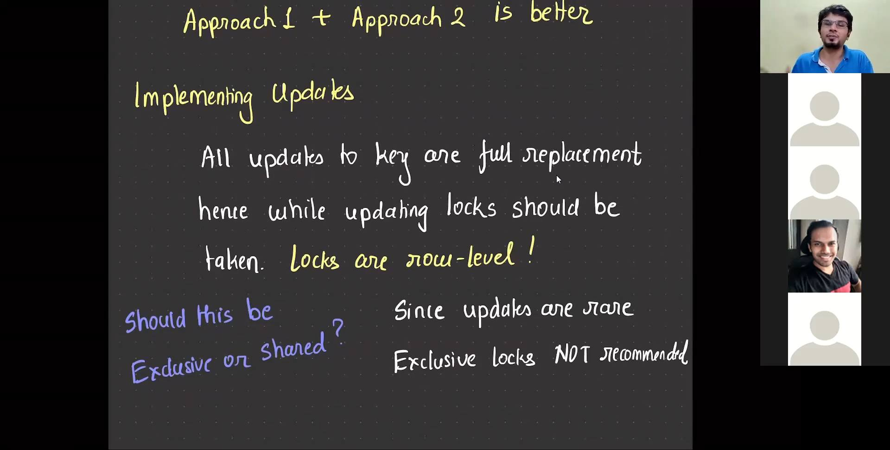
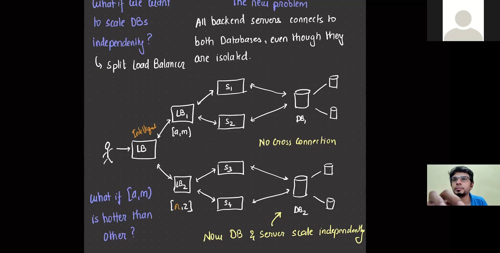

## 1. 这一节做什么

这一节对应 `p003` 的后半段与问答：讲师没有给出一套可克隆的工程代码，而是在白板上收尾一个 **key-value store 的生产级设计**，重点讨论：

- 删除为什么要先软删、再延迟硬删；
- TTL 过期后，为什么 `GET` 还要在应用层再判断一次过期；
- 读多怎么扩：read replica；
- 写多怎么扩：先 scale up，再 shard；
- 按 key 范围分片后，为什么“每个 API server 连所有 shard”会造成连接池爆炸；
- 为什么要拆成“前端智能 LB + 每个 shard 自己的 LB + 只连本 shard 的 API server”；
- DynamoDB 这类系统为什么需要这种多跳负载均衡；
- 更新为什么是整 key 替换、为什么需要行级锁；
- `LIST / SCAN` 跨 shard 时，为什么必须用 last-key pagination，而不是 limit-offset；
- 最后延伸到缓存、MySQL/PostgreSQL 选型、ORM/原生 SQL/存储过程、SQL 与 NoSQL 的取舍。

注意：**这门课的 P3 是纯架构讨论，逐字稿里没有给出工程代码**。所以本文第 4 节的代码是“示意实现”，用来把讲师讲的设计语义跑起来、做断言验证；不是讲师原代码。文档仍然按“可复现”的方式组织：你先复现设计决策，再用示意代码验证关键行为。



---

## 2. 讲师原话（带「—— pNNN [MM:SS]」）

下面引用逐字稿原句，保留英文；每条后面用中文说明它在项目里对应什么约束。

> "始终、始终要这样做。但删除操作必须先做软删除，之后再在稍后阶段做硬删除，或者永远不要在实时流程里做硬删除。"
> —— p003 [125:29]

对应：删除不要实时硬删。先 `is_deleted = true`，再由后台任务延迟硬删；硬删要尽量晚，避免把数据库打挂。

> "读流量高时，就增加读副本。那如果要扩展写能力呢？先纵向扩容一段时间，然后再做分片。"
> —— p003 [127:22]

对应：读扩展靠副本；写扩展先纵向扩，再分片。分片后每个 shard 还可以有自己的 read replica。

> "我的所有应用服务器都必须为系统中的每个分片维护一个连接池。这会是个问题。"
> —— p003 [130:14]

对应：如果前端 LB 把任意 key 随机打到任意 API server，那么每个 API server 都必须连所有 shard。服务器越多，数据库连接数越爆炸。

> "第一个负载均衡器才是关键，它是有智能的。"
> —— p003 [134:06]

对应：拆分后，最前面的 LB 要知道 key range，把 `A-M` 打到第一组 LB/服务器/DB，把 `N-Z` 打到第二组。

> "DynamoDB 用的就是这个。"
> —— p003 [135:03]

对应：讲师用 DynamoDB 举例说明这种多跳 LB、按 key range 隔离资源的架构在超大规模系统里是真实存在的。

> "在读取发生时检查是否过期。"
> —— p003 [152:47]

对应：cron job 还没跑到的时候，数据库里仍然可能有“已过期但还没被软删”的行。`GET` 必须在应用层检查 TTL，过期直接返回 404。

> "对键的所有更新都是全量替换……更新时应当加锁。"
> —— p003 [153:44]

对应：KV 的更新通常是整 value 替换；更新时要拿行级锁。读操作因为只操作单个 key，通常不需要锁；但排他锁会阻塞读，所以要按场景选共享锁/排他锁。

> "你要为此采用的分页方式必须是基于最后键的分页，而不是 limit offset 分页。"
> —— p003 [161:21]

逐字稿里是 “last key phase”，语义是 last-key based。对应：跨 shard 的 `LIST / SCAN` 不能用 limit-offset，必须让客户端带 `exclusiveStartKey`，服务端返回“我读到哪个 key 了”，下一页从该 key 之后继续。



---

## 3. 从零复现

这一节不是“照着敲一个 DynamoDB”，而是按讲师的推导顺序，把设计一步步推出来。你最终要得到三样东西：

1. 一张可评审的架构决策表；
2. 一份 API / 数据模型草案；
3. 一个能跑的示意实现，验证 TTL、软删、分片路由、last-key 分页。

### 3.1 先明确需求边界

课程里讨论的是一个 key-value store，核心操作是：

- `PUT key value`：写入/整值替换；
- `GET key`：按 key 读；
- `DELETE key`：删除，但先软删；
- `LIST / SCAN`：跨 key 扫描，支持分页；
- TTL：key 可以过期；
- 读多写多都要能扩。

讲师没有给出完整的 HTTP 规范、错误码规范、鉴权、多租户、事务隔离级别。这些属于“课里没讲”，复现时不要假装讲师讲过。

### 3.2 第一步：单机 KV + read replica

初始状态是：

```text
User -> API Server -> SQL / KV Engine
```

读请求高时，加 read replica：

```text
User -> API Server -> Primary DB
                         ├── Replica 1
                         └── Replica 2
```

写走 primary，读走 replica。讲师在 [127:22] 明确说：读多就加 read replica。

### 3.3 第二步：写扩展，先 scale up，再 shard

写请求继续涨，先纵向扩一阵，再分片。因为这是 KV，所有操作都带 key，数据可以按 key 互斥拆分，所以分片很自然：

```text
Shard 1: key A-M
Shard 2: key N-Z
```

每个 shard 自己带一组 read replica：

```text
Shard A-M: Primary + Replicas
Shard N-Z: Primary + Replicas
```

讲师在 [127:51] 说，每个 shard 会有自己的 replica 集合；在 [128:18] 说，应用服务器根据 key 判断该去哪个 shard，GET 打到对应 read replica，PUT 打到 primary。

### 3.4 第三步：发现连接池爆炸问题

如果只有一个 LB，把请求随机分给 S1、S2：

```text
          ┌── S1 ── connects to DB1 + DB2
LB ───────┤
          └── S2 ── connects to DB1 + DB2
```

因为 key `A` 的请求可能落到 S1，也可能落到 S2；S1/S2 都必须能处理任意 key，所以每个 API server 都要连所有 shard。服务器越多，每个数据库要接的连接数越大。讲师在 [130:14] 把这个问题说得很清楚：所有 application server 都要维护到所有 shard 的连接池，这是问题。



### 3.5 第四步：拆分 LB，让 API server 只连本 shard

目标架构：

```text
                         ┌── LB-A ── S1, S2 ── DB1(A-M) + replicas
User -> Front LB (智能) ─┤
                         └── LB-N ── S3, S4 ── DB2(N-Z) + replicas
```

- Front LB 知道 key range：`A-M` 去左边，`N-Z` 去右边；
- 每个 shard 有自己的 LB；
- 每个 shard 的 API server 只连本 shard；
- 这样 `A-M` 流量低就少配服务器、小 DB；`N-Z` 流量高就多配服务器、大 DB；
- 数据库不再被迫为了“连接数”同等扩容。

讲师举的例子是：`A-M` 可能 100 rps，`N-Z` 可能 10,000 rps；`A-M` 可能只要三四台服务器，DB1 可以用 32GB，DB2 可以用 128GB。这是举例，不是固定容量公式。

### 3.6 第五步：删除与 TTL

数据记录至少需要这些语义：

```text
key
value
ttl / 过期时间
is_deleted
updated_at
```

删除流程：

1. 用户删除：先 `is_deleted = true`，不实时硬删；
2. 后台 cron job 每隔一段时间扫描过期 key，把过期 key 标记为软删；
3. 再过一段保留期，才做硬删；
4. `GET` 时无论 cron 有没有跑，都要检查：
   - 记录不存在 → 404；
   - `is_deleted = true` → 404；
   - TTL 已过期 → 404。

讲师在 [152:47] 和 [166:58] 反复强调：cron job 两次运行之间，数据库里会有“已过期但还没软删”的 key；如果 `GET` 不检查过期，就会把过期数据返回给用户。

### 3.7 第六步：更新与锁

讲师说更新通常是 full replacement：更新一个 key，就是整个 value 替换。更新时要拿锁；读的时候因为只操作一个 key，通常不需要锁。排他锁会阻塞读，所以不要滥用排他锁。

在前端/Node 语境里：

- Node 单进程内没有“多线程共享内存”的数据库行锁概念；
- 多实例部署时，真正要靠数据库事务、行锁、乐观锁版本号来保证同一 key 的并发更新；
- 课里讲的是数据库层面的 shared lock / exclusive lock，Node 侧只能算“调用方”，不要误以为 JS 的 `Map` 能替代数据库锁。

### 3.8 第七步：LIST / SCAN 跨 shard

如果 `LIST` 只查一个 shard，很简单：在单表里分页即可。但跨 shard 时，问题变成：

- 第一页从 `A-M` 开始；
- `A-M` 读完了，怎么让前端 LB 知道要切到 `N-Z`？
- 用户请求 10 条，`A-M` 只剩 3 条，剩下 7 条谁补？
- 不能用 limit-offset，因为跨 shard 后 offset 没有全局意义。

讲师给的方案是：

- 客户端带 `exclusiveStartKey`；
- 服务端返回本页最后读到的 key；
- 前端智能 LB 发现当前 shard 已经 exhausted，就把同一个请求转发到下一个 shard；
- 用特殊错误码、flag 或空结果集来表达“这个 shard 读完了”；
- 下一页从 `exclusiveStartKey` 之后继续。

示意协议：

```http
GET /kv?limit=10&exclusiveStartKey=mango
```

返回：

```json
{
  "items": [
    { "key": "nectarine", "value": "..." },
    { "key": "zebra", "value": "..." }
  ],
  "nextKey": null,
  "hasMore": false
}
```

### 3.9 第八步：缓存与选型补充

讲师在问答里补充了缓存和数据库选型：

- Netflix 缓存命中率接近 99.7%；
- Hotstar 首页大量内容可以被缓存，所以搜索不是唯一瓶颈；
- Google autocomplete 本身就是一种缓存：用户选中建议词后，可以直接拿预计算好的 top 10 文档 ID；
- MySQL 更通用；PostgreSQL 在 analytics、缓存处理上更强；
- ORM 提升开发效率，但会生成不太好的 SQL；规模上来后逐步转原生 SQL，再考虑存储过程；
- NoSQL 适合 schema-less、day-one sharding、没有大量 foreign key 的场景；需要大量报表/analytics 时 SQL 更稳；
- 数据库迁移通常会有短暂停机，只是可能发生在你睡觉的时候。



---

## 4. 完整代码

### 4.1 设计产物（课里给的是方案，不是代码）

#### 设计决策表

| 决策 | 讲师方案 | 复现时要落到哪里 |
|---|---|---|
| 读扩展 | read replica | 每个 shard 配 replica，GET 走 replica |
| 写扩展 | 先 scale up，再 shard | 按 key range 分片，写走 primary |
| 分片方式 | 举例 `A-M` / `N-Z` range partition；也提到 fixed key / hash 可选 | 应用层或智能 LB 维护 key range 映射 |
| 每 shard 扩容 | 独立扩容 | `A-M` 和 `N-Z` 不强制同规格 |
| 连接池爆炸 | 拆 LB，API server 只连本 shard | Front LB 按 key range 路由 |
| 删除 | soft delete，延迟 hard delete | `is_deleted` + 后台任务 |
| TTL | GET 时也检查过期 | 应用层 `GET` 判断 TTL |
| 更新 | full replacement + 行级锁 | 同一 key 更新要串行化 |
| 跨 shard 列表 | last-key pagination | `exclusiveStartKey` + `nextKey` |
| 缓存 | 减少 DB 命中 | autocomplete / 热点结果预计算 |
| 关系库选型 | MySQL 通用，Postgres analytics 强 | 按团队与用例选，不要神化 |
| ORM | 先 ORM，后原生 SQL，再存储过程 | 按性能阶段演进 |
| SQL/NoSQL | 报表多选 SQL；schema-less + 分片选 NoSQL | 不要为了“潮”选 NoSQL |

#### 组件职责表

| 组件 | 职责 | 不该做什么 |
|---|---|---|
| Front LB | 解析 key，按 range 把请求转到对应 shard LB；处理 LIST 的 shard exhausted 切换 | 不直接连数据库 |
| Shard LB | 在本 shard 的 API server 之间随机/负载均衡 | 不跨 shard 路由 |
| API Server | 处理 PUT/GET/DELETE/LIST；只连本 shard | 不维护所有 shard 的连接池 |
| DB Primary | 承接写、强一致读 | 不被所有 API server 无脑连 |
| Read Replica | 承接读 | 不承接写 |
| Cron

## 5. 逐行解释

现有文档的「4. 完整代码」里只有 4.1 设计产物表，没有给出代码文件、文件名或可逐行解释的源码；文档也明确说 P3 是纯架构讨论，第 3 节的示意实现不是讲师原代码。因此这里按“纯讲解课”处理：逐条解释 4.1 中每个设计决策和组件职责，说明为什么这么定、不这么定会怎样。涉及课里没讲的具体实现，不假装讲师讲过。

### 5.1 设计决策表逐条解释

1. **读扩展用 read replica**  
   为什么这么定：读请求高时，把 GET 放到 replica，primary 主要承接写，避免读把主库打满。  
   不这么定会怎样：所有读都打 primary，主库 CPU、IO、连接数先成为瓶颈；加 API server 也扩不出读能力。课里没讲 replica 延迟和写后读一致性，复现时不能把“写后立刻读 replica 一定读到”当成讲师承诺。

2. **写扩展先 scale up，再 shard**  
   为什么这么定：分片会引入路由、跨 shard 查询、扩容迁移等复杂度，能纵向扩一段就先纵向扩。  
   不这么定会怎样：过早分片，系统复杂度和运维成本提前上升；但只 scale up 也有硬件上限，所以讲师说“先扩一段时间，再 shard”。

3. **分片方式举例 `A-M` / `N-Z` range partition，fixed key / hash 可选**  
   为什么这么定：这是 KV，操作都带 key，按 key range 分片后 Front LB 可以直接根据 key 判断去哪个 shard。  
   不这么定会怎样：如果路由层不知道 key 和 shard 的映射，就无法保证某个 API server 只服务本 shard，后面“只连本 shard”的架构落不了地。fixed key / hash 是讲师提到的可选方向，课里没有展开具体算法，复现时不要补造细节。

4. **每个 shard 独立扩容**  
   为什么这么定：`A-M` 和 `N-Z` 的流量可能差很多，讲师举例 100 rps 和 10,000 rps；独立扩容才能让低流量 shard 用小机器、小 DB，高流量 shard 用大机器、大 DB。  
   不这么定会怎样：所有 shard 被迫同规格扩容，低流量 shard 浪费资源，高流量 shard 又可能不够；数据库连接数也会被不必要地拉高。

5. **连接池爆炸：拆 LB，API server 只连本 shard**  
   为什么这么定：如果 Front LB 把任意 key 随机打到任意 API server，那么每个 API server 都必须能处理任意 key，也就必须连所有 shard；API server 越多，每个 DB 要接的连接数越爆炸。拆成 Front LB 按 key range 路由后，本 shard 的 API server 只连本 shard。  
   不这么定会怎样：连接数大致按“API server 数 × shard 数”增长，数据库先被连接数拖死；讲师在 [130:14] 明确说这是问题。

6. **删除先 soft delete，再延迟 hard delete**  
   为什么这么定：删除不要实时硬删。先 `is_deleted = true`，后台任务延迟硬删，避免删除流量直接放大成数据库写 IO，也保留恢复窗口。  
   不这么定会怎样：用户一删除就实时硬删，高峰期容易把数据库打挂；误删后也没有回旋余地。课里没讲具体保留期多长、cron 频率多少，复现时不要编固定值。

7. **TTL：GET 时也要检查过期**  
   为什么这么定：cron job 两次运行之间，数据库里会有“已过期但还没被软删”的行；如果 GET 只信数据库行存在，就会把过期数据返回给用户。所以应用层 GET 必须判断 TTL，过期直接 404。  
   不这么定会怎样：过期数据在 cron 窗口内泄露；业务上会出现“明明过期了还能读到”的错误。讲师在 [152:47] 和 [166:58] 附近反复强调这一点。

8. **更新是 full replacement + 更新时拿行级锁**  
   为什么这么定：KV 的更新通常是整 value 替换，不是字段级 merge；同一 key 并发更新要串行化，否则会丢更新或互相覆盖。  
   不这么定会怎样：如果把 PUT 实现成 merge，旧字段会残留，语义和 KV 不一致；如果并发更新不加锁/不做版本控制，两个写入都可能声称成功，最终值不可解释。课里讲的是数据库层面的 shared lock / exclusive lock，Node 侧只是调用方；不要误以为 JS 的 `Map` 能替代数据库行锁。

9. **跨 shard `LIST / SCAN` 用 last-key pagination**  
   为什么这么定：跨 shard 后 offset 没有全局意义，必须让客户端带 `exclusiveStartKey`，服务端返回本页最后读到的 key，下一页从该 key 之后继续。  
   不这么定会怎样：用 limit-offset 跨 shard 分页会出现重复或遗漏；A-M 读完后也不知道怎么切到 N-Z。讲师在 [161:21] 明确说不能用 limit-offset。

10. **缓存：减少 DB 命中**  
    为什么这么定：热点内容、autocomplete 结果可以预计算或缓存，Netflix 缓存命中率接近 99.7% 的例子说明缓存能大幅减少 DB 命中。  
    不这么定会怎样：所有热点请求都打 DB，读 replica 也扛不住。课里没讲缓存失效、缓存一致性，复现时不要假装讲师给过完整缓存方案。

11. **关系库选型：MySQL 通用，PostgreSQL analytics 更强**  
    为什么这么定：按团队和用例选，MySQL 更通用，Postgres 在 analytics、缓存处理上更强。  
    不这么定会怎样：把选型神化成“某个库永远更好”，容易在报表/analytics 场景选错；课里没有给出绝对结论，复现时也不要写成绝对结论。

12. **ORM：先 ORM，后原生 SQL，再存储过程**  
    为什么这么定：ORM 提升开发效率；规模上来后，ORM 生成的 SQL 可能不够好，再逐步转原生 SQL，必要时考虑存储过程。  
    不这么定会怎样：一开始就全手写原生 SQL，开发慢；一直停留在 ORM，又可能在规模上来后被生成 SQL 拖累。课里没有给具体迁移阈值。

13. **SQL / NoSQL 取舍**  
    为什么这么定：报表/analytics 多、需要大量 foreign key 和约束时 SQL 更稳；schema-less、day-one sharding、没有大量 foreign key 的场景适合 NoSQL。  
    不这么定会怎样：为了“潮”选 NoSQL，后期报表和 analytics 会很难做；反过来，所有场景都上 SQL，也可能在 day-one sharding 上受限。

### 5.2 组件职责表逐条解释

1. **Front LB**  
   为什么这么定：它要解析 key，按 key range 把请求转到对应 shard LB；跨 shard LIST 时还要处理当前 shard exhausted 后的切换。它不直接连数据库，避免把连接池问题拉回最前面。  
   不这么定会怎样：如果 Front LB 不按 key range 路由，后面的 API server 就必须连所有 shard，连接池爆炸问题回归；如果它直接连 DB，也会破坏分层。

2. **Shard LB**  
   为什么这么定：只在本 shard 的 API server 之间做负载均衡，职责单一。  
   不这么定会怎样：如果 Shard LB 也跨 shard 路由，Front LB 的 key range 决策就失效，职责边界混乱。

3. **API Server**  
   为什么这么定：处理 PUT/GET/DELETE/LIST，只连本 shard，不维护所有 shard 的连接池。  
   不这么定会怎样：每个 API server 都连所有 shard，连接数随服务器数和 shard 数相乘增长，正是讲师说的“This is a problem”。

4. **DB Primary**  
   为什么这么定：承接写和强一致读；不让所有 API server 无脑连它。  
   不这么定会怎样：写和连接都集中爆炸；读 replica 也失去意义。

5. **Read Replica**  
   为什么这么定：承接读，不承接写。  
   不这么定会怎样：读写混在一起，replica 失去扩展读的作用；写扩散到 replica 还会引入一致性混乱。课里没讲复制延迟处理，复现时不要补造。

6. **Cron / 后台清理任务**  
   现有文档 4.1 的组件职责表在 Cron 行处截断，具体原文不全；按第 3.6 的流程，它负责扫描过期 key、标记软删，并在保留期后做硬删，而不是实时硬删。  
   不这么定会怎样：要么过期数据长期堆积，要么删除实时打挂数据库。课里没讲 cron 的调度频率、批量大小、失败重试，复现时只能标注为未讲。

### 5.3 关于“完整代码”的边界

4.1 的设计决策表和组件职责表不是“代码文件”，而是复现时的评审产物。把它们逐条落到“复现时要落到哪里”，是为了避免把口头架构和可验证行为混在一起。  
不这么做的后果：复现者容易把第 3 节的示意实现当成讲师原代码，或者只写出一段 CRUD 却没有验证软删、TTL、分片路由、last-key 分页这些关键语义。文档已明确“P3 是纯架构讨论，逐字稿里没有给出工程代码”，复现说明必须保留这个边界。

## 6. 复现检查清单

- [ ] 确认代码边界：查看复现目录或 README，是否明确写“第 3 节是示意实现，不是讲师原代码”。验证：全文搜索“示意实现 / 讲师原代码”；应该看到边界说明，而不是把示意代码冒充讲师工程代码。
- [ ] 检查设计决策表完整性：逐行核对读扩展、写扩展、分片、每 shard 扩容、连接池、删除、TTL、更新、分页、缓存、选型、ORM、SQL/NoSQL。验证：每行都有“复现时要落到哪里”；应该没有只写口号、没有落地位置的空行。
- [ ] 检查组件职责表：核对 Front LB、Shard LB、API Server、DB Primary、Read Replica、Cron。验证：每个组件都能说清“职责”和“不该做什么”；如果沿用现有文档，Cron 行在 4.1 中截断，应在复现产物中按 3.6 补全或明确标注“课里没讲具体调度”。
- [ ] 分片路由验证：向 Front LB 发 key `apple` 和 `nectarine`。验证：`apple` 应进入 `A-M` 对应 shard，`nectarine` 应进入 `N-Z` 对应 shard；边界 key `m` / `n` 的归属要与路由表定义一致，不能出现空档或重叠。
- [ ] API server 连接范围验证：检查每个 shard 的 API server 环境变量/DSN/连接配置。验证：只出现本 shard 的 primary 和 replica，不出现另一个 shard 的连接串。
- [ ] 连接池不爆炸验证：对比监控或配置。验证：每个 DB 的连接数应约等于“本 shard 的 API server 数 × 本 shard 池大小”，而不是“全系统 API server 数 × 池大小”。
- [ ] 软删验证：对某个 key 执行 DELETE，然后直接查 primary。验证：行还在，`is_deleted = true`，`updated_at` 有变化；不应立即物理删除。
- [ ] 延迟硬删验证：运行一次 cron/后台清理任务。验证：过期或软删数据先被标记/保留，保留期到达后才物理删除；不应在 DELETE 请求当下硬删。
- [ ] GET 不存在验证：GET 一个从未写入的 key。验证：返回 404，不返回空 value 冒充存在。
- [ ] GET 软删验证：GET 一个已软删的 key。验证：返回 404，不返回原 value。
- [ ] GET TTL 验证：插入一条 TTL 已过期但 cron 尚未运行的记录，再 GET。验证：应用层判断 TTL 后返回 404；不应因为数据库行还在就返回 value。
- [ ] 全值替换验证：先 PUT `{a:1,b:2}`，再 PUT `{a:3}`，再 GET。验证：结果只有 `{a:3}`，旧字段 `b` 不残留；如果实现成 merge 就不符合 full replacement。
- [ ] 并发更新验证：两个客户端同时 PUT 同一个 key。验证：通过数据库行锁/事务或乐观锁版本号串行化；不应出现两个更新都成功但最终值不可解释。课里没讲 Node 多实例具体实现，检查结果语义即可。
- [ ] 跨 shard last-key 分页验证：造 `A-M` 3 条、`N-Z` 7 条，`limit=10`，带空 `exclusiveStartKey` 请求 LIST。验证：返回 10 条且无重复遗漏；`nextKey` 指向最后读到的 key 或为 null；第二页从 `nextKey` 之后继续。
- [ ] shard exhausted 验证：让 `A-M` 只有 3 条且 `limit=10`。验证：Front LB 应识别当前 shard 耗尽并继续下一个 shard 补足，或返回 `hasMore/nextKey` 让客户端继续；不能因为 `A-M` 不足就错误地认为全局没有更多数据。
- [ ] 禁止 limit-offset 验证：搜索 LIST/SCAN 的参数和 SQL。验证：跨 shard 分页应使用 `exclusiveStartKey/nextKey`；不应把 offset 当成跨 shard 的全局偏移。
- [ ] 读写分离验证：观察 GET 与 PUT/DELETE 的连接。验证：GET 走 replica，写走 primary；不应把写请求发到 replica。课里没讲复制延迟，因此不把“写后立刻读 replica 必须读到”作为通过条件。
- [ ] 每 shard 独立扩容验证：检查两个 shard 的服务器数和 DB 规格配置。验证：`A-M` 与 `N-Z` 可以不同规格、不同服务器数；不应强制所有 shard 同规格。
- [ ] 缓存与选型文档检查：检查热点 GET 是否命中缓存、autocomplete 是否使用预计算 top 10；检查选型说明是否写明 MySQL/Postgres、ORM/原生 SQL、SQL/NoSQL 的适用场景。验证：应能看到这些是补充建议而非讲师给出的完整实现；课里没讲缓存失效，不要求复现缓存一致性。
- [ ] 未讲项标注检查：检查复现说明是否把鉴权、错误码规范、多租户、事务隔离级别等标为“课里没讲”。验证：不应把文档第 3.1 明确说未讲的内容伪装成讲师讲过。

## 7. 课里没讲但你会撞上的

| 现象 | 原因 | 怎么办 |
|---|---|---|
| 跨 shard LIST 出现重复或漏 key | 课里没讲（补充）：`exclusiveStartKey` 比较用了 `>=`，或切 shard 时丢掉了最后 key | 严格用“最后 key 之后”继续；切 shard 时保留同一个 `nextKey`；用边界 key 和空 shard 写用例验证。 |
| `A-M` 只剩 3 条、`limit=10` 却直接结束 | 课里没讲（补充）：只实现了单 shard 分页，没实现 Front LB 的 shard exhausted 切换/补足 | 识别 exhausted 后继续下一个 shard；用 `hasMore/nextKey` 或特殊 flag 明确表达“本 shard 读完”。 |
| GET 返回已过期 value | 课里讲：只靠 cron 软删，GET 没在应用层检查 TTL | GET 判断 TTL，过期直接 404；不要只依赖 cron。 |
| LIST 返回软删或过期行 | 课里没讲（补充）：LIST 查询没过滤 `is_deleted` 和 TTL | 所有读路径统一过滤；分页计数也要过滤，避免每页数量看起来正常但内容不可见。 |
| PUT 后旧字段仍然存在 | 课里讲：更新应是 full replacement，但实现成了 merge | PUT 覆盖整个 value；不要用 patch/merge 语义。 |
| 并发 PUT 丢更新 | 课里讲锁，但课里没讲（补充）多实例下具体怎么落锁 | 用数据库行锁/事务或乐观锁版本号；不要用进程内 `Map` 当锁。 |
| 两个更新互相等待或死锁 | 课里没讲（补充）：多 key 加锁顺序不一致 | 固定加锁顺序、缩短事务、捕获死锁后有限重试。 |
| 刚写 primary 立刻读 replica 读不到 | 课里没讲（补充）：replica 存在复制延迟 | 读己之写走 primary，或等待/版本校验；监控复制延迟。 |
| API server 仍然连了所有 shard | 课里讲连接池爆炸问题，但课里没讲（补充）配置怎么落地 | 每个 shard 的 API server 只注入本 shard DSN；Front LB 按 key range 路由，不能随机打。 |
| key range 边界出现空档或重叠 | 课里没讲（补充）：`A-M` / `N-Z` 边界定义不一致，或 key 大小写/编码未规范化 | 统一定义边界和 key 规范化规则；测 `m`、`n`、空字符串、大小写混合。 |
| cron 硬删误删刚恢复或刚重写的 key | 课里没讲（补充）：硬删只按旧时间，没有重新检查当前状态 | 硬删前重新检查 `is_deleted/TTL/updated_at`；延迟队列带版本号。 |
| 软删后同 key 重新创建冲突 | 课里没讲（补充）：唯一键仍然包含软删行 | 明确“恢复旧行”还是“新版本”语义；唯一键设计要配合软删。 |
| 分片扩容后请求打到错误 shard | 课里没讲（补充）：Front LB 路由表缓存未更新，或 rebalance 未完成 | 路由表版本化/热更新；迁移期做双读或校验，确认新映射生效。 |
| 缓存返回已删除或过期数据 | 课里没讲（补充）：删除/过期时没有失效缓存 | 删除/过期时清缓存或使用短 TTL；关键读路径仍要校验数据库状态。 |
| 连接池大小沿用单库配置 | 课里没讲（补充）：每个 shard/API server 的池大小没按本 shard QPS 配 | 按本 shard 的服务器数和 DB 连接上限配池；监控等待时间和连接数。 |
| 用 limit-offset 做跨 shard 分页 | 课里讲：offset 跨 shard 没有全局意义 | 改成 `exclusiveStartKey/nextKey` 的 last-key pagination。 |
| 把 JS `Map` 当成行级锁 | 课里没讲（补充）：单进程内存锁跨实例无效 | 用数据库事务/行锁/乐观锁；`Map` 只能做进程内临时结构。 |
