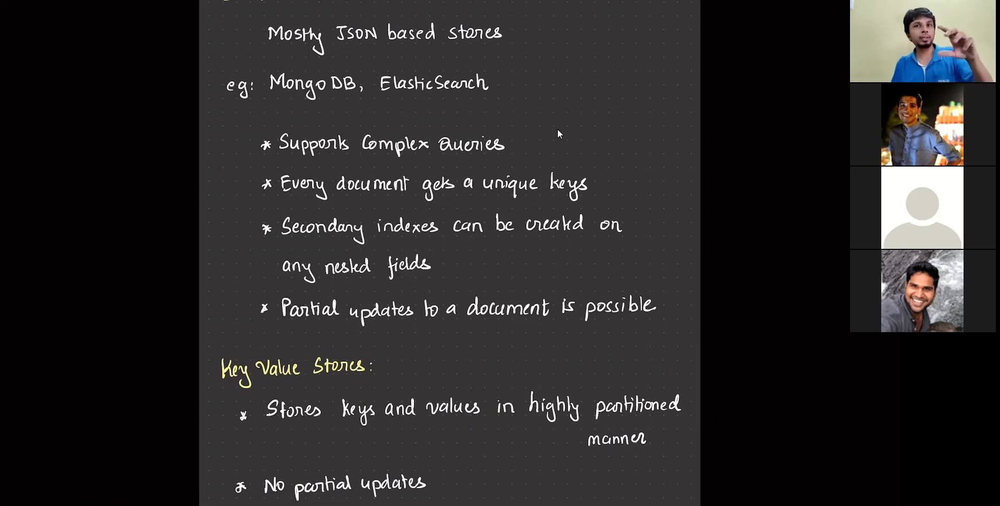
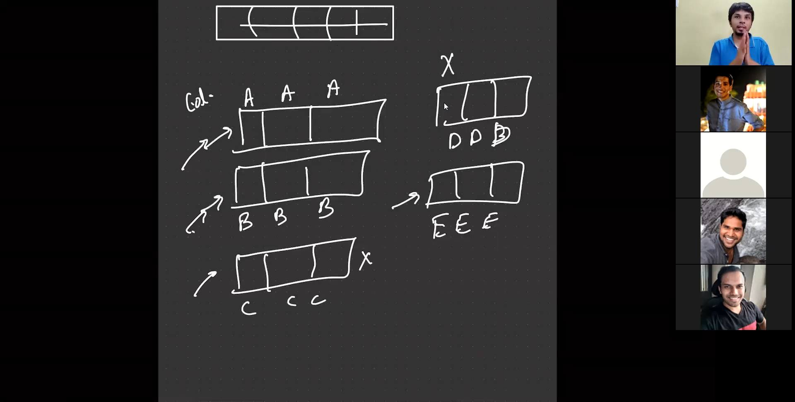
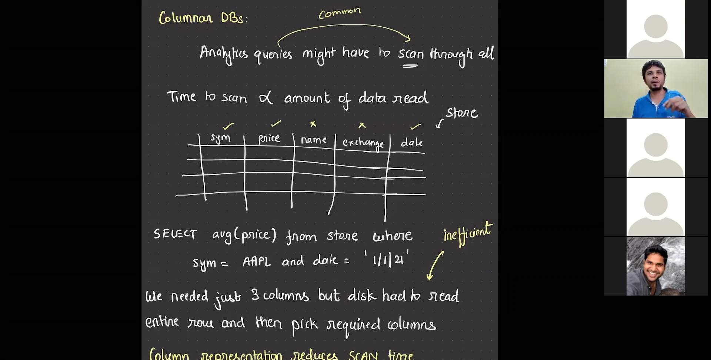
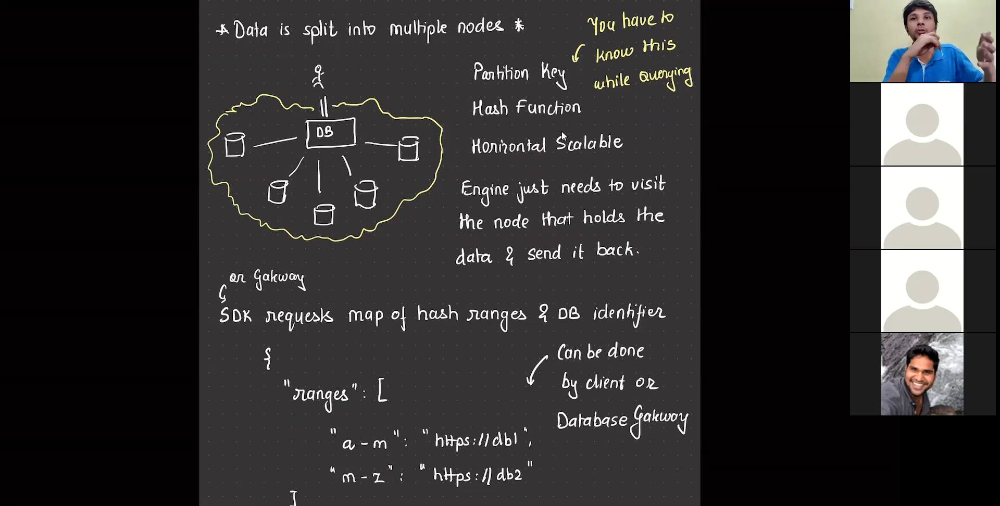

# System Design Masterclass：NoSQL 数据库选型与扩展（P004）

> 说明：本课截图文件清单仅提供 5 张可用帧，因此本文档按清单全部插入这 5 张；实际使用时可自行补充同课程其他帧。

## 1. 这一节做什么

这一节讲师 Arpit 先分享了一段 Unacademy 被黑的真实事故（AWS 访问密钥泄露导致大面积破坏），借此强调安全是系统设计的第一前提。接着进入正题：NoSQL 数据库。你将会搞清楚以下问题：

- NoSQL 到底是什么？它和 SQL 的本质区别是什么？
- schema-less 到底是什么意思？为什么说 NoSQL 仍然有隐含 schema？
- 文档数据库、键值存储、列数据库、图数据库各自适合什么场景？它们的关键特性是什么？
- 为什么列数据库对分析查询特别快？它和行式存储的磁盘布局有什么不同？
- 什么情况下才应该用图数据库？简单的“是否存在关系”为什么用键值存储就够了？
- 为什么 NoSQL 可以水平扩展？分区/分片是怎么工作的？分区键的设计为什么如此重要？

这节课没有动手写代码，而是大量基于生产经验的选型判断。你将学会一套“需求 → 约束 → 方案 → 取舍”的数据库选型推导方式，并能在实际项目中为数据建模做出更合理的决策。

## 2. 讲师原话

以下摘录几句能代表核心观点的原话，并标注在逐字稿中的位置（p004 时间码）。

- 「No matter how much we say that no SQL databases are schema less, there is still underlying schema that each document adheres to.」—— p004 [10:44]
  （无论我们怎样说 NoSQL 数据库是无模式的，每个文档仍然遵循一个底层模式。）

- 「It does not have relationships. It does not have foreign key constraints and all of those parts, right? Because of which it is very highly scalable and available because it gives you sharding by default.」—— p004 [11:42]
  （它没有关系，没有外键约束等。正因为如此，它非常易于扩展和高可用，因为它默认提供分片。）

- 「Columnar database were primarily introduced to make analytics queries very efficient.」—— p004 [24:25]
  （列式数据库主要是为了让分析查询变得非常高效。）

- 「If you want to use graph algorithms, which are not optimal to do on a SQL storage or a non-SQL kind of thing, then you use graph database.」—— p004 [45:34]
  （如果你想使用图算法，而这些算法在 SQL 存储或 NoSQL 上不是最优的，那才用图数据库。）

- 「Anything is infinitely scalable only when it is horizontally scalable. If it is not horizontally scalable, then there will be a limit after which it will stop scaling.」—— p004 [52:36]
  （只有水平可扩展的系统才能无限扩展。如果不能水平扩展，总有一个上限，到那里就停止扩展了。）

- 「So your use cases should always be like for a certain key or for a certain user, you have to do it. And then you would be using that as your partition key, right? So that it just goes to one node and purchases it.」—— p004 [56:56]
  （你的查询用例应该总是围绕某个特定 key 或用户展开，这样才能用那个 key 作为分区键，让请求只去一个节点处理。）

- （关于安全事件）「Someone got access to AWS. ... someone's official, basically someone's machine got hacked and from that access and secret keys were leaked.」—— p004 [02:23]
  （有人访问了 AWS……某位员工的机器被黑，access key 和 secret key 泄漏了。）

（注：以上原话为视频中英文逐字稿的摘录，翻译为中文供参考。）

## 3. 从零复现

这一节是纯讲解课，没有可运行的代码。我们把讲师的推导过程整理成可复现的步骤：面对一个存储需求时，如何像讲师一样逐步做出数据库选型。下面这几步就是你在面试或项目中可以当场执行的方法论。

### 步骤 1：先讲一个真实事故，建立安全背景

讲师在开头花了不少时间讲 Unacademy 在 2020 年被黑的经历：一台 Mac 上的 AWS access key 和 secret key 泄漏，攻击者创建了多个 IAM 用户并破坏基础设施，最终导致 700 多台机器需要轮换、20 多个数据库密码需要更改、大量代码库和密钥被删除。讲师用这个例子说明：系统设计不能只考虑功能和性能，安全必须放在第一位。这个案例也引出了后续系统设计中“权限最小化、密钥轮换、VPN”等原则。


### 步骤 2：明确核心需求

接下来，讲师正式进入 NoSQL 主题。首先问自己：我的数据需要「关系」吗？

- 如果数据之间有强关联、需要外键约束、需要跨表事务，那么一开始就偏向 SQL，而不是 NoSQL。
- 如果数据是自包含的（例如一份用户资料、一条推文、一个订单的完整信息），并且你希望根据某个 key 快速读写，那么 NoSQL 更合适。

讲师强调：NoSQL 的主要特征不是 schema-less，而是「没有关系」。schema-less 只是灵活性，它允许不同文档有不同字段，但为了能够查询，文档们仍然会趋于同构。不要为了“无 schema”而选 NoSQL，而要看你的数据是否需要关系。

### 步骤 3：评估扩展性需求

如果你的数据量预计会很大，需要水平扩展，那么 NoSQL 默认支持分片，是一个强优势。SQL 通常只能单机运行，除非做复杂的主从和分库分表。如果你的业务查询模式是「围绕同一个 key（如用户 ID、作者 ID）进行读写」，那么你可以把数据按这个 key 分区，让每个请求只访问一个分片，从而获得几乎线性的扩展能力。

### 步骤 4：分析查询模式，挑选数据库类型

按查询模式挑选数据库类型：

- **文档数据库**（MongoDB、Elasticsearch）：数据是 JSON 文档，你需要在文档内部查询字段、做部分更新、构建嵌套字段的二级索引。适合内容管理、用户资料、日志搜索等。
- **键值存储**（DynamoDB、Redis）：你只需要通过 key 获取整个 value，value 通常被视为不透明 blob，不支持在 value 内做复杂查询；部分更新很困难（完整替换）。适合缓存、会话、计数、查重等。
- **列式数据库**（Redshift、CSTORE）：数据按列存储，适合大数据量的聚合分析（如“上个月总收入”“平均股价”），查询只涉及少数列，扫描数据量小，压缩率高。不适合高并发的实时事务写入。
- **图数据库**（Neo4j、DGraph、Amazon Neptune）：数据以节点和边存储，适合真正需要图算法的场景（如计算社交网络中的“度数”）、推荐引擎的协同过滤。如果只是判断“A 是否关注 B”，用键值存储即可，不必上图数据库。



### 步骤 5：估算关键指标

虽然没有具体数字，但讲师给出了一个重要的数量级概念：

- 列式数据库的压缩比通常 > 95%～96%，因为同列数据同质化，可以用更高效的压缩算法（如 run-length encoding）。
- 分析型表通常有 50 到 100 列以上，而分析查询往往只用其中一两列。行式存储必须读取整行，导致大量磁盘 IO 浪费；列式存储只读取用到的列，扫描时间与「实际读取的数据量」成正比，因而快得多。
- 实时分析如果从 SQL 聚合，一般需要配合缓存（例如 5 分钟缓存），不要直接压到列式数据库上。讲师提到 Algolia 和 CloudWatch 都有类似做法。



### 步骤 6：做出取舍

- 如果业务是支付、订单这类强一致、强事务需求，选 SQL，牺牲一定的水平扩展性。
- 如果业务是读多写少、可接受最终一致，且需要水平扩展，选 NoSQL。
- 如果要做分析报表，选列式存储，但必须接受它不适合承载实时查询。
- 如果需要图遍历和最短路径，选图数据库，但要接受它的高成本和高复杂度；否则用 SQL 或键值存储更划算。

### 步骤 7：设计分区键

如果决定用 NoSQL，需要仔细选分区键。讲师用 Twitter 举例：按 author ID 分区，则一个用户的所有推文都在同一个分区，查询某用户的所有推文只需访问一个节点。分区策略有：

- **范围分区**（range-based）：把 key 按字母序/数值段分到不同节点（A–M 到 DB1，N–Z 到 DB2）。
- **哈希分区**（hash-based）：对 key 做哈希，再取模或按哈希区间分配。
- **固定分区**（fixed/listing）：按固定属性（如地区、公司）分区。

分区键必须出现在每次查询中，否则查询要广播到所有分片，再由某个节点汇总，性能极差。因此建模时，先确定最核心的访问模式，再定分区键。





## 4. 完整代码

本课没有给出任何代码或配置文件。为了让你把上面的内容固化下来，我整理成以下「产物」。这些是讲师观点的浓缩，不是代码运行结果。

### 4.1 数据库选型决策表

| 需求特征 | 推荐类型 | 代表产品（讲师提到的） | 理由 |
|---|---|---|---|
| 数据间有强关系、需要事务和外键 | SQL | Postgres | 事务、联结、完整性约束 |
| 文档型、可在 JSON 内部查询、部分更新 | Document DB | MongoDB、Elasticsearch | 灵活 schema，可查询文档内部字段 |
| 只需要按 key 存取整个 value | Key-Value Store | DynamoDB、Redis | 单 key 查询极快，自动分片 |
| 大数据量聚合分析（读多写少） | Columnar DB | Redshift、CSTORE | 按列扫描，压缩率高 |
| 需要图算法（最短路径、推荐协同过滤） | Graph DB | Neo4j、DGraph、Amazon Neptune | 图结构原生支持图遍历和算法 |
| 只需要判断关系是否存在 | Key-Value（或 SQL） | DynamoDB | 用组合键查存在性，最简单高效 |

### 4.2 分区策略对比表

| 策略 | 做法 | 优点 | 缺点/注意 |
|---|---|---|---|
| Range-based | 按 key 范围分段（A-M / N-Z） | 实现简单，天然支持范围扫描 | 可能产生热点（如热门用户集中在某段） |
| Hash-based | 对 key 取哈希再分片 | 数据分布均匀，避免热点 | 范围查询低效，必须带 key 查询 |
| Fixed/Listing | 按固定属性（如地区）分片 | 业务逻辑清晰，便于隔离 | 可能数据倾斜，某地区数据量大 |

### 4.3 行存储 vs 列存储的数据布局示意

课里没有代码，以下为示意（用 ASCII 图展示）：

```
行式存储（Row-based）在磁盘上的布局：
[Row1: symbol= AAPL | price= 150 | name= Apple | exchange= NASDAQ | date= ...]
[Row2: symbol= MSFT | price= 300 | name= Microsoft | exchange= NASDAQ | date= ...]
[Row3: symbol= TSLA | price= 700 | name= Tesla | exchange= NASDAQ | date= ...]

列式存储（Columnar）在磁盘上的布局：每个列一个文件
column_symbol:   AAPL | MSFT | TSLA
column_price:    150  | 300  | 700
column_name:     Apple| Microsoft | Tesla
column_exchange: NASDAQ| NASDAQ | NASDAQ
column_date:     ...   | ...   | ...
```

查询“最近一天 AAPL 的平均价格”：行式存储会读取所有行；列式存储只需读取 symbol、price、date 三个列，跳过 name 和 exchange。

### 4.4 分区映射的示意伪代码

课里没有代码，以下为示意，演示数据库网关如何根据分区键转发请求：

```python
# partition_map: 分区映射表，模拟数据库内部维护的元数据
# 范围分区示例
def get_node_for_key(key: str, partition_map: list) -> str:
    for start, end, node_id in partition_map:
        if start <= key <= end:
            return node_id
    raise KeyError(f"No partition for key: {key}")

# 哈希分区示例
def get_node_for_key_hash(key: str, num_nodes: int) -> str:
    node_index = hash(key) % num_nodes
    return f"db_{node_index}"

# 使用示例
range_map = [("A", "M", "db_0"), ("N", "Z", "db_1")]
print(get_node_for_key("Alice", range_map))   # db_0
print(get_node_for_key("Tom", range_map))     # db_1
```

### 4.5 实时分析缓存模型（示意）

课里没有代码，以下为示意，对应讲师提到的「缓存 5 分钟 + 配置变更时失效」：

```python
import time

CACHE_TTL_SECONDS = 300  # 5 分钟
analytics_cache = {}      # key: 分析查询的标识, value: (结果, 过期时间)

def get_analytics(query_key):
    now = time.time()
    if query_key in analytics_cache:
        result, expire_at = analytics_cache[query_key]
        if now < expire_at:
            return result
    # 未命中/过期，从底层 SQL 聚合计算（假设可以承受）
    result = compute_analytics_from_sql()
    analytics_cache[query_key] = (result, now + CACHE_TTL_SECONDS)
    return result

def invalidate_cache(query_key):
    if query_key in analytics_cache:
        del analytics_cache[query_key]
    # 当配置表发生 insert/update 时，调用这个函数使相关缓存失效
```

## 5. 逐行解释

- **选型决策表**：每一行对应一门讲座中的一个关键决策。
  - SQL 行：如果数据需要强关系和事务，选 SQL。讲师用 Dubai 咨询案例说明，很多“实时分析”需求其实用普通 Postgres 就够了，不需要 Redshift。在 JS/Node 里，如果你要用事务，通常对应 `BEGIN/COMMIT`（如 `pg` 库），而 NoSQL 大多没有跨文档事务（或较弱）。
  - Document DB 行：文档数据库允许你在 JSON 内部查询，这是它和键值存储最大的区别。你在 Node 里用 `MongoDB` 时，`find({ "address.city": "X" })` 就是文档内部查询。
  - Key-Value Store 行：键值存储中，value 不透明，通常只能整体替换。如果使用 Redis 的 `SET`，它会覆盖整个 value；但 Redis 的 `LPUSH` 可以部分更新，说明现在的数据库界限模糊。
  - Columnar DB 行：列式存储主要用于分析，不适合实时写入。如果把它当普通 SQL 用，性能会很差。在 JS 世界里你不太会直接连列式数据库，通常通过数据仓库的 SQL 端点（如 Redshift Spectrum）或分析平台访问。
  - Graph DB 行：只有当你要跑图算法（比如“二度人脉”）时才值得用。在 Node 里，你可以用 Neo4j 的 JavaScript Driver 发 Cypher 查询，但普通“A 是否关注 B”用一张 `followers` 表加唯一索引就够。
  - Key-Value 判断关系存在：组合键是 NoSQL 里常见的技巧。比如关注关系，可以用 `follower_id` 和 `followee_id` 组成复合主键，查询时直接 `GetItem`，判断是否存在。

- **分区策略表**：分区的本质是把数据水平切分到多个节点。范围分区的好处是支持范围查询，但热门 key 可能集中；哈希分区能均匀分布，但范围查询低效；固定分区按业务属性分，但可能数据倾斜。选择分区键必须匹配最常见的查询模式，确保每次查询都带分区键，否则会变成全分片扫描。

- **行式 vs 列式布局示意图**：行式存储将所有字段放在同一行；列式存储将每列单独存放。分析查询通常只关心少数列，因此列式存储能避免读取无关数据，从而显著减少磁盘 IO。同时，同列数据类型一致，压缩率高（讲师说 95% 以上），进一步加速扫描。在 JS 里，如果你用 `Apache Parquet` 这类列式格式，读取少量列时只需加载对应的列 chunk。

- **分区映射伪代码**：`get_node_for_key` 模拟数据库内的路由层。`range_map` 定义了从 key 到节点的映射。数据库引擎或网关会先查这个映射，再把请求转发到对应节点。这个映射本身也可能需要高可用和一致，通常由集群元数据服务管理（讲师说“some authority”）。哈希分区通过 `hash(key) % num_nodes` 直接计算目标节点，不需要维护范围表，但增加节点时会导致大量数据迁移（如果不用一致性哈希）。

- **实时分析缓存模型**：`CACHE_TTL_SECONDS` 设 300 秒，对应讲师说“缓存五分钟”。`analytics_cache` 是内存缓存，实际系统中可能用 Redis。`get_analytics` 先查缓存，如果没过期就返回，否则从 SQL 计算并填充缓存。`invalidate_cache` 在配置变化时手动删除缓存条目，这是讲师提到的“添加配置变更时使缓存失效”的落地方式。注意：这个代码是示意，实际要加锁/并发控制，避免缓存击穿；在 JS/Node 里可以用单线程事件循环天然避免部分竞态，但多线程/多进程下需要用互斥锁或 Redis 原子操作。

## 6. 复现检查清单

读完这一节后，你可以通过以下检查确认自己真的掌握了内容：

- [ ] 能用自己的话解释“NoSQL 不是 no SQL，而是 non-relational（非关系型）”。
- [ ] 能说明为什么 NoSQL 仍然有隐含 schema，即使它叫 schema-less。
- [ ] 能列出 NoSQL 的四种主要类型，并各自举出一个讲师提到的产品。
- [ ] 能解释文档数据库和键值存储的关键区别（是否可在文档内部查询、是否支持部分更新）。
- [ ] 能用一张小表画出行式存储和列式存储的磁盘布局差异，并解释为什么列式存储更适合聚合分析。
- [ ] 能说出列式存储的两个额外优势（压缩率高、跳过无关列）。
- [ ] 能区分“判断关系是否存在”和“跑图算法”，并知道后者才需要图数据库。
- [ ] 能解释为什么 NoSQL 靠分区/分片实现水平扩展，且分区键必须与主要查询模式匹配。
- [ ] 能画出范围分区、哈希分区、固定分区的简单示意图，并说出各自的优缺点。
- [ ] 能描述实时分析的常见做法：SQL 聚合 + 缓存（例如 5 分钟），配置变更时使缓存失效。

完成以上任意 8 项，说明你对这节课的掌握已经达到可以用于面试或实际选型的程度。

## 7. 课里没讲但你会撞上的

- **一致性哈希**：讲师只提到了范围分区和哈希分区，但没有详细讲如何平滑扩缩容。实际系统中（如 DynamoDB、Cassandra）常用一致性哈希和虚拟节点来减少数据迁移，这是你在做分片时必然会遇到的问题。
- **CAP 定理的细节**：讲师说“已经有很多资源，不展开”，只提了 Consistency、Availability、Partitioning。你实际会撞到的是：网络分区不可避免，必须在一致性和可用性之间选边。NoSQL 产品（如 DynamoDB 的强一致与最终一致选项）就是 CAP 权衡的体现。
- **具体数据库的配置语法**：课程只讲了概念，没有给 MongoDB 的 `sh.shardCollection`、Cassandra 的 `CREATE KEYSPACE ... WITH replication` 等命令。你在部署时会需要查官方文档。
- **部分更新在 Redis 中的细节**：讲师提到 Redis 可以部分更新（如 `LPUSH`），但没有讲 `JSON.SET` 这类模块（如 RedisJSON）。如果你在项目里用 Redis 存 JSON，会发现完整替换和部分更新的界线更模糊。
- **列式数据库的排序和索引**：课里没有讲列式存储内部如何用 min/max 索引、稀疏索引、zonemap 来跳过数据块。实际用 Redshift 或 ClickHouse 时会用到。
- **实时分析的其他方案**：讲师提到用 SQL + 缓存解决实时分析，但没有讲流式处理（Kafka + Flink）、物化视图、OLAP 引擎等更现代的方案。如果数据量极大，你可能需要这些。
- **安全事件的具体防御**：Unacademy 事故是引子，但课里没有讲如何使用 IAM Role、临时凭证、密钥轮换、VPN 的具体操作。你如果负责部署，需要更细的安全实践。