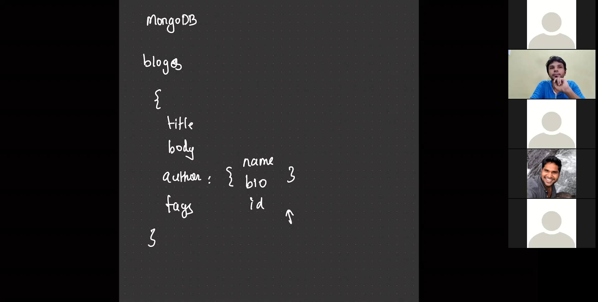
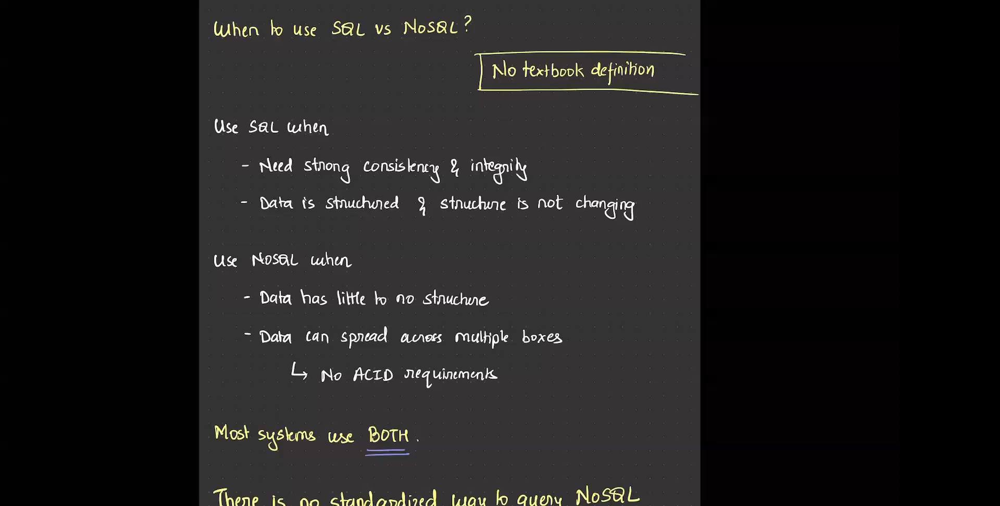
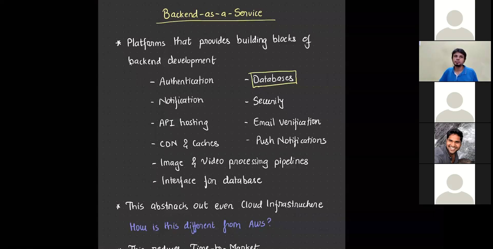
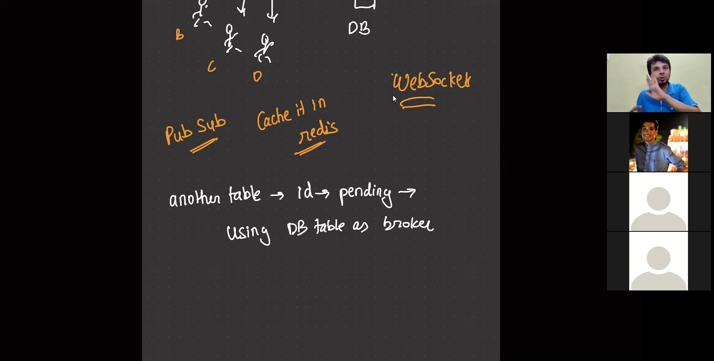

# System Design Masterclass（Arpit）P004 第 2/3 段：从 NoSQL 建模到实时同步系统设计

> 说明：本段（59:45–126:48）是纯白板/讨论课，逐字稿里没有可运行的工程代码。因此第 3、4 节按「纯讲解课」处理：第 3 节复现讲师的推导链，第 4 节把推导落成设计决策表、组件职责表、数据模型草案与容量估算表；文中出现的示意代码均已标注「课里没有代码，以下为示意」。
>
> 另：任务要求插入 ≥6 张截图，但【截图文件清单】只提供了 5 张（p004 的 68:01、80:23、92:45、105:06、117:28），没有第 6 张可选帧。按「清单里没有的帧一律不存在」的规则，本文只能插入这 5 张，不编造第 6 张。

---

## 1. 这一节做什么

这一节是整门课从「存储选型」转向「实时系统设计」的过渡段，可以拆成三块：

1. **NoSQL 建模的收尾**：固定分区（fixed partitioning）到底适合什么业务；NoSQL 没有 join 时，users 与 addresses 该怎么建模；反规范化（denormalization）的收益与代价；N+1 查询问题；软删除、回收站与冷热分层存储。
2. **SQL vs NoSQL 的决策框架**：讲师明确说「没有银弹」，但给了一组可操作的判断条件；随后系统梳理分片（sharding）的四种切法（range / vertical / hash / list / round-robin）以及分片带来的四个硬伤。
3. **实时同步系统的架构推导**：以 Google Firestore 为参照，从「一个客户端更新、其他客户端实时收到」这个需求出发，一步步推出 API Server → DB → append-only log → WebSocket room 广播的链路，并暴露出「多台 API Server 时广播送不到别的机器」这个核心难题，最终把问题归结为「如何水平扩展 WebSocket」。

对前端转 AI 应用工程师的读者来说，这一节的价值在于：你平时用 Firebase/Firestore 只觉得「它自己就同步了」，这一节把「同步」拆成了可自己实现的组件，并且指出了单机 socket.io 方案在多实例部署下必然踩的坑。

---

## 2. 讲师原话（带时间戳）

下面几条是本节最关键的判断，后面第 3、4 节都围绕它们展开。

> "指定范围，就是指定 A 应该进入这个数据库，B 应该进入这个数据库，M 应该进入这个数据库。如果这些值非常有限，我认为这样做是合理的。"
> —— p004 [59:45]

> "一个月前，大家都在交易 Dogecoin……你肯定不希望仅仅因为某一种资产被大量交易，就让整个系统崩掉。所以你要做的是：你知道这个实体现在是我的热点实体，那就让它拥有独立的存在。"
> —— p004 [60:11]

> "与其采用 A2M，不如这样说：假设苹果是我的客户，苹果的所有数据都存放在 DB1……麦当劳的数据存放在 DB2……基本上，我会新开一个数据库，然后为它添加一条映射。"
> —— p004 [61:37]

> "由于非关系型数据库没有连接操作，但如果你需要连接，该怎么做？……一次连接会对应多次选择操作。"
> —— p004 [66:49]

> "不要存储外键，而是直接存储值，从而避免再次查找……当读取远多于写入时，这种做法效果非常好。"
> —— p004 [71:36]

> "N+1 问题说的是……先用一次查询获取用户，然后再用 N 次查询获取该用户的 N 个地址。"
> —— p004 [75:53]

> "让这个已删除标记一直保留，不再运行 cron 任务去删除……另一种做法是建一张副本表，把这一行从这张表移到那张表。"
> —— p004 [79:40]

> "亚马逊默认会把所有超过 6 个月的订单归档到 S3……2017 年，这样做每月节省的金额是 600 万美元。"
> —— p004 [85:58]

> "如果你刚开始构建产品，那就选择 SQL……在起步的第零天、第一天，SQL 数据库始终会占据主导地位。"
> —— p004 [99:35]

> "水平分区就是做基于范围的分区……垂直分区则是按列拆分数据……哈希分区，是最常见的一种……基于列表的分区更像静态分配……另外还有轮询。"
> —— p004 [102:00]

> "分片带来的问题，显然包括连接。你无法跨分片做连接。数据必须反规范化。参照完整性没有了，而且新增分片时还要重新平衡。"
> —— p004 [104:21]

> "这不过是一个群聊。这些消息不过就是数据库里的各种内容。"
> —— p004 [117:05]

> "当我只有一台服务器时，配置这个系统非常容易。但当我把它扩展到多台服务器时，这就成了一个挑战。"
> —— p004 [124:06]

---

## 3. 从零复现（纯讲解课：按推导链复现）

这一节不写「P004 讲了 A、P005 讲了 B」，而是把讲师的推理重新走一遍。你可以把它当成一份「如果今天让你从零设计一个 Firestore-like 实时同步服务，你应该按什么顺序想」的清单。

### 3.1 需求：先分清「存储选型」和「实时同步」是两个问题

讲师在本段其实处理了两个独立需求，只是用一段话串起来了：

- **需求 A（存储侧）**：一个多租户/多实体的业务，数据该放一个库还是拆多个库？NoSQL 没有 join，关联数据怎么建模？
- **需求 B（同步侧）**：一个客户端改了数据，如何让其他正在看同一份数据的客户端「立刻」看到，而不是靠轮询？

这两个需求的约束完全不同：A 的约束是「一致性、关联查询、更新扩散」；B 的约束是「低延迟推送、连接数、跨机广播」。混在一起想就会乱，所以第 3 节先拆开。

### 3.2 需求 A 的推导：固定分区什么时候成立

讲师给的第一个判断是「值域是否有限」：

- 股票代码、交易所代码这类字段，取值是有限集合，可以提前把「A 股→DB1、港股→DB2、美股→DB3」写死。这就是 **list-based / fixed partitioning**。
- 反过来，如果取值是无限增长的（比如用户 ID），就没法提前枚举，只能用 hash 或 range。

第二个判断是「是否存在热点实体」：

- Dogecoin 被全世界的交易平台同时交易时，这一两个实体的流量会打爆整个集群。讲师的原话是「you don't want that entire system to crumble by just having one being traded a lot」。
- 解法是给热点实体「单独的存在」——把它拎到独立库/独立实例，避免它拖垮其他实体。这和 Twitter/Instagram 给百万粉认证账号单独一套存储是同一个思路。

第三个判断是「是否需要租户级隔离」：

- B2B 场景下，客户会要求「我的数据不跟别人共享数据库」。这时固定分区的映射表就是天然的多租户路由：Apple→DB1、McDonald's→DB2，新客户进来就「provision 一个新库 + 加一条映射」。
- 讲师特别强调这是「complete isolation」，不是逻辑隔离。

**取舍**：固定分区的代价是「映射表要维护」「新租户要 provision 新库」「跨租户查询做不了」。所以它只适合「实体数量有限 + 需要隔离 + 热点可预测」这三条同时成立的场景。三条里缺一条，就退回 hash/range。

### 3.3 需求 A 的推导：NoSQL 没有 join 怎么办

讲师用 users 和 addresses 举了一个完整例子，这是本段信息密度最高的部分，值得逐步复现：

**第一步：先按「两个集合」建模（规范化）**

- `users` 集合：`{ _id, name, bio, addressIds: [...] }`
- `addresses` 集合：`{ _id, userId, state, country, city, area }`

一个 user 可以有多个 address，所以 user 文档里存一个 `addressIds` 数组。

**第二步：查询时在应用层做 join**

要渲染用户 profile 时：

1. 先查 `users` 拿到目标 user 和它的 `addressIds`；
2. 再用 `addressIds` 去 `addresses` 集合做一次 `where _id in (...)`；
3. 在应用代码里把两份结果拼起来。

讲师的原话是「one join would be multiple selects」——SQL 里一条 JOIN，在 NoSQL 里就是「1 次主查询 + 1 次 IN 查询」，然后在应用层合并。

**第三步：如果 `IN` 不可用，就退化成 N+1**

如果数据库/ORM 不给你 `IN` 操作符，你只能对每个 addressId 单独查一次，于是变成「1 次查 user + N 次查 address」。这就是 **N+1 问题**。讲师说 ORM（尤其 Django）、GraphQL 都容易踩这个坑，并提到 `prefetch_related` 是 Django 里的缓解手段。

**第四步：换一条路——反规范化**

与其查两次，不如把 addresses 直接内嵌进 user 文档：

```json
{
  "_id": "u1",
  "name": "...",
  "bio": "...",
  "addresses": [
    { "state": "...", "country": "...", "city": "...", "area": "..." }
  ]
}
```

这样一次查询就能拿到完整 profile，省掉一次网络调用。讲师的原话是「Network calls are much costlier than just making one call to the database and fetching a lot of data at once」。

**第五步：算反规范化的代价**

讲师用博客例子算了一笔账：如果 500 篇博客都把 author 的 name/bio 内嵌进去，作者一改名，就要更新 500 个文档；如果作者 ID 是引用，只改 1 个文档。所以：

- **读多写少** → 反规范化划算；
- **写频繁 / 被引用字段经常变** → 反规范化会放大写成本，应该保持规范化。

**取舍**：反规范化不是「更高级」，它是在「读放大」和「写放大」之间选边。讲师没有给统一答案，只给了判断依据：读写比 + 被引用字段的更新频率。


### 3.4 需求 A 的推导：软删除与冷热分层

讲师接着处理「删除」这个动作。他的推导是：

1. 如果业务需要「回收站」（比如 Google Drive 删了 30 天内可恢复），**不要物理删除**，加一个 `isDeleted` 标志位；
2. 主界面查询加 `isDeleted = false`，回收站查询加 `isDeleted = true`；
3. 如果数据「永久保留」，那就更不需要 cron 删，让它躺着；
4. 如果确实要清理，两种做法：**双表迁移**（把行从主表挪到归档表）或**归档到 S3**；
5. 归档到 S3 的前提是「删除不频繁」——讲师用 Google Drive 举例：创建远多于删除，所以删除频率低，`isDeleted` 标志位就够了；如果删除非常频繁，才值得做迁移管道。

关于「要不要放列式数据库」，讲师明确否定了：「If you are not making analytics query on that, why would you want to store it on columnar data? You just want to store it at a cheaper storage.」——冷数据要的是便宜，不是列存，S3 就够。

他还补了一个 Amazon 的真实案例：6 个月以上的订单默认归档到 S3，主库只留近期订单；归档时把数据「wrap 进 embedded database」再上传，保证还能查；这套冷存储 2017 年一个月省了 600 万美元。这里的关键取舍是**用延迟换成本**——用户查 2017 年订单可以接受 3 秒，但不能接受主库被冷数据撑爆。



### 3.5 SQL vs NoSQL 的决策框架

讲师先泼冷水：「There is no text to finish（口误，意为没有标准答案）」，然后给了一组可操作的条件。

**选 SQL 的信号**：

- 需要强一致性和完整性：外键、check 约束、主键、`ON DELETE CASCADE`、`ON UPDATE CASCADE`；
- 需要事务和 ACID；
- 需要实时聚合/分析：NoSQL 分片后跨片聚合很慢，SQL 的索引对聚合、key lookup、range lookup、多字段排序都更成熟；
- 不确定未来会跑什么查询：SQL 可以靠建索引兜底，NoSQL 不行。

**选 NoSQL 的信号**：

- 需要往数据里塞自定义字段（schema 灵活）；
- 绝大多数操作是 key lookup / 单点查 / 范围查，且能提前预判分区键；
- 不需要 ACID；
- 有外部约束（比如云厂商免费额度）——讲师自己举例：他做 side project 用 DynamoDB 是因为「Amazon 免费」，等有收入了再迁 RDS。

**给前端/新项目的建议**：讲师的原话是「always on day zero, day one, SQL databases would rule the world」——新项目先上 SQL，等需求稳定、出现明确的专用场景，再拆微服务、换专用库。

### 3.6 分片（sharding）的四种切法与四个硬伤

讲师把分片切成四类，并逐一给了适用场景：

| 切法 | 做法 | 讲师给的适用场景 |
|---|---|---|
| Range（水平分区） | 按某个字段的区间切 | 通用 |
| Vertical（垂直分区） | 按列/按表切，本质是拆微服务 | 支付表一个库、用户表一个库 |
| Hash | 对分区键做 hash 再 mod n | 最常用，但 n 变化要 rebalance |
| List / Fixed | 静态枚举映射 | 多租户、固定实体 |
| Round-robin | 轮流分配 | 负载均衡常用，数据分片很少用（因为不知道数据在哪） |

**四个硬伤**（讲师原话）：

1. 跨分片 join 做不了；
2. 数据必须反规范化；
3. 参照完整性丢失；
4. 加新分片要 rebalance。

这里和 3.3 的反规范化是同一个 trade-off 的两面：你为了跨片查询，只能把关联数据冗余进去，冗余又带来更新扩散。讲师没有回避这个矛盾，而是明确说「sharding 听起来很能 scale，但它有一堆 pain point」。



### 3.7 需求 B 的推导：实时同步系统怎么搭

休息回来后，讲师用 Firestore 做引子，把「实时同步」拆成一条链路。这是本节最值得复现的部分。

**第一步：明确 Firestore 的核心卖点**

不是「云托管 NoSQL」——MongoDB Atlas 也是。Firestore 真正的差异点是**实时同步**：一个客户端改了数据，其他订阅同一份数据的客户端会立刻收到推送，不用刷新、不用轮询。讲师用「15 人 NGO 下乡做调查」举例：15 台手机，任何一台改了数据，另外 14 台本地副本自动同步。

**第二步：把同步拆成组件**

讲师引导学员一步步说出组件：

1. 客户端发起写请求 → 打到 API Server；
2. API Server 先写 DB（保证持久化）；
3. 写成功后，把「这次变更」追加到一条 **append-only log**（讲师原话「append-only log, new things coming up」）；
4. 有一个广播机制，把变更推给「订阅了同一份数据」的所有客户端；
5. 客户端收到推送后更新本地副本。

**第三步：选通信协议**

学员提出 WebSocket，讲师认可：因为需要服务端主动推、需要双向、需要长连接。他也提到「实现可以是 pull-based，但对外表现为 push」——即客户端可以带 `lastSeq` 做增量拉取，服务端只负责通知「有新数据了」。

**第四步：怎么知道推给谁——room 抽象**

讲师把「订阅同一份数据」抽象成 **room**：room ID 就是 table ID（或文档 ID）。客户端连接后 `join(roomId)`，服务端广播时 `io.to(roomId).emit(...)`。这和聊天室的模型完全一样，所以讲师说「This is nothing but a group chat」。

**第五步：暴露单机方案的死穴**

到这里，单机 socket.io 已经能跑通。但讲师立刻指出问题：

- 生产环境有多台 API Server，前面有负载均衡；
- 客户端 A、B、C 连在 API-1，D 连在 API-2；
- A 发消息，请求落到 API-1，API-1 只知道自己这台机器上的 room 成员，于是只广播给 B、C；
- D 永远收不到。

这就是「**如何水平扩展 WebSocket 广播**」的问题。讲师说这也是他当年在 Unacademy 做直播课聊天时踩过的坑。

**第六步：尝试解法与取舍**

学员提了几个方向，讲师逐一评估：

- **按 table ID 做一致性哈希路由**：让同一个 table 的所有人落到同一台 API Server。讲师认可这个方向，但指出「那台 API Server 有上限」——5000 人的群可以，百万人的直播聊天不行。
- **round-robin 分配 table 到 API Server**：可以缓解，但跨机广播的问题还在。
- **Redis / 消息队列做跨机广播**：学员提到，讲师没有在本段展开实现（他说「we will be discussing that when we will be designing Dropbox」），但认可这是正确方向。

**本段的结论**：单机 socket.io 简单可用；多机部署必须引入「跨机广播层」（Redis Pub/Sub、Kafka、或 socket.io 的 adapter），并且要接受「room 路由 + 单机连接上限」的双重约束。讲师把更细的 sequence number、断线重连、消息去重留到了第 8 周 Dropbox 那节。





---

## 4. 完整代码（纯讲解课：落成可用的设计产物）

课里没有代码。下面四张表 + 一段示意代码，是把第 3 节的推导固化成「可以直接拿去开评审」的产物。

### 4.1 设计决策表

| 决策点 | 选择 | 依据（对应原话/时间） | 不这样会怎样 |
|---|---|---|---|
| 新项目默认库 | 先上 SQL | 「day zero, day one, SQL databases would rule the world」[99:35] | 过早选 NoSQL，需求一变就要重建模 |
| 多租户隔离 | 固定分区 + 映射表 | 「Apple→DB1、McDonald's→DB2」[61:37] | 共享库无法满足 B2B 隔离要求 |
| 热点实体 | 单独拎出独立库/实例 | Dogecoin 例子 [60:11] | 单实体打爆整个集群 |
| 关联数据 | 读多写少→反规范化；写多→保持引用 | 博客 500 篇例子 [73:30] | 写放大或读放大，二选一 |
| 删除 | 优先 `isDeleted` 标志位 | 回收站例子 [79:40] | 物理删除无法恢复 |
| 冷数据 | 归档 S3，用延迟换成本 | Amazon 6 个月订单 [85:58] | 主库被冷数据撑爆 |
| 分片键 | 能预判就用 hash/range；多租户用 list | [102:00] | 跨片 join 做不了 |
| 实时同步 | WebSocket + room 广播 | [119:49] | 轮询延迟高、浪费连接 |
| 多机广播 | 引入跨机广播层（Redis/Kafka/adapter） | [123:08]–[124:06] | 跨机客户端收不到消息 |

### 4.2 组件职责表

| 组件 | 职责 | 本段是否展开 |
|---|---|---|
| 客户端 SDK | 维护 WebSocket 连接、断线重连、本地副本 | 提到 socket.io 管理连接，细节未展开 |
| API Server | 接收写请求、写 DB、追加 log、触发广播 | 展开 |
| 主数据库 | 持久化业务数据 | 展开（选型讨论） |
| Append-only log | 按序记录变更，供增量拉取 | 提到，未给 schema |
| Room 注册表 | 维护 tableId → 连接集合 | 展开（room 抽象） |
| 跨机广播层 | 把变更从一台 API Server 送到其他机器 | 只给方向，未实现 |
| 冷存储（S3） | 归档历史数据 | 展开（Amazon 案例） |

### 4.3 数据模型草案

**规范化版（两个集合）**：

```text
users
  _id: string
  name: string
  bio: string
  addressIds: string[]

addresses
  _id: string
  userId: string
  state: string
  country: string
  city: string
  area: string
```

**反规范化版（内嵌）**：

```text
users
  _id: string
  name: string
  bio: string
  addresses: [
    { state, country, city, area }
  ]
```

**实时同步事件（课里只给了概念，字段名为示意）**：

```text
change_event
  tableId: string      // 对应 room ID
  seq: number          // 讲师提到 sequence number，但未给字段名
  op: "insert" | "update" | "delete"
  payload: object
```

> 注意：`seq`、`op`、`payload` 这些字段名逐字稿里没有出现，是本文为了把「append-only log + sequence number」落成结构而补的示意字段。实际实现请以你选用的日志/消息队列的 schema 为准。

### 4.4 容量估算表

| 场景 | 并发连接 | 单机 socket.io 是否够 | 需要跨机广播 | 依据 |
|---|---|---|---|---|
| 15 人 NGO 调查 | 15 | 够 | 不需要 | 讲师原例 [107:15] |
| 5000 人群聊 | 5000 | 单机可撑，但接近上限 | 需要 | 讲师提到「那台 API Server 有上限」[125:04] |
| 百万级直播聊天 | 1,000,000 | 不够 | 必须 | 讲师用 YouTube 直播举例 [126:48] |

> 说明：逐字稿没有给具体的连接数上限数字（比如「单机 1 万连接」），上表的「够/不够」是定性判断，不是实测值。真实容量要压测。

### 4.5 示意代码（课里没有代码，以下为示意）

下面这段只是把「写 DB → 追加 log → 广播到 room」翻译成 Node.js + socket.io 的形态，帮助你把第 3.7 节的链路对上号。它不是讲师写的，也不含跨机广播（跨机部分需要接 Redis adapter，课里只给了方向）。

```js
// 课里没有代码，以下为示意
const express = require('express');
const http = require('http');
const { Server } = require('socket.io');

const app = express();
const server = http.createServer(app);
const io = new Server(server);

// 客户端连接后加入 room（roomId = tableId）
io.on('connection', (socket) => {
  socket.on('join', (tableId) => {
    socket.join(tableId);
  });
});

// 写接口：先落库，再追加 log，最后广播
app.post('/tables/:tableId/rows', express.json(), async (req, res) => {
  const { tableId } = req.params;
  const change = req.body;

  // 1. 写主库（这里用伪函数代替，课里没给具体 DB 客户端）
  await db.write(tableId, change);

  // 2. 追加 append-only log（课里只给概念，未给实现）
  const seq = await log.append({ tableId, change });

  // 3. 广播给同一 room 的所有连接
  io.to(tableId).emit('change', { seq, change });

  res.json({ ok: true, seq });
});

server.listen(3000);
```

> 再次强调：这段代码只覆盖「单机广播」。一旦部署多台 API Server，`io.to(tableId)` 只在本进程内有效，必须换成 socket.io 的 Redis adapter 或自建 Pub/Sub，否则就是第 3.7 节第五步描述的事故。

---

## 5. 逐行解释（逐条解释第 3、4 节的每个决策）

**为什么固定分区要先看「值域是否有限」？**
因为 list-based partitioning 的本质是「提前枚举映射」。值域无限（用户 ID）就枚举不完，只能 hash/range。讲师用股票代码举例，就是因为股票代码是有限集合。

**为什么热点实体要单独拎出来？**
因为分片的目标是「把负载打散」，但热点实体的负载天然集中。你把它和其他实体放一个库，它一抖，整个库都抖。拎出来之后，爆炸半径被限制在单个实体。

**为什么 B2B 隔离用固定分区而不是 hash？**
hash 分区是「按算法路由」，你没法跟客户承诺「你的数据一定在某个库」；固定分区是「按映射路由」，可以明确写进合同。讲师原话是「complete isolation」。

**为什么 NoSQL 的 join 要放到应用层？**
因为 NoSQL 的存储层没有跨集合 join 能力（分片后更不可能）。应用层做 join 的代价是「多次网络往返」，收益是「存储层可以水平扩展」。这是一笔用延迟换扩展性的交易。

**为什么反规范化适合读多写少？**
反规范化的成本在「写时更新所有副本」。读多写少时，写成本被摊薄，读收益被放大；反过来写多时，每次写都要更新 N 个副本，写放大直接吃掉收益。讲师用 500 篇博客改名举例，就是在算这笔账。

**为什么 N+1 是问题？**
因为它把「1 次网络往返」变成「1+N 次」。网络往返的延迟远高于内存计算，N 一大，接口就慢。讲师说 ORM/GraphQL 容易踩，是因为它们把「查关联」封装成了「自动帮你查」，你不知不觉就发了 N 条 SQL。

**为什么软删除优先用 `isDeleted` 而不是双表？**
双表要维护迁移逻辑、要保证两表一致、要处理迁移失败回滚。如果删除不频繁（Google Drive 的例子），`isDeleted` 一个字段就够，复杂度低得多。只有删除非常频繁、主表被历史数据撑爆时，双表/归档才值得。

**为什么冷数据放 S3 而不是列式数据库？**
因为冷数据的使用场景是「偶尔查一次」，不是「频繁聚合分析」。列式数据库的收益在分析查询，你如果不做分析，就只是为用不上的能力付钱。S3 便宜、够用，代价是延迟高——而冷数据场景恰恰能接受高延迟。

**为什么新项目先上 SQL？**
因为早期需求不稳定，SQL 的 schema 约束和索引能力能兜住「未知查询」；NoSQL 一旦选错分区键，后期迁移成本极高。讲师的建议是「先 SQL，等需求稳定再拆专用库」。

**为什么分片会丢参照完整性？**
因为外键约束是「库内」能力，跨库做不了。你分片之后，`addresses.userId` 指向的 user 可能在另一个库，数据库没法帮你校验。只能靠应用层保证，或者干脆反规范化把数据冗余进去。

**为什么单机 socket.io 在多机部署下会丢消息？**
因为 `io.to(roomId)` 只遍历「本进程内」的 room 成员。A 的请求落到 API-1，API-1 只认识连在自己身上的 B、C，不认识连在 API-2 上的 D，所以 D 收不到。解法是引入一个所有 API Server 都能读写的广播层（Redis Pub/Sub、Kafka、socket.io adapter），让「广播」跨进程。

**为什么「按 table ID 哈希路由」不能彻底解决问题？**
因为它把「跨机广播」转化成了「同一 table 的人必须在同一台机器」。小群可以，大群（百万直播）单机连接数撑不住。所以它是缓解，不是根治；根治要靠跨机广播层。

**为什么讲师把实时同步类比成群聊？**
因为两者的抽象完全一致：room = 群，消息 = 变更事件，广播 = 群发。群聊领域已经有很多成熟方案（包括 sequence number、断线重连、消息去重），直接复用可以少走弯路。讲师原话是「most of the system design things is just about building those analogies」。

---

## 6. 复现检查清单

如果你要按本段内容做一个 Firestore-like 的 demo，按下面顺序自查：

- [ ] 能说清楚你的业务属于「值域有限 + 需要隔离 + 热点可预测」中的哪几条，从而决定用固定分区还是 hash/range。
- [ ] users 和 addresses 的建模能画出两个集合的字段，并能写出「1 次主查询 + 1 次 IN 查询」的应用层 join 代码。
- [ ] 能算出反规范化的写放大倍数（比如 500 篇博客改名要更新 500 个文档），并据此决定是否内嵌。
- [ ] 删除逻辑有 `isDeleted` 标志位，主界面和回收站查询分别带 `false`/`true`。
- [ ] 冷数据有归档策略（S3 或双表），并明确「删除频率低就不做迁移」的判断。
- [ ] 能背出 SQL vs NoSQL 的决策条件（强一致/事务/聚合 → SQL；自定义字段/key lookup/无 ACID → NoSQL）。
- [ ] 能说出四种分片切法，并知道跨片 join、参照完整性、rebalance 三个硬伤。
- [ ] 单机 socket.io demo 能跑通：客户端 join room、写接口落库、`io.to(roomId).emit` 广播。
- [ ] 能复现「多机丢消息」事故：起两台 API Server，A 连 1、D 连 2，A 发消息 D 收不到。
- [ ] 知道多机解法的方向是「跨机广播层」（Redis/Kafka/adapter），而不是继续在单机代码里打补丁。

---

## 7. 课里没讲但你会撞上的

这一节列的是本段「点到为止」但实际落地一定会遇到的问题。逐字稿没有展开，我按前端/Node 视角补一下，并明确标注哪些是课里没讲的。

1. **socket.io 的 Redis adapter**：课里只说了「需要跨机广播」，没提具体实现。Node 生态里常用 `@socket.io/redis-adapter`，它把 `io.to(room).emit` 转成 Redis Pub/Sub，多台 API Server 都能收到。这是课里没讲的。
2. **sequence number 的持久化**：讲师提到「sequence number」和「append-only log」，但没给存储选型。实际落地要决定 seq 存在 Redis（快但可能丢）还是 DB（慢但可靠），以及客户端断线重连后怎么用 `lastSeq` 拉增量。课里没讲。
3. **消息去重与幂等**：客户端可能重复收到同一条变更，写接口也可能被重试。需要客户端按 `seq` 去重、服务端按幂等键去重。课里没讲。
4. **WebSocket 的鉴权**：连接建立时怎么带 token、room 权限怎么校验（用户能不能 join 这个 tableId）。课里没讲。
5. **连接数上限与压测**：讲师说「那台 API Server 有上限」，但没给具体数字。实际要压测单机 keep-alive 连接数、内存占用、广播扇出耗时。课里没讲。
6. **GraphQL 的 DataLoader**：讲师提到 GraphQL 有 N+1，但没提解法。Node 生态里常用 DataLoader 做批处理，把 N 次查询合并成 1 次。课里没讲，属于补充。
7. **Mongoose 的 `populate` 与 `$lookup`**：学员在 [77:21] 问过 Mongoose 的关联，讲师说「I don't know how mongoose work because I've always preferred writing raw queries」。所以这块课里明确没讲，不要当成讲师观点。
8. **Presto 查 S3**：讲师在 [86:57] 明确说「Presto would be too slow」，Amazon 用的是自研格式 + embedded database。所以「S3 + Presto」不是本段推荐的方案，别照搬。
9. **`hash mispartitioning` 这个说法**：讲师在 [102:59] 说的是「hash mispartitioning」，从上下文看应该是「hash-based partitioning」的口误（mis- 可能是口癖）。落地时按 hash partitioning 理解即可。
10. **一致性哈希的细节**：讲师说「we'll see consistent hashing in action」，但本段没展开。虚拟节点、环、数据迁移量估算这些要等后续课。课里没讲。

---

**一句话总结**：这一节把「NoSQL 建模 → 分片 → 实时同步」串成了一条线，核心不是某个具体技术，而是「每个选择都在用某样东西换另一样」——固定分区换隔离、反规范化换读性能、S3 换成本、跨机广播层换可扩展性。你照着第 4 节的表和第 6 节的清单走一遍，就能把这条线落成一个能跑、能讲清楚取舍的 demo。