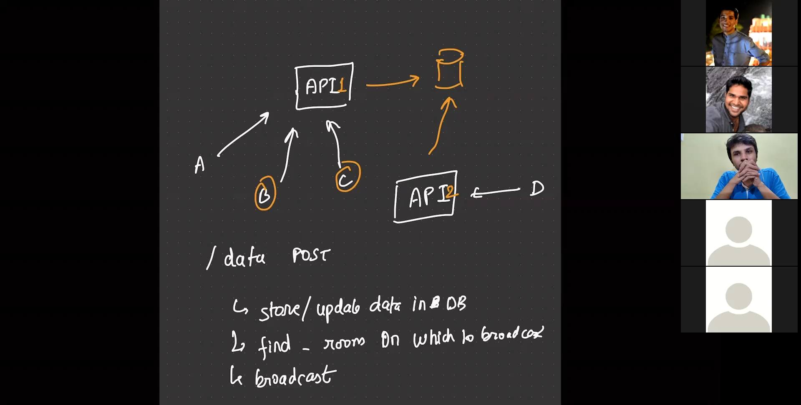
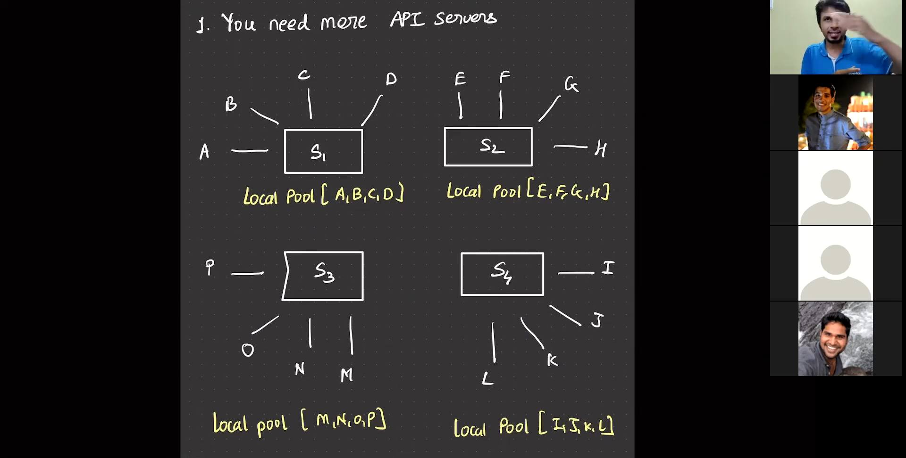
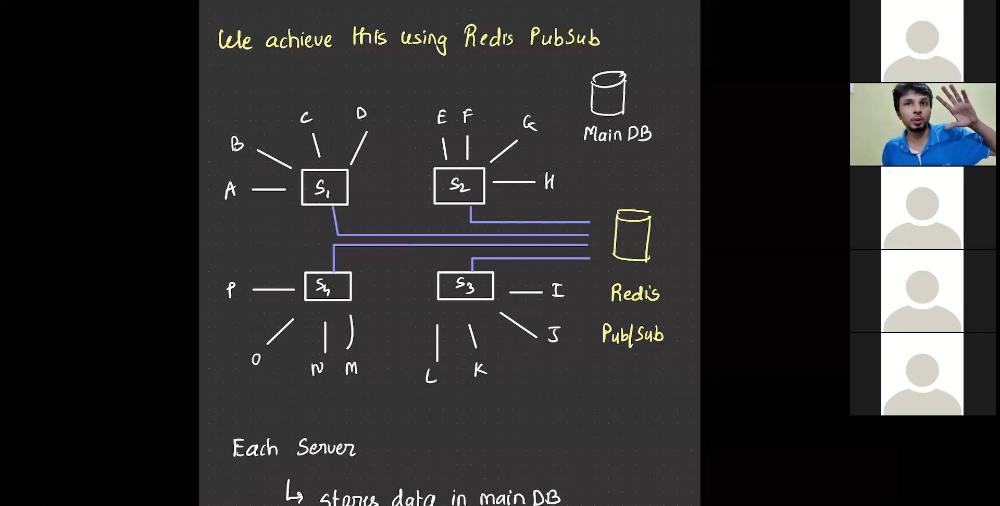
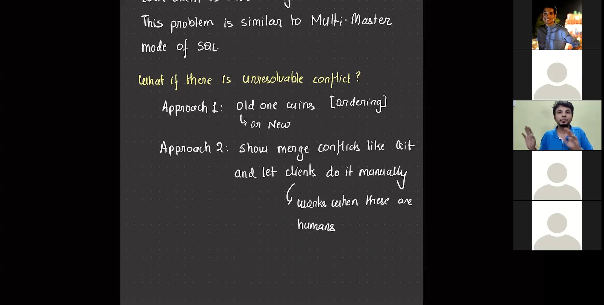
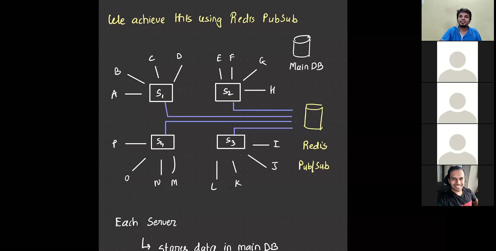

# 用 Redis Pub/Sub 横向扩展 WebSocket 实时聊天系统（P004）

> 课程：system-design-masterclass（BV1k7un69EUL）｜覆盖 P004（127:15–185:26）
> 读者定位：前端转 AI 应用工程师。本文按「把东西做出来」组织，不是知识点罗列。

---

## 1. 这一节做什么

这一节解决一个非常具体的问题：**当聊天室用户多到一台服务器装不下时，怎么让消息仍然能实时送达所有人。**

课程前半段（P001–P003，本文不覆盖）已经建立了单机版实时聊天的雏形：客户端用 WebSocket 连到一台 API 服务器，服务器维护一个本地连接池（connection pool），有人发消息就遍历这个池子广播出去。问题在于——这个池子是**进程内**的。用户 A 连在服务器 S1，用户 E 连在服务器 S2，A 发的消息 S1 只能广播给连在 S1 上的人，E 永远收不到。

讲师在 P004 里给出的答案是：**用 Redis 的 Pub/Sub（发布/订阅）做服务器之间的通信总线**。每台 API 服务器都订阅同一个频道（channel，讲师建议用 table ID / room ID 作 key），任何一台服务器处理完写库后，往这个频道 publish 一条消息，所有订阅者（其他 API 服务器）立刻收到，再由各自向自己的本地连接池广播。

这一节还顺带讨论了四个真实生产里必然撞上的问题，本文第 7 节会展开：消息**顺序**、**多主冲突**、**Redis 挂掉怎么办**、**断线重连后如何补消息**。



---

## 2. 讲师原话

下面几句是这一节的技术骨架，直接引用（带时间戳）：

> "那么现在的问题就是，D 如何知道 A 发出了一个更新；这意味着我们需要在两个 API 服务器之间建立通信通道。"
> —— p004 [130:32]

> "所以，服务器到服务器通信可以让你避免“所有客户端都必须连接到同一台服务器”这一限制。"
> —— p004 [131:29]

> "我们使用 Redis……它有名为 subscribe 的命令，也有名为 publish 的命令，还有名为 unsubscribe 的命令。"
> —— p004 [132:52]

> "Redis 会确保所有这些服务器都连接到一个中心 Redis……所有服务器都与 Redis 建立了 TCP 连接，并且它们已经发布过消息，也都订阅了相应的频道。假设每张表对应一个键。"
> —— p004 [133:22]

> "第一，这让我们能够扩展，因为 Redis 可以在集群模式下运行。第二，Redis 会确保当我的 API 服务器所用的 TCP 连接断开时自动重连……第三，它会确保我的 TCP 连接长期保持。"
> —— p004 [134:21]

> "当 A 有更新时，请求会发到 S1。更新数据库后，A 想把它广播给所有客户端。本地 Socket.IO 连接池里有 A、B、C、D，所以广播只会发给它们……每台服务器都会把数据存进主数据库，广播到本地连接池，并在 Redis 上发布一条消息。"
> —— p004 [143:44]

> "一旦服务器读取到消息，也就是从 Redis 上配置的发布/订阅机制收到消息或更新，它就会把消息广播到本地客户端。"
> —— p004 [144:11]

关于顺序问题，讲师明确承认这是遗留问题：

> "顺序问题可以单独解决……一旦 API 服务器把一条消息发布到数据库，这条消息就会被分配一个时间戳……客户端会使用该时间戳对内容排序。"
> —— p004 [139:06] / [157:17]

关于 Redis 挂掉，讲师给了一个「不要过度设计」的立场：

> "如果某个事件很少发生，你不会想为它构建一套常规方案。你得把它当作例外情况来处理……让所有客户端拉取主数据库，以获取它们尚未收到的消息。"
> —— p004 [177:28] / [180:16]

关于真实规模，讲师给了一组数字：

> "我们有 5 万个用户同时聊天……大约有 50 台服务器运行聊天服务……它们都连接到一个 Redis 发布/订阅机制……而且在同一时刻，我们大约有 20 个这样的群聊正在进行……延迟为 1 到 2 秒。最大呢？5 秒。"
> —— p004 [152:39] / [153:08]



---

## 3. 从零复现

> **重要说明**：逐字稿里讲师**没有写出任何一行可运行代码**，全程是白板/口头推演。下面这套实现是严格按讲师描述的数据流（写库 → 本地广播 → publish → 其他服务器 subscribe → 各自本地广播）搭出来的最小可跑版本。凡是讲师没讲的细节（比如具体用哪个库、端口号），我会明确标注「课里没讲，此处为可跑通的最小选择」。

### 3.1 环境与依赖

- Node.js 18+（用原生 `node:crypto` 生成 ID，不引第三方 uuid）
- Redis 7（本地用 Docker 起，最省事）
- 依赖只有三个：`express`（HTTP 层）、`socket.io`（WebSocket 层，讲师原话点名了 socket.io）、`redis`（官方 Node 客户端，v4 起原生支持 pub/sub）

```bash
mkdir ws-chat && cd ws-chat
npm init -y
npm install express socket.io redis
```

`package.json` 里加一行 `"type": "module"`，下面代码全部用 ESM。

### 3.2 起一个 Redis

```bash
docker run -d --name chat-redis -p 6379:6379 redis:7
```

验证：`docker exec -it chat-redis redis-cli ping` 应返回 `PONG`。

### 3.3 目录结构

```
ws-chat/
├── package.json
├── server.js          # 单台 API 服务器（可起多份，端口不同）
└── public/
    └── index.html     # 极简测试页
```

### 3.4 启动方式（关键：起两台，才能验证跨服务器广播）

```bash
# 终端 1
PORT=3001 node server.js
# 终端 2
PORT=3002 node server.js
```

然后浏览器开两个标签页：`http://localhost:3001` 和 `http://localhost:3002`，两个页面都 join 同一个 room（比如 `room-1`），在其中一个页面发消息，另一个页面应当**立刻**收到——即使它们连的是不同的服务器进程。这就是本节要复现的核心现象。

### 3.5 数据流（照讲师 [143:44] 的顺序）

1. 客户端通过 socket 发 `send_message`，带上 `roomId` 和 `text`
2. 收到消息的那台服务器先把消息**写入主数据库**（本文用内存 Map 模拟，见第 7 节说明）
3. 该服务器向**自己的本地连接池**广播（socket.io 的 `io.to(roomId).emit`）
4. 该服务器向 Redis 的频道 `chat:room:<roomId>` **publish** 一条 JSON
5. 所有服务器（包括自己，见下方注意）都 subscribe 了 `chat:room:*`，收到后向**自己的本地连接池**广播

> **注意一个讲师没讲、但实现时必须决定的点**：如果第 3 步和第 5 步都广播，发布者自己那台服务器上的用户会收到**两条**。讲师在 [143:44] 的描述里确实说了「broadcast it to the local pool, and publish a message on Redis」，字面上是两次。工程上通常的做法是：**发布者只 publish，不本地广播，统一由订阅回调广播**，这样天然去重。我在下面代码里采用后者，并在第 5 节解释为什么。

---

## 4. 完整代码

### 4.1 `server.js`（完整文件，可直接保存运行）

```js
import express from 'express';
import { createServer } from 'node:http';
import { Server } from 'socket.io';
import { createClient } from 'redis';
import { randomUUID } from 'node:crypto';

const PORT = Number(process.env.PORT || 3001);
const REDIS_URL = process.env.REDIS_URL || 'redis://localhost:6379';

// ---- 主数据库（课里没讲具体 DB，这里用内存 Map 模拟，仅用于演示"先写库"这一步）----
// 生产环境应替换为真实数据库；本文件不负责持久化语义。
const messagesByRoom = new Map(); // roomId -> Array<{id, roomId, text, ts}>

function persistMessage(msg) {
  if (!messagesByRoom.has(msg.roomId)) messagesByRoom.set(msg.roomId, []);
  messagesByRoom.get(msg.roomId).push(msg);
}

// ---- HTTP + Socket.IO ----
const app = express();
app.use(express.static('public'));

const httpServer = createServer(app);
const io = new Server(httpServer);

// ---- Redis：一个连接用于 subscribe，另一个用于 publish ----
// 课里没讲必须分开，但 redis v4 客户端进入 subscriber 模式后不能再发普通命令，
// 所以这里用两个 client。这是官方客户端的约束，不是讲师讲的。
const pubClient = createClient({ url: REDIS_URL });
const subClient = pubClient.duplicate();

pubClient.on('error', (e) => console.error('[pub] redis error', e.message));
subClient.on('error', (e) => console.error('[sub] redis error', e.message));

const CHANNEL_PREFIX = 'chat:room:';

async function main() {
  await pubClient.connect();
  await subClient.connect();

  // 订阅所有房间频道（pattern subscribe）
  await subClient.pSubscribe(`${CHANNEL_PREFIX}*`, (raw, channel) => {
    // channel 形如 chat:room:room-1
    const roomId = channel.slice(CHANNEL_PREFIX.length);
    let payload;
    try {
      payload = JSON.parse(raw);
    } catch {
      console.error('[sub] bad payload', raw);
      return;
    }
    // 收到任何服务器（含自己）publish 的消息，向本机连接池广播
    io.to(roomId).emit('message', payload);
  });

  io.on('connection', (socket) => {
    console.log(`[${PORT}] socket connected: ${socket.id}`);

    socket.on('join', ({ roomId }) => {
      socket.join(roomId);
      console.log(`[${PORT}] ${socket.id} joined ${roomId}`);
    });

    socket.on('send_message', async ({ roomId, text }) => {
      if (!roomId || typeof text !== 'string' || !text.trim()) return;

      const msg = {
        id: randomUUID(),
        roomId,
        text: text.slice(0, 2000),
        ts: Date.now(), // 讲师 [157:17]：消息带时间戳，客户端据此排序
      };

      // 1) 先写主数据库（讲师 [143:44]：先更新 DB）
      persistMessage(msg);

      // 2) 再 publish 到 Redis；本机也会通过订阅回调收到并广播
      await pubClient.publish(`${CHANNEL_PREFIX}${roomId}`, JSON.stringify(msg));
    });

    socket.on('disconnect', () => {
      console.log(`[${PORT}] socket disconnected: ${socket.id}`);
    });
  });

  httpServer.listen(PORT, () => {
    console.log(`[${PORT}] listening, redis=${REDIS_URL}`);
  });
}

main().catch((e) => {
  console.error('fatal', e);
  process.exit(1);
});
```

### 4.2 `public/index.html`（完整文件，测试用）

```html
<!doctype html>
<html lang="zh">
<head>
  <meta charset="utf-8" />
  <title>ws-chat test</title>
</head>
<body>
  <h3>ws-chat 测试页</h3>
  <p>当前服务器端口：<b id="port"></b></p>
  <p>房间：<input id="room" value="room-1" /></p>
  <p><button id="join">加入房间</button></p>
  <ul id="log" style="font-family:monospace"></ul>
  <p>
    <input id="text" placeholder="输入消息" />
    <button id="send">发送</button>
  </p>

  <script src="/socket.io/socket.io.js"></script>
  <script>
    const socket = io();
    document.getElementById('port').textContent = location.port;

    const log = (s) => {
      const li = document.createElement('li');
      li.textContent = s;
      document.getElementById('log').appendChild(li);
    };

    document.getElementById('join').onclick = () => {
      const roomId = document.getElementById('room').value.trim();
      socket.emit('join', { roomId });
      log(`joined ${roomId}`);
    };

    document.getElementById('send').onclick = () => {
      const roomId = document.getElementById('room').value.trim();
      const text = document.getElementById('text').value;
      socket.emit('send_message', { roomId, text });
      document.getElementById('text').value = '';
    };

    socket.on('message', (msg) => {
      log(`[${new Date(msg.ts).toLocaleTimeString()}] ${msg.text}`);
    });
  </script>
</body>
</html>
```

### 4.3 验证脚本（可选，纯命令行验证跨服务器广播）

课里没讲，但比开两个浏览器快。另开一个终端：

```bash
npm install -D socket.io-client
node -e "
const { io } = require('socket.io-client');
const a = io('http://localhost:3001');
const b = io('http://localhost:3002');
a.on('connect', () => a.emit('join', { roomId: 'room-1' }));
b.on('connect', () => b.emit('join', { roomId: 'room-1' }));
b.on('message', (m) => console.log('B 收到:', m.text));
setTimeout(() => a.emit('send_message', { roomId: 'room-1', text: 'hello from 3001' }), 500);
setTimeout(() => process.exit(0), 2000);
"
```

预期输出：`B 收到: hello from 3001`。B 连的是 3002，A 连的是 3001，消息跨进程送达，说明 Redis Pub/Sub 这一环通了。

---

## 5. 逐行解释

**`const pubClient = createClient(...)` / `const subClient = pubClient.duplicate()`**
为什么两个连接？Redis 协议里，一个连接一旦进入 subscribe 模式，就只能收订阅消息，不能再发普通命令。所以「既订阅又发布」必须两条连接。讲师在 [133:22] 说「all of the servers have the TCP connections set up with Redis」，用的就是复数 connections，方向一致；但「必须 duplicate」这个具体做法是 Node 客户端的约束，课里没讲。

**`subClient.pSubscribe(\`${CHANNEL_PREFIX}*\`, ...)`**
用 pattern subscribe 而不是逐个房间 subscribe。讲师 [133:22] 说「for each table, we have one key... subscribe to this table ID」，字面是每个房间一个频道。pattern 订阅是等价实现，好处是服务器不用预先知道有哪些房间。如果你要严格照讲师说法，可以改成在 `join` 时动态 `subscribe(\`chat:room:${roomId}\`)`，但那样每台服务器都要为每个活跃房间维护一条订阅，房间多了会很重——这也是为什么 pattern 更常见。

**`persistMessage(msg)` 在 `publish` 之前**
这是讲师反复强调的顺序（[143:44]、[149:22]）：「first update happens on the DB, then the server broadcasts... then it publishes a message on to Redis」。**主数据库是 source of truth**，Redis 只是传输通道，不承担持久化。讲师 [148:30] 原话：「Redis will not have data. Redis is a Pub/Sub.」

**`ts: Date.now()`**
对应讲师 [157:17]：「once a message is published by an API server in the database, it is assigned that timestamp with the message... and that timestamp is used at the client side for ordering things.」客户端拿到消息后按 `ts` 排序，这是讲师给出的顺序问题解法。

**为什么发布者不本地广播、只 publish**
讲师 [143:44] 字面描述是「broadcast it to the local pool, and publish a message on Redis」两步都做。但那样本机用户会收到两条（一条来自本地广播，一条来自订阅回调）。工程上统一走订阅回调即可，语义等价且天然去重。这是实现取舍，不是讲师原话。

**`io.to(roomId).emit('message', payload)`**
socket.io 的 room 机制。讲师 [136:11] 提到「connection pool... subscribed to a certain room... it would just broadcast within that pool」，socket.io 的 room 就是这个 pool 的现成实现。

**`text.slice(0, 2000)`**
讲师 [169:29] 提到单用户狂发消息会「choke up」服务器连接，解法是 rate limiting。这里只做了长度截断，是极简防护；真正的 rate limit 见第 7 节。

**`randomUUID()`**
消息唯一 ID。讲师在讨论去重和补消息时（[179:19] 附近）反复绕回「怎么知道哪条消息」，但没有给出具体 ID 方案。UUID 是最小可用选择。

---

## 6. 复现检查清单

按顺序打勾，任何一项不过，后面的现象都不可信：

- [ ] `docker exec -it chat-redis redis-cli ping` 返回 `PONG`
- [ ] `PORT=3001 node server.js` 打印 `[3001] listening, redis=redis://localhost:6379`
- [ ] `PORT=3002 node server.js` 打印 `[3002] listening...`
- [ ] 浏览器开 `localhost:3001`，点「加入房间」，控制台出现 `[3001] <socketid> joined room-1`
- [ ] 浏览器开 `localhost:3002`，同样加入 `room-1`
- [ ] 在 3001 页面发消息，**3002 页面立刻出现同一条消息**（这是本节核心验证点）
- [ ] 在 3002 页面发消息，3001 页面也立刻出现
- [ ] 命令行验证脚本输出 `B 收到: hello from 3001`
- [ ] 关掉 3002 进程，3001 页面发消息不报错（publish 到无人订阅的频道是合法的）
- [ ] 重启 3002，重新加入房间，再发消息仍能收到（验证讲师 [134:21] 说的自动重连）



---

## 7. 课里没讲但你会撞上的

这一节是 P004 后半段 Q&A 的浓缩，也是你照着上面代码跑起来之后**一定会遇到**的问题。讲师对这些问题的态度很明确：**大部分不要提前设计，撞上再说**。

### 7.1 消息顺序

讲师承认顺序会乱（[139:06]、[162:28]）：「a little misordering might be there... that's where client-side sorting on the basis of timestamp works」。上面的代码已经带了 `ts`，但**客户端没有排序**——`index.html` 是收到就 append。生产里应该在客户端维护一个按 `ts` 排序的列表。讲师提到 LinkedIn 消息会跳序就是这个原因。

### 7.2 多主冲突（两个用户同时改同一条数据）

讲师 [157:46] 给了两个策略：**last-write-wins / first-write-wins（按时间戳选）**，或者**像 git 一样把冲突抛给用户手动合并**。他还提到 Figma / Google Docs 这类协同编辑用的是 **differential synchronization** 算法，并坦言「the guy who built that thing is unable to explain it well」——所以这块课里也没讲透，只给了关键词。

> 前端视角：这等价于你在前端做 optimistic update 时，两个 tab 同时改同一份 state，你需要决定谁赢。React 里常见的「以服务端返回为准」就是 last-write-wins 的简化版。

### 7.3 Redis 挂了怎么办

这是 Q&A 里耗时最长的问题（[167:32]–[182:38]）。讲师的最终立场非常务实：

1. **不要为罕见事件建常规机制**（[177:28]）：「If an event is rare, you would not want to build a regular solution for that.」
2. **让客户端兜底**（[180:16]–[183:36]）：假设 SLA 是 Redis 5 分钟内恢复，那就让**客户端**每 5 分钟向**主数据库**拉一次「我这 5 分钟应该收到但没收到的消息 ID 列表」，缺什么补什么。讲师原话：「let this complexities be offered to your end user to pull from the main source of truth.」
3. 他明确否掉了「服务器之间互相 ack + 重发」的方案：「Very, very hard solution. Think simple.」（[179:19]）

上面的代码**没有实现这个兜底**——因为课里只给了思路没给实现。你要补的话，需要：主数据库按 `roomId + ts` 建索引，暴露一个 `GET /messages?roomId=&since=` 接口，客户端定时调用。

### 7.4 断线重连补消息

讲师 [163:21] 提到 WhatsApp 的「checking for new messages」就是这个机制：客户端记住自己读到的最后一条消息的 sequence number / timestamp，重连后向主数据库要这之后的所有消息。他明确说这依赖「log up and log sequence numbers」，并说这块要到「第六、七周」才展开——**P004 里没讲具体实现**。

### 7.5 惊群（所有服务器同时重连 Redis）

讲师 [170:27] 给的解法极其简单：**启动时加 1–10 秒随机 sleep**。「Whenever our API service starts off, we have a random time delay between 1 to 10 seconds.」上面的代码**没有加**，你如果在生产里同时重启 50 台服务器，会看到 Redis 连接被打爆。补法：

```js
await new Promise(r => setTimeout(r, 1000 + Math.random() * 9000));
await pubClient.connect();
```

### 7.6 单用户刷屏

讲师 [169:29]：「one user is sending a lot of message, then that server connection might choke up... that is where rate limiting comes into the picture.」上面的代码只做了 2000 字符截断，没有速率限制。最小补法是每 socket 维护一个令牌桶。

### 7.7 跨地域

讲师 [146:04]–[148:01] 讲了一段实战教训：他们试过用 Redis Pub/Sub 直接连两个地域的 Redis，**TCP 连接频繁断**，最后改成**地域内用 Redis Pub/Sub，跨地域用消息队列（SQS）桥接**，每个地域一个 Redis cluster，队列消费者把消息搬过去。他明确说这是「very specific to our problem」，不是通用最优解。**上面的代码是单地域版本，跨地域部分课里没给代码。**

### 7.8 规模参考

讲师给的真实数字（[152:39]）：5 万并发用户、约 50 台 chat 服务器、1 个 Redis Pub/Sub、20 个这样的群聊同时进行、延迟 1–2 秒（最差 5 秒）。他强调**扩展性瓶颈在服务器数量，不在用户数量**（[152:09]）：「it is limited by the number of servers and not by the number of users connected.」这解释了为什么 Redis Pub/Sub 这种「一条消息广播给所有订阅者」的模型在这个量级还撑得住——订阅者只有 50 个，不是 5 万个。

### 7.9 认证

讲师 [164:16] 提到 WebSocket 本身是「created on trust」，连接建立后靠 token（他点名 JWT）做鉴权，并类比 Redis 的 `AUTH` 命令是连接时验证一次。上面的代码**没有任何认证**，任何人都能连。生产里应在 `io.on('connection')` 里校验 handshake 里的 token。

### 7.10 消息去重的隐藏成本

第 3.5 节选了「发布者只 publish、统一由订阅回调广播」，这样天然去重。但它有代价：发布者自己的用户要等消息从 Redis 绕一圈回来才看到，延迟从「本地广播的微秒级」变成「一次 Redis 往返的毫秒级」。讲师 [143:44] 描述的两步广播（先本地、再 Redis）在体验上更快，只是要额外做去重——比如给每条消息带 `id`，客户端收到重复 `id` 就丢弃。当前代码选了简单版；如果压测发现延迟不可接受，再换成「本地先广播 + 客户端按 id 去重」。这个取舍课里没讲，是工程判断。

---





---

**一句话总结这一节**：WebSocket 单机广播靠 socket.io 的 room，跨机广播靠 Redis Pub/Sub 做服务器间总线；主数据库永远是 source of truth，Redis 只是传输层；顺序、冲突、Redis 宕机这些硬问题，讲师的态度是「先跑起来，用客户端兜底，别过度设计」。