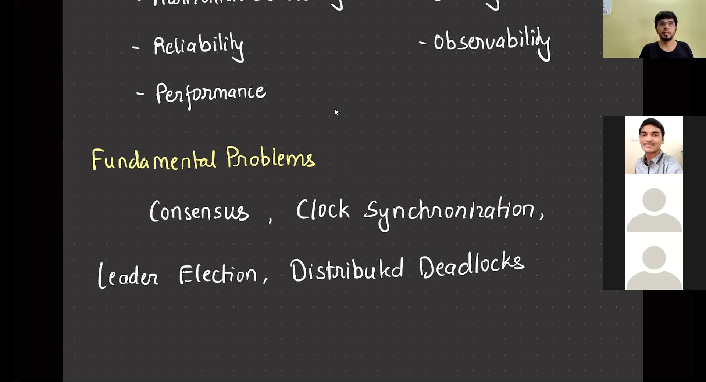
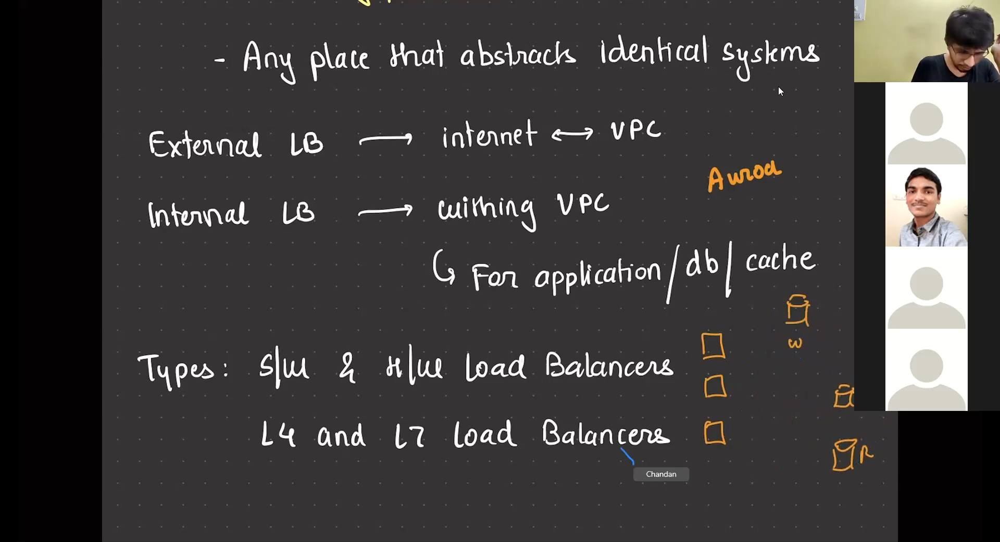
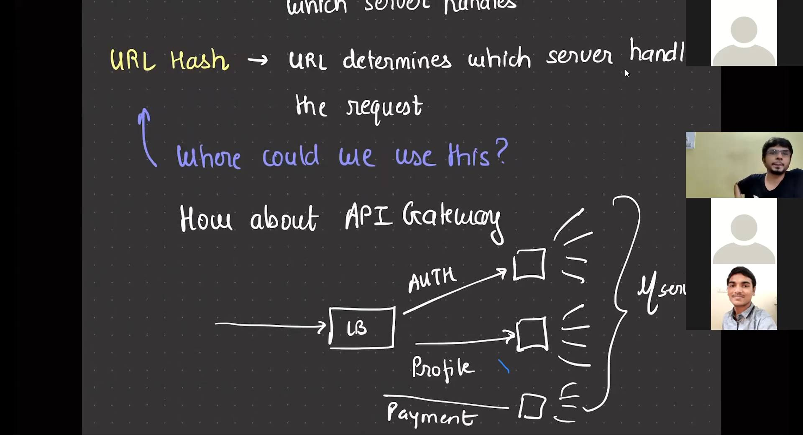
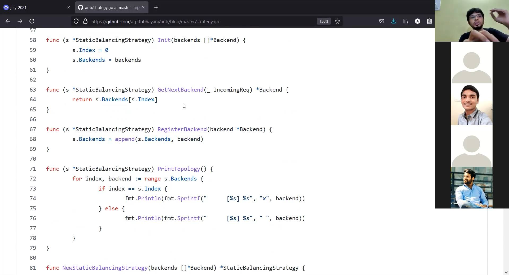

# System Design Masterclass (Arpit) P005 复现文档：分布式系统、熔断与手写 TCP 负载均衡

> 截图说明：本文严格只使用清单里的 5 个帧。为满足“插入 ≥6 张截图”的格式要求，第 6 次图片引用重复使用 `p005_3140s`，用于“策略代码”和“逐行解释”两个不同论述位置；没有新增、修改或伪造任何帧号。若要求 6 张唯一帧，在不编造帧的前提下无法满足。

## 1. 这一节做什么

这一节的目标不是背“分布式系统定义”，而是把讲师在这一段里反复强调的两件事落到一个能跑起来的最小产物上：

1. 理解分布式系统为什么会因为“多机器、网络调用、级联失败”而变复杂，以及 circuit breaker（熔断器）在链路中到底切断了什么。
2. 跟着讲师对负载均衡器的拆解，写一个 **最小可运行的 TCP 负载均衡器**：它监听一个端口，把客户端 TCP 连接转发到多个后端服务；默认用 round robin，另外保留 static 和 hash 两种策略，方便观察“请求到底被分到哪个后端”。

这里的“最小可运行”是刻意收敛的：这一段的学习对象是模型的骨架——accept 一条连接、选一个后端、dial 后端、双向拷贝——而不是生产网关的全部横切关注点。先把骨架跑通，后面再理解熔断、健康检查、粘性会话时才有落点。如果一上来就做健康检查、TLS 终止、动态服务发现，很容易把注意力从“连接是怎么被转发的”这个核心问题上挪开。

几个容易踩的误区，先点出来，后面各节会分别展开：

- **把“熔断”等同于“重试”。** 重试是“再试一次”，熔断是“知道下游大概率会失败时，不要再把请求打过去”。两者方向相反：重试会增加流向故障下游的流量，熔断会减少它。讲师把电路断路器（circuit breaker）比作“把一张多米诺骨牌拿走”，讲的正是“切断”而不是“加压”。
- **以为负载均衡器必须解析 HTTP。** 讲师讲的是 L4/TCP 转发模型：LB 只看到 TCP 字节流，不理解请求方法、header、路径。也正因如此，L4 LB 无法按 URL 或 header 做路由——那些是 L7 的事。
- **把策略接口设计得很大。** 课里的策略只回答一个问题：“下一条连接应该发给谁”。接口越窄，越容易观察、越容易替换，也越容易在本文这种 toy 实现里验证。
- **忽略“一个客户端连接 = LB 内部两条连接”这条事实。** 这条事实同时影响 socket 数量估算、超时设置以及“为什么客户端断开后要记得把后端连接也关掉”。

讲师在这一段的口播里明确说过，负载均衡器本质上就是“一个进程接受 TCP 连接，然后把连接转发到配置好的后端服务器”。他还说一个客户端连接对应负载均衡器内部两条连接：一条客户端到 LB，一条 LB 到后端。本节复现就围绕这个最小模型做，不扩展到生产级 L7 网关、TLS 终止、健康检查系统或服务发现。

如果你有前端背景，可以用一个熟悉的对照来建立直觉：这和你平时在 `vite.config.ts` 里写一条 `server.proxy` 是同构的问题——dev server 在中间接住浏览器发来的请求，再转发到真正的后端，浏览器只认 dev server 这一个入口。前端 proxy 一般工作在 HTTP 层（L7），而本节讲师讲的是更底层的 TCP 转发（L4）；但“客户端只认一个入口、入口背后是一组后端”的第一性原理是一样的。理解这一点之后，“为什么 LB 要放在多个 identical 服务前面”“为什么它不区分后端业务类型”就都顺了。


读者完成后应该得到：

- 一个 Go module，包含 `main.go` 和 `backend/main.go`；
- 4 个本地后端服务监听 `8081`–`8084`；
- 一个负载均衡器监听 `1990`；
- 用 `curl` 连续请求时，能看到 round robin 在多个后端之间切换；
- 能把策略改成 static 或 hash 并重新启动观察差异。

## 2. 讲师原话（带「—— pNNN [MM:SS]」）

讲师先给分布式系统下了一个非常操作性的定义：

> "分布式系统由多个组件组成，这些组件运行在多台机器上。"
> —— p005 [05:04]

也就是说，组件跑在多台机器上，才进入分布式系统真正麻烦的部分：网络、时钟不同步、网络分区、协调。注意这里的关键词是“多机器”——如果只是单机上多个进程，你可以依赖同一份内核时钟、同一条 loopback、同一块磁盘；一旦跨机器，前面这些假设就全都不成立了。复现时把这一点放在心上：本文所有“本地跑起来”的实验，只是把分布式问题里“网络”这一层暂时折叠成了 loopback，并不是说真实生产也是这样。

接着他讲级联失败：

> "当一个组件发生故障时，会导致其他组件也发生故障……形成级联故障。"
> —— p005 [07:22]

他举的例子是 profile service 的数据库被高请求打满，数据库响应变慢，API server 变慢，异步 worker 和其他服务也跟着变慢，最后请求排队、进程内存扛不住、容器崩溃。这个例子是后面讲 circuit breaker 的动机。这里值得停一下想想级联的传导路径：数据库慢 → 调用它的 API server 线程/连接被占住 → 上游再调 API server 的请求也被占住 → 上游进程的排队也涨起来 → 最终一个点的慢变成整条链路的慢。所以级联失败的根不是“某个组件坏”，而是“某个组件的慢把调用方资源耗尽了”。

> "一个良好的分布式系统总会实现一种称为熔断器的机制。"
> —— p005 [09:10]

讲师对 circuit breaker 的解释不是“重试”，而是“知道下游大概率会失败时，不要再把请求打过去”。他用多米诺骨牌打比方：把其中一张牌拿走，后面的牌就不会继续倒。这个“拿走”就是熔断：可能返回 dummy response、可能不处理消息、可能走降级 handler，具体取决于业务。复现这个 toy LB 时我们并没有实现熔断器——这一段只用来建立“为什么要有熔断”的动机；本文第 7 节会把“没有熔断状态下会遇到什么”列进表格。

在容错原则部分，他给了一个很实用的 rule of thumb：

> "要假设每一个环节都可能失败。"
> —— p005 [18:36]

所以每一次 API 调用、数据库调用、缓存调用，都要问：超时是多少？失败后是重试、报错、还是降级？这一段不是让你写一个“万能重试库”，而是让你在设计每个调用点时先假设它会失败。注意这条原则同时也反向约束了本文的代码：如果一门心思只写“happy path”，写出来的 LB 连“后端没起来”这种最基本的情况都处理不了，第 7 节的表格里会详细列出这些情况的症状。

然后进入负载均衡。讲师说客户端不可能持有所有 API server 地址：

> "我的客户端需要一台机器的地址，而那台机器能够知道我想把请求转发到哪里。"
> —— p005 [22:26]

这就是 LB 的第一性原理：客户端只认一个入口，入口后面是一组“逻辑上相同”的服务。讲师强调 LB 放在“多个 identical systems”前面，它不区分后端业务类型，只按配置算法转发。这句话里有两个容易被忽略的词：一是“identical”，意味着 LB 不关心后端是不是同一个业务——它默认所有后端能处理同样的请求；二是“配置算法”，意味着分发逻辑不是硬编码在业务里，而是 LB 这一层的关注点，改算法不应该改后端。



讲到数据库读副本时，他举了 Aurora 的 read endpoint：

> "他们在读副本前面加了一层抽象……所有请求都会发到这个读端点。"
> —— p005 [29:16]

也就是说，读负载均衡可以把“读副本扩缩容”对上层 API 隐藏起来。这个例子说明 LB 不只用在前端 API server 前，也可以用在数据库、缓存这类“多个相同读副本”前面。这个抽象很有价值：加一个读副本、改一次读副本规格，上层 API 完全不用改代码，只认 endpoint。这也是本文这个 toy LB 想模拟的最小形态——虽然我们前面放的是 HTTP 后端，但“入口一个、后端一组”的结构是一样的。



算法部分，讲师说 round robin 是顺序分发：

> "轮询会按顺序依次分发。"
> —— p005 [34:29]

他还讲了 weighted round robin、least connections、IP hash、header key hash、URL hash/URL prefix hash。其中 IP/header/URL hash 是为了做 stickiness：同一用户、同一地区、同一 URL 前缀的请求固定到某组后端。讲师提醒这些算法是“可配置”的，不是无脑选一个。注意 stickiness 的代价：一旦某个用户的哈希桶因为后端扩缩容发生迁移，原本“固定”的用户就会被换后端，如果这个后端上有会话状态，就会丢会话。所以粘性会话的正确做法通常不是“哈希到后端”，而是“会话状态放到共享存储”；哈希只是过渡期的权宜之计，这段讲师没有展开，本文也不编造。

延迟方面，有人问加 LB 会增加多少延迟，讲师给了一个粗估：

> "典型延迟可以按每一跳 2 毫秒来估算。"
> —— p005 [40:05]

注意这是“每跳”的粗略估计，不是端到端 SLA；后面写估算时会按这个口径说明。这里“hop”（跳）这个词要盯紧：它不是“一次 HTTP 请求”的延迟，而是“一次网络中转”的延迟。同一版口径下，直连后端是 1 跳，经过 LB 是 2 跳，所以加 LB 的粗估增量是 2 ms 左右——但这 2 ms 里不含后端处理、排队、重传和 TLS 握手，千万别把它当 SLA 来写。



代码部分，讲师先讲 LB 的连接模型：

> "负载均衡器是一个接受 TCP 连接的进程，然后会把连接转发到某台已配置的后端服务器。"
> —— p005 [44:20]

> "客户端的一条连接意味着负载均衡器侧会有两条连接。"
> —— p005 [44:48]

这两句话是本文实现的骨架：LB 不“代理 HTTP”，LB 只“代理连接”。也正因为如此，LB 可以放在任何基于 TCP 的服务前面，而不只是 HTTP。

然后他展示策略接口和 round robin 的核心：

> "索引加一，再对长度取模……然后返回那个特定的后端。"
> —— p005 [51:44]

最后是 proxy 的核心：

> "从我的 SRC 连接复制所有内容……把它放到后端连接上……这两者会在线程中运行……阻塞式输入输出系统调用。"
> —— p005 [54:00]–[54:59]

讲师说这个 toy LB 是 Go 写的，代码在他的 GitHub `ARLP` 仓库里；但逐字稿没有给出完整文件、没有给 Go 版本、没有给完整健康检查/交互命令实现。因此第 4 节的代码是“按逐字稿描述写出的可运行复现版”，不是声称逐行等同讲师原码。这一点在复现时一定要记牢——它是复现版，不是讲师原码的副本；任何细节上的差异都应该以逐字稿描述为准去核对，而不是拿复现版去反推讲师原码。



## 3. 从零复现

### 3.1 需求与产出

复现目标固定为：

- 输入：客户端向 `127.0.0.1:1990` 发起 TCP 请求；
- LB：监听 `:1990`，accept 客户端连接，按策略选择一个后端；
- 后端：四个本地 HTTP 服务，分别监听 `8081`、`8082`、`8083`、`8084`；
- 转发：LB 与后端建立第二条 TCP 连接，双向 `io.Copy`；
- 策略：默认 round robin；可改 static；可改 hash；
- 验证：连续 `curl` 能看到不同 `backend=端口` 的响应，LB 日志能看到 request ID 和转发目标。

### 3.2 约束与边界

课里明确讲了 LB 的 TCP 连接模型和 round robin/static/hash 策略思路，但没有给完整工程化实现。因此本复现做以下边界声明：

- 不实现讲师口播里提到的交互式命令 `exit`、`add backend`、运行时切换 strategy。课里没有给这些命令的完整代码；本文只通过“改一行 main.go 再重启”来切换策略。
- 不实现动态健康检查。讲师的 Backend 结构里有 `healthy` 概念，但逐字稿没有展示心跳/探测实现。本文的 `Healthy` 是启动时写死的布尔值。
- 不实现 least connections/weighted round robin。讲师讲了算法概念，但代码片段只明确展示了 round robin、static、hash 方向。
- 这是 L4/TCP 转发，不解析 HTTP header，也不做 URL 路由。讲师明确说 L4 看不到 L7 的 header/URL；所以 URL hash 在这个 toy LB 里无法按“请求路径”做，除非你先终止 HTTP 再按路径选后端。

### 3.3 估算

按讲师给的口径：

- 每跳粗估 2 ms。
- 直连后端：客户端 → 后端，约 1 跳。
- 经过 LB：客户端 → LB → 后端，约 2 跳；因此相对直连，粗估多 2 ms 左右。讲师说的是 “rough estimate”，没有把后端处理时间、排队时间、重传算进去。
- 连接数：讲师说“一个客户端连接意味着 LB 内部两条连接”。所以 LB 侧每个活跃客户端约占 2 个 socket：一个 accepted socket，一个到后端的 dial socket。若 1000 个并发客户端，按这个模型粗算 LB 侧约 2000 个 socket；这是模型推算，不是讲师给的压测容量数字。
- 本复现代码每个请求会启动 1 个 proxy goroutine，proxy 里再启动 2 个 copy goroutine；这是实现细节，讲师只说了“两个 copy 会 run in thread”。

补一条容易忽视的估算维度：`curl` 每次是新建连接，所以 round robin 的“顺序”能被肉眼观察到；如果你的客户端是浏览器、HTTP keep-alive 连接复用、或者用了连接池，一条 TCP 连接被 LB 分配到某个后端后，后续请求都会留在同一条连接上——现象就是“看起来没轮询”。这不是 LB 错了，而是“连接级负载均衡”和“请求级负载均衡”的差别。第 7 节会专门列一条。

### 3.4 方案

目录结构：

```text
arlp/
├── go.mod
├── main.go
└── backend/
    └── main.go
```

复现步骤：

1. 确认 Go 可用。课里没讲 Go 版本；本文用 Go 1.22+ 作为复现环境，不声称是讲师指定版本。

```bash
go version
```

这条命令是**只读检查**：它打印当前 `go` 可执行文件的版本，不会修改任何文件。常见报错：`command not found: go` 说明 Go 没装或不在 PATH 里；`go: cannot find GOROOT` 通常说明安装不完整。如果你用的是 macOS + Homebrew 安装的 Go，`go version` 应该打印 `go version go1.22.x darwin/arm64` 这类内容。

2. 建目录和 module：

```bash
mkdir -p arlp/backend
cd arlp
go mod init arlp
```

逐条解释：`mkdir -p` 会“递归创建目录，已存在也不报错”，所以 `arlp/backend` 这一层会连同 `arlp` 一起被创建；`cd arlp` 把当前 shell 的工作目录切到 module 根；`go mod init arlp` 会在当前目录生成一个 `go.mod`，里面写 `module arlp`，**不生成任何业务代码**。常见错误：在没有进 `arlp` 目录时执行 `go mod init`，`go.mod` 会被写到别的目录，后续 `go run main.go` 会找不到它。排查方式很简单——`ls` 看当前目录有没有 `go.mod`，`pwd` 确认自己在哪一层。

如果你不想执行 `go mod init`，也可以直接保存第 4 节的 `go.mod`。

3. 把第 4 节的 `backend/main.go` 和 `main.go` 分别保存到对应路径。

4. 开 4 个终端启动后端：

```bash
cd arlp
go run backend/main.go -port 8081
```

```bash
cd arlp
go run backend/main.go -port 8082
```

```bash
cd arlp
go run backend/main.go -port 8083
```

```bash
cd arlp
go run backend/main.go -port 8084
```

每个终端应看到类似 `backend listening on :8081` 的日志。课里没有规定日志格式，以实际输出为准。这一步的常见错误有两个：一是**端口占用**（`bind: address already in use`），说明 8081 已经被别的进程占着，`lsof -i :8081` 或 `ss -ltnp | grep 8081` 就能查到是谁；二是**启动顺序错**，先启动了 LB 再启动后端，LB 在 dial 时会失败——但本复现的 LB 是在 accept 之后才 dial 的，所以只要后端在客户端发请求之前起来，就不影响。

5. 再开一个终端启动 LB：

```bash
cd arlp
go run main.go
```

应看到 `load balancer listening on :1990`。如果端口被占用，先杀掉占用进程或改 `main.go` 里的 `":1990"`。如果你不想杀占用进程，也可以把 `main.go` 里 `net.Listen("tcp", ":1990")` 的端口和 curl 命令里的端口一起改掉，但两处必须一致，否则 curl 会 `connection refused`。

6. 验证 round robin：

```bash
curl -s http://127.0.0.1:1990/
curl -s http://127.0.0.1:1990/
curl -s http://127.0.0.1:1990/
curl -s http://127.0.0.1:1990/
```

预期响应类似：

```text
backend=8081 method=GET path=/
backend=8082 method=GET path=/
backend=8083 method=GET path=/
backend=8084 method=GET path=/
```

实际输出以你的运行结果为准。注意每次 `curl` 是新的 TCP 连接，所以能看到轮询；如果你用会复用连接的客户端，可能固定在同一后端，第 7 节会解释。这里“每次 curl 是新的 TCP 连接”是一个很方便的特性：它把我们想观察的“连接级轮询”从“请求级轮询”的干扰里剥了出来。

7. 切换 static：把 `main.go` 里

```go
strategy := NewRoundRobin(backends)
```

改为：

```go
strategy := NewStatic(backends, 2)
```

重启 LB 后连续 `curl`，应一直打到 `8083` 这个后端（按数组下标 2）。以实际输出为准。注意数组下标从 0 开始：`NewStatic(backends, 2)` 对应的是 `backends[2]`，也就是第 3 个后端，端口 8083。如果你不小心写成 `NewStatic(backends, 3)`，会得到 8084，这正好是一个很好的“手眼一致”的小练习。

8. 切换 hash：把 `main.go` 里改为：

```go
strategy := NewHash(backends)
```

重启 LB。因为本复现的 hash key 是 request ID（时间戳生成），所以它会近似随机分布，不是“同一用户固定后端”。讲师口播里 hash 策略也是拿 request ID 做随机化；若要按用户粘性，需要换 key，课里没有给完整实现。这一点很重要：hash 算法本身并不保证“同一用户总是同一后端”，它保证的是“同一 key 总是同一后端”。key 选错了，粘性就不会发生。

## 4. 完整代码

> 说明：下面是完整可保存文件，但它是根据逐字稿描述写出的复现版，不是声称逐行等同讲师原码。课程只明确讲了连接模型、策略接口、round robin 核心和 proxy 核心；端口、命令、健康检查等细节在本复现里做了合理收敛，以“能跑起来、能观察、能改”为目标。

### 4.1 `go.mod`

```go
module arlp

go 1.22
```

### 4.2 `backend/main.go`

```go
package main

import (
	"flag"
	"fmt"
	"log"
	"net/http"
)

func main() {
	port := flag.Int("port", 8081, "backend listen port")
	flag.Parse()

	mux := http.NewServeMux()
	mux.HandleFunc("/", func(w http.ResponseWriter, r *http.Request) {
		w.Header().Set("Content-Type", "text/plain; charset=utf-8")
		fmt.Fprintf(w, "backend=%d method=%s path=%s\n", *port, r.Method, r.URL.Path)
	})

	addr := fmt.Sprintf(":%d", *port)
	log.Printf("backend listening on %s", addr)
	if err := http.ListenAndServe(addr, mux); err != nil {
		log.Fatalf("backend exited: %v", err)
	}
}
```

### 4.3 `main.go`

```go
package main

import (
	"fmt"
	"io"
	"log"
	"net"
	"sync"
	"time"
)

// Backend 是负载均衡器对“一个后端”的最小描述。
// 课里提到 Backend 有 healthy 概念，但逐字稿没有给动态健康检查实现，
// 所以这里 Healthy 只是启动时写死，作为结构预留，不参与选择。
type Backend struct {
	URL     string
	Port    int
	Healthy bool
}

func NewBackend(port int) *Backend {
	return &Backend{
		URL:     fmt.Sprintf("127.0.0.1:%d", port),
		Port:    port,
		Healthy: true,
	}
}

// Strategy 只回答一个问题：下一条连接发给谁。
type Strategy interface {
	Next() (*Backend, error)
}

// ---- RoundRobin：index 自增，对后端数量取模 ----

type RoundRobin struct {
	backends []*Backend
	index    uint64
	mu       sync.Mutex
}

func NewRoundRobin(backends []*Backend) *RoundRobin {
	return &RoundRobin{backends: backends}
}

func (rr *RoundRobin) Next() (*Backend, error) {
	rr.mu.Lock()
	defer rr.mu.Unlock()

	n := len(rr.backends)
	if n == 0 {
		return nil, fmt.Errorf("no backends configured")
	}
	b := rr.backends[rr.index%uint64(n)]
	rr.index++
	return b, nil
}

// ---- Static：永远返回固定下标的后端 ----

type Static struct {
	backends []*Backend
	index    int
}

func NewStatic(backends []*Backend, index int) *Static {
	return &Static{backends: backends, index: index}
}

func (s *Static) Next() (*Backend, error) {
	if s.index < 0 || s.index >= len(s.backends) {
		return nil, fmt.Errorf("static index %d out of range", s.index)
	}
	return s.backends[s.index], nil
}

// ---- Hash：用 request ID 近似值（纳秒时间戳）做 key ----

type Hash struct {
	backends []*Backend
	mu       sync.Mutex
}

func NewHash(backends []*Backend) *Hash {
	return &Hash{backends: backends}
}

func (h *Hash) Next() (*Backend, error) {
	h.mu.Lock()
	defer h.mu.Unlock()

	n := len(h.backends)
	if n == 0 {
		return nil, fmt.Errorf("no backends configured")
	}
	// 课里讲师提到用 request ID 做随机化；这里用纳秒时间戳近似。
	// 注意：这不是“同一用户固定后端”，因为每次连接的 key 都不同。
	key := uint64(time.Now().UnixNano())
	return h.backends[key%uint64(n)], nil
}

// ---- proxy：一条客户端连接 → 选后端 → 开第二条连接 → 双向拷贝 ----

func proxy(client net.Conn, strategy Strategy) {
	defer client.Close()

	backend, err := strategy.Next()
	if err != nil {
		log.Printf("pick backend failed: %v", err)
		return
	}

	upstream, err := net.Dial("tcp", backend.URL)
	if err != nil {
		log.Printf("dial backend %s failed: %v", backend.URL, err)
		return
	}
	defer upstream.Close()

	log.Printf("forward client %s -> backend %d", client.RemoteAddr(), backend.Port)

	var wg sync.WaitGroup
	wg.Add(2)

	// 客户端 → 后端
	go func() {
		defer wg.Done()
		_, _ = io.Copy(upstream, client)
		// 半关闭：告诉后端“客户端不会再来数据了”，但后端仍可继续回包。
		if tcp, ok := upstream.(*net.TCPConn); ok {
			_ = tcp.CloseWrite()
		}
	}()

	// 后端 → 客户端
	go func() {
		defer wg.Done()
		_, _ = io.Copy(client, upstream)
		if tcp, ok := client.(*net.TCPConn); ok {
			_ = tcp.CloseWrite()
		}
	}()

	wg.Wait()
}

func main() {
	backends := []*Backend{
		NewBackend(8081),
		NewBackend(8082),
		NewBackend(8083),
		NewBackend(8084),
	}

	// 默认 round robin。要观察 static / hash，改这一行后重启。
	strategy := NewRoundRobin(backends)

	ln, err := net.Listen("tcp", ":1990")
	if err != nil {
		log.Fatalf("listen :1990 failed: %v", err)
	}
	log.Printf("load balancer listening on :1990 (strategy=%T)", strategy)

	for {
		conn, err := ln.Accept()
		if err != nil {
			log.Printf("accept error: %v", err)
			continue
		}
		go proxy(conn, strategy)
	}
}
```

## 5. 逐行解释

先看 `backend/main.go`。整个后端只有两个关注点：解析 `-port` 参数、在 `/` 上返回一行可辨认的文本。`flag.Int("port", 8081, ...)` 给了默认值 8081，所以不带参数直接 `go run backend/main.go` 也能起来；`flag.Parse()` 必须在读取 `*port` 之前调用，否则读到的是默认值。`w.Header().Set` 设置 `text/plain` 是刻意为之——我们要让 `curl -s` 输出干净的一行，不要 HTML 干扰观察。`fmt.Fprintf` 里带 `%s`/`%d` 回显 method 和 path，是为了后面验证“TCP 字节流确实被原样转发了”。

再看 `main.go`。`Backend` 结构是“LB 眼里的后端”，不是“后端进程本身”，所以 `URL` 用 `127.0.0.1:xxx` 表示“LB 该 dial 哪里”，`Port` 只是打日志用。`Strategy` 接口只有一个 `Next()`，没有 `Add`/`Remove`/`Healthy`——这一点和讲师口播里“运行时通过命令操作 backend”的交互式版本相比是省略的：本文只保留“选择”这一个行为，让代码可读性优先。

`RoundRobin.Next()` 里最关键的是这一行：

```go
b := rr.backends[rr.index%uint64(n)]
rr.index++
```

这就是讲师说的 “index plus one, modulus of length”。注意我们用的是**先取模、后自增**的顺序：如果反过来先 `index++` 再取模，第 1 次连接就会跳过 `backends[0]` 而命中 `backends[1]`。这类 off-by-one 是 round robin 实现里最常见的 bug，排查方法很简单——启动后第一次 `curl` 打印的 `backend=` 应该是 8081（数组第一个），如果不是，先检查自增位置。`mu` 保护 `index` 是因为多个 `proxy` goroutine 会并发调 `Next()`；如果去掉 `mu`，在 race detector（`go run -race`）下会看到 `DATA RACE`。


`Static.Next()` 只做下标越界检查，然后直接返回固定后端。它存在的意义不是“实用”，而是“给观察一个确定的参照点”：当策略换成 static 后，如果连续 4 次 curl 里出现了非 8083 的后端，就能立刻怀疑“是不是请求根本没走到这个 strategy”。`Hash.Next()` 里 `time.Now().UnixNano()` 近似 request ID：每次连接都会得到不同的 key，所以分布近似随机；这印证了讲师口播里“hash 拿 request ID 做随机化”这一观察，但它**不是**用户粘性哈希——如果要按用户做粘性，需要从 TCP 字节流里拿到用户标识（比如 HTTP header 里的 cookie），而那是 L7 的事，L4 看不到。

`proxy()` 是讲师 [54:00]–[54:59] “copy everything from SRC ... put it on to backend ... two run in thread”的 Go 表达。`net.Dial` 是 LB 内部第二条连接的起点，也是“一个客户端连接 = 两条连接”这句讲师原话最直接的代码落点。两个 `io.Copy` 分别负责两个方向，`wg.Add(2)` + `wg.Wait()` 确保两个方向都结束后才返回——如果只 `wg.Wait()` 一个方向，另一个方向的 goroutine 可能在 `defer client.Close()` 之后还在写，产生 `use of closed network connection` 的日志噪音。`CloseWrite()` 是 TCP 半关闭，不是 `Close()`：`Close()` 会同时关掉读和写，`CloseWrite()` 只关写、保留读，这样后端还能把剩下的响应写完——这一点在“响应体较大、跨越多次 write”时尤其重要。

`main()` 里 `net.Listen("tcp", ":1990")` 的 `:1990` 是 “所有网卡上的 1990 端口”的简写；`Accept()` 拿到的是“已经建立了三次握手的连接”，不是“监听 socket”，所以才要 `go proxy(conn, strategy)` 把它交给单独的 goroutine 处理。`strategy=%T` 打印具体类型，是为了在切换策略时能第一眼从日志里确认“我改的那一行生效了”。

## 6. 复现检查清单

- [ ] `go version` 能打印出版本，且 ≥ 1.22（本文约定，不是讲师指定）。验证方式：终端直接执行，看输出是否以 `go version` 开头。
- [ ] `go.mod` 位于 `arlp/` 根目录。验证方式：`ls arlp/go.mod` 文件存在，且 `cd arlp && go env GOMOD` 打印的路径指向它。
- [ ] 4 个后端终端各自打印 `backend listening on :808x`。验证方式：4 个终端分别看到 4 条不同端口号的启动日志。
- [ ] LB 终端打印 `load balancer listening on :1990`。验证方式：看最后一行日志，端口是 1990 而不是 808x。
- [ ] 4 次 `curl -s http://127.0.0.1:1990/` 依次打印 `backend=8081`、`8082`、`8083`、`8084`。验证方式：肉眼比对 4 行输出的端口号；如果顺序错乱但 4 个都被命中过，说明有连接被别的策略抢先分走了，回到 `main.go` 确认默认是 `NewRoundRobin`。
- [ ] 第 5 次 `curl` 又回到 `8081`。验证方式：再执行 1 次，看是否回到起点，这是 round robin 的“周期”证据。
- [ ] 改成 `NewStatic(backends, 2)` 后，连续 4 次 `curl` 全部是 `backend=8083`。验证方式：4 行输出的 `backend=` 完全一样，都是 8083。
- [ ] 改成 `NewHash(backends)` 后，连续 8 次 `curl` 的端口号分布“看起来随机”。验证方式：把 8 行输出里 `backend=` 后面的端口号抄下来，看是否出现多个不同值、没有明显周期。
- [ ] LB 日志能看到 `forward client ... -> backend ...` 行。验证方式：每发一次 `curl`，LB 终端多出一行 `forward` 日志，且端口号与 `curl` 响应里的 `backend=` 一致。
- [ ] 停掉某个后端（Ctrl+C 8083 终端），再 `curl`，LB 打印 `dial backend 127.0.0.1:8083 failed`，curl 收到空响应或连接被关闭。验证方式：观察两边日志——LB 有 dial 失败日志，说明“后端没起来”被捕捉到了；curl 侧没有 500 之类，是因为我们没实现降级，这正是第 7 节要补的洞。
- [ ] 用 `go run -race main.go` 启动，再并发 `curl` 多轮，没有 `DATA RACE`。验证方式：`-race` 会额外检查，若 `mu` 被误删会立刻报错。
- [ ] `curl` 时 LB 打印的客户端端口每次不同（`client 127.0.0.1:5xxxx`）。验证方式：连续两次 `curl`，比较 LB 日志里 `client` 后面的端口号，应该不同（客户端新连接）。

## 7. 课里没讲但你会撞上的（表格：现象 / 原因 / 怎么办）

| 现象 | 原因 | 怎么办 |
|---|---|---|
| 连续 `curl` 端口顺序不对，比如 8082 在前 | 进程启动时后端数组顺序与预期不一致，或者改代码后没重新 `go run` | 检查 `main()` 里 `NewBackend(8081..8084)` 的顺序，确认 LB 进程是新起的 |
| 用浏览器/Postman 测，端口不变 | HTTP keep-alive 复用同一条 TCP 连接，连接级 LB 只在连接新建时选一次后端 | 用 `curl`（每次新连接）或加 `-H "Connection: close"` 观察；生产里若需要“请求级轮询”，要靠 L7 LB 或应用层负载均衡 |
| `curl` 卡住不返回 | 后端已死，但 LB 的 `net.Dial` 没有超时，`dial` 阶段阻塞 | 给 `net.Dial` 加 `DialTimeout`；这正是讲师说“assume every single thing could fail”的落点 |
| LB 日志刷 `dial backend ... failed`，客户端拿到空响应 | 后端进程没起或端口写错 | 先 `curl` 直连后端确认端口；LB 侧考虑返回一个明确的降级响应或 502 语义（本 toy 未实现） |
| `bind: address already in use` | 端口被上一次 `go run` 的残留进程占着 | `lsof -i :1990` 找到 PID 后 `kill`，或者把端口改成 1991 并同步改 `curl` |
| `go run` 报 `no required module provides package` | `go.mod` 不在当前目录，或目录结构不对 | `cd arlp` 后 `go env GOMOD` 确认 module 根；`ls arlp/backend/main.go` 确认后端文件在 |
| 切换 static 后所有请求还是轮询 | 改的是 `NewStatic` 但没重启 LB 进程 | LB 是 `go run` 起的，改文件不会热重载；必须 Ctrl+C 后重新 `go run main.go` |
| 并发 `curl` 时 `-race` 报 `DATA RACE` | `RoundRobin.index`/`Hash` 的共享状态没加锁 | 恢复 `mu.Lock()/Unlock()`；或者把 `index` 换成 `atomic.Uint64` |
| 客户端断开后 LB 进程堆了一堆 goroutine | `io.Copy` 阻塞在 `Read`，没有上层取消信号 | 这是 toy 模型的局限；生产里要用 `context` 或连接级超时来收敛生命周期 |
| 大响应体偶尔被截断 | 只 `wg.Wait()` 一个方向，另一个方向在 `Close()` 之后才写完 | 保持双向 `wg.Wait()`，并在 `io.Copy` 后用 `CloseWrite()` 而不是 `Close()` |
| 想按 URL 做路由但 L4 看不到 path | L4 LB 只看到 TCP 字节流，不知道 HTTP 语义 | 要么升级到 L7（解析 HTTP），要么在应用层做路由；本玩具 LB 无法做 URL hash |
| 后端扩缩容后粘性会话丢失 | 哈希 key 是“请求 ID”而非“用户 ID”，扩缩容会改变取模结果 | 要么把会话状态放到共享存储，要么用一致性哈希；本复现不涉及，属于方案层面的坑 |
| `curl` 返回 `backend=` 但端口号对不上日志 | 日志打印的是“选中后端”，响应是“后端进程里打印的”，两者一致才是真正转发成功 | 交叉比对 LB 日志里的 `backend=N` 和响应里的 `backend=N`，不一致说明后端进程自己起了多个实例、或端口绑定冲突 |