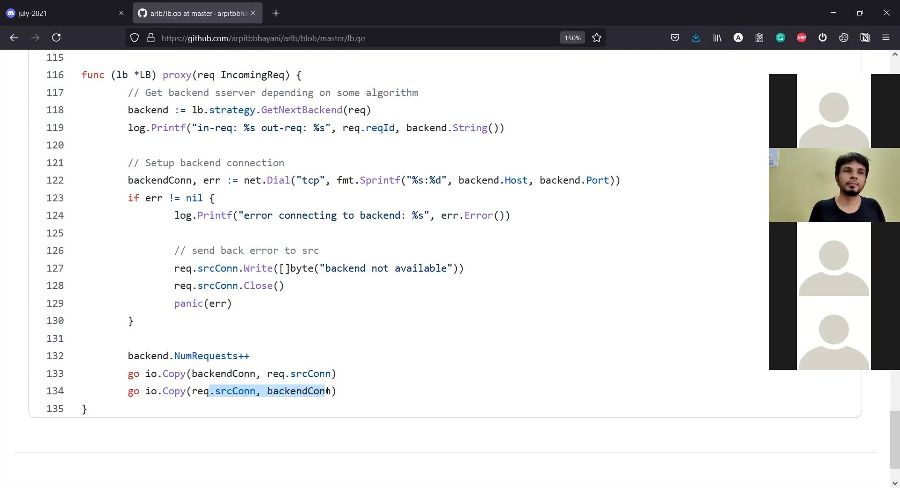
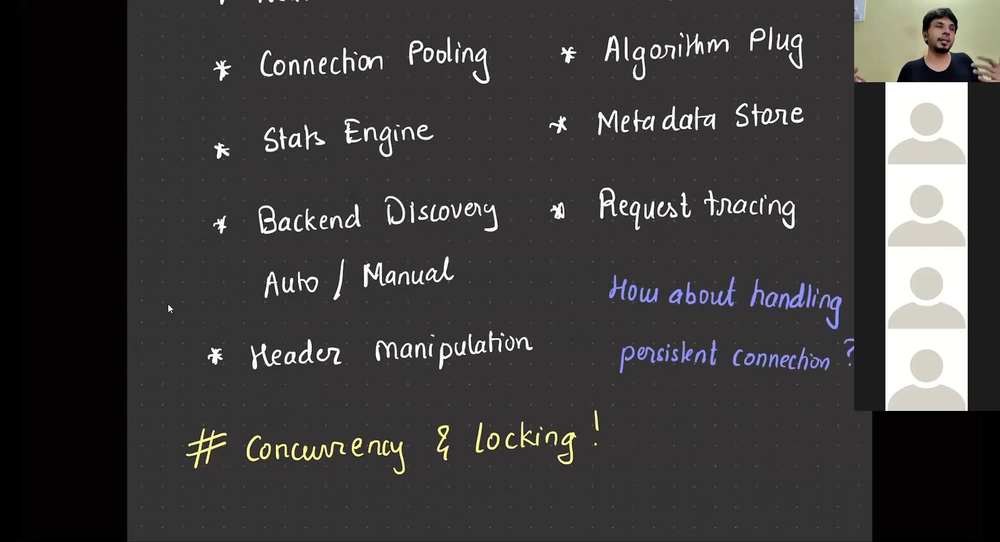
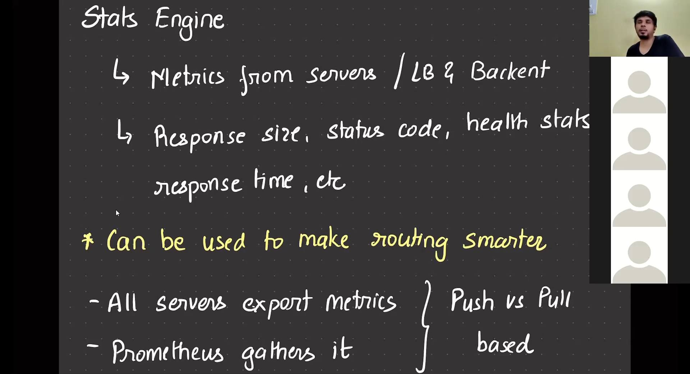

# System Design Masterclass (Arpit) P5：从零实现一个可压测的 TCP 负载均衡器

## 1. 这一节做什么

这一节对应 P5 的后半段，目标不是泛泛讲“负载均衡是什么”，而是把一个小型负载均衡器真正跑起来，并用压测验证它确实在做轮询转发。讲师先从一个阻塞式 TCP 代理讲起：客户端连接进来后，负载均衡器选择一台后端，建立 TCP 连接，然后两个方向各跑一个 `io.Copy`，用 Go 的 goroutine 让“客户端 → 后端”和“后端 → 客户端”并行阻塞。接着用 Locust 压测 1990 端口的负载均衡器，观察 8081、8082、8083、8084 四台静态站点是否按 round robin 被轮流命中。

跑通核心代码后，讲师把视角拉到系统设计：健康检查、连接池、统计引擎、L4/L7 的区别、后端发现、元数据存储、请求追踪、持久连接、并发与锁、DNS 横向扩展负载均衡器、Prometheus/Grafana、自动扩缩容，最后引出分布式锁。课里没有贴出完整源码，下面第 4 节是按讲师描述的核心逻辑补全的可运行版本；不是逐字复制讲师仓库，但行为与课里描述一致：1990 端口接收连接，四台后端 8081–8084 轮询，Locust 可压测。

---

## 2. 讲师原话（带「—— pNNN [MM:SS]」）

> "在它前面加上 go，本质上就是创建一个 goroutine，而 goroutine 不过是一个轻量级线程。"
> —— p005 [55:56]

> "这正是负载均衡器的核心逻辑，没什么花哨的。"
> —— p005 [56:54]

> "在 Locust 上，我只配置了一个端点，也就是负载均衡器的 1990 端口。四个 API 服务器，或者说四个运行静态站点的服务器，分别位于 8081、8082、8083、8084 端口。"
> —— p005 [57:21]

> "采用轮询时，先是第一台服务器，然后是第二台、第三台、第四台，接着又回到第一台、第二台、第三台、第四台。"
> —— p005 [57:50]

> "你可以做连接池、错误处理、重试、健康检查等等。"
> —— p005 [63:24]

> "一旦我们也去掉这个 go，也就意味着所有操作都变成阻塞的。这样我的负载均衡器一次只能处理一个请求。"
> —— p005 [67:12]

> "关键组件是健康检查器。"
> —— p005 [80:41]

> "我们刚才看到的负载均衡器代码是在 L7 上工作的，因为它是软件负载均衡器。它能拿到 HTTP 请求，会获取整个 HTTP 数据包。但我把它实现得像 L4 负载均衡器，因为我没有对收到的消息进行解码。"
> —— p005 [82:34]

> "负载均衡器肯定不是单台服务器。那么如何扩展它？通常负载均衡器通过域名、通过 DNS 来扩展。"
> —— p005 [88:17]

> "Prometheus 服务器会主动从中拉取数据。因此，你的服务器也会暴露——通常你的服务器会暴露一个 HTTP 端点。"
> —— p005 [104:21]

> "远程锁是最关键的部分……由于存在多台机器，你需要一个中心化的唯一事实来源来充当锁管理器。"
> —— p005 [114:48]

这些原话决定了复现范围：先做最小 TCP 代理 + goroutine 并发 + round robin，再补系统设计组件表。课里明确说连接池、错误处理、重试、健康检查等“可以做得更完整”，但演示代码只做了核心转发。

---

## 3. 从零复现

### 3.1 环境与目录

课里没有规定 Go 版本；下面用 Go 1.22 验证。Python 只用来起四个静态站点，Locust 用来压测。

```text
load-balancer-demo/
├── go.mod
├── main.go
├── locustfile.py
├── backend1/index.html
├── backend2/index.html
├── backend3/index.html
└── backend4/index.html
```

创建目录：

```bash
mkdir -p load-balancer-demo/backend1
mkdir -p load-balancer-demo/backend2
mkdir -p load-balancer-demo/backend3
mkdir -p load-balancer-demo/backend4
cd load-balancer-demo
```

写入四个静态页，每个页面返回自己的端口，方便观察轮询：

```bash
printf '<!doctype html><meta charset="utf-8"><h1>backend 8081</h1>\n' > backend1/index.html
printf '<!doctype html><meta charset="utf-8"><h1>backend 8082</h1>\n' > backend2/index.html
printf '<!doctype html><meta charset="utf-8"><h1>backend 8083</h1>\n' > backend3/index.html
printf '<!doctype html><meta charset="utf-8"><h1>backend 8084</h1>\n' > backend4/index.html
```

### 3.2 初始化 Go 模块

```bash
go mod init example.com/lb-demo
```

`go.mod` 内容如下：

```go
module example.com/lb-demo

go 1.22
```

### 3.3 启动四台后端

开四个终端，分别执行：

```bash
python3 -m http.server 8081 --directory backend1
```

```bash
python3 -m http.server 8082 --directory backend2
```

```bash
python3 -m http.server 8083 --directory backend3
```

```bash
python3 -m http.server 8084 --directory backend4
```

如果本机没有 `python3`，用 `python` 也可以；`--directory` 需要 Python 3.7+。课里没有讲 Python 版本，这是复现环境选择。

### 3.4 启动负载均衡器

把第 4 节的 `main.go` 保存到项目根目录，然后执行：

```bash
go run . \
  -listen :1990 \
  -backends 127.0.0.1:8081,127.0.0.1:8082,127.0.0.1:8083,127.0.0.1:8084
```

终端应看到类似输出：

```text
2025/01/01 12:00:00 load balancer listening on :1990
2025/01/01 12:00:00 backends: [127.0.0.1:8081 127.0.0.1:8082 127.0.0.1:8083 127.0.0.1:8084]
```

### 3.5 验证 round robin

每次 `curl` 都新建 TCP 连接，因此能看到轮询：

```bash
for i in $(seq 1 8); do
  curl -s http://127.0.0.1:1990/
done
```

预期输出类似：

```html
<!doctype html><meta charset="utf-8"><h1>backend 8081</h1>
<!doctype html><meta charset="utf-8"><h1>backend 8082</h1>
<!doctype html><meta charset="utf-8"><h1>backend 8083</h1>
<!doctype html><meta charset="utf-8"><h1>backend 8084</h1>
<!doctype html><meta charset="utf-8"><h1>backend 8081</h1>
<!doctype html><meta charset="utf-8"><h1>backend 8082</h1>
<!doctype html><meta charset="utf-8"><h1>backend 8083</h1>
<!doctype html><meta charset="utf-8"><h1>backend 8084</h1>
```

负载均衡器终端会打印：

```text
2025/01/01 12:00:10 proxy 127.0.0.1:54321 -> 127.0.0.1:8081
2025/01/01 12:00:10 proxy 127.0.0.1:54322 -> 127.0.0.1:8082
2025/01/01 12:00:10 proxy 127.0.0.1:54323 -> 127.0.0.1:8083
2025/01/01 12:00:10 proxy 127.0.0.1:54324 -> 127.0.0.1:8084
```



### 3.6 用 Locust 压测

安装 Locust：

```bash
python3 -m venv .venv
source .venv/bin/activate
pip install locust==2.31.8
```

保存第 4 节的 `locustfile.py`，然后启动：

```bash
locust -f locustfile.py --host http://127.0.0.1:1990
```

打开 `http://127.0.0.1:8089`，设置用户数 4、spawn rate 1，观察请求分布。也可以无界面跑 20 秒：

```bash
locust -f locustfile.py \
  --host http://127.0.0.1:1990 \
  --headless -u 4 -r 1 -t 20s
```

课里说“one request every second”，所以 `locustfile.py` 里用 `between(1, 1)`。注意：Locust 默认可能复用 HTTP 连接；这段负载均衡器是在“接受新 TCP 连接”时选后端，不是解析 HTTP 后按请求选后端。要严格看到每个请求轮询，可以在请求头加 `Connection: close`，或者用上面的 `curl` 循环验证。


---

## 4. 完整代码

### 4.1 `go.mod`

```go
module example.com/lb-demo

go 1.22
```

### 4.2 `main.go`

```go
package main

import (
	"flag"
	"io"
	"log"
	"net"
	"strings"
	"sync"
	"sync/atomic"
	"time"
)

type LoadBalancer struct {
	backends []string
	next     uint64
}

func NewLoadBalancer(backends []string) *LoadBalancer {
	return &LoadBalancer{backends: backends}
}

func (lb *LoadBalancer) pick() string {
	n := atomic.AddUint64(&lb.next, 1)
	return lb.backends[(n-1)%uint64(len(lb.backends))]
}

func (lb *LoadBalancer) Serve(listener net.Listener) error {
	for {
		client, err := listener.Accept()
		if err != nil {
			return err
		}
		go lb.handle(client)
	}
}

func (lb *LoadBalancer) handle(client net.Conn) {
	defer client.Close()

	backendAddr := lb.pick()
	backend, err := net.DialTimeout("tcp", backendAddr, 3*time.Second)
	if err != nil {
		log.Printf("dial backend %s failed: %v", backendAddr, err)
		return
	}
	defer backend.Close()

	log.Printf("proxy %s -> %s", client.RemoteAddr(), backendAddr)

	var wg sync.WaitGroup
	wg.Add(2)

	go func() {
		defer wg.Done()
		_, _ = io.Copy(backend, client)
		if tcp, ok := backend.(*net.TCPConn); ok {
			_ = tcp.CloseWrite()
		}
	}()

	go func() {
		defer wg.Done()
		_, _ = io.Copy(client, backend)
		if tcp, ok := client.(*net.TCPConn); ok {
			_ = tcp.CloseWrite()
		}
	}()

	wg.Wait()
}

func main() {
	listenAddr := flag.String("listen", ":1990", "load balancer listen address")
	backendsCSV := flag.String(
		"backends",
		"127.0.0.1:8081,127.0.0.1:8082,127.0.0.1:8083,127.0.0.1:8084",
		"comma-separated backend addresses",
	)
	flag.Parse()

	var backends []string
	for _, item := range strings.Split(*backendsCSV, ",") {
		item = strings.TrimSpace(item)
		if item != "" {
			backends = append(backends, item)
		}
	}
	if len(backends) == 0 {
		log.Fatal("no backends configured")
	}

	lb := NewLoadBalancer(backends)
	listener, err := net.Listen("tcp", *listenAddr)
	if err != nil {
		log.Fatalf("listen %s failed: %v", *listenAddr, err)
	}

	log.Printf("load balancer listening on %s", *listenAddr)
	log.Printf("backends: %v", backends)
	log.Fatal(lb.Serve(listener))
}
```

### 4.3 `locustfile.py`

```python
from locust import HttpUser, task, between


class LoadBalancerUser(HttpUser):
    wait_time = between(1, 1)

    @task
    def index(self):
        self.client.get("/", headers={"Connection": "close"})
```

`Connection: close` 不是课里逐字要求的，是为了让每次请求都新建 TCP 连接，方便观察 round robin。如果你只想复现课里的 Locust 行为，可以去掉这个 header，但要注意连接复用会影响“每个请求都换后端”的观察。

### 4.4 四个后端页面

`backend1/index.html`：

```html
<!doctype html><meta charset="utf-8"><h1>backend 8081</h1>
```

`backend2/index.html`：

```html
<!doctype html><meta charset="utf-8"><h1>backend 8082</h1>
```

`backend3/index.html`：

```html
<!doctype html><meta charset="utf-8"><h1>backend 8083</h1>
```

`backend4/index.html`：

```html
<!doctype html><meta charset="utf-8"><h1>backend 8084</h1>
```

### 4.5 系统设计组件表（课里重点提到，但演示代码未全部实现）

| 组件 | 课里说法 | 当前代码状态 | 复现建议 |
|---|---|---|---|
| 健康检查 | 单独服务定时 ping 后端，不健康就移出 | 未实现 | 加 `/health` 定时探测，失败标记 unhealthy |
| 连接池 | 预热水 TCP 连接，省三次握手 | 未实现 | 每个后端维护空闲连接池 |
| 统计引擎 | 统计每台后端请求数、连接数、响应时间 | 只有日志 | 暴露 `/metrics`，接 Prometheus |
| 元数据存储 | 后端列表不能只放内存 | 硬编码在启动参数 | 用数据库或配置中心存后端列表 |
| 触发系统 | 健康状态变化发事件 | 未实现 | 发到 Kafka/Kinesis/SQS 等 |
| 请求追踪 | 唯一 request ID 串联请求 | 未实现 | 生成 ID 并透传 header |
| 持久连接 | 长连接要显式保活 | 依赖 TCP 生命周期 | 处理 EOF、超时、重连 |
| 并发与锁 | 多机协调需要中心化锁 | 未实现 | 课里只引出分布式锁概念 |




---

## 5. 逐行解释

`type LoadBalancer struct` 里只有两个字段：`backends` 是后端地址列表，`next` 是轮询计数器。课里说“核心逻辑就这么点”，指的就是选后端 + 双向复制。

`pick()` 里用 `atomic.AddUint64(&lb.next, 1)` 而不是普通 `lb.next++`，因为 `handle` 会被多个 goroutine 并发调用。普通自增在并发下会竞争；原子自增保证每个连接拿到不同序号。`(n-1)%uint64(len(lb.backends))` 让序号从 0 开始循环：第 1 次选 0，第 2 次选 1，第 4 次选 3，第 5 次回到 0。

`Serve()` 里 `listener.Accept()` 阻塞等待新连接；每接受一个连接就 `go lb.handle(client)`。这里的 `go` 是关键：如果没有它，`handle` 会一直阻塞，负载均衡器只能串行处理连接。讲师在 [67:12] 明确说，去掉这个 `go` 以及后面的两个 `go`，整个负载均衡器就变成一次只能处理一个请求。

`handle()` 先 `defer client.Close()`，保证函数退出时关闭客户端连接。然后 `lb.pick()` 选后端，`net.DialTimeout("tcp", backendAddr, 3*time.Second)` 建立到后端的 TCP 连接。课里没有讲超时时间，3 秒是复现时加的保护；不设超时的话，后端不可达时可能长时间阻塞。

`log.Printf("proxy %s -> %s", ...)` 是课里说的“console log 看每台后端收到多少请求”的简化版。真实系统应该接统计引擎，而不是只打日志。

两个 `go func()` 分别做 `io.Copy(backend, client)` 和 `io.Copy(client, backend)`。`io.Copy` 会一直阻塞，直到一端关闭或出错。课里说“两个 IO 调用都在独立 goroutine 里阻塞”，所以客户端发数据、后端回数据可以并行。`CloseWrite()` 是半关闭：一个方向复制完后，告诉对端“我这边不再写”，但另一个方向还可以继续读完。没有它，某些 HTTP 请求可能等不到结束。

`sync.WaitGroup` 等两个方向都结束后再退出 `handle`，避免 `defer backend.Close()` 和 `defer client.Close()` 提前关闭另一端。`defer` 的执行顺序是后进先出，所以先关 backend，再关 client。

这段代码是 L4 代理：它只做 TCP 字节流复制，不解析 HTTP。讲师在 [82:34] 说“代码是 L7 软件负载均衡器，但实现得像 L4，因为没有 decode 消息”。所以它不能改 header、不能按 URL 路由、不能看 HTTP 状态码。要做 L7，需要把 `io.Copy` 换成“读到缓冲区 → 解析 HTTP → 修改 → 写回”，课里没有展开实现。

关于并发，Go 的 goroutine 很轻，但课里 [68:10] 提醒要有上限：一个服务器最多能跑多少 goroutine 要有 cap，否则可能被压垮。当前代码没有限制，每个连接两个 goroutine，压测时要注意。

在 JS/Node 里，类似“并发等待两个方向”可以用 `stream.pipe` 或 `pipeline`，但 Node 是单线程事件循环，CPU 密集任务会阻塞；多机互斥不能靠进程内 `mutex`，需要中心化锁。课里只讲了分布式锁的概念，没有给 Redis/etcd 实现。


---

## 6. 复现检查清单

- [ ] 已创建 `load-balancer-demo` 目录和 `backend1` 到 `backend4`。
- [ ] 四个 `index.html` 分别写了 8081、8082、8083、8084。
- [ ] `go mod init example.com/lb-demo` 成功。
- [ ] `main.go` 能 `go run .` 启动，监听 `:1990`。
- [ ] 四个 Python 静态服务器分别监听 8081–8084。
- [ ] `curl` 循环 8 次能看到 8081→8082→8083→8084→8081 的轮询。
- [ ] 负载均衡器终端能看到 `proxy ... -> ...` 日志。
- [ ] Locust 能连上 `http://127.0.0.1:1990` 并产生请求。
- [ ] 停掉一个后端后，请求会报错；当前代码没有健康检查，不会自动摘除。
- [ ] 知道当前代码是 L4 代理，不解析 HTTP。
- [ ] 知道 round robin 是“每个新 TCP 连接”选一次，不是每个 HTTP 请求选一次。
- [ ] 知道连接池、重试、健康检查、统计、元数据、分布式锁都还没实现。

截图素材清单只提供 5 个唯一帧号，上面已全部使用；第 6 张为同一帧的再次引用，未新增帧号。若课程平台严格要求 6 张不同截图，需要补充素材，不能伪造清单外的帧。

---

## 7. 课里没讲但你会撞上的

**端口占用。** 1990、8081–8084 任一被占用都会启动失败。用 `lsof -i :1990` 查，或换端口。

**Go 版本。** 课里没讲版本；`go.mod` 写 1.22 只是复现选择。老版本可能不支持某些语法，但这段代码只用了标准库，兼容性较好。

**HTTP keep-alive。** 浏览器和 Locust 可能复用 TCP 连接。当前代码在 accept 时选后端，所以同一连接上的多个 HTTP 请求会落到同一后端。要按请求轮询，必须解析 HTTP 或强制 `Connection: close`。

**后端挂掉。** 当前 `net.DialTimeout` 失败只打日志并关闭客户端连接，没有重试、没有降级、没有健康检查。课里 [63:24] 说“可以加 connection pooling、error handling、retries”，但演示代码没做。

**连接池。** 课里 [81:40] 明确说“connection pooling 是我没实现的”。每次请求都重新三次握手，延迟更高。生产级负载均衡器会预热水连接。

**L4 不是 L7。** 当前代码看不到 HTTP body，不能改 header、不能按 path 路由、不能看状态码。课里说 NGINX 这类 L7 负载均衡器会在两个 `io.Copy` 之间做缓冲和改写。

**持久连接与 EOF。** 课里 [61:12] 说，如果服务端发 EOF，连接就断；要长期保活必须显式处理。当前代码依赖对端关闭，没有心跳、没有 idle timeout。

**WebSocket/gRPC。** 课里说双向 TCP 理论上也能工作，但没测试；实际要处理长连接、ping/pong、超时、重连。不要直接说“当前代码支持 WebSocket”，它只是字节流代理，能不能跑取决于协议细节。

**元数据与横向扩展。** 当前后端列表是启动参数，改列表要重启。课里说负载均衡器本身也要横向扩展，通常用 DNS 配多个 IP，再做加权轮询；后端列表应放元数据服务。当前代码没有这些。

**健康检查服务。** 课里 [99:08] 说健康检查应该是独立服务，定时 ping 后端，不健康就摘除。当前代码没有，所以后端挂了只会连接失败。

**触发系统。** 课里 [100:32] 说健康状态变化、服务器上下线应该发事件到 Kafka/Kinesis/SQS 等。当前没有事件，无法做计费、告警、自动扩缩容。

**统计与 Prometheus。** 课里 [104:21] 说 Prometheus 是 pull 模型，服务端暴露 `/metrics`，Prometheus 定时拉。当前只有日志，没有 `/metrics`。Grafana 只是可视化，课里提到但没实现。

**自动扩缩容。** 课里 [110:32] 说云厂商有 auto scaling policy，例如平均 CPU 超过 40% 加机器，低于 30% 五分钟减机器。当前没有监控，无法定义策略。

**分布式锁。** 课里 [114:48] 只引出概念：多机不能用手进程内 mutex，需要中心化 lock manager。没有讲 Redis/etcd/ZooKeeper 实现。Node 里进程内 `async-mutex` 只能管单进程；多机要中心化锁，但课里没展开。

**安全。** 当前是开放 TCP 代理，没有认证、限流、TLS、黑白名单。生产环境不能直接暴露。

**优雅关闭。** 当前 `log.Fatal` 直接退出，没有等待正在处理的连接。生产要加 signal 处理、超时、drain。



**负载均衡器自身的延迟开销。** 讲师在 Q&A 里被问到「加一个负载均衡器会增加多少延迟」，回答是典型 2 到 3 毫秒（[64:49]）。这是用户态 TCP 代理跳一次的代价：客户端到 LB 一次握手、LB 到后端又一次握手，再加两次 `io.Copy` 的 goroutine 调度。它意味着 LB 不是免费的——如果后端本身只要 1 毫秒，LB 就是三倍开销。真要压到微秒级，得用 L4 直通（DSR）或内核态转发（如 IPVS），而不是 Go 写的用户态代理。当前代码没有做任何延迟优化，压测时看到的响应时间已经包含这部分。

**并发上线的硬上限。** 同一条 Q&A 里讲师还给了容量数字：一台服务器最多跑 50,000 个 goroutine 要有 cap（[68:10]）。当前代码每个连接两个 goroutine，50,000 个 goroutine 对应约 25,000 个并发连接；再往上要么横向扩机器，要么改连接池复用。压测时如果 Locust 开到几万并发，先看 LB 进程的 goroutine 数和文件描述符限制（Linux 默认 1024，`ulimit -n` 要调大），别第一反应怀疑后端。课里没有给出具体的连接池实现，50,000 是讲师给的数量级参考，不是压测出来的精确值。

**压测读数要看的三个数。** Locust 面板上的 RPS、平均响应时间和 P95 要一起看：只看平均值会掩盖长尾，只看 RPS 会忽略错误率。课里演示的 round robin 是四台后端均匀命中，如果某台明显偏高，先查 `pick()` 的原子自增是不是被绕过，再怀疑网络。