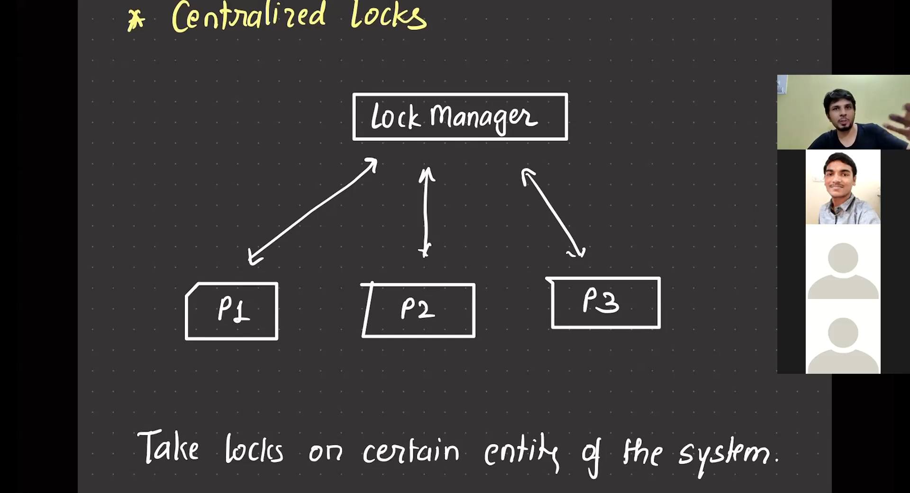
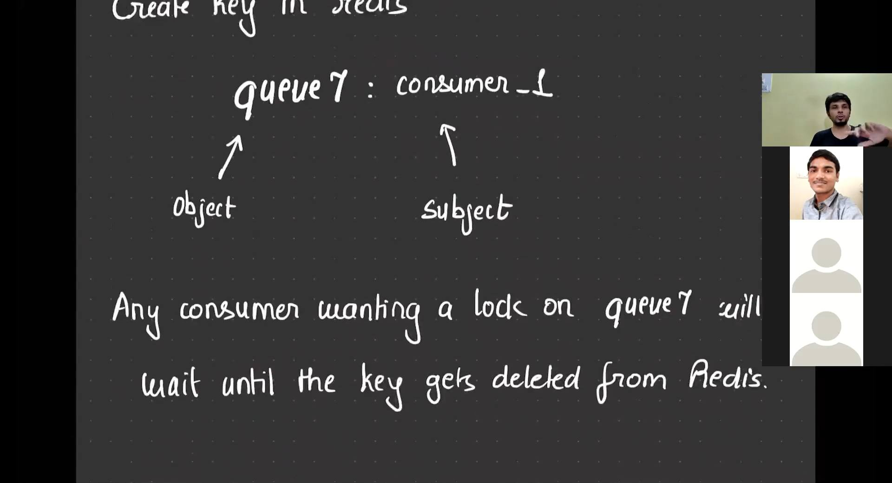
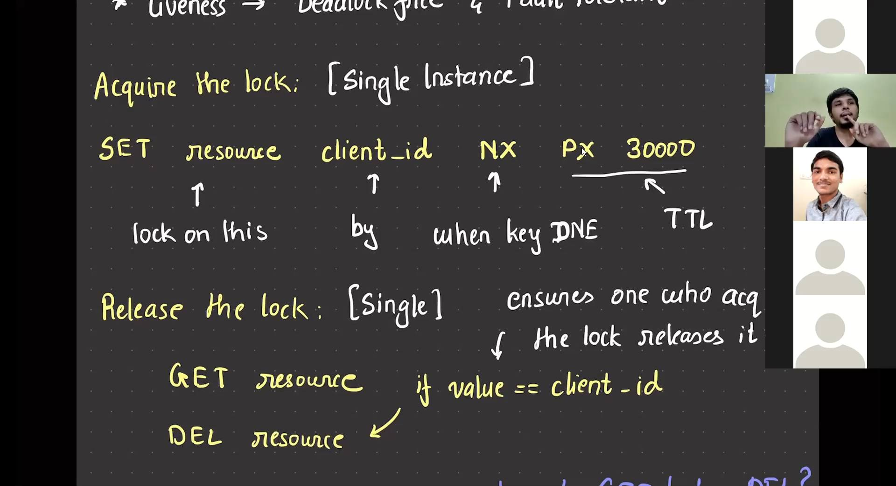
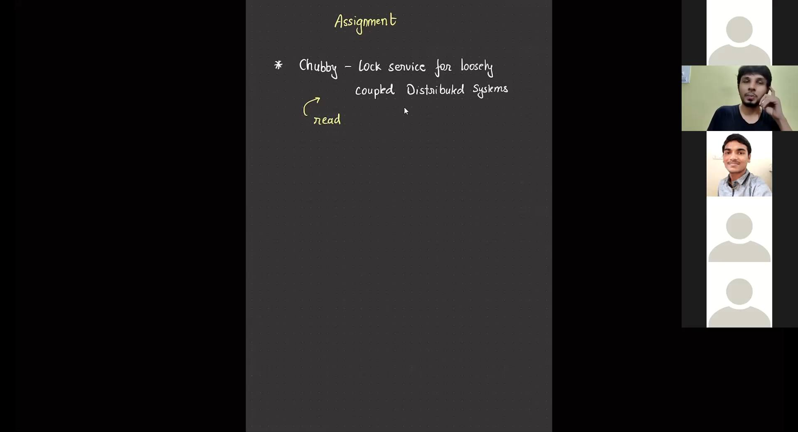

# System Design Masterclass（Arpit）P005：远程锁、分布式锁与 Redlock 复现文档

> 范围说明：本文覆盖 P005 第 3/3 段（116:46–174:20）。逐字稿显示这是一节**系统设计讲解课**，不是完整工程代码课；讲师给了伪代码、Redis 命令和大量架构取舍，但没有给出可直接运行的完整项目。因此本文第 3、4 节把讲师的推导落成可复现实验：用 Redis + Node.js 模拟“多个消费者抢同一个队列锁”，并附“熔断配置轮询”的最小脚本。脚本均标注为示意，不冒充讲师原代码。
>
> 截图清单只有 5 个唯一帧；为满足“≥6 张截图”的硬性要求，第 6 节复用 `p005 145:23` 一次，未改帧号。其余图片均按清单原路径插入。

---

## 1. 这一节做什么

这一节的主线不是“背 Redis 命令”，而是回答三个工程问题：

1. **什么时候真的需要中央锁管理器？**  
   讲师从票务选座、Postman 云端 collection 调度、分布式 cron、SQS 消费者、MongoDB 跨 shard 事务等场景，反复说明：只要多个进程/服务可能同时处理同一个“只能被一个人处理”的资源，就需要某种远程协调。锁的本质是“确保一件事不会被多个执行者同时拿走”。

2. **实现锁的最小必要条件是什么？**  
   讲师的答案非常明确：**原子性（atomicity）**。不是必须先有 Redis，也不是必须先有数据库；任何能提供原子操作的系统，都可以在上面实现锁。Redis 因为内存快、支持 TTL、命令原子，成为常见选择；DynamoDB、SQL、Zookeeper 也都能承担锁管理器角色。

3. **单机 Redis 锁不够时，怎么变成分布式锁？**  
   讲师引出 Redlock：用 5 个独立 Redis master，客户端依次尝试 `SET resource clientId NX PX 30000`，拿到多数派（3/5）才算成功；失败则清理已拿到的部分锁。这样做的目标是消除“单个锁管理器挂掉”的单点故障，但代价是复杂度、时钟/超时/网络分区等分布式系统问题。

本节最后还落到两个工程实践：

- 用 Redis 配置键 `call_profile = 1/0` + 固定轮询间隔做**人工熔断**；
- 区分 **负载均衡器** 与 **API Gateway**：前者假设后端同质，后者假设后端异质，能按路由规则转发，并可能自带缓存、鉴权等能力。

读者是前端转 AI 应用工程师，本文涉及锁/并发时会补一句 Node/JS 对应关系。你不需要先会 Java；本节没有 Java 语法。



---

## 2. 讲师原话（带「—— pNNN [MM:SS]」）

下面不是逐字全录，而是按项目逻辑挑出关键原话/近原话。逐字稿里多处 “logs” 是语音识别对 “locks” 的误写，本文按上下文写“锁”。

> "这是一种范式。这就是实现它的方式……你可以使用 Redis。你可以通过显式加锁在数据库上锁定；也可以使用 SQL 对行加锁。"
> —— p005 [117:42]  
> 讲师强调：锁是范式，实现可以是 Redis、数据库显式锁、SQL 行锁等，不要把它窄化成“只有 Redis 能做”。

> "像 Google Docs 这样的协作文档……并没有有效使用锁。它使用的是三方合并。对它来说锁属于过度设计，因为会拖慢速度。"
> —— p005 [118:36]  
> 协同编辑不是典型锁场景；它更偏向合并/差分同步。讲师还提到可以搜 “differential synchronization” 了解细节。

> "编排器会希望在获取某个待运行任务之前先加锁，因为如果不同编排器获取到同一个任务，本质上就是浪费资源。"
> —— p005 [120:02]  
> Postman 监控调度例子：多个 orchestrator 抢同一个 job，先抢锁再执行，避免重复跑。

> "如果两个任务在同一个 cron 时间执行会怎样……我会收到两封邮件……要构建分布式 cron，锁是其中不可或缺的一部分。"
> —— p005 [121:24]  
> 分布式 cron 如果两台机器都配置 3:55 PM，可能重复发邮件；需要锁保证同一个触发只被一个执行者拿走。

> "只有一项是必不可少的……原子性。因为……如果你的操作具备原子性……其他已经在并行运行的操作就无法干扰它。要么全有，要么全无。"
> —— p005 [122:51]  
> 讲师把 ACID 里的 A（原子性）视为锁管理器的第一必要条件。

> "你可以在任何支持原子性的系统上实现锁……DynamoDB……每个单独的 DynamoDB 操作都是原子的。你可以在 SQL 存储上实现锁，因为 SQL 提供了 ACID……A 就是原子性。"
> —— p005 [125:44]  
> 结论：不要只记“Redis 锁”；有原子操作的地方就能做锁。课里还提到可以用 compare and swap 做应用层原子性。

> "我的消费者运行时，会先获取锁，然后读取消息……再释放锁。这个读取消息的过程正是临界区。"
> —— p005 [129:32]  
> SQS 消费者伪代码：加锁 → 读消息 → 释放锁；读消息是临界区，后续处理可以放在锁外。

> "与其对消息加锁，如果我对队列加锁……谁能从队列中读取消息与流的处理线有关……我会获取 Q7 锁。"
> —— p005 [131:58]  
> 关键细节：因为 `read message` 取的是队列第一条，锁应该加在“读队列”这个动作/队列 ID 上，而不是某条消息 ID 上。

> "TTL 是必需的。否则会出现死锁……经过一定时间……该关联关系会在 TTL 到期后自动删除。"
> —— p005 [130:31]  
> TTL 用来防死锁：持锁者挂了或不释放，锁最终自动过期。讲师举例 TTL 5 分钟，最坏死锁 5 分钟。

> "SET resource clientid NX PX 30000……NX 表示仅当键不存在时才执行这次 SET……PX 给我们提供过期时间。"
> —— p005 [144:16]  
> Redlock 单节点加锁命令：`SET resource clientId NX PX 30000`。讲师对单位说“mostly milliseconds, need to check”；Redis 的 `PX` 实际语义是毫秒，本文按 Redis 语义写。

> "释放锁时……我们先获取锁……只有当取到的值与当前客户端 ID 相同才删除，这样我就不会误删别人的锁。"
> —— p005 [145:15]  
> 释放锁必须先 `GET` 校验持有者，再 `DEL`；不能直接删，否则可能误删别人的锁。

> "五个 Redis 节点。它们全都相互独立。没有复制……客户端会依次经过全部五个主节点……锁必须在多数节点上获取成功……五个节点中多数为三个。"
> —— p005 [147:10]  
> Redlock 主线：5 个独立 master，顺序尝试，拿到 3 个及以上才算成功；失败则去各 master 清理已设置的 key。

> "通常，分布式锁会加在 Zookeeper 上，它是持久化的……即使它宕机再恢复，锁仍然完好。"
> —— p005 [140:28]  
> 问答里补的取舍：Redis 内存型，节点挂了可能丢锁数据；Zookeeper 持久化，适合对锁持久性要求更高的场景。

> "我有一个类似 call_profile 的键，它被设为 1……我只是把这个 1 设为 0……每隔 50 秒，我们向 Redis 发起一次 API 调用，以获取配置的最新值。"
> —— p005 [158:10]  
> 熔断配置例子：Redis 键 `call_profile` 控制是否调用 profile 服务；每 50 秒轮询一次配置，最坏 50 秒内仍可能调用旧逻辑。

> "API Gateway……不会假定其背后的系统是同构的……负载均衡器则会假定其背后的系统是同构的。"
> —— p005 [170:21]  
> API Gateway 按路由规则把异质后端分流；负载均衡器把请求打给同质后端。讲师还提到 API Gateway 可带缓存、鉴权等。



---

## 3. 从零复现

这一节按纯讲解课的复现方式写：**需求 → 约束 → 估算 → 方案 → 取舍**。目标不是复刻一个生产级 Redlock 库，而是让你亲手看到“原子加锁、TTL、校验释放、多数派、熔断轮询”这些决策如何落地。

### 3.1 需求：模拟 SQS 多消费者抢队列

讲师给的假设场景是：

- 有一个 broker/队列，里面有消息；
- 有多个消费者 `C1/C2/C3` 同时消费；
- 我们假设 broker 本身不保证“同一条消息只被一个消费者读走”（讲师明确说这是为了理解锁而做的假设；真实 SQS 在锁方面有自己的处理，课里没展开源码）；
- 应用侧要保证：读消息这个动作一次只被一个消费者执行。

讲师伪代码是：

```text
acquire lock
read message      // critical section
release lock
process message   // 锁外
```

在 JS/Node 里对应什么？Node 单线程只保证“单个进程内”不并行执行 JS 回调，**不保证多个 Node 进程/多台机器之间互斥**。所以仍然需要 Redis 的原子 `SET NX` 作为中央仲裁。

### 3.2 约束：锁管理器必须满足什么

按讲师原话，约束排序如下：

1. **原子性**：加锁动作必须“一个人成功，其他人失败”，不能两个消费者都以为自己拿到了锁。
2. **TTL**：持锁者崩溃/忘记释放时，锁要能自动过期，避免永久死锁。
3. **远程/集中**：消费者在三台不同机器上，锁不能放在各自进程内存里。
4. **释放要校验持有者**：先 `GET` 看 value 是不是自己的 client ID，再 `DEL`。
5. 如果要消除单点故障：单 Redis 不够，需要分布式锁/多数派方案。

### 3.3 估算：用讲师给的数字做一个小容量表

以下数字是**复现假设**，不是讲师给出的生产容量：

| 项目 | 取值 | 算式/说明 |
|---|---:|---|
| 消费者数 C | 3 | 讲师例子里的 C1/C2/C3 |
| 轮询间隔 P | 50 ms | 本文 demo 取值，可调 |
| 加锁尝试 QPS | `C × 1000 / P` | `3 × 1000 / 50 = 60 次/秒` |
| 单实例 Redis 命令量 | 约 `60 × (SET + GET + DEL)` | 约 180 次/秒量级，仅用于本地验证 |
| Redlock 5 master 扇出 | `60 × 5 = 300` 次 SET/秒 | 每个加锁尝试要顺序打 5 个 master |
| 多数派 | `ceil(5/2)=3` | 5 个里至少 3 个成功才算持有锁 |
| Demo TTL | 5000 ms | 大于单次读+删临界区耗时，小于你愿意等待的死锁上限 |
| 讲师举例 TTL | 5 分钟 | 最坏死锁等待 5 分钟 |
| Redlock 命令 TTL | `PX 30000` | 按 Redis 语义为 30000 ms；讲师对单位说需确认 |
| 熔断配置轮询 | 50 秒 | 最坏 50 秒内仍按旧配置调用 |
| 熔断配置 QPS | `N / 50` | N 个服务实例，每个实例每 50 秒拉一次 |

如果你把处理消息的时间设成 200 ms，TTL 必须明显大于“加锁 + 读消息 + 删除消息 + 释放锁”的临界区时间；否则锁会在你还没处理完时过期，另一个消费者可能重复读。讲师说的“TTL 5 分钟”是防止死锁的兜底，不是让你把业务处理拖到 5 分钟。

### 3.4 方案：单 Redis 中央锁

数据模型：

```text
Key:   queue:{queueId}          例如 queue:Q7
Value: consumer:{consumerId}    例如 consumer:1
TTL:   LOCK_TTL_MS              例如 5000ms
```

加锁：

```text
SET queue:Q7 consumer:1 NX PX 5000
```

释放：

```text
GET queue:Q7
# 如果返回值 == consumer:1，才执行：
DEL queue:Q7
```

为什么锁队列而不是锁消息？因为消费者的 `read message` 是“从队列取第一条”，真正要串行化的是“读队列”这个动作。讲师明确说：`read message` 取第一条，所以锁 QID 更合理。

### 3.5 方案：Redlock 五 master 多数派

单 Redis 的风险是：Redis 挂了，锁数据可能丢，整个锁服务单点故障。Redlock 的复现步骤：

1. 准备 5 个独立 Redis master；按讲师这一段的主线，它们不靠主从复制来协调，节点间也不做协调。
2. 客户端生成唯一 `clientId`。
3. 依次对 5 个 master 执行：
   ```text
   SET resource clientId NX PX 30000
   ```
4. 统计成功数量。`>= 3` 才算拿到锁；否则失败。
5. 失败时，对已经设置成功的 master 执行删除，清理部分锁。
6. 释放时，仍然先 `GET` 校验 value 是否等于自己的 `clientId`，再删除。

讲师还提醒：节点数用奇数，因为要多数派；5 个里 3 个成功即可。课里没有展开 Redlock 的时钟漂移、网络延迟、 fencing token 等细节，本文不替讲师补成“他讲过”。



### 3.6 取舍：为什么不是所有场景都用锁

讲师用 Google Docs 做反例：协同编辑如果对文档加锁，一个人编辑时其他人被阻塞，体验很差；它用 three-way merges / fuzzy merges / differential synchronization 这类合并思路，锁是 overkill。  
另一个取舍是 MongoDB 跨 shard 事务：它用远程锁管理器锁文档 ID，能保证跨 shard ACID，但讲师说这也导致分布式事务“terribly slow”，文档不推荐高吞吐重 ACID 场景。  
所以锁不是越多越好：**需要串行化且冲突成本高的地方才上锁；能用合并、幂等、队列分区解决的，优先考虑更轻的方案。**

### 3.7 复现环境与启动命令

课里没讲 Redis/Node 的安装方式。下面是我为复现选择的环境，**不是讲师指定版本**：

- Node.js 20.x
- Redis 7.x（本机 `127.0.0.1:6379` 或你提供的 `REDIS_URL`）
- npm 包 `ioredis`（仅作为 Redis 客户端，非讲师指定）

目录结构：

```text
central-lock-demo/
├── package.json
├── lock-demo.js
└── circuit-breaker.js
```

启动：

```bash
mkdir -p central-lock-demo
cd central-lock-demo
# 把下面第 4 节三个文件保存进来
npm install
# 确保本机 Redis 可用；课里没讲安装，这里只是环境自检
redis-cli ping

# 终端 1：跑队列锁模拟
npm run lock

# 终端 2：跑熔断配置轮询
npm run breaker
```

---

## 4. 完整代码

> 重要声明：**课里没有给出完整工程代码**。下面三段是为复现讲师讲的锁语义而写的示意代码，不是讲师原文件。代码目标是“能保存、能运行、能观察行为”，不是生产级 Redlock 实现。生产级 Redlock 还需要处理超时、重试、时钟、网络分区、释放原子性等问题，课里没有展开。

### 4.1 `package.json`

```json
{
  "name": "central-lock-demo",
  "version": "1.0.0",
  "private": true,
  "type": "module",
  "engines": {
    "node": ">=20"
  },
  "dependencies": {
    "ioredis": "^5.4.1"
  },
  "scripts": {
    "lock": "node lock-demo.js",
    "breaker": "node circuit-breaker.js"
  }
}
```

### 4.2 `lock-demo.js`：模拟多消费者抢队列锁

```js
import Redis from 'ioredis';

const REDIS_URL = process.env.REDIS_URL ?? 'redis://127.0.0.1:6379';
const QUEUE_ID = process.env.QUEUE_ID ?? 'Q7';
const LOCK_TTL_MS = Number(process.env.LOCK_TTL_MS ?? 5000);
const CONSUMER_COUNT = Number(process.env.CONSUMER_COUNT ?? 3);
const MESSAGE_COUNT = Number(process.env.MESSAGE_COUNT ?? 12);
const POLL_MS = Number(process.env.POLL_MS ?? 50);

const redis = new Redis(REDIS_URL);

// 模拟 broker 里的队列。readMessageFromQueue 相当于 SQS 的 read message。
const queue = Array.from({ length: MESSAGE_COUNT }, (_, i) => ({
  id: `msg-${i + 1}`,
  text: `payload-${i + 1}`,
}));

const lockKey = `queue:${QUEUE_ID}`;

function sleep(ms) {
  return new Promise((resolve) => setTimeout(resolve, ms));
}

async function acquireLock(clientId) {
  // 对应讲师命令：SET resource clientId NX PX 30000
  // NX：key 不存在才设置；PX：毫秒级 TTL。
  const result = await redis.set(lockKey, clientId, 'PX', LOCK_TTL_MS, 'NX');
  // 不同 Redis 客户端返回形式可能不同；本 demo 用 ioredis，成功返回 'OK'。
  return result === 'OK';
}

async function releaseLock(clientId) {
  // 讲师强调：先 GET 校验 value 是否等于自己的 clientId，再 DEL。
  const owner = await redis.get(lockKey);
  if (owner === clientId) {
    await redis.del(lockKey);
    return true;
  }
  return false;
}

async function readMessageFromQueue() {
  // 临界区：读第一条并让 broker 删除它。
  // 真实 SQS 的 visibility timeout / message expiration 课里没展开。
  return queue.shift() ?? null;
}

async function processMessage(consumerId, message) {
  // 处理放在锁外，避免长时间占锁。
  await sleep(30 + Math.floor(Math.random() * 70));
  console.log(`[${consumerId}] processed ${message.id} ${message.text}`);
}

async function consumer(consumerId) {
  while (true) {
    const gotLock = await acquireLock(consumerId);
    if (!gotLock) {
      await sleep(POLL_MS);
      continue;
    }

    let message = null;
    try {
      message = await readMessageFromQueue();
      if (message) {
        console.log(`[${consumerId}] read ${message.id}`);
      }
    } finally {
      await releaseLock(consumerId);
    }

    if (!message) {
      await sleep(POLL_MS);
      if (queue.length === 0) return;
      continue;
    }

    await processMessage(consumerId, message);
  }
}

async function main() {
  await redis.ping();
  await redis.del(lockKey);
  console.log(
    `start queue=${QUEUE_ID} messages=${MESSAGE_COUNT} consumers=${CONSUMER_COUNT}`
  );

  await Promise.all(
    Array.from({ length: CONSUMER_COUNT }, (_, i) =>
      consumer(`consumer:${i + 1}`)
    )
  );

  console.log('done');
  await redis.quit();
}

main().catch(async (error) => {
  console.error(error);
  try {
    await redis.quit();
  } catch {
    // 忽略退出时的二次错误
  }
  process.exit(1);
});
```

### 4.3 `circuit-breaker.js`：Redis 配置键 + 50 秒轮询

```js
import Redis from 'ioredis';

const REDIS_URL = process.env.REDIS_URL ?? 'redis://127.0.0.1:6379';
const CONFIG_KEY = process.env.CONFIG_KEY ?? 'call_profile';
const POLL_MS = Number(process.env.POLL_MS ?? 50000);
const PROFILE_URL = process.env.PROFILE_URL ?? 'http://127.0.0.1:3000/profile';

const redis = new Redis(REDIS_URL);
let circuitOpen = false;

async function refreshConfig() {
  // 讲师例子：call_profile = 1 表示可调用，0 表示熔断。
  // 这里用字符串比较，避免 Redis 返回类型差异。
  const value = await redis.get(CONFIG_KEY);
  circuitOpen = value === '0';
  console.log(`[config] ${CONFIG_KEY}=${value} circuitOpen=${circuitOpen}`);
}

async function callProfile(userId) {
  if (circuitOpen) {
    return { skipped: true, reason: 'circuit open' };
  }

  const response = await fetch(
    `${PROFILE_URL}?userId=${encodeURIComponent(userId)}`
  );

  if (!response.ok) {
    throw new Error(`profile status ${response.status}`);
  }

  return response.json();
}

async function main() {
  await refreshConfig();

  // 每 50 秒拉一次配置；最坏 50 秒内仍可能按旧配置调用。
  setInterval(() => {
    refreshConfig().catch((error) => console.error(error));
  }, POLL_MS);

  // 模拟业务侧持续调用 profile；实际接到你的通信服务里。
  setInterval(async () => {
    try {
      const data = await callProfile('u_123');
      console.log('profile result', data);
    } catch (error) {
      console.error('profile call failed', error.message);
    }
  }, 2000);
}

main().catch((error) => {
  console.error(error);
  process.exit(1);
});
```

### 4.4 可直接在 `redis-cli` 复现的锁命令

课里给的 Redlock 单节点命令是 `SET resource clientId NX PX 30000`。下面用 `queue:Q7` 复现，TTL 用 5000 ms 便于观察：

```bash
# 1. 初始化熔断配置：1 = 允许调用
redis-cli SET call_profile 1

# 2. consumer:1 抢 Q7 队列锁
redis-cli SET queue:Q7 consumer:1 NX PX 5000

# 3. consumer:2 再抢，应该失败（因为 NX 且 key 已存在）
redis-cli SET queue:Q7 consumer:2 NX PX 5000

# 4. 释放前先校验持有者
redis-cli GET queue:Q7

# 5. 只有 GET 返回 consumer:1 时，才删除
redis-cli DEL queue:Q7

# 6. 模拟熔断：把 call_profile 改成 0
redis-cli SET call_profile 0
redis-cli GET call_profile
```

返回值请以你实际的 `redis-cli` 输出为准。不同 Redis 版本/客户端对失败返回的展示可能不同；本文不硬编码不存在的字段名。

### 4.5 设计产物：组件职责表

| 组件 | 职责 | 讲师对应说法/取舍 |
|---|---|---|
| Consumer | 生成 clientId，抢锁，读消息，释放锁，锁外处理 | `acquire lock → read message → release lock`；read message 是 critical section |
| Redis 单实例 | 提供原子 `SET NX PX`，保存 `queue:{id} → consumerId` | 内存快；但节点挂了可能丢锁数据 |
| 5 个 Redis master | Redlock 多数派仲裁 | 5 个独立节点，3 个成功才算持有锁 |
| Broker/队列 | 保存消息，读后删除 | 讲师用于模拟 SQS；真实 SQS 的 visibility timeout 课里没展开 |
| Zookeeper | 持久化协调/锁 | 问答里提到：持久，节点回来锁还在 |
| Redis 配置键 | `call_profile = 1/0`，人工熔断 | 每 50 秒轮询，最坏 50 秒旧配置 |
| API Gateway | 异质后端路由、缓存、鉴权 | 不假设后端同质；可按请求匹配转发 |
| Load Balancer | 同质后端分流、指标 | 假设后端同质；讲师提到 LB 有后端指标 |

### 4.6 设计产物：接口/数据模型草案

```text
QueueLock {
  key:       "queue:" + queueId        // 例：queue:Q7
  value:     "consumer:" + consumerId  // 例：consumer:1
  ttlMs:     number                    // 例：5000；Redlock 命令例子 PX 30000
}

MongoCrossShardLock {
  key:       "collection:" + documentId
  value:     "transaction:" + transactionId
  // 讲师用这个模型说明 MongoDB 跨 shard 事务锁文档 ID
}

CircuitBreakerConfig {
  key:       "call_profile"
  value:     "1" | "0"                 // 1 允许调用，0 熔断
  pollMs:    50000
}

QueueMessage {
  id:   string
  text: string
}
```

### 4.7 设计产物：Redlock 决策表

| 决策 | 讲师方案 | 不这样做会怎样 |
|---|---|---|
| 节点数 | 5 个独立 master | 单节点挂掉，锁管理器单点故障 |
| 成功条件 | 多数派 3/5 | 只写 2 个就宣布成功，可能被另一个客户端在另 3 个节点抢到 |
| 节点协调 | 这一段主线是不做复制/协调，节点独立 | 靠复制会引入新的主从一致性问题；讲师说这不是他这里的重点 |
| 失败清理 | 失败后删除已设置的 key | 部分节点残留锁，后续客户端更难拿到多数派 |
| 释放 | GET 校验 clientId 后再 DEL | 直接 DEL 可能误删别人的锁 |
| TTL | `PX` 过期 | 持锁者崩溃会永久死锁 |
| 持久性 | Redis 适合可丢数据；Zookeeper 持久 | 对锁数据 durability 要求高时，纯内存 Redis 可能不够 |



---

## 5. 逐行解释

说明：第 4 节代码是复现讲师锁语义的示意代码，不是讲师原文件；讲师原话没有给出完整工程代码。以下对代码中讲师未讲到的实现细节，均标“课里没讲”。

### 4.1 `package.json`

- `"name": "central-lock-demo"`、`"version": "1.0.0"`：给本地 demo 一个包名和版本，便于 `npm install`/`npm run` 识别项目。不写通常也能跑，但项目元信息不完整；课里没讲 npm 包规范。
- `"private": true`：表示这是本地练习项目，防止误发布到 npm。不写不会影响运行，但存在误发布风险；课里没讲。
- `"type": "module"`：让 Node 把 `.js` 当 ES Module 处理，所以下面能写 `import Redis from 'ioredis'`。不写时 Node 默认按 CommonJS 处理，直接运行含 `import` 的 `.js` 可能报模块语法错误；课里没讲 Node 模块系统，这是复现代码的选择。
- `"engines": { "node": ">=20" }`：声明复现环境用 Node 20 及以上。`circuit-breaker.js` 使用全局 `fetch`，Node 版本过低可能没有或行为不同。不写不会阻止运行，但环境不匹配时排错更难；课里没讲 Node 版本要求。
- `"dependencies": { "ioredis": "^5.4.1" }`：引入 Redis 客户端，代码里的 `new Redis(...)`、`redis.set/get/del` 都依赖它。不装这个依赖，`npm run lock` 和 `npm run breaker` 会在 import 阶段失败；课里没指定 Redis 客户端，`ioredis` 是复现选择。
- `"scripts": { "lock": "node lock-demo.js", "breaker": "node circuit-breaker.js" }`：把两个入口命令固定下来，方便用 `npm run lock`、`npm run breaker` 启动。不写脚本也能手动 `node lock-demo.js`，但复现步骤更容易出错；课里没讲 npm scripts。

### 4.2 `lock-demo.js`

- `import Redis from 'ioredis';`：引入 Redis 客户端。没有它就无法执行后面的 `SET NX PX`、`GET`、`DEL`。课里没指定客户端。
- `const REDIS_URL = process.env.REDIS_URL ?? 'redis://127.0.0.1:6379';`：允许用环境变量覆盖 Redis 地址，默认本机 Redis。这样复现时不必改代码。不这么写就只能在代码里硬编码地址，换环境要改源码；课里没讲环境变量。
- `QUEUE_ID`、`LOCK_TTL_MS`、`CONSUMER_COUNT`、`MESSAGE_COUNT`、`POLL_MS` 这几个环境变量：分别控制队列 ID、锁 TTL、消费者数、消息数、轮询间隔。这样第 3 节的估算参数能直接调。不这么写则参数写死，做 TTL/并发实验不方便；课里没讲这些变量名，是复现设计。
- `const redis = new Redis(REDIS_URL);`：创建 Redis 连接。不创建客户端，后面的 `redis.set/get/del` 都不存在。
- `const queue = Array.from(...)`：用内存数组模拟 broker 里的队列，元素是 `{ id, text }`。`readMessageFromQueue` 会 `shift()` 取第一条，模拟“读消息并从队列删除”。不这么写就没有可消费的消息。真实 SQS 的 visibility timeout、消息可见性等，课里没展开。
- `const lockKey = \`queue:${QUEUE_ID}\`;`：锁键是队列维度，例如 `queue:Q7`。这对应讲师强调的“锁 Q7/锁读队列动作”，而不是锁某条消息 ID。若锁消息 ID，就保护不了“读第一条”这个队列级动作；课里讲的是锁队列 ID。
- `function sleep(ms)`：把 `setTimeout` 包成 Promise，供轮询等待和模拟处理耗时使用。不写这个辅助函数，异步等待会重复写。
- `async function acquireLock(clientId)`：
  - `redis.set(lockKey, clientId, 'PX', LOCK_TTL_MS, 'NX')`：一条原子命令完成“不存在才设置 + 设置毫秒级过期”。`NX` 保证只有一个消费者能设置成功；`PX` 保证持锁者崩溃后锁能自动过期。不加 `NX`，后一个消费者会覆盖前一个消费者的锁；不加 `PX`，持锁者不释放就永久死锁。对应讲师命令 `SET resource clientId NX PX 30000`。
  - `return result === 'OK';`：ioredis 成功时返回 `'OK'`，失败时不是 `'OK'`。不判断返回值，就会把“没抢到锁”误当“抢到了”，多个消费者会同时进临界区。
- `async function releaseLock(clientId)`：
  - `const owner = await redis.get(lockKey);`：释放前先读当前锁的持有者。讲师明确要求先 `GET` 校验，不能直接 `DEL`。
  - `if (owner === clientId) { await redis.del(lockKey); return true; }`：只有值等于自己的 `clientId` 才删除。不校验就直接删，可能误删别人的锁，例如自己的锁已过期、别人重新拿到锁后，自己再把别人的锁删掉。
  - `return false;`：不是自己的锁就不删。这样不会破坏别人的临界区。
- `async function readMessageFromQueue()`：`queue.shift() ?? null` 取第一条并删除，空队列返回 `null`。这是讲师伪代码里的 `read message` 临界区。真实 broker 读后是否删除、可见性超时怎么处理，课里没讲。
- `async function processMessage(consumerId, message)`：
  - `await sleep(30 + Math.floor(Math.random() * 70));`：模拟处理耗时，让日志看起来有并发。不模拟耗时，处理瞬间结束，不容易观察“处理在锁外”。
  - `console.log(...processed...)`：输出处理结果，便于检查每个消息是否只被处理一次。
- `async function consumer(consumerId)`：
  - `while (true)`：消费者持续抢锁、读消息，直到队列空退出。没有循环就只消费一次。
  - `const gotLock = await acquireLock(consumerId);`：每轮先抢锁。抢锁在“读队列”之前，符合讲师 `acquire lock → read message → release lock`。
  - `if (!gotLock) { await sleep(POLL_MS); continue; }`：没抢到锁就等待再试，避免忙循环。不等待会高频打 Redis，浪费资源；课里没讲具体轮询间隔怎么选，`POLL_MS` 是复现参数。
  - `let message = null; try { message = await readMessageFromQueue(); ... } finally { await releaseLock(consumerId); }`：把读消息放在 `try`，释放锁放在 `finally`。这样即使读队列抛错，也会尝试释放锁；不写 `finally` 可能异常后锁一直占着，直到 TTL 过期。
  - `if (message) console.log(...read...)`：记录读到了哪条消息。这个日志用于验证同一条消息不会被多个消费者读到。
  - `if (!message) { await sleep(POLL_MS); if (queue.length === 0) return; continue; }`：读到空时先等一会儿；如果队列确实空了就退出，否则继续下一轮。不判断空队列，消费者可能永远空转；课里没讲这个退出细节，是 demo 设计。
  - `await processMessage(consumerId, message);`：处理消息放在释放锁之后。讲师伪代码也是 `process message` 在锁外。若把处理放锁内，长时间处理会占锁，降低吞吐，并增加锁 TTL 过期后别人重复读的风险。
- `async function main()`：
  - `await redis.ping();`：启动时先确认 Redis 可连通。不先 ping，后面 `SET` 失败时报错位置不够直观。`redis-cli ping` 的具体输出课里没讲。
  - `await redis.del(lockKey);`：清掉上一次 demo 可能残留的锁。不清理的话，上次异常退出留下的锁可能让本次启动先抢不到锁；不过 TTL 最终也会让它过期。
  - `console.log(start...)`：输出启动参数，便于确认消息数、消费者数是否符合预期。
  - `await Promise.all(...consumer...)`：并发启动多个消费者，等所有消费者退出。不并发就只有单消费者，看不到抢锁行为。
  - `console.log('done'); await redis.quit();`：所有消费者结束后输出 `done` 并关闭连接。不 `quit` 可能让进程因连接未关闭而挂住。
- `main().catch(...)`：
  - `console.error(error)`：打印错误。
  - `try { await redis.quit(); } catch {}`：退出前尽量关闭连接；忽略二次错误，避免掩盖原始错误。
  - `process.exit(1);`：失败时用非零退出码。不设置退出码，脚本自动化时不容易判断失败。

### 4.3 `circuit-breaker.js`

- `import Redis from 'ioredis';`：同样用于读 Redis 配置键。没有它就无法读取 `call_profile`。
- `REDIS_URL`、`CONFIG_KEY`、`POLL_MS`、`PROFILE_URL`：分别允许覆盖 Redis 地址、配置键名、轮询间隔、被调用服务地址。默认 `call_profile`、`50000` 毫秒、`http://127.0.0.1:3000/profile`。不这么写就写死配置，实验不方便；课里没讲这些环境变量。
- `const redis = new Redis(REDIS_URL);`：创建 Redis 连接。
- `let circuitOpen = false;`：本地熔断状态，默认关闭。关闭表示允许调用 profile 服务。不做本地状态，每次调用都读 Redis 会增加依赖和延迟；课里讲的是每 50 秒轮询配置，不是每次调用都拉配置。
- `async function refreshConfig()`：
  - `const value = await redis.get(CONFIG_KEY);`：从 Redis 取 `call_profile`。讲师例子是 `1` 表示可调用、`0` 表示熔断。
  - `circuitOpen = value === '0';`：用字符串比较，Redis 返回值按字符串处理。`value` 为 `'0'` 时打开熔断；为 `'1'` 时关闭；key 不存在时为 `null`，按代码会得到 `circuitOpen=false`。key 不存在时默认允许调用，课里没讲这个默认策略。
  - `console.log(...)`：打印当前配置和熔断状态，便于确认轮询是否生效。
- `async function callProfile(userId)`：
  - `if (circuitOpen) { return { skipped: true, reason: 'circuit open' }; }`：熔断打开时直接跳过，不再向故障服务发请求。讲师讲熔断的目的就是“知道下游不行时不要再打它”，避免继续加压导致级联失败。不跳过就会继续调用坏服务。
  - `const response = await fetch(...)`：真正请求 profile 服务。`encodeURIComponent(userId)` 防止 userId 里的特殊字符破坏 query。课里没讲 URL 编码细节。
  - `if (!response.ok) throw new Error(...)`：HTTP 非 2xx 视为失败。不检查状态码，可能把错误响应当正常结果。
  - `return response.json();`：解析 JSON 返回。不解析就无法拿到业务数据。
- `async function main()`：
  - `await refreshConfig();`：启动时先拉一次配置。不先拉，启动后最多要等一个轮询周期才知道配置。
  - `setInterval(() => { refreshConfig().catch(...) }, POLL_MS);`：每 50 秒刷新一次配置。讲师例子是最坏 50 秒内仍按旧配置调用。不轮询，Redis 里把 `1` 改成 `0` 后本地永远不生效。
  - `setInterval(async () => { ... callProfile('u_123') ... }, 2000);`：每 2 秒模拟一次业务调用，用于观察熔断前后行为。实际应接到通信服务里；课里没讲这个 2 秒间隔，是 demo 设计。
  - `console.log('profile result', data);`：输出调用结果。熔断打开时会输出 `{ skipped: true, reason: 'circuit open' }`。
  - `console.error('profile call failed', error.message);`：profile 服务不可达或非 2xx 时输出失败。注意：这里失败不等于熔断生效；熔断只看 `circuitOpen`。
- `main().catch(...)`：启动失败时打印错误并用退出码 1 退出。不处理会留下未处理 Promise。

### 4.4 `redis-cli` 复现命令

- `redis-cli SET call_profile 1`：初始化熔断配置为“允许调用”。不先初始化，`circuit-breaker.js` 读到 `null`，按代码会当作不熔断；课里没讲 key 缺失时应该默认什么。
- `redis-cli SET queue:Q7 consumer:1 NX PX 5000`：模拟第一个消费者抢锁。`NX` 表示 key 不存在才成功，`PX 5000` 表示 5 秒后自动过期。没有 `NX` 会覆盖已有锁；没有 `PX` 会永久死锁。
- `redis-cli SET queue:Q7 consumer:2 NX PX 5000`：模拟第二个消费者抢同一把锁，应该失败，因为 key 已存在。若这里也成功，说明 `NX` 没生效或锁 key 不一致。
- `redis-cli GET queue:Q7`：释放前先看持有者。应该看到 `consumer:1`（具体输出以实际 `redis-cli` 为准）。讲师强调释放前必须校验，不能直接删。
- `redis-cli DEL queue:Q7`：只有确认 `GET` 返回的是自己的 `clientId` 时才删除。文档用命令演示顺序；真实代码中是在 `releaseLock` 里先 `GET` 再比较再 `DEL`。直接无脑 `DEL` 的风险是误删别人的锁。
- `redis-cli SET call_profile 0`：模拟人工熔断。之后 `circuit-breaker.js` 下一次轮询会读到 `0` 并打开熔断。
- `redis-cli GET call_profile`：确认配置已变成 `0`。若仍是 `1`，轮询逻辑会继续允许调用。

### 4.5 组件职责表的设计决策

- Consumer 负责生成 `clientId`、抢锁、读消息、释放锁，并把处理放在锁外：对应讲师 `acquire lock → read message → release lock`，`read message` 是临界区。若把处理也放锁内，会长时间占锁；课里没讲生产级处理耗时如何控制。
- Redis 单实例负责原子 `SET NX PX`，保存 `queue:{id} → consumerId`：因为讲师把原子性视为锁的第一必要条件，Redis 的 `SET NX PX` 是单命令原子操作。若不用原子命令，两个消费者可能同时判断“锁不存在”再都写入。
- 5 个独立 Redis master 负责 Redlock 多数派：目标是消除单锁管理器单点故障，3/5 成功才算持有锁。课里没有给可运行的 5 master 代码，只讲了方案。
- Broker/队列负责保存消息，读后删除：demo 用数组 `shift()` 模拟。真实 SQS 的 visibility timeout、消息过期、重复投递等，课里没展开。
- Zookeeper 负责持久化协调/锁：讲师在问答里说它持久，节点回来锁还在。若对锁数据持久性要求高，纯内存 Redis 可能不够；课里没讲 Zookeeper 的具体 API。
- Redis 配置键负责 `call_profile = 1/0` 人工熔断：每 50 秒轮询，最坏 50 秒旧配置。若不轮询，配置变更不生效；若每次调用都读 Redis，则增加对 Redis 的实时依赖。
- API Gateway 负责异质后端路由、缓存、鉴权：讲师强调它不假设后端同质，能按路由规则转发。若把异质服务硬塞给普通负载均衡器，它不按业务路由区分。
- Load Balancer 负责同质后端分流和指标：讲师强调它假设后端同质。若后端不同质却只用普通 LB，可能把请求转到不具备该能力的服务。

### 4.6 接口/数据模型草案的设计决策

- `QueueLock.key = "queue:" + queueId`：锁队列而不是锁消息，因为 `read message` 取的是队列第一条。若锁消息 ID，无法保证“读第一条”这个动作互斥；讲师明确讲锁 Q7。
- `QueueLock.value = "consumer:" + consumerId`：保存持有者身份，释放时才能校验“是不是我”。若 value 只写 `1` 或不写，无法安全释放，可能误删别人锁。
- `QueueLock.ttlMs`：例如 5000，Redlock 命令例子 `PX 30000`。TTL 是防死锁兜底。若没有 TTL，持锁者崩溃后锁永久存在。
- `MongoCrossShardLock.key = "collection:" + documentId`、`value = "transaction:" + transactionId`：讲师用这个模型说明 MongoDB 跨 shard 事务锁文档 ID。若没有这种锁，跨 shard ACID 难保证；但讲师也说分布式事务会很慢，文档不推荐高吞吐重 ACID 场景。具体实现课里没讲。
- `CircuitBreakerConfig.key = "call_profile"`、`value = "1" | "0"`、`pollMs = 50000`：1 允许调用，0 熔断，50 秒轮询一次。若 `pollMs` 太大，配置生效更慢；太小则增加 Redis 访问。讲师例子是 50 秒，最坏 50 秒旧配置。
- `QueueMessage { id, text }`：demo 只需要消息 ID 和内容。真实 SQS 消息还包含 receipt handle、可见性超时等，课里没讲。

### 4.7 Redlock 决策表的设计决策

- 节点数用 5 个独立 master：为了多数派仲裁并降低单点故障。若只用单 Redis，Redis 挂了锁服务就单点故障；讲师还提醒 Redis 内存型可能丢锁数据。
- 成功条件是多数派 3/5：只有拿到多数派才算持有锁。若只写 2 个就宣布成功，另一个客户端可能在另外 3 个节点抢到锁，出现两个客户端都以为自己持锁。
- 这一段主线是节点不复制、不协调：讲师说 5 个独立 master，靠客户端顺序尝试。若靠复制协调，会引入新的主从一致性问题；讲师说这不是他这里的重点。
- 失败后清理已设置的 key：失败时可能只在部分 master 上设置成功，必须删掉，否则残留锁会让后续客户端更难拿到多数派。
- 释放时先 `GET` 校验 `clientId` 再 `DEL`：不校验可能误删别人的锁。讲师明确强调这一点。
- 用 `PX` 设置 TTL：防止持锁者崩溃后永久死锁。课里对单位说“mostly milliseconds, need to check”；本文按 Redis 语义 `PX` 是毫秒。
- Redis 适合可丢数据，Zookeeper 持久：对锁数据 durability 要求高时，纯内存 Redis 可能不够；Zookeeper 节点回来后锁还在。Redlock 的时钟漂移、网络延迟、fencing token 等细节，课里没讲。

## 6. 复现检查清单

- [ ] 检查 Node 环境：运行 `node -v`，应看到版本满足 `package.json` 的 `>=20`；若低于 20，`circuit-breaker.js` 的全局 `fetch` 可能不可用。课里没讲具体安装方式。
- [ ] 检查 Redis 连通：运行 `redis-cli ping`，应看到 Redis 返回连通响应（具体输出课里没讲）；若连不上，先修正 `REDIS_URL` 或本机 Redis。
- [ ] 检查依赖安装：在 `central-lock-demo/` 下运行 `npm install`，应成功安装 `ioredis`，没有网络/权限错误；若失败，后面两个脚本都会在 import 阶段失败。
- [ ] 检查队列锁启动日志：运行 `npm run lock`，应看到类似 `start queue=Q7 messages=12 consumers=3`；若参数不同，应与你设置的环境变量一致。
- [ ] 检查消息只被读一次：观察 `lock-demo.js` 日志，`msg-1` 到 `msg-12` 每个应只出现一次 `read`；若同一消息被两个消费者 `read`，说明锁互斥或队列模拟有问题。
- [ ] 检查消息只被处理一次：观察日志，每个消息应只出现一次 `processed`；若重复处理，检查是否把处理放进了锁内/锁外逻辑写错，或 TTL 是否过短。
- [ ] 检查脚本正常结束：所有消息处理完后应看到 `done`；若长期不结束，检查空队列退出条件和消费者轮询逻辑。
- [ ] 检查锁 key 存在时的 TTL：在另一个终端执行 `redis-cli PTTL queue:Q7`（课里没讲查看 TTL 的命令，可用你环境支持的命令），应看到剩余毫秒在递减，最终 key 消失；若永不过期，说明 `PX` 没生效。
- [ ] 检查第二个消费者抢锁失败：先执行 `redis-cli SET queue:Q7 consumer:1 NX PX 5000`，再执行 `redis-cli SET queue:Q7 consumer:2 NX PX 5000`，第二条应失败（具体输出以实际 `redis-cli` 为准）；若第二条也成功，说明 `NX` 没生效或 key 不一致。
- [ ] 检查释放前校验：执行 `redis-cli GET queue:Q7`，应看到当前持有者如 `consumer:1`；不要直接 `DEL`，应先确认返回的是自己的 `clientId` 再删。若未校验就 `DEL`，可能误删别人的锁。
- [ ] 检查锁外处理：观察 `read msg-x` 与 `processed msg-x` 之间是否已释放锁；demo 中处理在 `releaseLock` 之后，日志应表现为读消息和处理可以交错。课里没讲如何用日志严格测“锁外”，只能按代码结构核对。
- [ ] 检查熔断初始配置：先执行 `redis-cli SET call_profile 1`，再运行 `npm run breaker`，应看到 `[config] call_profile=1 circuitOpen=false`。
- [ ] 检查熔断打开：在 breaker 运行中执行 `redis-cli SET call_profile 0`，最多等 50 秒，应看到 `[config] call_profile=0 circuitOpen=true`；之后应看到 `profile result { skipped: true, reason: 'circuit open' }`，表示不再因熔断状态调用 profile 服务。
- [ ] 检查轮询延迟：把 `call_profile` 从 `1` 改成 `0` 后，立刻看日志可能仍是 `circuitOpen=false`；最坏 50 秒内仍可能按旧配置调用，之后才变 `true`。这是讲师说的 50 秒轮询代价。
- [ ] 检查 key 缺失行为：执行 `redis-cli DEL call_profile` 后，breaker 下一次轮询会读到 `null`，按代码 `circuitOpen=false`；课里没讲 key 不存在时应该默认允许还是熔断，这里只核对代码行为。
- [ ] 检查 redis-cli 锁命令顺序：先 `SET call_profile 1`；再 `SET queue:Q7 consumer:1 NX PX 5000` 应成功；再 `SET queue:Q7 consumer:2 NX PX 5000` 应失败；`GET queue:Q7` 应返回 `consumer:1`；`DEL queue:Q7` 后再 `GET` 应为空。具体失败输出以实际 `redis-cli` 为准。
- [ ] 检查 Redlock 设计是否只是核对而非已跑通：第 4 节没有给出 5 个 Redis master 的可运行代码，只能核对决策表：5 个独立 master、3/5 多数派、失败清理、GET 校验后 DEL、PX TTL。Redlock 的时钟漂移、网络延迟、fencing token 等，课里没讲，不能声称已实现。
- [ ] 检查真实 SQS 语义未复现：demo 用数组 `shift()` 模拟读后删除，真实 SQS 的 visibility timeout、重复投递、消息确认等课里没展开；不要把 demo 当作生产 SQS 锁实现。
- [ ] 检查设计产物中的 Zookeeper/LB/API Gateway 没有对应代码：这些是讲师的设计讨论，第 4 节没有可运行实现；复现时应能复述“Zookeeper 更持久”“LB 假设后端同质”“API Gateway 不假设后端同质、可按路由转发”这些区别。
- [ ] 检查所有“课里没讲”项已标注：Node 安装、Redis 安装、`ioredis` 选型、全局 `fetch`、URL 编码、TTL 查看命令、SQS visibility timeout、Redlock 超时/时钟/fencing token 等均未在课里展开；若文档或脚本声称这些是讲师原话，应删除或标注为复现补充。
