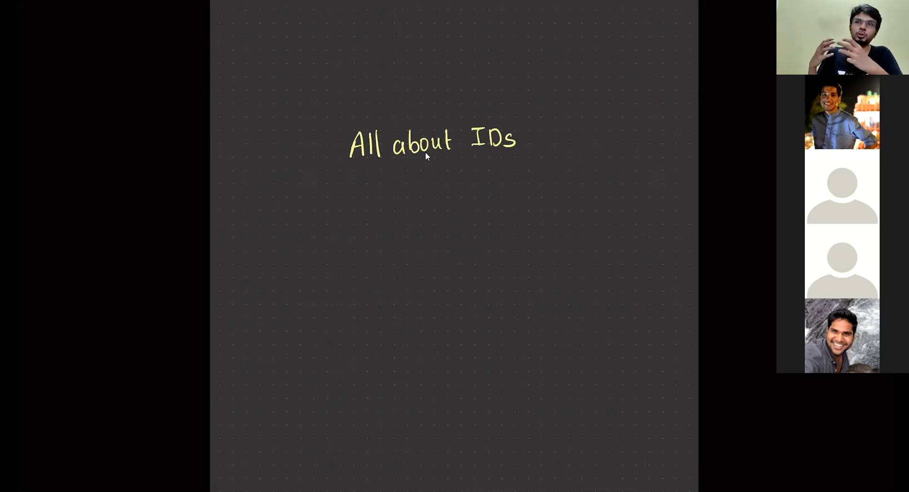
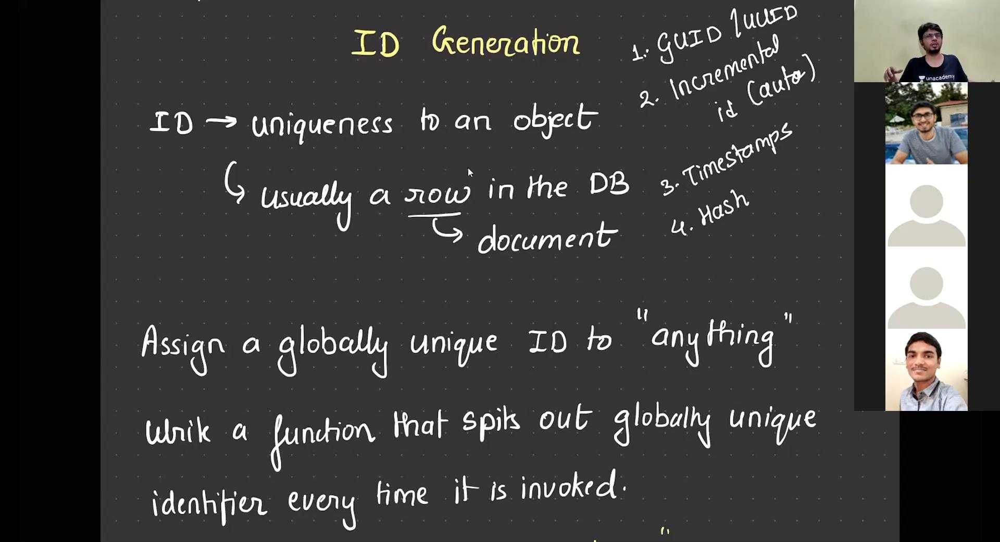
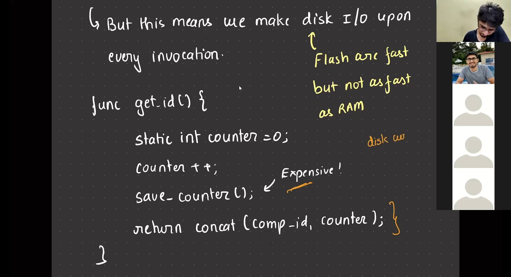
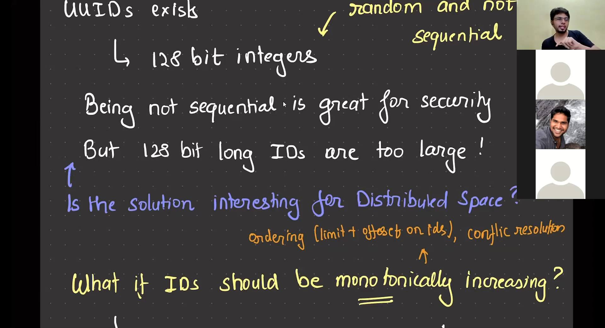

# System Design Masterclass (Arpit) P006 复现文档：课程 LMS 技术选型与全局 ID 生成

## 1. 这一节做什么

P006 是一节“系统设计推导课”，不是手把手部署课。它包含两条主线：

1. **讲师自己的课程 LMS 是怎么选型的**：前端 Nuxt/Vue + Bulma，静态站放 Netlify；后端 Flask 跑在 AWS Lambda，前面接 API Gateway 和 Route53；认证用 magic link + JWT + IP 级单会话检查；图片用 GitHub 当 CDN，视频嵌 Vimeo，笔记计划放 S3。核心约束不是“架构先进”，而是**一人公司、流量突发、成本优先、开发速度优先**。
2. **全局唯一 ID 怎么从零推导出来**：从 `epoch milliseconds` 开始，逐步发现同毫秒、多线程、多机器、进程重启、磁盘 IO 太贵、单调递增、分页、冲突解决、数据库锁等问题，最后落到“时间放最高位 + 机器标识 + 计数器 + 定期落盘检查点”的方案。

本文按“可复现”重写：LMS 部分复现的是**架构决策和取舍表**，因为逐字稿没有给出 Lambda 配置、API Gateway 路由、Flask 源码、Netlify 构建命令；ID 部分则给出一个**可直接保存运行的 Node.js 示意实现**，把讲师的推导落成一个能跑的文件。课里没有代码，所以代码部分会明确标注“以下为示意”。


---

## 2. 讲师原话（带「—— p006 [MM:SS]」）

下面只摘与复现直接相关的原话，不按时间流水账排列，而按项目决策归类。

**关于 LMS 后端与部署：**

> “The entire deployment is done on AWS Lambda connected to AWS API gateway... connected to my route 53 domain... api.dugup.com points to one AWS lambda... that AWS lambda has this flask server running.”
>
> —— p006 [03:20]

> “The back end deployment is done on AWS Temra. Frontend is hosted on Netlify because it's a static site.”
>
> —— p006 [04:49]

逐字稿里的 “AWS Temra” 是转写结果，课里没有给出对应部署脚本或服务细节，因此本文不把它扩写成具体工具名。LMS 可复现的是决策：**静态前端 + 无服务器 API + 按请求计费**。

**关于前端和静态化：**

> “For front end, I used NuxJS... I'm a big fan of ViewJS... I've used Bulma... it's a static site. It's not a dynamics. I don't really need a server to run this.”
>
> —— p006 [04:19] / [04:49]

> “For the first load, it would go to the Netlify server... pre-generated HTML content... once it loads, then the normal API called request actually takes care of the entire application.”
>
> —— p006 [05:17]

这里讲的是典型的静态首屏 + 客户端 API 拉取。逐字稿口头说 “NuxJS”，通常指 NuxtJS；课里没有展开 `nuxt.config`、构建命令或部署目录，所以本文不编造这些文件。

**关于认证和会话：**

> “Authentication is done via magic link. Basically, the token I use is JWT token, which works for 30 days... only one session remains active at a time. So I've done IP level checks.”
>
> —— p006 [08:58]

> “Every time you do a login, it would send you a magic link onto your email clicking on which will verify the magic link and would log you out from all other sessions.”
>
> —— p006 [09:28]

**关于 Lambda 冷启动和保温取舍：**

> “One lambda for each request, but AWS might choose to not spin up a new container to run the lambda... once I've started my container, I can keep my container running... It waits for some time... if any request comes up, it would be forwarded to the same running container.”
>
> —— p006 [14:04] / [15:31]

> “I accidentally deployed sqs consumer on lambda... sqs does not notify... it's a pull-based thing... it used to ping every five seconds... I billed about $5 that month without even consuming any message.”
>
> —— p006 [17:53] / [18:19]

这段是成本取舍的关键：保温能减少冷启动，但误把拉取型消费者放在 Lambda 上，会让 Lambda 持续运行并计费。课里没有给 SQS 消费者代码，本文只复现这个教训。

**关于 ID 生成的第一版：**

> “Get epoch milliseconds... every time it is invoked, it would be invoked at a particular instant in time which is kind of unique.”
>
> —— p006 [27:09]

> “What if this function is invoked twice in the same millisecond?... multiple threads... or multiple machines... your ID is not unique.”
>
> —— p006 [27:37] / [28:32]

**关于机器 ID、计数器和磁盘持久化：**

> “Append or prepend your computer id or your server id or your thread id... concatenating computer ID and then your time.”
>
> —— p006 [29:01] / [29:58]

> “We have a static counter... computer ID, the time, and a counter... counter is always auto incrementing.”
>
> —— p006 [30:57]

> “Once the machine reboots my counter would be reset to zero... we would store the counters on the disk... every time I'm updating the counter... disk IO, which is expensive.”
>
> —— p006 [32:52] / [33:50]

> “Instead of writing it every time we do it once every thousand thoughts... upon every boot, it would load it from the disk, do a plus 1000.”
>
> —— p006 [35:13] / [35:42]

**关于 UUID、顺序性和单调递增：**

> “UUIDs are 128-bit integers... randomly assigned ones and zeros and they are not sequential... it is great for security.”
>
> —— p006 [38:03] / [39:26]

> “128 bit integers, they are too big for any database to hold... imagine storing a billion rows.”
>
> —— p006 [40:25] / [40:53]

> “If you want to know which event happened before the other... conflict resolution... taking locks on the database.”
>
> —— p006 [42:50] / [45:14]

> “Instead of prepending computer ID to the time, append computer ID to the time... time being on the left side... time is the MSB... your IDs with time will always move forward.”
>
> —— p006 [46:42] / [47:09]

---

## 3. 从零复现

这一节按“需求 → 约束 → 估算 → 方案 → 取舍”复现，不按视频页码复述。

### 3.1 LMS 部分：先复现决策，不要假装能一键部署

**需求。** 讲师要的是一个课程 LMS：课程 agenda、视频、笔记/内容、登录认证、课程访问权限检查、学员管理、费用跟踪、退款、邮件模板、复制课程等。逐字稿提到 educator 侧有“copy course”按钮，能把已有课程复制成下一期课程，再改 agenda 和直播链接。

**约束。**

- 一人公司，开发速度比语言性能更重要。
- 流量不是持续高并发，而是上课前后突发；平时可能很低。
- 不想长期维护 EC2 和数据库。
- 前端讲师熟悉 Vue，所以选 Vue 生态的 Nuxt 抽象。
- 开源 LMS 的定制能力不够。讲师提到 Open edX / Moodle “looked really bad”，并且至少需要能跑数据库的机器，成本 and 定制都不合适。
- 课程内容不是全部静态公开：视频可以嵌 Vimeo，图片可以公开，但“这个人有没有权限访问这门课”必须动态检查。

**估算。** 课里给的量级是：Lambda 每月有 1 百万次调用免费额度；到 5 百万次量级仍然很便宜，讲师说约 `$2` 量级，加税约 `$3` 量级。这个数字应以实际 AWS 账单为准，课里没有给完整计价公式。相对地，EC2 是持续运行、持续计费；在流量不连续时，Lambda 更划算。另一个反例是误把 SQS consumer 部署到 Lambda：它每 5 秒拉一次，导致 Lambda 持续运行，讲师说那个月没消费消息也 bill 了约 `$5`。

**方案。**

- 前端：Nuxt/Vue + Bulma，静态生成，部署到 Netlify。
- 首屏：Netlify 提供预生成 HTML；页面加载后，前端再调用 API 拿动态数据。
- API：API Gateway → Lambda → Flask。
- 域名：Route53 指向 API 域名，例如逐字稿中的 `api.dugup.com`。
- 认证：magic link 邮件登录；JWT 有效期 30 天；同一时间只允许一个会话；用请求 IP 做额外检查。
- 图片：GitHub 当 CDN，减少对象存储成本。
- 视频：Vimeo 嵌入。
- 笔记：计划放 S3，但课里说还需要创建 bucket，说明当时未完全落地。
- 权限：不能做纯静态全公开站点，因为“用户是否有这门课权限”必须动态查。

**取舍。**

- 不保温 Lambda：第一请求有冷启动，但成本低；讲师曾因 SQS consumer 误部署被计费，因此不轻易保温。
- 不用 EC2：除非流量持续到值得长期开机。
- 不用开源 LMS：定制和托管成本不划算。
- 用 GitHub 存图片：是成本 hack，不是通用大流量 CDN 方案。



### 3.2 ID 生成部分：按讲师推导一步步复现

**第 1 步：用 epoch milliseconds 做 ID。**

```text
id = Date.now()  // 毫秒时间戳
```

这能保证“每次调用时间点不同”时唯一。问题是同一毫秒内可能调用多次。

**第 2 步：发现同毫秒冲突。**

冲突来源有两类：

- 同一台机器多线程/多协程在同一毫秒调用。
- 多台机器在同一毫秒调用。

毫秒粒度很粗，CPU 很快，所以同毫秒完全可能。

**第 3 步：加入机器/线程标识。**

```text
id = computerId + time
```

或者 `time + computerId`。这样不同机器不会因为同一毫秒而碰撞。课里说 computer ID 可以是 thread ID、server ID、system ID、MAC 地址哈希等，关键是“能区分碰撞来源”。

**第 4 步：同一台机器同一毫秒仍然冲突，引入计数器。**

```text
id = computerId + time + counter
counter++  // 静态/全局计数器
```

计数器每次调用自增，解决同机同毫秒多次调用。

**第 5 步：发现计数器重启归零。**

计数器放在内存/堆里，机器重启后从 0 开始，会和历史 ID 碰撞。于是要把计数器持久化到磁盘。

**第 6 步：每次写磁盘太贵，改成检查点。**

不要每次 `counter++` 都写盘。每 1000 次写一次盘；启动时从磁盘读最后检查点，然后加 1000 再开始。这样最多浪费一段计数区间，但避免重启碰撞，同时把磁盘 IO 降低到 1/1000。

**第 7 步：让 ID 单调递增，把时间放左边。**

课里强调：把时间放在最高位/最左边。因为时间总是向前走，所以生成的 ID 在字典序/数值序上总体向前。最终形态可以写成：

```text
id = time | machineId | counter
```

这里的 `|` 表示拼接，不是位运算。课里没有规定具体位宽、分隔符和编码，所以复现时可以用字符串拼接，也可以用位打包；本文用可读的字符串拼接做示意。

**第 8 步：和 UUID、哈希、数据库自增对比。**

- UUID：128 bit，随机、非顺序，适合不可猜和安全，但存储大，不适合依赖顺序的冲突解决。
- 哈希：MD5 等可做 ID，但有碰撞概率；课里说很多系统仍用，因为碰撞概率低。
- 数据库自增：常见、顺序、分页友好，但分布式多库下需要额外方案。
- 时间 + 机器 + 计数器：兼顾唯一、近似单调、可冲突解决，但需要处理时钟回拨、机器 ID 稳定性和持久化。

**第 9 步：顺序 ID 的用途。**

课里明确提到：

- 分页：`limit + offset` 基于 ID 更好做。
- 冲突解决：最后写入获胜，需要知道谁先谁后。
- 数据库锁/事务：先来的事务拿锁，后来的可能失败。  
  在 JS/Node 里对应的是：单进程内可用队列/单例串行化；多进程或多实例下，课里没有讲具体锁实现，工程上通常要数据库条件更新、版本号或集中式锁，但这些不属于本课已讲内容。



---

## 4. 完整代码

### 4.1 设计决策表：LMS

> 说明：逐字稿没有给 Lambda 配置文件、API Gateway 路由、Flask 源码和 Netlify 构建命令。下表是“按讲师决策可复现的架构产物”，不是伪造的线上配置。

| 决策 | 课里依据 | 复现动作 | 不这样会怎样 |
|---|---|---|---|
| 前端静态化 | 讲师说前端是 static site，首屏由 Netlify 预生成 HTML | 用 Nuxt/Vue 生成静态产物，部署 Netlify | 每页都跑服务器，成本和运维上升 |
| API 走 Lambda | 讲师说 API Gateway → Lambda → Flask | 把 Flask 应用作为 Lambda 处理请求 | 长期开 EC2，低流量时浪费 |
| 认证用 magic link + JWT | JWT 30 天，邮件 magic link 登录 | 登录发邮件链接，点击验证后发 JWT | 自建密码体系、会话存储复杂度上升 |
| 单会话 + IP 检查 | 讲师说同一时间只允许一个 session，并检查 IP | 每次请求校验 JWT + IP，登录时踢掉其他会话 | 账号共享更难控制 |
| 图片用 GitHub | 讲师说 GitHub 当 CDN，付零成本 | 公开图片放 GitHub 静态路径 | 额外对象存储和流量成本 |
| 视频用 Vimeo | 讲师说视频嵌入 Vimeo | 课程页嵌 Vimeo | 自建视频转码/带宽成本高 |
| 笔记计划 S3 | 讲师说 notes 大概率要 S3，但 bucket 还未建 | 后续建 S3 bucket 存笔记 | 笔记没有持久对象存储 |
| 不轻易保温 Lambda | SQS consumer 误部署导致持续计费 | 默认不保温；只有明确需要再评估 | 冷启动变少但账单可能上升 |

### 4.2 设计决策表：ID 生成

| 决策 | 课里依据 | 复现动作 | 风险 |
|---|---|---|---|
| ID 必须全局唯一 | 问题定义是 globally unique | 机器 ID + 时间 + 计数器 | 只靠时间同毫秒冲突 |
| 时间放最高位 | 讲师说 time 是 MSB，ID 总体向前 | 字符串最左边放毫秒时间 | 时钟回拨会破坏单调 |
| 机器 ID 参与拼接 | 课里说 computer/server/thread ID | 用稳定 `MACHINE_ID` 环境变量 | 机器 ID 重复会碰撞 |
| 同机同毫秒用计数器 | 课里说 static counter | 每次 `counter += 1` | 多进程不共享内存计数器 |
| 计数器定期落盘 | 课里说每 1000 次写盘，启动加 1000 | checkpoint 文件 + 启动加步长 | 检查点文件损坏/丢失需处理 |
| UUID 不作为默认方案 | 128 bit 随机、非顺序、存储大 | 仅在需要不可猜 ID 时考虑 | 顺序分页、冲突解决弱 |
| 顺序 ID 用于分页/冲突解决 | 课里讲 limit+offset、last write wins、锁 | 保留时间左置保证近似顺序 | 不能保证严格全序，除非有中心授权 |

### 4.3 组件职责表

| 组件 | 职责 | 课里是否明确 |
|---|---|---|
| Netlify | 托管静态前端、首屏 HTML | 明确 |
| Nuxt/Vue + Bulma | 前端框架和样式 | 明确 |
| API Gateway | 暴露 API | 明确 |
| AWS Lambda | 运行 Flask API，按请求计费 | 明确 |
| Route53 | 域名解析到 API | 明确 |
| JWT + magic link | 登录认证 | 明确 |
| IP 检查 | 限制同一时间单会话 | 明确 |
| GitHub | 图片 CDN | 明确 |
| Vimeo | 视频嵌入 | 明确 |
| S3 | 笔记存储（计划） | 明确为计划 |
| SQS consumer | 拉取消息；误部署到 Lambda 导致计费 | 明确为反例 |
| ID generator | 生成全局唯一、近似单调 ID | 明确为推导主题 |

### 4.4 接口/数据模型草案

> 课里没有给出 LMS 表结构，以下只是按讲师提到的能力列出的“复现草案”，不是讲师线上 schema。

LMS 实体草案：

```text
User:        id, email, createdAt
Course:      id, title, cohort, agenda, liveClassUrl
Session:     id, courseId, title, startsAt, videoUrl
Enrollment:  id, userId, courseId, status
Payment:     id, userId, courseId, amount, status
Refund:      id, paymentId, amount, status
EmailTemplate: id, key, subject, body
MagicLinkToken: id, userId, tokenHash, expiresAt, ip
AccessCheck: userId + courseId -> allowed/denied
```

ID 生成器接口草案：

```text
nextId(): string
环境变量：
  MACHINE_ID            稳定机器标识
  ID_CHECKPOINT_FILE    计数器检查点文件路径
  ID_CHECKPOINT_EVERY   每多少次落盘一次，默认 1000
```

### 4.5 容量估算表

| 项目 | 课里给出的量级 | 复现时怎么用 |
|---|---|---|
| Lambda 免费额度 | 每月 1 百万次调用 | 低流量 LMS 优先按这个量级估算 |
| Lambda 低成本区间 | 5 百万次量级约 `$2`，加税约 `$3` | 只作量级参考，实际以账单为准 |
| SQS consumer 误部署 | 每 5 秒拉一次，未消费消息也约 `$5/月` | 不要随便把拉取型消费者放 Lambda 保温 |
| UUID 存储 | 128 bit = 16 字节 | 十亿行仅 ID 原始字节约 16GB，索引开销另算；课里只说“太大”，这是补充算式 |
| 计数器落盘 | 每 1000 次一次 | 把磁盘 IO 降到 1/1000 |

### 4.6 可运行示意代码：`examples/id-generator.js`

> 课里没有代码，以下为示意。它把 P006 的 ID 推导落成一个无第三方依赖的 Node.js 文件，可直接保存运行。Node.js 18+ 即可，无 npm 依赖。

文件路径：

```text
examples/id-generator.js
```

完整代码：

```js
// examples/id-generator.js
// 课里没有代码，以下为示意：把 P006 的 ID 生成推导落成可运行示例。
'use strict';

const fs = require('fs');
const path = require('path');
const os = require('os');

const CHECKPOINT_EVERY = Number(process.env.ID_CHECKPOINT_EVERY || 1000);
const CHECKPOINT_FILE =
  process.env.ID_CHECKPOINT_FILE || path.join(__dirname, '.id-counter.json');
const MACHINE_ID =
  process.env.MACHINE_ID || sanitizeMachineId(os.hostname());

function sanitizeMachineId(raw) {
  const cleaned = String(raw).replace(/[^a-zA-Z0-9_-]/g, '').slice(0, 24);
  return cleaned || 'machine0';
}

function loadCounter() {
  try {
    const raw = fs.readFileSync(CHECKPOINT_FILE, 'utf8');
    const saved = JSON.parse(raw);
    const persisted = Number(saved.counter);

    if (!Number.isFinite(persisted) || persisted < 0) {
      throw new Error('invalid counter checkpoint');
    }

    // 课里：启动时从磁盘读出 counter，再加一个检查点步长，
    // 跳过上次进程可能已经用过但还没落盘的区间。
    return persisted + CHECKPOINT_EVERY;
  } catch (err) {
    // 第一次运行或检查点损坏：先落一个 0 检查点。
    // 这样即使第一次运行在达到 1000 前崩溃，下次启动也会从 1000 之后开始。
    try {
      persistCounter(0);
    } catch (writeErr) {
      // 演示环境没有写权限时仍允许继续；生产环境应显式失败。
    }
    return 0;
  }
}

function persistCounter(nextCounter) {
  const tmp = CHECKPOINT_FILE + '.tmp';
  const body = JSON.stringify(
    {
      counter: nextCounter,
      at: new Date().toISOString()
    },
    null,
    2
  );

  fs.writeFileSync(tmp, body, 'utf8');
  fs.renameSync(tmp, CHECKPOINT_FILE);
}

let counter = loadCounter();

function nextId() {
  const now = Date.now();
  counter += 1;

  if (counter % CHECKPOINT_EVERY === 0) {
    persistCounter(counter);
  }

  const timePart = String(now).padStart(13, '0');
  const counterPart = String(counter).padStart(12, '0');

  // 时间在左（MSB），机器 ID 居中，计数器在右。
  return `${timePart}-${MACHINE_ID}-${counterPart}`;
}

function main() {
  console.log('CHECKPOINT_FILE =', CHECKPOINT_FILE);
  console.log('MACHINE_ID =', MACHINE_ID);
  console.log('CHECKPOINT_EVERY =', CHECKPOINT_EVERY);

  const ids = [];
  for (let i = 0; i < 5; i += 1) {
    ids.push(nextId());
  }

  ids.forEach((id) => console.log(id));

  const monotonic = ids.every((id, i) => i === 0 || id > ids[i - 1]);
  console.log('lexicographicMonotonic =', monotonic);
}

if (require.main === module) {
  main();
}

module.exports = { nextId };
```

运行命令（macOS/Linux）：

```bash
mkdir -p examples
# 把上面的代码保存到 examples/id-generator.js
MACHINE_ID=machine-a node examples/id-generator.js
```

运行命令（Windows PowerShell）：

```powershell
New-Item -ItemType Directory -Force examples | Out-Null
# 把上面的代码保存到 examples/id-generator.js
$env:MACHINE_ID="machine-a"
node .\examples\id-generator.js
```

测试检查点更快触发：

```bash
ID_CHECKPOINT_EVERY=5 MACHINE_ID=machine-a node examples/id-generator.js
cat examples/.id-counter.json
```

再次运行，观察启动时是否跳过区间：

```bash
ID_CHECKPOINT_EVERY=5 MACHINE_ID=machine-a node examples/id-generator.js
```

模拟另一台机器：

```bash
ID_CHECKPOINT_EVERY=5 MACHINE_ID=machine-b node examples/id-generator.js
```

---

## 5. 逐行解释

### 5.1 为什么时间放最左边

`nextId()` 最后返回：

```js
return `${timePart}-${MACHINE_ID}-${counterPart}`;
```

`timePart` 是 13 位毫秒时间戳，放在最左边。课里说时间是 MSB，时间向前走，所以 ID 总体向前。只要时间戳递增，字符串比较就会变大；同一毫秒内，`counterPart` 递增，字符串比较也会变大。因此演示里用 `id > ids[i - 1]` 做字典序单调检查。

但这不是严格全序：机器时间可能回拨，多机器时钟也可能不完全同步。课里没有讲时钟回拨处理，这是复现时会撞上的问题。生产上通常要处理 NTP 回拨、等待时钟追平或引入中心授权；本课没有展开。

### 5.2 为什么需要 `MACHINE_ID`

课里说可以用 computer ID、server ID、thread ID、MAC 地址哈希等。代码用环境变量 `MACHINE_ID`，因为这是最可控的复现方式。不要用随机数当机器 ID，否则每次重启都变，反而失去去重意义。`sanitizeMachineId` 只是把 hostname 中不安全字符去掉，保证 ID 可读、可放进字符串。

### 5.3 计数器为什么在模块顶层

```js
let counter = loadCounter();
```

这相当于课里说的“static counter / 全局变量”。它不是 `nextId()` 里的局部变量；否则每次调用都从 0 开始，完全没用。注意：Node.js 单进程单线程事件循环下，`counter += 1` 不会像 Java 多线程那样发生内存级竞争；但如果你用 `cluster`、PM2 多进程或多台机器，这个内存计数器不共享，必须靠不同 `MACHINE_ID` 或外部中心服务区分。课里没有讲 Node 多进程实现。

### 5.4 为什么启动要 `persisted + CHECKPOINT_EVERY`

假设上次检查点写入 `1000`，之后进程又生成了 `1001` 到 `1999`，但还没到下一次落盘就崩溃。磁盘里仍是 `1000`。如果重启直接从 `1000` 开始，就会和已经发出去的 `1001` 到 `1999` 碰撞。所以启动时读 `1000`，加 `1000`，从 `2000` 之后开始，跳过一段可能已经用过的区间。课里原话是“load it from the disk, do a plus 1000”。

代码里 `loadCounter()` 的 `catch` 还会在第一次运行时写入 `0` 检查点。这样即使第一次运行在计数器到 `1000` 之前崩溃，下次启动也会从 `1000` 之后开始，避免与第一次已经发出的 `1..999` 碰撞。这是对课里检查点思路的工程补全。

### 5.5 为什么每 1000 次才落盘

如果每次 `nextId()` 都 `fs.writeFileSync`，每次请求都付磁盘 IO，吞吐会很差。课里明确说“every call, I'm doing a disk IO, which is expensive”，所以改成每 1000 次写一次。代码用 `counter % CHECKPOINT_EVERY === 0` 判断。`CHECKPOINT_EVERY` 可通过环境变量改小，方便测试。

### 5.6 `tmp + rename` 是课里没讲的工程补充

代码先写 `CHECKPOINT_FILE + '.tmp'`，再 `renameSync` 覆盖正式文件。这不是讲师原话，而是为了避免写到一半进程崩溃留下半个 JSON。课里只讲“存到磁盘”，没有讲原子写。复现时你可以保留这个细节，也可以简化，但生产环境建议保留。

### 5.7 UUID 的对比怎么理解

课里说 UUID 是 128 bit、随机、非顺序。128 bit 等于 16 字节。如果十亿行，仅 ID 原始字节约 `1,000,000,000 × 16 = 16,000,000,000` 字节，约 16GB；再加上索引、行头、页开销会更多。课里没有给这个算式，只说“too big”，这里是为了让前端读者有量级感。UUID 的优点是不可猜，适合安全场景；缺点是顺序性弱，做 `limit + offset` 分页和 last-write-wins 冲突解决不友好。

### 5.8 哈希、自增、时间 + 机器 + 计数器怎么选

- 哈希：课里说 MD5 等有碰撞但概率低，很多真实产品在用。适合内容寻址，但内容变 ID 变。
- 数据库自增：课里说这是最常见的 SQL 方案，顺序、分页友好；分布式多库要额外设计。
- 时间 + 机器 + 计数器：本课推导主线，兼顾唯一和近似单调，但要处理机器 ID、时钟和持久化。
- UUID：随机不可猜，但存储大、非顺序。

### 5.9 锁和事务在 JS/Node 里对应什么

课里提到“taking locks on the database”“which transaction came first”。在 Java 里可能是数据库行锁、事务隔离级别；在 JS/Node 里，单进程可以用队列或 `async` 串行化，但多实例下课里没有讲具体实现。你能对应的是：数据库条件更新、版本号乐观锁、事务中的 `SELECT ... FOR UPDATE`（具体语法取决于数据库），或者用消息队列串行化。**这些实现细节课里没讲**，不要把它们说成讲师给出的方案。



---

## 6. 复现检查清单

### 6.1 LMS 架构检查

- [ ] 前端是否做成静态站，首屏 HTML 是否由 Netlify 这类静态托管提供。
- [ ] 动态权限检查是否走 API，而不是把课程内容全部公开静态化。
- [ ] API 是否按“API Gateway → Lambda → Flask”组织；如果没有 AWS 账号，至少画出这条链路。
- [ ] 登录是否是 magic link；JWT 是否设置有效期（课里是 30 天）。
- [ ] 是否实现“同一时间单会话”和 IP 检查；登录时是否踢掉旧会话。
- [ ] 图片是否走低成本 CDN/hack 路径；视频是否嵌 Vimeo。
- [ ] 笔记是否规划 S3；课里说 bucket 当时还未建，复现时要补这一步。
- [ ] 是否避免把拉取型 SQS consumer 放 Lambda 后持续计费。

### 6.2 ID 生成器检查

- [ ] 文件保存为 `examples/id-generator.js`。
- [ ] 运行 `node examples/id-generator.js` 不报错。
- [ ] 设置 `MACHINE_ID=machine-a`，连续运行两次，ID 不应重复。
- [ ] 设置 `ID_CHECKPOINT_EVERY=5`，运行后检查 `examples/.id-counter.json` 是否出现。
- [ ] 再运行一次，观察计数器是否从检查点加步长后继续。
- [ ] 设置 `MACHINE_ID=machine-b`，确认机器 ID 出现在 ID 中间段。
- [ ] 观察 5 条 ID 的 `lexicographicMonotonic = true`。
- [ ] 删除检查点文件重跑：`rm -f examples/.id-counter.json`，确认能重新初始化。
- [ ] 明确知道：这个示意实现不是严格全序，时钟回拨和多进程共享计数器仍需生产级处理。




---

## 7. 课里没讲但你会撞上的

1. **LMS 的 Lambda 部署配置课里没讲。** 没有 `serverless.yml`、SAM 模板、API Gateway 路由、Flask 入口函数、依赖打包方式。本文只能复现架构决策，不能假装给出可直接部署的云配置。
2. **Nuxt 的具体版本和构建命令课里没讲。** 口头说的 `NuxJS` 通常对应 NuxtJS，但课里没有给 `nuxt.config`、`npm run generate` 或 Netlify 构建目录。复现时需要按你选的 Nuxt 版本查官方文档。
3. **JWT 的签名算法、密钥管理、magic link token 存储课里没讲。** 课里只说了 JWT 30 天、magic link、IP 检查、单会话。生产上还要处理 token 撤销、邮件送达、重放攻击、IP 变化误伤。
4. **IP 检查会误伤移动网络。** 讲师也提到 Geo 等网络可能 CG NAT、IP 变化频繁。课里说如果成为问题再做 device-based，但 device-based 的具体方案没讲。
5. **S3 bucket 当时还没建。** 逐字稿说 notes 大概率要上 S3，但“I need to create one S3 bucket”说明未完成。复现时不要把 S3 笔记当成已经跑通的功能。
6. **ID 的机器 ID 怎么稳定分配课里没讲。** 代码用环境变量是示意。生产上要考虑机器 ID 冲突、容器重启后 ID 是否复用、Kubernetes 之类环境怎么分配；课里没有展开。
7. **时钟回拨课里没讲。** 讲师说时间总是向前，但真实机器会 NTP 校准。如果时间回拨，时间在左边的单调性会破坏。需要等待时钟追平、记录最大时间戳或引入中心授权。
8. **多进程/多实例共享计数器课里没讲。** Node 单进程事件循环下计数器简单；多进程下内存不共享。课里推导的是单机静态计数器 + 磁盘检查点，不是分布式共识方案。
9. **检查点文件损坏/丢失课里没讲。** 代码用 `tmp + rename` 做原子写是工程补充；如果磁盘丢失，仍可能碰撞。生产要把检查点放可靠存储，并考虑备份。
10. **严格全序需要中心授权。** 课里说“需要 authority 给单调递增 ID”，但没有给具体服务实现。时间 + 机器 + 计数器只能做到近似单调，不能替代数据库序列或中心发号器。
11. **分页用 ID 的完整 SQL 课里没讲。** 课里提到 `limit + offset on IDs`，但没有给 `WHERE id > lastId ORDER BY id LIMIT n` 的完整例子。复现时要知道 offset 分页在深页会慢，基于游标的分页通常更好，但这是课里没展开的内容。

如果你只做一件事：先把 `examples/id-generator.js` 跑起来，观察到“时间左置 + 机器 ID + 计数器 + 每 N 次落盘 + 启动加步长”的行为；然后再把 LMS 的架构决策表对照一遍。这样 P006 的两条主线就都能复现，而不是只记住几个名词。