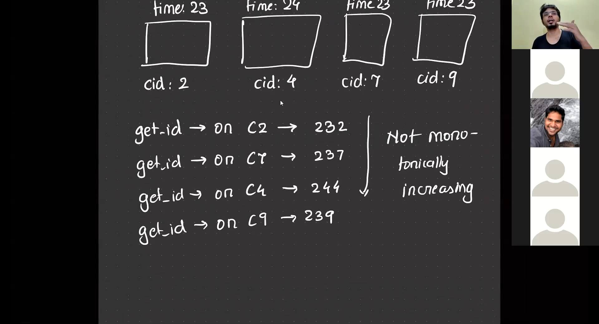
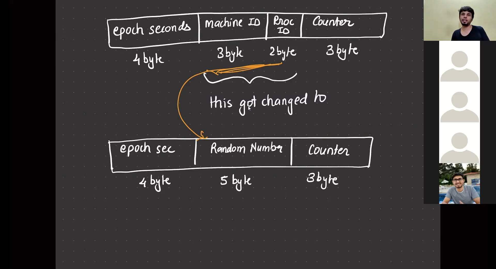
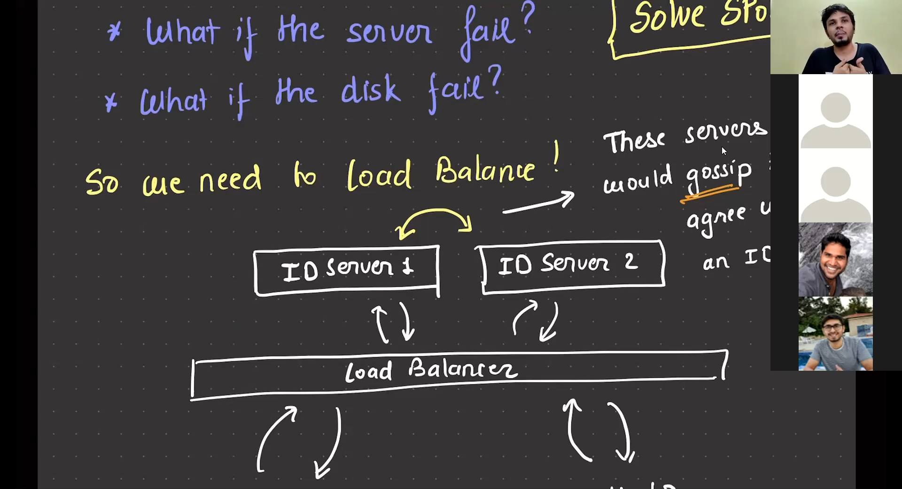
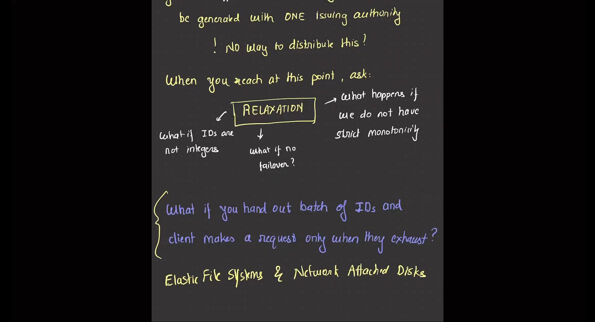
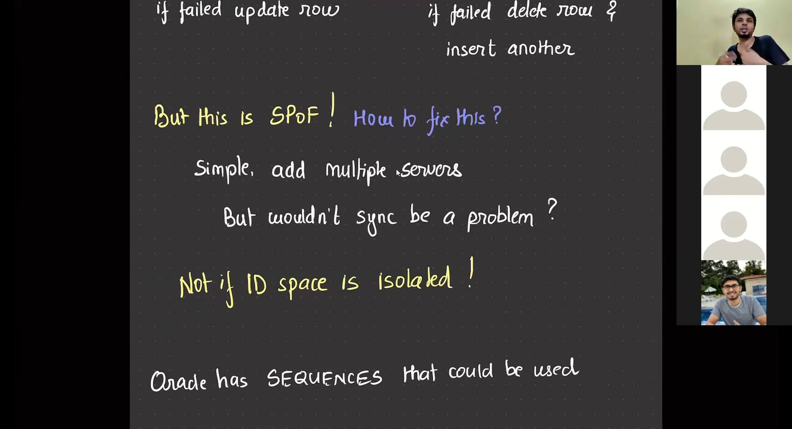

# 分布式 ID 生成：从单机自增到 Flickr Ticket Server

## 1. 这一节做什么

这一节解决的是“分布式系统里怎么生成全局唯一、又对数据库友好的 ID”。你会先理解为什么 ID 的时间部分一定要放在最左边（最高位），然后看到多机时钟不同步如何毁掉“单调递增”，最后会完整拆解 Flickr 的 **ticket server** 方案：用数据库自带的 `AUTO_INCREMENT` 加一条 `INSERT ... ON DUPLICATE KEY UPDATE` 语句，低成本地获得唯一且近似递增的 64 位整数 ID。

这一节的重点不是背一条 SQL，而是建立一套判断标准：当你要在多个服务、多个数据库、多个机房之间生成 ID 时，先问自己到底需要“全局唯一”还是“严格单调递增”，需要“64 位整数”还是“可读字符串”，需要“高可用”还是“绝对不重复”。这些目标之间经常互相拉扯，课程里的方案演进就是围绕这些拉扯展开的。

学完这一节，你可以独立回答：

- 为什么 UUID 不适合做主键/索引？
- 为什么“多个 ID 服务器”不能直接保证严格单调？
- 为什么“时间戳 + 机器ID”在服务器时钟不同步时会乱序？
- Flickr 的 ticket server 表结构长什么样？两条 SQL 的本质区别是什么？

此外，你还要能把课里的数据库取号方案落到实际工程里：知道 `AUTO_INCREMENT`、唯一键、`REPLACE INTO`、`INSERT ... ON DUPLICATE KEY UPDATE`、`LAST_INSERT_ID()` 分别做什么，知道它们常见的坑在哪里，知道在 Node.js 连接池里为什么要强调“同一个连接”，也知道前端看到的“ID 顺序”和数据库里“发号顺序”并不是一回事。学完后你不一定马上要上线一个 ID 服务，但至少要能判断：什么时候用单机自增、什么时候用 ticket server、什么时候必须承认“严格单调只能由一个发号权威保证”。

## 2. 讲师原话

> “...strict monotonic increasing ids can only be generated with one issuing authority. There is no way to distribute this because if you're distributing this, there will always be an edge case which is unhandled...” —— p006 [59:04]

> “...if you cannot keep your indexes in memory, you cannot make your database fast...” —— p006 [87:08]

> “...one call and I get 1000 IDs back.” —— p006 [78:36]

> “A good system is never complicated.” —— p006 [58:59]

这几句原话分别对应本节的三条主线。第一句说明“严格单调递增”和“多发号者”天然冲突：只要有两个地方都能发号，就存在其中一个稍慢、稍快、网络延迟、重试、时钟回拨的边缘情况。第二句说明为什么 ID 的大小和类型会影响数据库性能：索引要尽量放在内存里，主键越长，索引越大，越容易把内存挤爆。第三句说明批量取号是降低集中式发号压力的重要手段：一次网络调用拿回一批 ID，客户端本地慢慢消费，减少每次写入都打一次 ID 服务的开销。第四句则是整节课的取舍原则：好系统不靠复杂协议堆出来，能复用数据库已有能力，就不要自己造一个分布式一致性系统。

## 3. 从零复现

### 3.1 需求

假设你正在设计类似 Flickr 的照片服务，用户上传照片、评论、点赞，每条数据都要一个唯一 ID。基本需求是：

1. **全局唯一**：不能因为多台机器同时生成而撞车。
2. **最好随时间递增**：这样能按 ID 排序就能得到创建时间顺序，方便分页和冷热数据分离。
3. **ID 尽量小**：要放进数据库主键索引，太大会拖垮性能。
4. **高可用**：不能因为生成 ID 的服务挂掉，整站就无法写入。

把这四条展开看，会发现它们并不是同等重要。全局唯一是底线，不能妥协；随时间递增是“最好”，因为它能让分页、归档、冷热分离更自然；ID 尽量小是性能要求，尤其当表很大、索引很多时，主键从 8 字节变成 16 字节不是小问题；高可用则是运行要求，决定你能不能接受单点。实际设计时，通常是先保证唯一，再在“严格单调”和“高可用”之间做取舍。课程里反复强调的“单一发号权威”，就是为了唯一和严格单调；而批量取号、奇偶分区、多个 ticket server，则是在尽量不破坏唯一性的前提下缓解单点和压力。

### 3.2 约束

- 多台服务器的**物理时钟不可能完全同步**。讲师明确说：NTP 同步通常几分钟一次，偏差可以达到秒甚至分钟；CPU 负载、机柜温度都会让石英晶振走快或走慢。
- 如果你把时间放在 ID 左侧（高位），一旦不同机器的时钟偏差，就会产生“后生成的 ID 反而更小”的乱序。
- 严格单调递增的 ID，要求“生成顺序”和“ID 大小顺序”完全一致。这只能由**唯一发号权威**完成；一旦有多个发号者，它们之间必须同步状态，而同步状态又会导致额外网络调用和复杂度。

这里的“时间放左边”可以理解成：ID 的高位存时间戳，低位存机器号或序列号。这样做的好处是 ID 大致按时间排序，坏处是它把“时间”这个不可靠的东西放到了排序的最高位。只要两台机器的时间有偏差，比如 A 机器时间是 10:00:01，B 机器时间是 10:00:03，但 B 先生成 ID，A 后生成 ID，那么后生成的 ID 反而可能更小。课程中的 `232, 237, 244, 239` 就是在说明这种局部乱序：整体看大概递增，但严格比较时就出现回退。



### 3.3 估算

- 64 位无符号整数最大值：\(2^{64} \approx 1.8446744 \times 10^{19}\)。如果按每毫秒生成 100 万个 ID，也能撑大约 584 年（课里没给这个算式，这是常见工程估算；你只要知道 64 位在现实业务中几乎不会用完即可）。
- UUID 是 128 位 = 16 字节，是 `BIGINT`（8 字节）的两倍。索引里存 16 字节的值，会让索引占用空间翻倍，导致内存放不下索引，数据库必须回磁盘读，性能下降。
- MongoDB ObjectID 是 12 字节 = 96 位（4 字节秒 + 3 字节机器 + 2 字节进程 + 3 字节计数器），比 UUID 小，但比 64 位整数大 50%。

估算的意义不只是算“够不够用”，更是让你在选型时把“索引大小”和“内存”联系起来。数据库的主键索引通常是最常被访问的索引之一，如果主键值很大，索引页能容纳的条目就变少，同样的数据量需要更多页，缓存命中率下降。课程里那句“索引放不进内存，数据库就快不起来”说的就是这个道理。UUID 的 16 字节不仅比 8 字节大，而且随机 UUID 还会让插入位置分散，索引页分裂更频繁；Flickr 选择 64 位整数，就是想让 ID 尽量小、尽量有序，从而对 B+ 树索引更友好。



### 3.4 方案演进

1. **单机自增 ID**：单台数据库用 `AUTO_INCREMENT`，严格单调，只能单点。
2. **时间戳 + 机器 ID**：把当前 Unix 时间放在高位，机器 ID 放在低位。问题：多机时钟不同步，产生 `232, 237, 244, 239` 这种乱序。
3. **中央 ID 服务**：所有请求打到一个独立服务，服务内部用自增计数器或数字库自增。严格单调，但每次取 ID 都要一次网络调用，且存在单点故障。
4. **中央 ID 服务 + 负载均衡**：加多个 ID 服务后，两个服务必须 gossip 对齐，又回到分布式一致性问题，系统变复杂。



5. **批量取号**：客户端一次向中央服务要 1000 个 ID，本地慢慢用，减少集中服务压力，但不解决单点故障。
6. **奇偶分区**：两个 ID 服务，一个生成 1,3,5,7，另一个生成 2,4,6,8，再用严格 round robin 负载均衡，可以得到近似单调的序列。这是 Flickr 用过的思路。
7. **数据库 ticket server**：用 MySQL 自带的自增和唯一键冲突语句来做取号器，不需要额外写 ID 生成服务。



把这条演进线连起来看，会发现它不是“越往后越先进”，而是每一步都在解决前一步的某个问题，同时引入新的代价。单机自增最简单，但单点；时间戳加机器号看起来分布式，但时钟不同步会乱序；中央 ID 服务能保证严格单调，但每次都要网络调用；多 ID 服务加负载均衡看似高可用，但两个服务之间要同步状态，复杂度又回来了；批量取号减少调用次数，但服务挂了仍然麻烦；奇偶分区能让两个服务交错发号，但依赖严格 round robin；ticket server 则是把“发号状态”放进数据库，用数据库事务和唯一键冲突来保证原子性，从而少写一个独立服务。对于前端开发者来说，这很像“先本地生成临时 ID，再等服务端返回正式 ID”与“所有 ID 都必须由服务端统一签发”的区别：前者快，但要处理冲突和乱序；后者稳，但有网络和单点成本。

### 3.5 取舍

- 要**严格单调**，就必须有**单一权威**，这会牺牲一定可用性；可以通过批量取号和缓存来缓解。
- 要**高可用**，就得多节点，但要接受“大致有序、不严格单调”。
- 要**索引性能**，就不要用 UUID，最好用 64 位整数。
- 要**低复杂度**，就复用现有数据库能力，而不是自己造一个分布式一致性协议。

这四条取舍可以当作检查表：如果你的业务只是给日志、评论、图片生成 ID，且允许极小概率的局部乱序，那么 ticket server 或批量取号足够；如果你的业务要求严格按 ID 排序做增量同步，那就必须明确“只有一个发号权威”，并接受它的故障切换设计；如果你的表非常大，主键索引必须常驻内存，那就优先选 64 位整数，而不是 128 位 UUID；如果团队没有维护分布式协调系统的经验，那就优先复用 MySQL 的自增和唯一键，而不是自己写 gossip 协议。课程里说“好系统从来不复杂”，并不是反对高可用，而是提醒你：复杂度要花在真正必要的地方。

## 4. 完整代码

下面是一个可以直接保存运行的 MySQL 脚本 `flickr_ticket.sql`，它复刻了课中 Flickr ticket server 的核心表与取号语句。需要 MySQL 5.7+ 或 8.x。

```sql
-- flickr_ticket.sql
-- Flickr-style ticket server，仅用于本地复现

CREATE DATABASE IF NOT EXISTS id_generator;
USE id_generator;

-- 1. 建表
CREATE TABLE ticket64 (
    id   BIGINT UNSIGNED NOT NULL AUTO_INCREMENT,
    stub CHAR(1)         NOT NULL DEFAULT '',
    PRIMARY KEY (id),
    UNIQUE KEY stubs_uniq (stub)
) ENGINE = InnoDB;

-- 2. 用 REPLACE INTO 取号（课里说它比 ON DUPLICATE KEY UPDATE 慢 32 倍）
REPLACE INTO ticket64 (stub) VALUES ('a');
SELECT LAST_INSERT_ID();

-- 3. 用 INSERT ... ON DUPLICATE KEY UPDATE 取号（Flickr 最终采用）
INSERT INTO ticket64 (stub) VALUES ('a')
ON DUPLICATE KEY UPDATE id = id + 1;
SELECT id FROM ticket64 WHERE stub = 'a';
```

运行方式（Linux/macOS 终端，Windows 可在 MySQL Workbench 中整段执行）：

```bash
mysql -u root -p < flickr_ticket.sql
```

这条命令的完整含义是：调用 `mysql` 客户端，使用 `root` 用户连接本机 MySQL，`-p` 表示接下来提示输入密码，`<` 是 shell 的输入重定向，把 `flickr_ticket.sql` 文件内容送给 `mysql` 客户端执行。常见错误包括：MySQL 服务没有启动、`root` 密码不对、当前用户没有创建数据库的权限、文件路径不对、Windows 终端不支持 `<` 重定向。排查时可以先执行 `mysql -u root -p -e "SELECT VERSION();"`，确认能连上；再执行 `mysql -u root -p < flickr_ticket.sql`；如果报权限错误，检查用户授权；如果报语法错误，确认 MySQL 版本和脚本编码。前端对照可以理解为：这就像你本地用 `curl -X POST` 调接口前，先确认服务启动了、端口通了、鉴权头正确，否则后面的业务逻辑根本跑不到。



## 5. 逐行解释

- `CREATE DATABASE IF NOT EXISTS id_generator;`：创建独立数据库，避免影响业务库。`IF NOT EXISTS` 让脚本可以重复执行；如果库已存在，MySQL 不会报错，而是继续往下走。常见错误是用户以为“重复执行会重置数据”，其实不会，旧表和数据还在。
- `USE id_generator;`：切换到该库。后面的建表和取号都在这个库里执行。如果省略这一行，表可能建到默认库里，排查时会发现“明明执行了脚本却找不到表”。
- `CREATE TABLE ticket64 (...)`：创建 64 位整数的取号表。课里表名叫 `ticket64`，因为 Flickr 要发 64 位长整数 ID。`ticket64` 不是业务表，而是发号表，里面通常只保存很少的行。
- `id BIGINT UNSIGNED NOT NULL AUTO_INCREMENT`：主键列，无符号大整数，自增。这是 ID 的来源。`UNSIGNED` 表示只存非负数，范围更大；`AUTO_INCREMENT` 由 InnoDB 维护自增值，插入时可以不指定 id。常见错误是手动插入一个很大的 id，之后自增值可能被推高，影响后续发号预期。
- `stub CHAR(1) NOT NULL DEFAULT ''`：长度为 1 的字符，代表“哪个服务在取号”。它故意制造唯一键冲突。比如 `'a'` 代表 A 服务，`'b'` 代表 B 服务。前端对照：它有点像“发号通道”或“业务线标识”，不同业务用不同 stub，避免互相抢同一行。
- `PRIMARY KEY (id)`：id 是主键，全局唯一。主键同时是聚簇索引，InnoDB 会按主键组织数据，所以主键越小、越有序，插入和查询通常越友好。
- `UNIQUE KEY stubs_uniq (stub)`：stub 唯一，所以同一个服务在表里只能有一行。这是后面两条语句能触发冲突的关键。如果没有这个唯一键，`INSERT` 每次都成功，就不会走到 `ON DUPLICATE KEY UPDATE` 分支。
- `ENGINE = InnoDB`：使用支持事务和行级锁的存储引擎。ticket server 的原子性依赖 InnoDB 的唯一键冲突和行锁；换成不支持事务的引擎，行为会不同。
- `REPLACE INTO ticket64 (stub) VALUES ('a');`：尝试插入 stub='a'。如果表里已存在 'a'，先删除旧行，再插入新行；自增列会生成一个更大的 id。它的语义是“删除再插入”，所以会触发删除和插入相关的副作用。常见错误是以为它只是“更新”，结果发现触发器被触发两次、外键级联被影响。
- `SELECT LAST_INSERT_ID();`：返回当前连接上最后一次自动生成的自增值。注意：它是连接级的，不是全局的。常见错误是在连接池里把 `REPLACE` 和 `SELECT` 发到不同连接上，结果拿到别的请求的值。前端对照：这就像前端把“下单”和“查订单号”拆成两个请求，却没有带同一个请求上下文，最后查到别人的订单。
- `INSERT INTO ticket64 (stub) VALUES ('a') ON DUPLICATE KEY UPDATE id = id + 1;`：尝试插入 'a'。如果唯一键冲突，不删除旧行，而是把当前行的 id 加 1。这个操作是原子的，比 REPLACE 快很多。`id = id + 1` 是在数据库内部完成的自增更新，不需要应用层先查再改。
- `SELECT id FROM ticket64 WHERE stub = 'a';`：取回更新后的 id，作为新 ID 返回。它和上一条 `INSERT ... ON DUPLICATE KEY UPDATE` 最好在同一个连接、同一个事务边界内执行；否则并发请求可能夹在中间，你读到的就不是刚更新的值。

在 JS/Node.js 里的对应：如果你用 `mysql2`，`REPLACE INTO` 后可以读 `result.insertId`，它大概等价于 `LAST_INSERT_ID()`；而 `INSERT ... ON DUPLICATE KEY UPDATE` 后 `result.insertId` 可能不是新 id，所以通常像课里一样再执行一次 `SELECT`。注意取号 SQL 和后面的 `SELECT` **必须在同一个连接上执行**，否则可能拿到别的并发请求写入的值。实际写代码时，应该从连接池取出一个连接，依次执行取号语句和查询语句，再释放连接；不要用两次 `pool.query()` 就以为它们一定在同一条连接上。前端对照：这类似前端在同一个请求里拿 CSRF token 和提交表单，不能拆成两个互不相关的请求；也类似前端本地缓存一个临时 ID，但最终仍要以服务端返回的正式 ID 为准。

## 6. 复现检查清单

- [ ] 安装 MySQL 5.7 或 8.x，并启动服务。验证方式：执行 `mysql --version` 看版本，再执行 `mysql -u root -p -e "SELECT VERSION();"`，能返回版本号说明服务可连。
- [ ] 将上面的 SQL 保存为 `flickr_ticket.sql`。验证方式：用 `cat flickr_ticket.sql` 或编辑器确认文件里有建库、建表、取号三段，且没有被编辑器改成智能引号。
- [ ] 执行 `mysql -u root -p < flickr_ticket.sql`。验证方式：命令没有报错退出；如果报错，先看是连接错误、权限错误还是 SQL 语法错误，再分别排查。
- [ ] 第一次执行完成后，确认 `REPLACE INTO` 后的 `LAST_INSERT_ID()` 返回 1。验证方式：在 MySQL 客户端里执行 `SELECT * FROM ticket64;`，看到 stub='a' 且 id=1；如果返回 0 或 NULL，检查是否在同一个连接里执行。
- [ ] 再次执行 REPLACE 段，确认返回 2。验证方式：重复执行 `REPLACE INTO ticket64 (stub) VALUES ('a'); SELECT LAST_INSERT_ID();`，观察结果是否递增；如果 id 跳得很大，检查是否有其他会话也在取号。
- [ ] 执行 `INSERT ... ON DUPLICATE KEY UPDATE` 段两次，观察 `id` 从 3 变到 4、5。验证方式：每次执行后立刻 `SELECT id FROM ticket64 WHERE stub='a';`，记录结果；注意自增值可能因前面的 REPLACE 已经推高，不一定是 3，但应连续递增。
- [ ] 清空表后，单独测试第二个取号语句，确认每次 `SELECT id FROM ticket64 WHERE stub='a'` 都会比上一次大 1。验证方式：先 `TRUNCATE TABLE ticket64;`，再连续执行 `INSERT ... ON DUPLICATE KEY UPDATE` 和 `SELECT` 多轮，记录每轮 id；如果出现重复或回退，检查是否连到了不同数据库或不同实例。
- [ ] 如果你想模拟 Flickr 双 ticket server 的奇偶方案，需要两个 MySQL 实例分别设置 `auto_increment_increment=2` 和 `auto_increment_offset=1` / `2`（课里没给配置文件，这个步骤是第 7 节要说的补充内容）。验证方式：在两个实例分别执行 `SHOW VARIABLES LIKE 'auto_increment%';`，确认步长和偏移生效；再分别取号，观察是否分别落在奇数和偶数序列。


## 7. 课里没讲但你会撞上的

下面把课里没有展开、但复现时很容易遇到的点整理成表格：现象 / 原因 / 怎么办。表格里的内容不是课程原话，而是围绕本节方案做工程落地时会遇到的补充排查点；原有事实和课程结论保持不变。

| 现象 | 原因 | 怎么办 |
| --- | --- | --- |
| 取号结果偶尔重复、回退，或者和预期不一致 | NTP 同步漂移：课里提到时钟会因温度、CPU 负载走偏，但没讲怎么解决。实际生产环境要配置 `chronyd` 或 `ntpd`，每 5 分钟同步一次，并监控时钟偏移量。 | 先确认是否用了“时间戳 + 机器 ID”方案；如果是，监控 `chronyc tracking` 或 `ntpq -p` 的偏移量，给时钟回拨设置等待或拒绝发号策略；如果是 ticket server，确认是否误用了多个发号权威。 |
| `LAST_INSERT_ID()` 返回了别人的值，或者返回 0 | `LAST_INSERT_ID()` 是连接绑定的。在 Node.js 连接池里，如果你把 `INSERT` 和 `SELECT` 放到不同连接，会拿到错误值。这是最常见的坑。 | 从连接池取同一个连接，依次执行取号和查询，再释放；不要用两次独立的 `pool.query()` 就假设它们同连接；必要时把取号和查询包在同一个事务或同一个连接上下文里。 |
| `REPLACE INTO` 之后出现外键级联、触发器被多次触发，或者性能明显变慢 | `REPLACE INTO` 的副作用：它本质是 `DELETE + INSERT`，会触发外键级联、触发器，并且每次都会消耗一个新的自增值。Flickr 因此改成 `INSERT ... ON DUPLICATE KEY UPDATE`，课里给出了性能对比：快约 32 倍。 | 优先使用 `INSERT ... ON DUPLICATE KEY UPDATE`；如果必须用 REPLACE，检查外键、触发器和自增消耗；用执行计划和压测对比两条语句，不要只看单次结果。 |
| 高并发时取号变慢，出现锁等待甚至超时 | 并发取号的锁竞争：ticket 表里只有一个服务对应的行，多个请求同时 `INSERT ... ON DUPLICATE KEY UPDATE` 时，InnoDB 会对这行加锁。高并发下这行的锁竞争会很激烈。Flickr 的做法是给高吞吐服务单独开 ticket server，但课里没有深入锁机制。 | 给不同业务或高吞吐服务拆独立 ticket 表/实例；用批量取号降低取号频率；监控 InnoDB 锁等待；不要把全站所有业务都压到同一行 stub 上。 |
| 奇偶方案下 ID 局部乱序，比如出现 `1,3,5,2,4` | 奇偶方案的负载均衡必须严格 round robin：如果同一个请求连续打到同一个节点，会出现 `1,3,5,2,4` 这种局部乱序。课里说“说来简单，实现很难”。 | 检查负载均衡是否严格轮询；在客户端记录节点分配；如果业务要求严格单调，就不要依赖奇偶方案，回到单一发号权威加批量取号。 |
| Snowflake 在时钟回拨时产生重复 ID 或发号失败 | Snowflake 的时钟回拨：课里只开了 Twitter Snowflake 的头，没讲细节。实际 Snowflake 如果发现时钟回拨，会等待或拒绝发号，否则可能产生重复 ID。 | 监控时钟回拨；在回拨时等待时钟追平或直接拒绝发号；不要用“回拨后继续发”的方式掩盖问题；如果业务允许，记录回拨告警并人工介入。 |
| 两个 MySQL 实例没有按奇偶发号，步长和偏移不生效 | MySQL 全局变量配置：课里没说怎么设置步长和偏移，但你可以用如下配置实现两个 ticket server 分别生成奇偶号。这是补充内容，不是课程原话。 | 在两个实例分别设置 `auto_increment_increment=2` 和不同的 `auto_increment_offset`，重启或用 `SET GLOBAL` 后执行 `SHOW VARIABLES LIKE 'auto_increment%';` 验证；再分别取号观察奇偶序列。 |
| 脚本重复执行时以为数据被重置，或者建表报“已存在” | `CREATE DATABASE IF NOT EXISTS` 和 `CREATE TABLE` 的幂等性不同：库有 `IF NOT EXISTS`，表没有；重复执行可能报错或保留旧数据。 | 复现时先确认当前库和表状态；需要清空时显式执行 `TRUNCATE TABLE ticket64;`；不要把“脚本能重复跑”误解成“数据会自动重置”。 |
| 前端拿到的 ID 顺序和页面创建时间顺序不一致 | 前端看到的是接口返回顺序，数据库看到的是发号顺序；网络延迟、重试、批量取号、多节点都会让两者不完全一致。 | 前端不要用 ID 直接推断严格创建时间；需要严格时间排序时存独立时间字段；分页用稳定游标；把“ID 大致递增”和“时间严格排序”分开设计。 |

MySQL 全局变量配置示例：

```ini
[mysqld]
auto_increment_increment=2
auto_increment_offset=1
```

另一个实例把 `offset` 改成 2。这样做的目的只是让两个 ticket server 分别产生奇数和偶数序列；它不能让多个发号者自动获得“严格单调”，只是让序列在理想轮询下近似有序。课里强调的“严格单调只能有一个发号权威”仍然成立：如果你需要绝对单调，就不能靠多个实例各自发号来保证，必须回到单一权威或接受局部乱序。