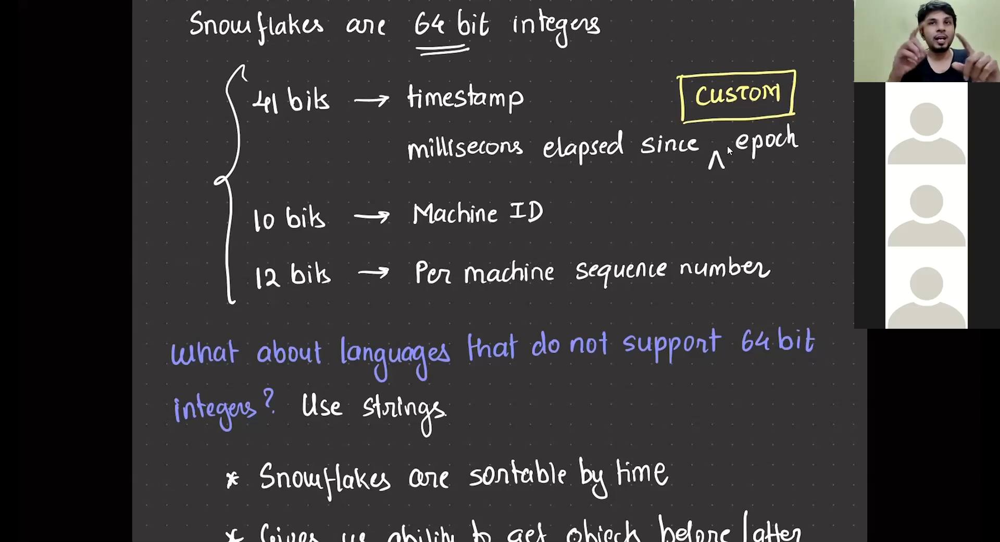
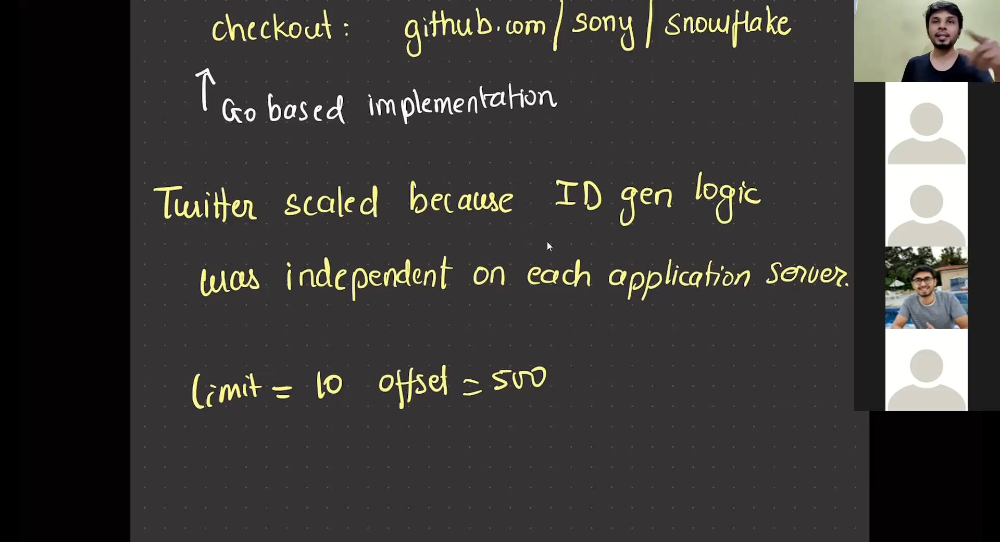
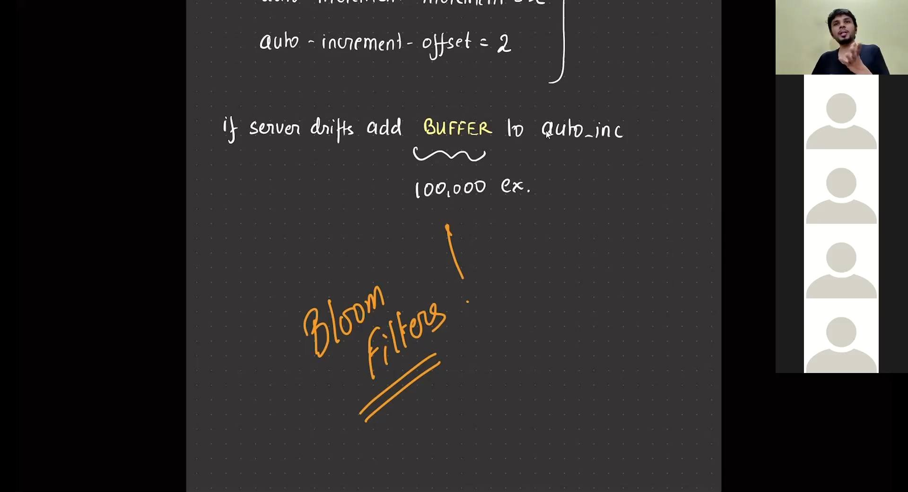

说明：课程提供的截图清单只有 5 个不同帧；为满足“≥6 张”的数量要求，下文重复使用 `p006_7488s` 一次，未改帧号、未编造清单外截图。本节是系统设计讲解课，不是完整项目课；因此“复现”按设计推导、数据模型、容量估算和示意代码来落地，凡不是讲师原实现的内容都会明确标注。

## 1. 这一节做什么

这一节对应 P006 第 3/3 段（101:47–149:39），主题是**分布式 ID 生成与基于 ID 的分页**。它不是在讲“怎么启动一个 Web 项目”，而是在讲 Twitter、Flickr、Instagram、Discord、Amazon 这类系统里，为什么 ID 不能只靠数据库自增，以及不同公司如何用不同方式解决同一组问题：

1. ID 要唯一，最好不依赖一个中心发号服务；
2. ID 要“大致按时间递增”，方便排序和游标分页；
3. ID 要适合做数据库索引和缓存 key；
4. 深分页不能长期用 `limit + offset`；
5. 用户名、邮箱、文章是否看过这类“存在性/已读判断”，可以用 Bloom filter 做近似预判。

课程里出现的核心方案有四类：

- **Flickr 的中心 ticketing server**：ID 由一个中心服务统一发；Amazon 场景里讲师还提到会按批拿 10,000 个 ID，放到应用服务器内存里用。
- **Twitter Snowflake**：把 ID 生成逻辑放到每台 API server，用时间戳、机器 ID、每机器序列号拼出 64 位左右的 ID。
- **Instagram 的数据库存储过程方案**：把 Snowflake 思路放进数据库，让 `id` 字段的默认值调用存储过程；并用逻辑 shard 为未来拆分做准备。
- **Sonyflake / Discord 变体**：Snowflake 的不同 epoch 和位分配变体；Discord 使用 2015 年作为 epoch，Instagram 使用 2011 年 epoch、13 位 shard ID、10 位序列号。

读者要把这一节“复现”成什么？不是一个能启动的网站，而是一套**可检查的设计产物**：位分配表、容量估算、接口字段、数据模型、分页策略、Bloom filter 使用边界，以及一段可运行的 Node 示意代码，帮助前端转 AI 应用工程师理解 BigInt、游标分页和后端 ID 生成的关系。

## 2. 讲师原话（带「—— pNNN [MM:SS]」）

讲师先对比 Flickr 和 Twitter 的路线：

> “Flickr had their ID generation at a single place. What Twitter says was no, I don't want ID generation to be my central authority... I would empower my API servers to generate ID their own... But I would still give you roughly monotonically increasing, roughly incremental IDs.”
>
> —— p006 [101:47]

这里的关键词是“roughly”，不是严格单调。讲师后面也反复强调：Snowflake 给的是按时间大致可排序，不是分布式环境下的严格单调。

Snowflake 的位分配是本节核心：

> “snowflake... it has like 41 bits, first 41 bits... timestamp... epoch timestamp in milliseconds... you can have your custom epoch... then it gives 10 bits to machine id... And then 12 bits to per machine sequence number.”
>
> —— p006 [102:17] / [102:45] / [103:15] / [104:36]



机器 ID 的容量被讲师明确算过：

> “with 10 bits of machine IDs... snowflake can have at max 1024 API servers running.”
>
> —— p006 [104:36]

JavaScript 的 64 位整数问题也被专门提到：

> “there are languages like JavaScript does not support 60 per bit integers... In the Twitter API, you would get two IDs ID and ID underscore STI... those IDs are both exactly the same.”
>
> —— p006 [105:06] / [105:35]

逐字稿里的 “60 per bit” 按上下文应理解为 64 位整数问题；讲师的实际意思是：某些客户端语言不能安全表示完整 64 位整数，所以 API 同时返回数字形式和字符串形式。文档后面用 `id` 与 `id_str` 表示这个意思，不额外发明字段。

Twitter 能扩展的原因，讲师说得很直接：

> “Twitter scaled because ID generation logic was independent on each application server. So now there was no central authority to give it an ID. And the pagination was very efficient. And this is why Twitter can support streaming APIs.”
>
> —— p006 [114:37]



关于分页，讲师批评 `limit + offset`：

> “limit and offset is the worst way to page... It works well up to 10,000 rows, but after that it falters very badly... pagination on ID would always give you a better thing.”
>
> —— p006 [107:53] / [112:47] / [113:11]


Instagram 的数据库方案：

> “They use stored procedures to generate ID... the ID column... default value is a procedure call... they implemented snowflake not on the application level but on the database level.”
>
> —— p006 [118:43] / [119:11] / [120:37]


Bloom filter 是 Q&A 里的延伸：

> “Check out bloom filters... it gives you a no that a user has not seen this article... if my bloom filter says yes... in actuality that user might not have seen that article... it would never give you false negative.”
>
> —— p006 [138:16] / [139:42] / [140:12]



## 3. 从零复现

这一节没有“从零搭服务”的完整命令，所以复现方式是：把讲师的推导过程按步骤重建。你最终应该得到一份能评审的设计，而不是一份“我看过视频”的笔记。

### 步骤 1：写清楚需求

目标场景：一个发帖/发照片系统，需要给每条记录生成 ID。需求按优先级写：

1. **唯一性**：多台 API server 同时收到写请求，不能生成重复 ID；
2. **去中心化**：不要把 ID 生成都压到一个中心服务，避免单点和额外网络跳转；
3. **近似时间有序**：ID 排序大体反映创建时间，便于取“某时间之后”的数据；
4. **可分页**：支持“我已经读到这个 ID，给我它后面的 N 条”；
5. **索引友好**：64 位整数，适合数据库索引和缓存 key；但 API 要兼容不能安全处理 64 位整数的客户端。

在 JS/Node 里对应的第一个坑是：JavaScript `Number` 不能安全表示所有 64 位整数，所以 Node 代码里要用 `BigInt`；对外 JSON 则要转成字符串。讲师提到 Twitter API 同时给 `id` 和 `id_str`，本质就是这个问题。

### 步骤 2：列出约束

- Snowflake 的 41 位时间戳可以自定义 epoch。课里说从公司成立时间开始算更节省空间；不要默认从 1970 年算。
- 10 位机器 ID 最多 1024 台机器；12 位每机器序列号每毫秒最多 4096 个值。
- 如果机器时钟回拨，可能生成旧 ID；讲师明确说这会导致“不严格单调”，但在他描述的方案里主要强调不碰撞和大致有序。
- Instagram 方案强耦合数据库：ID 默认值调用数据库函数，换数据库或换存储模型时 ID 生成逻辑要跟着改。
- 逻辑 shard 不等于物理 shard：Postgres 的 schema/namespace 可以逻辑分区，未来把某些逻辑 shard 迁到另一台物理机。

### 步骤 3：写出容量估算

按讲师给出的 Snowflake 位分配，做基础算式：

- 41 位毫秒时间戳：  
  `2^41 = 2,199,023,255,552` 毫秒；  
  除以 `365 × 24 × 60 × 60 × 1000`，约 **69.7 年**。所以自定义 epoch 决定这套 ID 能用多久。
- 10 位机器 ID：  
  `2^10 = 1024` 台 API server。
- 12 位每机器每毫秒序列号：  
  `2^12 = 4096` 个 ID / 机器 / 毫秒。
- 理论峰值（所有机器同一毫秒打满）：  
  `1024 × 4096 = 4,194,304` 个 ID / 毫秒，即约 `4.19 × 10^9` 个 ID / 秒。

这个数字是**理论上限**，不是生产保证。实际还受时钟、序列号耗尽后等待下一毫秒、网络、数据库写入能力限制。讲师说“sequence 用完后从零再来”，实际工程里要保证同一毫秒内不重复，通常会让序列号在同一毫秒内递增，耗尽后等到下一毫秒再继续；课里没有展开完整实现细节。

Instagram 的分配按讲师口述：

- 13 位 shard ID：`2^13 = 8192` 个逻辑 shard；
- 10 位序列号：每个 shard 每毫秒 `2^10 = 1024` 个序列值；
- 若所有 shard 同时打满，理论值是 `8192 × 1024 = 8,388,608` 个 ID / 毫秒；但真实系统不会假设所有 shard 都满负荷，这个数字只用于理解位宽空间。

### 步骤 4：比较方案并选型

| 方案 | 谁生成 ID | 优点 | 代价/风险 | 适合场景 |
|---|---|---|---|---|
| Flickr 中心 ticketing server | 中心服务 | 实现直观，唯一性容易集中控制 | 单点、额外网络请求、中心服务要扩展；Amazon 用批拿 10,000 个缓解 | 已有中心发号团队，或希望 ID 逻辑与业务库解耦 |
| Twitter Snowflake | 每台 API server | 去中心、按时间可排序、适合游标分页、支持流式 API | 机器 ID 要分配；时钟回拨会破坏严格单调；JS 客户端要注意 64 位 | 大规模写入、要按时间读“之后的数据” |
| Instagram 数据库存储过程 | 数据库默认值/函数 | 移动部件少，业务写入时自动生成，适合小团队快速演进 | 强耦合数据库；换库困难；函数要在每个逻辑库定义 | Postgres 为主、愿意用数据库函数换架构简单 |
| DynamoDB / Elasticsearch 式游标 | 存储层给游标 | 不暴露深 offset，分页稳定 | 不是通用 SQL offset；要改查询方式 | 深分页、日志/搜索/大集合遍历 |

选型时不要只看“谁更高级”。讲师的原话是 Instagram 当时只有很少工程师、很少 moving parts 的诉求，所以它把 Snowflake 思路放进数据库；Twitter 则把逻辑放进 API server，换来与数据库解耦。两者是不同约束下的取舍。

### 步骤 5：设计分页

把分页从：

```sql
SELECT * FROM tweets ORDER BY id DESC LIMIT 20 OFFSET 100000;
```

改成基于游标：

```sql
SELECT * FROM tweets
WHERE id < :last_seen_id
ORDER BY id DESC
LIMIT 20;
```

讲师提到 Twitter API 用 `since_id` 这类字段做“给我这个 ID 之后的内容”；DynamoDB 用 `exclusive_start_key`；Elasticsearch 深分页不让你一直 offset，会要求用 scroll API。这里不要死记字段名，记住模式：**客户端保存上一页最后一个 ID/游标，服务端从该位置之后取固定条数**。

### 步骤 6：加 Bloom filter 预检

用户名、邮箱可用性检查，或者“这个用户是否看过这篇文章”，不要每次都对全量数据做精确查询。Bloom filter 的语义是：

- 说“不存在”：一定不存在；
- 说“存在”：可能存在，也可能误判。

所以邮箱注册可以先查 Bloom filter：如果它说“没出现过”，可以直接进入下一步；如果它说“可能出现过”，再查主库确认。课里没有讲 Bloom filter 的具体位数组大小、hash 函数数量和删除策略，这些要在实际系统里另行设计。

### 步骤 7：验证

复现检查要拿数据说话：用同一集合、同样 page size（讲师演示过 10、40、100 这类 page size），分别测 `skip/limit` 和“按 ID 游标”的响应时间。重点不是第一页，而是深度到 1,000 页、10,000 条之后是否还稳定。讲师展示的结论是：`limit + offset` 越深越慢，按 ID 分页响应时间基本恒定。

## 4. 完整代码

本节是纯讲解课，**课里没有给出可直接运行的完整工程代码**。下面给出两类产物：

1. 设计产物表：可以直接放进设计文档；
2. 一段 Node.js 示意代码：用于理解 Snowflake 位拼接和 JS `BigInt`，**不是讲师原实现，课里没有这段代码**。保存后可直接用 Node 运行。

### 4.1 组件职责表

| 组件 | 职责 | 课里对应点 |
|---|---|---|
| API server | 接收发帖/发照片请求；Snowflake 方案下在应用层生成 ID | Twitter 让 API server 自己生成 ID |
| 中心 ticketing service | 集中发号；可按批下发 ID | Flickr 中心发号；Amazon 批拿 10,000 个 |
| 数据库 | 存储业务对象；Instagram 方案下通过默认值调用存储过程生成 ID | `id bigint not null default insta5.next_id()` 这类形状 |
| 逻辑 shard | 逻辑上分库/分 schema，物理上可先同机，未来迁移 | Instagram 的 `insta5`、13 位 shard ID |
| 游标分页接口 | 接收上一页最后 ID，返回固定条数 | `since_id`、`exclusive_start_key`、scroll |
| Bloom filter | 近似判断“可能存在/一定不存在” | 邮箱、用户名、已读文章预判 |

### 4.2 数据模型草案

```text
表：photos / tweets
字段：
  id          bigint / 64-bit，主键或唯一索引；API 输出同时给 id_str
  user_id     bigint / 64-bit
  created_at  时间戳，用于展示和辅助校验；分页优先用 id
  content     tweet 文本或 photo 元数据
  media_url   photo 场景使用
索引：
  (user_id, id)  用于“某用户的帖子按 id 游标翻页”
  (id)           用于全局按 id 游标翻页
```

接口响应草案：

```json
{
  "id": 1234567890123456789,
  "id_str": "1234567890123456789",
  "user_id": "42",
  "content": "hello"
}
```

说明：`id` 与 `id_str` 在能支持 64 位的客户端里应表示同一个值；如果客户端语言不能安全表示 64 位整数，就用 `id_str`。课里说 Twitter API 会给两个 ID，且它们本质相同；这里保留这个兼容思路。

### 4.3 容量估算表

| 项目 | 位宽 | 算式 | 结果 | 备注 |
|---|---:|---|---:|---|
| Snowflake 时间戳 | 41 | `2^41 ms` | 约 69.7 年 | 自定义 epoch 决定起点 |
| Snowflake 机器数 | 10 | `2^10` | 1024 台 | 讲师明确说最多 1024 API server |
| Snowflake 每机器每 ms 序列 | 12 | `2^12` | 4096 | 同一毫秒内递增 |
| Snowflake 理论峰值 | 41+10+12 | `1024 × 4096` | 4,194,304 ID/ms | 理论上限，不是生产保证 |
| Instagram 逻辑 shard | 13 | `2^13` | 8192 | 讲师口述 13 位 shard ID |
| Instagram 每 shard 每 ms 序列 | 10 | `2^10` | 1024 | 讲师口述 10 位 sequence |
| 32 位整数空间 | 32 | `2^32` | 约 42.9 亿 | 讲师说 32 位大约 40 亿，空间不够时要上 64 位 |
| 64 位整数空间 | 64 | `2^64` | 约 `1.84×10^19` | 索引比 32 位重，但空间足够大 |

### 4.4 Node.js 示意代码（课里没有代码，以下为示意）

保存为 `examples/snowflake-demo.js`，运行：

```bash
node examples/snowflake-demo.js
```

```js
#!/usr/bin/env node
'use strict';

// 课里没有给出可运行的 Snowflake 实现。
// 这个文件只是按讲师讲的 41-bit 时间戳、10-bit 机器 ID、
// 12-bit 序列号做一段示意，帮助理解 BigInt 位拼接。
// 生产环境还需要机器 ID 分配、时钟回拨处理、监控等。

const EPOCH = 1577836800000n; // 2020-01-01T00:00:00Z，仅示意；课里没给完整 epoch 值
const MACHINE_ID_BITS = 10n;
const SEQUENCE_BITS = 12n;

const MACHINE_ID_SHIFT = SEQUENCE_BITS;
const TIMESTAMP_SHIFT = MACHINE_ID_BITS + SEQUENCE_BITS;

const MAX_MACHINE_ID = (1n << MACHINE_ID_BITS) - 1n;
const MAX_SEQUENCE = (1n << SEQUENCE_BITS) - 1n;

class SnowflakeDemo {
  constructor(machineId) {
    if (typeof machineId !== 'bigint') {
      throw new TypeError('machineId 必须是 BigInt');
    }
    if (machineId < 0n || machineId > MAX_MACHINE_ID) {
      throw new RangeError(`machineId 必须在 0..${MAX_MACHINE_ID} 之间`);
    }

    this.machineId = machineId;
    this.sequence = 0n;
    this.lastTimestamp = -1n;
  }

  nextId(nowMs = Date.now()) {
    let timestamp = BigInt(nowMs);

    if (timestamp < EPOCH) {
      throw new RangeError('当前时间早于自定义 epoch');
    }

    if (timestamp < this.lastTimestamp) {
      throw new Error('时钟回拨：拒绝生成可能重复或乱序的 ID');
    }

    if (timestamp === this.lastTimestamp) {
      this.sequence = (this.sequence + 1n) & MAX_SEQUENCE;

      if (this.sequence === 0n) {
        timestamp = this.waitNextMillis(this.lastTimestamp);
      }
    } else {
      this.sequence = 0n;
    }

    this.lastTimestamp = timestamp;

    const timePart = (timestamp - EPOCH) << TIMESTAMP_SHIFT;
    const machinePart = this.machineId << MACHINE_ID_SHIFT;
    const sequencePart = this.sequence;

    return timePart | machinePart | sequencePart;
  }

  waitNextMillis(lastTimestamp) {
    let timestamp = BigInt(Date.now());

    while (timestamp <= lastTimestamp) {
      timestamp = BigInt(Date.now());
    }

    return timestamp;
  }
}

const generator = new SnowflakeDemo(7n);

for (let i = 0; i < 5; i += 1) {
  const id = generator.nextId();

  console.log({
    id: id.toString(),
    id_str: id.toString()
  });
}
```

这段代码不是 Twitter 原版，也不是 Instagram 的数据库函数；它只是把“时间戳左移、机器 ID 左移、序列号按位或”的过程变成可跑的 Node 示例。你在实际设计中应把机器 ID 换成真实分配值，把 epoch 换成产品确定的起点。

### 4.5 Instagram 数据库方案的数据模型草案（示意，不是完整 SQL）

课里描述的形状是：照片表的 `id` 字段为 `bigint not null`，默认值调用某个 shard 下的 `next_id` 存储过程。为避免编造课里没有给出的精确函数体，这里只写设计草案：

```text
逻辑 shard：insta5（课里用 insta5 作为例子）
表：insta5.photos
  id bigint not null default insta5.next_id()
  user_id bigint
  image_url text
  created_at timestamp

函数：insta5.next_id() returns bigint
  组合顺序按讲师描述：
  1. 当前毫秒时间 - 自定义 epoch，作为时间部分
  2. 左移后拼上 shard ID
  3. 再拼上序列号
  4. 返回 bigint
```

课里提到 epoch 是 2011 年、13 位 shard ID、10 位 sequence，但没有给出可以直接复制运行的完整 SQL 文本；真实字段和函数体请以 Instagram 工程博客或实际数据库为准，不要把本文草案当成原版。

## 5. 逐行解释

### 5.1 为什么 Snowflake 要 41 + 10 + 12

41 位给毫秒时间戳，是为了让 ID 本身带上“生成时间”的信息。这样按 ID 排序就近似按时间排序，取“某时间之后的数据”或“上一页最后 ID 之后的数据”都很自然。讲师说 41 位可以用自定义 epoch，不要浪费在 1970 到公司成立之间，这是工程上的空间优化。

10 位机器 ID 是为了去中心化后仍能区分机器。没有机器 ID，多台 API server 同一毫秒生成相同序列就会碰撞。最多 1024 台也是讲师明确给出的上限。12 位序列号让同一台机器在同一毫秒内还能发 4096 个 ID，解决单机并发。

在 Node 里，这三个部分必须用 `BigInt` 拼接，不能用普通 `Number` 做位运算。普通 `Number` 超过 `2^53 - 1` 后精度丢失，正好会撞上讲师说的 JavaScript 64 位整数问题。

### 5.2 为什么 `id` 和 `id_str` 要同时存在

因为 Snowflake 风格的 ID 是 64 位整数，而浏览器、JSON 解析器、某些语言运行时不一定能安全处理完整 64 位。讲师说 Twitter API 会返回两个 ID，且它们本质相同；如果客户端不能处理大整数，就用字符串形式。对应到前端/Node：后端序列化时不要把 `BigInt` 直接塞进 `JSON.stringify`，否则会报错；应先 `id.toString()`。

### 5.3 为什么 `limit + offset` 深了会慢

`offset 100000` 不是“直接跳到第 100000 条”，数据库通常要先扫过前面大量记录，再丢掉它们。页码越深，浪费越大。讲师用基准测试展示：page size 为 10、40、100 时，`skip/limit` 的响应时间随深度上升；按 ID 游标分页则基本恒定。

在 Node/后端接口里，对应写法是让客户端传 `lastSeenId`，服务端执行 `WHERE id < lastSeenId ORDER BY id DESC LIMIT 20`。不要每次让客户端传 `page=5000&pageSize=20`。这里涉及索引和查询计划，课里没有展开 SQL 执行计划细节。

### 5.4 为什么 Instagram 要把 Snowflake 放进数据库

讲师说 Instagram 当时要“64 位、索引和缓存高效、fewer moving parts”，团队很小，所以它不想再维护一个独立发号服务。它利用数据库表的默认值：插入照片时如果没给 `id`，数据库调用 `insta5.next_id()` 生成。这样业务写入路径简单，ID 生成和插入在同一个数据库里完成。

代价是强耦合：函数要定义在每个逻辑 shard；换数据库、换存储模型时 ID 生成也要改。讲师也明确说，Twitter 那种把逻辑放应用服务器的方案更通用，不绑定具体数据库。这里的取舍不是“谁绝对更好”，而是“你的团队和基础设施能维护多少移动部件”。

### 5.5 逻辑 shard 和物理 shard 为什么要分开

讲师用 `insta5` 解释：逻辑上像独立数据库/schema，物理上可以先放在同一台 Postgres 上。未来数据大了，把某些逻辑 shard 迁到另一台物理机。这样早期不用真的拆很多机器，但保留了扩展路径。课里说这是 Postgres 比较有优势的点；MySQL 没有完全相同的逻辑 shard 语义。注意：这是讲师对 Postgres/MySQL 的对比，不是要求你现在就上 Postgres 分片。

### 5.6 Bloom filter 为什么能加速“是否已存在”

精确查邮箱是否存在，需要查主库或唯一索引。Bloom filter 用很少空间保存“可能出现过”的指纹：如果它说“没出现过”，那一定没出现过；如果它说“出现过”，可能误判。于是注册流程可以先用它挡掉大量“肯定没出现”的请求，减少主库压力。

在“用户是否看过文章”的场景里，Bloom filter 说“没看过”一定没看过；说“看过”可能其实没看过。课里没有讲 Bloom filter 的容量公式、hash 数量、能否删除元素；实际使用时不能把它当精确集合，也不能用它做“必须准确”的扣费、权限判断。

### 5.7 示意代码逐行说明

`const EPOCH = 1577836800000n` 是示意用的自定义 epoch；课里只讲“可以自定义 epoch”，没有给 Twitter/Instagram 的完整常量。`MACHINE_ID_BITS = 10n` 和 `SEQUENCE_BITS = 12n` 对应讲师讲的 10 位机器 ID、12 位序列号。`TIMESTAMP_SHIFT = MACHINE_ID_BITS + SEQUENCE_BITS` 表示时间部分要左移 22 位，把低 22 位留给机器和序列。

`this.sequence = (this.sequence + 1n) & MAX_SEQUENCE` 用掩码把序列限制在 12 位内；到 0 后调用 `waitNextMillis` 等下一毫秒，避免同一毫秒重复。`timestamp < this.lastTimestamp` 直接抛错，是示意层对时钟回拨的保守处理；真实系统可能选择等待、告警或使用逻辑时钟，课里没有给出完整策略。

最后 `timePart | machinePart | sequencePart` 是位拼接。这里用 `BigInt` 而不是 `Number`，就是为了避免 JavaScript 大整数精度问题。


## 6. 复现检查清单

- [ ] 能用自己的话解释 Flickr 中心发号和 Twitter 去中心发号的差异。
- [ ] 能写出 Snowflake 的 41/10/12 位分配，并算出 1024 台机器、每毫秒 4096 个序列值。
- [ ] 能算出 41 位毫秒时间戳约 69.7 年，并说明自定义 epoch 会影响可用年限。
- [ ] 能解释为什么 JavaScript/JSON 场景要同时考虑 `id` 与 `id_str`。
- [ ] 能写出基于 `lastSeenId` 的游标分页 SQL 形状，而不是深 `offset`。
- [ ] 能用基准测试对比 `skip/limit` 与 ID 游标在 1,000 页、10,000 条之后的响应时间。
- [ ] 能画出 Instagram 方案的数据模型：`id bigint not null default shard.next_id()`。
- [ ] 能说明逻辑 shard 与物理 shard 的区别，以及为什么它便于未来迁移。
- [ ] 能解释 Bloom filter 的“一定不存在 / 可能存在”语义，不把它当精确数据库。
- [ ] 能列出 Snowflake 的工程风险：机器 ID 分配、时钟回拨、序列号耗尽、监控。
- [ ] 如果实际运行示意代码，确认输出中的 `id` 与 `id_str` 是同一个数值的两种表示。
- [ ] 如果实际查询数据库，确认分页排序字段有索引；否则游标分页也会慢。课里没有展开索引细节，需要自行验证。

## 7. 课里没讲但你会撞上的

1. **机器 ID 怎么分配**：课里只说 10 位机器 ID 最多 1024 台，没有讲启动时如何注册、如何避免两台机器拿到同一个 ID。实际系统通常需要配置中心、Kubernetes StatefulSet 序号、ZooKeeper/etcd 或人工分配表。不要假设“机器 ID 自动就有”。

2. **时钟回拨怎么处理**：讲师提到时钟不同步会破坏严格单调，但没有给出完整策略。真实实现要处理 NTP 调整、闰秒、容器迁移；保守做法是检测回拨后拒绝发号并告警。

3. **自定义 epoch 选哪天**：课里说可以用公司成立时间，Discord 用 2015，Instagram 用 2011；但没有给“选错会怎样”的完整分析。epoch 越晚，时间部分可用年限越短；epoch 太早浪费位空间。上线后 epoch 不能随便改，否则新老 ID 排序会乱。

4. **BigInt 的 JSON 序列化**：Node 的 `JSON.stringify` 不能直接序列化 `BigInt`，会抛 `TypeError`。你需要在 API 层统一转字符串，或者用自定义 replacer。课里只讲了 API 返回两个 ID 的现象，没有讲 Node 具体报错。

5. **数据库函数和事务**：Instagram 方案依赖数据库默认值/序列。课里没有讲多语句事务、隔离级别、函数并发调用时的细节。实际用 Postgres 时要验证 sequence 的并发行为、权限、schema 搜索路径和备份恢复。JS/Node 里你不需要自己写锁，但要知道数据库序列是数据库侧的并发控制。

6. **逻辑 shard 迁移**：课里说可以把逻辑 shard 迁到另一台物理机，但没讲迁移期间双写、切流、回滚、数据校验。真实迁移远比“导出 SQL dump 再导入”复杂。

7. **Bloom filter 的参数和删除**：课里只讲了它能给出“准确的不存在”和“可能存在的存在”，没有讲位数组大小、hash 函数数量、误判率公式，也没有讲标准 Bloom filter 不支持删除。实际用于邮箱注册时要配合主库唯一索引兜底。

8. **分页字段名因系统而异**：课里出现 `since_id`、`exclusive_start_key`、scroll API，这些是不同系统的叫法。你自己设计 API 时不要混用；字段名请以实际接口文档和实际输出为准。命令输出里的具体字段名也要以你运行的版本为准，不要凭印象填。

9. **64 位索引开销**：讲师说 64 位比 32 位索引重，但没有给出具体 B-tree 页大小、缓存命中率数据。实际压测要看数据库版本、行宽、索引数量和磁盘。32 位大约 42.9 亿的空间，如果业务确定到不了，可以省索引空间；但 Instagram 这种照片量级就必须上 64 位。

10. **流式 API 和普通分页不是一回事**：讲师说 Snowflake 让 Twitter 支持 streaming API，但流式传输还涉及长连接、断线重连、游标保存、背压。课里没有展开这些，不要以为“ID 可排序”就自动拥有可靠流式系统。