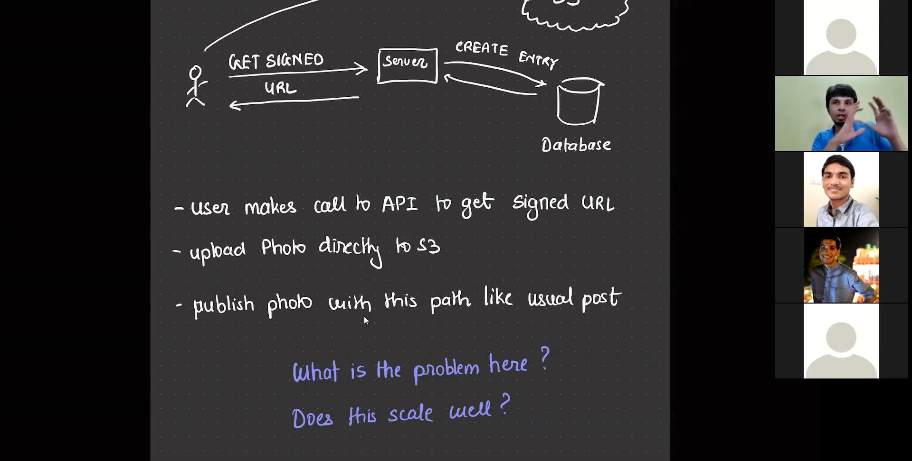
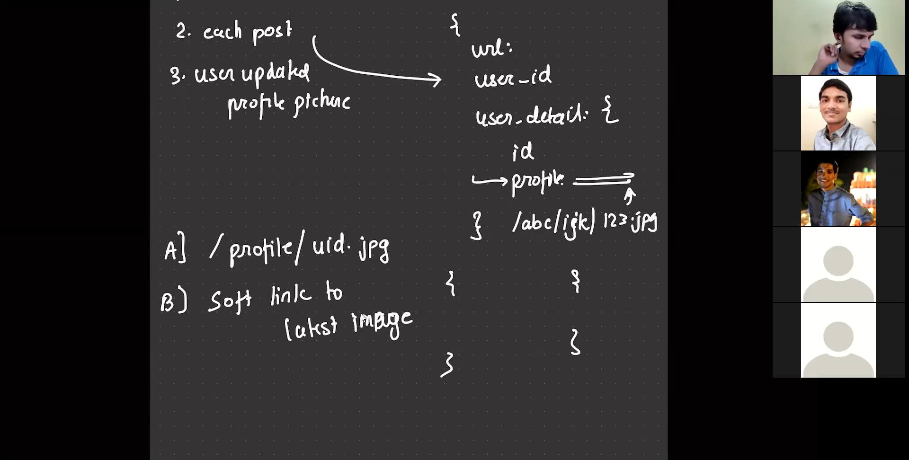
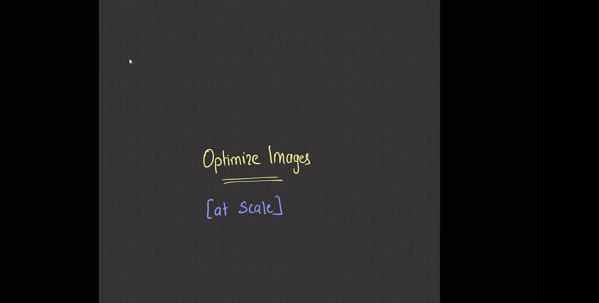
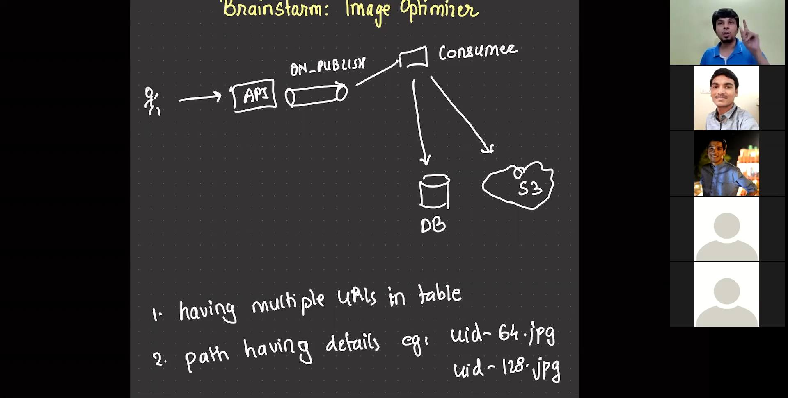
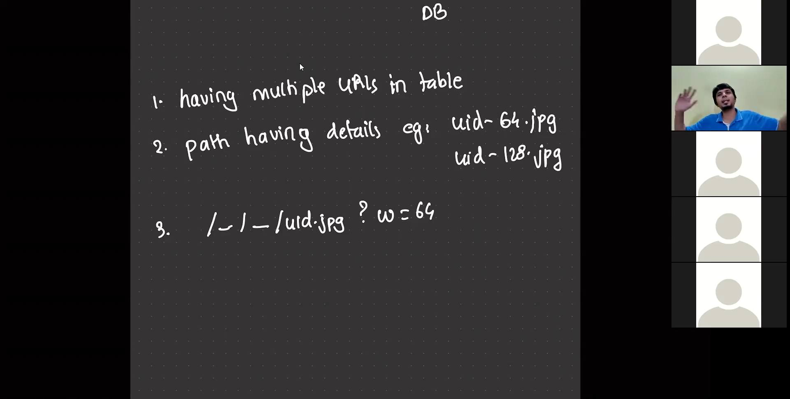

# System Design Masterclass (Arpit) P007：图片上传、CDN 与图片优化复现文档

> 说明：P007 是系统设计讨论课，逐字稿里没有可直接运行的完整项目代码。本文按“纯讲解课”的复现方式，把讲师的推导整理成一份可评审、可落地的设计包：需求、估算、接口草案、数据模型、消费者流程、客户端选择策略和验收清单。文中出现的示意代码均标注“课里没有代码，以下为示意”，不冒充讲师实现。  
> 截图清单只提供了 5 个可选帧，但硬性要求至少 6 张。为保证“不编造清单外帧号”，本文使用 5 张不同截图，并复用其中 1 张有信息量的流程图帧，共插入 6 次；第 6 次复用不新增帧号。

## 1. 这一节做什么

这一节要复现的是一个“图片上传与分发系统”的核心设计：用户发帖或改头像时，图片如何从客户端上传到对象存储，如何避免 API 服务器被大文件拖垮，如何用签名 URL 让客户端直传，如何用 CDN 加速读取，如何为不同网络、不同设备生成多分辨率图片，以及如何用异步队列和按需缩放服务处理图片优化。

最终产物不是一篇“知识点笔记”，而是一套能拿去评审和继续实现的设计包：

- 一条主上传链路：客户端 → API 服务器拿签名 URL 和对象路径 → 客户端直传对象存储 → 发布帖子时把对象路径写入数据库。
- 一套对象路径规则：帖子图片用随机路径，头像等需要“覆盖更新”的场景用固定路径。
- 一套 CDN 与缓存规则：静态图片走 CDN，动态缩放请求也走 CDN，但要处理同路径覆盖导致的缓存问题。
- 一套异步优化链路：发布事件进队列，消费者生成 64、128、256 等尺寸，上传对象存储，更新数据库的 `photos` 字段。
- 一套按需缩放链路：客户端带 `?w=64` 之类的参数，请求经 CDN 到缩放服务，缩放服务从对象存储读图、处理后返回，CDN 缓存结果。
- 一套客户端选择策略：根据网络速度、电池、设备分辨率选择低/中/高分辨率，并在缺失时回退到默认图。

讲师在这一段里反复强调的是“取舍”：直传省服务器内存和双跳流量，但需要签名 URL 和前端约束；批处理生成全尺寸省客户端等待，但可能生成用不到的图且有延迟；动态缩放省存储和生成量，但有首次请求延迟；真实系统通常是批处理与动态缩放的组合。

## 2. 讲师原话（带「—— pNNN [MM:SS]」）

下面按主题摘录关键原话，英文为逐字稿原话，中文是本文的要点说明。不是按时间流水账罗列，而是作为后面设计决策的依据。

关于“早期上传要经过 API 服务器”：

> "用户通过 API 上传照片。在 POST 请求中，图片以 base64 编码的形式发送……你的服务器进行解码……把它上传到 S3，然后……在数据库中做一次更新。"
> —— p007 [48:57]

这对应“方案一”：客户端把图片 base64 后发给 API 服务器，服务器解码、上传对象存储、再写数据库。讲师指出这会有两次 5MB/6MB 级数据传输，并且 HTTP 请求体是内存绑定的：

> "这完全是内存受限的……这 5 MB 的图片数据会一直占用你请求体中的内存。"
> —— p007 [50:52]

关于签名 URL 直传：

> "每一个对象存储都带有签名 URL 的概念……你的服务器与对象存储通信……给我一个针对该对象的签名 URL。任何拿到这个签名 URL 的人都可以向它发起 POST 请求，直接把文件上传到该 URL。"
> —— p007 [51:49]

关于签名 URL 的过期和前端约束：

> "这些签名 URL 都带有过期时间。通常……是五分钟……否则，这个 URL 就会过期。"
> —— p007 [53:14]

> "所有关于文件格式、文件大小的约束检查……都属于前端的业务逻辑。你也可以选择在 S3 存储桶或签名 URL 上应用策略。"
> —— p007 [55:05]



关于 API 返回两个东西：

> "API 服务器在响应中返回两样东西。第一是你需要用来上传图片的签名 URL，第二是图片的路径。"
> —— p007 [56:30]

关于上传完成后不需要单独再通知，发布帖子时顺带提交：

> "图片上传完成后……接下来就是发布帖子。所以你可以把这段逻辑搭在帖子发布的流程里。"
> —— p007 [57:28]

关于固定路径与软链接：

> "有两种方式来处理这件事……对于一些特殊情况，可以使用静态 URL，比如头像……/profile/用户ID.jpg……每次上传照片时，它都会被替换掉。"
> —— p007 [62:36] 到 [63:35]

> "另一种做法是使用所谓的软链接……它会始终指向该 URL 下最新的照片。"
> —— p007 [64:04]

关于 CDN：

> "CDN 会有帮助，它通过在边缘服务器上保留一份图片的本地副本来降低响应时间……请求总是会发往最近的边缘服务器。"
> —— p007 [66:53]



关于多分辨率优化：

> "根据用户的网络带宽，Instagram 会希望向网速较慢的用户展示低分辨率图片，而向网速非常快的用户展示真正的 4K 高清……尽可能最好的图片。"
> —— p007 [76:32]

关于路径后缀和多个 URL：

> "我们可以保存图片的 ID，然后根据……分辨率来选择对应的 ID……123x64、123x128……uid-64.jpg、userid-128.jpg。"
> —— p007 [79:49] 到 [80:44]

关于发布后进队列、消费者生成多格式：

> "你会怎么设计这个？我们会放入一个事件，在发布时只放入一个事件，然后有一个消费者……把所有图片转换成所有格式，并保存到数据库中。它会更新图片 URL 部分。"
> —— p007 [78:52] 到 [79:20]

> "帖子发布之后……我们向队列发送一条消息。可以用 SQS 或 RabbitMQ 或随便什么……消费者……会从消息体中取出图片 URL……把它转换成多种格式。比如 64x64、128x128、256x256，也许还有 PNG 转 JPG。"
> —— p007 [84:31] 到 [85:00]



关于动态缩放：

> "我们给出图片 URL……然后传入查询参数，比如 width 为 64……这个 URL 经过 CDN……到达后端服务器，后端的职责是从 S3 获取图片数据……做一些后处理，然后把它流式返回。"
> —— p007 [86:57] 到 [87:27]

> "网络带宽被节省下来并得到优化，代价是一点点延迟……与其传输 5 MB 数据，不如说传输 100 KB 数据……它用一点点时间换来了用户网络带宽的节省。"
> —— p007 [89:20]

关于真实方案是组合：

> "真正的解决方案或者说实际在用的方案……是第二和第三种方案的结合……对于较新的数据，你可能会采用动态方式，除非条目已经存在……客户端在这方面要聪明得多。"
> —— p007 [92:07]

关于网络检测和电池：

> "如果你查看浏览器的 navigator，也就是 window.navigator，它包含一堆信息……还有 ping 协议……前端服务器会 ping 你的后端 API 并测量响应时间。"
> —— p007 [95:53] 到 [96:22]

> "电池起着非常重要的作用……更高的网络调用、更高的 CPU，意味着更低的电池续航……电池、设备分辨率，你要根据这些来决定调用哪一部分。"
> —— p007 [100:38]

关于图片处理库：

> "你会使用像 PIL 这样的库。如果你用 Python，就会用 PIL，它在内部使用 ImageMagick 之类的东西……C 语言级别的处理要快得多。"
> —— p007 [97:46]

关于异步队列的必要性：

> "你不会希望让 API 服务器直接与优化服务通信，并期望它实时完成这个操作，因为处理图片需要时间……照片发布后，会触发一个任务……把它推入 broker 或队列……优化服务的消费者会消费它。"
> —— p007 [99:42] 到 [100:10]



## 3. 从零复现

这一节按“需求 → 约束 → 估算 → 方案 → 取舍”复现讲师的推导过程。读者可以照此产出一份评审文档。

### 3.1 需求与场景

先固定场景：

- 每天上传约 200 万张照片。讲师原话是 “2 million photos a day”。
- 单张图片可能是 5MB 或 6MB 级别。
- 用户会发帖，也会更新头像。
- 图片读取远多于写入，且读取要快。
- 内容有热区：讲师提到 Instagram 之类的内容大约一周左右是黄金观看期，之后很少再看。这个“7 天”用于 CDN 缓存策略估算。
- 客户端网络差异大：低带宽用户不应被迫下载 4K/高清原图。
- 需要防滥用：不能让人随便上传任意大小、任意格式、任意尺寸的图。

在 JS/Node 里，这个场景对应一个 HTTP API 服务加一个独立的队列消费者 worker。API 服务只做“签名、鉴权、入队、写元数据”，不要把图片解码和缩放放在请求链路里 `await`，否则请求会被大图拖住。

### 3.2 约束

讲师明确或隐含的约束：

1. API 服务器不应承载大文件内存。HTTP 请求体在内存里，5MB/6MB 的图片会占用请求内存。
2. 不应双跳传输。客户端到 API 服务器一次，API 服务器到对象存储再一次，网络流量成本翻倍。
3. 签名 URL 必须有过期时间，讲师举例 5 分钟。
4. 前端要做文件格式、文件大小检查；服务端还可以用桶策略或签名策略限制 MIME 类型。
5. 头像这类图片需要“更新后所有引用处自动生效”，否则去重写所有历史帖子会非常昂贵。
6. CDN 缓存可能让用户继续看到旧头像，讲师提到 DigitalOcean Spaces 场景下可能需要手动 purge 或等缓存过期。
7. 图片优化是异步的，消费者处理需要时间，客户端可能先拿到帖子但低分辨率图还没生成，需要 fallback。
8. 动态缩放参数不能完全放开，否则可能被滥用；讲师公司经验是只允许 4 到 5 个受支持的尺寸。

### 3.3 容量估算

按讲师给的数字做保守估算，不编造云单价。

- 每天照片数：2,000,000 张/天。
- 单张按 6MB 估算：  
  2,000,000 × 6MB = 12,000,000MB/天 ≈ 12TB/天（十进制）。
- 若单张按 5MB 估算：  
  2,000,000 × 5MB = 10,000,000MB/天 ≈ 10TB/天。
- 方案一“客户端 → API → S3”双跳，网络传输量约翻倍：  
  12TB/天 × 2 = 24TB/天；或 10TB/天 × 2 = 20TB/天。
- 方案二“客户端直传 S3”只跳一次：  
  约 12TB/天 或 10TB/天。相比双跳，上传链路少传约 12TB/天 或 10TB/天。
- 签名 URL 过期时间：5 分钟 = 300 秒。签名接口的延迟目标可参考讲师说的“worst case 200ms，P99”。
- 多分辨率尺寸：讲师举例 64×64、128×128、256×256；还提到 PNG 转 JPG、WebP 等格式。实际生成数量取决于产品支持的尺寸白名单，讲师公司经验是 4 到 5 个尺寸。
- 热数据缓存：若按 7 天黄金期缓存，原始图热数据约：  
  12TB/天 × 7 天 = 84TB；若按 10TB/天则约 70TB。多分辨率副本的增量取决于压缩率和格式，逐字稿没有给压缩率，不能编造具体存储增量。
- 成本公式：  
  网络成本 ≈ 传输 TB 数 × 云厂商出网/传输单价；存储成本 ≈ 存储 TB 数 × 存储单价。单价课里没讲，必须按实际云账单填。

这些估算说明一个核心结论：直传省下的不只是服务器内存，还有每天十 TB 级的重复网络传输。图片优化则要在“预生成全尺寸”和“按需生成”之间取平衡。

### 3.4 上传主链路

按讲师的设计，主链路应固定为：

1. 客户端先请求 API：我要上传一张帖子图或头像图。
2. API 鉴权，校验用途、内容类型、允许的最大大小，生成对象路径。
3. API 向对象存储申请签名 URL，返回：
   - `uploadUrl`：客户端直传用的签名 URL；
   - `objectPath`：上传完成后要保存到数据库的路径；
   - `expiresIn`：过期秒数，例如 300。
4. 客户端直接向 `uploadUrl` 上传文件。失败就捕获错误提示；成功则拿到对象路径。
5. 用户点“发布”时，客户端把 `objectPath`、文案、位置等一起提交给 `POST /posts`。不需要单独再发一次“我上传好了”的请求，讲师明确说可以 piggyback 到发布逻辑里。
6. API 写帖子记录，并向队列发“帖子已发布”事件。
7. 优化消费者异步读事件，生成多尺寸图，上传对象存储，更新数据库 `photos` 字段。
8. CDN 始终在对象存储前面，读图请求先到边缘节点，未命中再回源对象存储。

### 3.5 头像等“必须覆盖更新”的路径

普通帖子图可以用随机 UUID 路径，因为每张图是新的。头像不同：如果头像路径每次都变，而用户信息被反规范化复制到很多帖子文档里，改头像就要回写所有历史帖子，成本很高。讲师给了两种做法：

- 固定路径覆盖：头像永远用 `/profile/{userId}.jpg`。每次上传都覆盖同一路径，所有引用处自动看到新图。问题是 CDN 可能缓存旧图，需要手动 purge 或等 TTL 过期。讲师用 DigitalOcean Spaces 的经历说明过这个坑。
- 软链接：对外仍是固定 URL，例如 `/profile/{userId}.jpg`，内部指向最新随机图片。改一处链接即可。讲师没有展开软链接实现，明确建议学生自己查。

在实现上，签名接口要能识别用途：`purpose=profile` 时返回固定 `objectPath`，`purpose=post` 时返回随机路径。这样服务端和客户端都不需要猜。

### 3.6 CDN 与缓存

CDN 的作用是让读请求到最近边缘节点，降低网络时延。讲师说 CDN 前面是边缘缓存，后面回源到 S3 或块存储；CDN 没有数据时回源取图并缓存。

复现时要写清两条规则：

1. 帖子图是“新路径”，CDN 第一次回源后缓存，后续命中。
2. 头像是“同路径覆盖”，CDN 可能继续返回旧图。必须定义失效策略：手动 purge，或设置合理 TTL 等它自然过期。讲师提到内容型负载 TTL 可能很长，所以头像这种会变的图必须显式处理。

### 3.7 异步多分辨率优化

讲师设计的批处理链路：

1. 帖子发布后，API 向 broker/queue 发消息。队列可以是 SQS、RabbitMQ 或同类产品；课里没有指定唯一选型。
2. 消费者从消息体里取图片路径。
3. 从对象存储读原图。
4. 生成 64×64、128×128、256×256 等尺寸，必要时转换格式，例如 PNG 转 JPG。
5. 把生成图上传到对象存储，路径例如 `/profile/{userId}-64.jpg` 或帖子图路径加 `-64` 后缀。
6. 更新数据库：原来只有 `photo` 一个字段，现在增加 `photos.low`、`photos.medium`、`photos.high` 之类的多 URL 字段。NoSQL 是 schemaless 的，加字段方便；SQL 则需要迁移表结构。
7. 客户端根据网络和分辨率选择 `photos.low`，没有就回退到原始 `photo`。

这条路线的风险是延迟：用户发完帖、通知已经推给粉丝，但低分辨率图还没生成。讲师提到需要 image fallback。另一个风险是全尺寸预生成可能过度生产，尤其是长尾图片没人看。

### 3.8 动态按需缩放

第三条路线是动态缩放：

1. 图片 URL 形如 `/abc/pqr/uid.jpg?w=64`，客户端按需带宽度参数。
2. 请求先到 CDN。
3. CDN 没命中时，回源不是 S3，而是缩放服务/API。
4. 缩放服务从 S3 读原图，按 `w=64` 缩放，返回图片。
5. CDN 缓存这次响应，后续同参数请求直接命中。
6. 首次请求会有一点延迟，但省带宽：讲师举例从 5MB 降到 100KB 级。

动态缩放非常适合“访问模式很尖峰”的场景，也适合内容只热 7 天的情况：热期内 CDN 缓存各分辨率，过期后不再为冷图预生成。讲师还提到 AWS 有 serverless 动态缩放方案，可以用 Lambda 在请求时下载、缩放、返回，再由 CloudFront/CDN 缓存。

### 3.9 真实方案：批处理 + 动态 + 客户端智能选择

讲师明确说真实系统通常是方案二和方案三的组合：

- 新内容可以走动态缩放，按需生成。
- 已经存在、访问稳定的内容可以用预生成多 URL。
- 客户端根据响应里有没有 `photos.low` 等字段，决定调用预生成 URL 还是动态缩放 URL。
- 客户端还要根据网络速度、电池、设备分辨率做选择。网络检测可用 `window.navigator` 信息和前端定时 ping 后端测响应时间。
- 防滥用：动态参数不能无限放开，只允许白名单尺寸；请求要带认证信息；讲师举例 Facebook/LinkedIn 的图片 query 参数曾可被改成更大尺寸，这是滥用风险。



## 4. 完整代码（本节为设计产物，课里没有代码）

> 重要：逐字稿没有给出可运行项目，也没有指定 SDK 版本、数据库产品、队列产品和云厂商签名参数。下面不是讲师代码，而是把讲师设计落成可评审的产物。示意代码不能直接连云运行，需要你补 SDK、队列和数据库适配；这样做是为了不编造讲师没讲过的实现。

### 4.1 建议的设计包目录

```text
image-service-design/
  README.md
  api-contract.md
  data-model.md
  decisions.md
  capacity.md
  optimizer-consumer.pseudo.js
  client-photo-select.pseudo.js
```

### 4.2 设计决策表

| 决策点 | 采用方案 | 理由 | 课里依据 |
|---|---|---|---|
| 上传路径 | 客户端直传对象存储 | 避免 API 服务器内存被大文件占用，避免双跳流量 | p007 [50:52]、[51:49] |
| 签名接口返回 | `uploadUrl` + `objectPath` + `expiresIn` | 客户端上传用签名 URL，发布时用持久路径 | p007 [56:30] |
| 签名过期 | 例如 300 秒 | 降低被滥用风险；按需生成，不批量囤 URL | p007 [53:14]、[54:11] |
| 帖子图路径 | 随机 UUID 路径 | 新图不覆盖旧图 | p007 [58:26] 讨论随机 URL |
| 头像路径 | 固定 `/profile/{userId}.jpg` 覆盖 | 改一处全引用生效 | p007 [62:36] |
| 头像替代方案 | 软链接指向最新图 | 对外 URL 不变，内部换目标 | p007 [64:04]，实现课里没讲 |
| 读取加速 | CDN 放对象存储前 | 边缘缓存降低时延 | p007 [66:53] |
| 同路径覆盖缓存 | purge 或等 TTL | 否则用户看到旧头像 | p007 [65:27] 到 [66:24] |
| 优化触发 | 发布后发队列消息 | 图片处理慢，不能阻塞发布 | p007 [99:42] |
| 预生成尺寸 | 64、128、256 等，按白名单 | 覆盖常见设备 | p007 [85:00] |
| 动态缩放 | `?w=64` 经 CDN 到缩放服务 | 按需生成，省带宽和存储 | p007 [86:57] |
| 客户端选择 | 网络、电池、设备分辨率 | 低带宽低端设备不拉高清 | p007 [100:38] |
| 防滥用 | 前端校验 + 桶/签名策略 + 尺寸白名单 + 认证 | 防止任意大小/格式/尺寸 | p007 [55:05]、[92:59] |

### 4.3 组件职责表

| 组件 | 职责 | 不负责 |
|---|---|---|
| 客户端 | 检查格式/大小；请求签名；直传；发布时带 `objectPath`；按网络选图并 fallback | 不决定存储桶权限 |
| API 服务器 | 鉴权；生成对象路径；申请签名 URL；写帖子元数据；发队列消息 | 不在请求链路里解码/缩放图片 |
| 对象存储 | 存原图和多尺寸图；执行桶策略/MIME 限制 | 不负责业务鉴权 |
| CDN | 缓存静态图和动态缩放结果；回源 | 不负责生成图片 |
| 队列 | 缓冲“帖子已发布”事件 | 不存图片 |
| 优化消费者 | 读原图；生成多尺寸/多格式；上传对象存储；更新数据库 | 不阻塞用户发布请求 |
| 动态缩放服务 | 按 `w/h` 参数从对象存储读图并缩放；返回图片 | 不放任任意尺寸，需白名单 |
| 数据库 | 存帖子元数据、`photo`、`photos.low/medium/high` | 不存图片二进制 |

### 4.4 接口草案

> 以下字段名是本文为落地而定义，不是逐字稿中的既有字段。真实项目可按团队规范改名。

```http
POST /media/sign
Content-Type: application/json
Authorization: Bearer <token>

{
  "purpose": "post",
  "contentType": "image/jpeg",
  "maxSizeBytes": 5242880
}
```

响应：

```json
{
  "uploadUrl": "https://storage.example/signed-upload-url",
  "objectPath": "/posts/8f14e45f-.../original.jpg",
  "expiresIn": 300,
  "method": "POST"
}
```

头像请求：

```json
{
  "purpose": "profile",
  "contentType": "image/jpeg",
  "maxSizeBytes": 2097152
}
```

响应中的 `objectPath` 固定为：

```text
/profile/{userId}.jpg
```

发布帖子：

```http
POST /posts
Content-Type: application/json
Authorization: Bearer <token>

{
  "caption": "hello",
  "location": "optional",
  "photoPath": "/posts/8f14e45f-.../original.jpg"
}
```

队列消息示意：

```json
{
  "event": "post.published",
  "postId": "post_123",
  "imagePath": "/posts/8f14e45f-.../original.jpg",
  "userId": "user_456",
  "publishedAt": "2026-01-01T00:00:00Z"
}
```

### 4.5 数据模型草案

NoSQL 文档示意：

```json
{
  "_id": "post_123",
  "userId": "user_456",
  "caption": "hello",
  "photo": "/posts/8f14e45f-.../original.jpg",
  "photos": {
    "low": "/posts/8f14e45f-.../original-64.jpg",
    "medium": "/posts/8f14e45f-.../original-128.jpg",
    "high": "/posts/8f14e45f-.../original-256.jpg"
  },
  "status": "published"
}
```

讲师原话里提到：原来只有一个 `photo` 属性，后来增加 `photos`，里面可以有 low、medium、high。这里字段名是本文示意，真实命名可按团队规范调整。

### 4.6 容量估算表

| 项目 | 算式 | 结果 |
|---|---|---|
| 每天原图传输量（6MB） | 2,000,000 × 6MB | 约 12TB/天 |
| 每天原图传输量（5MB） | 2,000,000 × 5MB | 约 10TB/天 |
| 双跳传输量（6MB） | 12TB/天 × 2 | 约 24TB/天 |
| 双跳传输量（5MB） | 10TB/天 × 2 | 约 20TB/天 |
| 签名 URL 过期 | 5 分钟 | 300 秒 |
| 签名接口延迟目标 | 讲师说 worst case 200ms，P99 | 200ms 级 |
| 7 天热数据（6MB 原图） | 12TB/天 × 7 | 约 84TB |
| 7 天热数据（5MB 原图） | 10TB/天 × 7 | 约 70TB |
| 多分辨率增量 | 逐字稿未给压缩率 | 不能编造，按实际格式测 |

### 4.7 示意代码：优化消费者

> 课里没有代码，以下为示意。它表达讲师描述的“读消息 → 读原图 → 生成多尺寸 → 上传 → 更新数据库”流程，但 `storage`、`imageProcessor`、`db`、队列客户端需要你按实际技术栈补。

```js
// optimizer-consumer.pseudo.js
// 课里没有代码，以下为示意，不是讲师实现。
// 环境变量示意：S3_BUCKET、QUEUE_URL、CDN_BASE_URL
// 这些变量名是本文定义，课里没有指定。

const SIZES = [64, 128, 256];

async function handlePostPublished(message) {
  const event = JSON.parse(message.body);
  const { postId, imagePath } = event;

  // 1. 从对象存储读原图
  const original = await storage.getObject({
    bucket: process.env.S3_BUCKET,
    key: imagePath
  });

  const photos = {};

  // 2. 生成多尺寸图并上传
  for (const size of SIZES) {
    const resized = await imageProcessor.resize(original, {
      width: size,
      height: size,
      format: "jpg"
    });

    const outputPath = imagePath.replace(/\.jpg$/i, `-${size}.jpg`);

    await storage.putObject({
      bucket: process.env.S3_BUCKET,
      key: outputPath,
      body: resized,
      contentType: "image/jpeg"
    });

    // 3. 记录不同尺寸路径
    if (size === 64) photos.low = outputPath;
    if (size === 128) photos.medium = outputPath;
    if (size === 256) photos.high = outputPath;
  }

  // 4. 更新数据库。重复消费时用覆盖写，保证幂等。
  await db.collection("posts").updateOne(
    { _id: postId },
    { $set: { photos } }
  );
}

// 队列消费者主循环示意
async function runConsumer() {
  while (true) {
    const messages = await queue.receive(process.env.QUEUE_URL, {
      maxMessages: 10,
      waitSeconds: 20
    });

    for (const message of messages) {
      try {
        await handlePostPublished(message);
        await queue.delete(process.env.QUEUE_URL, message.receiptHandle);
      } catch (err) {
        // 真实项目要配置重试、死信队列和告警；课里没讲这些细节。
        console.error("optimizer failed", err);
      }
    }
  }
}

runConsumer();
```

### 4.8 示意代码：客户端选图与回退

> 课里没有代码，以下为示意。它表达“按网络选低清，缺失则回退默认”的策略；实际网络检测和电池 API 需要按浏览器/客户端能力实现。

```js
// client-photo-select.pseudo.js
// 课里没有代码，以下为示意。

function choosePhoto(post, networkInfo) {
  const photos = post.photos || {};

  // 低带宽优先 low，其次回退到原始 photo
  if (networkInfo.bandwidthKbps < 500) {
    return photos.low || post.photo;
  }

  // 中等带宽优先 medium，其次 low，最后回退原始图
  if (networkInfo.bandwidthKbps < 2000) {
    return photos.medium || photos.low || post.photo;
  }

  // 高带宽优先 high，其次 medium，最后回退原始图
  return photos.high || photos.medium || post.photo;
}

async function renderPostImage(post) {
  const networkInfo = await measureNetwork();
  const url = choosePhoto(post, networkInfo);

  return imageTag({
    src: url,
    onError: () => {
      // 动态尺寸不存在或加载失败时回退原始图
      return imageTag({ src: post.photo });
    }
  });
}
```

## 5. 逐行解释

这一节逐条解释上一节的设计决策、估算和示意代码为什么这样定，不这样会怎样。

1. **为什么上传要直传对象存储？**  
   因为 API 服务器的 HTTP 请求体在内存里。5MB/6MB 的图片如果先进 API 服务器，会占用请求内存；服务器还要再上传一次到对象存储，网络流量翻倍。讲师明确说 HTTP 请求是 memory bound。直传后，图片只从客户端到对象存储一次，API 服务器只处理签名和元数据。在 Node 里对应：HTTP handler 不要 `await` 图片解码和上传，只返回签名 URL 和路径。

2. **为什么签名接口要返回 `uploadUrl` 和 `objectPath` 两个东西？**  
   `uploadUrl` 是临时上传凭证，过期就失效；`objectPath` 是上传成功后要写进数据库的持久路径。客户端发布帖子时带的是 `objectPath`，不是签名 URL。讲师原话说 API server 返回两个东西：签名 URL 和图片路径。若只返回签名 URL，发布时可能已经过期，无法作为长期引用。

3. **为什么 `expiresIn` 设为 5 分钟？**  
   讲师举例签名 URL 带过期时间，典型 5 分钟。过期太短，用户上传大图可能失败；过期太长，URL 泄露后被滥用的窗口更大。讲师还讨论过批量预生成签名 URL，但认为按需生成更好，因为批量会拉长过期时间，增加滥用面。签名调用本身不贵，最坏 200ms P99。

4. **为什么帖子图用随机路径，头像用固定路径？**  
   帖子图是新内容，随机路径不会覆盖旧图。头像会被很多历史帖子引用；如果头像路径每次都变，就要回写所有帖子文档，成本高。讲师说可以把头像固定成 `/profile/{userId}.jpg`，每次覆盖同一路径，所有引用处自动看到新图。代价是 CDN 缓存可能返回旧图，需要 purge 或等 TTL。软链接是另一种做法：对外 URL 不变，内部指向最新图；课里没有展开实现。

5. **为什么 CDN 要放在对象存储前面？**  
   讲师说 CDN 把图片缓存在边缘服务器，用户请求走最近边缘节点，降低网络时延。没有 CDN 时，每次读图都要回源对象存储。CDN 未命中会回源，命中就直接返回。帖子图是新路径，缓存友好；头像同路径覆盖，缓存不友好，必须定义失效策略。

6. **为什么发布后要发队列消息，而不是 API 直接调用优化服务？**  
   图片处理会花时间，API 服务器如果同步等优化完成，发布会变慢甚至超时。讲师明确说不要把 API 服务器和 optimizer 直接实时耦合，要发到 broker/queue，让 consumer 异步处理。在 Node 里对应：API 只 `publish` 消息，消费者是独立 worker 进程；不要用 `await resizeAll()` 阻塞 HTTP 响应。

7. **为什么消费者要生成 64、128、256 等多个尺寸？**  
   不同设备、不同网络需要不同分辨率。讲师举例 64×64、128×128、256×256，还提到 PNG 转 JPG、WebP 等格式。预生成后客户端可以直接选 `photos.low`、`photos.medium`、`photos.high`，不用每次等缩放。代价是可能生成没人看的尺寸，所以真实系统会结合动态缩放。

8. **为什么数据库从 `photo` 增加 `photos`？**  
   原来一个帖子只有一个图片 URL，无法表达多分辨率。增加 `photos` 对象后，客户端按网络选 low/medium/high，缺失时回退到 `photo`。NoSQL 是 schemaless，加字段方便；SQL 需要迁移和事务设计。课里没有讲具体数据库实现，这里不能替讲师指定。

9. **为什么动态缩放 URL 要带 `?w=64`，并且 CDN 回源到缩放服务？**  
   动态缩放按需生成，省存储和预生成量。请求先到 CDN，未命中时回源缩放服务；缩放服务读 S3 原图、缩放、返回；CDN 缓存结果。代价是首次请求有延迟。讲师说这是用一点 lag 换带宽：5MB 变 100KB 级。CDN 的缓存键必须包含 `w` 等参数，否则不同尺寸会串；这一点课里没有展开，但工程上必须做。

10. **为什么真实方案是批处理加动态的组合？**  
    预生成全尺寸覆盖常见访问，动态缩放处理长尾和尖峰；新内容可以先动态，已有稳定内容用预生成。讲师说真实方案是方案二和方案三的组合，客户端根据响应里有没有多尺寸字段来决定。这样既不无限预生成，也不让所有请求都走实时缩放。

11. **为什么客户端要看网络、电池、设备分辨率？**  
    低带宽用户拉高清会慢且耗流量；低电量设备大量网络和 CPU 会加速耗电。讲师说 `window.navigator` 可提供网络信息，前端还可以定时 ping 后端测响应时间；电池和设备分辨率也要考虑。在 Web 里电池 API 的可用性因浏览器而异，课里没有讲具体兼容性。

12. **为什么动态尺寸要白名单和认证？**  
    如果客户端可以随便改 `w=99999`，会被滥用生成巨大图或打爆缓存。讲师举例 Facebook/LinkedIn 的图片参数曾被改大；他公司只支持 4 到 5 个尺寸。防滥用还包括前端格式/大小检查、桶策略限制 MIME、签名 URL 过期、请求带认证头。课里对 signed URL 上能否校验文件大小有犹豫，明确的是前端校验和桶/签名策略可配置；具体能力以存储商为准。

13. **容量估算为什么只算到流量和热数据，不算多分辨率存储增量？**  
    因为逐字稿没有给压缩率、格式占比和尺寸白名单数量。可以算原图 12TB/天、双跳 24TB/天、7 天热数据 84TB，但多分辨率副本增加多少必须实测。编造一个“压缩到 30%”会违背不编造原则。成本也一样：公式给出来，单价必须按实际云厂商账单填。

## 6. 复现检查清单


- [ ] 已明确场景：每天约 200 万张图，单张 5MB/6MB 级，读多写少，内容约 7 天热区。
- [ ] 已完成容量估算：6MB 时约 12TB/天，双跳约 24TB/天；5MB 时约 10TB/天，双跳约 20TB/天。
- [ ] 已定义签名接口：返回 `uploadUrl`、`objectPath`、`expiresIn`；过期示例 300 秒。
- [ ] 已区分用途：`purpose=post` 用随机路径；`purpose=profile` 用固定 `/profile/{userId}.jpg`。
- [ ] 已定义发布流程：上传完成后不单独通知，发布帖子时带 `photoPath`。
- [ ] 已定义前端约束：文件格式、文件大小；已定义存储侧策略：MIME 限制、最大大小限制（以存储商能力为准）。
- [ ] 已定义 CDN：帖子图新路径缓存；头像同路径覆盖需 purge 或 TTL。
- [ ] 已定义队列消息：`post.published` 包含 `postId`、`imagePath`、`userId` 等。
- [ ] 已定义消费者：读原图、生成 64/128/256、上传对象存储、更新 `photos`。
- [ ] 消费者幂等：重复消费用覆盖写，不重复追加；课里没讲重试/死信，需自行补。
- [ ] 已定义客户端回退：`photos.low` 缺失回退 `photo`；图片加载失败回退原始图。
- [ ] 已定义动态缩放：`?w=64` 经 CDN 到缩放服务；CDN 缓存结果。
- [ ] 已定义动态尺寸白名单和认证，防止任意尺寸

## 7. 课里没讲但你会撞上的

| 现象 | 原因 | 怎么办 |
|---|---|---|
| 直接运行 `optimizer-consumer.pseudo.js` 报 `storage is not defined`、`imageProcessor is not defined`、`queue is not defined`、`db is not defined` | 文档已说明这是示意代码，依赖需自行补；补充：课里没讲具体 SDK、队列、数据库和图片处理库 | 先补齐 `storage`、`imageProcessor`、`queue`、`db` 适配层，或改成依赖注入；课里没讲的部分按实际技术栈实现 |
| 浏览器直传对象存储被跨域拦截，控制台报 CORS 错误 | 客户端直传对象存储需要桶允许跨域请求；补充：课里没讲对象存储 CORS 配置 | 在对象存储桶配置允许来源、方法和必要请求头；具体能力以存储商文档为准，课里没讲 |
| 用户选图后停留超过 5 分钟再上传或发布，签名 URL 失效 | 文档示例 `expiresIn` 为 300 秒，课里讲签名 URL 会过期；补充：课里没讲过期后的客户端重试/重新签名流程 | 上传前检查剩余时间；过期时重新调用 `/media/sign`，不要复用旧 `uploadUrl` |
| 头像覆盖上传后，部分用户仍看到旧头像 | 头像使用固定路径 `/profile/{userId}.jpg`，CDN 同路径缓存旧内容；课里讲到需要 purge 或等 TTL，但补充：课里没讲 purge 的具体 API/自动化 | 头像更新后触发 CDN purge 或设置合理 TTL；课里没讲具体 purge 实现，需按 CDN 厂商补 |
| 想按“软链接”实现头像时不知道代码往哪写，或实现后对外 URL 没有按预期指向最新图 | 逐字稿只提到软链接指向最新图片，明确没展开实现；补充：课里没讲软链接的数据结构和更新原子性 | 用固定对外路径加内部映射或重定向到最新对象；实现细节属于补充，课里没讲 |
| 消费者重复消费同一消息时，`photos` 处理结果不稳定或重复做缩放 | 示意代码只做 `$set` 覆盖写，未处理失败重试和重复消息；补充：课里没讲重试、死信队列和幂等键 | 以 `postId` 做幂等，生成结果可覆盖写；补重试、死信、告警；课里没讲这些细节 |
| `imageProcessor.resize` 调用失败，或本地缺少图片处理依赖 | 第 4.7 节是示意代码，没有给真实图片处理库；逐字稿只提到 Python 的 PIL/ImageMagick，补充：课里没讲 Node 侧选型和安装 | 按实际运行时选图片处理库并安装系统依赖；课里没讲具体库和版本 |
| `imagePath.replace(/\.jpg$/i, ...)` 对 PNG、无后缀或带查询串的路径没有生成预期输出路径 | 示意代码只处理 `.jpg` 结尾；逐字稿提到 PNG 转 JPG 和格式转换，但补充：课里没讲完整路径和扩展名规则 | 先规范化输出格式和扩展名，再拼接尺寸后缀；非 jpg 输入按产品规则转码；课里没讲完整规则 |
| 动态缩放 `?w=64` 与 `?w=128` 返回同一缓存图，或改 `w` 后 CDN 不生效 | CDN 缓存键必须包含 `w` 等影响输出的参数；文档说这个点课里没展开，补充：课里没讲 CDN 缓存键配置 | 把白名单内的 `w/h/format` 纳入缓存键；课里没讲具体 CDN 配置 |
| 有人把 `?w=99999` 改成超大尺寸，缩放服务被打爆或缓存被污染 | 文档要求动态尺寸白名单和认证，但示意代码没有实现；补充：课里没讲具体白名单校验代码 | 只允许受支持的少量尺寸，校验认证和参数；课里没讲具体实现，按文档要求补 |
| 客户端 `measureNetwork()` 或电池信息拿不到，选图逻辑直接抛错 | 文档说可用 `window.navigator` 和 ping 测网络，但补充：课里没讲浏览器兼容性和电池 API 可用性 | 做能力检测，拿不到就用默认网络档并回退到 `photo`；课里没讲具体兼容实现 |
| 把 `photos.low/medium/high` 写进 SQL 数据库时报字段不存在 | 文档示例按 NoSQL 文档加字段；补充：课里没讲 SQL 迁移和表结构 | 先迁移表结构或使用 JSON 列，再更新；课里没讲具体 SQL 方案 |
| 消费者从对象存储读不到原图，队列一直重试 | 发布事件里的 `imagePath` 与客户端实际上传的 `objectPath` 不一致，或上传未完成就发布；文档要求上传完成后再带路径发布，补充：课里没讲失败重试和一致性校验 | 前端确保上传成功后再 `POST /posts`，服务端校验对象存在；课里没讲对象存在性校验细节 |
| 签名接口看似返回成功，但上传被存储桶策略拒绝 | 逐字稿说前端做格式/大小检查，服务端可加桶策略或签名策略，但对签名 URL 能否校验大小有犹豫；补充：课里没讲各存储商策略能力 | 在签名接口校验用途、类型、大小，并按存储商能力配置桶策略；以实际存储商文档为准，课里没讲 |
| 消费者进程 `while(true)` 跑着但消息不被删除或重复堆积 | 示意主循环未展开可见性超时、批量删除失败、异常退避；补充：课里没讲队列消费语义 | 补可见性超时、重试退避、死信和监控；课里没讲这些实现 |
