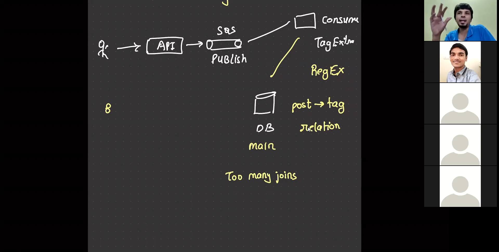
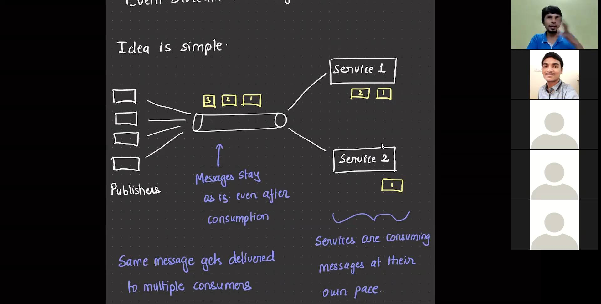
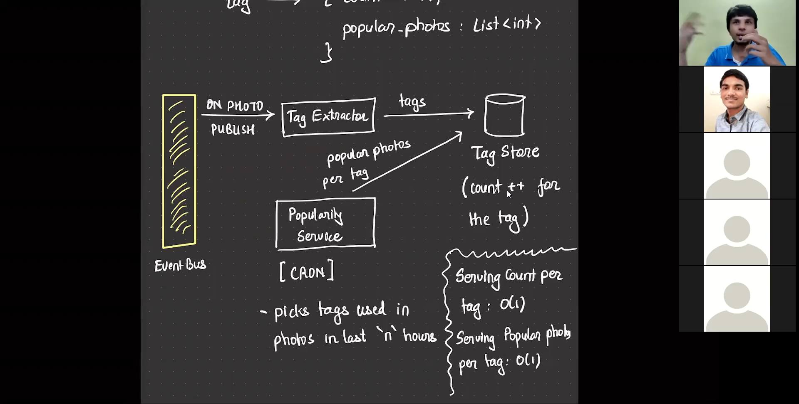
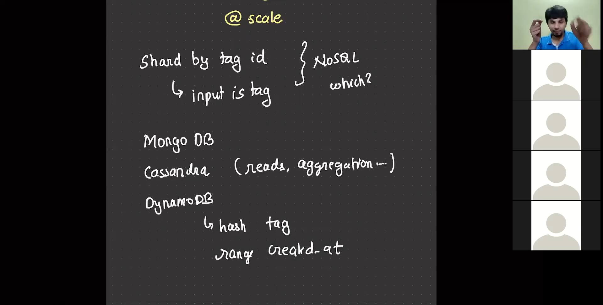
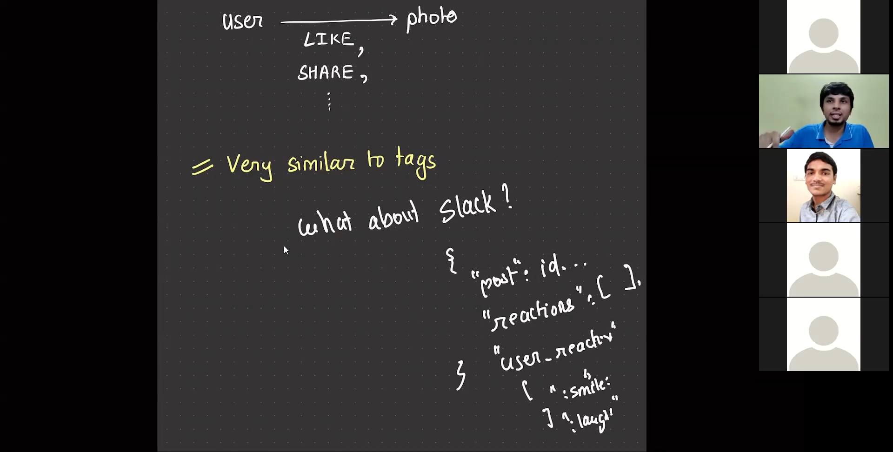

# System Design Masterclass（Arpit）P007 复现文档：社交网络标签系统与反应建模

> 说明：P007 是系统设计讲解课，不是代码课。逐字稿里没有完整仓库、依赖版本、环境变量和启动命令。因此本文按“纯讲解课”方式复现：把讲师的推导过程整理成可执行的设计步骤、数据模型草案、容量估算表和检查清单。第 4 章中出现的 SQL/伪代码均明确标注“课里没有代码，以下为示意”，不冒充课程原始代码。

## 1. 这一节做什么

这一节要解决的问题是：**用户发帖后，如何异步提取 hashtag、保存“帖子—标签”关系、支撑标签页的计数与热门帖子，并避免数据库被写入和实时 count 查询打爆。**

课程从“图片优化服务”的 SQS 消费者架构切入，先画出标签提取消费者的朴素方案：API Server 在 post publish 后发消息，消费者提取标签，再写数据库。随后讲师用 back-of-the-envelope 估算指出问题：Instagram 平均每帖约 8 个标签，每天约 200 万帖子，那么每天就是约 1600 万条 post-to-tag 写入；这些写都要进主库，规模上来后数据库会成为瓶颈。接着课程引入 event bus（Kafka/Kinesis 这类事件总线）、标签表规范化、计数预计算、按 tag 分片、DynamoDB 的 hash key/range key 设计，最后讨论 reactions 的 SQL 行式建模与 NoSQL 数组化反规范化建模。

本课最终产出不是“能启动的服务”，而是一套设计产物：

- 事件驱动架构：API 只发布一次 `post.published`，多个异构消费者各自消费。
- 标签表设计：`words` 表存字符串，`post_tags`/tags 表存 photo ID 与 word ID。
- 标签存储：预计算每个 tag 的 post count 和 top popular photos，让标签页读取接近 O(1)。
- 分片方案：按 tag ID 分片，按 created at 排序，解决 photo-tag 组合爆炸。
- reactions 建模：固定反应可用列/枚举；动态自定义 emoji 用多行；NoSQL 可用数组/嵌套文档并做原子数组操作。

## 2. 讲师原话（带「—— pNNN [MM:SS]」）

下面只摘录能支撑设计决策的原话，并在每条后说明它在项目里的作用。

1. “So I'll get this thing, user, making call to our API server. Our API server pay on publish, like SQS pay, it got a message, something like a consumer, a very similar architecture to image resolution... So image optimizer service.”
   —— p007 [101:55]
   这是朴素方案：API 发消息，消费者做 tag extraction。它和图片优化服务同构，说明可以先复用已有异步消费者模式。

2. “What's the, how many tags per post is an average for Instagram? Two or three... It's eight. It's published by Instagram. So eight is the average... two million posts a day... we would get 16 million tag entries.”
   —— p007 [105:11] / [105:40]
   这是容量估算的起点：8 tags/post × 2M posts/day = 16M post-to-tag entries/day。讲师用它说明“写入爆炸”。

3. “And since these are rights, this has to go to the master. You can't have a separate thing gone. So this is where your design needs to be altered.”
   —— p007 [106:38]
   这里指出写操作要进主库，单纯加消费者不能解决写放大；必须改数据库设计和架构。

4. “Would your post publish call should like push messages in 50 queues that would make your API call too slow... this is a classical case that we have to use event driven architecture.”
   —— p007 [108:30] / [108:59]
   这是 event bus 的引入理由：如果每增加一个下游就多推一个队列，发布接口会变慢且容易失败；应改成发布一次事件。

5. “instead of publishing the message n times for n use case in n different message broker event bus ensure that you just have to publish the message once the same message would be read by multiple consumers.”
   —— p007 [110:25]
   这是事件总线与普通队列的核心差异：同一消息可被多个异构消费者读取；普通队列通常一条消息被一个消费者读走。

6. “if your thing has just 10 partitions, so the number of concurrent reads that you can make on Kafka would be 10. And this goes for Kinesis. So Kinesis has shards.”
   —— p007 [114:42]
   这是容量与并行度的约束：Kafka 分区数/Kinesis 分片数限制消费并行度。设计时要按目标吞吐配置分区/分片。

7. “What's a better way to do this? A better way to do this is having it pre-computed... you would see the number of posts made on that... A query like this becomes very inefficient.”
   —— p007 [120:51]
   这是 count 查询的解法：不要实时 `COUNT` 大表，改为预计算 tag store。

8. “Shard by tag ID... Because your lookups are by the tag, not by the photo. Your input is the tag. You want to get the count for tag and you want to get the photos for tag.”
   —— p007 [131:14] / [131:41]
   这是分片键选择原则：按查询入口分片，而不是按 photo 分片。

9. “...your hash key could be your tag and your range key could be your created act... if you'd want to go through all the photos for a certain tag... created at as your sorting parameters.”
   —— p007 [136:26] / [137:24]
   这是 DynamoDB 式 schema：hash key 用 tag，range key 用 created at，支持按 tag 取全部照片并按时间排序。

10. “...if these are dynamic... each of them has to be a row... if it's no sequelish design you can skip all of that and just have a list of reaction id's... array operations would be atomic.”
    —— p007 [144:53] / [148:34]
    这是 reactions 的两种建模路径：关系型用多行，NoSQL 用数组/列表并做原子数组操作。

## 3. 从零复现

这一章按“需求 → 约束 → 估算 → 方案 → 取舍”复现讲师的推导。读者可以照着在 `design/social-tags/README.md` 中逐项填写。

### 3.1 需求

1. 用户发布帖子，帖子包含 `caption` 文本，文本中可能有多个 hashtag。
2. 发布接口不能同步做所有下游事情，否则响应慢、失败面大。
3. 发布后要异步提取 hashtag，并保存“哪个 photo 包含哪个 tag”。
4. 标签页要展示：该 tag 的帖子数量、该 tag 下热门照片（讲师提到 top 500）。
5. 要能按 tag 获取该 tag 下所有照片，并支持按 created at 排序/时间范围遍历，供 popularity service 做聚合。
6. reactions 也要建模：固定反应与动态自定义 emoji 都要考虑。

### 3.2 约束

- 原始设计是 `photo ID + tag string`，字符串重复严重。讲师指出：`hashtag sunset` 出现在 100 万张照片上，就重复存 100 万次；如果数据库编码是 `utf8mb4`，每个字符 4 字节，重复字符串更糟。
- 实时 `COUNT` 大表很贵。讲师明确说不要在生产标签页实时跑 count。
- 写操作要进主库，单 SQL 主库在 1600 万条/天级别的 post-to-tag 写入下会死。
- Kafka/Kinesis 的消费并行度受分区/分片数量限制。
- 同一事件有多个异构消费者：image optimizer、tag extractor、未来 analytics/popularity 等。普通队列“一条消息一个消费者”的模式不合适。

### 3.3 估算

讲师给的核心口径：

- 平均 tags per post：`8`
- 每天帖子数：`2,000,000`
- 每天 post-to-tag entries：`8 × 2,000,000 = 16,000,000`

按这个口径继续算平均写入：

- 每天秒数：`86,400`
- 平均每秒 post-to-tag 写入：`16,000,000 ÷ 86,400 ≈ 185 条/秒`

峰值倍数课里没有给。为了做容量检查，本文示例假设峰值是平均的 10 倍，则约 `1,850 条/秒`。这个 10 倍是本文假设，不是讲师原话；实际应按业务峰值重新估。

事件总线保留：讲师说 Kafka 里消息通常存两周，即 `14 天`。如果只算 `post.published` 事件：`2,000,000 × 14 = 28,000,000` 条事件。如果每个 tag 单独发事件，则 `16,000,000 × 14 = 224,000,000` 条 tag-entry 事件。课里没有确定“一条 post 事件还是每条 tag 一条事件”，所以这两个口径只用于提醒读者区分事件粒度和存储成本。



### 3.4 方案

**方案 A：事件总线替代多队列直推。**  
API Server 在 post publish 时只发布一次 `post.published` 事件到 event bus。tag extractor、image optimizer、popularity service 等作为不同 subscriber 订阅同一 topic 或各自 topic。讲师说 Kafka/Kinesis 这类事件总线会保留消息一段时间，消费者按自己的节奏消费；新服务可以从历史位置开始读。Kafka 用 partitions，Kinesis 用 shards；并行度受分区/分片数限制。



**方案 B：标签表规范化。**  
不要 `photo_id + tag_string`。改成：

- `words(id, word)`：每个 tag 字符串只存一次。
- `post_tags(photo_id, word_id, created_at)`：只存整数 word_id 和 photo_id。

代价是多一次 join；收益是字符串不重复、索引更小、内存命中更好、count/查找更高效。讲师明确说虽然多一个 join，但数据库性能更稳。

**方案 C：预计算 tag store。**  
对每个 tag 维护：

- `count`：该 tag 出现过多少帖子。
- `popular_photos`：热门照片列表，讲师举例 top 500。

标签页读取时，给定 tag 一次读取 tag store，就能拿到 count 和热门照片，变成接近 O(1) 的操作。讲师说 popularity service 可以消费 event bus，按每 5 分钟或每小时重算热门；具体算法课里没展开。



**方案 D：按 tag 分片存 source of truth。**  
photo-tag 关系仍然爆炸，单 SQL 会撑不住。讲师选择按 tag ID 分片：同一 tag 的所有记录落到同一 shard，查询“某 tag 下所有照片”只打一个 shard。排序键用 created at，便于按时间倒序或时间范围遍历，供 popularity service 使用。讲师以 DynamoDB 为例：hash key 用 tag，range key 用 created at；也提到 Cassandra/MongoDB 属于分片/分布式 NoSQL 方向。



**方案 E：reactions 建模。**  
固定反应集合可以用枚举/列；动态自定义 emoji 不能无限加列，关系型就一行一个 reaction。NoSQL 可以把 reactions 作为数组/嵌套文档存在 post 文档里，并用数据库原生数组操作原子 add/remove，避免读整个文档再写回。讲师还提到可限制每帖 reaction 数量（例如 100）来控制文档大小。



### 3.5 取舍

- 事件总线：增加 Kafka/Kinesis 运维和分区设计成本，换来发布接口解耦、多消费者复用、可回放。
- 规范化表：多一次 join，换来字符串不重复和更小索引。
- 预计算：count 与热门照片可能短暂不一致，换来标签页快读；一致性策略课里没讲。
- 按 tag 分片：同一 tag 热点会集中到一个 shard；但查询入口就是 tag，所以这是合理取舍。
- NoSQL 数组化 reactions：写入可能集中到单个 post 文档/shard；讲师说数组操作原子，但热点帖子仍是风险。课里没给最终一致性方案。

## 4. 完整代码

> 本章标题保留“完整代码”，但本课是纯讲解课。以下不是课程仓库代码，而是把讲师口头设计落成可保存的设计产物。所有 SQL/JSON/伪代码均标注“课里没有代码，以下为示意”。

### 4.1 建议目录

以下是本文建议保存结构，不是课里给的：

```text
design/social-tags/
  README.md
  schema.sql
  event-post-published.json
  tag-extractor.pseudo.ts
  reactions.md
```

### 4.2 设计决策表

| 问题 | 决策 | 原因 | 不这样会怎样 |
|---|---|---|---|
| 发布接口同步推多个队列 | 改为 event bus 发布一次 | 讲师说 n 个下游推 n 次会让 API 太慢 | 发布接口 RT 上涨，下游失败影响发布 |
| 标签字符串重复存 | `words` 表存字符串，`post_tags` 存 word_id | 减少重复，索引更小 | utf8mb4 下字符串放大，索引膨胀 |
| 实时 count 大表 | tag store 预计算 count | 讲师说实时 count 非常低效 | 标签页查询打爆数据库 |
| 热门照片实时算 | 预存 top popular photos | 标签页要快 | 每次打开标签页都做重查询 |
| photo-tag 单库爆炸 | 按 tag 分片，created at 排序 | 查询入口是 tag | 单 SQL 主库写入瓶颈 |
| 动态 reactions 加列 | 关系型多行；NoSQL 数组 | 自定义 emoji 不可枚举 | 列数爆炸或文档结构僵化 |

### 4.3 组件职责表

| 组件 | 职责 | 输入 | 输出 |
|---|---|---|---|
| API Server | 发布帖子，写主数据，发 `post.published` | 用户发帖请求 | 事件消息 |
| Event Bus | 保存并分发事件，支持多消费者 | `post.published` | 多个消费者各自读取 |
| Tag Extractor | 从 caption 提取 hashtag，批量写 words/post_tags，更新 tag store | 事件中的 caption/photo_id | words、post_tags、tag store 更新 |
| Tag Store | 保存每个 tag 的 count 和 popular photos | tag extractor/popularity service 更新 | 标签页读取 |
| Popularity Service | 消费事件，重算热门照片 | event bus + photo-tag source of truth | tag store 的 popular photos |
| Reaction Service | 写 reactions，读 reactions | 用户 reaction 请求 | SQL 行或 NoSQL 数组更新 |

### 4.4 数据模型草案

课里没有给建表语句。以下是按讲师口头描述整理的示意 SQL：

```sql
-- design/social-tags/schema.sql
-- 课里没有代码，以下为示意：按 P007 中 words/tags/photo ID/word ID/created at 的口头描述整理。

CREATE TABLE words (
  id BIGINT PRIMARY KEY,
  word VARCHAR(255) NOT NULL UNIQUE
);

CREATE TABLE post_tags (
  photo_id BIGINT NOT NULL,
  word_id BIGINT NOT NULL,
  created_at TIMESTAMP NOT NULL,
  PRIMARY KEY (photo_id, word_id),
  KEY idx_word_created (word_id, created_at)
);

-- 固定反应集合可用枚举/列；动态自定义 emoji 在关系型里一行一个 reaction。
CREATE TABLE post_reactions (
  photo_id BIGINT NOT NULL,
  user_id BIGINT NOT NULL,
  reaction VARCHAR(64) NOT NULL,
  created_at TIMESTAMP NOT NULL,
  PRIMARY KEY (photo_id, user_id, reaction)
);
```

tag store 的 NoSQL 文档草案：

```json
{
  "tag": "sunset",
  "count": 1000000,
  "popular_photos": [123, 456, 789],
  "updated_at": "2025-01-01T00:00:00Z"
}
```

`event-post-published.json` 草案：

```json
{
  "type": "post.published",
  "photo_id": 123,
  "caption": "sunset #food #travel",
  "created_at": "2025-01-01T00:00:00Z"
}
```

> 以上 JSON 字段是示意，课里没有给完整消息 schema。

### 4.5 容量估算表

| 项目 | 公式 | 结果 | 备注 |
|---|---:|---:|---|
| 每日帖子 | 给定 | 2,000,000 | 讲师口径 |
| 平均 tags/post | 给定 | 8 | 讲师引用 Instagram 数据 |
| 每日 post-to-tag 写入 | 8 × 2,000,000 | 16,000,000 | 讲师核心估算 |
| 平均写入 QPS | 16,000,000 ÷ 86,400 | ≈185/s | 本文计算 |
| 峰值写入 QPS | 平均 × 10 | ≈1,850/s | 10 倍是本文假设，课里没给 |
| Kafka 14 天 post 事件 | 2,000,000 × 14 | 28,000,000 | 若每帖一条事件 |
| Kafka 14 天 tag-entry 事件 | 16,000,000 × 14 | 224,000,000 | 若每 tag 一条事件 |
| top photos per tag | 给定 | 500 | 讲师举例 |

### 4.6 标签消费者伪代码

> 课里没有代码，以下为示意：只表达 batch get + batch insert + count 预计算的思想，不是可运行仓库。

```ts
// design/social-tags/tag-extractor.pseudo.ts
// 课里没有代码，以下为示意。

type PostPublishedEvent = {
  type: "post.published";
  photo_id: number;
  caption: string;
  created_at: string;
};

async function handlePostPublished(event: PostPublishedEvent) {
  const tags = extractHashtags(event.caption);
  const uniqueTags = Array.from(new Set(tags));

  // 讲师强调：不要一条一条 get/insert，要 batch get + batch insert。
  const wordIdMap = await batchGetWordIds(uniqueTags);
  const missingTags = uniqueTags.filter((tag) => !wordIdMap.has(tag));
  const insertedMap = await batchInsertWords(missingTags);

  for (const [tag, id] of insertedMap) {
    wordIdMap.set(tag, id);
  }

  const wordIds = uniqueTags.map((tag) => wordIdMap.get(tag)!);
  await batchInsertPostTags(event.photo_id, wordIds);

  // tag store 预计算 count；热门照片可由 popularity service 异步更新。
  await tagStore.incrementCounts(uniqueTags);
}

function extractHashtags(caption: string): string[] {
  // 正则细节课里没讲，这里只示意提取 # 开头单词。
  return caption.match(/#[\p{L}\p{N}_]+/gu)?.map((s) => s.slice(1)) ?? [];
}
```

## 5. 逐行解释

这一章逐条解释第 4 章产物为什么这样定。仍要强调：SQL 和伪代码是示意，不是课程代码。

**`words(id, word)`**：讲师说要有单独 tags 表存 word ID 和 word 字符串，避免 `sunset` 重复一百万次。`word` 加唯一约束是为了同一个字符串只出现一次。`id` 用整数，post_tags 只存整数，索引更小。

**`post_tags(photo_id, word_id, created_at)`**：讲师的口头表是 photo ID + word ID。加 `created_at` 是为了支持按 tag 取照片时按时间排序；讲师在 DynamoDB 方案里明确说 range key 用 created at，用于 popularity service 按时间窗口遍历。`PRIMARY KEY (photo_id, word_id)` 防止同一帖子同一标签重复插入；`idx_word_created (word_id, created_at)` 服务“某 tag 按时间排序”的查询。这个索引是本文按讲师查询需求补的草案，课里没有写出索引语句。

**`post_reactions`**：讲师说如果反应动态、不能加列，就一行一个 reaction。`PRIMARY KEY (photo_id, user_id, reaction)` 表示同一用户对同一帖子同一反应只存一行。固定反应集合可用枚举/列；这里用字符串 `reaction` 是为了表达动态 emoji 也能落行。

**tag store 文档**：`count` 对应讲师说的 count++/post count；`popular_photos` 对应讲师说的 top popular photos，top 500 是例子。`updated_at` 是本文加的运维字段，课里没讲。

**`handlePostPublished` 的函数边界**：讲师说消费者从事件里拿到 post caption，正则提取标签；正则不在数据库跑，是 CPU bound 过程。因此伪代码先 `extractHashtags`，再批量查/写数据库。

**`Array.from(new Set(tags))`**：同一帖子可能重复写同一个 tag，先去重，避免主键冲突和无意义 count++。课里没讲去重细节，但这是工程上必须处理的点。

**`batchGetWordIds` 和 `batchInsertWords`**：对应讲师说的“不要 one write one get，要 batch get + batch insert”。讲师说批量可以 10 个或 50 个一组；具体批次大小课里没定，需要按数据库限制和压测确定。

**`batchInsertPostTags`**：把 photo 与 word ID 的关系批量写入。讲师说 insertion 很贵，批量插入能显著缓解；但讲师也明确说这仍然只是推迟爆炸，不是根本解决，所以还要分片。

**`tagStore.incrementCounts`**：对应讲师说的 count++。这里没有做“读-改-写”，而是假设 tag store 支持原子计数。课里没给具体数据库 API；在 Node/JS 里，读者应优先使用数据库客户端提供的原子 increment/数组操作，避免先 `get` 再 `set`。如果底层不支持原子操作，就要用事务、版本号或唯一键幂等（课里没讲，见第 7 章）。

**`extractHashtags` 正则**：只示意。讲师说用正则表达式提取，但没有给具体正则、大小写规则、多语言规则、是否保留 `#`。这些是实际实现会撞上的问题。


**分片键为什么是 tag**：讲师说查询输入是 tag，不是 photo；要拿某 tag 的 count 和 photos。按 tag 分片后，同一 tag 的记录落同一 shard，查询只打一个 shard。按 country 分片被讲师否掉，因为 hashtag 是全局的。代价是热点 tag 会集中到一个 shard，这是分片键选择的固有取舍。

**DynamoDB 的 hash key/range key**：讲师说 hash key 用 tag，range key 用 created at。这样“按 tag 取全部照片并按时间排序”是天然支持的。课里没有给表名、容量单位、读写容量配置，实际落地要另算。

**reactions 数组化**：讲师说关系型动态反应一行一个 reaction；NoSQL 可以把 reactions 作为数组/列表放在 post 文档里，用原子 add/remove 操作，避免读整个文档再写回。热点帖子仍会集中写一个文档/shard，讲师也提到“很多人更新这个 post 会有问题”，但数组操作原子可缓解。课里没讲跨文档事务和最终一致性。

## 6. 复现检查清单

读者可以按下面清单检查自己是否把 P007 的设计复现完整。

- [ ] 写出需求：post publish 后异步提取 hashtag；标签页显示 count 与 top popular photos；按 tag 查全部照片并按 created at 排序；reactions 支持固定与动态 emoji。
- [ ] 写出容量估算：`8 × 2,000,000 = 16,000,000` post-to-tag entries/day；平均 QPS 约 185；峰值倍数自行假设并标注。
- [ ] 画出朴素架构：API → SQS/队列 → tag extractor → DB，并说明它的问题。
- [ ] 画出事件总线架构：API 只发布 `post.published` 一次；tag extractor、image optimizer、popularity service 各自订阅。
- [ ] 说明 Kafka/Kinesis 的并行度受 partitions/shards 限制；写出目标分区/分片数（课里没给具体值，自行估算）。
- [ ] 建 `words` 表与 `post_tags` 表草案；确认没有把 tag 字符串重复存进关系表。
- [ ] 设计 tag store：每个 tag 存 count 和 popular photos（top 500 是讲师例子）。
- [ ] 设计 source of truth 分片：hash key = tag，range key = created at；说明为什么不是 photo。
- [ ] 说明 batch get + batch insert；批次大小待压测。
- [ ] 设计 reactions：关系型多行；NoSQL 数组/嵌套文档；说明原子数组操作。
- [ ] 写验证查询：用 `words` + `post_tags` 校验某个 tag 的 count，但明确生产标签页读 tag store，不实时 count 大表。
- [ ] 列出未解决项：幂等、重试、死信、正则细节、热门算法、一致性、热点 shard、成本优化最终答案。

验证 SQL 示例（仅校验用，不是生产标签页查询）：

```sql
SELECT w.word, COUNT(*)
FROM post_tags pt
JOIN words w ON pt.word_id = w.id
WHERE w.word = 'sunset'
GROUP BY w.word;
```

## 7. 课里没讲但你会撞上的

1. **消息幂等与去重**：课里没讲消费者重复消费怎么办。实际 event bus 可能至少一次投递；需要幂等键（如 `photo_id + word_id` 唯一约束）或去重表。在 Node/JS 里不要假设“处理一次就一定只执行一次”，要用数据库唯一键/幂等记录兜底。

2. **失败重试与死信队列**：课里没讲 tag extractor 失败后的重试策略、退避、死信队列。实际要定义重试次数和告警。

3. **正则细节**：课里只说用正则提取 hashtag，没有给正则、大小写、多语言、连续 `#`、`#` 后标点、emoji 边界等规则。实际要写测试用例。

4. **tag 归一化**：`Sunset` 与 `sunset` 是否同一 tag？课里没讲。实际要做大小写/Unicode 归一化，否则 words 表会分裂。

5. **count 一致性与热点**：tag store 的 count++ 与 source of truth 写入不是同一事务。课里没讲补偿、对账、最终一致性窗口。热点 tag 的 count++ 也会形成单键热点，需要分桶/异步聚合，但课里只把“成本优化”留作挑战。

6. **popularity 算法**：讲师说 popularity service 可以消费事件、每 5 分钟或每小时重算，但没给完整算法。top 500 怎么选、时间衰减、反作弊都没讲。

7. **Kafka/Kinesis 具体配置**：课里没给分区数、副本数、保留策略细节、消费者组配置。只讲了“14 天”这个常见保留时长例子和“分区/分片限制并行度”。

8. **DynamoDB 容量与成本**：课里给了 hash key/range key 思路，但没给读写容量单位、GSI、热分区处理、按需/预置模式选择。实际要另做成本估算。

9. **MongoDB/DynamoDB 数组原子操作细节**：课里说数组操作原子、可以直接 add/remove，但没给具体 API。实际要查对应数据库文档，确认是原子操作还是需要条件更新。在 Node/JS 里要避免“先读数组再 push 再写回”的竞态；优先用数据库原生原子操作，或事务/版本号。

10. **锁与事务的 JS/Node 对应**：课里讨论的是数据库层原子性和分片，不是 Node 进程内锁。读者如果是前端转 AI 应用工程师，要记住：Node 单线程不等于数据库写安全；并发请求下仍需要数据库唯一索引、原子 increment、事务或幂等键。课里没讲具体事务隔离级别。

11. **跨 store 一致性**：words/post_tags 在 SQL，tag store 在 NoSQL，popular photos 又可能被 popularity service 更新。课里没讲双写失败、顺序错乱、对账任务。实际要设计 outbox/重放/对账，但这些工具名课里没提，本文不把它们安到讲师头上。

12. **成本优化最终答案**：讲师在 [138:23] 之后把“让架构成本更高效、放松 count++ 约束、batch/micro-batch/stream processing”留作挑战，并说明天再讨论。课里没有给最终完整答案。复现时不要把某个未出现的方案写成讲师结论。