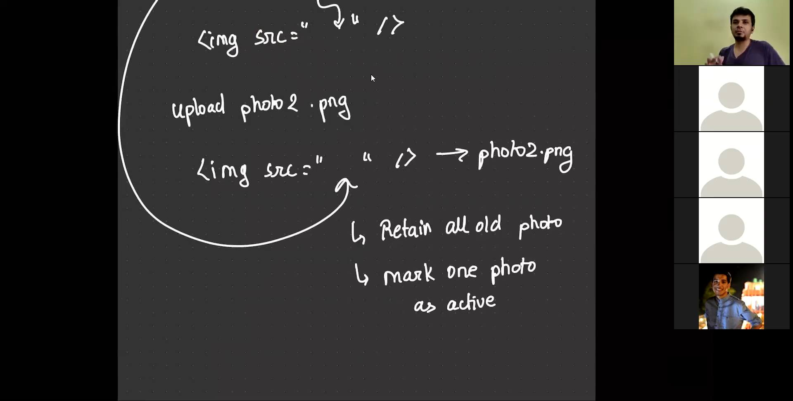
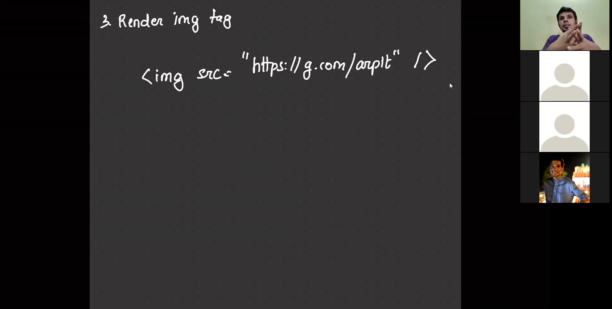
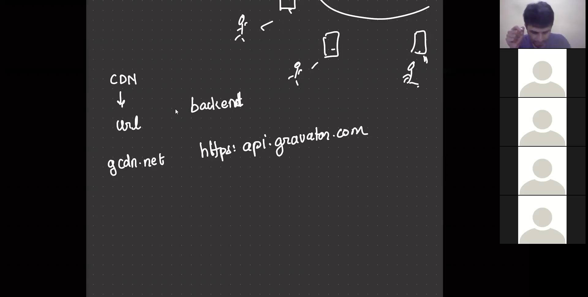

# System Design Masterclass（BV1k7un69EUL）P008 复现文档：从「换头像」推到 Gravatar 式图片服务

## 1. 这一节做什么

P008 是一节**白板讨论课**，不是敲代码课。讲师从一个很具体的问题切入：**用户换了头像，历史帖子里已经冗余保存的旧头像 URL 怎么办？** 由此一路推到「设计一个 Gravatar」：一个固定 URL，谁访问都返回该用户当前最新的头像；同时要保留历史头像、允许用户把某张旧头像重新标为 active；最后还要让这个 URL 能直接塞进 ``，并且用 CDN 扛住读流量。

这节课的前 5 分钟还有一个引子：**计数系统的 blast radius（爆炸半径）**。讲师比较了「先写 DB 再写 Kafka」和「先批量聚合再提交」两种顺序，指出前者失败会**多算**，后者失败会**少算且可重试**；并提到可以用近似计数器、采样、按粉丝量给用户分桶（HyperLogLog、Redis 也被点名）。这部分是背景，不是本节项目的主线，但理解它有助于明白讲师的取舍风格：**先问失败时往哪边错，再问能不能用近似换吞吐**。

本节最终要复现的产物是：

1. 一个**不带扩展名**的固定 URL：`https://gravatar.com/{userId}`；
2. 一条**上传路径规范**：`s3://images/{userId}/{timestamp}.{ext}`（或 UUID）；
3. 一套**元数据表**：`photos` 存所有历史图，`users.active_photo_id` 只存当前激活图；
4. 一条**读路径**：API Server 查库拿到 `photo_url`，从 S3 读原始字节，以 `Content-Type: image/*` 直接流回浏览器；
5. 一层 **CDN**：边缘节点缓存 `/{userId}`，换图时按 `userId`  purge。

> 说明：本节截图清单只提供了 5 帧（p008 05:34 / 16:43 / 27:51 / 38:59 / 50:08），文档已全部插入；清单里没有的帧我没有编造。

---

## 2. 讲师原话（带「—— pNNN [MM:SS]」）

> "通过这种做法，我们实际上是在尽可能缩小故障影响范围本身。"
> —— p008 [00:00]

> "如果你一开始先做批处理，到那个时间点再提交，那么结果会少计，而不会多计。"
> —— p008 [00:27]

> "你其实可以使用占用空间更小的近似计数器。"
> —— p008 [02:50]


> "把照片上传到同一路径，这样用户的照片 URL 就能始终保持不变。"
> —— p008 [16:20]

> "我们必须生成一个 URL；任何人访问这个 URL 时，拿到的都会是你最新的照片。"
> —— p008 [22:38]

> "保留所有旧照片，并支持将照片标记为活跃，也就是把其中一张照片标记为活跃状态。"
> —— p008 [25:01]

> "你可能需要建一个用户表……其中会有照片 ID，而这个照片 ID 会指向这里。"
> —— p008 [34:05]

> "从文件中读取内容，也就是从 S3 文件中读取，然后将其作为原始 HTTP 响应返回。"
> —— p008 [45:31]

> "你可以显式地按某个键执行清除。这里的键就是你的用户 ID。"
> —— p008 [52:34]

---

## 3. 从零复现

### 3.1 先把需求钉死：URL 是契约，不是文件路径

讲师在 [22:38] 把问题定义得很清楚：**Gravatar 的本质是「URL → 最新照片」的映射，而且这个 URL 必须静态**。静态的意思是：用户第一次拿到的是 `https://gravatar.com/arpit`，以后换一百次头像，前端 `` 里仍然是这个字符串，不需要改任何历史帖子。

这直接推翻了「把头像覆盖上传到同一个 S3 路径」的朴素做法。覆盖同路径确实能让 URL 不变，但会带来两个问题：

- **历史丢失**：用户想回滚到旧头像时，旧文件已经被覆盖；
- **MIME 类型打架**：讲师在 [17:13] 专门追问「用户上传 PNG，你要不要在线转 JPG？」——PNG 支持透明背景，JPG 不支持，不能无脑转。既然不能转，就不能假设固定路径一定是 `.jpg`。

所以最终 URL 设计成**不带扩展名**：

```text
https://gravatar.com/{userId}
```



扩展名由服务端在响应头里用 `Content-Type` 决定，而不是由 URL 决定。这是整个设计的第一块基石。


### 3.2 子问题一：上传照片，路径要能保留历史

讲师在 [28:22] 把问题拆成第一个子问题：**用户从设备上传照片到 S3，路径怎么定？**

讨论结果是：

```text
s3://images/{userId}/{timestamp}.{ext}
# 或者
s3://images/{userId}/{uuid}.{ext}
```

为什么不用「覆盖同一个路径」？因为需求里明确要**保留所有旧照片**，并且允许用户把某张旧照片重新标为 active。每张图必须有唯一路径，否则历史无法追溯。

为什么不用纯时间戳？讲师在 [29:19] 提醒：**两个人同一毫秒上传会撞**。所以更稳的是 UUID，或者「时间戳 + 随机后缀」。课里没有规定必须用哪种，只给了这两个方向。

### 3.3 子问题二：元数据放数据库，不要每次 list S3

第二个关键决策在 [30:18] 附近：**要不要把照片信息存数据库？**

讲师的回答很直接：**要**。因为如果你不存，渲染「历史照片列表」时就得对 S3 做 `list` 调用；而 S3 的 `list` 响应时间远高于数据库查询。并且数据库还能支撑软删除、分析（比如某张图被渲染了多少次）等需求。

表结构在 [32:09] 被讨论出来：

- `photos` 表：`photo_id`、`user_id`、`photo_url`、`uploaded_at`、`is_deleted`；
- **不要**在 `photos` 表里放 `is_active` 布尔列。

为什么？讲师在 [33:37] 解释得很清楚：如果 `is_active` 在 `photos` 表里，用户把第 1000 张图设为 active 时，你得先找到「原来哪张是 active」，把它改成 false，再把新图改成 true——**两次 UPDATE + 一次查询**，而且容易并发出错。

更好的做法是：在 `users` 表里放一个 `active_photo_id` 外键，指向 `photos.photo_id`。这样「切 active」只需要**更新 users 表的一行**：

```text
users(user_id, email, active_photo_id)
photos(photo_id, user_id, photo_url, mime_type, uploaded_at, is_deleted)
```

讲师在 [35:59] 总结：**「the photo ID which is here is the one which is active」**，所以任意时刻改 active 都只动一行。

### 3.4 子问题三：`` 打过来，API 要返回原始字节

第三个子问题在 [38:23]：`` 发的是 GET 请求，API Server 怎么把图片返回去？

讲师先否掉了「301 重定向到 S3」：**「redirection works，but it's not recommended」**（[41:42]）。原因不是 `` 不支持重定向，而是重定向会把控制权交给 S3，你没法统一做鉴权、Content-Type 修正、缓存头、审计。

最终方案是：**API Server 自己读 S3 对象，把原始字节作为 HTTP response body 返回**。



流程是：

1. 请求 `GET /{userId}` 打到 API Server；
2. API Server 用 `userId` 查 `users` 表拿到 `active_photo_id`；
3. 用 `active_photo_id` 查 `photos` 表拿到 `photo_url` 和 `mime_type`；
4. 从 S3 读取该对象的**原始字节**；
5. 设置 `Content-Type` 为存下来的 MIME 类型，把字节写回 response。

讲师在 [45:31] 特别强调：**「just send those raw bytes. Don't send JSON」**。图片不是 JSON，不能包一层 `{ "data": "..." }`；浏览器拿到什么字节就按 `Content-Type` 渲染什么。base64 也可以，但那是编码后的字节，不是 JSON 包装。

### 3.5 子问题四：CDN 缓存 + 按 userId purge

最后一个子问题在 [46:28]：如果每次 `` 都打到 API Server，再由 API Server 回源 S3，API Server 会变得很「胖」。解法是加 CDN。

讲师在 [49:15] 画了配置：

```text
CDN 域名:   https://gcdn.net
回源地址:   https://api.gravatar.com
```

当用户请求 `https://gcdn.net/arpit` 时：

1. 请求先到离用户最近的边缘节点；
2. 边缘节点检查 `/arpit` 是否有缓存；
3. 第一次没有，回源到 `https://api.gravatar.com/arpit`；
4. API Server 返回图片字节；
5. CDN 缓存这份字节，再返回给浏览器；
6. 下次同一个 key 的请求直接命中边缘缓存。



关键在**换图时怎么让缓存失效**。讲师在 [52:34] 说：**「manually purge the cache of CDN for that key, which is slash arpit」**。也就是说，当用户把 active photo 从 A 改成 B 时，业务代码要调用 CDN 的 purge API，把 `/{userId}` 这个 key 清掉。下一次请求就会回源，拿到新图，再重新缓存。

讲师也补了一句：CDN 不只能缓存图片，**JSON 响应也能缓存**（[54:23]）。比如用户资料这种「读多写少」的接口，可以配置 CDN 缓存 JSON，过期再回源。

### 3.6 取舍复盘：为什么不是「覆盖同路径」

把整条链路串起来看，讲师其实在三个方案里做了选择：

| 方案 | 做法 | 问题 |
|---|---|---|
| A. 覆盖同路径 | 永远上传到 `/images/profile/{userId}.jpg` | 丢历史；PNG/JPG 无法共存；无法回滚 |
| B. 每次换 URL | 上传到新路径，DB 里改 URL | 历史帖子里的旧 URL 不会自动更新；需要改 1000 条冗余数据 |
| C. 固定 URL + 服务端查 active | URL 永远 `/{userId}`，服务端查 `active_photo_id` | 多一次 DB 查询 + 一次 S3 读；但可用 CDN 缓存掉 |

讲师选的是 C。代价是读路径多了一次查库和一次回源，但换来的是：**URL 永久稳定、历史可保留、MIME 可不同、切图只改一行**。这就是系统设计里的典型取舍：**用读时的一点点计算，换取写时的巨大简化**。

---

## 4. 完整代码

> 本节是纯讲解课，讲师没有写代码。下面先给设计产物（决策表、职责表、数据模型、接口、容量估算），最后给一段**标注为示意**的可运行 Demo，用本地磁盘代替 S3、用内存 Map 代替数据库，只为把「上传 → 切 active → 读原始字节」这条链路跑通。

### 4.1 设计决策表

| 决策点 | 课里选定的做法 | 被否掉的替代方案 | 理由 / 代价 |
|---|---|---|---|
| 对外 URL | `https://gravatar.com/{userId}`，不带扩展名 | `/{userId}.jpg` | `` 不关心扩展名；换 MIME 不用改 URL |
| 上传路径 | `s3://images/{userId}/{timestamp}.{ext}` 或 UUID | 覆盖同一路径 | 要保留历史；不同 MIME 要共存 |
| 元数据 | 存数据库 | 每次 `list` S3 | S3 list 慢；DB 可软删、可分析 |
| active 标记 | `users.active_photo_id` 外键 | `photos.is_active` 布尔列 | 切图只更新一行，避免多行 UPDATE |
| 读路径 | API 读 S3 原始字节并流式返回 | 301 重定向到 S3 | 课里说重定向「能用但不推荐」；要统一控制头 |
| 缓存 | CDN 边缘缓存 + 按 `userId` purge | 只用 Redis / 本地盘 | 全球边缘加速；换图时主动失效 |
| 计数（引子） | 批量聚合，失败可重试 | 先写 DB 再写 Kafka | 后者失败会多算；前者少算可重试 |

### 4.2 组件职责表

| 组件 | 职责 | 输入 | 输出 |
|---|---|---|---|
| 浏览器 `` | 发 GET，按 `Content-Type` 渲染 | `https://gravatar.com/{userId}` | 图片像素 |
| CDN 边缘节点 | 缓存 `/{userId}`，未命中回源 | 客户端 GET | 缓存的图片字节 |
| API Server | 查 active photo、读 S3、写响应 | `userId` | `200 image/*` + 原始字节 |
| 数据库 | 存 `users` / `photos` 元数据 | SQL | `active_photo_id`、`photo_url`、`mime_type` |
| S3 | 存原始图片对象 | `photo_url` | 对象字节 |
| 上传服务 | 接收 multipart、写 S3、写 DB | 图片文件 | `photo_id` |

### 4.3 数据模型草案

> 课里只给了字段名（`photo_id`、`user_id`、`photo_url`、`uploaded_at`、`is_deleted`、`active_photo_id`），下面的类型和约束是我补的，方便直接建表。

```sql
-- PostgreSQL 方言；课里没有指定数据库
CREATE TABLE users (
  user_id         BIGSERIAL PRIMARY KEY,
  email           TEXT NOT NULL UNIQUE,
  active_photo_id BIGINT NULL,
  created_at      TIMESTAMPTZ NOT NULL DEFAULT now()
);

CREATE TABLE photos (
  photo_id    BIGSERIAL PRIMARY KEY,
  user_id     BIGINT NOT NULL REFERENCES users(user_id),
  photo_url   TEXT NOT NULL,
  mime_type   TEXT NOT NULL,
  uploaded_at TIMESTAMPTZ NOT NULL DEFAULT now(),
  is_deleted  BOOLEAN NOT NULL DEFAULT false
);

-- 循环外键：users.active_photo_id -> photos.photo_id
ALTER TABLE users
  ADD CONSTRAINT fk_users_active_photo
  FOREIGN KEY (active_photo_id) REFERENCES photos(photo_id);

CREATE INDEX idx_photos_user_id ON photos(user_id);
```

### 4.4 接口草案

| 方法 | 路径 | 作用 | 返回 |
|---|---|---|---|
| `POST` | `/{userId}/photos` | 上传一张新头像 | `201 { photoId, url }` |
| `PUT` | `/{userId}/active-photo` | 把某张图设为 active | `204` |
| `GET` | `/{userId}` | 返回当前 active 图的原始字节 | `200 image/*` |
| `GET` | `/{userId}/photos` | 列出历史头像 | `200 { activePhotoId, photos: [...] }` |

### 4.5 容量估算表

> 课里没有给具体 QPS，只给了「5 billion / 10 billion」「10 million followers」「1000 tweets」这类量级。下面的数字是**假设**，用来演示估算方法，不是讲师原话。

| 指标 | 假设 | 算式 | 结果 |
|---|---|---|---|
| 日读请求 | 100 万用户，每人每天看 100 次头像 | `1e6 × 100` | `1e8 次/天` |
| 平均读 QPS | 一天 86400 秒 | `1e8 ÷ 86400` | `≈ 1157 QPS` |
| 峰值读 QPS | 按 3 倍峰值 | `1157 × 3` | `≈ 3500 QPS` |
| 单图大小 | 假设 100 KB | — | `100 KB` |
| 日读流量 | `1e8 × 100 KB` | `1e10 KB` | `≈ 10 TB/天` |
| CDN 卸载 95% 后回源 | `10 TB × 5%` | — | `≈ 500 GB/天` |
| 日上传量 | 1% 用户换头像 | `1e6 × 1%` | `10,000 次/天` |
| 上传 QPS | `10,000 ÷ 86400` | — | `≈ 0.12 QPS` |
| 元数据增长 | 1 万张/天 × 30 天 | `10,000 × 30` | `30 万行/月` |

结论：**读远大于写**，所以 CDN 缓存是必须的；写路径很轻，数据库压力不大，重点在「读时不要每次打 S3」。

### 4.6 示意代码（课里没有代码，以下为示意）

> 下面用 `express + multer + 本地磁盘` 模拟 S3，用内存 `Map` 模拟数据库。它可以直接跑，用来验证「固定 URL 返回 active 图」这条链路。生产环境把 `photos` / `users` 换成数据库、把 `fs.readFile` 换成 S3 `GetObject` 即可。

**package.json**

```json
{
  "name": "gravatar-like-demo",
  "private": true,
  "type": "module",
  "scripts": {
    "start": "node server.js"
  },
  "dependencies": {
    "express": "^4.19.2",
    "multer": "^1.4.5-lts.1"
  }
}
```

**server.js**

```js
// 课里没有代码，以下为示意：本地磁盘代替 S3，内存 Map 代替数据库。
// 运行：npm i && npm start
import express from 'express';
import multer from 'multer';
import { randomUUID } from 'node:crypto';
import fs from 'node:fs/promises';
import { mkdirSync } from 'node:fs';
import path from 'node:path';

const app = express();
const upload = multer({ dest: 'tmp/' });
const PORT = 3000;
const STORAGE = path.resolve('storage');

mkdirSync('tmp', { recursive: true });

// 内存“数据库”
const users = new Map();  // userId -> { userId, activePhotoId }
const photos = new Map(); // photoId -> { photoId, userId, filePath, mimeType, uploadedAt, isDeleted }

function ensureUser(userId) {
  if (!users.has(userId)) {
    users.set(userId, { userId, activePhotoId: null });
  }
  return users.get(userId);
}

// 1) 上传：写磁盘 + 写元数据
app.post('/:userId/photos', upload.single('photo'), async (req, res) => {
  const { userId } = req.params;
  if (!req.file) return res.status(400).json({ error: 'photo is required' });

  ensureUser(userId);

  const photoId = randomUUID();
  const ext = path.extname(req.file.originalname) || '';
  const dir = path.join(STORAGE, userId);
  await fs.mkdir(dir, { recursive: true });

  const filePath = path.join(dir, `${photoId}${ext}`);
  await fs.rename(req.file.path, filePath);

  const photo = {
    photoId,
    userId,
    filePath,
    mimeType: req.file.mimetype,
    uploadedAt: new Date().toISOString(),
    isDeleted: false,
  };
  photos.set(photoId, photo);

  const user = ensureUser(userId);
  if (!user.activePhotoId) user.activePhotoId = photoId;

  res.status(201).json({ photoId, url: `/${userId}` });
});

// 2) 切 active：只更新 users 表这一行
app.put('/:userId/active-photo', express.json(), (req, res) => {
  const { userId } = req.params;
  const { photoId } = req.body ?? {};

  const user = ensureUser(userId);
  const photo = photos.get(photoId);

  if (!photo || photo.userId !== userId || photo.isDeleted) {
    return res.status(404).json({ error: 'photo not found' });
  }

  user.activePhotoId = photoId;
  res.status(204).end();
});

// 3) 读：返回原始字节，不是 JSON
app.get('/:userId', async (req, res) => {
  const { userId } = req.params;
  const user = users.get(userId);
  const photo = user?.activePhotoId ? photos.get(user.activePhotoId) : null;

  if (!photo || photo.isDeleted) return res.status(404).end();

  const bytes = await fs.readFile(photo.filePath);

  // 关键：Content-Type 用上传时记录的 MIME
  res.setHeader('Content-Type', photo.mimeType);
  res.setHeader('Cache-Control', 'public, max-age=60');
  res.send(bytes);
});

// 4) 列出历史头像
app.get('/:userId/photos', (req, res) => {
  const { userId } = req.params;
  const list = [...photos.values()]
    .filter((p) => p.userId === userId && !p.isDeleted)
    .map(({ photoId, mimeType, uploadedAt }) => ({ photoId, mimeType, uploadedAt }));

  res.json({
    userId,
    activePhotoId: users.get(userId)?.activePhotoId ?? null,
    photos: list,
  });
});

app.listen(PORT, () => {
  console.log(`Gravatar-like demo on http://localhost:${PORT}`);
});
```

**启动与验证**

```bash
npm i
npm start

# 另开终端：上传一张图
curl -F "photo=@./avatar.png" http://localhost:3000/u123/photos

# 读取当前 active 图（应返回 image/png 原始字节）
curl -i http://localhost:3000/u123

# 查看历史列表
curl http://localhost:3000/u123/photos
```

---

## 5. 逐行解释

**为什么 URL 不带扩展名？**  
因为扩展名是「文件系统」的概念，不是「HTTP 资源」的概念。浏览器拿到 `` 后只发 GET，然后看响应头 `Content-Type`。只要服务端返回 `image/png`，URL 里写不写 `.png` 都能渲染。反过来，如果 URL 写死 `.jpg`，用户上传 PNG 时你就得做转码，而 PNG 的透明背景转 JPG 会丢信息——讲师在 [17:13] 专门点了这个坑。

**为什么上传路径要带 `{userId}` 和唯一 ID？**  
`{userId}` 把同一用户的图放在同一前缀下，方便按用户列举和做生命周期管理；唯一 ID（时间戳或 UUID）保证每张图有独立对象键，才能保留历史。如果覆盖同一路径，S3 上只剩最后一张，`photos` 表里就算存了旧 URL 也读不到旧字节。

**为什么 `active_photo_id` 放在 `users` 表，而不是 `photos.is_active`？**  
这是本节最值得记住的建模技巧。`is_active` 是「多行里最多一行为 true」的约束，数据库本身很难用普通列表达；每次切图都要「先查旧 active，再改 false，再改 true」，至少两条 UPDATE，还要处理并发。把 `active_photo_id` 放到 `users` 表后，「当前 active 是谁」变成**单行单列**的事实，切图就是一条 `UPDATE users SET active_photo_id = $1 WHERE user_id = $2`。在 Node 里，这条语句本身是原子的；如果你用 Prisma，就是 `prisma.user.update({ where: { userId }, data: { activePhotoId } })`。课里没有展开锁和事务，但你可以记住：**能用一个字段表达的状态，不要用多行布尔值表达**。

**为什么读路径要返回原始字节，而不是 301？**  
301 会把浏览器直接送到 S3 的 URL，看起来省了 API Server 的带宽，但你会失去：统一的 `Content-Type` 修正、鉴权、审计、缓存头控制、以及「S3 桶不公开」的安全模型。讲师在 [41:42] 说重定向「works but not recommended」，就是在这个取舍上选了「API Server 做静态文件服务器」。在 Node 里对应 `res.setHeader('Content-Type', mime); res.send(buffer)`；不要 `res.json({ data: buffer.toString('base64') })`，除非你明确要 base64 包装。

**为什么 CDN 要按 `userId` purge？**  
CDN 的缓存键是 URL path。`https://gcdn.net/arpit` 对应的 key 就是 `/arpit`。用户切了 active photo 后，如果不清这个 key，边缘节点还会返回旧图，直到 TTL 过期。讲师在 [52:34] 说「manually purge the cache of CDN for that key」，就是让业务在切图成功后调用 CDN 的 purge API。课里没有讲 purge 的失败重试、跨地域延迟，这些要在工程里补。

**示意代码里的 `Cache-Control: public, max-age=60` 是课里讲的吗？**  
不是。课里只讲了「CDN 会缓存」，没有给具体头。这里写 60 秒是为了让 Demo 能观察到缓存行为；生产环境通常会给更长的 `max-age`，再配合主动 purge。

---

## 6. 复现检查清单

- [ ] 对外 URL 是 `https://gravatar.com/{userId}`，**不带扩展名**。
- [ ] 上传路径是 `s3://images/{userId}/{唯一ID}.{ext}`，同一用户的历史图不会互相覆盖。
- [ ] `photos` 表有 `photo_id`、`user_id`、`photo_url`、`mime_type`、`uploaded_at`、`is_deleted`。
- [ ] `users` 表有 `active_photo_id` 外键，切 active 只更新一行。
- [ ] `GET /{userId}` 返回的是**原始字节**，响应头 `Content-Type` 来自 `photos.mime_type`。
- [ ] 没有用 301 重定向到 S3（或者用了但明确知道课里不推荐）。
- [ ] CDN 回源地址配置为 `https://api.gravatar.com`，缓存键是 `/{userId}`。
- [ ] 切 active 成功后，调用 CDN purge `/{userId}`。
- [ ] 本地 Demo 能跑通：`npm i && npm start`，`curl -F "photo=@avatar.png"` 上传，`curl -i /u123` 返回 `image/png`。
- [ ] 截图清单只有 5 帧，已全部插入；没有编造第 6 帧。

---

## 7. 课里没讲但你会撞上的

1. **鉴权与越权**：课里没讲「谁有权限改 `active_photo_id`」。真实系统里，`PUT /{userId}/active-photo` 必须校验登录用户就是 `userId` 本人，否则任何人都能把别人的头像切掉。在 Node 里就是中间件里比对 `req.user.id === req.params.userId`。

2. **文件类型校验**：课里提到 `` 会执行 JavaScript 的 XSS 风险（[40:14]），但没有给防护方案。工程上不能只信 `Content-Type` 和扩展名，要用 magic bytes 检测真实类型；响应加 `X-Content-Type-Options: nosniff`；禁止 SVG 或对 SVG 做清洗。

3. **并发切图**：两个请求同时把 active 从 A 改成 B 和 C，最后谁赢？课里没讲。单条 `UPDATE` 是原子，但「后写覆盖先写」是否符合业务预期要定义。如果需要严格顺序，可以用 `updated_at` 做乐观锁，或者在事务里 `SELECT ... FOR UPDATE`。在 Node 里对应 `BEGIN` / `COMMIT` 或 Prisma `$transaction`。

4. **CDN purge 的失败与延迟**：课里说「manually purge」，但没说 purge API 失败怎么办、跨地域多久生效。工程上要加重试队列，并且接受「短时间内可能读到旧图」的最终一致。

5. **S3 读放大与成本**：每次回源都 `GetObject`，如果 CDN 命中率低，S3 请求费用会很高。课里没讲成本，但你要监控 CDN 命中率；必要时在 API Server 前再加一层 Redis 缓存。

6. **删除与合规**：`is_deleted` 是软删，但用户要求「彻底删除」时，S3 对象、CDN 缓存、备份都要清。课里没讲 GDPR/CCPA 流程，这是上线前必须补的。

7. **图片体积与限流**：课里没讲上传大小限制、压缩、EXIF 清理。真实系统要限制 `multipart` 大小，否则一个 100 MB 的图就能打爆内存；`multer` 的 `limits.fileSize` 要配。

8. **数据库迁移与循环外键**：上面的 DDL 用了 `ALTER TABLE` 加循环外键，因为 `users` 和 `photos` 互相引用。课里没讲迁移顺序；实际项目里要先建表、再插数据、最后加外键，或者把 `active_photo_id` 做成可空并延迟约束。

9. **可观测性**：课里没讲日志和指标。至少要有：`GET /{userId}` 的 P99、CDN 命中率、S3 回源次数、purge 成功率。否则换图后用户说「还是旧图」，你无法定位是 DB 没更新、CDN 没 purge，还是浏览器缓存。

10. **「课里没讲」的边界**：本节没有出现 WebSocket、Kafka 具体配置、Redis 具体命令、S3 SDK 代码、CDN 厂商 API。上面 Demo 里的 Express、multer、PostgreSQL 方言都是**我补的工程实现**，不是讲师原话；讲师只给了架构和取舍。