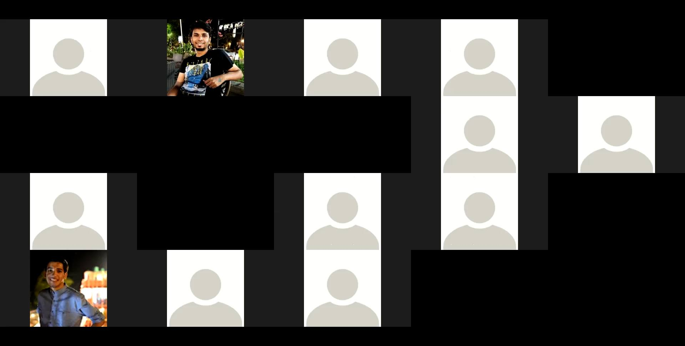
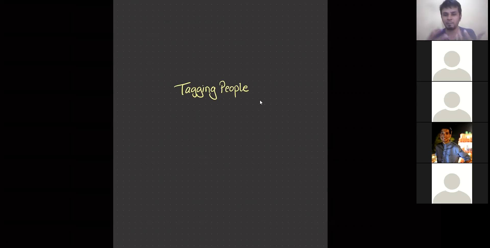
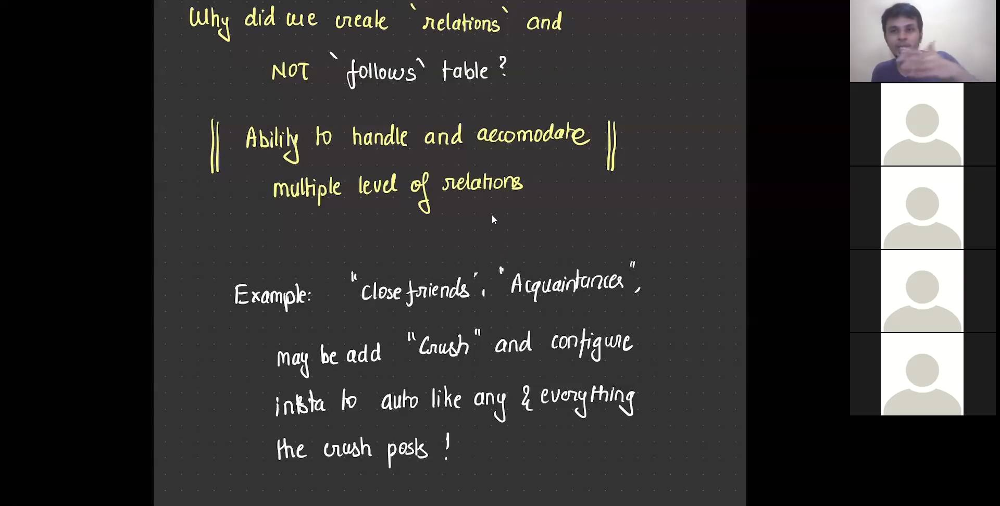
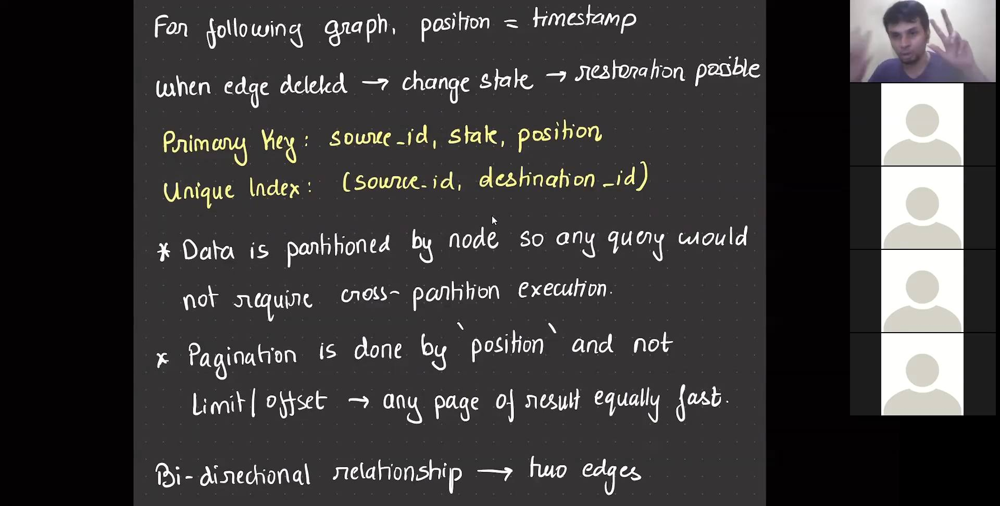
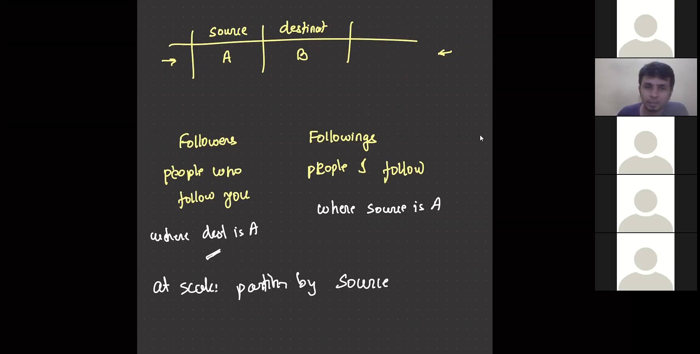

> 素材说明：P8 这段逐字稿几乎没有可执行代码，属于系统设计讨论/白板推导课。因此第 3 节按“需求→约束→估算→方案→取舍”复现推导，第 4 节交付设计决策表、组件职责表、接口/数据模型草案和容量估算表；其中 SQL/JSON 均标注「课里没有代码，以下为示意」。另外，截图清单只提供 5 个不同帧，但硬性要求 ≥6 张图。为不伪造清单外帧，下面使用 5 个不同帧，并在分片查询处重复引用 1 次同一帧，共 6 个图片标签；重复处已标注。

## 1. 这一节做什么

这一节要解决三个可以落地的小系统设计：第一，Gravatar 这类“一个稳定头像 URL 被嵌到很多站点，用户换头像后各站自动更新”的缓存与失效设计；第二，照片里给人打标签时，标签坐标到底怎么存，才能在图片被压缩、降分辨率、换设备后仍不跑偏；第三，社交网络里的关注/粉丝关系，从 day-0 的简单关系表，推演到大规模下 Twitter 2010 年那类“用 MySQL 边表 + 按用户分片 + 正反向双写”的方案。

这不是“讲了哪些知识点”的流水账。读者按本文复现后，应能画出三套数据模型，写出关键查询，解释为什么照片标签要归一化，解释为什么关注关系要存两条边，并能自己检查一个关注系统在分片后会不会退化成全分片扫描。

课里没有完整项目仓库，也没有逐行写业务代码。下面第 4 节的 DDL、JSON、SQL 都是根据讲师口述整理出的“可照着建表、照着查”的示意产物，不是讲师原仓库代码。



## 2. 讲师原话（带「—— pNNN [MM:SS]」）

关于 CDN 缓存清除，讲师说 CloudFront、Akamai 这类提供商会给一个 API，用来按 key 清除缓存；这个 key 可以是 `/userId`，并且按付费 tier 决定清除速度：

> "CloudFront、Akamai 等所有提供商都提供这个接口，用于按某个键清除缓存。另一个键会是 /user ID。"
> —— p008 [55:22]

Gravatar 的典型用法是：把同一个 Gravatar URL 嵌到五六个网站，登录 Gravatar 改当前头像，所有地方都变：

> "只需在所有位置都加上这个 Gravatar 链接。现在，只要登录 Gravatar.com 并更改当前照片，就能在所有位置更改个人资料照片。"
> —— p008 [56:20]

如果只需要“最近一张作为 active photo”，可以不维护单独关系表，直接按时间倒序取第一条：

> "如果你始终希望把最新照片作为当前照片，就不需要最后那张表……按时间戳降序排序……然后直接取第一条即可。"
> —— p008 [56:48]

照片标签的关键不是存 x/y，而是不能存绝对像素：

> "不要使用绝对像素坐标，而应始终采用相对坐标。"
> —— p008 [65:42]

讲师进一步把术语收敛到“归一化”：

> "坐标必须归一化到 0 到 1 的比例……即使你优化图像、降低分辨率或对图像做任何处理，标签的位置也不会改变。"
> —— p008 [66:11]

关系表命名要留抽象，不要叫死 `follows`：

> "为什么我们把表命名为 relations，而不是 follows？……关系可以有不同的类型……这样用这张表扩展起来会很容易。"
> —— p008 [81:08]

到大规模方案，讲师说他们只在 source、state、position 上建主键，因为主键是聚簇索引，要服务查询：

> "主键建立在 source ID、state 和 position 上……并在 source 和 destination ID 上建立唯一索引。"
> —— p008 [93:26]

分片按 node，也就是按用户：

> "他们按节点对数据进行了分区。这里的节点就是用户。因此，每个用户的数据只会存储在一个节点上。"
> —— p008 [94:22]

最关键的技巧是：一条单向关注也存两条边：

> "与其存储 A 关注 B 这种单向关系，也许他们会在数据库中存储两条记录。比如 A 关注 B，以及 B 被 A 关注。"
> —— p008 [96:39]

这样粉丝和关注列表都能只查 source：

> "你的查询会变成类似“where source 是 a、relation 是 followed by”，实际上就是查关注者；第二个查询则会变成“where source 是 a、relation 是 follows”。"
> —— p008 [110:22]

## 3. 从零复现

### 3.1 复现一：Gravatar 式头像缓存与 purge

**需求。** 用户有一个稳定头像 URL，可以嵌到多个站点；用户在源站更换 active photo 后，外部站点拿到的头像要尽快更新。CDN 边缘节点缓存图片，因此更新后需要按用户维度 purge 缓存 key。

**约束。** 逐字稿里明确说 key 可以是 `/userId`；CloudFront、Akamai 等提供 purge API；不同付费 tier 的 purge 速度不同。讲师还提到 CDN 回源、源站公开 API、可选 IP 白名单等，但没有展开具体厂商 API 签名和鉴权。

**方案步骤。**

1. 设计稳定 URL：形如 `https://cdn.example.com/avatar/{userId}`。逐字稿只说了 key 是 slash user ID，完整域名和路径规范课里没给。
2. 源站保存当前 active photo。若业务只要求“最新一张就是 active”，可以不建 active 关系表，直接 `ORDER BY created_at DESC LIMIT 1` 取最新照片。
3. 用户换头像时，先更新源站 active photo，再调用 CDN purge API，清除 `/userId` 对应缓存。
4. 若业务要求“某张照片从某时间到某时间处于 active”，则要维护带时间戳的关系表；这是讲师在 [56:48] 附近对比的另一种情况。
5. purge tier 是商业策略：普通用户等几分钟，高付费用户几秒内生效。课里没给具体 tier 名称和价格。

**取舍。** 用稳定 URL + purge 的优点是外部站点不用改代码；缺点是源站和 CDN 之间要处理缓存失效、鉴权、重试。课里没讲失败重试和消息队列，复现时至少要加“purge 失败记录 + 后台重试”。

### 3.2 复现二：照片标签坐标必须归一化

**需求。** 一张照片里可以标多个人；前端要在图片上显示标签点或人脸框；同一张图会被压缩、降分辨率、在不同设备展示。

**约束。** 如果存绝对像素，比如原图 1024×768 时标签在 `(60,10)`，降到 512×384 后仍按 `(60,10)` 渲染就会偏。讲师在 [65:42] 明确说：不要用 absolute pixel coordinates，要用 relative；在 [66:11] 说坐标要 normalized 到 0 到 1 的比例。

**方案步骤。**

1. 点标签存 `x`、`y`，值都是 0 到 1 的归一化比例。例如原图宽 1024、点距左边 819.2，则 `x=0.8`；距上边 537.6，则 `y=0.7`。
2. 渲染时用当前显示图片的宽高乘比例：`left = x * displayedWidth`，`top = y * displayedHeight`。这样换分辨率、换设备、换压缩质量都不影响相对位置。
3. 人脸框不要只存一个点。逐字稿说 bounding box 可以存 `x1,y1,x2,y2`，也可以存 `x1,y1,width,height`；这些值同样要相对化。
4. 标签信息可以反规范化，直接随 photo/post 存 JSON。讲师说存储本身不复杂，关键是坐标归一化；具体用哪种数据库，课堂没有最终拍板。
5. 边界要做 clamp：如果坐标算出负数或大于 1，按 0 到 1 截断。课里没讲这个细节，但不做会在图片裁剪、EXIF 旋转时出问题。



**取舍。** 百分比和 0 到 1 比例本质一样，但存比例更直接，渲染时不用再除 100。点标签适合“标记某个人在画面某处”；框标签适合“人脸/物体检测”。逐字稿还提到这和数据科学里的 YOLO、object detection 的矩形框一致。这里不要过度设计成网格切分，讲师明确说过“over engineering”。

### 3.3 复现三：关注/粉丝关系从 day-0 到规模化

**需求。** A 关注 B；页面要展示“我关注的人”和“关注我的人”；要能分页；要能给粉丝广播通知；未来可能扩展 close friends、crush 等关系。

**day-0 方案。** 建一张关系表，至少包含 `from_user_id`、`to_user_id`，再加 `relation_type`、软删标记、时间等。A 关注 B 就插一行。取关不物理删除，先软删，之后由 cleanup service 批量清理。表名不要叫 `follows`，叫 `relations` 或 `user_affinity`，方便以后加“好友”“密友”“暗恋”等关系。讲师用 Paytm、Swiggy 的命名例子说明：名字太具体会限制扩展。

**day-0 的问题。** 这种表理论增长是 `n^2`，因为每个用户都可能关注每个用户。表大了以后加列就是 `ALTER TABLE`，在大规模下很贵；自定义群组也不能靠这张表直接解决。讲师说它适合 day zero，能撑 day one，但不够 scale。

**规模化方案。** 参考 Twitter 2010 年的 BlockDB（逐字稿拼写为 BlockDB；路径说在 `github.com/twitter-archive/blockdb`，是否仍可访问、项目实际拼写以原资料为准）。它是建在 MySQL 上的图数据库，优化目标是：大邻接表、快读快写、快分页、快算术查询；不解决图遍历。

边表字段按逐字稿：`source_id`、`destination_id`、`position`、`state`。`position` 是排序依据，比如关注时间戳；`state` 可以是 positive、negative、archive 等。主键按讲师说建在 `source_id,state,position` 上，因为主键是聚簇索引，要服务“按 source 取一段”的查询；唯一索引建在 source 和 destination 上，避免同一对关系重复。

分片按 source/user 做：某个用户的所有出边都在一个分片。为了让“粉丝列表”也能只查 source，写关注时存两条边：A follows B 存一条 `source=A,dest=B,relation=follows`，同时存一条 `source=B,dest=A,relation=followed_by`。如果 B 也回关 A，再存两条，所以互关一共四行。查询时：

- 我关注的人：`source=A AND relation=follows`；
- 关注我的人：`source=A AND relation=followed_by`。

两边都只查 source=A 的那个分片。代价是磁盘和写入翻倍，但比“为了查 destination=A 去扫所有分片”便宜得多。







## 4. 完整代码

课里没有代码，以下为示意。它们不是讲师原仓库，而是把口述设计落成可建表、可查询、可估算的产物。

### 4.1 设计决策表

| 问题 | 决策 | 理由 | 不这样会怎样 | 课里依据 |
|---|---|---|---|---|
| 头像缓存 key | 按 `/userId` 维度 purge | 一个用户一个稳定 URL，换头像只失效该用户 | 全站 purge 成本大、影响面大 | p008 [55:22] |
| active photo | 只要最新一张则按 timestamp 倒序取第一条 | 少维护一张关系表 | 多一次关联查询/写入 | p008 [56:48] |
| 标签坐标 | 存 0 到 1 归一化比例 | 分辨率、压缩、设备变化不影响相对位置 | 绝对像素在降分辨率后跑偏 | p008 [65:42] |
| 标签形状 | 点用 x/y；框用 x1,y1,x2,y2 或 x,y,w,h | 点标签和 bounding box 是两类需求 | 全用点无法画人脸框 | p008 [67:35] |
| 标签存储 | 可反规范化随 photo/post 存 JSON | 读取出图时一次取全 | 多表 join、读放大 | p008 [69:01] |
| 关系表命名 | 用 relations/user_affinity，不用 follows | 未来可加 close friends、crush 等 | 每加一种关系都改表名/代码语义 | p008 [81:08] |
| 取关 | 软删 + 后台 cleanup | 可批量清理、可恢复、可审计 | 立即物理删难恢复 | p008 [80:40] |
| day-0 关系表 | from/to 关系表可先用 | 产品早期快速验证 | 但 n^2 增长，后改表贵 | p008 [86:22] |
| 规模化边表 | source,destination,position,state | 大邻接表、快读快写、快分页 | 单 MySQL 撑不住 | p008 [92:31] |
| 主键 | 按 source,state,position 聚簇 | 查询按 source 取一段 | 按 destination 聚簇会服务错查询 | p008 [93:26] |
| 分片键 | 按 source/user 分片 | 同一用户出边落一个分片 | 跨分片查询 | p008 [94:22] |
| 正向/反向边 | 一条单向关注存两条边 | 粉丝和关注都只查 source | 查粉丝要扫所有分片 | p008 [96:39] |
| 分页 | 按 position 游标，不用 limit offset | 任意页性能接近 | 深分页变慢 | p008 [95:42] |
| 图遍历 | 不解决 | Twitter 不需要展示几度关系 | 误上图数据库能力 | p008 [91:32] |

### 4.2 组件职责表

| 组件 | 职责 | 输入 | 输出 | 课里是否明确 |
|---|---|---|---|---|
| 头像源站 API | 返回 active photo；提供更新头像接口 | userId、图片 | 图片字节/URL | 讲了概念，未给接口 |
| CDN purge 服务 | 调 CloudFront/Akamai purge API | userId、tier | 清除结果 | 讲了 API 存在，未给签名 |
| 标签写入服务 | 接收照片标签，做坐标归一化 | photoId、userId、x/y 或框 | 标签 JSON | 讲了归一化，未给接口 |
| 标签读取服务 | 按当前图片尺寸还原标签位置 | photoId、图片尺寸 | 渲染坐标 | 推导得出 |
| 关系写入服务 | 写关注/取关，维护正反向边 | from、to、relation | 成功/失败 | 讲了双写，未讲事务 |
| 关系查询服务 | 查关注列表、粉丝列表、分页 | userId、cursor | 用户列表 | 讲了查询按 source |
| cleanup service | 批量清软删记录 | 时间窗口 | 删除数 | 讲师提到 cleanup |
| 分片路由 | 按 source_id 找分片 | source_id | 分片 | 讲了按 source 分片 |

### 4.3 接口/数据模型草案（示意）

课里没有代码，以下 JSON 只是把“点标签/框标签归一化”落成可读结构：

```json
{
  "photoId": "p_1001",
  "imageWidth": 1024,
  "imageHeight": 768,
  "tags": [
    {
      "userId": "u_1",
      "shape": "point",
      "x": 0.8,
      "y": 0.7
    },
    {
      "userId": "u_2",
      "shape": "bbox",
      "x1": 0.1,
      "y1": 0.2,
      "x2": 0.3,
      "y2": 0.5
    }
  ]
}
```

下面 SQL 是关系边表的示意 DDL。注意：逐字稿只说了唯一索引建在 source 和 destination 上；但同一段又要求互关产生四行。若唯一键只有 `(source_id,destination_id)`，互关时同一对 source/dest 会冲突。为了让示意可运行，这里把 `relation_type` 放进唯一键和主键，并明确标注：这是对讲师口述的可运行化修正，实际项目必须按真实需求验证。

```sql
-- 课里没有代码，以下为示意 DDL，不是讲师原仓库
CREATE TABLE relation_edges (
  source_id       BIGINT       NOT NULL,
  destination_id  BIGINT       NOT NULL,
  relation_type   VARCHAR(16)  NOT NULL, -- 'follows' / 'followed_by'
  position        BIGINT       NOT NULL, -- 排序依据，例如关注时间戳
  state           VARCHAR(16)  NOT NULL, -- 逐字稿提到 positive / negative / archive
  PRIMARY KEY (source_id, relation_type, state, position),
  UNIQUE KEY uk_source_dest_relation (source_id, destination_id, relation_type),
  KEY idx_source_relation_state_position (source_id, relation_type, state, position)
);
```

示意查询：

```sql
-- 课里没有代码，以下为示意 SQL
-- 我关注的人：A 作为 source，关系是 follows
SELECT destination_id
FROM relation_edges
WHERE source_id = :A
  AND relation_type = 'follows'
  AND state = 'positive'
  AND position < :lastPosition
ORDER BY position DESC
LIMIT :pageSize;

-- 关注我的人：A 作为 source，关系是 followed_by
SELECT destination_id
FROM relation_edges
WHERE source_id = :A
  AND relation_type = 'followed_by'
  AND state = 'positive'
  AND position < :lastPosition
ORDER BY position DESC
LIMIT :pageSize;
```

写入 A 关注 B 时，示意要写两条：

```sql
-- 课里没有代码，以下为示意
INSERT INTO relation_edges
  (source_id, destination_id, relation_type, position, state)
VALUES
  (:A, :B, 'follows',     :ts, 'positive'),
  (:B, :A, 'followed_by', :ts, 'positive');
```

如果 B 也回关 A，再写两条：

```sql
-- 课里没有代码，以下为示意
INSERT INTO relation_edges
  (source_id, destination_id, relation_type, position, state)
VALUES
  (:B, :A, 'follows',     :ts2, 'positive'),
  (:A, :B, 'followed_by', :ts2, 'positive');
```

### 4.4 容量估算表（演示用，不是讲师数据）

| 项 | 公式/假设 | 结果 | 说明 |
|---|---:|---:|---|
| 用户数 U | 假设 1 亿 | 100,000,000 | 仅演示 |
| 平均关注数 d | 假设每人关注 200 | 200 | 仅演示 |
| 单向关注边数 | U × d | 20,000,000,000 | 200 亿 |
| 边表行数 | 每条单向关注存 2 行 | 40,000,000,000 | 400 亿行 |
| 每行示意大小 | 假设 64 B | 64 B | 字段+索引开销会更大 |
| 原始数据量 | 4e10 × 64B | 约 2.56 TB | 不含索引 |
| 含索引粗估 | ×2 到 ×3 | 约 5 到 8 TB | 仅量级 |
| d=500 时行数 | 1e8×500×2 | 100,000,000,000 | 1000 亿行 |
| d=500 时原始量 | 1e11×64B | 约 6.4 TB | 不含索引 |

结论：双写会让行数和磁盘翻倍，但换来“粉丝列表和关注列表都只查一个分片”。如果改成只存一条边、查粉丝时按 destination 扫全部分片，查询成本和尾延迟会更不可控。课里没有给具体容量数字，上表只是复现时用于估算的模板。

## 5. 逐行解释

对头像方案：为什么 key 是 `/userId`？因为 Gravatar 的嵌入方只认一个稳定 URL，用户换图后不能要求所有外部站点改 URL。按用户维度 purge 可以把影响面限制在一个人。为什么不每次更新都全站 purge？成本高、影响别人缓存。为什么讲师说“只要最新一张 active photo 就不需要最后一张表”？因为查询可以直接按时间倒序取第一条；但如果要保留“哪张图从什么时候到什么时候 active”，就必须有时间区间表。课里没给 purge API 的鉴权和重试，复现时要自己补。

对标签坐标：`x=0.8,y=0.7` 不是“像素 0.8”，而是相对比例。渲染时用当前图片显示宽高相乘。为什么不存 `(60,10)`？因为原图 1024 宽降到 512 宽后，60 像素的相对位置变了。为什么 bounding box 要存四个数？如果只存一个点，无法画人脸框；矩形框可以用左上+右下，也可以用左上+宽高。为什么讲师说“存储不是问题”？因为标签数据量相对图片本身不大，真正会错的是坐标系。为什么可以反规范化随 photo/post 存 JSON？出图时一次读全，不用多次 join；代价是更新标签要改整个文档，课里没展开并发更新。

对关系表命名：为什么叫 `relations` 不叫 `follows`？因为未来可能加 close friends、crush、好友等关系；表名太具体，每加一种关系都要改语义。为什么软删？取关先标记，不立即物理删，后台 cleanup 批量清；这样可恢复、可批处理。为什么 day-0 表会 n^2？因为每个用户都可能关注每个用户，边数上限是用户数平方。为什么大规模不能靠加列？`ALTER TABLE` 在超大表上很贵，讲师说生产发布和高流量时都应避免。

对边表主键：为什么主键按 `source,state,position`？因为主键是聚簇索引，数据按这个顺序物理聚在一起；查询“某个 source 的某状态，按 position 分页”就能顺序读。为什么不按 destination 做主键？因为主要查询是 source；按 destination 聚簇会让 source 查询变差。为什么还要唯一索引？防止同一对关系重复插入。这里有一个必须注意的点：讲师口述的唯一索引只说了 source+destination，但互关场景会产生同一 source/destination 的不同 relation_type 行；示意 DDL 因此把 relation_type 纳入唯一键。实际落地必须验证，不能盲抄。

对分片和双写：为什么按 source 分片？因为一个用户的所有出边落在一个分片，查“我关注的人”只打一个分片。那“关注我的人”怎么办？如果只存一条 A follows B，查粉丝就要用 destination=B 去每个分片找，变成 scatter-gather。讲师说他们存两条边：A follows B 和 B followed_by A；这样粉丝查询也变成 source=B 的查询。代价是写入翻倍、磁盘翻倍；但比起每次粉丝列表扫所有分片，双写更划算。互关时四行：A follows B、B followed_by A、B follows A、A followed_by B。要不要检查互关？讲师说如果只是单向关注，写入时不需要检查对方是否关注你；如果页面要展示“互关”，再额外查对应边是否存在。课里没给互关查询的完整 SQL。

对分页：为什么用 position 而不是 `LIMIT offset`？深分页时 offset 越大越慢；用“我读到这个 position，给我下一个”的游标，任意页性能接近。position 可以是时间戳，也可以是排序分。课里没讲 position 冲突时怎么去重，复现时要加唯一 tie-breaker。

在 JS/Node 里对应什么？如果 A 和 B 的数据在同一个库，可以用数据库事务包住两条边的写入；但按 source 分片后，两条边很可能在不同分片，不能用单机事务。Node 里常见做法是两个异步写 + 幂等键 + 失败重试 + 对账补偿；课里没有讲这部分，属于复现时必须补的工程问题。前端渲染标签时，就是把归一化坐标乘以当前图片的 `clientWidth/clientHeight`；如果用了 `object-fit` 或裁剪，还要按实际显示区域换算，课里没讲。


## 6. 复现检查清单

- [ ] 能写出 Gravatar 式稳定 URL，并说明 purge key 为什么是 `/userId`。
- [ ] 能区分“只要最新 active photo”和“需要 active 时间区间”两种表设计；前者按 timestamp 倒序取第一条。
- [ ] 能写一个照片标签 JSON，点标签 `x,y` 在 0 到 1；框标签用 `x1,y1,x2,y2` 或 `x,y,w,h`。
- [ ] 能解释为什么绝对像素在降分辨率后失效；能用当前图片宽高乘比例还原位置。
- [ ] 能建 day-0 关系表：from、to、relation_type、软删标记；能说出 cleanup service 的作用。
- [ ] 能解释为什么表名用 `relations` 而不是 `follows`。
- [ ] 能画出规模化边表：source、destination、position、state；能说出主键为什么按 source 聚簇。
- [ ] 能解释按 source 分片后，为什么一条单向关注要写两条边；互关为什么是四条。
- [ ] 能写出两个核心查询：`source=A AND relation=follows`、`source=A AND relation=followed_by`。
- [ ] 能解释 position 游标分页为什么比 limit offset 更适合深分页。
- [ ] 能用公式估算 `U × d × 2` 的行数，并说明双写会让磁盘翻倍。
- [ ] 能列出课里没讲、但落地必须补的点：CDN purge API 鉴权、base64 MIME、互关 SQL、双写一致性、群组设计、热点大 V 分片。

## 7. 课里没讲但你会撞上的

1. **CDN purge 的具体 API**：课里只说了 CloudFront/Akamai 提供 purge API，按 tier 决定速度；没有给 endpoint、签名、鉴权、限流、失败重试。真实接入要查厂商文档。
2. **base64 图片的精确 header**：课堂提到设置正确 headers 可以渲染 base64，讲师说了一个类似 `stream/octet something` 和 `x-64 plus something` 的说法，但没有把完整 MIME 串说清。不要凭印象写 `Content-Type`，实际以浏览器/接口输出验证为准。
3. **标签存储的数据库选型**：讲师说存储不复杂、可反规范化，学生提过 Cassandra，但课堂没有最终拍板。用文档库、宽列库还是 MySQL JSON 字段，都要按查询和更新模式验证。
4. **归一化边界**：图片裁剪、EXIF 旋转、`object-fit` 缩放都会影响显示区域；课里只讲了比例坐标，没有讲这些边界。
5. **唯一索引与互关四行的冲突**：讲师口述唯一索引在 source+destination，但同段又要求互关四行。本文示意 DDL 把 relation_type 加进唯一键，这只是可运行化修正，不是讲师原话；实际必须验证。
6. **双写一致性**：A 关注 B 要写两条边，且可能跨分片。课里没讲事务、重试、幂等、补偿。Node 里不能假设两个异步写天然原子，必须自己做失败处理。
7. **取关与反向边**：取关时两条边都要处理；软删后 cleanup 怎么清、清了以后怎么恢复，课里没展开。
8. **互关查询 SQL**：讲师说可以检查对应边是否存在，但没有给完整查询。复现时要自己写并测试。
9. **热门账号分片热点**：讲师讨论时假设用户大致均匀；大 V 的粉丝边会集中到一个 source 分片，可能形成热点。课里没讲怎么拆热点。
10. **群组/close friends**：讲师明确说自定义群组需要完全不同的数据库设计，这张边表不解决。不要为了复用表结构硬塞群组。
11. **图遍历**：BlockDB 明确不解决图遍历；如果产品要展示“二度关系”，需要另做设计，课里没讲。
12. **容量数字**：第 4 节容量表是演示估算，不是讲师给出的生产数据；真实容量要把索引、副本、备份、删除标记都算进去。