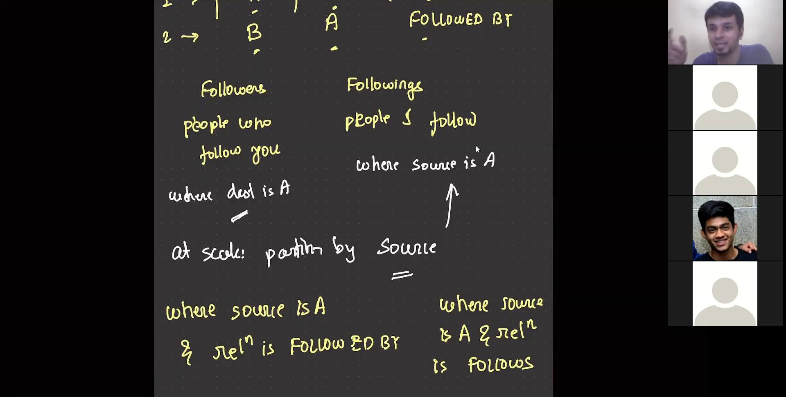
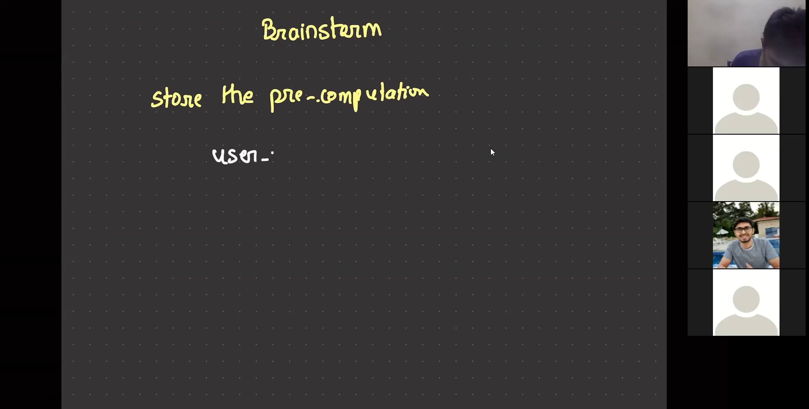
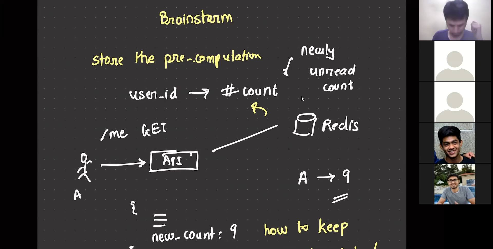
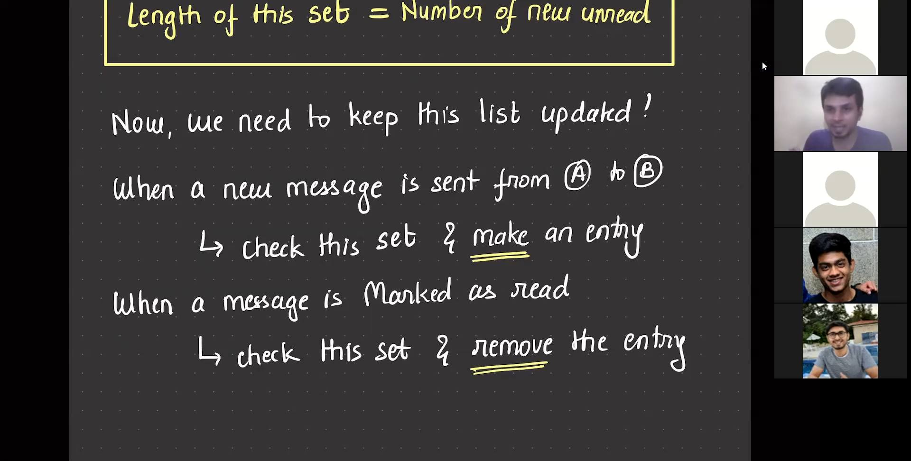

> 说明：这是一门**纯讲解/系统设计讨论课**，P008 这一段逐字稿里基本没有可运行代码。因此本文按“纯讲解课”要求组织：第 3 节复现讲师的推导过程，第 4 节把方案落成设计决策表、组件职责表、接口/数据模型草案、容量估算表；第 4 节里的伪代码会明确标注“课里没有代码，以下为示意”。  
> 另外，截图清单只提供了 5 个唯一帧。为了满足“≥6 张截图”的格式要求，本文把关键帧 `p008 128:06` 在“读路径”和“写路径”两处各引用一次，未新增任何不存在的帧号。

---

## 1. 这一节做什么

这一节要设计并复现一个社交网络/IM 产品里的 **“newly unread indicator”（新未读消息指示器）**：用户在消息图标旁看到一个小红点或数字，比如 `3`。这个数字不是“总未读数”，而是“最近收到、你还没有确认过的新消息人数”。你点开消息页之后，即使没有逐条读完消息，这个数字也应该消失；下次刷新时返回 `0`。

讲师在 P008 开头先把问题定义得很清楚：不是所有未读消息都算，而是“新收到的、你还没 acknowledge 的”。逐字稿里说：

> "新未读指示器……用户可能有数百条未读消息。但这里的“三”表示的是你最近收到且尚未确认的三条消息。"
> —— p008 [120:49] / [121:18]

这里最容易混淆的是三种状态：

| 状态 | 含义 | 是否进入本节计数 |
|---|---|---|
| newly unread | 你离开后新收到、还没有打开消息页确认的人 | 是 |
| unread | 你打开过消息页，但某个人/某条消息你还没点开读 | 课里说这是另一个产品问题 |
| read | 已经点开或明确已读 | 否 |

本节的核心输出不是一个消息列表，而是一个**极轻量的计数**，可选带“谁给你发了消息”的简短列表。讲师反复强调：渲染这个数字时不应该去读消息正文，否则数据量太大，尤其是用户离线很久后收到成千上万条消息时，系统会被拖垮。



上图对应讲师前面讨论大 V/celebrity 账号的热点问题：某些账号的关注关系、消息量会形成热点，必要时需要手动指定分区。这个思路在本设计里也适用：某个用户如果收到大量消息，他的 Redis key 可能变热，需要按 userID 分片或做隔离。

本节最小闭环包含这些动作：

1. 用户 B 打开 App 或调 `/me` 类似接口，拿到 `newlyUnreadCount`。
2. 用户 A 给 B 发消息，消息正文落库。
3. 系统更新 B 的“新未读发送者集合”。
4. 如果 B 在线，可通过已经存在的 WebSocket 连接推送提醒；如果 B 离线，B 下次上线时从 Redis 读计数。
5. B 点开消息页，系统清空 B 的“新未读集合”。
6. 再次读取时，计数为 `0`。

---

## 2. 讲师原话（带「—— pNNN [MM:SS]」）

下面摘录的是本节最关键的讲师原话。英文保留原句，后面用中文解释它在设计里的作用。

1. **“When something needs to be near real time... you would have to store the pre-computed data.”**  
   —— p008 [127:24]  
   讲师的意思是：只要要求“近实时”，就不要在请求到来时现场算。应该预计算，把结果存在某个地方，API 来了直接取。

2. **“Store user ID to count... API wants to send the response, it would just come to this store and from this user ID, it would get the newly unread count and return it.”**  
   —— p008 [128:22]  
   这是最初的最简方案：Redis 里存 `userId -> count`，API 直接读。



3. **“The requirement said that the newly unread messages count is equal to the number of unique people who have sent you the message but you have not read them.”**  
   —— p008 [134:09]  
   这句话把 `count++` 方案否掉了：同一个人发 100 条，只能算 1 个“新未读人”，不能算 100。

4. **“A different data structure... different user IDs would be perfect and the timing would be the score.”**  
   —— p008 [135:02]  
   讲师把数据结构从普通计数改成 Redis sorted set：成员是发送者 userID，score 是时间。这样既能去重，又能按最近时间排序。

5. **“To render the count instead of reading the value from the Redis, you would read the length of the sorted set.”**  
   —— p008 [135:30]  
   读取时不再读一个整数，而是读集合长度。集合里每个发送者只出现一次，所以长度就是“去重后的人数”。

6. **“When user is trying to read all the messages... you would just purge the entire sorted set.”**  
   —— p008 [137:50]  
   用户点开消息页时，清空这个 sorted set。之后读取长度为 0，前端计数归零。

7. **“You would not be storing the actual message here because storing the actual message might be too costly for Redis.”**  
   —— p008 [139:44]  
   Redis 里只存 userID、时间戳、可选的基础展示名，不存消息正文。正文仍然在消息数据库里。

8. **“If B is online... API server can choose to send a message over WebSocket... if B is not online... update the Redis.”**  
   —— p008 [142:36] 附近  
   在线用户优先走 WebSocket 推送；离线用户靠 Redis 里的集合，下次上线读取。是否在线时还更新 Redis，讲师说这取决于产品需求。

9. **“Newly unread bold is different and unread messages are different.”**  
   —— p008 [145:53]  
   讲师明确区分“新未读”和“未读消息”。本节只做 newly unread 指示器，不把“所有未读消息是否加粗”混进来。

10. **“Batching... count plus equal to k... you are reducing your IOPS.”**  
    —— p008 [162:55]  
    这是问答里对 hashtag 计数等场景的优化：牺牲实时精确性，批量累加，降低数据库写入。注意：这个优化不能直接套到“去重人数”上，因为本节要求 unique people。

---

## 3. 从零复现

这一节按讲师的推导顺序复现：先定义输入输出，再列约束，再做估算，再一步步改方案，最后做取舍。课里没有给出具体机器数、QPS、内存数字；下面出现的估算会明确标注“自拟”，不是逐字稿数据。

### 3.1 先定输入输出

**输入事件：**

- 用户 A 给用户 B 发送一条消息。
- 用户 B 打开 App / 调 `/me` 或消息状态接口。
- 用户 B 点开消息页，表示“我确认有新消息了”。

**输出：**

- 对用户 B 返回 `newlyUnreadCount`。
- 可选返回 `newlyUnreadSenders`：最近给 B 发消息、B 还没确认的发送者列表，按时间倒序。
- 不返回消息正文。
- 不要求读消息表来算计数。

讲师说：“I typically start with input output.” —— p008 [128:22] 附近。先把 IO 钉死，后面所有设计围绕 IO 转。

### 3.2 约束

1. **近实时**：A 发消息后，B 的计数要尽快变化。  
2. **去重人数**：同一个人发 100 条，只算 1 个新未读人。  
3. **打开消息页即清零**：即使 B 没逐条读，点开消息页后计数也归零。  
4. **不读消息正文**：渲染计数不能把消息体传给前端，也不能为了算计数去消费大量消息。  
5. **离线可恢复**：B 关机、关笔记本时 WebSocket 不存在，上线后仍要能拿到计数。  
6. **在线体验更好**：B 在线时可用 WebSocket 推一个小红点。  
7. **可扩展**：大 V、热点用户、大量消息不能把单个 key 打爆。  
8. **产品可配置**：在线时是否还显示未读、newly unread 和 unread 如何区分，都是产品决策。

### 3.3 估算（自拟，不是逐字稿数据）

> 以下数字仅用于复现时做容量推演，逐字稿没有给这些参数。

假设：

- DAU = 1000 万。
- 每人每天收到 50 条消息。
- 每人每天平均有 20 个不同发送者。
- 峰值消息 QPS 按日均的 3 倍估算。
- 每人每天打开 App/触发 `/me` 5 次。
- 每个 Redis sorted set 条目按 100 B 估算（member + score + 结构开销，粗估）。

计算：

- 日均消息写入：`10,000,000 × 50 / 86,400 ≈ 5,787 msg/s`。
- 峰值消息写入：`5,787 × 3 ≈ 17,361 msg/s`。
- `/me` 日均读取：`10,000,000 × 5 / 86,400 ≈ 579 QPS`。
- `/me` 峰值读取：`579 × 3 ≈ 1,737 QPS`。
- Redis 条目数：`10,000,000 × 20 = 200,000,000` 条。
- Redis 内存粗估：`200,000,000 × 100 B ≈ 20 GB`。
- 如果每个用户最多保留 100 个发送者：`10,000,000 × 100 × 100 B = 100 GB`，需要更谨慎地做上限、过期和分片。

这些估算说明两件事：

1. **写多读少**：消息写入 QPS 远高于 `/me` 读取 QPS。所以写路径必须轻，不能在每条消息上做重查询。
2. **Redis 内存是主要成本**：只存 userID + timestamp，不存消息正文，是必须坚持的边界。

### 3.4 方案演进

#### 第 1 步：最简方案，Redis 存 `userId -> count`

讲师最开始说：

> "存储用户 ID 用于计数……Redis 获取数据并发送。"
> —— p008 [128:22]

也就是：

```text
Redis key: newly_unread_count:{userId}
Redis value: 7
```

B 调 `/me` 时，API 直接 `GET` 这个 key，返回 7。这个方案能满足“快”，但马上遇到需求冲突。

#### 第 2 步：发现问题，`count++` 不能去重

如果 A 给 B 发了 100 条消息，`count++` 会变成 100。但需求是“unique people”，A 只应该算 1。讲师在 [134:09] 明确纠正了这一点。所以不能只存一个整数。

#### 第 3 步：改成 Redis sorted set

讲师说：

> "不同的用户 ID 就正合适，时间则作为分值。"
> —— p008 [135:02]

结构变成：

```text
Redis key: newly_unread:{userId}
Redis type: sorted set
member: senderUserId
score: 最后一条消息的时间戳
```

例如 B 的 key 里有：

```text
newly_unread:user_B
  member=user_A  score=1710000300
  member=user_C  score=1710000200
  member=user_D  score=1710000100
```

读取时用集合长度，长度为 3，表示 3 个不同的人给 B 发了新消息。A 再发 100 条，只要 member 不变，长度还是 3，但 score 可以更新为最新时间。



讲师还提到可以存一点基础展示信息，比如 first name，这样前端 hover 时可以显示“Arpit、Vishal、Manav 给你发了消息”。但消息正文不进来。

#### 第 4 步：读路径

B 打开 App 或调 `/me`：

1. API 读 `newly_unread:{userId}` 的集合长度。
2. 返回 `newlyUnreadCount`。
3. 可选：按 score 倒序取前 N 个 member，返回发送者简表。
4. 不查消息表，不读消息正文。

讲师说：

> "API 会直接访问 Redis，获取数据并发送。"
> —— p008 [128:22] 附近

#### 第 5 步：写路径

A 给 B 发消息：

1. API 把消息正文保存到消息数据库。
2. API 更新 B 的 Redis sorted set：`member=A`，`score=当前时间`。
3. 如果 B 在线，通过 WebSocket 给 B 推一个提醒。
4. 如果 B 离线，不推；等 B 下次调 `/me` 时读 Redis。

讲师说消息保存后“it would go and update the Redis as well.” —— p008 [141:40] 附近。

#### 第 6 步：点开消息页，清空集合

B 点开消息页时，可以有两种做法：

- 单独一个 API handler，专门清空 sorted set；
- 或者 piggyback 到“拉取消息列表”的 API 上，在同一个请求里清空。

讲师说：

> "要么在点击按钮时再发起一次 API 调用，要么把它捎带在返回消息的那次 API 调用上。"
> —— p008 [138:17] 附近

清空后，下一次 `/me` 读到的长度是 0，前端计数归零。

#### 第 7 步：在线与离线分支

- B 在线：WebSocket 连接存在，API server 可以直接推送“有新消息”。  
- B 离线：WebSocket 不存在，不能靠推送；下次上线读 Redis。  
- B 在线时是否还要更新 Redis？讲师说取决于产品需求：如果在线时不想显示未读，可以只推 socket；如果仍要显示，就继续更新 Redis。

#### 第 8 步：热点与大 V

讲师在前面讨论 celebrity 账号时提到：大 V 的图关系/关注列表会有热点，可能需要手动指定分区，避免 10 个 celebrity 挤在一个 shard。对应到本设计：

- 普通用户按 `userId` 分片到 Redis。
- 超级大 V 或企业账号可以单独分片、单独限流。
- sorted set 可以设置最大长度，只保留最近 N 个发送者；更老的发送者是否还需要计入“新未读”，是产品决策。

#### 第 9 步：产品取舍：newly unread 不是 unread

讲师在问答里反复区分：

- newly unread：你离开后新收到、还没打开消息页确认的人；
- unread：你打开过消息页，但某个人的消息你还没点开；
- 已读：你点开过。

所以本节不要试图一次解决“所有未读消息加粗”“每个会话的已读回执”“群组消息未读”等。课里没有把这些问题合并进最小方案。

---

## 4. 完整代码（纯讲解课：设计产物与示意）

> 本节不是代码课。逐字稿没有给出语言、框架、依赖版本、环境变量或启动命令。下面给出的是可照着落地的**设计产物**：决策表、组件职责表、接口/数据模型草案、容量估算表。  
> 最后的伪代码是帮助理解用的，**课里没有代码，以下为示意**，不要把字段名当成课程原文。

### 4.1 设计决策表

| 决策 | 具体做法 | 为什么 | 不这样会怎样 |
|---|---|---|---|
| 预计算 | 写入时更新 Redis，读取时直接拿 | 满足 near real time | 每次 `/me` 现场聚合消息表，慢且贵 |
| 用 Redis | 存 newly unread 集合 | 快、简单 key-value/集合操作、可分片 | 用关系库频繁更新计数，写放大严重 |
| 不存整数，存 sorted set | member=senderUserId，score=timestamp | 需要按人去重，还要按最近时间排序 | `count++` 把同一人的 100 条算成 100 |
| 读长度 | 读取集合长度作为人数 | 长度天然等于去重人数 | 需要额外 distinct 查询 |
| 不存消息正文 | 只存 userID、时间、可选基础名 | Redis 内存贵 | 内存暴涨，缓存被消息体挤爆 |
| 打开消息页清空 | 删除/清空该用户 sorted set | 用户已确认有新消息 | 计数一直不消失，体验错误 |
| 在线走 WebSocket | 在线用户推提醒 | 低延迟 | 只能等轮询，体验差 |
| 离线靠 Redis | 上线后 `/me` 读取 | WebSocket 不在时仍可恢复 | 离线期间消息丢失提醒 |
| 在线是否写 Redis | 产品决定 | 在线时可能不想显示未读 | 产品规则和实现打架 |
| 热点分片 | 大 V/热 key 手动隔离 | 避免单 shard 被打爆 | 一个 key 拖慢整个 Redis |
| 批处理只用于可近似计数 | hashtag 计数可 `count += k` | 降低 IOPS | 套到 unique people 上会算错人数 |

### 4.2 组件职责表

| 组件 | 职责 | 本节最小闭环是否需要 |
|---|---|---|
| Client/App | 显示计数；点消息页时触发清空；可 hover 显示发送者简表 | 是 |
| API Server | 鉴权；处理发消息；保存消息；更新 Redis；返回 `/me`；处理清空 | 是 |
| 消息数据库 | 存消息正文、会话、时间等 | 是，讲师明确说消息要 save in database |
| Redis | 存 `newly_unread:{userId}` sorted set | 是 |
| WebSocket Gateway | 在线用户实时推送 | 是，讲师说在线可用 socket |
| Kafka/SQS 等事件总线 | 通知系统扩展、削峰、异步 | 课里在问答延伸提到，但不是本设计最小闭环 |
| 监控/告警 | 看 Redis 命中、延迟、内存、错误 | 课里没展开，但上线必有 |

### 4.3 接口/数据模型草案（字段名为示意）

> 以下字段名不是逐字稿原文，是为了落地而拟的草案。

**Redis key 草案：**

```text
key: newly_unread:{userId}
type: sorted set
member: senderUserId
score: lastMessageTimestamp
```

可选：为了 hover 显示名字，可以另存：

```text
key: user_basic:{userId}
type: hash 或 string
fields: displayName 等（课里没定具体编码）
```

但不要存消息正文。

**读取接口草案：**

```http
GET /api/me
```

响应示意：

```json
{
  "userId": "user_B",
  "newlyUnreadCount": 3,
  "newlyUnreadSenders": [
    { "userId": "user_A", "displayName": "Arpit", "lastMessageAt": 1710000300 },
    { "userId": "user_C", "displayName": "Vishal", "lastMessageAt": 1710000200 },
    { "userId": "user_D", "displayName": "Manav", "lastMessageAt": 1710000100 }
  ]
}
```

如果不想返回发送者列表，只返回 `newlyUnreadCount` 也可以。讲师说可以只渲染 count，也可以利用 sorted set 做更个性化的 tooltip。

**清空接口草案，二选一：**

```http
POST /api/messages/ack-newly-unread
```

或者把清空逻辑 piggyback 到拉消息列表的接口里：

```http
GET /api/messages?conversationId=...
```

**发送消息内部流程草案：**

```text
POST /api/conversations/{conversationId}/messages
1. 鉴权，确认 A 能发给 B
2. 保存消息到消息数据库
3. Redis: ZADD newly_unread:{B} score=now member=A
4. 如果 B 在线，WebSocket 推送提醒
5. 返回发送成功
```

### 4.4 容量估算表（自拟，不是逐字稿数据）

| 指标 | 假设 | 算式 | 结果 | 备注 |
|---|---:|---|---:|---|
| 日均消息写入 | DAU 1000 万，人均 50 条/天 | `10,000,000 × 50 / 86,400` | ≈ 5,787 msg/s | 只算消息事件 |
| 峰值消息写入 | 峰值系数 3 | `5,787 × 3` | ≈ 17,361 msg/s | 写路径要轻 |
| `/me` 日均读取 | 人均 5 次/天 | `10,000,000 × 5 / 86,400` | ≈ 579 QPS | 读少写多 |
| `/me` 峰值读取 | 峰值系数 3 | `579 × 3` | ≈ 1,737 QPS | Redis 读为主 |
| Redis 条目数 | 人均 20 个不同发送者 | `10,000,000 × 20` | 2 亿条 | 需要分片 |
| Redis 内存粗估 | 每条 100 B | `200,000,000 × 100 B` | ≈ 20 GB | 不含副本和开销 |
| 上限方案 | 每人最多 100 个发送者 | `10,000,000 × 100 × 100 B` | ≈ 100 GB | 需要上限/过期/分片 |


上图对应讲师在问答里说的批处理优化：对 hashtag 计数这类场景，可以牺牲精确实时性，用 `count += k` 降低写入。但本节的 newly unread 是 unique people，不能简单批处理成人数，除非产品接受近似。

### 4.5 示意伪代码（课里没有代码，以下为示意）

> 下面不是逐字稿代码，只是把上面的读写路径写成伪代码，帮助前端转 AI 应用工程师理解。具体 Redis 客户端、框架、版本课里没讲。

```ts
// 课里没有代码，以下为示意
// 读取：返回新未读人数，可选返回发送者简表
async function getMe(userId: string) {
  const key = `newly_unread:${userId}`;

  // 示意：取集合长度作为去重人数
  const count = await redis.zcard(key);

  // 示意：按 score 倒序取前 20 个发送者
  const senders = await redis.zrevrange(key, 0, 19, "WITHSCORES");

  return {
    userId,
    newlyUnreadCount: count,
    newlyUnreadSenders: senders, // 实际落地时再映射成 {userId, displayName, lastMessageAt}
  };
}

// 课里没有代码，以下为示意
// 写路径：A 给 B 发消息后更新 B 的新未读集合
async function onMessageSent(fromUserId: string, toUserId: string, now: number) {
  // 1. 消息正文先落库（示意）
  await messageDb.save({ fromUserId, toUserId, createdAt: now });

  // 2. 更新 B 的 sorted set；同一发送者只更新 score，不增加长度
  const key = `newly_unread:${toUserId}`;
  await redis.zadd(key, now, fromUserId);

  // 3. 如果 B 在线，走 WebSocket 推送（示意）
  const online = await presence.isOnline(toUserId);
  if (online) {
    await socket.push(toUserId, { type: "new_message_hint" });
  }
}

// 课里没有代码，以下为示意
// 清空：用户点开消息页后调用
async function ackNewlyUnread(userId: string) {
  const key = `newly_unread:${userId}`;
  await redis.del(key);
}
```

---

## 5. 逐行解释

这一节逐条解释上一节每个决策和估算为什么这样定，不这样会怎样。

1. **为什么先定输入输出？**  
   因为讲师说“I typically start with input output”。如果先想数据库表，很容易把“newly unread”和“unread”“消息正文”“已读回执”混在一起。先定输出只有 count（可选 senders），后面才能围绕 Redis 设计。

2. **为什么要求 near real time 就必须预计算？**  
   如果 B 每次打开 App 都去消息表 `COUNT(DISTINCT sender_id)`，在千万级消息量下会非常慢。讲师在 [127:24] 说 near real time 意味着要 store pre-computed data。预计算把重活放到写路径，读路径只做一次 Redis 读。

3. **为什么第一版用 Redis 存 `userId -> count` 是合理的？**  
   因为它是最小闭环，能快速验证“读 Redis 返回 count”的体验。讲师说先做最 simplistic 的设计，再看是否 make sense。工程上先用简单方案跑通，再根据需求修正，比一开始过度设计好。

4. **为什么 `count++` 必须被否掉？**  
   需求是 unique people。A 发 100 条，`count++` 会变成 100，但产品要的是 1。讲师在 [134:09] 专门纠正了这一点。这里也提醒：不要拿到一个“计数”需求就默认是整数累加，要先确认去重维度。

5. **为什么 sorted set 的 member 用 senderUserId？**  
   因为要去重。同一个 senderUserId 在 sorted set 里只能有一个 member，重复发送只会更新 score，不会增加长度。长度就是“不同发送者人数”。

6. **为什么 score 用时间戳？**  
   讲师说“timing would be the score”。这样既能按最近时间排序，渲染“Sarthak、Manav、Vishal 给你发了消息”时，最近的人排前面；也方便做上限，比如只保留最近 N 个发送者。

7. **为什么读取用集合长度，而不是再存一个 count？**  
   如果同时存 count 和集合，就要保证两者一致，增加并发和事务问题。直接用长度，少一个一致性负担。讲师在 [135:30] 说 read the length of the sorted set。

8. **为什么不在 Redis 存消息正文？**  
   讲师在 [139:44] 说 storing actual message might be too costly。消息正文体积大、增长快，会把 Redis 内存打满；而且渲染小红点根本不需要正文。正文留在消息数据库，Redis 只做索引/计数。

9. **为什么清空是 purge 整个 sorted set？**  
   因为产品语义是“你打开消息页，表示你确认有新消息了”，不是“你逐条读完了”。讲师在 [137:50] 说 purge the entire sorted set。清空后长度 0，读数归零，逻辑最简单。

10. **清空应该单独 API 还是 piggyback？**  
    讲师说两种都行：按钮点击时单独调一个 API，或者挂在拉消息列表的 API 上。单独 API 职责清晰；piggyback 少一次请求，但要把“拉列表”和“清空”放在一个事务/顺序里考虑。课里没有规定必须选哪种。

11. **为什么在线走 WebSocket，离线靠 Redis？**  
    WebSocket 只在连接存在时有效。B 关机时 socket 不存在，不能靠推送。Redis 是持久一点的“待确认集合”，B 下次上线读它。讲师在 [142:36] 附近说了 online/offline 分支。

12. **在线时还要不要写 Redis？**  
    讲师说取决于产品需求。如果产品认为“你在线看着呢，不需要小红点”，可以只推 socket；如果产品仍要显示未读，就继续写 Redis。这里不是技术对错，是产品规则。实现时要把这个开关做成配置，而不是写死。

13. **为什么大 V 要手动分区？**  
    大 V 的 key 可能被大量写入或读取，形成 hot key。讲师在前面讨论 celebrity 时提到手动 assign partitions。工程上可以按 userId hash 分片，也可以对超级大 V 单独隔离。课里没有给具体分片算法。

14. **为什么容量估算要区分写 QPS 和读 QPS？**  
    本设计写多读少：每条消息都可能触发一次 Redis 更新，但 `/me` 一天只调几次。优化重点在写路径：批量、异步、减少重复更新、限制集合长度；读路径反而简单。

15. **为什么不能把 hashtag 的 `count += k` 直接套到 newly unread？**  
    hashtag 计数可以接受近似，少算几次没关系；newly unread 要的是 unique people，批处理 `+= k` 无法知道 k 里有几个不同的人。除非产品接受近似人数，否则不能用。讲师在 [162:55] 讲 batching 时也明确是“牺牲实时/精确”换 IOPS。

16. **为什么第 4 节的接口字段名要标注“示意”？**  
    因为逐字稿没有给 API schema、字段名、Redis key 命名。文档不能把 `newlyUnreadCount` 说成讲师原话；它只是为了落地拟的草案。实际项目可以叫 `newCount`、`newUnread` 等，以团队规范为准。

17. **在 Node.js 里并发更新要注意什么？**  
    课里没有讲锁/事务。落地时你会遇到并发：同一发送者连续发消息、多个 API 实例同时更新同一个 key。Node 里不要用“先 GET 再 SET”的读改写，应该用 Redis 的原子集合操作；具体用哪个客户端能力，课里没讲，选型时以实际 Redis 客户端文档为准。

---

## 6. 复现检查清单

照着下面逐项打勾，能确认你把本节的最小闭环复现出来了。

- [ ] 我能用自己的话解释 newly unread 和 unread 的区别。
- [ ] 我明确本节计数是“不同发送者人数”，不是消息条数。
- [ ] 我画出了输入输出：输入是发消息/打开消息页，输出是 count。
- [ ] 我选择了一个存储来预计算计数，课里选择的是 Redis。
- [ ] 我没有用 `count++` 直接累加，而是用能去重的结构。
- [ ] 我用 sorted set：member 是 senderUserId，score 是时间戳。
- [ ] 读取计数时，我用集合长度，而不是遍历消息表。
- [ ] Redis 里没有存消息正文。
- [ ] 发消息时，消息正文先落库，再更新 Redis。
- [ ] 同一发送者重复发消息，不会增加计数长度。
- [ ] 用户打开消息页时，会清空/删除该用户的 sorted set。
- [ ] 清空后再次读 `/me`，计数返回 0。
- [ ] 在线用户有 WebSocket 推送分支。
- [ ] 离线用户下次上线能从 Redis 读到计数。
- [ ] 我明确了“在线时是否还写 Redis”是产品配置。
- [ ] 我为大 V/热 key 预留了分片或隔离方案。
- [ ] 我知道 hashtag 的批处理优化不能直接用于 unique people 计数。
- [ ] 我能列出至少 5 个课里没讲、但上线会遇到的工程问题。

> 截图复用说明：本文共插入 6 个图片标记，其中 `p008 128:06` 在“预计算计数”和“读路径”两处复用；截图清单本身只有 5 个唯一帧，未使用任何清单外的帧号。

---

## 7. 课里没讲但你会撞上的

下面这些不是讲师在本节给出的结论，而是你真正落地时会遇到的问题。课里没讲，不要把它们当成“讲师说必须这样做”。



上图对应问答里关于搜索和层级连接的讨论。它提醒我们：本节的 newly unread 只是社交系统里一个很小的读模型；真实系统还会有搜索、推荐、通知、群组等模块，边界要划清。

1. **Redis 故障后计数怎么恢复？**  
   课里把 Redis 当作 newly unread 的 source of truth，但没讲 Redis 持久化、主从、故障重建。你要决定：Redis 丢了以后，是否可以从消息库重算最近未确认的发送者？重算窗口多大？

2. **消息落库成功、Redis 更新失败怎么办？**  
   课里说“消息保存后更新 Redis”，但没讲一致性。工程上你会遇到 DB 成功、Redis 超时。可以用重试、补偿任务、outbox 等，但具体方案课里没讲。

3. **重复消息和幂等**  
   同一发送者连续发消息，sorted set 会去重；但如果消息重试导致多次 `ZADD`，score 会变，长度不变。你需要确认这是否符合产品语义。

4. **并发更新**  
   多个 API 实例同时更新同一个用户的 key。Node 里不要读改写，要用原子操作。课里没讲具体 Redis 命令和事务策略。

5. **集合无限增长**  
   一个用户可能收到很多不同发送者的消息。sorted set 会一直变大。你需要设上限，比如只保留最近 N 个发送者，或对老条目做过期。课里没有给上限值。

6. **多设备**  
   用户在手机和笔记本同时在线。一个设备点开消息页清空了集合，另一个设备的小红点要不要同步消失？课里没讲多端同步。

7. **群组消息**  
   本节只讨论一对一“谁给你发了消息”。群组消息的 newly unread 是按人、按群、还是按消息算？课里在问答里提到 Slack 一对一可以建模成两人 group/channel，但没有展开群组未读算法。

8. **已读回执与“真正已读”**  
   本节是“打开消息页即确认”，不是“逐条已读”。如果产品要区分“点开列表”和“点开某个人对话”，需要额外的已读表/回执，课里没讲。

9. **在线状态判断**  
   讲师说 API server 知道 B 是否在线，因为有 WebSocket 长连接。但真实系统里在线状态可能不准、可能多网关、可能断线重连。你需要 presence 服务和超时机制，课里没展开。

10. **WebSocket 推送失败**  
    推了 socket 但客户端没收到，或者用户刚好断线。要不要 fallback 到 Redis/轮询？课里没讲。

11. **大 V 热点**  
    讲师提到 celebrity 需要手动分区。具体怎么分、怎么迁移、怎么限流，课里没讲。你需要监控 hot key。

12. **Redis 内存与淘汰**  
    Redis 内存有限，淘汰策略可能把 newly unread key 淘汰掉。你需要决定是否允许丢计数、是否单独实例、是否持久化。

13. **安全与权限**  
    `/me` 只能返回当前登录用户的数据；发送消息要校验 A 是否能给 B 发。课里没讲鉴权和风控。

14. **监控指标**  
    至少要看：`/me` 延迟、Redis 读写延迟、写失败率、sorted set 长度分布、hot key、WebSocket 推送成功率。课里在通知系统延伸里提到 monitoring，但本节没展开。

15. **批处理与近实时的取舍**  
    讲师在问答里说 hashtag 计数可以批处理降 IOPS。但 newly unread 是 unique people，批处理会破坏去重语义。你要和产品确认：能不能接受“人数稍晚一点更新”，不能接受就别批处理。

16. **数据库重构的长期问题**  
    讲师在最后问答里说，SQL 设计如果一开始不可扩展，后面改列可能很贵，常见做法是并行新服务/版本切换，而不是硬改大表。这提醒你：newly unread 这种读模型可以独立演进，不要和核心消息表耦合死。

17. **搜索/推荐不是本节范围**  
    问答里讨论了搜索个性化、模型每 8 小时训练、先取 80 个候选再重排 10 个等。这些是搜索/推荐系统的话题，不是 newly unread 指示器的最小闭环。课里没讲它们和本设计的直接集成，先不要混进来。

18. **环境变量、依赖版本、启动命令**  
    本节没有代码，所以没有依赖版本、环境变量名和启动命令。课里没讲具体语言/框架。你要落地时，需要自己选 Redis 客户端、WebSocket 框架、消息数据库，并补齐这些工程配置。

---

**一句话总结：** 本节的可复现核心不是“写一个计数器”，而是“用 Redis sorted set 维护 `userId -> {senderUserId, timestamp}` 的去重集合，读长度作为 newly unread 人数，打开消息页清空集合，在线走 WebSocket、离线靠 Redis 恢复”。把这个最小闭环跑通，再谈分片、批处理、群组和已读回执。