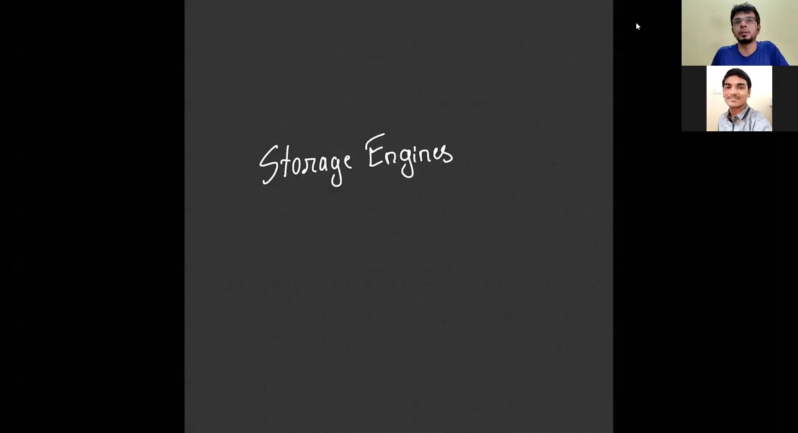
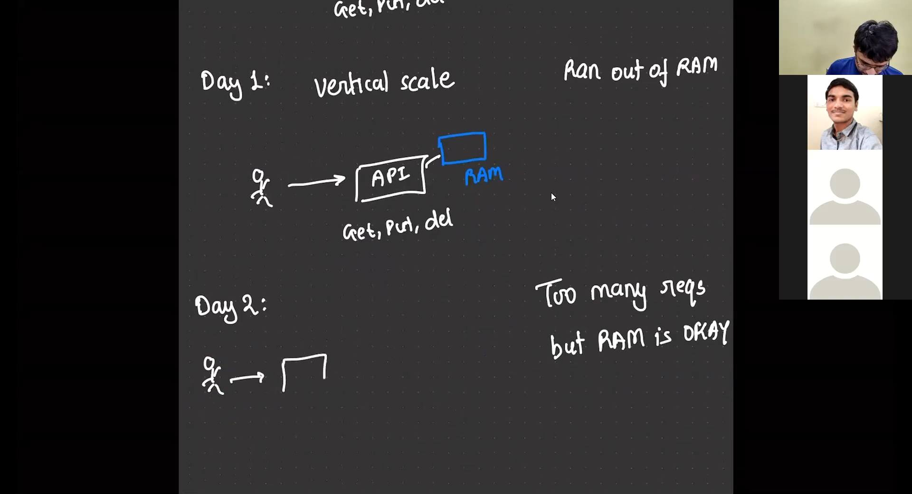
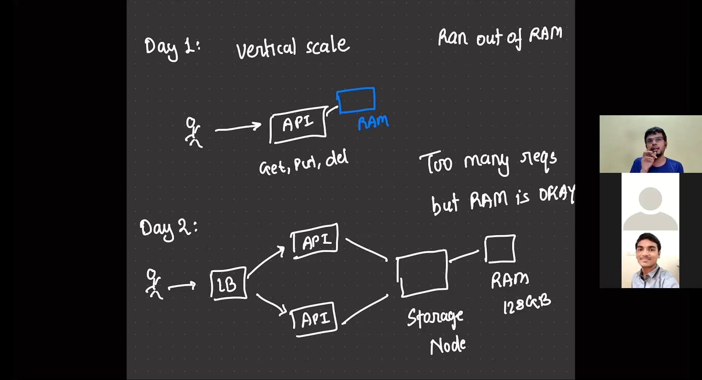
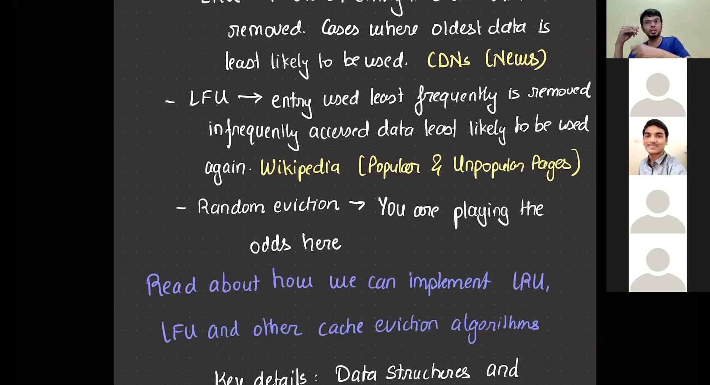
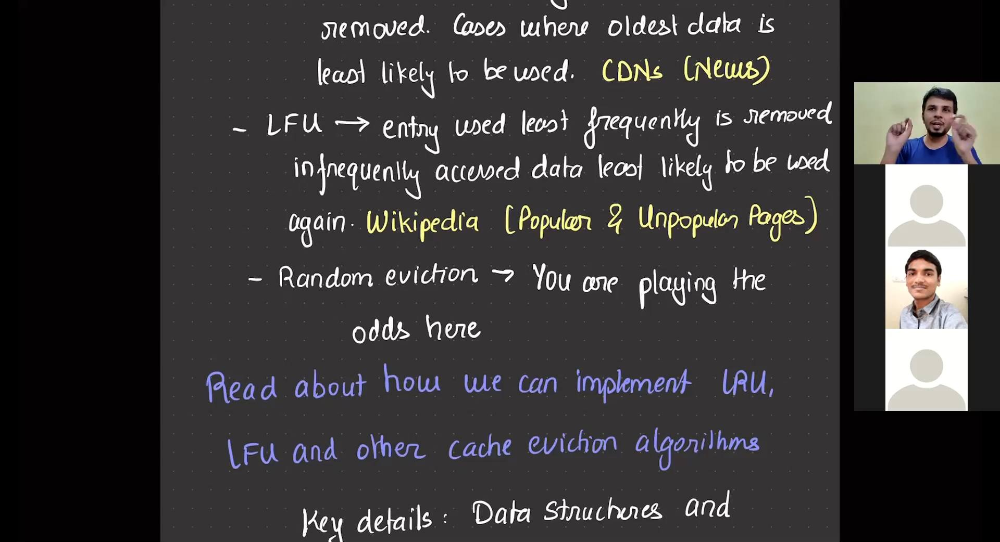

# System Design Masterclass（Arpit）P009：从一张哈希表到分布式缓存

> **关于截图数量的说明**：任务要求插入 ≥6 张截图，但本次提供的 `BV1k7un69EUL` 截图清单只有 **5 个可选帧**（p009 的 05:22 / 16:06 / 26:50 / 37:34 / 48:18）。按照「清单里没有的帧一律不存在、不许编造」的硬性规则，本文把 5 帧全部用满，不虚构第 6 个帧号。若需要补足 6 张，请补充帧清单后我再补插。
>
> **关于代码的说明**：本讲（p009）逐字稿里**讲师没有写任何代码**，全程是白板推导 + 课堂问答。因此第 4 章的示意实现是我根据讲师的设计逐条落成的、可直接运行的产物，**不是讲师在课上敲的代码**，文中已逐处标注。

---

## 1. 这一节做什么

这一节是「存储引擎」专题的开篇，讲师用**分布式缓存**当作载体，去讲所有存储系统共用的 building block。他的原话是：你完全可以把 cache 换成 data、换成 DB，高层设计长得一模一样，唯一的差别是「东西存在哪」——缓存存在内存里，数据库存在磁盘上，除此之外什么都不变 —— p009 [01:26]。

所以这一节真正要交付的不是「Redis 怎么用」，而是四件能迁移到任何存储系统上的东西：

1. **一份会演进的单机拓扑**：Day 0 一台机器内嵌哈希表 → Day 1 垂直扩容 → Day 2 拆出独立存储节点 + 负载均衡 + 多台瘦 API server → Day 3 才是真正的分布式。讲师反复强调：没走到 Day 3 就别碰分布式 —— p009 [20:25]。
2. **分清「分布式」的两种含义**：一种是分布式且复制（master-slave，两台数据相同），一种是分布式不复制（分片，交集为 ∅）。课上要求你在任何设计讨论中第一句话就把这个边界画出来 —— p009 [04:15]。
3. **一个有界内存的淘汰策略抉择**：LRU / LFU / 随机，以及讲师团队在生产上做过的真实对比实验（12 GB 缓存、16 GB 数据、约 300 万键、随机淘汰反而多装 5%–6% 的键）。
4. **一套 TTL 的实现骨架**：存绝对过期时间（epoch 毫秒）+ 最小堆按过期时间升序 + 后台周期性清理 + get 时惰性兜底 + 允许批量删除。

外部依赖是 **0**。你要准备的只有：一张能画白板的纸（或 excalidraw）、一个 Node.js ≥ 18 的终端（跑第 4 章的示意代码）、以及一台能开两个终端做命中率对比的笔记本。

---

## 2. 讲师原话

以下为逐字稿的中文转述，关键英文术语按原样保留，方便你回听对照。

> 「你可以把 cache 换成 data、换成 DB，一个 cache 或者一个 DB 的高层设计看起来完全一样，只是存储方式变了。分布式数据库是持久化到磁盘，cache 是在内存里，除此之外什么都不变。」
> —— p009 [01:26]

> 「当有人说 distributed cache，绝大多数情况指的是分布式**不复制**的那一种。一个节点存不下你全部数据，一开始你只有一台机器，用户量涨了、内容涨了，RAM 变成瓶颈，你先 vertical scaling，到某个点垂直也到顶了，这才是你决定 shard 的时刻。」
> —— p009 [04:41] / [05:38]

> 「理论上，最基本的 requirement 就是 key-value store：get、put、delete，value 存在内存里，就这么简单。Redis 那些花哨命令——sorted set、HyperLogLog、geo、全文搜索的 trie——它们不过是被实现出来的数据结构而已，本质就是跑在内存里的 C 代码。」
> —— p009 [06:35] / [07:34]

> 「如果你想支持 key-value 之外的东西，你只需要给每个 key 关联一个 type 字段，这个 type 就代表它背后的数据结构。这时候 low level design 变得非常重要：类、继承、多态。tree 的 put 可能是 append，list 的 put 也可能是 append，priority queue 的 put 又是另一回事。」
> —— p009 [08:32] / [09:28]

> 「先别管分布式，先管 cache 部分。怎么实现一个支持 get / put / delete 的 cache？Hash map。如果是并发的，也许 ConcurrentHashMap。哈希表是数据结构，哈希 map 是它的实现，Python 的 dict、JavaScript 的对象，都很类似。」
> —— p009 [10:26] / [12:24]

> 「Day 2 的问题是什么？可能是请求太多了，RAM 还够。那你会增加 API server 的数量。但如果你照抄 Day 0 的代码，你就有了两套哈希 map，key 在 A 上有、在 B 上没有——你等于已经开始做分布式、做 shard 了。可 RAM 一点都不便宜，每台 128 GB，你加两台就是成本翻倍。所以更好的做法是把 storage 拆出去，做成一个 storage node，让 API server 保持很瘦。」
> —— p009 [15:11] / [18:28] / [19:25]

> 「我拆 storage node 的主要理由有两条：第一，我要一个中央存储位置，它的职责只是存数据，别的什么都不管；第二，我要 API server 极其轻量，这样我可以随意扩容缩容。如果你把两者绑在一起，你扩 API server 的时候就得同时扩存储。」
> —— p009 [27:51] / [28:18] / [29:16]

> 「storage node 现在确实成了单点故障，但这是可以后面修的：数据仍然放在那一台机器上，但另一台机器上有一份拷贝，也许是个 cold standby。」
> —— p009 [28:47]

> 「你的 cache 本质就是一个说 HTTP 的简单 web server，它认识 get / put / delete。如果你在实现 Redis，那是一条裸 TCP 连接，你按某种协议发命令，前三个字节是这个、接下来五个字节是那个……而这些 key-value store 都存在哈希表里。」
> —— p009 [33:55] / [34:24]

> 「大多数情况下 cache 是有界的。你会给 cache 进程分配固定大小的内存，storage node 必须知道『我快到上限了』。要让新的 entry 进来，就得把旧的删掉，这就是 cache eviction。LRU 适合新闻类场景——你有多大概率去访问一周前的新闻？LFU 适合 Wikipedia：Sachin Tendulkar 那个页面可能连着两三天没人看，但它历史上极热门，我仍然想把它留在 cache 里。」
> —— p009 [34:50] / [35:49] / [37:08]

> 「随机淘汰算法实际上给出了和 LFU、LRU 相当的性能。我们在生产上试过：数据库预置了 100 GB，实际数据只有 16 GB，cache 是 12 GB，差不多 80% 到 90% 的数据都在 cache 里。我们的键数大约 300 万，随机淘汰在峰值时存的键比 LFU 多 5% 到 6%，因为它不需要维护那些链表结构，同样的内存能装更多数据，命中率反而没掉。」
> —— p009 [38:05] / [46:29] / [47:25]

> 「TTL 这部分：你在 put 的时候问用户『这个 key 想留多久』，但存的时候不要存相对时长，要存绝对时间。当前 epoch 是 15723067，你说 100 秒后删，那实际存 15723167。这样你才能高效地找出该删的 key。数据结构上你唯一需要的特性是：它能按过期时间升序把 key 排好。MinHeap 就是个好例子，priority queue 的优先级就是这个绝对过期时间。」
> —— p009 [43:06] / [44:05] / [45:01]

> 「你的后台任务可能每 5 分钟跑一次。所以在 get 的时候也要再判断一次这个数据是不是过期了，因为在这 5 分钟窗口里它可能还躺在里面。批量删除当然可以——只要堆顶元素的过期时间小于当前 epoch，你就一直 pop 一直删，本来就是成批发生的。」
> —— p009 [45:30] / [50:09]

> 「下一周讲 S3 的架构。这周我们主要聊存储引擎。」
> —— p009 [00:00]

---

## 3. 从零复现

这一章是整个文档的骨架。你按 3.1 → 3.6 的顺序在白板或 excalidraw 上重画一遍，画完你就复现了讲师这 50 分钟的推导。

### 3.1 需求：把最小功能集钉死

讲师在 [06:35] 明确收敛了功能边界，只有三个命令：

| 命令 | 语义 | 参数 |
|---|---|---|
| `put` | 写入 / 覆盖一个 key 的值 | key、value、TTL（秒） |
| `get` | 按 key 取值，不存在返回空 | key |
| `delete` | 按 key 删除 | key |

讲师特意解释：Redis 那些 sorted set、list、tree、graph、全文搜索的 trie、HyperLogLog、geo，本质上都是「数据结构 + 一个 type 字段 + 多态分派」，不是新的存储原语 —— p009 [07:34] / [09:02]。所以本节的复现范围**只做这三个命令**，其余一律视为扩展项，不进主线。

**明确不在本节范围内**（讲师自己划掉的）：
- S3 的架构设计 —— 讲师明确说这周不讲，挪到下周 —— p009 [00:00]。
- 花哨数据结构的内部实现 —— 讲师只说了"要做就加 type 字段 + 多态"，没给任何结构定义 —— p009 [09:02]。
- 分片算法（哪台机器负责哪个 key）—— 讲师只说了"这是分片，交集为 ∅"，**具体算法课里没讲**。

### 3.2 约束：四个卡子

| 约束 | 来源 | 后果 |
|---|---|---|
| 数据必须在**内存**里 | cache 的定义 —— p009 [01:55] | 容量受 RAM 限制，128 GB 已经是「massive」的机器 —— p009 [34:50] |
| 内存**很贵**，API server **很便宜** | p009 [18:56] | 不能让 N 台 API server 各带一份 128 GB |
| 内存必须**有界** | p009 [34:50] | 必须引入淘汰策略 |
| 值有**生命周期** | p009 [42:37] | 必须有 TTL 和清理机制 |

### 3.3 迭代：Day 0 → Day 3（这是本节的主线，请照着重画）

这一段对应截图里的第一张关键帧，讲师正是在这里解释"为什么 RAM 会成为分片的触发点"：



**Day 0 —— 单机，存储与 API 同进程**

```
User ──HTTP──▶ API Server（进程内 hashmap 就是全部存储）
                    └─ RAM
```

讲师在 [10:26]–[12:24] 把这一步定死：一个 API server 暴露 get / put / delete，参数是 key，数据存进进程里的哈希表。他特别澄清了术语：**哈希表（hash table）是数据结构，哈希 map 是实现**，Python 的 dict、JS 的对象都是同一类东西。在 Java 里并发场景会换成 ConcurrentHashMap —— 讲师原话是"如果是并发场景，也许可以用并发哈希映射"。

> **给前端读者的锚点**：JS 里这就是一个 `const store = new Map()`。Node 是单线程，单进程内不需要锁；但一旦你用 `cluster` 起多进程、或者部署多实例，就重新回到了讲师在 Java 里遇到的并发问题。这部分**课里没讲**，第 7 章会单列。

**Day 1 —— 垂直扩容**

触发条件：**RAM 不够了**。动作：换一台内存更大的机器，拓扑不变 —— p009 [13:47]。

这一步没有引入任何新组件，但讲师点出了它的天花板：内存不可能无限大，迟早要撞墙 —— p009 [14:16]。

**Day 2 —— 加负载均衡 + 多台 API server，但存储不能跟着复制**

触发条件有两个，讲师让学生自己说出来的：一是**请求量超过单机处理能力**（RAM 其实还够），二是**单点故障**（那台机器挂了就全站宕机）—— p009 [14:44]。



**这里是最容易做错的一步**。直觉做法是把 Day 0 的整个进程复制两份、前面加个负载均衡。讲师在 [16:08]–[18:28] 明确否掉了：那样你会得到**两个互不相通的哈希表**，同一个 key 在 A 上有、在 B 上没有，你不是在做"两台 API server"，你已经**被迫做了分片**——而分片是 Day 3 才该出现的东西。

**正确做法：把存储从 API server 里剥出来，做成独立的 storage node。**

```
User ──▶ Load Balancer ──┬──▶ API Server 1 ──┐
                         └──▶ API Server 2 ──┴──▶ Storage Node（128 GB RAM，唯一一份数据）
```

讲师给出的两条理由（[27:51]–[29:16]）：
1. **集中**：所有 cache 数据在一个地方，职责单一，只负责存。
2. **解耦伸缩**：API server 变瘦，可以按请求量随意加减，不必每次都背上 128 GB 的内存成本。

这里课堂上有学生反复质疑：**你加了负载均衡，结果 storage node 又变成新的单点故障，不是原地打转吗？** 讲师没有回避，直接承认了：



他的回答分两层 —— p009 [28:47] / [31:40]：
- **短期**：storage node 确实是单点。修法是「数据仍在这一台，但另一台机器上放一份拷贝，也许是个 cold standby」。**具体复制协议、切换流程，课里没讲。**
- **长期**：这种拆分在 S3、在普通数据库上都成立——你不会希望数据库进程和业务 API 挤在同一台机器上，机器一挂全挂。拆开之后，两边可以**各自**做容错。

**Day 3 —— 真的需要分布式了**

触发条件：**128 GB 也不够了**。到这一步，方案才回到 3.4。

### 3.4 两种"分布式"，画清楚再讨论

讲师在 [03:21]–[04:15] 用集合语言把这件事讲得很干净，值得原样搬进你的设计文档：

| 形态 | 拓扑 | 集合关系 | 对应现实 |
|---|---|---|---|
| 分布式 **+ 复制** | C1 ⇄ C2，写入 C1 同步/异步复制到 C2 | 交集非空，两份数据相同 | 数据库的 master-slave |
| 分布式 **不复制**（分片） | C1、C2 互不通信，key 只属于其中一个 | 交集 = ∅ | shard |

讲师的原话是"通常，当人们谈到分布式缓存时，主要指的是第二种"——默认语境是分片，不是主从 —— p009 [04:41]。他还要求：和同事讨论任何存储设计时，**第一句话就把这个边界画出来** —— p009 [04:15]。

### 3.5 估算：把讲师给的数字算一遍

讲师在课堂问答里给了一组真实的线上数据（[46:29]–[47:54]）。下面每一行都写明来源，凡是推算的都标出来。

| 项目 | 数值 | 来源 |
|---|---|---|
| 数据库预置容量 | 100 GB | 讲师口述 —— p009 [46:29] |
| 实际数据总量 | 16 GB | 讲师口述 —— p009 [46:29] |
| 缓存分配内存 | 12 GB | 讲师口述 —— p009 [46:29] |
| 缓存峰值键数 | 约 300 万 | 讲师口述 —— p009 [47:54] |
| 讲师口述命中率 | 85%（另一处说 80%–90%） | p009 [39:25] / [46:58] |
| 随机淘汰相对 LFU 多存的键 | 5%–6% | 讲师口述 —— p009 [47:25] |

**推算（我按上面的数字算的，不是讲师说的）**：

- 缓存覆盖率（容量口径）：`12 GB ÷ 16 GB = 75%`
- 按口述命中率 85% 计，则「未命中率 = 15%」
- 随机淘汰多存的键数区间：`300 万 × 1.05 = 315 万` 到 `300 万 × 1.06 = 318 万`，即多出约 **15 万到 18 万个键**
- 平均单键体积（用数据侧总量估）：`16 GB ÷ 300 万 ≈ 5.46 KB/key`
- 缓存侧每键平均可用内存：`12 GB ÷ 300 万 ≈ 4 KB/key`
- Day 2 若直接复制含存储的 API server：`2 × 128 GB = 256 GB` 内存计费；拆出 storage node 后为 `1 × 128 GB + N × 廉价 API server`

> 注意：`5.46 KB` 和 `4 KB` 这两个数是我用讲师给的三个数字做的除法推导，用来校验"随机淘汰能多装 5%–6% 键"在量级上合不合理（多出的 5%–6% 相当于每键省下约 200 字节的管理开销，这与 LRU/LFU 要维护链表、频次表的方向一致）。**逐字稿没有给出单键体积，也没有给出管理开销的字节数。**

### 3.6 三个子问题的决策（对应后面的第 4 章产物）

**（a）数据结构**：哈希表。并发场景用并发安全的哈希表 —— p009 [10:26]。

**（b）有界内存 + 淘汰**。讲师把三种策略和三组场景绑在一起讲：



- **LRU**（Least Recently Used）：踢掉最久没被访问的。**适合新闻**——Google News 场景，"你有多大概率去访问一周前的新闻？" —— p009 [35:49]。
- **LFU**（Least Frequently Used）：踢掉访问频次最低的。**适合 Wikipedia**——Sachin Tendulkar 的页面可能连着两三天没人打开，但它历史上极热门，你仍然想留着 —— p009 [37:08]。
- **随机淘汰**：随便挑一个踢掉。

关于随机淘汰，讲师给了一段真实经历（这是全课信息密度最高的部分，[38:05]–[40:45]）：他们在做医生、医院、搜索结果列表的业务时，把缓存策略从 LFU 换成了随机淘汰，**性能几乎一样**。原因追查下去是命中率本来就极高——16 GB 数据、12 GB 缓存，80%–90% 的数据都在缓存里，淘汰本身很少真正发生。讲师还补了一句反直觉的观察：**随机淘汰几乎不需要维护任何额外结构**（LRU/LFU 要维护链表和频次），内存足迹极低，所以同样 12 GB 能塞进更多键。



但讲师立刻给了边界条件，这段必须原样抄进你的设计评审文档 —— p009 [39:52] / [49:13]：

> 只有当你的**数据规模小到几乎全部能装进缓存**（他举的例子：微服务总共 16 GB 数据、开 12 GB 缓存），随机淘汰才成立。这种情况下淘汰几乎不发生，用复杂结构换命中率是纯浪费。他明确说「我不会无脑推荐随机淘汰」。

另外讲师留了一个阅读作业（[41:14] / [42:11]）：LRU 做到 O(1) 很容易，LFU 大家以为做不到 O(1)，但有论文做到了；**代价是额外空间**——当 value 很小（比如只缓存 4 字节的整数）时，大部分内存花在维护 LFU 的那些结构上，而不是数据本身。**这篇论文的具体内容课里没讲，讲师说自己写过一篇文章。**

**（c）TTL**。讲师给的方案是三件套（[43:06]–[46:00]）：

1. **入参是相对时长，存储是绝对时间**。`now(15723067) + 100s → 存 15723167`。理由：只有这样，"哪些 key 该删"才是一个可比大小的问题。
2. **数据结构**：任何能按过期时间**升序**排好 key 的结构都行，讲师点名 MinHeap / priority queue，堆顶就是最先该过期的。他也提到还听过别的结构，但**名字他当场没想起来，课里没给出**。
3. **两处触发清理**：
   - 后台线程/任务**周期性**跑（讲师说 5 分钟一次），从堆顶一直 pop 到堆顶的过期时间 > 当前 epoch，**天然就是批量删除** —— p009 [50:09]；
   - **`get` 时再校验一次**，因为在两次后台任务之间的窗口里，过期数据还躺在内存中 —— p009 [45:30]。

---

## 4. 完整代码

> **再次强调：这一讲讲师一行代码都没写。** 下面 4.1–4.4 是把讲师的口头决策整理成可评审的产物；4.5 是一份**示意实现**，用来证明这套设计能跑起来，不是讲师的代码，也不是生产级 Redis 替代品。

### 4.1 设计决策表

| # | 决策点 | 选择 | 讲师给出的理由（时间戳） | 不这样会怎样 |
|---|---|---|---|---|
| D1 | 存储与 API 进程是否同机 | **拆开** | 职责分离，可独立伸缩；API server 便宜、内存贵 —— [27:51] / [18:56] | 扩 API 就得同时扩 128 GB 内存，成本翻倍 —— [18:56] |
| D2 | 拆开后 storage 是否立刻多副本 | **先单点，后续加冷备** | 「另一台机器上放一份拷贝，也许是个 cold standby」—— [28:47] | 不做就一直是单点；具体复制协议**课里没讲** |
| D3 | 什么时候才上分片 | **128 GB 也不够时** | 「没走到这一步，就没必要做分布式」—— [20:25] | 过早分片，白白引入一致性问题 |
| D4 | 分片还是复制 | **默认分片（交集 = ∅）** | 分布式缓存的默认语境 —— [04:41] | 混淆两者会导致容量规划完全失真 |
| D5 | 存储结构 | **哈希表** | 三个命令的 bare minimum —— [10:26] | — |
| D6 | 是否支持富数据结构 | **不在本节范围**；要做就加 `type` 字段 + 多态 | [08:32] / [09:28] | 硬编码分支，扩展时大改 |
| D7 | 内存是否设上限 | **必须设** | 内存有界，必须淘汰 —— [34:50] | 进程被 OOM 干掉 |
| D8 | 淘汰策略默认值 | **LRU**（本示意实现） | 新闻类场景的最优解 —— [35:49] | — |
| D9 | 淘汰策略候选 | LRU / LFU / 随机 | [35:49]–[38:05] | — |
| D10 | 随机淘汰适用条件 | **缓存覆盖率极高（如 85%）、单服务数据小** | [39:52] / [49:13] | 低命中率下随机淘汰会打穿到后端 |
| D11 | TTL 存相对还是绝对 | **绝对时间（epoch ms）** | [43:06] | 无法排序，找不出该删的 key |
| D12 | TTL 用什么结构 | **最小堆** | [44:05] / [45:01] | 每次全表扫描 |
| D13 | 清理触发点 | **后台周期任务 + get 时惰性校验** | [45:30] | 两次任务之间返回过期数据 |
| D14 | 是否批量删除 | **可以，且天然成批** | [50:09] | 不必逐条起任务 |

### 4.2 组件职责表

| 组件 | 唯一职责 | 不应该做的事 | 来源 |
|---|---|---|---|
| Load Balancer | 把请求分发到多台 API server | 不理解 key 的语义 | p009 [16:08] |
| API Server | 解析 HTTP / 连接池 / 可选的本机小缓存 | **不保存主存储数据** | p009 [19:25] / [24:05] |
| Storage Node | 存 key-value，执行 get/put/delete，管理淘汰与 TTL | 不处理用户 HTTP 语义之外的业务 | p009 [27:51] |
| 淘汰模块

## 5. 逐行解释

> 输入中第 4 章可见内容只到 4.1 设计决策表、4.2 组件职责表，且 4.2 最后一行“淘汰模块”被截断；没有 4.3–4.5 的文件正文。因此下面不虚构文件，只对可见产物逐条解释；未提供正文的地方明确标“课里没讲 / 文档未提供”。

### 5.1 对 4.1 设计决策表逐条解释

**D1：拆存储与 API 进程**
- 为什么这么写：内存贵、API server 便宜。把 storage node 独立后，扩 API server 不必同时背 128 GB 内存成本；两边可以独立伸缩。依据是讲师对“集中存储 + 瘦 API server”的两条理由 —— p009 [27:51] / [18:56]。
- 不这么写会怎样：扩 API 就得同时扩存储容量，成本翻倍；更严重的是存储和 API 耦合，无法按请求量和内存量分别扩容、缩容。

**D2：拆开后先单点，后续加冷备**
- 为什么这么写：讲师承认 storage node 拆出来后仍是单点，但把它当成“后面可修”的问题，只给到 cold standby 方向 —— p009 [28:47]。
- 不这么写会怎样：如果假装已经有多副本，却没有复制协议和切换流程，就是虚构；如果完全不承认单点，则设计评审会直接卡住。具体复制协议、切换流程课里没讲。

**D3：128 GB 也不够时才上分片**
- 为什么这么写：讲师的演进线是 Day 0 → Day 1 垂直扩容 → Day 2 拆 storage node → Day 3 才分布式；没到 RAM 瓶颈就不该碰分布式 —— p009 [20:25]。
- 不这么写会怎样：过早分片会提前引入分片路由、一致性和运维复杂度，而这些问题在 Day 2 本来不存在。

**D4：默认分片（交集 = ∅）**
- 为什么这么写：讲师说“distributed cache”默认语境多数是分布式不复制，也就是分片 —— p009 [04:41]。
- 不这么写会怎样：把“复制”和“分片”混为一谈，容量规划会完全失真：复制是同一份数据多副本，分片是所有节点合起来才是一份全量数据。

**D5：存储结构用哈希表**
- 为什么这么写：get / put / delete 的最小实现就是 key-value store，哈希表最直接 —— p009 [10:26]。
- 不这么写会怎样：主线只需要三个命令，引入别的结构没有收益；若为了“像 Redis”先做富结构，会把最小复现范围撑爆。

**D6：富数据结构不进主线；要做就加 `type` 字段 + 多态**
- 为什么这么写：讲师说每个 key 多一个 type 字段表示背后数据结构，再用多态分派操作 —— p009 [08:32] / [09:28]。
- 不这么写会怎样：如果按数据结构硬编码 if/else 分支，扩展 tree、list、priority queue 时低层设计会大改；具体类设计课里没讲。

**D7：内存必须设上限**
- 为什么这么写：cache 是有界的，storage node 必须知道自己快到上限 —— p009 [34:50]。
- 不这么写会怎样：进程会一直吃内存，最后被 OOM 杀掉；淘汰逻辑也无从触发。

**D8：示意实现默认 LRU**
- 为什么这么写：讲师把 LRU 和新闻类场景绑定，示意实现需要一个明确默认值来跑通主线 —— p009 [35:49]。
- 不这么写会怎样：注意 D8 只是“本示意实现”的默认值，不是讲师宣称所有场景都用 LRU；如果业务是 Wikipedia 式“历史热门但近期冷”的场景，LRU 会偏向最近访问而误删。通用默认策略课里没讲。

**D9：候选策略是 LRU / LFU / 随机**
- 为什么这么写：讲师用三种策略对应三类访问模式，并给出生产对比 —— p009 [35:49]–[38:05]。
- 不这么写会怎样：只会一种策略就无法解释为什么新闻、Wikipedia、高覆盖率微服务会选择不同淘汰算法。

**D10：随机淘汰只适用于覆盖率极高、单服务数据小的场景**
- 为什么这么写：讲师的生产案例里 12 GB 缓存、16 GB 数据，淘汰很少真正发生；随机省掉链表/频次结构，同样内存能多装键 —— p009 [38:05] / [39:52]。
- 不这么写会怎样：低命中率下随机淘汰会随机踢掉即将访问的 key，打穿到后端；讲师明确说“不会无脑推荐随机淘汰”。

**D11：TTL 存绝对时间（epoch ms）**
- 为什么这么写：入参可以是相对秒数，但存储必须转成 `now + ttl` 的绝对时间，才能比较大小、排序找出该删的 key —— p009 [43:06]。
- 不这么写会怎样：存相对时长无法高效判断“谁最先过期”，清理只能全表扫描或逐条算。

**D12：TTL 用最小堆 / priority queue**
- 为什么这么写：只需要一个能按过期时间升序排列 key 的结构，堆顶就是最早该过期的 —— p009 [44:05] / [45:01]。
- 不这么写会怎样：每次清理都扫描全表，复杂度不可接受；讲师也提到还听过别的结构，但名字当场没想起来，课里没给出。

**D13：后台周期任务 + get 时惰性校验**
- 为什么这么写：后台任务可能每 5 分钟才跑一次，窗口内过期数据还躺在内存里，所以 get 返回前必须再校验 —— p009 [45:30]。
- 不这么写会怎样：用户会在两次清理之间读到已过期数据。

**D14：允许批量删除，且天然成批**
- 为什么这么写：只要堆顶过期时间小于当前 epoch，就连续 pop 连续删，本来就是成批发生 —— p009 [50:09]。
- 不这么写会怎样：如果逐条起任务或逐条扫描，清理效率低；具体批量大小、周期参数课里没讲。

### 5.2 对 4.2 组件职责表逐条解释

**Load Balancer**
- 为什么这么写：它只负责把请求分发到多台 API server，不理解 key 的语义 —— p009 [16:08]。
- 不这么写会怎样：如果让 LB 按 key 做路由，它事实上就变成分片器；而分片算法课里没讲，不能在这里偷偷引入。

**API Server**
- 为什么这么写：解析 HTTP、维护连接池、可选本机小缓存；主存储不在这里 —— p009 [19:25] / [24:05]。
- 不这么写会怎样：又回到 Day 0 把 hashmap 留在 API server 的做法；多台 API server 会各自持有互不相通的 hashmap，等于被迫做了隐式分片。

**Storage Node**
- 为什么这么写：唯一职责是存 key-value、执行 get / put / delete，并管理淘汰和 TTL；不处理用户 HTTP 之外的业务 —— p009 [27:51]。
- 不这么写会怎样：职责膨胀后无法独立扩容缩容，也失去了“集中存储、瘦 API server”的解耦收益。

**淘汰模块**
- 说明：文档中这一行被截断，只看到“淘汰模块”四个字，后面职责和“不应该做的事”没有给出。
- 能确认的部分：依据 4.1 的 D7–D10 和 3.6(b)，它应负责有界内存下的淘汰；但具体接口、触发阈值、数据结构实现课里没讲。这里不编造逐行解释。

### 5.3 对 4.5 示意实现

文档提到 4.5 是一份示意实现，但输入里没有给出文件正文，因此不能对不存在的文件逐行解释。可以确认的只有：它不是讲师课上敲的代码，运行命令、文件结构、具体函数签名课里没讲；后续若补齐代码，只能按 D1–D14 逐条核对设计一致性，不能声称是讲师原代码。

## 6. 复现检查清单

- [ ] 检查 Day 0 → Day 1 → Day 2 → Day 3 的演进顺序：在白板/文档里逐段写出触发条件；应该看到 Day 0 是单进程 hashmap，Day 1 只换大 RAM、拓扑不变，Day 2 才有 LB + 多 API + 独立 storage node，Day 3 才是分片。
- [ ] 检查 Day 2 没有把“含存储的 API server”复制两份：看架构图里是否只有一份主存储；应该看到 API server 不与主存储同进程，若看到两台 API 各带一个 hashmap 则失败。
- [ ] 检查“分布式”边界有没有在第一句画清：在设计文档开头找“分片（交集 = ∅）”或“复制（交集非空）”；应该能明确回答默认语境是分片，而不是主从复制。
- [ ] 检查功能边界：接口清单是否只保留 put / get / delete + TTL；应该看到 sorted set、HyperLogLog、geo、全文搜索等没有进主线。
- [ ] 检查组件职责表：API Server 的“不应该做的事”里是否写了“不保存主存储数据”；Storage Node 是否只负责存数据、淘汰、TTL；Load Balancer 是否不按 key 做业务路由。
- [ ] 检查 storage node 单点有没有被承认：Day 2 图中 storage node 是否标为单点；修复方案是否只写到 cold standby；应该看到“具体复制协议、切换流程课里没讲”的标注。
- [ ] 检查内存是否有界：设计/实现里是否有固定内存上限和淘汰入口；应该看到“无上限则失败”的结论；具体上限数值课里没讲，不能编造。
- [ ] 检查淘汰策略条件：默认 LRU 是否只标为“本示意实现”；随机淘汰是否写明只适用于覆盖率极高、单服务数据小；应该看到“不无脑推荐随机淘汰”。
- [ ] 检查 TTL 存储值：put 入参是否为秒，落库是否为 `now + ttl` 的 epoch 毫秒；应该看到存绝对时间，若存相对秒数则失败。
- [ ] 检查 TTL 结构：是否使用最小堆 / priority queue，堆顶是否最早过期；应该看到按过期时间升序，若每次全表扫描则失败。
- [ ] 检查两处清理：get 路径是否有过期校验；后台任务是否从堆顶连续 pop 到堆顶未过期；应该看到两处都存在，只有一处则失败。
- [ ] 检查估算表来源：每一行是否有讲师口述时间戳或“推算”标注；应该看到 `5.46 KB/key`、`4 KB/key` 被标为推算，而不是讲师口述。
- [ ] 检查示意实现运行：文档未提供 4.5 代码，运行命令课里没讲；当前只能待代码补齐后验证 put/get/delete、TTL 惰性校验、堆批量清理和淘汰是否与 D11–D14 一致。输入中无法实际运行验证。
- [ ] 检查阅读作业：是否列出 LRU / LFU O(1) 实现待读；应该看到论文具体内容标为课里没讲，不能声称讲师已经讲过论文细节。

## 7. 课里没讲但你会撞上的

| 现象 | 原因 | 怎么办 |
|---|---|---|
| 单进程能跑，起多进程/多实例后同一个 key 时有时无 | 进程内 hashmap / `Map` 不共享；课里没讲（文档 3.3 已明确这一点，第 7 章单列） | 复现时先固定单进程；多实例必须按 Day 2 拆出独立 storage node。分片/复制协议课里没讲，不要自行假设。 |
| put 覆盖已有 key 后，旧 TTL 堆条目把新值删掉 | 覆盖 key 时没有让旧堆条目失效；课里没讲 | 补充：堆条目带版本号，清理时校验当前 TTL 是否仍匹配；具体方案课里没讲。 |
| delete 之后堆里还残留该 key 的过期条目，后台清理误删或报错 | 删除时没有同步 TTL 索引；课里没讲 | 补充：清理前校验 key 仍存在且过期时间匹配；课里没讲具体索引做法。 |
| 内存一直涨，最后进程被杀 | 只实现了存储，没有固定内存上限或淘汰触发；D7 课里讲了“必须有界”，但具体上限、阈值课里没讲 | 补充：先设固定上限和淘汰入口；内存参数、触发比例课里没讲。 |
| 照 LFU O(1) 论文实现后，value 很小但内存大半花在管理结构上 | LFU O(1) 需要额外频次/链表结构；讲师只提到“代价是空间”和阅读作业，具体实现课里没讲 | 补充：value 很小时先评估空间代价；论文具体内容课里没讲，不能声称已讲。 |
| 分片时不知道某个 key 应该放哪台机器 | 分片算法课里没讲；讲师只说了分片是交集为 ∅ | 补充：在设计中明确标“待设计”，不要假装课里给了算法；需要另做路由/再平衡设计。 |
| storage node 挂掉后全站缓存不可用 | 冷备复制协议、切换流程课里没讲；讲师只给到 cold standby 方向 | 按讲师方向先承认单点并预留冷备；具体复制协议、故障切换补充设计，课里没讲。 |
| API server 到 storage node 多了一跳后延迟升高，连接池打满 | 拆出 storage 引入网络 IO；讲师提到连接池，但具体池大小、超时课里没讲 | 补充：压测连接池和超时参数；具体数值课里没讲。 |
| API server 加了本机小缓存后读到旧值 | 本机缓存失效策略课里没讲；文档只说“可选的本机小缓存” | 补充：设置短 TTL 或主动失效；具体策略课里没讲。 |
| 用普通 JS 对象当 hashmap，数字 key 被转成字符串或撞上原型属性 | 文档只说 JS 对象类似 hashmap，没有讲 JS 对象与 `Map` 的差异；课里没讲 | 补充：复现时用 `Map`；key 序列化规则自行定义并写文档；课里没讲。 |
| 后台清理与 put/get 异步交错，刚写入的 key 被删 | 并发时序和清理临界区课里没讲 | 补充：单进程内把关键操作放同步临界区，清理前校验 TTL；多进程回到第 1 行问题；具体加锁方案课里没讲。 |
| put 已有 key 时，TTL 是重置还是保留没有定义，导致行为不一致 | 覆盖时 TTL 语义课里没讲 | 补充：在接口文档里明确“覆盖是否重置 TTL”；课里没讲默认语义。 |
