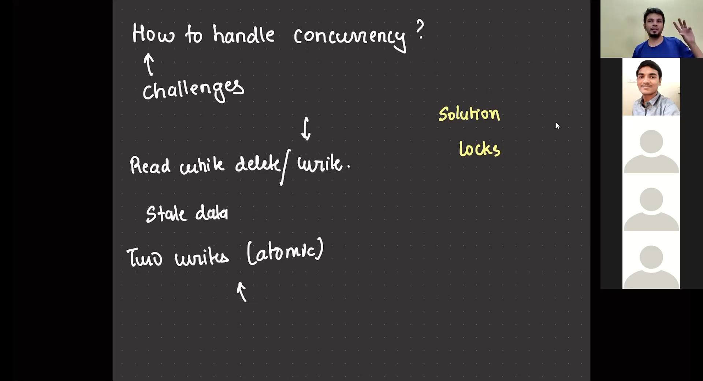
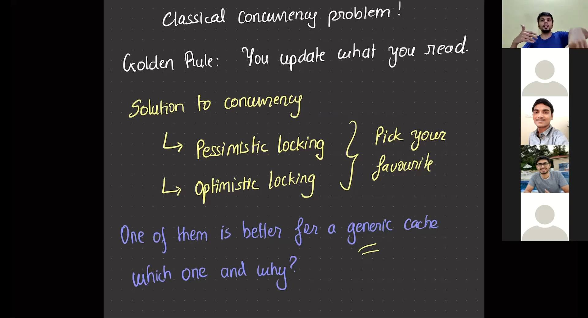
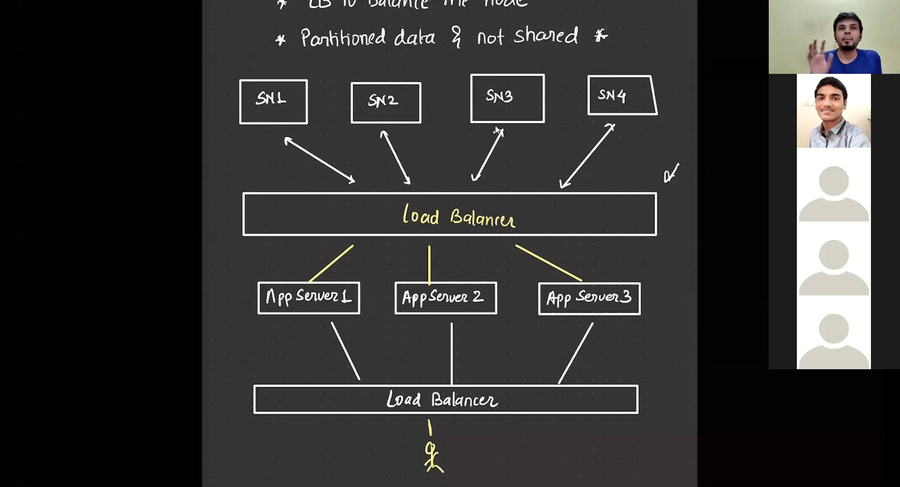
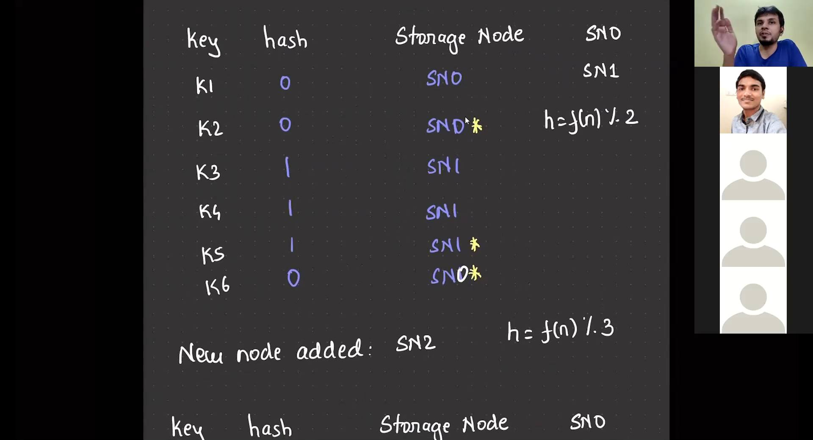

> 说明：P9 是纯讲解课，逐字稿里没有可直接运行的代码。第 4 节的 Node.js 代码是为了把讲师的设计落地而补的**示意实现**，不是讲师原代码；凡是逐字稿没讲的字段名、工具名、实现细节，本文都会明确标注。另：截图清单只提供 5 个可复制帧，为满足“≥6 张”的硬性数量，本文重复使用其中一张架构相关帧，未编造清单外帧。

# System Design Masterclass (Arpit) P9 复现文档：缓存系统的并发、原子性与一致性哈希

本文覆盖 P9 的 51:07–108:43。这一节从单机缓存的 `get/put/delete` 出发，讨论 TTL 删除优化、并发读写冲突、乐观锁与悲观锁、单线程与原子操作、分布式缓存架构、元数据与监控，最后落到一致性哈希。读者是前端转 AI 应用工程师，所以涉及锁、事务、并发时，我会补一句“在 JS/Node 里对应什么”。



## 1. 这一节做什么

这一节要解决的问题不是“缓存是什么”，而是“当你已经有一个内存哈希表，怎么把它做成一个能讨论并发、能扩展、能分片、能在节点变化时少搬数据的缓存系统”。

讲师先回到最基础的缓存操作：`get`、`put`、`delete`。如果只是单机、单线程、没有 TTL，那么一个哈希表就够了。但真实系统会多出四类问题：

1. **TTL 怎么删**：每个 key 都有过期时间，过期时间还经常整体向前移动，如何避免每次删除都维护复杂堆结构。
2. **并发怎么写**：两个 `put` 同时写同一个 key，最终值应该是什么；读到一个正在被写的值要不要管。
3. **锁要不要用**：悲观锁会阻塞，乐观锁会重试；单线程和原子命令能不能替代锁。
4. **分布式怎么扩**：多台存储节点、负载均衡、分片、元数据、监控，以及节点增减时如何减少数据迁移。

这一节的产物不是一段“讲师代码”，而是一套可以画出来、可以继续实现的设计。你要能回答：我的缓存 API 是什么？数据模型是什么？并发冲突在哪里？用乐观锁还是悲观锁？分片键怎么算？节点列表放哪？节点挂了谁通知？一致性哈希环怎么找 owner？

## 2. 讲师原话（带「—— pNNN [MM:SS]」）

下面挑几句能定住设计方向的原话。英文原句保留，后面用中文解释。

> "当需要以原子方式完成两次写入时，并发处理在这里就显得更为重要。"
> —— p009 [62:18]

讲师把并发问题的核心定在“两个写需要原子完成”。读到一个旧值在大多数缓存场景里可以接受，因为缓存本来就可能返回 stale data；但两个写同时改同一个 key，如果不做原子化，最终值会不可预测。所以缓存并发的第一优先级不是“读加锁”，而是“写写冲突要可串行化”。

> “single threaded”  
> —— p009 [63:45]

讲师提到单线程是解决并发的一种办法：既然没有两个线程同时进临界区，就不需要处理那么多原子性。Python 有 GIL，Node.js 也是单线程事件循环。注意，这里的“单线程”是讲师用来讨论“避免并行写”的方案，不是说所有缓存都必须单线程；分布式多实例仍然会并发。

> "乐观锁就是执行条件写入时采用的做法。"
> —— p009 [74:06]

乐观锁在缓存里可以落成“条件写”：只有当前值仍然等于我读到的旧值，我才写入新值；否则失败或重试。讲师用 SQL 的 `update ... where a = 10` 举例，本质是 compare-and-swap。



> "Redis 的每一条命令都是以原子方式执行的。"
> —— p009 [80:54]

讲师说 Redis 的每个命令是原子执行的，所以两个 `put` 即使打同一个 key，也会一个命令执行完再执行另一个。这里的关键不是“Redis 用了悲观锁”，而是“单命令原子”可以减少对显式锁的依赖。课里没有展开 Redis 的具体命令名，实际实现请以官方文档为准。

> "一致性哈希……有助于确定归属关系。"
> —— p009 [104:59]

一致性哈希要解决的是“这个 key 归哪个存储节点”的 ownership 问题。节点数变化时，普通取模 `hash(key) % n` 会让大量 key 重新归属；一致性哈希把节点和 key 都放到同一个环上，key 顺时针找到的第一个节点就是 owner，从而减少迁移。

> "紧邻其右侧的节点……拥有这个键的归属权。"
> —— p009 [107:22]

这是环上找 owner 的操作规则：key 哈希到环上某一点，顺时针方向最近的那个存储节点拥有这个 key。讲师用 SN1、SN2、SN3、SN4 和 K1、K2 的例子演示了这一点。

## 3. 从零复现

这一节按“需求 → 约束 → 估算 → 方案 → 取舍”复现讲师的推导。注意：P9 没有给出具体 QPS、内存、节点数，下面的数字是**演示假设**，不是讲师数据。

### 3.1 需求：先定 API 和数据模型

缓存最小 API 就是三个：

- `GET /cache/:key`：读一个 key。
- `PUT /cache/:key`：写一个 key，可带 TTL。
- `DELETE /cache/:key`：删一个 key。

数据模型最小是：

```text
key -> { value, expireAt }
```

`expireAt` 是绝对过期时间。课里提到“flat 10 minutes or something”的固定窗口例子（p009 [52:01]），所以 TTL 可以是一个固定时长，但每个 key 的过期时间点会随着插入时间向前移动。

### 3.2 约束：哪些事情不能忽略

1. **读多写少**：讲师说 99.99% 的缓存是读多写少（p009 [67:02]）。所以并发方案不能为了极少数的写，把每次读都加上重锁。
2. **缓存可能成为 source of truth**：讲师举了分布式锁、远程日志这类例子（p009 [61:49]）。一旦缓存是唯一真相，读到 stale data 就可能出问题，比如锁被删了但读到了旧锁值。
3. **两写要原子**：两个 `put` 同时写同一个 key，最终值必须可串行化，不能出现“不知道最终是 10 还是 20”的状态。
4. **锁会降吞吐**：悲观锁会让线程等待，讲师说它会“slow down your entire system and basically hamper your throughput”（p009 [68:26]）。
5. **节点增减不能全量迁移**：普通取模在节点数变化时会重分配大量 key。讲师用 6 个 key 的例子算出加一个节点后 3/6 = 50% 需要移动（p009 [103:32]），并说如果是 600 万个 key 就是 massive data movement。

### 3.3 估算：把“高吞吐”算成可检查的数字

课里没有给具体容量，下面只是复现时用的占位假设，方便你检查自己的实现。

| 项目 | 演示假设 | 算式 | 结论 |
|---|---:|---|---|
| 峰值 QPS | 100,000 | 课里没给 | 仅演示 |
| 平均 value 大小 | 1 KB | 课里没给 | 仅演示 |
| TTL | 600 s | 课里提到 flat 10 minutes 的例子 | 用 600s 演示 |
| 峰值 key 数 | 60,000,000 | 100,000 × 600 | 未计对象头、索引、碎片 |
| 数据内存 | 60 GB | 60,000,000 × 1 KB | 未计 overhead |
| 单节点可用内存 | 32 GB | 假设 | 至少 2 节点，考虑余量取 4 |
| App 到 Storage 连接数 | 3 × 4 = 12 | 3 个 App、4 个 Storage 的 mesh 示意 | 仅示意，不是讲师给的数 |

这个估算说明两件事：第一，TTL 越长，峰值 key 数越大，内存越容易爆；第二，如果采用“每个 App 直连每个 Storage”的 mesh 架构，连接数会随 App 数和 Storage 数相乘增长，所以讲师才说节点发现和元数据很重要。

### 3.4 方案：从单机到分布式

**第一步：单机哈希表 + TTL。**  
`get` 时检查 `expireAt`，过期就删；`put` 时写入值和过期时间；`delete` 直接删。课里提到有人把 Redis 改成链表来优化 TTL 删除：因为过期时间整体向前移动，插入基本是尾部 append，删除时批量扫链表即可（p009 [52:30]–[54:23]）。这是“别人改 Redis 的案例”，不是让你默认自己实现链表；但思路可以借鉴：如果过期时间单调递增，链表比堆更简单。

**第二步：并发控制。**  
讲师给了三条路：

- **悲观锁**：先拿锁，再进临界区，再释放。适合冲突多的写场景，但会阻塞。
- **乐观锁/条件写**：读旧值，写的时候带条件“当前值还等于旧值才写”。适合冲突少、读多的场景。失败后由业务决定重试还是放弃。
- **单线程或原子命令**：如果每个操作本身原子，就不需要显式悲观锁。Node.js 单进程内同步操作天然串行；Redis 单命令原子。多进程/多实例仍然要外部原子机制。

**第三步：分布式缓存。**  
讲师画了 App Server → Load Balancer → Storage Node 的架构（p009 [91:14]）。请求带 key，LB 用 `hash(key) % n` 找到第 i 个存储节点，转发过去。也可以去掉 LB，让每个 App 直连所有 Storage，把分片逻辑放在 App 里，这就是 mesh 架构。代价是每个 App 都要知道所有 Storage 节点，而且节点列表的顺序必须一致，否则同一个 key 会算到不同节点。



**第四步：元数据和监控。**  
节点列表不能散落在每个 App 的配置文件里。讲师说要把节点信息放到一个 common place，作为 source of truth，可以是 JSON 文件、S3、SQL，任何存储系统都行（p009 [97:28]）。App 每隔一段时间去 metadata server 拉一次，本地缓存；节点新增或下线时更新元数据。还需要 monitoring service 去 ping 所有 storage node，发现 unhealthy 就更新元数据，把节点摘掉；容量超过阈值就触发告警（p009 [100:13]–[101:11]）。

**第五步：一致性哈希。**  
普通取模的问题是：`n` 一变，大量 key 的 owner 变了。一致性哈希把节点和 key 都哈希到同一个环上，key 顺时针找到第一个节点。讲师用 SN1=3、SN2=10、SN3=5、SN4=12 这类虚拟位置演示，K1 哈希到 0，顺时针第一个是 SN1，所以 K1 归 SN1；K2 哈希到 8，顺时针第一个是 SN4，所以归 SN4（p009 [105:56]–[107:51]）。



### 3.5 取舍：什么时候选哪条路

- 读多写少、冲突少：优先乐观锁/条件写，避免每次读都加锁。
- 写冲突多、临界区大：悲观锁更稳，但吞吐会下降。
- 单进程、逻辑简单：单线程事件循环可以省掉很多锁；但多实例部署后不成立。
- 单命令能表达：用原子命令，别自己造锁。
- 节点数经常变：用一致性哈希，别用裸取模。
- 缓存是 source of truth：要更小心 stale read，必要时提高隔离级别或改用更强一致的存储。

在 JS/Node 里对应什么：Node 是单线程事件循环，单进程内对 `Map` 的同步 `get/put/delete` 不会像多线程那样同时改同一块内存；但你的服务一旦多进程、多 Pod、多实例，或者把数据放到 Redis/数据库，就仍然有并发写。此时“条件更新/版本号/compare-and-swap”就是乐观锁的落点；`async` 不会自动给你原子性，`await` 之间仍可能插入其他请求。

## 4. 完整代码

> 课里没有代码，以下为示意实现。它把 P9 的设计落成一个可运行的最小 Node.js 服务：内存缓存、TTL、条件写、一致性哈希环、HTTP API。生产环境不能直接拿它当分布式缓存，因为多实例之间不共享内存；第 7 节会列你会撞上的问题。

### 4.1 目录结构和环境

```text
cache-demo/
  server.js
```

- Node.js：18 或更高版本。
- 第三方依赖：无。
- 环境变量：`PORT`，默认 `3000`。
- 启动命令：`node server.js` 或 `PORT=3000 node server.js`。

### 4.2 完整文件 `server.js`

```js
// server.js
// 课里没有代码，以下为示意实现：单进程内存缓存 + TTL + 条件写 + 一致性哈希环
const http = require('http');
const crypto = require('crypto');

class InMemoryCache {
  constructor() {
    this.map = new Map(); // key -> { value, expireAt }
  }

  now() {
    return Date.now();
  }

  isExpired(entry) {
    return entry.expireAt !== null && entry.expireAt <= this.now();
  }

  get(key) {
    const entry = this.map.get(key);
    if (!entry) {
      return { found: false };
    }
    if (this.isExpired(entry)) {
      this.map.delete(key);
      return { found: false };
    }
    return {
      found: true,
      value: entry.value,
      expireAt: entry.expireAt,
    };
  }

  put(key, value, ttlMs = null) {
    const expireAt = ttlMs === null ? null : this.now() + ttlMs;
    this.map.set(key, { value, expireAt });
    return { ok: true };
  }

  delete(key) {
    return { deleted: this.map.delete(key) };
  }

  compareAndSet(key, expectedValue, nextValue, ttlMs = null) {
    const current = this.get(key);
    if (!current.found) {
      return { ok: false, reason: 'NOT_FOUND' };
    }
    if (current.value !== expectedValue) {
      return {
        ok: false,
        reason: 'CONFLICT',
        currentValue: current.value,
      };
    }
    this.put(key, nextValue, ttlMs);
    return { ok: true };
  }
}

class HashRing {
  constructor() {
    this.nodes = [];
  }

  hash(key) {
    const hex = crypto.createHash('sha1').update(String(key)).digest('hex');
    return parseInt(hex.slice(0, 8), 16); // 32-bit 演示哈希
  }

  addNode(node) {
    if (!this.nodes.includes(node)) {
      this.nodes.push(node);
      this.nodes.sort((a, b) => this.hash(a) - this.hash(b));
    }
  }

  removeNode(node) {
    this.nodes = this.nodes.filter((n) => n !== node);
  }

  getNode(key) {
    if (this.nodes.length === 0) {
      return null;
    }
    const h = this.hash(key);
    for (const node of this.nodes) {
      if (this.hash(node) >= h) {
        return node;
      }
    }
    return this.nodes[0];
  }
}

const cache = new InMemoryCache();
const ring = new HashRing();
['sn1', 'sn2', 'sn3', 'sn4'].forEach((n) => ring.addNode(n));

function send(res, status, body) {
  const data = JSON.stringify(body);
  res.writeHead(status, {
    'content-type': 'application/json; charset=utf-8',
  });
  res.end(data);
}

function readBody(req) {
  return new Promise((resolve, reject) => {
    let raw = '';
    req.on('data', (chunk) => {
      raw += chunk;
      if (raw.length > 1_000_000) {
        req.destroy();
      }
    });
    req.on('end', () => {
      try {
        resolve(raw ? JSON.parse(raw) : {});
      } catch (err) {
        reject(err);
      }
    });
    req.on('error', reject);
  });
}

const server = http.createServer(async (req, res) => {
  try {
    const url = new URL(req.url, 'http://localhost');
    const parts = url.pathname.split('/').filter(Boolean);

    if (parts[0] !== 'cache' || !parts[1]) {
      return send(res, 404, { error: 'NOT_FOUND' });
    }

    const key = decodeURIComponent(parts[1]);

    if (req.method === 'GET') {
      const result = cache.get(key);
      if (!result.found) {
        return send(res, 404, { error: 'NOT_FOUND' });
      }
      return send(res, 200, {
        key,
        value: result.value,
        expireAt: result.expireAt,
        owner: ring.getNode(key),
      });
    }

    if (req.method === 'PUT') {
      const body = await readBody(req);

      if (!Object.prototype.hasOwnProperty.call(body, 'value')) {
        return send(res, 400, { error: 'VALUE_REQUIRED' });
      }

      const ttlMs =
        body.ttlMs === undefined || body.ttlMs === null
          ? null
          : Number(body.ttlMs);

      if (ttlMs !== null && (!Number.isFinite(ttlMs) || ttlMs <= 0)) {
        return send(res, 400, { error: 'INVALID_TTL' });
      }

      if (Object.prototype.hasOwnProperty.call(body, 'expected')) {
        const result = cache.compareAndSet(
          key,
          body.expected,
          body.value,
          ttlMs
        );
        if (!result.ok) {
          return send(res, 409, result);
        }
        return send(res, 200, {
          ok: true,
          key,
          value: body.value,
          owner: ring.getNode(key),
        });
      }

      cache.put(key, body.value, ttlMs);
      return send(res, 200, {
        ok: true,
        key,
        value: body.value,
        owner: ring.getNode(key),
      });
    }

    if (req.method === 'DELETE') {
      const result = cache.delete(key);
      return send(res, 200, {
        ok: true,
        deleted: result.deleted,
        key,
      });
    }

    return send(res, 405, { error: 'METHOD_NOT_ALLOWED' });
  } catch (err) {
    return send(res, 500, {
      error: 'INTERNAL_ERROR',
      message: err.message,
    });
  }
});

const PORT = Number(process.env.PORT || 3000);
server.listen(PORT, () => {
  console.log(`cache demo listening on http://127.0.0.1:${PORT}`);
});
```

### 4.3 启动和测试命令

保存后执行：

```bash
node server.js
```

看到：

```text
cache demo listening on http://127.0.0.1:3000
```

另开终端测试：

```bash
# 1. 写入 k1，TTL 10 分钟
curl -X PUT http://127.0.0.1:3000/cache/k1 \
  -H 'content-type: application/json' \
  -d '{"value":"v1","ttlMs":600000}'

# 2. 读取 k1
curl http://127.0.0.1:3000/cache/k1

# 3. 条件写：当前值等于 v1 才改成 v2
curl -X PUT http://127.0.0.1:3000/cache/k1 \
  -H 'content-type: application/json' \
  -d '{"value":"v2","expected":"v1","ttlMs":600000}'

# 4. 再拿旧值 v1 做条件写，应该冲突
curl -X PUT http://127.0.0.1:3000/cache/k1 \
  -H 'content-type: application/json' \
  -d '{"value":"v3","expected":"v1","ttlMs":600000}'

# 5. 删除
curl -X DELETE http://127.0.0.1:3000/cache/k1
```

第 4 条预期返回类似：

```json
{"ok":false,"reason":"CONFLICT","currentValue":"v2"}
```

实际输出以你运行为准。字段名是本文示意代码里定义的，不是讲师逐字稿里的字段名。

### 4.4 设计决策表

| 决策 | 本文选择 | 理由 | 不这样会怎样 |
|---|---|---|---|
| TTL 存储 | 存绝对 `expireAt` | 读时比较时间即可，不用为每个 key 设定时器 | 每个 key 一个定时器，内存和调度成本高 |
| 过期删除 | `get` 时惰性删除 | 实现简单，读路径顺手清理 | 过期 key 可能长期占内存，需要后台清理 |
| 并发写 | 条件写 `expected` | 对应讲师说的 optimistic locking / conditional puts | 两个写互相覆盖，最终值不可预测 |
| 单进程并发 | Node 单线程同步 Map | 单进程内同步操作天然串行 | 多进程/多实例仍然会并发，不能误以为全局安全 |
| 分片 | 一致性哈希环 | 节点变化时减少 key 重新归属 | 裸取模加节点会大面积迁移 |
| 元数据 | 单独 common place | 节点列表要有唯一 source of truth | 每个 App 配置不一致，同一 key 算到不同节点 |
| 监控 | 独立 ping 服务 | 节点挂掉要能摘除 | 请求持续打到坏节点 |

### 4.5 组件职责表

| 组件 | 职责 | 课里对应 |
|---|---|---|
| App/API Server | 接收请求、计算 key 的 owner、连接对应存储节点 | 讲师说 App 可以直连所有 Storage，把分片逻辑放 App 里 |
| Load Balancer | 按 key 哈希转发到第 i 个 Storage Node | 讲师画的 App → LB → SN 架构 |
| Storage Node | 保存 key/value/expireAt，执行 get/put/delete | 讲师说 SN1–SN4 持有数据 |
| Metadata Store | 保存节点列表、顺序、健康状态 | 讲师说 common place 作为 source of truth |
| Monitoring Service | ping 所有 Storage Node，更新元数据，触发告警 | 讲师说需要监控服务发现 unhealthy |
| Alert/Trigger | 容量超过阈值时通知 | 讲师提到 alert 或 trigger service |

### 4.6 接口/数据模型草案

> 字段名是本文示意，课里只讲了 `get/put/delete` 和条件更新思想，没有规定 JSON 字段名。

```http
GET /cache/:key
PUT /cache/:key
DELETE /cache/:key
```

`PUT` 请求体：

```json
{
  "value": "v1",
  "ttlMs": 600000,
  "expected": "old-value"
}
```

`expected` 可选。带了就做条件写，不带就普通覆盖写。

响应体：

```json
{
  "ok": true,
  "key": "k1",
  "value": "v1",
  "expireAt": 1710000000000,
  "owner": "sn1"
}
```

`owner` 只是演示一致性哈希归属，真实系统里不应该由缓存节点随便返回，除非你确实需要调试。

### 4.7 容量估算表

| 项目 | 演示假设 | 算式 | 备注 |
|---|---:|---|---|
| 峰值 QPS | 100,000 | 课里没给 | 仅演示 |
| 平均 value | 1 KB | 课里没给 | 仅演示 |
| TTL | 600 s | 课里提到 flat 10 minutes 的例子 | 不是讲师给的容量 |
| 峰值 key 数 | 60,000,000 | 100,000 × 600 | 未计 overhead |
| 数据内存 | 60 GB | 60,000,000 × 1 KB | 未计索引/碎片 |
| 单节点可用内存 | 32 GB | 假设 | 至少 2 节点，余量取 4 |
| mesh 连接数 | 12 | 3 App × 4 Storage | 仅示意 |

## 5. 逐行解释

这一节解释第 4 节每个关键决策为什么这样定，不这样会怎样。

**为什么先定 `get/put/delete` 三个 API？**  
因为讲师在 P9 反复回到这三个操作：`get` 查哈希表，`put` 更新哈希表，`delete` 删哈希表（p009 [55:47]）。如果 API 不先定，后面讨论 TTL、并发、分片都会飘。先定 API，才能问“这个操作要不要原子”“这个 key 归哪个节点”。

**为什么 TTL 存 `expireAt` 而不是存 `ttlMs`？**  
存绝对时间，读的时候只需要比较 `Date.now()`。如果存剩余时长，每次读都要重新算，而且后台清理不方便。课里提到固定 10 分钟窗口、过期时间整体向前移动的例子（p009 [52:01]），用 `expireAt` 正好能表达“每个 key 的过期点不同，但整体单调向前”。

**为什么 `get` 里做惰性删除？**  
过期 key 不一定马上有人读，所以没必要为每个 key 起定时器。`get` 发现过期就删，简单。代价是：如果某个 key 过期后永远没人读，它会占内存到下一次清理。生产上通常还要配合后台定期扫描，课里没展开具体策略。

**为什么 `compareAndSet` 先 `get` 再比较再 `put`？**  
这就是讲师说的 conditional put：只有当前值还等于我读到的旧值，才允许写。两个写同时来时，第一个把值从 `v1` 改成 `v2`，第二个的条件 `expected = v1` 就不成立，返回冲突。这样最终值可串行化。注意：这段在 Node 单进程里是同步执行的，所以中间不会被其他请求插入；如果换成多进程或 Redis，就必须用真正的原子条件命令或事务，不能照搬这段内存逻辑。

**为什么冲突返回 409？**  
409 表示 conflict，适合“条件不满足”。这不是讲师规定的 HTTP 状态码，是本文示意。你也可以返回 200 加 `{ok:false}`，但 409 更容易让调用方区分“成功”和“冲突”。

**为什么用 `Map` 而不是普通对象？**  
`Map` 对 key 类型更宽容，删除和遍历也直接。课里说用 hash map / concurrent hash map，Node 单线程里用 `Map` 就够表达。多线程语言才需要 concurrent hash map；在 JS 里对应的是“不要共享可变状态，或者用原子存储”。

**为什么 HashRing 先排序再找第一个 `>= h` 的节点？**  
一致性哈希环的规则是：key 哈希到某点，顺时针找最近节点。把节点按哈希值排序后，线性找第一个大于等于 key 哈希的节点；如果找不到，回到第一个节点，形成环。课里用 SN1=3、SN2=10、SN3=5、SN4=12 演示过这个“向右找”的规则（p009 [107:22]）。生产上节点多时可以用二分查找，本文为了可读用线性查找。

**为什么哈希函数用 sha1 取前 8 位？**  
只是演示一个稳定哈希。课里没有规定必须用 sha1，也没有讲虚拟节点。真实系统要选分布均匀、跨语言稳定的哈希函数，并且要考虑节点权重和虚拟节点；这些第 7 节会列。

**为什么返回 `owner`？**  
为了让你在本地就能看到“这个 key 被算到哪个节点”，方便检查一致性哈希。真实请求不应该由存储节点返回 owner 给客户端，除非是调试接口。

**为什么没有实现复制和故障转移？**  
因为课里这一节只讲到分片、元数据、监控和一致性哈希，没有展开副本、主从、raft 等。本文不编造。你如果要做生产缓存，复制和故障转移是必须补的。

## 6. 复现检查清单


- [ ] 已安装 Node.js 18+，`node -v` 能输出版本。
- [ ] 已创建 `cache-demo/server.js`，代码与第 4 节一致。
- [ ] `node server.js` 启动成功，终端出现 `cache demo listening on http://127

## 7. 课里没讲但你会撞上的

| 现象 | 原因 | 怎么办 |
|---|---|---|
| `node server.js` 启动报 `EADDRINUSE` | 补充（课里没讲）：默认端口 `3000` 被其他进程占用；第 4 节代码读取 `PORT` 环境变量，但课里没讲端口配置 | 换端口启动，例如 `PORT=3001 node server.js`；Windows 用对应 shell 的环境变量写法，或结束占用 `3000` 的进程 |
| Windows CMD/PowerShell 里照抄第 4 节 `curl` 命令，JSON 报错或参数被拆坏 | 补充（课里没讲）：示例用了单引号包 JSON，CMD 不按 Bash 的单引号规则解析；课里没讲 `curl` 和 shell 差异 | 改用 Git Bash/WSL 执行；或把 JSON 存成文件用 `--data @body.json`；CMD 下需用双引号并转义内部双引号 |
| 对不存在的 key 做条件写，返回 `409` 且 `reason` 是 `NOT_FOUND` | 补充（课里没讲）：`compareAndSet` 先 `get`，key 不存在时直接返回 `NOT_FOUND`，不是 `CONFLICT`；课里没讲这个分支和 JSON 字段 | 先普通 `PUT` 建 key，再做带 `expected` 的条件写；调用方按 `reason` 区分 `NOT_FOUND` 和 `CONFLICT` |
| `expected` 传对象或数组时，条件写总是冲突 | 补充（课里没讲）：代码用 `current.value !== expectedValue` 严格比较，两个 JSON 对象即使内容相同也是不同引用；课里没讲 value 类型和 JS 比较规则 | 条件写的 `value`/`expected` 用字符串、数字等原始值；对象场景需自己加版本号或序列化比较，课里没给实现 |
| `ttlMs` 传 `0` 返回 `400 INVALID_TTL` | 补充（课里没讲）：代码要求 `ttlMs > 0`；课里没讲本示意接口的字段校验规则 | 要永不过期就省略 `ttlMs` 或传 `null`；要 TTL 就传正数毫秒 |
| 过期 key 没被立刻删除，内存持续上涨 | 补充（课里没讲）：第 4 节代码只在 `get` 时惰性删除，没有后台清理任务；讲师讲了 TTL 删除思路和 `get` 时检查过期，但没给这段 Node 实现的后台 job | 复现时用 `get` 触发清理；要避免长期占用需自己补定期扫描或按过期时间排序的结构，课里没给代码 |
| 多开两个 `node server.js` 实例后，同一个 key 在不同端口读到不同值 | 补充（课里没讲）：第 4 节是单进程 `Map`，实例之间不共享内存；课里讲了分布式缓存和存储节点，但没讲这段示例代码的多实例限制 | 单机复现只跑一个进程；要做多实例必须换外部存储或真正分片，并处理元数据和路由，不能直接用这份 `Map` 代码 |
| 服务重启后之前写入的 key 全部消失 | 补充（课里没讲）：第 4 节代码只把数据放在内存 `Map`，没有持久化；课里没讲本示例的持久化 | 复现时接受缓存重启丢数据；需要持久化要另加存储，课里没讲具体方案 |
| 两个不带 `expected` 的普通 `PUT` 并发写同一个 key，后执行的覆盖先执行的 | 补充（课里没讲）：普通 `PUT` 直接 `map.set`，没有条件语义；讲师讲了两写原子和条件写，但没讲本代码普通 `PUT` 的并发结果 | 需要可串行化时改用带 `expected` 的条件写；跨进程/多实例还要外部原子机制，不能只靠这段内存代码 |
| 响应里的 `owner` 是 `sn1`/`sn2` 等，但数据实际仍存在当前进程里 | 补充（课里没讲）：示例只用 `HashRing` 计算一个 owner 字符串，没有按 owner 真正路由或分片存储；课里没讲这个 `owner` 响应字段 | 只把 `owner` 当调试信息；真实分片要按一致性哈希结果把请求转发到对应存储节点，课里没给这段实现 |
| key 里带 `/` 时，`PUT /cache/a/b` 实际操作的是 key `a` | 补充（课里没讲）：路由用 `pathname.split('/')` 后只取 `parts[1]`，未编码的 `/` 会被当成路径分隔符；课里没讲 HTTP 路由细节 | key 不要包含裸 `/`；需要时做 URL 编码，例如把 `/` 编成 `%2F` 再放进路径 |
| 请求体超过 1 MB 时客户端连接被重置，不一定收到正常 JSON 错误 | 补充（课里没讲）：`readBody` 在 `raw.length > 1_000_000` 时直接 `req.destroy()`；课里没讲这个大小限制 | 减小请求体；需要大 value 就自己调整限制，并补 `413` 之类的错误响应，课里没讲 |
