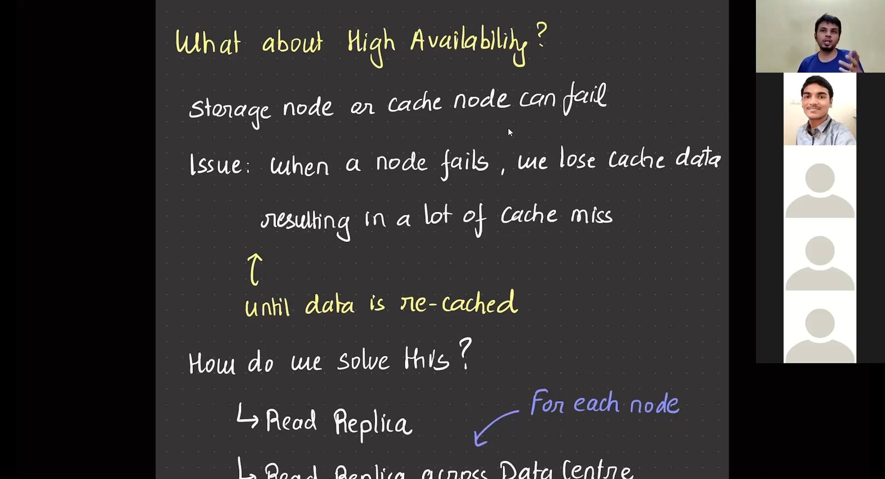
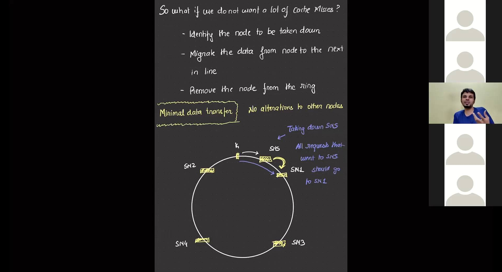
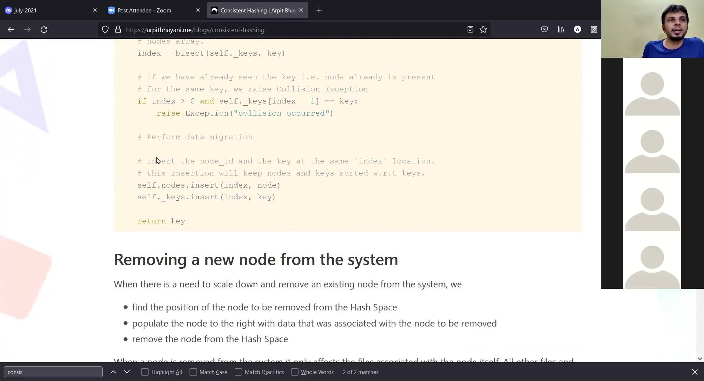
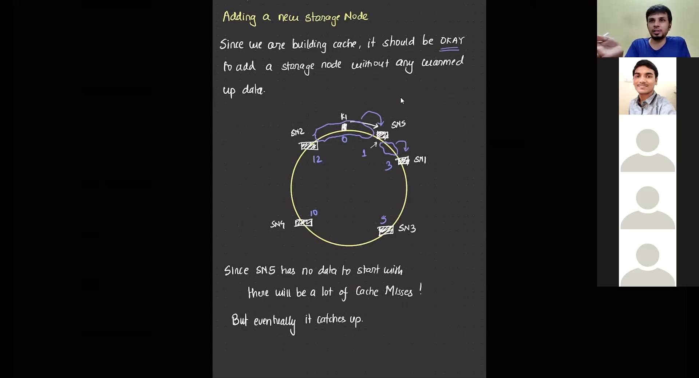
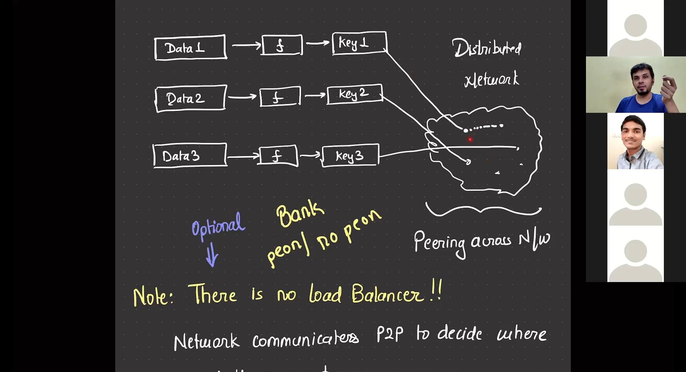

# System Design Masterclass（BV1k7un69EUL）P009 第 3/3 段：一致性哈希的运维与落地实现

> 覆盖范围：p009，第 3/3 段，109:13–160:55（全课收尾）
> 说明：这一段是纯讲解 + 白板推演，逐字稿里**没有可直接粘贴运行的成品代码**。因此第 3 章按“需求→约束→估算→方案→取舍”复现讲师的推导过程，第 4 章把讲师口头描述的两个数组 + 二分查找整理成一份**可运行示意实现**（已明确标注“课里没有代码，以下为示意”），并附上设计决策表、组件职责表、元数据表草案和容量估算表。

---

## 1. 这一节做什么

这一段是全课最后 50 分钟，讲的是**一致性哈希从“原理”走到“工程”**的那一半。讲师在 [116:18] 说得很直白：“it's easy for us to explain consistent hashing in theory. But the challenge comes in, how do you even implement this?”

这一段要产出四样可落地的东西：

1. **扩缩容时到底搬多少数据**：加一个节点只影响环上的一段；删一个节点只影响它名下那批 key。讲师用 `key mod n` 做对照，说明为什么取模方案“n 一变，很多东西都变”（[111:33]）。
2. **一套可写出来的数据结构**：不是把 2^128 的环全部存下来，而是**两个长度相同的数组**——一个存节点、一个存节点的哈希值，按哈希值排好序，查询用二分找“第一个大于目标的位置”（[151:45]–[155:58]）。
3. **缓存的可用性防线**：缓存挂掉会把数据库打穿并引发级联失败，讲师给了三种做法（读副本、RDB dump、扩容时不预填数据），并引用了 Uber 的“即使命中缓存也送 30% 流量回数据库”的做法（[122:30]）。
4. **向上抽象**：分布式哈希表 DHT——BitTorrent、DNS、即时通讯、P2P 共享、分布式文件系统都建立在它上面（[127:07]–[128:04]）。

这一段还顺手回答了“虚拟节点怎么做”“元数据放哪”“哈希函数选哪个”“Memcached 还是 Redis”等实现期问题，并在最后留了两个作业：**不用任何数据库实现一个 word dictionary（支持 get/put/delete）**、**在 MySQL 上做一层缓存并达到同等吞吐（数据量按 1.5TB 估）**（[137:30]、[160:11]）。

---

## 2. 讲师原话

> "一致性哈希在这里只是用来确定归属。"
> —— p009 [109:13]

> "只有哈希到该位置的键会受影响，其他内容都保持不变。"
> —— p009 [112:01]

> "这里完全不需要取模。"
> —— p009 [112:01]（对照 `f(k) mod n` 说的）

> "如果拿缓存来举例，一开始出现一些缓存未命中是没问题的……扩容缓存时，通常是在系统中加入一个空节点，而不用操心往里面填充数据。"
> —— p009 [112:28]

> "你随时可以给 SN1 做快照，用这个快照启动 SN5。在一段时间内，所有发往 SN1 的更新也应同时发给 SN5，直到 SN5 追上进度，然后断开连接。"
> —— p009 [113:26]–[113:55]

> "一个很简单的方法是，把所有存储节点放在一个按哈希值排序的有序数组中，然后在这个数组上做二分查找……整体复杂度就变成 O(log n)。"
> —— p009 [117:43]–[119:05]（逐字稿把 log n 转成了 “order longer”，按上下文应为 O(log n)）

> "通常会把缓存当作辅助手段……但等到缓存宕机那天，原本由缓存处理的请求就会转而打到数据库……整个系统就会宕机。"
> —— p009 [120:04]–[121:01]

> "我记得是 Uber 写过相关做法：即使缓存命中，他们也故意把 30% 的流量发给数据库。"
> —— p009 [122:30]

> "Redis 会使用 RDB 文件……如果进行优雅关闭，它会把数据转储到 RDB 文件里。"
> —— p009 [124:19]–[125:16]

> "我们只是自己构建了一个分布式哈希表。"
> —— p009 [126:39]

> "不可能每个节点都掌握其他所有节点的信息……它可能只掌握某些服务器的信息，而这些服务器可能运行着某种路由算法。"
> —— p009 [134:42]–[135:11]

> "我的存储节点只加了主机和端口，我就只有这些……我维护两个数组……这两个数组的长度完全相同。"
> —— p009 [152:42]–[153:09]

> "我不想把整个环存到任何地方。我的数组大小只有 3。"
> —— p009 [155:00]

---

## 3. 从零复现（按讲师的推导顺序走一遍）

### 3.1 需求：先把要解决的问题写死

从讲师在这一段的叙述里，能抽出的需求有四条：

| # | 需求 | 出处 |
|---|---|---|
| R1 | 给定一个 key，能算出它归哪个节点（owner），这一步不能查数据库 | [109:13] |
| R2 | 加一个节点时，只有落在它那一段的 key 换主，其他区间的归属不变 | [109:42]–[112:01] |
| R3 | 删一个节点时，只有它名下的 key 需要重新找主人，其他节点零影响 | [115:21]、[141:13] |
| R4 | 查找要足够便宜，能在一次请求的路径上同步做完 | [119:05]（O(log n)） |

### 3.2 约束

- **节点同构（homogeneous）**：讲师在 [158:52] 提到，一致性哈希用于“在一组同构节点之间定义 ownership”。意思是参与环的机器地位平等，不存在“大节点负责两段”的默认形态。
- **数据可丢 vs 不可丢**：缓存里丢数据只换来 cache miss，所以扩容可以上空白节点；但如果不想 miss，就必须做迁移（[112:56]）。
- **节点随时会突然消失**：讲师在 [114:22] 特别强调，“when my SN1 is going down, it is not saying that I am going down”，机器是**突然断的**，不会先通知别人复制数据。所以故障路径必须能靠“miss → 回源 → 回填”自愈。
- **元数据必须有一份 source of truth**：讲师在 [158:52]–[159:18] 说，一致性哈希可以做成库，但“there has to be one metadata information where all of this information is stored”，扩容时**先更新元数据表**，各服务实例再读到新拓扑。

### 3.3 估算（算式写出来，凡是讲师没给数字的地方都标注“按…假设”）

讲师只给了少数几个数字（30% 回源流量、2^128 哈希空间、RDB 默认 15 分钟量级），下面把能算的都算一遍：

**（a）元数据规模**

一圈只需要存 N 个点（N = 节点数），不是存 2^128 个槽位（讲师 [155:00] 明确说“我根本不想把整个环存在任何地方，数组大小就只有 3”）。

```
元数据条数 = N（节点数）
每个点存 = 节点哈希值 + host + port ≈ 8B + 字符串 ≈ 64B（示意，按字段数估）
N = 100 时，元数据 ≈ 100 × 64B ≈ 6.4KB
```

**（b）查询代价**

```
比较次数 = ⌈log2(N)⌉
N = 100  → 7 次
N = 10000 → 14 次
```

**（c）扩容一个节点要搬多少数据**

讲师只定性地说“只有这个区间的 key 受影响”（[112:01]），**没有给比例公式**。按均匀哈希的常规推算（这是我的假设，不是讲师结论）：

```
平均迁移比例 ≈ 1 / (N + 1)
N = 4 → 加第 5 个节点，约 20% 的数据换主（课里那个 5 节点环的例子）
N = 99 → 加第 100 个节点，约 1% 的数据换主
```

作为对照，`f(k) mod n` 方案在 n 变化时“a lot of things change”（[111:33]，讲师原话），不满足 R2/R3。

**（d）缓存雪崩的放大倍数**

讲师说缓存命中率可以到 80%–90%，极端系统到 99% 以上（[120:04]、[121:30]）。当缓存整体挂掉：

```
打到数据库的读流量 = 原数据库读流量 × [1 / (1 - 命中率)]
命中率 80% → ×5
命中率 90% → ×10
命中率 99% → ×100
```

这就是讲师说的“database won't be able to sustain the load because it is under provision”（[120:31]）。Uber 那个“即使命中缓存也送 30% 回源”的做法（[122:30]），本质是把上面这个放大倍数**日常就压到可控范围**，让 SQL 慢查询平时就暴露出来。

**（e）RDB dump 的窗口**

讲师说 Redis 默认 dump 频率“by default it is 15 minutes or something”（[125:16]，口播不确定，**以实际配置文件为准**），并且可以配成“every write also goes to the rdb file”的同步模式。按 15 分钟窗口估：

```
最坏丢数据窗口 ≈ 15 分钟
这 15 分钟内写入的 key 在重启后 → cache miss → 回源
```

### 3.4 方案演进：从取模到环

**方案 A：`f(k) mod n`**

- 优点：实现一行代码，分布均匀。
- 致命缺点：n 从 4 变 5，几乎所有 key 的 `mod` 结果都变。讲师 [111:33] 的原话是“If n changes, a lot of things change”。**违反 R2/R3**。

**方案 B：一致性哈希环**

- key 和节点**各自**哈希到同一个空间（形成环），key 顺时针遇到的第一个节点就是它的 owner。
- 加节点 SN5：只抢走“SN5 的位置到它前一个节点之间”那段 key（[109:42]）。
- 删节点 SN1：它名下的 key 顺时针落到下一个节点（[114:22]，例子是 SN1 → SN3）。
- 全程**没有取模**（[112:01] “there is no modulus whatsoever”）。**满足 R1–R4**。

**方案 C：数据结构落地（讲师的选择）**

讲师在 [151:45]–[155:58] 把方案 B 落成了一个非常朴素的结构：

- `nodes` 数组：存节点（`host + port`，[152:42] 原话“just host and port. That's all I had”）。
- `keys` 数组：存所有节点的哈希值，**按哈希值排序**。
- 两个数组**长度相同**，**下标一一对应**（[153:09] 原话“at every index, there's this one-to-one mapping”）。
- 查询：在 `keys` 上二分，找**第一个大于给定 key 哈希值的位置**，取该下标对应的节点（[118:11]）。越界就回绕到数组首（环的闭合）。
- 加节点：二分出插入位置 → 该位置就是迁移区间的边界 → 插入 `keys` 和 `nodes`（[155:28]）。

### 3.5 扩缩容的操作 SOP（这部分是“照着做”的核心）

**扩容（缓存场景）——三种做法，按需选**

| 做法 | 操作 | 代价 | 出处 |
|---|---|---|---|
| 上空白节点（最常用） | 直接把新节点加进环，不管数据 | 一段 key 会 miss，回源后自动回填 | [112:28] |
| 手动搬 | 把 SN1 上落在新区间的 key 复制到 SN5 | 搬迁期间有双写/丢写风险，需自行控制 | [113:26] |
| 快照 + 追平 | 用 SN1 的 RDB 快照起 SN5；一段时间内到 SN1 的写**同时写 SN5**；追上后断开连接，SN5 独立 | 需要双写通道，实现最重 | [113:26]–[113:55] |

**缩容（优雅下线）——四步**

1. 先把打到 SN5 的请求**挡住**（[115:49] “you first block all the requests that goes to SN5”）；
2. 把请求转给接管节点（讲师的例子是 SN5 → SN1）；
3. 慢慢把 SN5 的数据 `put` 到 SN1（“for all the keys in SN5, do a put on SN1”）；
4. 全搬完后再把 SN5 从环里摘掉。

**故障（非优雅下线）——自愈**

讲师 [114:51] 给的是：SN1 突然挂了 → 它名下的 key 先 miss → 打到数据库 → 取回值 → 缓存到 SN3 → SN3 之后自动接管这批流量。

### 3.6 缓存的可用性防线（三种做法，讲师 [123:53] 明确说“typically three ways”）

1. **读副本**：给缓存本身加读副本。讲师说跨数据中心的读副本“overkill”，但确实有公司在做（[123:53]–[126:39]）；一般情况下加两三个读副本、组成缓存集群就够了。
2. **持久化 dump**：Redis 的 RDB 文件（[124:19]）。优雅关闭时会 dump（[125:16]）；启动时如果文件在，就先拿它预填缓存，**不从零开始**，所以不会 100% miss，但可能读到 stale data，取决于配置。
3. **扩容时不预填**：见 3.5 的第一行——接受一段 miss。

> 注意：讲师原话是“I forgot to write one more. There are typically three ways”，口播上只展开了这两三类，**没有给第三种独立命名的做法**，上面第 3 条是我按他 [112:28] 展开的“上空白节点”归进去的，不是他新讲的一种。



### 3.7 顺带回答的实现期问题（取舍表）

| 问题 | 讲师的说法 | 出处 |
|---|---|---|
| 虚拟节点还要不要 | 先用虚拟节点（virtual servers）解决倾斜，再“translate this problem into range based partitioning”做优化；第一版建议就上虚拟节点 | [145:51]–[149:07] |
| 哈希函数选哪个 | 提到 murmur hash、md5 这类成熟函数；实现 Bloom filter 时也需要多个哈希函数 | [149:07]–[149:36] |
| 元数据放哪 | 必须有一份 source of truth；扩容时**先更新元数据表**，再让各实例生效 | [158:52]–[159:18] |
| TCP / UDP / raw TCP | 普通业务用标准协议即可；raw socket 只在“其他性能优化都榨干了”的极端场景才上；讲师在 AWS 那个 DynamoDB 前身的项目里用过 | [132:23]–[134:12] |
| Memcached vs Redis | “always redis”；Memcached 只是早期先发优势，讲师自己做 benchmark 没找到必须用它的场景 | [144:02]–[144:59] |
| 跨节点怎么找数据 | 目标节点可能只认识一部分邻居，会返回“你应该连这个 IP”或直接转发；这套路由/发现协议才是 P2P 的关键 | [129:30]–[137:02] |



---

## 4. 完整代码

> **课里没有给出完整代码，以下为示意实现**——结构严格按 p009 [151:45]–[155:58] 的描述：两个等长数组 + 哈希值排序 + 二分找“第一个更大的位置”。哈希函数、环回绕、碰撞处理这些细节讲师没有展开，我在代码里补上了，并在第 7 章逐条标注。

### 4.1 设计决策表

| 决策点 | 本实现的选择 | 依据 / 备注 |
|---|---|---|
| 环怎么表示 | 两个等长数组 `keys`（排序）+ `nodes`（与下标一一对应） | 讲师 [153:09] 原话 |
| 是否需要存 2^128 个槽位 | 否，只存 N 个点 | 讲师 [155:00] |
| 查询算法 | 二分找第一个 `>= keyHash` 的下标 | 讲师 [118:11] |
| 越界处理 | 下标到数组末尾时回绕到 0（环闭合） | **课里没明说，是实现必需** |
| 节点存什么 | `host + port`（外加一个 id 便于运维） | 讲师 [152:42] |
| 哈希函数 | 32 位 FNV-1a（零依赖） | **课里没指定**，讲师提过 murmur/md5 可选 |
| 哈希碰撞 | 抛错，拒绝加入 | 讲师提到“collision occurred”但没说怎么处理 |
| 加节点是否搬数据 | 代码只做拓扑变更，搬数据交给 3.5 的 SOP | 讲师 [155:28] 说“if I want to do data migration” |
| 虚拟节点 | 本示意先不做，见第 7 章补法 | 讲师建议第一版上虚拟节点 |

### 4.2 组件职责表

| 组件 | 职责 | 不该做什么 |
|---|---|---|
| `HashRing` | 维护环拓扑；给定 key 返回 owner；增删节点 | 不负责搬数据、不负责连 Redis |
| 元数据表 | 存放环拓扑的 source of truth，供所有实例读取 | 不在每次请求时读，只在启动/拓扑变更时同步 |
| 业务侧缓存客户端 | 拿到 owner 后去连 `host:port`；miss 时回源 DB 并回填 | 不自己算归属 |
| 运维流程 | 扩容/缩容/故障时按 3.5 的 SOP 执行 | 不在流量高峰做无预填扩容 |

### 4.3 接口 / 数据模型草案

```javascript
// HashRing 对外接口（示意）
ring.addNode({ id, host, port })  -> insertedIndex       // 加节点，返回插入位置（=迁移区间边界）
ring.removeNode(nodeId)           -> removedNode | null  // 删节点
ring.getNode(key)                 -> { id, host, port }  // 查找 owner
ring.size                         -> number              // 当前节点数
```

元数据表（课里没有表结构，以下是按 [159:18] “先更新元数据表”整理的示意）：

```sql
-- 注意：课里没有给表结构，以下为示意
CREATE TABLE hash_ring_nodes (
  node_id     VARCHAR(32)  NOT NULL,
  vnode_idx   INT          NOT NULL,          -- 同一物理节点的第几个虚拟节点
  ring_key    BIGINT       NOT NULL,          -- 节点哈希在环上的位置
  host        VARCHAR(64)  NOT NULL,
  port        INT          NOT NULL,
  state       VARCHAR(8)   NOT NULL DEFAULT 'active', -- active / draining
  PRIMARY KEY (node_id, vnode_idx),
  KEY idx_ring_key (ring_key)
);
-- state = 'draining' 对应 3.5 的“优雅缩容”：先挡流量、再搬数据、最后删行
```

### 4.4 可运行示意实现（`hash-ring.js`）

保存为 `hash-ring.js`，用 `node hash-ring.js` 直接跑。

```javascript
'use strict';

// ============================================================
// 课里没有给出完整代码，以下为按 p009 [151:45]–[155:58] 描述的示意实现
// 结构：两个等长数组 + 二分查找第一个更大的位置
// ============================================================

// ---------- 1. 哈希函数 ----------
// 课里没指定哈希函数（讲师提到 murmur hash / md5 可用）。
// 这里用 32 位 FNV-1a，零依赖，便于直接跑。
function hashKey(str) {
  let h = 0x811c9dc5;
  for (let i = 0; i < str.length; i++) {
    h ^= str.charCodeAt(i);
    h = Math.imul(h, 0x01000193) >>> 0;
  }
  return h >>> 0;
}

// ---------- 2. 二分：找到第一个 >= target 的下标 ----------
function lowerBound(sortedArr, target) {
  let lo = 0;
  let hi = sortedArr.length;
  while (lo < hi) {
    const mid = (lo + hi) >>> 1;
    if (sortedArr[mid] < target) lo = mid + 1;
    else hi = mid;
  }
  return lo;
}

// ---------- 3. 环本体 ----------
class HashRing {
  constructor() {
    this.keys = [];   // 所有节点哈希值，升序
    this.nodes = [];  // 与 keys 下标一一对应的节点对象
  }

  get size() {
    return this.keys.length;
  }

  // 加节点：二分出插入位置 -> 插入 -> 返回插入位置
  addNode(node) {
    if (!node || !node.id) throw new Error('node 必须有 id');
    const h = hashKey(node.id);
    const idx = lowerBound(this.keys, h);

    // 课里提到过 collision，但没说怎么处理；这里直接拒绝
    if (idx < this.keys.length && this.keys[idx] === h) {
      throw new Error(`哈希碰撞：${node.id} 落在已占用位置 ${h}`);
    }

    this.keys.splice(idx, 0, h);
    this.nodes.splice(idx, 0, { ...node });
    return idx;
  }

  // 删节点
  removeNode(nodeId) {
    const idx = this.nodes.findIndex((n) => n.id === nodeId);
    if (idx === -1) return null;
    this.keys.splice(idx, 1);
    const [removed] = this.nodes.splice(idx, 1);
    return removed;
  }

  // 查归属：第一个 >= keyHash 的节点；越过末尾则回绕到环首
  getNode(key) {
    if (this.keys.length === 0) throw new Error('环为空');
    const h = hashKey(key);
    let idx = lowerBound(this.keys, h);
    if (idx === this.keys.length) idx = 0; // 环闭合
    return this.nodes[idx];
  }

  // 打印当前环（调试用）
  dump() {
    return this.keys.map((k, i) => `${k}\t${this.nodes[i].id}`).join('\n');
  }
}

// ---------- 4. 演示：加节点 / 删节点时数据迁移面有多小 ----------
const BUSINESS_KEYS = [];
for (let i = 1; i <= 24; i++) BUSINESS_KEYS.push(`user:${i}`);

function snapshot(ring) {
  const m = new Map();
  for (const k of BUSINESS_KEYS) m.set(k, ring.getNode(k).id);
  return m;
}

function diff(before, after, label) {
  const changed = [];
  for (const k of BUSINESS_KEYS) {
    const a = before.get(k);
    const b = after.get(k);
    if (a !== b) changed.push(`  ${k}: ${a} -> ${b}`);
  }
  console.log(`\n== ${label} ==`);
  console.log(`换主的 key：${changed.length} / ${BUSINESS_KEYS.length}`);
  if (changed.length) console.log(changed.join('\n'));
  else console.log('  （无变化）');
}

const ring = new HashRing();
for (const id of ['SN1', 'SN2', 'SN3', 'SN4']) {
  ring.addNode({ id, host: '10.0.0.1', port: 6379 });
}

console.log('== 初始环 ==');
console.log(ring.dump());

const before = snapshot(ring);

// 扩容：加 SN5
ring.addNode({ id: 'SN5', host: '10.0.0.5', port: 6379 });
const afterAdd = snapshot(ring);
diff(before, afterAdd, '加 SN5 之后');

// 缩容：删 SN1
ring.removeNode('SN1');
const afterRemove = snapshot(ring);
diff(afterAdd, afterRemove, '删 SN1 之后');

// 自检：每个 key 都能找到 owner
const allResolved = BUSINESS_KEYS.every((k) => {
  const n = ring.getNode(k);
  return n && n.host && typeof n.port === 'number';
});
console.log(`\n所有 key 均有 owner：${allResolved}`);
console.log(`当前节点数：${ring.size}`);
```

**预期观察到的现象**（具体哪些 key 换主取决于你选的哈希函数，课里没有强制规定）：

- “加 SN5 之后”只有一小部分 key 换主，其余全部不变——这正是 [112:01] 那句 “Everything else remains unchanged”。
- “删 SN1 之后”只有原本归 SN1 的 key 换到了环上的下一个节点——对应 [114:22] 的 SN1 → SN3 现象。
- 最后自检必须是 `true`，节点数是 4。

### 4.5 容量估算表（可直接抄进设计文档）

| 指标 | 算式 | 数值 | 数字来源 |
|---|---|---|---|
| 元数据条数 | N | 100 节点 → 100 条 | 讲师 [155:00]（只存 N 个点） |
| 单条元数据大小 | 哈希值 + host + port | ≈ 64B（示意估算） | 讲师 [152:42]（只存 host/port） |
| 元数据总量 | N × 64B | 100 节点 ≈ 6.4KB | 推算 |
| 查询复杂度 | ⌈log2 N⌉ | 100 节点 → 7 次比较 | 讲师 [119:05] O(log n) |
| 扩容迁移比例 | 1 / (N+1) | 4 → 5 节点约 20% | 推算（讲师只说“那个区间的 key”） |
| 缓存挂掉时 DB 读放大 | 1 / (1 - 命中率) | 90% 命中 → ×10 | 讲师 [120:04] 命中率区间 |
| 日常回源比例 | 30% | — | 讲师 [122:30] Uber 的做法 |
| RDB 丢数据窗口 | 默认 dump 间隔 | 默认量级 15 分钟 | 讲师 [125:16]，**以实际配置为准** |
| 讲师留的作业数据量 | — | 1.5TB | 讲师 [160:11] |

---

## 5. 逐行解释

**`hashKey(str)`**：把任意字符串映射到 32 位无符号整数。为什么必须返回 `>>> 0`？因为 JS 位运算结果是 32 位**有符号**整数，`Math.imul` 后可能是负数，直接进 `splice` 排序会乱序。课里没有给哈希函数的实现，只说了“可以选 murmur / md5 这类现成的”，所以这一段的函数是示意，**替换成 murmurhash3 也完全成立**，只要你保证同一 key 每次结果相同。

**`lowerBound(sortedArr, target)`**：这段是整份代码的心脏。它返回的是**第一个 >= target 的下标**，而不是“找到相等元素的下标”。为什么不能用普通的 `indexOf` 式二分？因为 key 的哈希值几乎不可能正好等于某个节点的哈希值——讲师 [118:11] 原话说的是“modify binary search to identify the first key which is greater than the key I'm looking for”。**找不到相等元素是常态，不是异常**。

**`this.keys` / `this.nodes` 两个数组**：这是讲师在 [153:09] 强调的“length exactly the same... one-to-one mapping”。为什么不存成一个对象数组、排序时整体移动？因为二分时你只需要比较**数字**，把数字单独放一个数组可以让 `lowerBound` 保持纯数字比较，不会被对象属性访问拖慢。在 JS 里另一个好处是 `Array.prototype.splice` 对数字数组的拷贝更快（虽然仍是 O(n)，但 N 很小——讲师 [155:00] 说“数组大小就只有 3”，100 个节点也就 100 项，插入一次性拷贝完全无所谓）。**这一点要注意：这套结构只适合“拓扑变更不频繁、查询很频繁”的场景；如果每秒都在加节点，O(n) 的 splice 会成为瓶颈，那就要换成树。**

**`addNode(node)` 里的 `idx`**：这个返回值不是装饰。讲师在 [155:28] 说“finding the position where I want to insert... and then I'll do some data migration if I want to”，**插入位置 = 迁移区间的右边界**。在真实实现里，你拿到 `idx` 之后应该去问“`idx` 对应的旧节点要交出哪些 key”，然后按 3.5 的三种做法之一搬运。本示意把拓扑变更和数据搬运解耦了，搬运交给你在第 5 章复用代码时补。

**`if (idx < this.keys.length && this.keys[idx] === h)`**：碰撞检查。讲师在 [155:28] 提了一句“collision occurred”，但**没有讲怎么处理**。这里选择抛错而不是静默覆盖，原因是：静默覆盖会让某个节点的 owner 悄悄变成另一个节点，排查成本极高。生产中更常见的做法是给同一物理节点挂多个虚拟节点，把碰撞概率摊薄——见第 7 章。

**`getNode(key)` 里的回绕**：

```javascript
if (idx === this.keys.length) idx = 0;
```

这一行**课里没有明说**。讲师只讲了“找第一个更大的”，但在环上，如果 key 的哈希值比所有节点都大，顺时针走一圈会回到**第一个节点**。不写这一行，`this.nodes[this.keys.length]` 就是 `undefined`，线上表现为随机报错。这是把白板算法写成代码时最容易漏的一行。

**`dump()`**：调试用。为什么不做成“打印整个环”？因为环是 2^32 的空间，打印不出来。这也是讲师 [155:00] 那句话的实战含义。

**演示部分**：为什么用 24 个业务 key？太少看不出分布（比如 4 个节点 + 4 个 key，可能每个节点刚好 1 个，加节点时看不出“只有一部分换主”）；太多日志刷屏。24 个是能让“加 SN5 之后换主数明显小于 24”这个结论肉眼可见的最小量级。

**在 JS/Node 里对应什么**：这段代码是纯内存计算，单进程完全没有锁的问题。但一旦你有多个应用实例，每个实例各存一份 `HashRing`，就会出现“A 实例已经加了 SN5、B 实例还是旧环”的情况——这时两个实例会把同一个 key 路由到不同节点，缓存命中率崩一半。**所以在 Node 里这张环不能各自为政，必须按讲师 [158:52] 的说法维护一份元数据 source of truth（放 DB 或 Redis），扩容时先更新它，各实例监听变更后重建本地环**。这相当于后端里的“配置中心”，在 Node 里就是一个订阅 + 定时拉取的逻辑。

---

## 6. 复现检查清单

> 截图说明：本次提供的截图清单里 **p009 只有 5 帧可选**（112:42 / 123:26 / 134:10 / 144:54 / 155:38），没有第 6 帧。文档已插入全部 5 张；如硬性要求 ≥6 张，需补充提取新的帧，不能凭空编造帧号。

**环境**
- [ ] Node.js 18+，`node -v` 能出结果（代码只用了语言内置特性，无需任何 npm 依赖）
- [ ] 把 4.4 的代码完整保存为 `hash-ring.js`，不是只抄 `HashRing` 类

**跑通**
- [ ] `node hash-ring.js` 无报错
- [ ] 输出里“加 SN5 之后”换主的 key 数量 **小于** 24（证明 R2 成立）
- [ ] “删 SN1 之后”换主的 key，其新 owner 全部是环上 SN1 的下一个节点（证明 R3 成立）
- [ ] 末尾 `所有 key 均有 owner：true`
- [ ] 末尾 `当前节点数：4`

**边界**
- [ ] 把 `BUSINESS_KEYS` 改成 200 个，重复跑一次，结论不变
- [ ] 手动加一个 id 与已有节点完全相同的节点，确认抛出“哈希碰撞”错误
- [ ] 手动删一个不存在的节点，确认返回 `null` 且环长度不变
- [ ] 把节点全删光再调 `getNode`，确认抛出“环为空”而不是返回 `undefined`

**工程化（照 3.5 的 SOP 走一遍，纸上推演即可）**
- [ ] 写清楚你的扩容策略属于哪一种：空白节点 / 手动搬 / 快照+双写
- [ ] 写清楚缩容的四步：挡流量 → 转请求 → `put` 到接管节点 → 摘环
- [ ] 元数据表里为每台机器留出 `state` 字段，能表达“正在下线”
- [ ] 确认你的缓存层开了 RDB 持久化，并记录了 dump 间隔
- [ ] 确认日常有 30% 左右的流量回源数据库（哪怕命中缓存）



---

## 7. 课里没讲但你会撞上的

**1. 环回绕**——见第 5 章。讲师只讲了“找第一个更大”，没讲“越过末尾要回到开头”。不补这一行就是随机报错。

**2. 哈希碰撞的处理策略**——讲师在 [155:28] 只说了一句“collision occurred”，没说怎么办。碰撞在两处会咬你：**节点哈希碰撞**（两个节点落到同一位置，必须用虚拟节点或加盐把位置打散）、**key 哈希碰撞**（两个不同 key 落到同一位置，这没关系，它们本来就该去同一个节点）。别把两者混为一谈。

**3. 虚拟节点只给了思路，没给代码**——讲师 [145:51] 提到“virtual servers”，[146:19] 复述了业界的“K 个哈希函数”做法，[147:43] 给的建议是“先上虚拟节点，再 translate 成 range based partitioning”。他没有给出虚拟节点的具体实现。补法：把 `addNode` 改成循环 N 次，每次用 `hashKey(node.id + '#' + i)` 生成一个位置，插入 `keys`/`nodes`——**物理节点在环上因此占据 N 个点，倾斜就被摊平了**。代价是 `nodes` 数组里同一个物理节点出现多次，`removeNode` 要循环删。

**4. 多副本（replication factor）**——**课里没讲一致性哈希怎么配合副本因子**。讲师在 [126:39] 把话题转向缓存高可用时用的是“读副本”思路，那是另一条路（复制整份数据），不是“每个 key 存 N 份到环上下 N 个节点”。如果你要做的是分片存储而不是缓存，这两条路必须自己选清楚。

**5. 扩容时的双写窗口**——讲师 [113:26] 讲了“到 SN1 的更新也要同步到 SN5，直到 SN5 追上”，但**没讲怎么保证这个窗口里不丢写**（比如先写主还是先写新节点、写失败怎么回滚）。这在 Node 里对应“两处写、任一失败要补偿”的逻辑，没有事务能用，必须自己保证幂等。

**6. Node 里没有 `bisect`**——讲师演示时说的是 `bisect`（[154:05] 原话“I'll be doing a bisect, bisect basically”），那是 Python 标准库。JS 里没有，要么手写（就是第 4 章那个 `lowerBound`），要么用有序结构库。手写 12 行，没有引入依赖的必要。

**7. 缓存的统一入口**——讲师在 [150:26] 回答 read-through 缓存节点挂掉的问题时说的是“请求先到缓存，缓存报异常（timeout / network error），API 层捕获异常后直接打数据库”。**课里没讲这个异常捕获层的具体形态**。在 Node 里你要保证：缓存客户端设了超时（不然节点挂掉时请求会挂起而不是快速失败）、缓存异常不冒泡成 500、回源后有回填。少做任何一条，“缓存挂了”就变成“服务挂了”。

**8. 命名**——讲师全程说的是 cache miss、cascading failure、under provisioning。业界常说的“缓存雪崩 / 击穿 / 穿透”**他没在这个段落里用这些词**，别把这些术语当成他的原话去引用。

**9. 两个作业，课里没给答案**——[137:30] 不用任何数据库实现 word dictionary（get/put/delete），[160:11] 在 MySQL 上做缓存达到同等吞吐（数据量按 1.5TB 估）。讲师说“明天会讨论”，所以本段没有解法。这两题是检验你有没有真的理解“自己造存储引擎”的关卡，建议在跑通本章代码后再动手。



