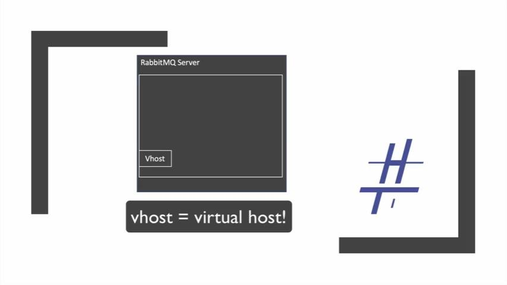
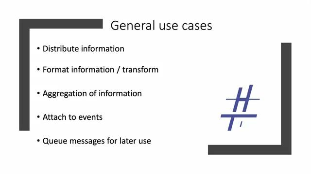
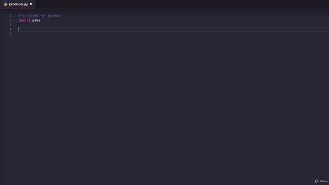
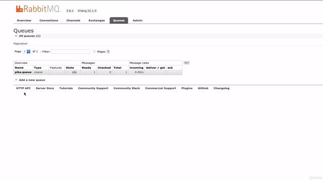
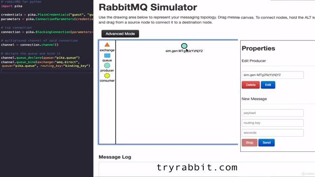
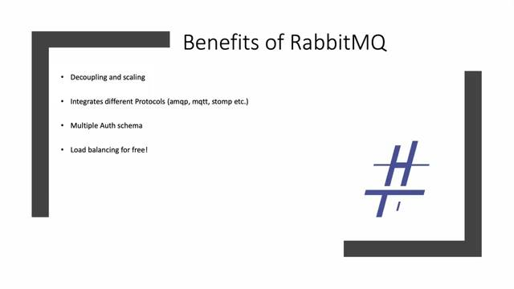

# RabbitMQ 入门到实践：消息代理、pika 生产者/消费者与核心架构（P1–P4）

## 1. 这一节做什么

这一节对应课程前 4 个视频（P1–P4），完成两件事。

**第一，建立“消息代理（Message Broker）”的全局概念。** 讲师先讲清楚为什么分布式系统需要 broker：解耦应用、异步处理、发布/订阅、削峰填谷。然后说明为什么选 RabbitMQ 而不是自己造轮子：开源、基于 AMQP 标准、内置集群、多语言客户端、可扩展插件。这一部分没有代码，但它决定了后续所有代码的写法——你的应用只认识 RabbitMQ，不直接认识其他应用。

如果把这一段展开来看，“消息代理”的核心并不是某个具体库，而是应用之间的一种中间层。生产者只负责把消息交给 broker，不关心谁会处理、什么时候处理、处理几次；消费者只负责从 broker 取消息，不关心消息由哪个生产者发出、生产者当时是否在线。这样一来，发布消息和处理消息就被拆成了两个独立动作：它们可以发生在不同时间，也可以发生在不同进程、不同机器甚至不同网络区域。课程里反复强调的“解耦”，落到代码上就是 producer 和 consumer 各自只需要连接 RabbitMQ，而不需要互相知道对方的地址和接口。

“异步处理”是同一个道理的另一种说法：producer 发完消息就可以关闭连接，消息先留在队列里，consumer 以后再取。发布动作不需要等待消费者立即处理完成，因此适合把耗时任务、通知任务、后台任务从主流程里拿出来。“发布/订阅”则说明 broker 不只是点对点转发，它还可以通过 exchange 和 binding 把消息路由到一个或多个队列。“削峰填谷”强调的是队列的缓冲作用：短时间内大量消息先进入队列，消费者按照自己的能力慢慢处理，避免上游流量直接压垮下游服务。这些概念在本节没有对应代码，但后面 producer 和 consumer 的写法，都是围绕这些概念展开的。

第二，动手跑通一条最简单的消息链路。讲师用 Python 的 pika 库现场写了一个 producer（生产者）和一个 consumer（消费者）。producer 往 RabbitMQ 发一条 “Hello RabbitMQ”，consumer 在另一端收下这条消息。配套使用了 TryRabbit 网页模拟器帮助我们可视化“发布→路由→入队→消费”的过程，再用 RabbitMQ 管理 UI 确认消息真的进了队列。

这条链路虽然短，但已经包含 RabbitMQ 入门最关键的几个对象：producer 通过连接和 channel 发布消息；消息先进入 exchange；exchange 根据 routing key 和 binding 找到 queue；queue 暂存消息；consumer 从同一个 queue 取出消息并执行回调。对于前端背景的读者，可以先把 RabbitMQ 理解成一个独立于浏览器和 Node 进程之外的“消息中转服务器”：它不是浏览器里的 `setTimeout`，也不是 JavaScript 的事件队列，而是一个真实运行在服务端的组件。浏览器里的事件队列通常和当前页面生命周期绑定，RabbitMQ 的队列则可以在 producer 关闭、consumer 尚未启动时仍然保存消息，等待之后消费。

本课程文档会把这条链路完整复现出来：用 Docker 启动 RabbitMQ 服务器，安装 pika，编写两个 Python 文件，依次运行，看到消息从发布到被消费的完整过程。同时解释这条链路里的核心概念：exchange（交换机）、queue（队列）、binding（绑定）、routing key（路由键）、vhost（虚拟主机）和 user。下面是这几节课对应的 RabbitMQ 高层结构示意图。



学习这一节时建议按“先概念、后命令、再代码、最后验证”的顺序推进。不要一上来就复制代码运行，而是先弄清楚 producer 和 consumer 必须使用同一个 queue、同一个 exchange、同一个 routing key，否则消息可能发布成功却没有进入你期望的队列。也不要误以为 `basic_publish` 之后消息一定马上被处理；消息只是进入 RabbitMQ，等待消费者取走。理解这一点，后面看到管理 UI 里的消息数、看到 consumer 阻塞等待，就不会感到意外。

## 2. 讲师原话

> "因此，我们可以把消息发布到消息代理，再将它们加入队列，稍后再进行处理。也就是说，消息的实际发布与处理并不发生在同一时间范围或同一实例中。"
> —— p002 [00:00]

消息代理把“发布消息”和“处理消息”在时间上、实例上彻底解耦，这是 broker 存在的根本原因。

这句话可以拆成两个层面理解。时间上，producer 发布消息时，consumer 可能还没有启动；consumer 处理消息时，producer 可能早已关闭连接。实例上，producer 和 consumer 可以是两个完全独立的进程，甚至部署在两台机器上。它们之间没有直接调用关系，只通过 RabbitMQ 中的队列发生联系。这正是消息代理区别于普通函数调用、HTTP 请求的地方。

> "你应该始终只使用不承担业务逻辑的消息代理。因为一旦把逻辑放进消息代理里，你就又会依赖它，并把所有东西与消息代理紧密耦合。"
> —— p002 [03:50]

“dumb broker”原则：broker 只做路由，不要把业务逻辑写进 broker。逐字稿里这个词被转录为 “dump”，按语义应为 “dumb”。

这条原则对写代码有直接指导意义：RabbitMQ 负责连接、路由、队列和投递，业务判断应该放在 producer 或 consumer 里，而不是寄希望于在 broker 内部实现复杂流程。broker 越“笨”，应用越容易替换、越容易排查问题；如果所有业务逻辑都塞进 broker，一旦 broker 配置或版本变化，整个系统都会被绑死。

> "为此，我们将使用 Python 的 Pika 库，因为这样所需的代码行数更少，目前更适合用于演示。"
> —— p003 [00:00]

讲师用 pika 的原因：代码行数少，适合做演示。逐字稿中库名被转录为 “Pico”，实际是 Pika。

这里的重点是“适合演示”，而不是说 pika 是唯一选择。RabbitMQ 是多语言客户端生态，Python 用 pika，Node.js 常用 amqplib，其他语言也各有客户端。入门阶段先用代码量少的客户端把链路跑通，再理解不同客户端只是连接方式不同，核心对象仍然是 exchange、queue、binding、routing key 和 consumer。

> "V-host 可以类比为任意一种数据库管理系统。也就是说，V-host 就像是服务器内部的一个小型消息代理。"
> —— p004 [00:00]

理解 vhost 的最快方式：它就像数据库管理系统里的一个独立数据库实例。

一个 RabbitMQ 服务器可以划分多个 vhost，不同 vhost 里的 exchange、queue、binding 彼此隔离。代码里的 `virtual_host="/"` 就是连接到默认 vhost。初学者如果发现自己明明创建了队列却看不到，或者 producer 和 consumer 连到了不同 vhost，就会表现为“消息发送成功但没有消费者收到”，排查时要先确认双方 vhost 是否一致。

> "你可以直接向单个队列添加更多消费者，而无需扩展其他任何组件。因此，如果队列收到大量消息，只需使用两个客户端应用从该队列消费，RabbitMQ 就会以轮询方式分发这些消息。"
> —— p004 [04:17]

RabbitMQ 的负载均衡是“加消费者”就能实现的：多个 consumer 消费同一个队列，消息按 round-robin 轮流分发。

这也解释了为什么队列可以承担缓冲和分流两种角色。消息多时，不是去改 producer 的发送逻辑，而是增加消费同一个队列的 consumer 实例。多个 consumer 之间不会收到同一条消息（在普通消费模型下），RabbitMQ 会轮流投递，从而把处理压力分摊到多个进程或机器上。入门复现时虽然只启动一个 consumer，但理解这个机制，后面做多消费者实验时就不会误以为“每个 consumer 都会收到全量消息”。



## 3. 从零复现

本节目标：在本机跑起一个 RabbitMQ 服务器，用 Python 发送一条消息，再把它消费掉。复现时不要只看最后是否打印出 `Received`，而要按顺序确认服务器、客户端库、producer、管理 UI、consumer 五个环节都正常。任何一步失败，都先停在该步排查，不要直接跳到下一步。

### 3.1 启动 RabbitMQ 服务器

**课里没讲怎么安装 RabbitMQ 服务器**，P003 一开始就假设服务器已在运行。为了能复现，这里用 Docker 启动官方带管理 UI 的镜像：

```bash
docker run -d --name rabbitmq \
  -p 5672:5672 \
  -p 15672:15672 \
  rabbitmq:3-management
```

这条命令的含义需要逐项拆开理解：`docker run` 表示创建并启动一个容器；`-d` 表示让容器在后台运行，命令执行后终端会立即返回容器 ID；`--name rabbitmq` 给容器起一个固定名字，后面 `docker ps --filter name=rabbitmq` 和 `docker logs rabbitmq` 都依赖这个名字；`-p 5672:5672` 把宿主机的 5672 端口映射到容器内的 5672 端口，pika 客户端通过这个端口使用 AMQP 协议连接 RabbitMQ；`-p 15672:15672` 把宿主机的管理 Web UI 端口映射出来；最后的 `rabbitmq:3-management` 是镜像名，带 `management` 的镜像才默认包含管理界面。

端口说明：

- `5672`：RabbitMQ 的 AMQP 协议端口，pika 客户端连接这个端口。
- `15672`：管理 Web UI，浏览器打开 `http://localhost:15672`，默认账号 `guest / guest`。

确认容器已经启动：

```bash
docker ps --filter name=rabbitmq
```

看到 `STATUS` 为 `Up` 即可继续。这个检查不能只看命令有没有报错，而要看输出中是否真的出现名为 `rabbitmq` 的容器，并且状态是 `Up`。如果 `docker ps` 没有输出，可能是容器没创建成功；如果容器存在但状态不是 `Up`，可以用 `docker ps -a --filter name=rabbitmq` 查看退出状态，再用 `docker logs rabbitmq` 读取容器日志。常见原因包括 Docker 服务没有启动、端口已被占用、镜像拉取失败、容器名冲突、机器资源不足导致容器退出。

常见错误与排查：

1. 提示 `docker: command not found`：当前机器没有安装 Docker，或者 Docker 客户端不在 PATH 中。先确认 Docker 可用，再执行启动命令。
2. 提示端口已被占用：5672 或 15672 已经被其他进程占用。可以停止占用端口的进程，或者把宿主机端口改成其他值。如果改动了 5672 的宿主机端口，pika 代码里的 `port` 也要相应修改，不能仍写 5672。
3. 提示容器名 `rabbitmq` 已存在：说明之前创建过同名容器。可以先 `docker rm -f rabbitmq` 删除旧容器，或者给新容器换一个名字，但后续检查命令中的名字也要跟着换。
4. 管理 UI 打不开：先用 `docker ps` 确认 15672 映射是否存在，再确认浏览器访问的是 `http://localhost:15672` 而不是 5672 端口。5672 是 AMQP 端口，不是网页端口。
5. 登录失败：默认账号是 `guest / guest`，但 RabbitMQ 默认限制 `guest` 只能从本机回环地址登录。本文通过 Docker 端口映射到本机，通常从 localhost 访问没问题；如果换成远程 IP，guest 可能被拒绝，需要新建用户或调整 `loopback_users` 配置。

还要注意，`rabbitmq:3-management` 默认把数据写在容器内部，删除容器会连队列和消息一起清除。入门复现可以接受这一点，但不要把重要消息只放在这种临时容器里。需要持久化时应挂载 volume，这属于后续工程化内容。

### 3.2 安装 pika

**课里没讲 pika 具体版本。** pika 1.x 与 0.x 的 API 有差异，本复现锁定 1.3.2：

```bash
pip install pika==1.3.2
```

建议先建一个虚拟环境再安装（工程习惯，课里没讲）：

```bash
python -m venv .venv
source .venv/bin/activate      # Windows: .venv\Scripts\activate
```

这两步的目的不是增加复杂度，而是避免不同项目共用全局 Python 环境时出现版本冲突。激活虚拟环境后，再执行 `pip install pika==1.3.2`，安装的包只进入当前项目环境。验证安装是否成功，可以运行：

```bash
python -c "import pika; print(pika.__version__)"
```

预期输出 `1.3.2`。如果提示 `ModuleNotFoundError: No module named 'pika'`，说明当前终端使用的 Python 环境里没有安装 pika，常见原因是虚拟环境没激活，或者 `pip` 和 `python` 指向不同的环境。如果输出版本不是 1.3.2，可能是之前装过其他版本，建议在虚拟环境中重新安装锁定版本，避免照抄本文代码时遇到旧 API 差异。

### 3.3 编写并运行 producer.py

创建 `producer.py`，内容见第 4 节。运行：

```bash
python producer.py
```

预期输出：

```
[x] Sent 'Hello RabbitMQ'
```

此时发送动作已经完成，消息在 RabbitMQ 服务器里等待消费。这里要区分“发送完成”和“消费完成”：producer 打印出 `Sent` 只表示 `basic_publish` 已执行、连接已关闭，并不表示 consumer 已经处理。如果 consumer 还没启动，消息应该留在队列里；如果管理 UI 里看不到消息，才需要排查路由或队列问题。

常见错误与排查：如果出现连接被拒绝，通常是 RabbitMQ 容器没有运行、端口没有映射、或者代码里的 host/port 写错；如果出现认证失败，检查用户名密码是否为 `guest / guest`，以及是否从被允许的主机连接；如果提示交换机不存在，检查 `amq.direct` 是否被误删（默认内置交换机通常存在，但不要在生产环境随意修改内置对象）；如果消息发送后管理 UI 看不到队列，检查 producer 是否真的执行到 `queue_declare` 和 `queue_bind`，以及是否连接到了同一个 vhost。



### 3.4 在管理 UI 确认消息入队

打开 `http://localhost:15672`，用 `guest / guest` 登录。进入 **Queues** 页签，找到名为 `pika.queue` 的队列。如果此时还没运行 consumer，队列里的消息数应该为 1（画面中显示的消息计数字段以实际管理 UI 为准，这里只说“1 条”是讲师在 P003 [02:54] 明确说过的 “one message is already enqueued”）。

管理 UI 的作用是把抽象路由过程可视化。你可以在 Queues 页签确认队列是否存在、消息是否进入队列；如果页面没有立即变化，可以刷新页面再查看。看到队列名后，重点核对三个点：队列名是否与代码一致、消息数是否在 producer 运行后增加、vhost 是否是代码连接的 `/`。如果队列存在但消息数为 0，可能是 consumer 已经提前启动并消费了消息，也可能是 producer 发布到了别的 exchange/routing key，消息没有路由到这个队列。



### 3.5 编写并运行 consumer.py

另开一个终端，创建 `consumer.py`，内容见第 4 节。运行：

```bash
python consumer.py
```

预期输出：

```
[*] Waiting for messages. To exit press CTRL+C
[x] Received Hello RabbitMQ
```

最后验证实时消费：让 consumer 保持运行，再开一个终端跑一次 `python producer.py`，consumer 终端会立刻打印第二条 `Received Hello RabbitMQ`。这一步是复现中最有价值的验证，因为它证明 consumer 不是只读取历史消息，而是已经进入持续等待状态；producer 每次发布新消息，都会经过 exchange、binding、queue，再触发 consumer 的回调。

如果 consumer 启动后没有打印 `Received`，先检查 producer 是否是在 consumer 启动之后运行的；再检查 producer 和 consumer 的 queue、exchange、routing key 是否完全一致；最后检查两边是否连接到了同一个 vhost。如果 consumer 打印 `Waiting` 后一按 `Ctrl+C` 就退出，这是正常行为，因为 `start_consuming()` 是阻塞循环，按中断键会停止消费。如果出现旧版 pika 的 `TypeError`，看下一节参数说明和第 7 节表格。



## 4. 完整代码

下面是两个可以直接保存运行的完整文件。两个文件中的连接参数、队列名、交换机名和 routing key 必须保持一致；入门阶段不要只改其中一个文件，否则消息可能发布成功但无法进入 consumer 正在消费的队列。

### producer.py

```python
import pika

credentials = pika.PlainCredentials("guest", "guest")

connection = pika.BlockingConnection(
    pika.ConnectionParameters(
        host="localhost",
        port=5672,
        virtual_host="/",
        credentials=credentials,
    )
)

channel = connection.channel()

channel.queue_declare(queue="pika.queue")

channel.queue_bind(
    exchange="amq.direct",
    queue="pika.queue",
    routing_key="binding_key",
)

channel.basic_publish(
    exchange="amq.direct",
    routing_key="binding_key",
    body="Hello RabbitMQ",
)

print(" [x] Sent 'Hello RabbitMQ'")
connection.close()
```

### consumer.py

```python
import pika

credentials = pika.PlainCredentials("guest", "guest")

connection = pika.BlockingConnection(
    pika.ConnectionParameters(
        host="localhost",
        port=5672,
        virtual_host="/",
        credentials=credentials,
    )
)

channel = connection.channel()

channel.queue_declare(queue="pika.queue")

channel.queue_bind(
    exchange="amq.direct",
    queue="pika.queue",
    routing_key="binding_key",
)

def callback(ch, method, properties, body):
    print(f" [x] Received {body.decode()}")

channel.basic_consume(
    queue="pika.queue",
    on_message_callback=callback,
    auto_ack=True,
)

print(" [*] Waiting for messages. To exit press CTRL+C")
channel.start_consuming()
```

## 5. 逐行解释

### 5.1 连接部分（两个文件相同）

```python
credentials = pika.PlainCredentials("guest", "guest")
```

这是 RabbitMQ 的认证信息。P003 [00:27] 讲师原话：“We use username and password here, which is guest, guest, which is the default one.” RabbitMQ 默认账号就是 `guest / guest`。

`PlainCredentials` 的作用是把用户名和密码封装成 pika 能使用的认证对象。入门演示使用默认账号，目的是减少配置步骤；真实环境不应长期依赖默认账号，而应创建专用用户并限制权限。这里还要注意，账号密码正确并不代表一定能登录，因为 RabbitMQ 还会检查用户是否有权限访问对应 vhost，以及 `guest` 是否允许从当前主机登录。

```python
connection = pika.BlockingConnection(
    pika.ConnectionParameters(
        host="localhost",
        port=5672,
        virtual_host="/",
        credentials=credentials,
    )
)
```

`ConnectionParameters` 描述“连到哪里”：`localhost:5672` 是 RabbitMQ 的 AMQP 入口；`virtual_host="/"` 是默认虚拟主机。`BlockingConnection` 发起一条真实的 TCP 连接。P003 [00:57] 讲师说“we need to create a connect to the broker which is a simple TCP connection”。

这段代码可以按四层理解：第一层是 host，告诉 pika 服务器地址；第二层是 port，告诉 pika 连接 AMQP 端口而不是管理 UI 端口；第三层是 virtual_host，告诉 pika 进入哪个逻辑隔离空间；第四层是 credentials，告诉 pika 以哪个用户身份进入。四层中任何一层不一致，都可能表现为连接失败或“看不到队列”。如果之前写前端，可以把这一层类比成建立到一个后端服务的连接配置：地址、端口、路径、身份认证缺一不可。不同的是，RabbitMQ 的连接不是 HTTP 短连接，而是 AMQP 长连接，后续 channel 操作都复用这条连接。

```python
channel = connection.channel()
```

在连接上开一个 channel（信道）。AMQP 允许一条 TCP 连接里复用多个 channel。后续的声明、绑定、发布、消费操作都发生在 channel 上。

可以把 connection 理解成“到 RabbitMQ 服务器的物理通道”，channel 理解成“这条物理通道上的逻辑会话”。一个连接可以开多个 channel，pika 的很多 API 都要求通过 channel 调用。入门时只开一个 channel 足够；工程中如果多个线程或多个任务共用连接，要特别注意 pika 的 BlockingConnection 不是线程安全的，通常需要每个线程独立连接或使用连接池。这个细节课里没有展开，但排查并发问题时很重要。

**与前端对照：** 前端调用后端 HTTP 接口时，通常由浏览器或 Node 进程发起请求，请求结束连接就结束；RabbitMQ 的 producer 和 consumer 则是先建立到 broker 的连接，再在 channel 上声明、发布或消费。Node.js 的 `amqplib` 也遵循类似模型，只是 API 是回调/Promise 风格。不要把 `channel` 误认为浏览器的 `BroadcastChannel`，后者是页面之间的通信，前者是 AMQP 连接内的逻辑信道。

### 5.2 声明队列和绑定

```python
channel.queue_declare(queue="pika.queue")
```

声明一个名为 `pika.queue` 的队列。这个操作是幂等的：队列不存在就创建，已存在则什么都不做。P003 [00:57] 讲师说“we declare it by giving it the name and this will be pika.q”（逐字稿此处写的是 `pika.q`，后面管理 UI 里又出现 `beaker.queue`，可能是口误或转录问题，本复现统一用 `pika.queue`）。

“幂等”是这里的关键词。producer 和 consumer 都可以执行 `queue_declare`，先启动谁都不会因为重复声明而报错。但如果已存在的队列参数与本次声明参数不一致，RabbitMQ 可能返回错误，例如队列已存在但 durable 等属性不同。入门代码没有显式写这些属性，使用的是客户端默认值；复现时保持 producer 和 consumer 的声明一致即可。

```python
channel.queue_bind(
    exchange="amq.direct",
    queue="pika.queue",
    routing_key="binding_key",
)
```

把队列 `pika.queue` 绑定到内置的直连交换机 `amq.direct` 上，绑定键是 `binding_key`。P003 [01:26] 讲师说：“we will bind it to the amq.direct exchange with the routing key binding_key. This is how you tell RabbitMQ how to route messages from publisher to a queue.” 这一句是整个路由机制的最小演示。

绑定可以理解成在 exchange 和 queue 之间画一条线，并给这条线贴上一个匹配标签。`amq.direct` 是 direct 类型交换机，它按 routing key 精确匹配：消息发布时带的 routing key 如果和绑定里的 routing key 相同，消息才会进入对应队列。这里的 `binding_key` 不是队列名，也不是 exchange 名，而是匹配条件。很多初学者把队列名和 routing key 混为一谈，导致发布时 routing key 写错，消息没有进入预期队列。

**与前端对照：** 如果熟悉前端路由，可以把 direct exchange 的精确匹配类比成“按完整路径匹配路由”，而不是模糊匹配。前端路由里 `/user/1` 和 `/user/2` 是不同路径；direct exchange 里 `binding_key` 和 `other_key` 也是不同 routing key。只有完全相等才会路由过去。

### 5.3 发布消息

```python
channel.basic_publish(
    exchange="amq.direct",
    routing_key="binding_key",
    body="Hello RabbitMQ",
)
```

发布消息时，消息先进 exchange，再由 exchange 根据 routing key 和已有绑定关系决定投递到哪个队列。`amq.direct` 的规则是：消息的 routing key 与绑定里的 routing key 完全相等，就投递过去。所以这条消息能进 `pika.queue`。

这段代码没有指定队列名，而是指定 exchange 和 routing key，这是 RabbitMQ 发布模型的核心。producer 不需要知道最终队列叫什么，它只把消息交给 exchange；exchange 再根据绑定关系查找到队列。这样 producer 和 queue 之间就解耦了：以后可以增加新的绑定，让同一条消息进入多个队列，而不需要改 producer 的发布目标。入门代码只演示一条绑定，但理解这个模型后，就能理解为什么 RabbitMQ 不只是“点对点队列”。

```python
connection.close()
```

关闭连接。producer 发完就关，消息已经安全躺在队列里，不依赖连接存活。

这里的“安全”是相对于演示环境而言：消息已经进入队列，producer 关闭连接不会把消息带走。但如果 RabbitMQ 容器被删除、队列没有持久化、消息没有持久化，消息仍然可能丢失。入门阶段先理解“发布与连接生命周期解耦”，工程化时再考虑持久化、确认机制和失败重试。

**在 Node.js 里对应什么：** 如果之前写前端，可以把 `channel` 想象成一条数据库连接池里的连接；`basic_publish` 相当于往一个消息管道里 `push`，但是这个“管道”不在浏览器里，而在独立的 RabbitMQ 服务器上。Node 里的 `amqplib` 库有对应的 `channel.publish(exchange, routingKey, content)`，但 API 是回调/Promise 风格，不是阻塞式（课里没讲 Node 客户端，仅作背景补充）。

发布时常见错误包括：routing key 写错导致没有队列匹配；exchange 名写错导致找不到交换机；连接到了不同 vhost 导致绑定关系不在同一个逻辑空间；producer 运行成功但 consumer 没启动，于是消息留在队列里而不是立刻被处理。排查时不要只看 producer 的 `Sent` 输出，而要到管理 UI 查看对应队列的消息数。

### 5.4 consumer 的消费部分

```python
def callback(ch, method, properties, body):
    print(f" [x] Received {body.decode()}")
```

consumer 的回调函数固定接收四个参数：channel、投递信息、消息属性、消息体。P003 [03:23] 讲师说“we define a consume method with four parameters”。RabbitMQ 发送的是字节串，所以先 `body.decode()` 再打印。P003 [03:51] 讲师强调：“RabbitMQ sends bytes, so we have to decode it first.”

四个参数各有用途：`ch` 是消费用的 channel；`method` 包含投递标签、routing key 等元信息；`properties` 包含消息属性；`body` 是真正的消息内容。入门只使用 `body`，但排查问题时会用到 `method.routing_key` 和 `method.delivery_tag`。`body` 默认是字节串，直接打印可能看到 `b'Hello RabbitMQ'` 这样的形式，所以代码用 `decode()` 转成普通字符串。

```python
channel.basic_consume(
    queue="pika.queue",
    on_message_callback=callback,
    auto_ack=True,
)
```

注册消费者：告诉 RabbitMQ，这个 channel 要从 `pika.queue` 里取消息，取到后调用 `callback`。`auto_ack=True` 表示收到消息后自动确认，这条消息就从队列中移除了。

这里的关键字参数是 pika 1.x 的写法。旧教程常见写法是位置参数加 `no_ack=True`，在 pika 1.x 中会报 `TypeError`。`auto_ack=True` 适合演示，因为不用手动确认；但如果回调执行过程中程序崩溃，消息已经被自动确认，就不会重新投递。真实业务通常要关闭自动确认，在业务处理成功后手动 `basic_ack`，失败时用 `basic_nack` 或 `basic_reject` 让消息重新入队或进入死信队列。

```python
channel.start_consuming()
```

进入阻塞式消费循环。进程会一直挂在这里等消息，按 `Ctrl+C` 退出。当 producer 再次发消息，回调会被触发。

“阻塞式”只表示当前 Python 进程会停在这个循环里等待消息，不是浏览器里阻塞主线程的概念。consumer 进程仍然在运行，只是主线程交给 pika 的事件循环处理网络消息。前端背景读者可以把它类比成 Node.js 里注册一个长期监听的事件回调：进程不退出，事件到来时执行回调。不同点是 pika 的 BlockingConnection 是同步阻塞模型，Node 的 amqplib 更贴近事件循环模型。

**为什么 consumer 里也要 `queue_declare` 和 `queue_bind`：** 课里 P003 只明确说 consumer “复制 connection 部分”，没有展示是否重新声明队列。但按 pika 的实际行为，`basic_consume` 前队列必须存在。如果先启动 consumer 再启动 producer，而 consumer 没有声明队列，RabbitMQ 会直接报错。因此完整文件里保留了这两条语句。

### 5.5 核心概念串联

从这两个脚本可以看到 RabbitMQ 完整路由链路：

```
Publisher -> Exchange -> Binding -> Queue -> Consumer
```

- **Exchange（交换机）**：消息入口。P004 [00:57] 讲师说 “the server has something called an exchange. This is where we want to publish our messages to later on.”
- **Queue（队列）**：消息存储的地方，等待消费者取走。P004 [00:57] “this is where all the messages sent to the server are stored and can be consumed later on.”
- **Binding（绑定）**：把 queue 连到 exchange 的“线”。P004 [02:23] 讲师说 bindings “connects the queue to an exchange, so that anything published to any exchange is known how to move to a queue.”
- **Routing key（路由键）**：发布时携带的标签，direct 交换机靠它精确匹配队列。
- **Vhost（虚拟主机）**：逻辑隔离单元。P004 [00:00] 把它类比成数据库实例，一个 RabbitMQ 服务器可以并排跑多个互不干扰的 vhost。
- **User（用户）**：访问控制的最小单位。P004 [02:52] 讲师说 users 是 “the single unit of access control for the RabbitMQ”。

这条链路可以对照代码来读：`basic_publish` 里的 `exchange` 对应 Exchange，`routing_key` 对应 Routing key；`queue_bind` 里的 `queue` 对应 Queue，`routing_key` 对应 Binding 的匹配条件；consumer 的 `basic_consume` 对应从 Queue 取消息；`callback` 对应 Consumer 处理逻辑。把这些对象串起来后，就能理解为什么 producer 和 consumer 不需要直接认识对方：它们都只和 RabbitMQ 中的对象打交道。

关于多消费者负载均衡，P004 [04:17] 讲师说：如果队列消息太多，直接加消费者，RabbitMQ 会用 round-robin 轮流分发。这是“队列即负载均衡器”的具体体现。



## 6. 复现检查清单

按顺序核对以下各项，全部通过即复现成功。每一条都不要只凭“我觉得应该可以”判断，而要用对应命令或界面输出确认：

- [ ] `docker ps --filter name=rabbitmq` 显示容器状态为 `Up`。验证方法：执行命令后看输出中是否有 `rabbitmq` 容器，`STATUS` 列是否为 `Up`。如果看不到容器，用 `docker ps -a` 查看是否已退出；如果状态异常，用 `docker logs rabbitmq` 读日志。
- [ ] `python -c "import pika; print(pika.__version__)"` 输出 `1.3.2`。验证方法：确认当前终端已激活虚拟环境，且 `python` 与 `pip` 指向同一环境；如果输出其他版本，重新安装锁定版本，避免旧 API 差异。
- [ ] 先运行 `python producer.py`，终端显示 `[x] Sent 'Hello RabbitMQ'`。验证方法：看到这一行只代表发送完成，还要继续检查管理 UI；如果报连接错误，先确认 RabbitMQ 容器和端口映射。
- [ ] 浏览器打开 `http://localhost:15672`，用 `guest / guest` 能登录。验证方法：确认访问的是 15672 而不是 5672；如果登录被拒绝，检查是否从非本机地址访问，以及是否受 `guest` 回环限制。
- [ ] 在管理 UI 的 Queues 页签看到 `pika.queue`，生产者运行后、消费者运行前，队列消息数为 1。验证方法：先运行 producer，再刷新 Queues 页面；如果队列不存在，检查 producer 是否成功执行 `queue_declare` 和 `queue_bind`；如果消息数为 0，检查是否已启动 consumer 或 routing key 不匹配。
- [ ] 另开终端运行 `python consumer.py`，显示 `[*] Waiting for messages...` 并打印 `[x] Received Hello RabbitMQ`。验证方法：确认 consumer 使用的是同一个 queue、exchange、routing key 和 vhost；如果出现 `TypeError`，检查是否误用旧版 `basic_consume` 参数。
- [ ] consumer 保持运行时，再跑一次 producer，consumer 会立刻打印新的 `Received` 消息。验证方法：不要关闭 consumer 终端，在另一个终端执行 producer，观察 consumer 终端是否出现第二条消息；如果没有，检查 consumer 是否仍在运行、是否连到同一队列。
- [ ] 如果队列里一直积压消息，检查是否没有启动 consumer，或者是否启动了多个 consumer 导致消息被分流。验证方法：在管理 UI 看队列消息数是否持续增加；用 `ps` 或终端窗口确认 consumer 进程是否存在；如果启动了多个 consumer，理解它们会按 round-robin 分担消息，而不是每个 consumer 都收到全量消息。

## 7. 课里没讲但你会撞上的

| 现象 | 原因 | 怎么办 |
| --- | --- | --- |
| 本地没有 RabbitMQ 服务器，代码一运行就连接失败。 | 课程直接假设服务器已经在运行，没有讲安装步骤。 | 用本文的 `rabbitmq:3-management` Docker 镜像补上这一步；生产环境通常用官方 RPM/DEB 包，或 Kubernetes 里的 operator 部署。先确认容器 `Up` 再运行 Python。 |
| 从远程 IP 使用 `guest / guest` 登录或连接被拒绝。 | RabbitMQ 默认禁止 `guest` 从非本机地址登录，存在 `loopback_users` 限制。 | 本文用 Docker 把端口映射到本机，从 localhost 连接没问题；如果换成远程服务器地址，需要新建用户并授权，或修改 `loopback_users` 配置。不要把开放 guest 远程登录当作默认做法。 |
| 代码里队列名和课程画面不一致，管理 UI 找不到预期队列。 | 逐字稿里出现过 `pika.q` 和 `beaker.queue` 两种写法，p003 内部不一致，可能是口误或转录问题。 | 复现时只要 producer 和 consumer 使用同一个队列名即可，本文统一用 `pika.queue`。核对两边代码、管理 UI 和报错信息中的名字是否一致。 |
| 运行 consumer 时出现 `TypeError`，提示参数不对。 | 网上很多老教程使用 pika 0.x 写法，pika 1.x 已改成关键字参数。 | 使用本文写法：`on_message_callback=` 和 `auto_ack=`。旧写法形如 `channel.basic_consume(callback, queue='pika.queue', no_ack=True)`，照抄会直接报错。 |
| 消费者处理过程中崩溃，但消息没有重新投递。 | 代码使用了 `auto_ack=True`，消息一收到就自动确认，后续处理失败也不会回到队列。 | `auto_ack=True` 只适合演示。真实系统通常用 `auto_ack=False`，处理成功后再手动 `basic_ack(delivery_tag)`；失败时按业务选择 `basic_nack` 或 `basic_reject`。课程 P004 没展开讲 ack 机制，只提了消费者和队列的关系。 |
| 删除 Docker 容器后，队列和消息全部消失。 | `rabbitmq:3-management` 默认把数据写在容器内部，`docker rm rabbitmq` 会连消息一起清掉。 | 入门复现可以接受临时数据；需要保留时挂载 volume，并进一步配置队列和消息持久化。课里没讲持久化。 |
| 把 RabbitMQ 队列误解成前端 JavaScript 事件队列，认为消息会随页面或进程生命周期存在。 | 前端事件队列通常属于浏览器/运行时内部；RabbitMQ 队列是独立服务端的存储结构，消息在进程外、机器外。 | 把 RabbitMQ 当作独立服务器组件；`start_consuming()` 的阻塞也不是浏览器“阻塞主线程”的概念，只是当前 Python 进程在等消息。Node 里更接近的写法是用 `amqplib` 订阅消息回调，事件循环仍然可以处理其他 IO。 |
| 引入消息代理后系统更难调试，失败路径不清楚。 | 讲师自己提到抽象可能隐藏问题（P004 [05:15]：“The tendency for abstraction might hide problems... You need to think very different”）。消息是单向的，publish 出去不保证一定有消费者立即响应。 | 设计系统时提前想清楚失败路径：消息是否持久化、消费者失败是否重试、队列积压如何监控、是否要死信队列。不要像写 HTTP 请求—响应那样期待同步返回。 |

上表第 4 行对应的旧版 API 代码块保留如下，便于对照报错来源：

```python
channel.basic_consume(callback, queue='pika.queue', no_ack=True)
```