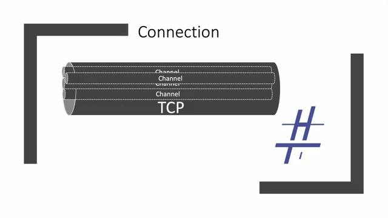
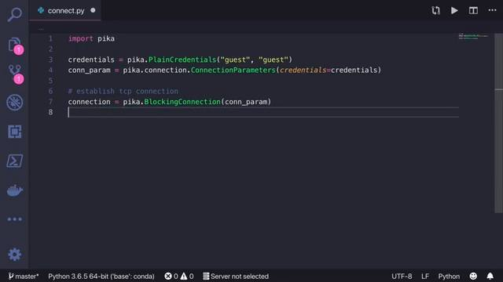
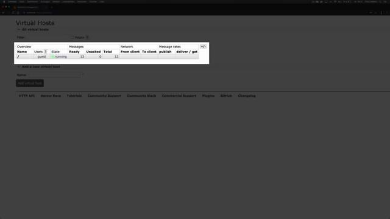
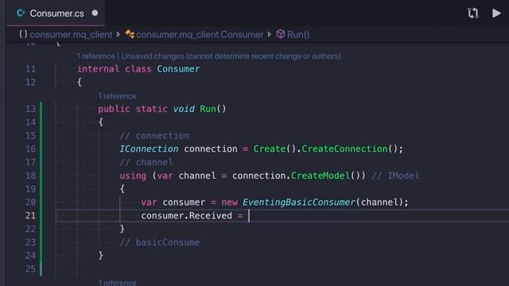
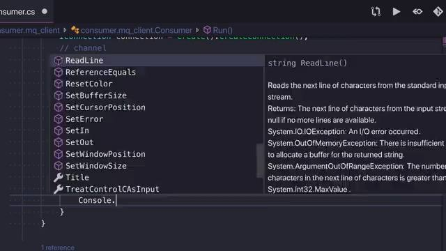
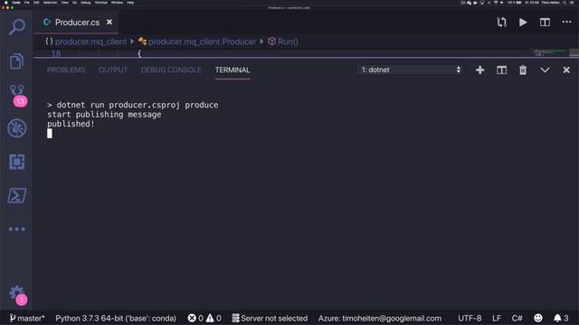
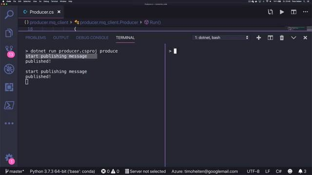
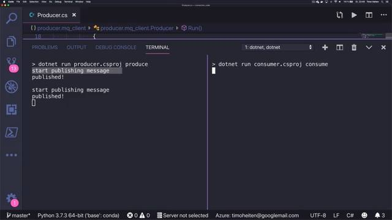

# RabbitMQ 实操：连接、vhost、.NET 消费者与生产者（P13–P16）

> 读者定位：前端转 AI 应用工程师。文中凡是涉及「连接复用 / 确认机制 / 权限隔离」的地方，都会补一句在 JS/Node 里对应什么。C# 代码只需「看得懂、能跑」，语法细节会标注「知道即可」。

---

## 1. 这一节做什么

这四集不是讲概念课，是一条完整的可跑通链路，目标只有一个：**让你用两个不同语言的客户端，把消息真正塞进 RabbitMQ、再取出来**。具体拆成四件事：

1. **P13**：用 Python 的 `pika` 库连上 RabbitMQ，建立 TCP 连接 → 开 channel → `basic_consume` 消费一个已经存在的队列，并在回调里手工 `basic_ack`。这一集同时讲了「为什么一个应用只开一条 TCP 连接、却开很多 channel」这个核心设计。
2. **P14**：讲 virtual host（虚拟主机），并在管理界面里真的建一个 vhost、建一个只对它有权限的用户，验证「vhost 之间是完全隔离的」。
3. **P15**：换 .NET 客户端，写一个控制台消费者，用 `EventingBasicConsumer` 订阅队列，从管理界面手动发消息验证。
4. **P16**：写 .NET 生产者，用 `BasicPublish` 往同一个队列发消息，然后开两个终端一收一发，验证消息计数、ack 数、连接数、channel 数。

学完这一节你应该拿到的东西：一个能跑的 RabbitMQ 实例、一个队列、一个 Python 消费者、一个 .NET 消费者、一个 .NET 生产者，以及一套能自己复现的验证方法。

**这一节刻意没有讲**：队列/交换机的声明与绑定（讲师明确说放到后面章节）、消息持久化、死信、confirm。所以下面文档里凡是超出这四集的内容，我都会标「课里没讲」。

---

## 2. 讲师原话（带时间戳）

关于「为什么不是每个操作开一条 TCP 连接」：

> "在 RabbitMQ 中，有多路复用连接的概念，即通过不同的信道来复用连接。因此，你可以使用一个连接并在其上打开许多信道，这样对于任意一个客户端，就不必打开不止一个 TCP 连接。"
> —— p013 [00:29]

> "你应该使用一个连接，也就是每个应用生命周期对应一个 TCP 连接……然后使用由这个连接创建的、按线程分配的信道。因此，这个应用中每个连接到 RabbitMQ 服务器的线程都有各自的信道。"
> —— p013 [00:59]

> "在连接上，你只能创建信道。这正是我们现在要在代码中查看的内容。"
> —— p013 [02:27]

关于默认交换机（这是本节能跑通的关键前提）：

> "这里有默认绑定，也就是 AMQP default；默认交换机会隐式绑定到每个队列，路由键等于队列名。"
> —— p013 [02:56]

关于 Python 侧的三步走：

> "我们需要创建一些凭据，也就是用户名为 guest、密码为 guest 的明文凭据。这是 localhost 的标准做法……然后我们创建一个连接，这里就是建立 TCP 连接。为此，我们直接使用阻塞连接。"
> —— p013 [03:26]

> "我们需要信道来访问库中的所有方法……然后需要一个回调……我们会把消息体打印到控制台，并直接用 basic.ack 方法进行确认。"
> —— p013 [03:55]

关于 vhost 的本质：

> "虚拟主机是 RabbitMQ 服务器内部的一个逻辑代理。因此，你可以在一个服务器中拥有许多不同的虚拟主机。"
> —— p014 [00:00]

> "这些主机之间不能通信。因此，虚拟默认主机中的一个交换机无法向另一个主机下的队列发布任何消息。所以这确实是一种完整的隔离，不是物理隔离，而是逻辑隔离。"
> —— p014 [01:54]

关于 .NET 里 channel 为什么叫 model：

> "在 .NET 中，我们使用 using 语句；有趣的是，.NET 客户端里它叫 model，因为接口是 IModel 接口，而不是信道。两者功能基本相同。"
> —— p015 [00:58]

关于 autoAck 必须关掉：

> "我们调用 basic.consume，提供队列，也就是 Pika 队列……把自动确认设为 false，这意味着我们必须在方法中手动确认。"
> —— p015 [01:55]

关于生产者的 routing key 为什么是队列名：

> "这里没有交换机名称，因为这里使用的是默认交换机，所以路由键必须使用队列名；我们记得，在默认交换机上，所有路由键都通过队列名进行绑定。"
> —— p016 [00:59]

---

## 3. 从零复现

### 3.0 目录结构（先建好，后面每个文件都对得上）

```
rabbitmq-course/
├── docker-compose.yml
├── python-consumer/
│   ├── requirements.txt
│   └── consume.py
└── dotnet/
    ├── Consumer/
    │   ├── Consumer.csproj
    │   └── Program.cs
    └── Publisher/
        ├── Publisher.csproj
        └── Program.cs
```

### 3.1 起一个 RabbitMQ（课里没讲，我补的）

讲师是直接在自己机器上跑着 RabbitMQ、然后在 `localhost:15672` 打开管理界面的，**他没讲 RabbitMQ 本身是怎么装的**。为了复现，最省事的是 Docker：

```bash
cd rabbitmq-course
docker compose up -d
docker compose ps
```

确认两个端口都在监听：`5672`（AMQP 协议端口，客户端连这个）和 `15672`（管理界面 HTTP 端口，浏览器开这个）。这两个端口号在 P16 里讲师明确说过："比如 localhost、guest、5672 等等"。

浏览器打开 `http://localhost:15672`，用 `guest / guest` 登录。P14 里讲师演示管理界面时说的就是 "端口 15672 上的本地主机代理"。

### 3.2 建队列 `pika-queue`（P13 的前置动作）

P13 一上来就说 "我们先创建一个队列。你会看到 pika 队列"——这个队列是在管理界面里手工建的，不是代码里声明的。跟着做：

1. 顶部 **Queues** 标签 → 页面下方 **Add a new queue**
2. **Type** 保持 `Classic`，**Name** 填 `pika-queue`
3. 其余全部留默认，点 **Add queue**

建完点进这个队列，看 **Bindings** 区域，你会看到一条来自默认交换机的绑定。讲师对这一步的解释是：

> "然后我们检查绑定。结果没有任何绑定，只有默认交换机绑定。"
> —— p013 [02:56]

这条绑定就是后面所有代码能跑通的原因：**交换机名传空字符串（默认交换机）+ routing key 填队列名**，消息就一定会落到这个队列。这句话在 P13 和 P16 各讲了一遍，是本节的「暗线」。



### 3.3 Python 消费者（P13）

```bash
cd python-consumer
python3 -m venv .venv
source .venv/bin/activate        # Windows: .venv\Scripts\activate
pip install -r requirements.txt
python consume.py
```

跑起来之后终端会停在 `Waiting for messages`。此时去管理界面，点进 `pika-queue`，用 **Publish message** 面板发一条 body 为 `hello world from pika queue` 的消息，终端立刻打印出来。讲师演示时说的就是这句 "来自 pika 队列的“你好，世界”"，并且强调发完之后 "在队列中，我们看到有一条消息已发布并已确认。"——**注意 "acknowledged" 这个词，它证明回调里的 `basic_ack` 真的生效了**，否则消息会一直挂在 Unacked 里。



### 3.4 建 vhost 和一个受限用户（P14）

这一步不影响前面的 Python 脚本跑通（它连的是默认 vhost `/`），但它决定了你后面 .NET 项目里 `VirtualHost` 这个参数该填什么。

1. **Admin** → 右侧 **Virtual Hosts** → **Add a new virtual host**
   - **Name**：`your-name-host`（讲师演示时就是随手起了个这样的名字）
   - 其余默认，**Add virtual host**
2. **Admin** → **Users** → **Add a user**
   - **Username**：`demo`
   - **Password**：自己设一个（讲师口述说 "创建一个没有密码的用户"，实际上 RabbitMQ 不允许空密码，必须填）
   - 点 **Add user**
3. 在用户列表里点刚建的 `demo` 用户名，进入权限页：
   - **Virtual Host** 下拉选 `your-name-host`
   - **Set permission**（讲师原话 "我们可以在这里更改虚拟主机并添加权限"）

建完后回到 **Virtual Hosts** 列表，你会看到两行：`/` 和 `your-name-host`。讲师在 P14 里强调的状态字段是 **running**——"状态是运行中，所以这个虚拟主机实际上已经启动并正在运行"。



到这里就能验证 P14 的核心结论了：切到 `your-name-host` 看 **Exchanges**，只有几个默认交换机、**没有任何队列**；切回 `/` 才能看到 `pika-queue`。讲师原话："目前这里只有默认交换机，因为它们始终存在，因此没有队列。然后我们切回斜杠（/）下的默认队列。"

### 3.5 .NET 消费者（P15）

```bash
cd dotnet/Consumer
dotnet restore
dotnet run
```

控制台打印 `Connection established, consuming in background. Press any key to exit.` 之后会挂住——这是正常的。讲师对这个 `Console.ReadKey()` 的解释是："原因是信道被映射到一个线程并在后台运行"。换句话说，**主线程一退出，后台的消费线程跟着没了**，所以必须阻塞住。

此时去管理界面给 `pika-queue` 发一条 `hello dotnet client`，终端打印 `Message received: hello dotnet client`。讲师接着还演示了发一条 JSON（`name` / `lastName` 两个字段），说明消费者并不关心消息体格式，它只是把 byte 转成字符串打印。





### 3.6 .NET 生产者（P16）

**先把 3.5 的消费者停掉**（按任意键退出），否则两个进程抢同一个队列，你看不清哪条是谁消费的（这个坑放在第 7 段细说）。

```bash
cd dotnet/Publisher
dotnet restore
dotnet run
```

终端提示后按任意键发一条，打印 `Published`。讲师在 P16 里演示时，发完两条之后去管理界面点 `pika-queue`，看到队列里有 **2 条** 消息，并特别提醒："这里的延迟是由 RabbitMQ 管理控制台五秒的刷新率造成的。"——**管理界面是 5 秒轮询刷新的，不是实时推送，别以为没发出去。**



然后再回去 `dotnet run` 消费者，两条消息会被瞬间取走：



最后看一眼管理界面的 **Connections** 和 **Channels** 标签页，讲师的原话是 "我们有两个连接和两个信道，因为目前我们的应用程序非常简单"——**一个消费者进程 = 1 条连接 + 1 个 channel，一个生产者进程同理**。这个 1:1 的观察结果，正好反过来印证了 P13 开头讲的「连接按应用生命周期开、channel 按线程开」。



---

## 4. 完整代码

### 4.1 `docker-compose.yml`

```yaml
services:
  rabbitmq:
    image: rabbitmq:3-management
    container_name: rabbitmq-course
    ports:
      - "5672:5672"      # AMQP 协议端口，客户端连这个
      - "15672:15672"    # 管理界面 HTTP 端口，浏览器开这个
    environment:
      RABBITMQ_DEFAULT_USER: guest
      RABBITMQ_DEFAULT_PASS: guest
    volumes:
      - rabbitmq-data:/var/lib/rabbitmq

volumes:
  rabbitmq-data:
```

### 4.2 `python-consumer/requirements.txt`

```
pika==1.3.2
```

> 版本号课里没讲，讲师只说 "通过 pip 安装 pika"。这里锁一个当时可用的稳定版本，避免 `pip install pika` 装到未来不兼容的大版本。

### 4.3 `python-consumer/consume.py`

```python
import pika

# 1) 凭证：localhost 上的 RabbitMQ 默认就是 guest / guest
credentials = pika.PlainCredentials("guest", "guest")

# 2) 连接参数：全部用默认值（主机、端口、vhost 都是标准值）
parameters = pika.ConnectionParameters(
    host="localhost",
    port=5672,
    virtual_host="/",
    credentials=credentials,
)

# 3) 建立 TCP 连接（阻塞式连接，pika 里最常用的一种）
connection = pika.BlockingConnection(parameters)

# 4) 在这条连接上开一个 channel，之后所有方法都从 channel 上调
channel = connection.channel()


def callback(ch, method, properties, body):
    # body 是 bytes，先转成字符串再打印
    print(f"[x] Received: {body.decode('utf-8')}")
    # 手工确认：告诉 RabbitMQ 这条消息已经处理完了
    ch.basic_ack(delivery_tag=method.delivery_tag)


# 5) 开始消费：队列是管理界面里已经建好的，auto_ack 必须关掉
channel.basic_consume(
    queue="pika-queue",
    on_message_callback=callback,
    auto_ack=False,
)

print("[*] Waiting for messages. To exit press CTRL+C")
channel.start_consuming()
```

### 4.4 `dotnet/Consumer/Consumer.csproj`

```xml
<Project Sdk="Microsoft.NET.Sdk">

  <PropertyGroup>
    <OutputType>Exe</OutputType>
    <TargetFramework>net8.0</TargetFramework>
    <Nullable>disable</Nullable>
    <ImplicitUsings>disable</ImplicitUsings>
  </PropertyGroup>

  <ItemGroup>
    <PackageReference Include="RabbitMQ.Client" Version="6.8.1" />
  </ItemGroup>

</Project>
```

> `net8.0` 和 `6.8.1` 这两个版本号课里都没讲（讲师只说 "添加 RabbitMQ 客户端的 NuGet 包，然后还原它"）。**必须锁 6.x**，因为 7.x 把 `IModel` 改成了 `IChannel`、把同步方法改成了 `*Async`，本节的代码在 7.x 上编译不过——详见第 7 段。

### 4.5 `dotnet/Consumer/Program.cs`

```csharp
using System;
using System.Text;
using RabbitMQ.Client;
using RabbitMQ.Client.Events;

namespace Consumer
{
    internal class Program
    {
        // 把连接的创建单独抽一个方法，方便和 Publisher 对照
        private static IConnection CreateConnection()
        {
            var factory = new ConnectionFactory
            {
                HostName = "localhost",
                Port = 5672,
                VirtualHost = "/",
                UserName = "guest",
                Password = "guest",
            };
            return factory.CreateConnection();
        }

        private static void Main(string[] args)
        {
            // 1) 建立连接
            var connection = CreateConnection();

            // 2) 在连接上开 channel（.NET 里叫 model，接口是 IModel）
            using (var channel = connection.CreateModel())
            {
                // 3) 创建消费者，把 channel 传进去
                var consumer = new EventingBasicConsumer(channel);

                // 4) 订阅 Received 事件
                consumer.Received += (sender, ea) =>
                {
                    // 先手工 ack，告诉 RabbitMQ 这条已被正确消费
                    channel.BasicAck(ea.DeliveryTag, false);

                    // body 是字节，需要自己解码
                    var body = ea.Body.ToArray();
                    var message = Encoding.UTF8.GetString(body);

                    Console.WriteLine($"Message received: {message}");
                };

                // 5) 开始消费，autoAck 关掉
                channel.BasicConsume(
                    queue: "pika-queue",
                    autoAck: false,
                    consumer: consumer
                );

                // 6) channel 在后台线程上跑，主线程必须阻塞住
                Console.WriteLine("Connection established, consuming in background. Press any key to exit.");
                Console.ReadKey();
            }

            connection.Close();
        }
    }
}
```

### 4.6 `dotnet/Publisher/Publisher.csproj`

```xml
<Project Sdk="Microsoft.NET.Sdk">

  <PropertyGroup>
    <OutputType>Exe</OutputType>
    <TargetFramework>net8.0</TargetFramework>
    <Nullable>disable</Nullable>
    <ImplicitUsings>disable</ImplicitUsings>
  </PropertyGroup>

  <ItemGroup>
    <PackageReference Include="RabbitMQ.Client" Version="6.8.1" />
  </ItemGroup>

</Project>
```

### 4.7 `dotnet/Publisher/Program.cs`

```csharp
using System;
using System.Text;
using RabbitMQ.Client;

namespace Publisher
{
    internal class Program
    {
        // 和 Consumer 里完全一样的连接参数：localhost / 5672 / 默认 vhost / guest
        private static IConnection CreateConnection()
        {
            var factory = new ConnectionFactory
            {
                HostName = "localhost",
                Port = 5672,
                VirtualHost = "/",
                UserName = "guest",
                Password = "guest",
            };
            return factory.CreateConnection();
        }

        private static void Main(string[] args)
        {
            // 1) 建立连接
            var connection = CreateConnection();

            // 2) 开 channel
            using (var channel = connection.CreateModel())
            {
                Console.WriteLine("Press any key to publish a message, press Q to quit.");

                var key = Console.ReadKey();
                Console.WriteLine();

                // 3) 按一次键发一条，按 Q 退出
                while (key.Key != ConsoleKey.Q)
                {
                    Console.WriteLine("Publishing message...");

                    // 4) 消息体：一串普通字符串，转成 UTF-8 字节
                    var body = Encoding.UTF8.GetBytes("hello from .NET publisher");

                    // 5) 发到默认交换机（exchange 传空），routing key 就是队列名
                    channel.BasicPublish(
                        exchange: "",
                        routingKey: "pika-queue",
                        basicProperties: null,
                        body: body
                    );

                    Console.WriteLine("Published.");

                    key = Console.ReadKey();
                    Console.WriteLine();
                }
            }

            // 6) 退出前关闭连接
            connection.Close();
            Console.WriteLine("Connection closed.");
        }
    }
}
```

---

## 5. 逐行解释

### 5.1 Python 侧：三个对象，层级不能反

`PlainCredentials` → `ConnectionParameters` → `BlockingConnection` → `channel`，这是刚性层级。讲师在 P13 里说得很直白：**"在连接上只能创建信道"**，你没法跳过 connection 直接拿 channel，也没法在 channel 上调连接级的方法。

- `BlockingConnection` 里的 `Blocking` 指的是调用会阻塞当前线程。`start_consuming()` 一旦调用就不返回了，后面的代码永远执行不到——所以它必须是最后一行。这在 Node 里没有直接对应物（Node 是回调/事件驱动），更接近你在 Node 里 `while(true)` 里 `await consumer.run()` 那种写法。
- `virtual_host="/"` 这个参数在 P13 里讲师说 "全部使用默认值"，默认值就是 `/`。如果你按 3.4 建了 `your-name-host`，把它改成 `your-name-host`，再跑这个脚本就会连不上——因为 `guest` 用户虽然默认对所有 vhost 有权限，但你得确认权限真的生效了（第 7 段会讲怎么排查）。
- `callback(ch, method, properties, body)` 这个四参数签名是 pika 规定的，讲师在 P13 [04:23] 逐字念了一遍："属性和消息体回调方法签名"。**`method` 里装着 `delivery_tag`，它是 ack 的唯一凭据**，所以 `basic_ack` 必须把 `method.delivery_tag` 传回去。这一点课里只说了「调 basic_ack」，没说参数从哪来，属于要自己补的常识。
- `auto_ack=False` 和回调里的 `basic_ack` 是一对。如果 `auto_ack=True`，RabbitMQ 在把消息推给客户端的那一刻就认为消费成功了，客户端处理到一半崩溃消息就丢了。**在 JS/Node 里，这等价于「流式消费时不要一收到就 commit offset，要处理完再 commit」**，思路完全一样。

### 5.2 .NET 消费者：`using` + `IModel` 两个坑

`using (var channel = connection.CreateModel())` 这个语法，翻译成前端能懂的话就是 **`try { ... } finally { channel.Dispose() }`**——花括号结束时自动释放。所以后面的 `Console.ReadKey()` 必须写在 `using` 块**内部**，写到外面的话 channel 已经被 Dispose 了，你按一下键消费就断了。P16 里讲师提到他故意没做 `using` 套 `using`，理由是 "这会让代码变得杂乱"，但 channel 这一层他是包了的。

`IModel` 这个命名是历史包袱，讲师专门提醒过：**"在 .NET 客户端中称为 model，因为接口是 iModel 而不是信道"**。你在 .NET 里看到的所有 `channel.XXX`，本质就是 Python 里的 `channel.XXX`，AMQP 的 `basic.*` 方法集一一对应。

`ea.Body.ToArray()` 这一句，讲师口述的原话是 "消息体会以字节形式传输，因此我们必须使用编码和 getStream 方法"——**字幕里的 "getStream" 具体是哪个方法名，录音不清晰，请以你实际编译时的类型提示为准**。在 RabbitMQ.Client 6.x 里 `ea.Body` 是 `ReadOnlyMemory<byte>`，`.ToArray()` 能转成 `byte[]`；如果你换到 7.x，这里的行为会变。

`channel.BasicAck(ea.DeliveryTag, false)` 第一个参数是投递标签（对应 Python 的 `method.delivery_tag`），第二个 `false` 表示「只确认这一条，不批量确认之前所有未确认的」。讲师在 P15 [01:26] 说 "它的具体作用我们会在本课程后面再探讨"，所以**批量确认的具体语义课里没讲**。

### 5.3 .NET 生产者：`exchange: ""` 是本节最容易抄错的参数

四个参数里，`exchange: ""` 和 `routingKey: "pika-queue"` 是一组，必须同时正确：

- `exchange` 传空字符串 = 使用默认交换机（`amq.direct` 之外那个匿名的 default exchange）
- 默认交换机有一条隐式规则：**每个队列自动以「队列名」为 routing key 绑定到它上面**

讲师在 P13 和 P16 各讲了一遍这条规则，P16 的原话是 "在默认交换机上，所有路由键都通过队列名绑定"。所以你把 `routingKey` 写成 `pikaqueue`（少个横杠），消息不会报错，但会**静默丢弃**——这是本节最阴的坑，第 7 段给排查方法。

`basicProperties: null` 表示不带任何消息属性。讲师说 "我们没有提供任何基本属性，而这些属性会增强我们的消息"——**消息优先级、过期时间、correlationId 这些都在 basicProperties 里，课里没讲**。

`Encoding.UTF8.GetBytes(...)` 和消费端的 `Encoding.UTF8.GetString(...)` 必须配对。**在 JS/Node 里这对应 `Buffer.from(str, 'utf8')` 和 `buf.toString('utf8')`**，概念一模一样，只是 Node 里通常不用你手写。

循环体里 `Console.ReadKey()` 出现两次（一次在循环外、一次在循环末尾），这是为了避免「按键回显」刷屏。`ConsoleKey.Q` 是枚举比较，C# 语法，知道即可。

---

## 6. 复现检查清单

按顺序打勾，任何一项没对上就停下来排查，不要往下走：

- [ ] `docker compose ps` 显示容器状态正常，`5672` 和 `15672` 两个端口都映射出来了
- [ ] 浏览器 `http://localhost:15672` 能用 `guest / guest` 登录
- [ ] **Queues** 列表里有 `pika-queue`，点进去 **Bindings** 里有一条来自默认交换机的绑定
- [ ] `python consume.py` 启动后打印 `[*] Waiting for messages`，不报错、不退出
- [ ] 管理界面给 `pika-queue` 发一条消息，Python 终端打印出 `[x] Received: ...`
- [ ] 发完消息后，队列详情页的 **Unacked** 计数在一两秒内回到 0（证明 ack 生效）
- [ ] **Admin → Virtual Hosts** 里能看到 `/` 和 `your-name-host` 两行，状态都是 running
- [ ] 切到 `your-name-host` 看 **Queues**，是空的（证明隔离生效）
- [ ] `dotnet run`（Consumer）打印 `Connection established, consuming in background...`
- [ ] 管理界面发一条 `hello dotnet client`，Consumer 终端打印 `Message received: hello dotnet client`
- [ ] 停掉 Consumer，`dotnet run`（Publisher），按两次键能看到两次 `Publishing message...` / `Published.`
- [ ] 队列详情页 **Ready** 计数变成 2（**记得等 5 秒刷新**）
- [ ] 再启动 Consumer，两条消息瞬间被消费，**Ready** 归 0
- [ ] **Connections** 和 **Channels** 页各显示 2 条（消费者 1 + 生产者 1）

---

## 7. 课里没讲但你会撞上的

**① RabbitMQ.Client 7.x 和本节代码不兼容。** 讲师录课时用的是 6.x 风格（`IModel`、`CreateModel()`、`BasicPublish` 同步方法）。7.x 把这些全改成了 `IChannel`、`CreateChannelAsync()`、`BasicPublishAsync()`，`EventingBasicConsumer` 也换成了 `AsyncEventingBasicConsumer`。所以你 `dotnet add package RabbitMQ.Client` 不锁版本的话，**十有八九编译不过**。这就是为什么 4.4 和 4.6 里锁死了 `6.8.1`。

**② `guest` 用户默认只能从 localhost 登录。** 课里没提这一点，但如果你把 RabbitMQ 装在另一台机器上、或者用 Docker 时网络模式不是默认的 bridge，`guest` 会直接返回 `ACCESS_REFUSED`。RabbitMQ 有个 `loopback_users` 配置项控制这个，**课里没讲怎么改**，最省事的做法就是按 3.1 用默认 bridge 网络 + `localhost` 访问。

**③ 两个消费者同时开着，消息会被「抢」。** Python 消费者和 .NET 消费者如果同时连 `pika-queue`，消息会被轮询分发到两个进程，你看到的现象是「有时候 Python 收到、有时候 .NET 收到」。这不是 bug，是队列的默认分发行为。**课里没有演示这个场景**（讲师每次都是先停一个再开另一个），但你自己复现时一定会遇到，所以第 3.6 步特意写了「先把消费者停掉」。

**④ routing key 打错，消息静默消失。** 前面说过，`exchange: ""` + `routingKey` 不等于任何队列名时，RabbitMQ **不报错、不返回、不警告**，消息直接丢。管理界面里也看不到任何痕迹。前端同学习惯了 HTTP 的 4xx/5xx，会非常不适应这种「无反馈失败」。**排查手段**：Publisher 发完之后立刻去 `pika-queue` 详情页看 Ready，如果 5 秒后还是 0，99% 是 routing key 拼错了。这个排查方法课里没讲。

**⑤ 管理界面的 5 秒刷新会骗你。** 讲师在 P16 [01:54] 专门提醒过 "延迟是由五秒的刷新率造成的"。但实际用的时候还是会怀疑自己：「明明打印了 Published，为什么队列里是 0？」——**手动点一下浏览器刷新按钮**，别干等。

**⑥ vhost 权限没生效时，报错信息不指向权限。** 如果你把 `VirtualHost` 改成 `your-name-host`，但 `guest` 或 `demo` 用户对这个 vhost 没配权限，客户端报的通常是 `ACCESS_REFUSED - access to vhost 'xxx' refused for user 'yyy'`。**课里演示了怎么加权限，但没演示权限没配时长什么样**。遇到就往 **Admin → Users → 点用户名 → Set permission** 这条路径走。

**⑦ .NET 的 `Console.ReadKey()` 在非交互终端里会抛异常。** 如果你把程序放进 CI、或者用 `dotnet run < /dev/null` 跑，`ReadKey` 会抛 `InvalidOperationException: Cannot read keys when either application does not have a console or when console input has been redirected`。**课里没讲**，但本地手动跑不会有问题。

**⑧ `connection.Close()` 之前没等 channel 释放。** Publisher 里 `using` 块结束会 `Dispose` channel，然后才 `connection.Close()`，顺序是对的。如果你把 `connection.Close()` 挪到 `using` 块里面，会偶发 `Already closed` 异常。**课里没讲这个顺序问题**，但它是 .NET 客户端最常见的报错之一。

**⑨ 队列不是 durable 的，重启就没了。** 3.2 里建队列时全部留默认，`Durable` 默认是 `false`——**Docker 容器一重启，`pika-queue` 就消失了**，你再跑消费者会报 `NOT_FOUND - no queue 'pika-queue'`。解决方法是重建队列，或者在建的时候勾上 Durable。**消息持久化（`basicProperties` 里的 `Persistent`）课里完全没讲**，属于后面章节的内容。

**⑩ vhost 之间「不能直接通信」但可以间接。** 讲师在 P14 [02:23] 说 "当然，也有一些模式可以处理这个问题，让你能在虚拟主机之间通信，但这不是直接通信，而是全都通过这种间接方式实现"——**具体是什么 pattern，课里没说**，别自己脑补成 shovel 或 federation 之类的具体插件名。

---

## 附：本节知识点与前端概念的对照速查

| RabbitMQ 概念 | 课里怎么说的 | 前端/Node 里的近似物 |
|---|---|---|
| TCP 连接（per application） | "按应用程序生命周期" | 一个进程一个 `pg.Pool` 单例 |
| Channel（per thread） | "each thread... has its own channel" | 一个 worker 一个 DB 连接；或者一个 `AsyncLocalStorage` 上下文 |
| `autoAck: false` + `BasicAck` | "we have to manually acknowledge" | 流式消费里处理完再 commit offset |
| vhost | "logical broker inside the server" | Postgres 里一个 database / schema |
| 默认交换机 + routing key = 队列名 | "隐式绑定到每个队列" | 没有直接对应物，记住这条隐式规则就行 |
| `basicProperties: null` | "enhance our messages" | HTTP headers |

按第 3 节的顺序走一遍，第 6 节的清单全打勾，这一节就算真正复现完了。下一节才会讲交换机类型、队列声明和绑定——也就是把 `exchange: ""` 这个「默认值」替换成你自己的东西。