# RabbitMQ 队列入门：declare / bind 与 EasyNetQ、pika 双客户端实跑（P017–P020）

> 本文对应课程 BV1o39SBiEhD 的 P017–P020。这一段课程的目标非常具体：**先把「生产者→交换机→队列→消费者」这条链路用 EasyNetQ 跑通一次，然后把焦点收到「队列」本身**——队列是 FIFO 的，队列必须先被声明（declare），要绑定到非默认交换机就必须再发一次 bind。最后用 Python 的 pika 库把 declare 和 bind 各做一遍，并在 RabbitMQ 管理 UI 里亲眼确认结果。

---

## 1. 这一节做什么

按项目视角，这一段要交付 **三样可运行的东西**：

| 顺序 | 交付物 | 语言/库 | 验证方式 |
|---|---|---|---|
| 1 | 一个 EasyNetQ 生产者 + 一个 EasyNetQ 消费者，围绕**已存在的队列 `pikaq`** 收发 3 条消息 | C# / EasyNetQ | 两个终端窗口；管理 UI 里队列深度先涨后落 |
| 2 | 一个队列 declare 脚本：声明 `simple bind` 队列（隐式绑默认交换机），并验证 declare 的**幂等** | Python / pika | 管理 UI 里 `simple bind` 的 Binding 显示指向默认交换机 |
| 3 | 同一个脚本声明 `direct bind` 队列并 `queue_bind` 到 `amq.direct`，routing key 为 `demonstrate` | Python / pika | 终端打印 `bound queue direct bind to exchange amq.direct with key demonstrate` |

三样东西共用一台本机 RabbitMQ（`localhost:5672`）+ 管理 UI。

**这一段没有做的事（后面课程才做）**：队列的 purge/delete、TTL/过期、lazy queue、durable/exclusive/auto-delete 的完整语义、RPC 模式、集群与性能优化。P018 是纯总结+预告，它明确把这些留到下一节——「Next section will concern itself with the meat of RabbitMQ, which is queues」—— p018 [01:23]。

---

## 2. 讲师原话（摘引与翻译）

> 「这一节我们要用 EasyNetQ 库把生产者/消费者模式重做一遍，这是我们这门课最喜欢的库。做法是加 EasyNetQ，然后用 `RabbitHutch.CreateBus` 建一个 bus，它自带所有标准默认的连接参数，所以我们只要给一个 `host=localhost` 的连接串。」
> —— p017 [00:00]

> 「我们要往一个**已经存在**的队列发布消息，这里用 EasyNetQ 的做法和没有队列时不一样。……我们先用高级总线（advanced bus）来发布：提供 properties 和消息体，跟原生 RabbitMQ client 发布很像。」
> —— p017 [00:28]

> 「这个场景里我们已经有名字叫 `pikaq` 的队列——这里是个常量——然后发布到**默认交换机**。这一步我们用 advanced bus 来做。」
> —— p017 [00:57]

> 「消费者这边类似：先 `RabbitHutch.CreateBus` 建 bus……然后用 advanced bus 声明我们要消费的队列，但这里需要的是 `IQueue` 接口，所以只给名字，它把 `IQueue` 实例返回给你。然后调用 consume 方法，需要队列（`IQueue`）和一个 delegate——这个函数要返回 `Task`，入参是消息、消息接收信息、以及发布时带的消息 properties。里面把消息解码打印到控制台，然后返回 `Task.CompletedTask`，因为我们这里没有异步工作。最后用 `Console.ReadKey` 挡住，别让 bus 被 dispose 掉。」
> —— p017 [01:26] / p017 [01:55] / p017 [02:24]

> 「先启动消费端，它已经在消费了；然后跑发布端。你能看到这里打印出 for 循环产生的 message number 0、1、2。……去 management UI 里也能看到这三条被生产出来，再被消费掉、从 UI 上移除。**注意这里是 5 秒刷新率**，延迟就是刷新造成的。」
> —— p017 [02:24] / p017 [02:53] / p017 [03:23]

> 「队列是用 FIFO 实现的，First In First Out。消息 1 先进，然后 2、3；消费的时候先出来的就是最先入队的 1，然后 2、3。」讲师同时强调：这个行为**技术上可以改，但强烈建议别改**，改了会让不了解的人非常困惑，对整体设计也不好。
> —— p019 [00:28]

> 「队列是它自己的一个**进程**（字幕写成 "error process"，指的是 Erlang 进程）。也就是说，每一个队列相当于你的 RabbitMQ 服务器里的一个小应用。」
> —— p019 [01:26]

> 「每个 virtual host 上始终有 7 个声明好的交换机，其中一个是默认交换机。……如果用 `queue declare` 给一个名字，比如 `simple bind`，它会**隐式地、自动地**绑定到默认交换机上，routing key 就是队列名。这一点在 EasyNetQ 往 `pikaq` 发消息时我们已经见过一次了。」
> —— p019 [01:26] / p019 [01:56]

> 「但通常我们要做的是建一个队列，这里叫 `direct bind`，把它连到某个交换机上。简单例子就用默认交换机里的 `amq.direct`，它是 direct 类型，意味着消息的 routing key 要和「交换机-队列」的 binding key **精确匹配**。……`queue bind` 命令会在内部往路由表里存一行：队列名 `direct bind`、交换机名 `amq.direct`、以及交换机用来找队列的 routing key。这样带 `demonstrate` 的消息就会匹配到 `direct bind` 队列。」
> —— p019 [02:25] / p019 [02:55]

> 「我们写了 `connect_local.py`，它负责连接，返回 channel 对象；我们也想之后把它关掉，这才是正确做法。……然后 `queue_declare` 声明队列。这里有个很重要的点：**queue declare 是幂等的**，跑多少次结果都不变；但如果换一个属性重新声明（比如把 durable 改掉），就会失败。所以只要属性一致，生产端和消费端随便重复声明。」
> —— p020 [00:28] / p020 [01:26]

> "然后声明 `direct bind`，需要用到 `queue bind` 命令，这一步很关键，因为它把交换机和队列连接起来。队列名是 `direct bind`、交换机名是 `amq.direct`、路由键是 `demonstrate`。……运行完成后会打印 `bound queue direct bind to exchange amq.direct with key demonstrate`，在界面上也能看到 `direct bind` 队列和 `amq.direct` 这个交换机（从上往下数第三个）。"
> —— p020 [02:23] / p020 [02:52]

---

## 3. 从零复现

### 3.1 目录结构

```
rabbitmq-course/
├─ docker-compose.yml
├─ easynetq/
│  ├─ Producer/
│  │  ├─ Producer.csproj
│  │  └─ Program.cs
│  └─ Consumer/
│     ├─ Consumer.csproj
│     └─ Program.cs
└─ pika/
   ├─ requirements.txt
   ├─ connect_local.py
   └─ queue_declare.py
```

### 3.2 环境与版本

| 组件 | 版本 | 说明 |
|---|---|---|
| RabbitMQ | `3.13-management` 镜像 | 需要 management 插件，因为本节反复用「管理 UI」做验证 |
| .NET SDK | 8.0 | 课里没指定 SDK 版本，用当前 LTS 即可 |
| EasyNetQ | `7.0.0` | **课里没讲版本**。本文固定到 7.0.0，因为 7.x 起消息体类型是 `ReadOnlyMemory<byte>`；若 restore 失败请改用 NuGet 上最新 7.x |
| pika | `1.3.2` | 课里同样没讲版本 |

> 课里没有演示 RabbitMQ 服务端如何安装（前几节已建好环境）。下面 `docker-compose.yml` 是本文补充的最省事方式，不是讲师在本集里讲的内容。

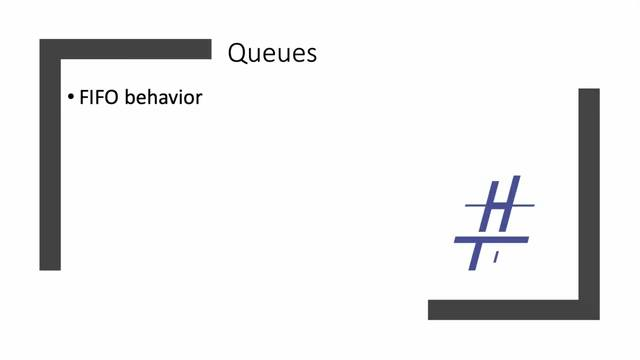

### 3.3 第一步：把 RabbitMQ 起起来

```yaml
# docker-compose.yml
services:
  rabbitmq:
    image: rabbitmq:3.13-management
    container_name: rabbitmq-course
    ports:
      - "5672:5672"      # AMQP 端口，EasyNetQ 与 pika 都连这里
      - "15672:15672"    # 管理 UI（RabbitMQ 默认管理端口），浏览器验证用
    environment:
      RABBITMQ_DEFAULT_USER: guest
      RABBITMQ_DEFAULT_PASS: guest
```

```bash
docker compose up -d
docker compose logs -f rabbitmq   # 等到日志出现 "Server startup complete"
```

浏览器打开 `http://localhost:15672`，用 `guest / guest` 登录。**后面所有「在 UI 里验证」的动作都在这个页面完成。**

> 管理 UI 默认 5 秒刷新一次。这一点讲师在 p017 [03:23] 专门解释过：如果发布完立刻刷页面发现队列深度没变，先等一轮刷新。

### 3.4 第二步：跑 EasyNetQ 的生产者/消费者

```bash
cd easynetq/Producer && dotnet restore
cd ../Consumer && dotnet restore
```

**注意关键前置条件**：这一对程序发布/消费的队列 `pikaq` 在课里是「已经存在的队列」（p017 [00:28]「we want to publish to an existing queue」）。所以先把消费端跑起来——消费端的第一件事就是 `QueueDeclare("pikaq")`，队列会被创建出来。

终端 A：

```bash
cd easynetq/Consumer
dotnet run
# 输出：消费中，按任意键退出…
```

终端 B：

```bash
cd easynetq/Producer
dotnet run
# 输出：
# published: 0
# published: 1
# published: 2
# 发布完成，按任意键退出…
```

终端 A 应当出现三行：

```text
received: 0
received: 1
received: 2
```

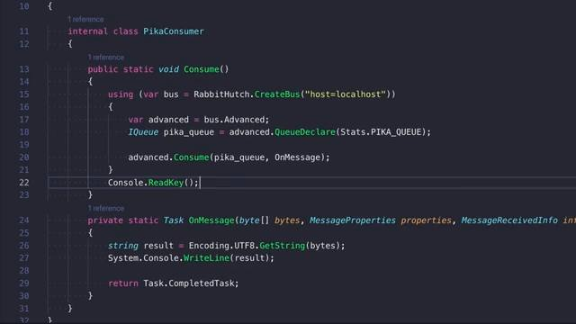

此时回到管理 UI 的 **Queues** 页：能看到 `pikaq`，消息已被消费掉（深度回到 0）。讲师在这一段特意指出延迟来自 5 秒刷新率，不是消息没被消费。

### 3.5 第三步：跑 pika 的 declare / bind

```bash
cd pika
python -m venv .venv && source .venv/bin/activate   # Windows: .venv\Scripts\activate
pip install -r requirements.txt
```

先跑「只声明、不 bind」的分支：

```bash
python queue_declare.py simple
# declared queue simple bind (implicitly bound to the default exchange)
# channel closed
```

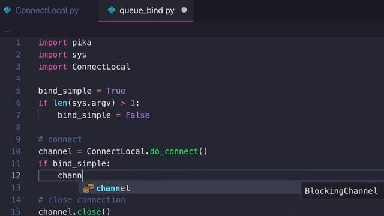

去 UI → Queues → 点 `simple bind` → 看 **Bindings** 区域：它的绑定指向默认交换机，routing key 等于队列名。**这一步我们一条 bind 命令都没发**，绑定是 declare 自动产生的——这正是 p019 [01:56] 讲的隐式绑定。

再跑 bind 分支：

```bash
python queue_declare.py direct
# bound queue direct bind to exchange amq.direct with key demonstrate
# channel closed
```

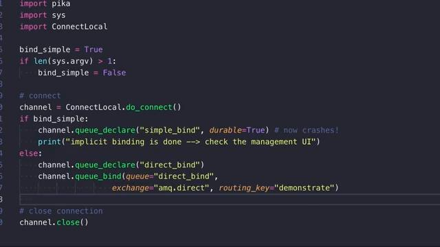

去 UI → Exchanges → `amq.direct`，在 Bindings 里能看到 `direct bind` 队列、routing key 为 `demonstrate`。

> 队列名照抄讲师口述的 **`simple bind` / `direct bind`（中间带一个空格）**。AMQP 允许队列名带空格，管理 UI 里就是这么显示的。真实项目建议改成 `simple-bind` 这类连字符命名。

### 3.6 关键概念：declare 与 bind 是两条命令

- `queue_declare` = 建队列（+ 自动绑默认交换机）。
- `queue_bind` = 额外建一条「交换机 ↔ 队列」的绑定，带 routing key。

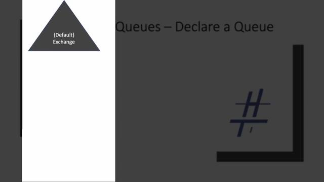

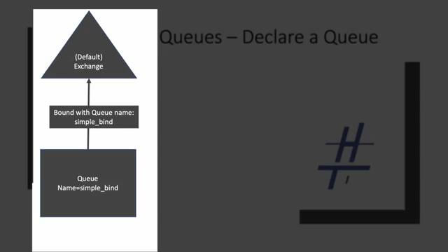

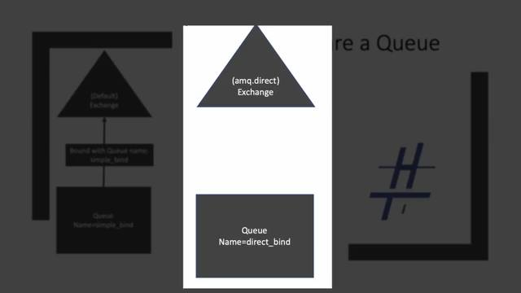

---

## 4. 完整代码

### 4.1 `easynetq/Producer/Producer.csproj`

```xml
<Project Sdk="Microsoft.NET.Sdk">

  <PropertyGroup>
    <OutputType>Exe</OutputType>
    <TargetFramework>net8.0</TargetFramework>
    <Nullable>enable</Nullable>
    <ImplicitUsings>enable</ImplicitUsings>
    <RootNamespace>Producer</RootNamespace>
    <AssemblyName>Producer</AssemblyName>
  </PropertyGroup>

  <ItemGroup>
    <PackageReference Include="EasyNetQ" Version="7.0.0" />
  </ItemGroup>

</Project>
```

### 4.2 `easynetq/Producer/Program.cs`

```csharp
using System;
using System.Text;
using EasyNetQ;

namespace Producer
{
    internal static class Program
    {
        // 课里说这个队列名"现在是常量"（p017 [00:57]）
        private const string QueueName = "pikaq";

        private static void Main()
        {
            // p017 [00:00]：用 RabbitHutch.CreateBus 建 bus，
            // 不额外配置时它自带所有标准默认连接参数，只需要一个 host
            using var bus = RabbitHutch.CreateBus("host=localhost");

            // p017 [00:28]：for 循环里产生编号 0/1/2 的消息
            for (var i = 0; i < 3; i++)
            {
                var body = Encoding.UTF8.GetBytes(i.ToString());

                // p017 [00:57]：发布到"默认交换机"，
                // 因此 routing key 直接用队列名，就能落到 pikaq 上
                bus.Advanced.Publish(
                    exchange: Exchange.GetDefault(),
                    routingKey: QueueName,
                    mandatory: false,
                    properties: new MessageProperties(),
                    body: body);

                Console.WriteLine($"published: {i}");
            }

            // 课里发布完就打印一句完成；这里补一个 ReadLine，
            // 否则 using 结束时 bus 立刻被释放，直观上"发完就退"
            Console.WriteLine("发布完成，按任意键退出…");
            Console.ReadLine();
        }
    }
}
```

### 4.3 `easynetq/Consumer/Consumer.csproj`

```xml
<Project Sdk="Microsoft.NET.Sdk">

  <PropertyGroup>
    <OutputType>Exe</OutputType>
    <TargetFramework>net8.0</TargetFramework>
    <Nullable>enable</Nullable>
    <ImplicitUsings>enable</ImplicitUsings>
    <RootNamespace>Consumer</RootNamespace>
    <AssemblyName>Consumer</AssemblyName>
  </PropertyGroup>

  <ItemGroup>
    <PackageReference Include="EasyNetQ" Version="7.0.0" />
  </ItemGroup>

</Project>
```

### 4.4 `easynetq/Consumer/Program.cs`

```csharp
using System;
using System.Text;
using System.Threading.Tasks;
using EasyNetQ;

namespace Consumer
{
    internal static class Program
    {
        private const string QueueName = "pikaq";

        private static void Main()
        {
            using var bus = RabbitHutch.CreateBus("host=localhost");

            // p017 [01:26]：用 advanced bus 声明队列，
            // 返回的是 IQueue 接口实例（consume 需要它，光有名字不够）
            var queue = bus.Advanced.QueueDeclare(QueueName);

            // p017 [01:55]：consume 需要 queue + 一个返回 Task 的 delegate。
            // 入参是消息体、消息 properties、以及消息接收信息
            bus.Advanced.Consume(queue, (body, properties, receivedInfo) =>
            {
                var text = Encoding.UTF8.GetString(body.Span);
                Console.WriteLine($"received: {text}");

                // p017 [02:24]：这里没有异步工作，返回已完成 Task
                return Task.CompletedTask;
            });

            Console.WriteLine("消费中，按任意键退出…");

            // p017 [02:24]：用 Console.ReadKey 挡住，别让 bus 被 dispose 掉
            Console.ReadKey();
        }
    }
}
```

### 4.5 `pika/requirements.txt`

```text
pika==1.3.2
```

### 4.6 `pika/connect_local.py`

```python
"""连接本机 RabbitMQ，返回一个 channel 对象。

课里（p020 [00:28]）说明这个脚本在第一节已经写好，
本集只是"直接调用它、拿回 channel、用完关掉"。
课里没有重讲它的内容，下面是等价实现。
"""
import pika


def connect():
    connection = pika.BlockingConnection(
        pika.ConnectionParameters(host="localhost")
    )
    return connection.channel()
```

### 4.7 `pika/queue_declare.py`

```python
"""P020 的完整复现：queue_declare + queue_bind。

用法：
    python queue_declare.py simple   # 只声明 simple bind（隐式绑默认交换机）
    python queue_declare.py direct   # 声明 direct bind 并 bind 到 amq.direct
"""
import sys

from connect_local import connect

# 课里讲师口述的队列名带一个空格，这里照抄
SIMPLE_QUEUE = "simple bind"
DIRECT_QUEUE = "direct bind"

# 课里用的默认交换机之一：amq.direct（direct 类型，routing key 精确匹配）
DIRECT_EXCHANGE = "amq.direct"
ROUTING_KEY = "demonstrate"


def declare_simple_bind(channel):
    """只发 queue_declare，不发 bind。

    队列会被隐式、自动地绑定到默认交换机，routing key 就是队列名。
    课里 p019 [01:56] 与 p020 [00:56] 讲的就是这个现象。
    """
    channel.queue_declare(queue=SIMPLE_QUEUE)
    print(f"declared queue {SIMPLE_QUEUE} (implicitly bound to the default exchange)")


def declare_direct_bind(channel):
    """声明 direct bind 队列，并显式 bind 到 amq.direct。

    幂等提醒（p020 [01:26]）：
    queue_declare 只要属性一致，跑多少次都不会变；
    但如果换属性（例如第二次用 durable=True 重新声明同名队列），就会失败。
    """
    channel.queue_declare(queue=DIRECT_QUEUE)

    # p020 [02:23]：queue / exchange / routing_key 三个参数
    channel.queue_bind(
        queue=DIRECT_QUEUE,
        exchange=DIRECT_EXCHANGE,
        routing_key=ROUTING_KEY,
    )

    # p020 [02:52]：课里终端就打印这一句
    print(f"bound queue {DIRECT_QUEUE} to exchange {DIRECT_EXCHANGE} with key {ROUTING_KEY}")


def main():
    # 课里是用 if / else 分支控制"先只 bind simple"还是继续做 direct bind，
    # 这里换成命令行参数，跑起来更方便
    mode = sys.argv[1] if len(sys.argv) > 1 else "simple"

    channel = connect()
    try:
        if mode == "simple":
            declare_simple_bind(channel)
        else:
            declare_direct_bind(channel)
    finally:
        # p020 [00:28]："我们也想之后把它关掉，这才是正确做法"
        channel.close()
        print("channel closed")


if __name__ == "__main__":
    main()
```

---

## 5. 逐行解释

### 5.1 EasyNetQ 部分

- **`RabbitHutch.CreateBus("host=localhost")`**：讲师原话是「它已经自带所有标准默认的连接模式，我们只要给一个 `host=localhost`」。这一句等价于「连接串里只写 host，其余走默认」——讲师把它类比成数据库连接串的用法。`RabbitHutch` 是静态工厂，`CreateBus` 返回 `IBus`（这里我们只用 `.Advanced` 这一层）。
- **`bus.Advanced`**：讲师反复说「this time we use the advanced bus」。原因是简单封装层（`bus.PubSub` 那一套）会**在后台自动建 exchange 和 queue**；而我们这个场景要往一个**已经存在、名字固定**的队列里发消息，所以必须下到 advanced 层自己指定 exchange 和 routing key。讲师原话：「Usually you would use EasyNetQ with messages and it will create exchanges and queues on its own in the background. In this case we already have a queue with the name `pikaq`」—— p017 [00:57]。
- **`Exchange.GetDefault()`**：对应讲师说的「publishes to the default exchange」。默认交换机的特点是：routing key 直接等于队列名就能投递。所以这里 `routingKey: QueueName`。
- **`new MessageProperties()`**：讲师提到「provide the properties and the message body」，但**没有逐字段讲 properties 里放什么**。本文就保持空对象——课里没讲的字段，不要自己加。
- **`Encoding.UTF8.GetBytes(i.ToString())`**：对应「create a message with a number of the for loop iteration variable and encode this to a message」。消费端对称地用 `Encoding.UTF8.GetString(...)` 解回来（讲师原话「encoding gets the string of the bytes and print it to the console」）。
- **`QueueDeclare` 返回 `IQueue`**：这是这一段最容易踩的细节。讲师专门强调：「we use the advanced bus to declare the queue we already have, but we need the `IQueue` interface here. So we only declare it with the name on the advanced bus and it will give us the `IQueue` instance.」
- **`Consume(queue, delegate)`**：delegate 的签名要求「一个返回 Task 的函数」。讲师在 p017 [01:55] 口述的入参顺序是「消息、消息接收信息、消息 properties」，而本文代码按库的实际签名写成 `(body, properties, receivedInfo)`。**如果你的 IntelliSense 提示类型不匹配，请以 IDE 提示为准**——不同 EasyNetQ 版本的 delegate 参数类型有差异（7.x 是 `ReadOnlyMemory<byte>`，更早版本是 `byte[]`，那时要把 `body.Span` 改成 `body`）。
- **`Task.CompletedTask`**：讲师原话「we have to return a task — completed task, because we don't do any async work here」。这是 .NET 里「同步逻辑包在异步签名里」的标准写法。
- **`Console.ReadKey()`**：讲师说「we also have to stop the bus from being disposed by using a console read key here」。因为 `using var bus` 在 `Main` 返回时会释放 bus，程序瞬间退出，消费还没发生。

> **给前端的类比**：`Task.CompletedTask` 相当于 `Promise.resolve()`；`using` + `Dispose` 相当于 `try/finally` 里手动 `close()`；`Bus`/`Channel` 的关系你可以先理解成 Node 里一个 http.Agent 复用多条 socket。

### 5.2 队列概念部分（P019）

- **FIFO**：讲师用「消息 1、2、3 依次入队，出队还是 1、2、3」解释。他强调这个顺序**技术上可以改，但强烈反对改**——「This will be very astonishing to people that do not know that this is possible and is bad for everyone design in general」。所以默认行为就是 FIFO，不要动。
- **队列是独立进程**：讲师说「It's also implemented as its own process... each queue is sort of its own application inside your RabbitMQ server」。意思是队列不是「一张表里的一堆行」，而是一个有自己生命周期的运行单元，这也是为什么后面会出现 lazy queue、exclusive queue 这类「队列级」属性。
- **7 个默认交换机 + 1 个默认交换机**：讲师说每个 virtual host 上始终有 7 个声明好的交换机，「one is the default exchange」（他幻灯片上标出来的那个）。本文用到的 `amq.direct` 就是其中之一。
- **隐式绑定**：`queue declare` 给了名字之后，「it's implicitly and automatically bound to the default exchange with its queue name」。所以 `simple bind` 队列在 UI 里看起来「没有 bind 命令、却已经连上了」。
- **显式绑定**：`direct bind` 队列要连 `amq.direct`，就必须 `queue bind`。`amq.direct` 是 direct 类型，讲师说「routing key on any messages is exactly matched to the binding key」——注意是**精确匹配**，不是前缀/通配（那是 topic 交换机的事，P018 提到过 topic 但本节没展开）。
- **bind 的物理含义**：讲师说 `queue bind` 「will internally store a row in the routing table」，这一行由「队列名 + 交换机名 + routing key」组成。所以 bind 不是「连接一下」，而是**往路由表插一条记录**。

> **给前端的类比**：FIFO 队列就是 JS 数组的 `push` + `shift`（不要用 `unshift`/`pop`，那是栈）。而 `queue_bind` 更像往路由表里加一条 `Map<交换机, Map<routingKey, 队列[]>>` 的记录——消息进来先按交换机查表，再按 routing key 查队列。

### 5.3 pika 部分（P020）

- **`connect()` 拿 channel**：讲师说「we will simply just call this and get the channel object back for the default localhost rabbitmq server」。所以 `connect_local.py` 的职责只有连接；**channel 的生命周期由调用方负责关闭**。
- **`channel.close()`**：讲师原话「We also want to close it afterwards because this is the right thing to do」。本文放在 `finally` 里，保证出错也会关。
- **`channel.queue_declare(queue=...)`**：最核心的一句。它对应讲师幻灯片里的 `queue declare`，只需要队列名就能工作（因为隐式绑默认交换机）。
- **幂等**：讲师用两句话讲完了：「we can run this command as often as we want and it will not change anything for the binding. Because queue declarations are idempotent.」以及反例：「if you now run it with a different declaration command, for example the durable property is changed now... it will fail」。**课里没给具体的错误码/错误名**，所以这里只写「会失败」，不臆造字段。这也是为什么在微服务里，生产端和消费端各自 declare 一遍同名队列是安全的——只要属性完全一致。
- **`channel.queue_bind(queue=, exchange=, routing_key=)`**：对应讲师逐字给出的三个值——queue name `direct bind`、exchange name `amq.direct`、routing key `demonstrate`。
- **打印语句**：`bound queue direct bind to exchange amq.direct with key demonstrate`，这是课里终端真实出现的输出文本，可以用来对照你的运行结果。

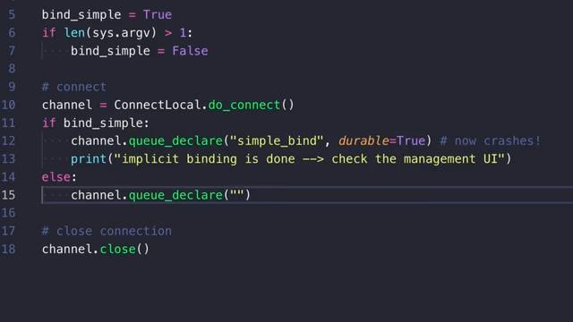

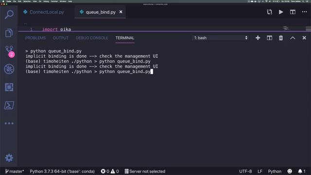

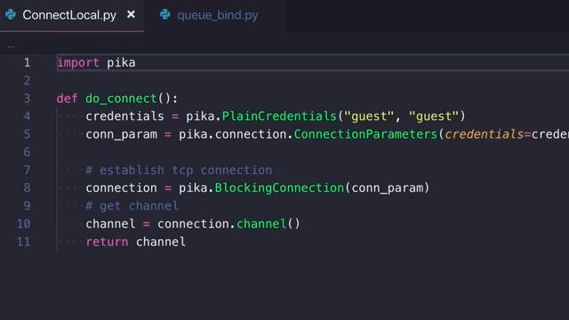

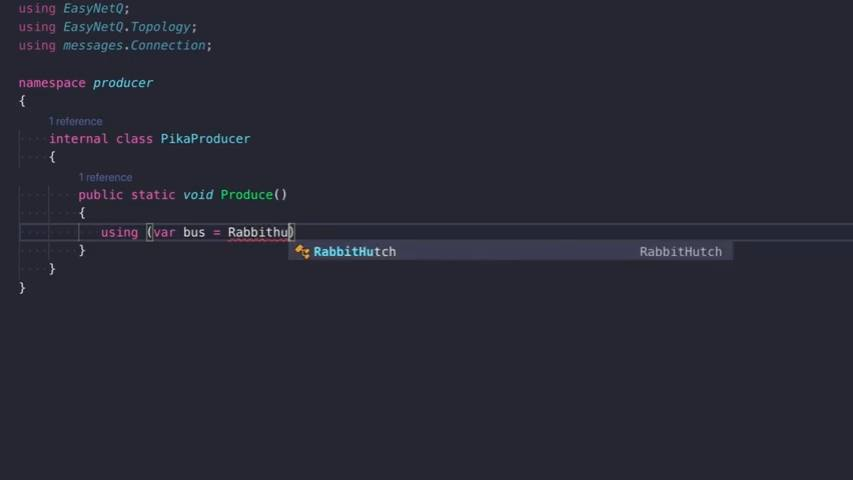

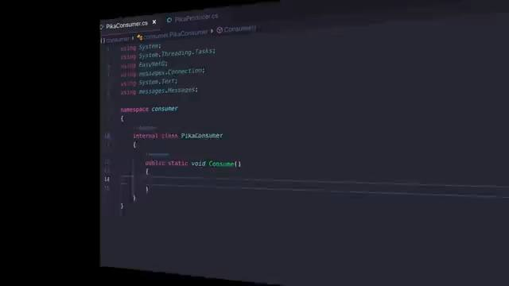

---

## 6. 复现检查清单

按顺序打勾，任何一项不过就不要往下走：

**环境**
- [ ] `docker compose up -d` 后日志出现 `Server startup complete`
- [ ] `http://localhost:15672` 能用 `guest/guest` 登录
- [ ] `dotnet --version` 是 8.x
- [ ] `pip show pika` 显示 1.3.2

**EasyNetQ（P017）**
- [ ] 终端 A 先跑 Consumer，控制台出现「消费中，按任意键退出…」，且**没有异常退出**
- [ ] 终端 B 跑 Producer，打印 `published: 0/1/2`
- [ ] 终端 A 依次出现 `received: 0`、`received: 1`、`received: 2`
- [ ] 管理 UI → Queues 里存在 `pikaq`，消息深度回到 0（等一轮 5 秒刷新再看）
- [ ] **反向验证**：不启动 Consumer 直接跑 Producer，UI 里 `pikaq` 深度变成 3；这时再启动 Consumer，三条会被消费掉、UI 上消失——讲师在 p017 [03:23] 演示的正是这个顺序

**pika declare（P020）**
- [ ] `python queue_declare.py simple` 打印 declared 行，无异常
- [ ] UI → Queues 出现 `simple bind`
- [ ] 点进 `simple bind`，Bindings 里能看到它指向默认交换机、routing key 等于队列名
- [ ] **连跑两次** `python queue_declare.py simple`，两次都成功、UI 不变 → 幂等确认
- [ ] 任何一步失败时，先去 UI 检查是否已存在同名但属性不同的队列（讲师说的「改属性就会失败」）

**pika bind（P020）**
- [ ] `python queue_declare.py direct` 打印 `bound queue direct bind to exchange amq.direct with key demonstrate`
- [ ] UI → Queues 出现 `direct bind`
- [ ] UI → Exchanges → `amq.direct` → Bindings 里有 `direct bind` 且 routing key 是 `demonstrate`
- [ ] 两步都执行完，`channel closed` 打印了两次

---

## 7. 课里没讲但你会撞上的

1. **RabbitMQ 服务端怎么装、管理插件怎么开**：本节直接使用「已存在」的服务器，安装步骤课里没讲。用上面的 `docker-compose.yml` 即可。
2. **EasyNetQ 与 pika 的具体版本号**：讲师全程没提版本。本文固定 `EasyNetQ 7.0.0` / `pika 1.3.2`。如果你用到其他 7.x，`body` 类型仍是 `ReadOnlyMemory<byte>`；如果是 5.x/6.x，`Encoding.UTF8.GetString(body.Span)` 要改成 `Encoding.UTF8.GetString(body)`。
3. **`Consume` delegate 的参数顺序**：讲师口述是「message → received info → properties」，代码里请以 IntelliSense 为准（本文写成 `body, properties, receivedInfo`）。这是最容易照抄出错的一处。
4. **`queue_declare` 属性不一致时的具体报错名**：讲师只说「it will fail」，没给错误码。实际跑起来你会看到连接被服务端关闭、pika 抛异常；具体错误常量请以你终端里的实际输出为准，本文不代填。
5. **`simple bind` 队列没有任何 bind 命令却「已绑定」**：不是 bug，是默认交换机的隐式绑定。看到 UI 里 Binding 指向默认交换机、routing key 就是队列名，属正常。
6. **管理 UI 有 5 秒刷新延迟**：讲师专门解释过。发布完立刻刷页面发现数字没变，等一轮再看。
7. **`guest` 用户只能本机登录**：默认限制，本机复现不受影响；如果你把服务端放到另一台机器，需要另建用户（课里没讲）。
8. **消息是否持久化、消费者 prefetch/QoS、手动 ack**：本节全部没讲。EasyNetQ 的 `Consume` 默认行为与 pika 的 `basic_consume` 默认行为不同，这一节不需要关心，但一旦用于生产就必须补课。
9. **队列名里带空格**：`simple bind` / `direct bind` 是讲师口述原样，AMQP 允许。真实项目建议用 `simple-bind`，否则命令行、URL、脚本里到处要加引号。
10. **`pika` 只是声明和绑定，没有发消息**：P020 这一段确实没写生产者代码。想验证「`demonstrate` 这个 routing key 真的会落到 `direct bind` 队列」，需要另外写 `basic_publish`——课里没演示这一步，管理 UI 自带的 Publish 功能也能做到，但同样不是本节内容。