# RabbitMQ 队列属性、消息 TTL、队列过期与消息模式复现文档（P21–P24）

## 1. 这一节做什么

这一节把 RabbitMQ 课程 P21–P24 的内容串成一个可以照着做的实验项目。完成后你应该能：

1. 用 Docker 启动一个带管理 UI 的 RabbitMQ 实例。
2. 用 Python `pika` 客户端复现队列的三个基础属性：`durable`、`auto-delete`、`exclusive`，以及 `passive` 方式的“只检查队列是否存在”。
3. 用 .NET `RabbitMQ.Client` 复现消息级 TTL 和队列级过期：消息 5 秒过期；队列在最后一个消费者断开后 7.5 秒消失。
4. 理解 P24 讲的四类消息模式：publish/subscribe、fire-and-forget、send/receive、request/response（RPC）。P24 只讲概念，没有给 RPC 代码，所以本文不会虚构 RPC 实现，只把流程和复现检查点写清楚。
5. 知道哪些东西是课程里没讲、但你实际动手一定会撞上的，比如客户端版本差异、`amq.direct` 与逐字稿里 `mq.direct` 的转写差异、`guest/guest` 的 localhost 限制、队列参数冲突等。

这里的目标不是背 API，而是把课程里分散的概念变成可重复的实验。建议你按 P21 → P23 → P22/P24 的顺序执行：先用 Python 看队列属性，再用 .NET 看消息 TTL 和队列过期，最后回到 P22/P24 的概念，把“队列属性”“消息属性”“消息模式”三件事分开理解。尤其不要把“消息 TTL”和“队列过期”混为一谈：消息 TTL 管的是队列里的某条消息能活多久，队列过期管的是这个队列在无人使用后多久被删除。

课程里用了两个客户端：P21 用 Python 的 `pika` 库，P23 用 RabbitMQ client for .NET。本文按这两个客户端分别给完整文件。你如果是前端转 AI 应用工程师，不需要先补 .NET 语法；把 .NET 部分当成“课程指定的第二个客户端示例”即可，语法知道即可。Node/JS 侧本课程没有讲具体客户端代码，本文不冒充讲师补 Node 实现，只在必要处说明概念对应关系。

## 2. 讲师原话（带「—— pNNN [MM:SS]」）

下面按主题摘录，不按页码流水账排列。

关于基础队列属性，讲师说：

> "这里的持久化是指队列的定义在服务器重启后仍然保留。"
> —— p021 [00:00]

> "自动删除是指，如果某个消费者已连接到该队列，那么当该消费者断开连接时，队列会被自动删除。"
> —— p021 [00:28]

> "独占是指只有声明该队列的信道才能访问它。"
> —— p021 [00:55]

关于 `passive` 检查：

> "被动声明不会在队列不存在时创建队列，而只会检查它是否已经存在。"
> —— p021 [01:24]

关于高级队列属性，讲师说：

> "如果存在一个队列，而最后一个消费者断开连接……计时器就会开始倒计时……倒计时结束后，该队列将被删除。"
> —— p022 [00:00]

> "消息存活时间是指，如果这段存活时间到期，消息就会从队列中移除。"
> —— p022 [00:29]

> "最大长度是指，你可以指定队列中可存储的消息数量上限，或者队列中可存储的字节数上限。"
> —— p022 [00:59]

> "溢出行为……包括拒绝发布和丢弃队头消息。"
> —— p022 [01:27]

> "死信交换机是指，这些消息……会被重新路由到这个交换机。"
> —— p022 [02:56]

> "惰性队列……会直接写入磁盘。"
> —— p022 [03:24]

关于 RPC 消息模式，讲师说：

> "当我们创建请求时，还会生成一个由服务器创建的队列……这个队列实际上会用 reply-to 头来标记请求。"
> —— p024 [03:51]

P24 还明确说，RPC 的实现会在下一节视频继续，所以本节的 P24 是概念课，不是完整代码课。

## 3. 从零复现

### 3.1 目录结构

建议建一个空目录，结构如下：

```text
rabbitmq-demo/
├── python/
│   ├── requirements.txt
│   └── p21_queue_properties.py
└── dotnet/
    ├── RabbitTtlDemo.csproj
    └── Program.cs
```

下面所有命令默认你在 `rabbitmq-demo/` 目录下执行。`python/` 目录只放 P21 的队列属性实验，`dotnet/` 目录只放 P23 的消息 TTL 和队列过期实验。这样做的目的是让两个客户端的依赖互不干扰：Python 侧的 `pika` 和 .NET 侧的 `RabbitMQ.Client` 都只是客户端库，真正保存队列和消息的是 RabbitMQ broker，也就是 Docker 容器里的服务。

### 3.2 启动 RabbitMQ 容器和管理 UI

课程里提到启动 Docker 容器、停止容器、再重启容器，并观察队列是否还在。课程没有给镜像 tag，也没有给 Docker 命令原文。下面用 RabbitMQ 官方带管理 UI 的镜像作为复现入口；镜像 tag 请以你本机实际拉取结果为准，不要把它当成讲师原话。

```bash
docker run -d \
  --name rabbitmq-course \
  -p 5672:5672 \
  -p 15672:15672 \
  rabbitmq:management
```

这条命令中，`-d` 表示后台运行；`--name rabbitmq-course` 给容器起固定名字，方便后面 `docker stop` / `docker start`；`-p 5672:5672` 把 broker 的 AMQP 端口映射到本机，Python 和 .NET 客户端默认连这个端口；`-p 15672:15672` 把管理 UI 端口映射到本机；最后的 `rabbitmq:management` 是带管理插件的官方镜像。如果你本机 5672 或 15672 已被占用，Docker 会报端口绑定失败，这时要么停掉占用进程，要么改用其他宿主机端口，但客户端连接参数也要相应修改。

查看容器：

```bash
docker ps
```

`docker ps` 用来确认容器是否处于 `Up` 状态、端口映射是否正确。如果看不到容器，可以先用 `docker ps -a` 查看是否已经退出，再用 `docker logs rabbitmq-course` 看启动日志。

管理 UI 地址：

```text
http://localhost:15672
```

默认用户名和密码是：

```text
guest / guest
```

注意：`guest/guest` 默认只允许本机访问。课程里没有展开远程用户权限，本文也不展开。你如果是在远程服务器上启动容器，却从另一台机器打开管理 UI，可能会遇到登录失败；这不是本文实验的必要路径，先在 localhost 上完成复现即可。

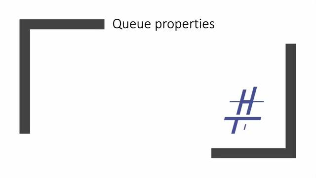

### 3.3 先跑 Python：复现队列基础属性

进入 Python 目录：

```bash
cd python
python -m venv .venv
```

`python -m venv .venv` 会创建独立虚拟环境，避免把 `pika` 装到系统 Python 里。macOS / Linux 激活：

```bash
source .venv/bin/activate
```

Windows PowerShell 激活：

```powershell
.venv\Scripts\Activate.ps1
```

激活后，命令行提示符前面通常会出现 `.venv` 字样。如果你在 PowerShell 里遇到执行策略限制，可以按提示调整当前用户策略，或者改用 CMD 激活脚本；这一步与 RabbitMQ 无关，只是 Python 环境问题。

安装依赖：

```bash
pip install -r requirements.txt
```

运行脚本：

```bash
python p21_queue_properties.py
```

脚本会做这些事：

1. 创建 `q-ok`，然后用 `passive=True` 再查一次，打印消息数和消费者数。
2. 创建 `q-durable`，`durable=True`。
3. 创建 `q-auto-delete`，`auto_delete=True`。
4. 创建 `q-non-durable`，`durable=False`。
5. 暂停，让你去管理 UI 看队列。
6. 给 `q-auto-delete` 挂一个消费者，再暂停；你按回车退出后，连接关闭，消费者断开，`q-auto-delete` 应该被删除。

这里要特别注意第 1 步：脚本先普通声明一次 `q-ok`，再用 `passive=True` 查询。原因是 `passive` 不会创建队列，如果队列不存在，broker 会返回 404 错误。先声明再 passive 查询，是为了让脚本从零开始也能顺利演示“检查已存在队列”的过程。如果你删掉第一次声明，那么第一次运行脚本时 `q-ok` 不存在，`queue_declare(passive=True)` 会抛异常；这正是 passive 的语义，不是脚本写错。

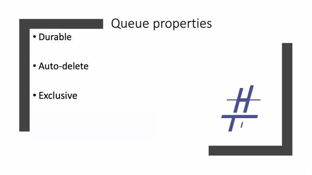

在管理 UI 的 Queues 页面，你应该能看到类似这些队列：

- `q-ok`：普通非 durable 队列。
- `q-durable`：durable 队列。
- `q-auto-delete`：带 auto-delete 的队列，讲师在 P21 说管理 UI 的 Features 列会显示 `AD`。
- `q-non-durable`：非 durable 队列。

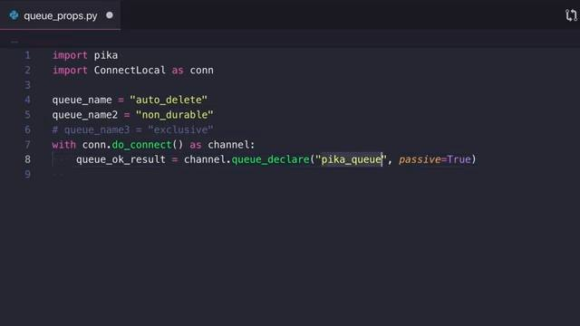

P21 里讲师特别强调：只声明 auto-delete 队列、不消费，它不会马上消失；必须先有 consumer 连上，再断开，才会触发删除。所以脚本里专门加了 `basic_consume` 和第二次暂停。很多初学者会误以为 `auto_delete=True` 表示“声明后过一会儿自动删除”，这是不对的；它依赖消费者连接与断开这一生命周期事件。

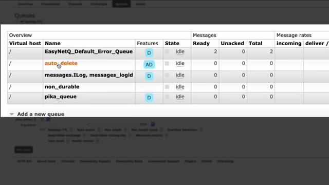

脚本退出后，刷新管理 UI：

- `q-auto-delete` 应该消失。
- `q-durable` 和 `q-non-durable` 还在。
- 然后你执行：

```bash
docker stop rabbitmq-course
docker start rabbitmq-course
```

等 RabbitMQ 重新启动后刷新管理 UI：

- `q-durable` 应该还在。
- `q-non-durable` 应该消失。
- `q-ok` 也是非 durable，所以也应该消失。

这正好对应 P21 最后一段：停 Docker 容器再启动，durable 队列还在，非 durable 队列没了。这里用的是同一个容器的 `stop` 和 `start`，不是删除容器；如果你执行 `docker rm` 把容器删掉，数据是否还在取决于你有没有挂载持久化卷，这已经超出本节实验范围。

常见错误与排查：如果运行脚本时报 `ModuleNotFoundError: No module named 'pika'`，说明虚拟环境没激活或依赖没装；如果报连接拒绝，先确认 `docker ps` 里容器是否在运行、5672 端口是否映射；如果 passive 查询报 404，说明你删掉了前面创建 `q-ok` 的那一行；如果脚本退出后 `q-auto-delete` 没消失，先确认脚本确实执行到了 `basic_consume`，并且你按回车后连接已经关闭，再刷新管理 UI。

前端对照：你可以把 `Connection` 理解成“到 broker 的一条长连接”，把 `Channel` 理解成这条连接上的多路复用通道；`queue_declare` 类似在前端调用一个“创建/确认命名资源”的接口，`passive=True` 更像只做存在性检查而不创建资源。`basic_consume` 则类似注册一个长期监听器，连接关闭后监听器自然消失，这也是 auto-delete 队列被删除的触发条件。

### 3.4 再跑 .NET：复现消息 TTL 和队列过期

进入 .NET 目录：

```bash
cd ../dotnet
```

创建项目并安装课程指定的 .NET 客户端。课程没有给版本号；下面锁定 `RabbitMQ.Client` 6.8.1，是为了匹配讲师使用的同步 API 写法。如果你装 7.x，API 会变成以异步为主，代码不能原样跑。

```bash
dotnet new console -n RabbitTtlDemo
cd RabbitTtlDemo
dotnet add package RabbitMQ.Client --version 6.8.1
```

`dotnet new console` 会生成一个控制台项目；`dotnet add package` 会把 `RabbitMQ.Client` 写进项目文件并还原依赖。这里锁定 6.8.1 不是课程原话，而是为了让你能直接跑本文的同步写法。7.x 里很多 API 改为异步，`CreateConnection`、`CreateModel`、`BasicPublish` 等调用方式会变化，所以如果你不锁版本，看到编译错误并不奇怪。

把本文第 4 节的 `RabbitTtlDemo.csproj` 和 `Program.cs` 覆盖进去。然后先跑消费者：

```bash
dotnet run -- consumer
```

消费者会声明 `expiring-queue`，绑定到 direct exchange 的 `ttl` routing key，并开始消费。

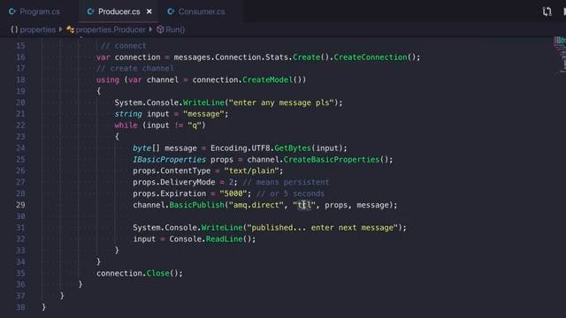

另开一个终端，进入同一个项目目录，跑生产者：

```bash
dotnet run -- producer
```

生产者会读取你输入的一行文本，设置：

- `ContentType = "text/plain"`
- `DeliveryMode = 2`
- `Expiration = "5000"`

然后发布到 direct exchange，routing key 为 `ttl`。

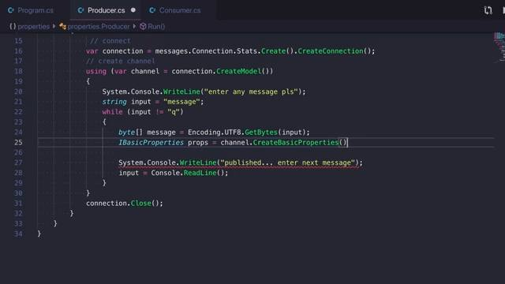

观察方式：

- 如果消费者正在运行，消息会被消费掉。
- 如果消费者没运行，消息进入 `expiring-queue`；5 秒后消息过期。你可以在管理 UI 里用 Get messages 观察，但 P24 讲师说 `basic.get` 性能很重，生产一般不要用 Get 轮询。
- 队列本身不会因为消息 TTL 而过期，消息 TTL 和队列过期是两件事。

再跑队列过期模式：

```bash
dotnet run -- queue-expiry
```

它会声明 `auto-expire-queue`，参数是 `x-expires = 7500` 毫秒。进程结束后，如果没有消费者连在这个队列上，7.5 秒后队列应该消失。注意这里的“7.5 秒”是队列在满足未使用条件后开始计时，不是消息在队列里活 7.5 秒；消息 TTL 是 `Expiration = "5000"`，两者作用对象不同。

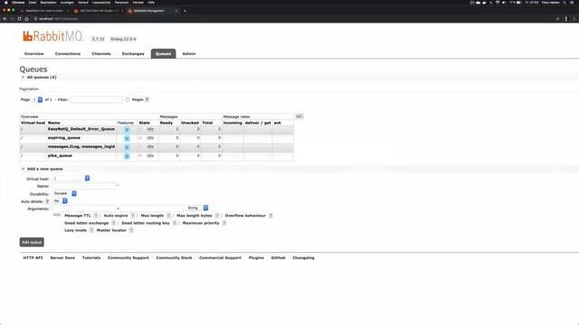

常见错误与排查：如果 `dotnet run -- consumer` 报找不到项目，确认你当前在 `RabbitTtlDemo` 目录；如果编译报同步 API 不存在，检查 `RabbitMQ.Client` 是否被还原成 7.x；如果生产者发布后消费者收不到，检查两边是否使用同一个 exchange、routing key 和队列绑定；如果 `queue-expiry` 声明报参数不一致，说明同名队列之前用不同参数声明过，换队列名或删掉旧队列再试。

前端对照：生产者类似前端里“往事件总线发事件”的代码，消费者类似后台 worker 或另一个监听页面；`ContentType`、`DeliveryMode`、`Expiration` 可以类比成消息自带的“请求头/元数据”，但不要类比成浏览器缓存过期，因为 RabbitMQ 的消息 TTL 是 broker 侧行为，不是浏览器侧缓存策略。

### 3.5 P22 的高级属性怎么落入实验

P22 是概念课，讲师没有逐条给代码。本文只把能在 P23 代码里落地的两个属性做成实验：

- 消息 TTL：`Expiration = "5000"`。
- 队列过期：`x-expires = 7500`。

P22 还讲了这些，但课程没有给完整代码，所以本文不虚构实现：

- `max-length` / `max-length-bytes`
- overflow behavior：`reject-publish` 和 `drop-head`
- max priority
- dead letter exchange / dead letter routing key
- lazy queues

这些属性的共同点是：它们都属于“队列声明参数”或“消息属性”层面的配置，实际使用时通常要在声明队列时传入 `arguments`，或者发布消息时设置 properties。本文不补代码，是因为课程没有给出对应实现，补了就容易把“课程内容”和“我额外发挥的内容”混在一起。你复现时只要理解它们分别解决什么问题：`max-length` 控制队列最多存多少条消息，`max-length-bytes` 控制最多存多少字节；overflow behavior 决定队列满了以后是拒绝新发布还是丢掉队头；max priority 影响优先级队列；dead letter exchange 负责把被拒绝、过期或超限的消息重新路由；lazy queues 更偏向把消息尽早写到磁盘。它们都可以在管理 UI 或官方文档里继续实验，但本文不把它们写成课程原代码。

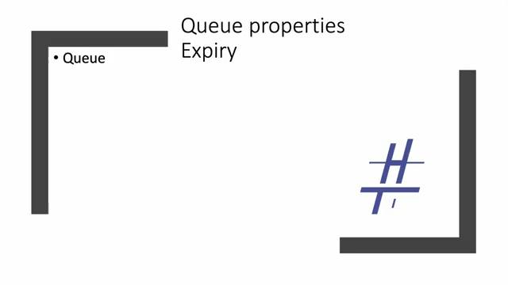

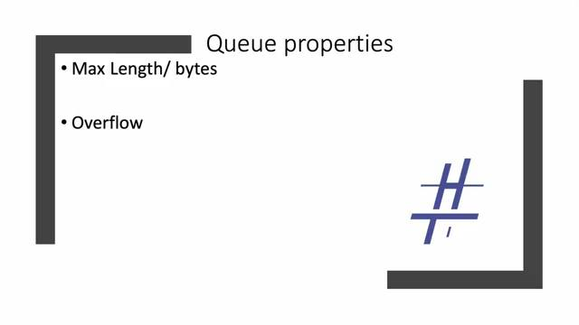

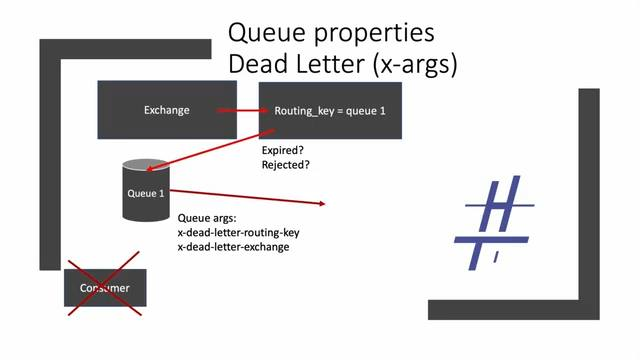

### 3.6 P24 的消息模式怎么理解

P24 把消息模式分成几类：

- publish/subscribe：发布者把消息交给 broker，broker 分发给订阅者。
- fire-and-forget：发出去就不管结果；如果没有消费者，消息可能一直留在队列里，除非设置了 TTL。
- send/receive：课程说会在示例应用里展开。
- request/response，也就是 RPC：客户端发请求，服务端回响应。

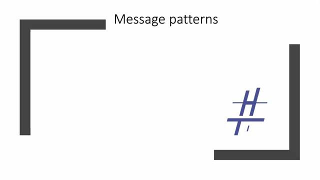

RPC 的关键点，讲师在 P24 末尾讲得很清楚：请求消息带一个 `reply-to` header，指向一个 server-generated queue；消费者处理完后，把响应发到这个队列，发布者再从该队列消费响应。这里要区分“请求队列”和“回复队列”：请求通常发到服务端监听的队列，回复则发到服务端临时生成、写在 `reply-to` 里的队列。P24 没有给 RPC 代码，下一节视频才实现。所以本文不写 RPC 的完整代码，只把它作为概念检查点。

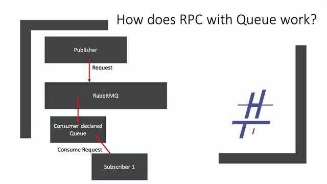

## 4. 完整代码

以下代码块保留本文实验所需的最小完整版本。Python 侧对应 P21，.NET 侧对应 P23 的消息 TTL 与队列过期。P22 的高级属性和 P24 的 RPC 不在这里虚构实现。

### 4.1 `python/requirements.txt`

```text
pika==1.3.2
```

课程没有给 `pika` 版本号；这里锁定 1.3.2 只是作为可复现基线。你如果安装其他版本，先确认 `queue_declare`、`basic_consume` 的签名是否一致。

### 4.2 `python/p21_queue_properties.py`

```python
import pika

QUEUE_OK = "q-ok"
QUEUE_DURABLE = "q-durable"
QUEUE_AUTO_DELETE = "q-auto-delete"
QUEUE_NON_DURABLE = "q-non-durable"


def on_message(ch, method, properties, body):
    print(f"[consumer] received: {body!r}")


def main():
    params = pika.ConnectionParameters(
        host="localhost",
        port=5672,
        virtual_host="/",
        credentials=pika.PlainCredentials("guest", "guest"),
    )

    with pika.BlockingConnection(params) as connection:
        channel = connection.channel()

        # 为了让 passive 检查从零也能跑，先普通声明一次 q-ok。
        # 严格只做“存在检查”时，可以删掉这一行；但队列不存在时 passive 会报错。
        channel.queue_declare(queue=QUEUE_OK, durable=False)

        q_ok = channel.queue_declare(queue=QUEUE_OK, passive=True)
        print(
            "[passive] "
            f"queue={q_ok.method.queue}, "
            f"messages={q_ok.method.message_count}, "
            f"consumers={q_ok.method.consumer_count}"
        )

        channel.queue_declare(queue=QUEUE_DURABLE, durable=True)
        channel.queue_declare(queue=QUEUE_AUTO_DELETE, auto_delete=True)
        channel.queue_declare(queue=QUEUE_NON_DURABLE, durable=False)

        print("已声明队列：")
        print(f"  {QUEUE_DURABLE}: durable=True")
        print(f"  {QUEUE_AUTO_DELETE}: auto_delete=True")
        print(f"  {QUEUE_NON_DURABLE}: durable=False")
        input("请到 http://localhost:15672 的 Queues 页面观察，按 Enter 继续挂消费者...")

        channel.basic_consume(
            queue=QUEUE_AUTO_DELETE,
            on_message_callback=on_message,
            auto_ack=True,
        )
        print(f"已给 {QUEUE_AUTO_DELETE} 挂上 consumer。按 Enter 退出，退出后连接关闭，auto-delete 队列应被删除。")
        input()

    print("连接已关闭。请刷新管理 UI：q-auto-delete 应消失。")


if __name__ == "__main__":
    main()
```

### 4.3 `dotnet/RabbitTtlDemo.csproj`

```xml
<Project Sdk="Microsoft.NET.Sdk">
  <PropertyGroup>
    <OutputType>Exe</OutputType>
    <TargetFramework>net8.0</TargetFramework>
    <ImplicitUsings>enable</ImplicitUsings>
    <Nullable>enable</Nullable>
  </PropertyGroup>

  <ItemGroup>
    <PackageReference Include="RabbitMQ.Client" Version="6.8.1" />
  </ItemGroup>
</Project>
```

课程没有指定 .NET 版本。`net8.0` 是本文为了方便复现选的；你本机如果只有其他 SDK，把 `TargetFramework` 改成你安装的版本即可。

### 4.4 `dotnet/Program.cs`

```csharp
using System.Text;
using RabbitMQ.Client;
using RabbitMQ.Client.Events;

const string Exchange = "amq.direct";
const string RoutingKey = "ttl";
const string ExpiringQueue = "expiring-queue";
const string AutoExpireQueue = "auto-expire-queue";

var mode = args.Length > 0 ? args[0] : "consumer";

var factory = new ConnectionFactory
{
    HostName = "localhost",
    Port = 5672,
    UserName = "guest",
    Password = "guest",
    VirtualHost = "/"
};

using var connection = factory.CreateConnection();
using var channel = connection.CreateModel();

switch (mode)
{
    case "producer":
        Producer(channel);
        break;

    case "consumer":
        Consumer(channel);
        break;

    case "queue-expiry":
        QueueExpiry(channel);
        break;

    default:
        Console.WriteLine("用法: dotnet run -- producer|consumer|queue-expiry");
        break;
}

void Producer(IModel model)
{
    Console.WriteLine("输入消息回车发送，消息 TTL 为 5000ms；空行退出。");

    string? line;
    while (!string.IsNullOrWhiteSpace(line = Console.ReadLine()))
    {
        var body = Encoding.UTF8.GetBytes(line);

        var props = model.CreateBasicProperties();
        props.ContentType = "text/plain";
        props.DeliveryMode = 2;
        props.Expiration = "5000";

        model.BasicPublish(
            exchange: Exchange,
            routingKey: RoutingKey,
            basicProperties: props,
            body: body
        );

        Console.WriteLine($"published: {line}");
    }
}

void Consumer(IModel model)
{
    model.QueueDeclare(
        queue: ExpiringQueue,
        durable: false,
        exclusive: false,
        autoDelete: false,
        arguments: null
    );

    model.QueueBind(
        queue: ExpiringQueue,
        exchange: Exchange,
        routingKey: RoutingKey
    );

    var consumer = new EventingBasicConsumer(model);
    consumer.Received += (sender, ea) =>
    {
        var body = ea.Body.ToArray();
        var message = Encoding.UTF8.GetString(body);
        Console.WriteLine($"[consumer] received: {message}");
    };

    model.BasicConsume(
        queue: ExpiringQueue,
        autoAck: true,
        consumer: consumer
    );

    Console.WriteLine($"正在消费 {ExpiringQueue}。按 Enter 停止。");
    Console.ReadLine();
}

void QueueExpiry(IModel model)
{
    var arguments = new Dictionary<string, object>
    {
        { "x-expires", 7500 }
    };

    model.QueueDeclare(
        queue: AutoExpireQueue,
        durable: false,
        exclusive: false,
        autoDelete: false,
        arguments: arguments
    );

    Console.WriteLine($"{AutoExpireQueue} 已声明，x-expires=7500ms。进程结束后 7.5 秒队列应消失。");
}
```

说明：逐字稿把 direct exchange 记成了 `mq.direct` / `MBU Direct`。RabbitMQ 自带的 direct exchange 实际名称是 `amq.direct`，所以代码用 `amq.direct`。如果你按字面写 `mq.direct`，需要先自己声明这个 exchange，否则 publish 会找不到 exchange；这一步课程没讲，所以本文用现成的 `amq.direct` 复现。

## 5. 逐行解释

### 5.1 `python/requirements.txt`

`pika==1.3.2` 表示固定 Python 客户端版本。固定版本的好处是复现结果稳定；坏处是你如果已经装过其他版本，`pip install -r` 会按这个版本调整。课程没有承诺使用 1.3.2，所以这里只是“可复现基线”。如果安装后导入报错，先确认当前 Python 解释器是不是虚拟环境里的解释器，可以用 `python -c "import pika; print(pika.__version__)"` 检查。

### 5.2 `python/p21_queue_properties.py`

开头的四个常量分别对应四个队列名。把队列名集中定义，是为了避免脚本里到处写字符串导致拼写不一致。`on_message(ch, method, properties, body)` 是 `pika` 消费回调的标准参数列表，其中 `body` 是消息正文；本例只用它打印内容，不需要手动 ack，因为后面用了 `auto_ack=True`。

`main()` 里先构造 `ConnectionParameters`，指定 `host="localhost"`、`port=5672`、`virtual_host="/"` 和 `guest/guest` 凭据。这里的 `virtual_host="/"` 是 RabbitMQ 的默认虚拟主机，概念上类似命名空间；管理 UI 里看到的队列都归属于某个 virtual host。`with pika.BlockingConnection(params) as connection:` 使用上下文管理器，退出 `with` 时自动关闭连接，这一点对 auto-delete 实验很关键，因为连接关闭会触发消费者断开。

`channel = connection.channel()` 创建通道。RabbitMQ 的多数操作走 channel，而不是直接在 connection 上执行。接着先 `queue_declare(queue=QUEUE_OK, durable=False)` 创建 `q-ok`，再 `queue_declare(..., passive=True)` 查询它。`passive=True` 的返回值里有 `method.queue`、`method.message_count`、`method.consumer_count`，分别表示队列名、当前消息数、当前消费者数。注意 `passive` 只检查，不创建；如果队列不存在，broker 会关闭 channel 并返回 404 类错误。

之后分别声明 `q-durable` 的 `durable=True`、`q-auto-delete` 的 `auto_delete=True`、`q-non-durable` 的 `durable=False`。`durable=True` 表示队列定义能活过 broker 重启；它不等于消息一定持久化，消息是否持久化还取决于消息的 `delivery_mode`。`auto_delete=True` 表示队列在最后一个消费者断开后删除；如果从来没有消费者连过，它不会因为“时间到了”自动消失。`durable=False` 的队列在 broker 重启后通常不会恢复。

两个 `input()` 是实验停顿点。第一个停顿让你去管理 UI 看队列的 Features；第二个停顿在 `basic_consume` 之后，让你确认消费者已经挂上。你按回车退出 `with` 块后连接关闭，`q-auto-delete` 应被删除。如果没删除，先检查是否真的执行到了 `basic_consume`，以及是否在另一个连接里还挂着消费者。

前端对照：这段 Python 没有前端代码，但概念上 `ConnectionParameters` 类似配置 API 基地址和认证信息，`Channel` 类似一个复用连接上的会话，`queue_declare` 类似创建/确认资源，`basic_consume` 类似注册事件监听器。不要把 `auto_delete` 理解成前端 `setTimeout` 定时删除，它依赖消费者连接生命周期。

### 5.3 `dotnet/RabbitTtlDemo.csproj`

`<OutputType>Exe</OutputType>` 表示这是可执行控制台程序；`<TargetFramework>net8.0</TargetFramework>` 指定目标框架，必须和你本机安装的 .NET SDK 匹配；`<ImplicitUsings>enable</ImplicitUsings>` 让一些常用命名空间自动引入；`<Nullable>enable</Nullable>` 开启可空引用类型检查。`PackageReference Include="RabbitMQ.Client" Version="6.8.1"` 是本文能跑同步 API 的关键。如果你改成 7.x，编译错误通常来自 API 形态变化，而不是 RabbitMQ 服务端问题。

### 5.4 `dotnet/Program.cs`

顶部常量里，`Exchange = "amq.direct"` 使用 RabbitMQ 自带的 direct exchange；`RoutingKey = "ttl"` 是绑定和发布共用的路由键；`ExpiringQueue` 是消息 TTL 实验队列；`AutoExpireQueue` 是队列过期实验队列。`mode` 从命令行第一个参数读取，默认 `consumer`，所以直接 `dotnet run` 会进入消费者模式。

`ConnectionFactory` 配置主机、端口、用户名、密码和 virtual host，然后 `CreateConnection()`、`CreateModel()` 分别创建连接和 channel。`using var` 保证作用域结束时释放资源。`switch` 根据模式调用 `Producer`、`Consumer` 或 `QueueExpiry`。

`Producer` 中，`Console.ReadLine()` 读一行文本，`Encoding.UTF8.GetBytes(line)` 转成字节数组。`CreateBasicProperties()` 创建消息属性；`ContentType = "text/plain"` 表示正文类型；`DeliveryMode = 2` 表示持久化消息；`Expiration = "5000"` 表示消息 TTL 为 5000 毫秒。注意 `Expiration` 是字符串，不是整数，这是 RabbitMQ 客户端属性定义决定的。`BasicPublish` 把消息发到 `amq.direct`，routing key 为 `ttl`。

`Consumer` 先声明 `expiring-queue`，再绑定到 `amq.direct` 的 `ttl` routing key。`EventingBasicConsumer` 注册 `Received` 事件，收到消息后把字节转成字符串打印。`BasicConsume` 开始消费，`autoAck: true` 表示收到即确认。最后的 `Console.ReadLine()` 只是让进程停住，方便你观察；按回车后进程退出，连接关闭。

`QueueExpiry` 构造 `arguments` 字典，放入 `x-expires = 7500`，然后声明 `auto-expire-queue`。`x-expires` 是队列参数，表示队列在未使用状态下超过指定毫秒数后删除。它不是消息 TTL，也不会让已经在队列里的消息按 7.5 秒过期。进程结束后连接关闭，如果没有消费者继续使用该队列，计时条件满足后队列应消失。

前端对照：`.NET` 代码里的生产者类似前端触发事件的代码，消费者类似后台 worker；`BasicProperties` 类似消息头，`DeliveryMode` 类似“是否持久化”的标记，`Expiration` 类似消息级过期时间。它和前端 HTTP 的 `Cache-Control` 不是一回事，因为这里控制的是 broker 中消息的生命周期。

## 6. 复现检查清单

下面每条都要实际验证，不要只看“命令没报错”。

1. Docker 容器已启动：执行 `docker ps`，确认 `rabbitmq-course` 状态为 `Up`，并且 5672、15672 端口映射存在。若没有，执行 `docker logs rabbitmq-course` 查看启动失败原因。
2. 管理 UI 可访问：浏览器打开 `http://localhost:15672`，用 `guest/guest` 登录。若登录失败，先确认你是在本机访问，且容器端口映射正确。
3. Python 虚拟环境可用：进入 `python/` 后激活 `.venv`，执行 `python -c "import pika; print(pika.__version__)"`，应能打印版本号。
4. Python 脚本可运行：执行 `python p21_queue_properties.py`，应看到 passive 查询输出，并在管理 UI 的 Queues 页面看到 `q-ok`、`q-durable`、`q-auto-delete`、`q-non-durable`。若 passive 报 404，检查是否删掉了创建 `q-ok` 的那一行。
5. auto-delete 行为正确：脚本第二次暂停时，`q-auto-delete` 应已有消费者；按回车退出后刷新 UI，`q-auto-delete` 应消失。若没消失，检查消费者是否真的挂上、连接是否关闭、是否有其他消费者占用。
6. durable 行为正确：执行 `docker stop rabbitmq-course` 再 `docker start rabbitmq-course`，等 broker 重启后刷新 UI，`q-durable` 应还在，`q-non-durable` 和 `q-ok` 应消失。若 `q-durable` 也没了，检查是否删除过容器或使用了不持久化的容器数据。
7. .NET 项目可构建：进入 `dotnet/RabbitTtlDemo`，执行 `dotnet build`，确认使用的是 `RabbitMQ.Client 6.8.1`。若报同步 API 不存在，检查包版本是否被还原成 7.x。
8. 消费者可启动：执行 `dotnet run -- consumer`，应看到“正在消费 expiring-queue”。若报 exchange 或队列错误，检查代码是否使用 `amq.direct`，以及 broker 是否在运行。
9. 生产者可发布：另开终端执行 `dotnet run -- producer`，输入一行文本回车，消费者终端应打印 `[consumer] received: ...`。若消费者没运行，消息应进入 `expiring-queue`，并在约 5 秒后过期；可在管理 UI 观察消息数变化，但不要用 Get 轮询代替生产消费。
10. 队列过期可验证：执行 `dotnet run -- queue-expiry`，看到声明成功提示后退出进程，等待超过 7.5 秒并刷新 UI，`auto-expire-queue` 应消失。若没消失，检查是否有消费者占用该队列、是否同名队列之前用不同参数声明过。
11. P24 概念可复述：能用自己的话说明 publish/subscribe、fire-and-forget、send/receive、request/response 的区别，并能指出 RPC 中 `reply-to` 指向 server-generated queue。P24 没有给 RPC 代码，所以这里不要求你跑通 RPC，只要求概念检查点清楚。

## 7. 课里没讲但你会撞上的（表格：现象 / 原因 / 怎么办）

| 现象 | 原因 | 怎么办 |
|---|---|---|
| `ModuleNotFoundError: No module named 'pika'` | 没有激活虚拟环境，或没有安装 `requirements.txt` | 进入 `python/` 激活 `.venv`，再执行 `pip install -r requirements.txt`；用 `python -c "import pika"` 确认当前解释器 |
| 连接 RabbitMQ 时报 `Connection refused` | 容器没启动、5672 没映射、或客户端连错主机/端口 | `docker ps` 确认容器 Up；检查 `-p 5672:5672`；确认代码里 host/port 与映射一致 |
| 管理 UI 登录失败 | `guest/guest` 默认只允许 localhost；或端口不是 15672 | 先在本机 `http://localhost:15672` 登录；远程访问需要另建用户和权限，课程未展开 |
| `passive=True` 报 404 / channel closed | passive 只检查不创建，队列不存在就会报错 | 先普通 `queue_declare` 创建队列，或删掉 passive 调用；不要指望 passive 帮你建队列 |
| `auto_delete=True` 的队列一直不消失 | auto-delete 需要先有消费者连接，再断开才触发；从没消费者连过不会按时间删除 | 确认脚本执行了 `basic_consume`，并关闭连接；刷新管理 UI 再观察 |
| 重启 broker 后非 durable 队列还在 | 可能没有真正重启 broker，或看的是旧 UI 缓存 | 用 `docker stop` / `docker start` 同一容器，等待启动完成后刷新 UI；确认队列的 durable 参数 |
| 重启 broker 后 durable 队列也没了 | 容器被删除、数据没有持久化，或没有使用同一容器数据 | 本实验用 `stop/start` 而不是 `rm`；生产要挂载持久化卷并理解 broker 数据目录 |
| 发布时报 `NOT_FOUND - no exchange 'mq.direct'` | 逐字稿转写成了 `mq.direct`，但 RabbitMQ 自带的是 `amq.direct` | 代码使用 `amq.direct`；如果坚持用 `mq.direct`，需要先自己声明该 exchange |
| 队列声明报 `PRECONDITION_FAILED - inequivalent arg` | 同名队列已经用不同参数声明过，例如 durable、auto-delete、x-expires 不一致 | 换一个队列名，或在管理 UI 删除旧队列后重新声明；队列参数必须一致 |
| .NET 编译报同步 API 不存在 | 安装了 `RabbitMQ.Client` 7.x，API 以异步为主 | 锁定 `6.8.1`，或按 7.x 异步 API 改写代码；不要混用两套写法 |
| 生产者发了消息，消费者收不到 | exchange、routing key、队列绑定不一致；或消费者没启动 | 对照代码检查 `amq.direct`、`ttl`、`expiring-queue`；先启动消费者再发布 |
| 消息 5 秒后没消失 | 消息可能已被消费；或你看的是队列过期而不是消息 TTL；或 UI 未刷新 | 停掉消费者再发布，观察 `expiring-queue` 消息数；刷新 UI；区分消息 TTL 与队列 `x-expires` |
| `x-expires` 队列没有按 7.5 秒消失 | 还有消费者占用；或同名队列参数不一致；或未满足“未使用”条件 | 关闭消费者和连接，等待超过 7.5 秒；换队列名重新声明；刷新 UI |
| 端口 5672 或 15672 被占用 | 本机已有 RabbitMQ、其他容器或进程占用端口 | 停掉占用进程，或改用其他宿主机端口并同步修改客户端连接参数 |
| 管理 UI 看不到刚声明的队列 | UI 没刷新，或连接/virtual host 看错 | 手动刷新页面；确认客户端和管理 UI 都在默认 `/` virtual host；确认队列声明没有报错 |
| 用 Get messages 轮询看 TTL，结果行为很怪 | `basic.get` 是同步拉取，性能和语义都不适合生产轮询；可能把消息取走 | 用消费者观察；只在调试时少量 Get；生产用长期消费者和合适的 ack 策略 |