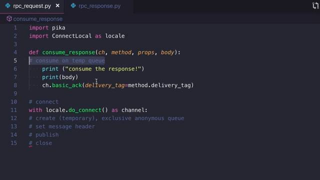
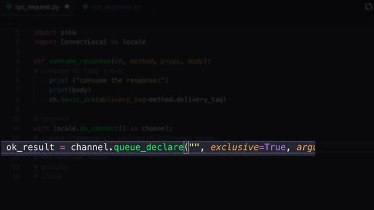
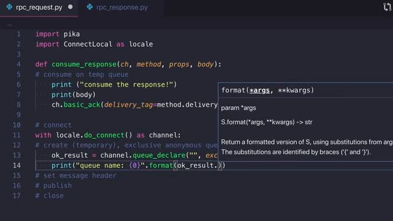
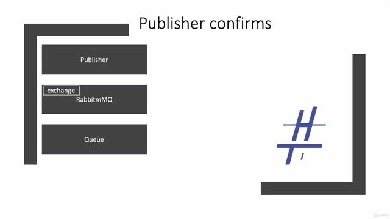
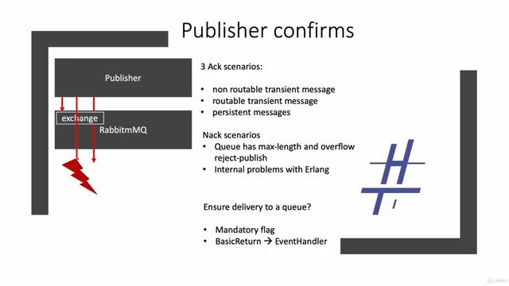
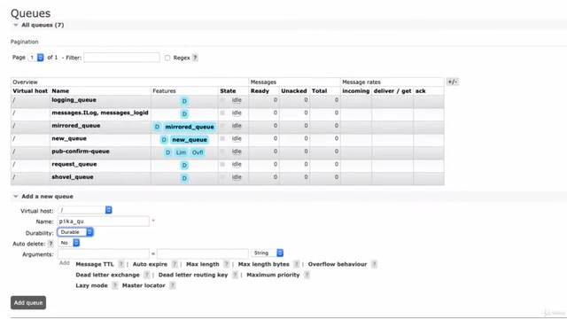
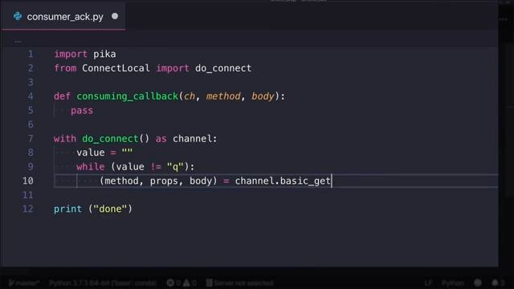
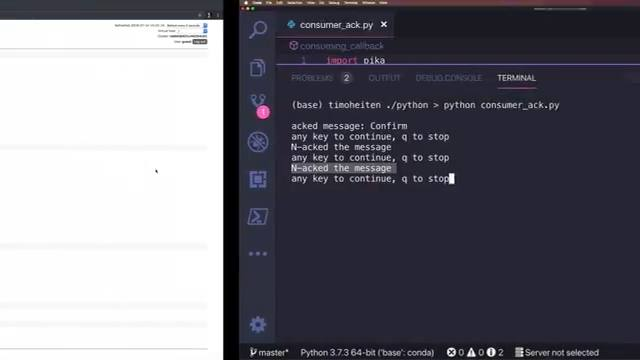

# RabbitMQ 消息可靠性与 RPC 队列实战（P25–P28）

> 说明：这四节的逐字稿里，P25 明确使用 Python 的 `pika` 库做 RPC；P27、P28 明确使用 .NET client 演示 publisher confirm 与 consumer acknowledgement。逐字稿没有贴出完整源码，也没有给 RabbitMQ、Python、.NET、RabbitMQ.Client 的具体版本。下面为了“照着能跑”，我把环境、目录、依赖版本和完整文件都补齐；代码是按讲师描述重写的，不是逐字照抄。课里没讲的部分我会明确标注。

本文的目标不是只把几段示例代码复制下来，而是把 P25 到 P28 串成一条可以反复验证的链路：先用 Python 做一次请求—响应式 RPC，再从生产者侧验证 broker 是否收到消息、消息是否能被路由，最后从消费者侧验证消息何时才算真正处理完成。阅读时建议始终围绕四个对象来定位问题：交换机负责路由，队列负责暂存，消息属性负责携带回复地址，确认机制负责回答“到底成功到哪一步”。只要这四个对象的边界不清楚，后面看到的 ack、nack、return 就很容易混在一起。

---

## 1 这一节做什么

这一节要做出四个可运行的验证：

1. **RPC over RabbitMQ**：客户端创建临时匿名回复队列，把 `reply_to` 放到消息属性里，服务端消费请求后把响应发回临时队列。对应 P25。
2. **理解消息可靠性机制**：publisher confirm、publisher transaction、consumer acknowledgement、durable queue、persistent message、basic reject / basic nack 的边界。对应 P26 的概念讲解。
3. **实现 publisher confirms + mandatory + basic.return**：验证 broker 是否收到消息、消息是否可路由、队列满了 `reject-publish` 时如何收到 nack。对应 P27。
4. **实现 consumer acknowledgement**：使用 `basic.get`、`autoAck=false`、`basic.ack`、`basic.nack`、`requeue` 控制消息重新入队。对应 P28。



这四个验证看起来分散，实际上分别落在消息链路的四个不同位置。P25 的 RPC 关注的是“请求消息发出去之后，回复消息如何回到调用方”。它依赖两个关键动作：客户端在发布请求时通过 `reply_to` 告诉服务端回复队列名；服务端处理完请求后，用默认交换机把响应发布到该队列。这里的“临时匿名队列”不是为了业务持久化，而是为了给一次调用提供一次性回信地址，因此它通常会设置 `exclusive`，客户端断开后由 broker 清理。

P26 的概念讲解解决的是“可靠性到底可靠在哪一层”。publisher confirm 只能证明 broker 接收了消息，不能证明消费者处理成功；mandatory 和 `basic.return` 关心的是消息有没有被路由到队列；consumer acknowledgement 关心的是消费者有没有完成处理；durable queue 与 persistent message 关心的是 broker 重启后队列和消息是否还在。它们不是互相替代的关系，而是分别回答不同阶段的问题。

P27 的 .NET publisher 演示把生产者侧的确认链路拆成三种场景：正常发布时观察 ack；队列设置了最大长度且溢出策略为 `reject-publish` 时观察 nack；发布时设置 `mandatory=true` 且路由键不存在时观察 `basic.return`。P28 的 .NET consumer 演示则把消费者侧的确认动作拆成 `basic.ack` 与 `basic.nack`：正常消息提交 ack，`reject` 消息按命令行参数决定是否重新入队。

最终目录如下：

```text
rabbitmq-p25-p28/
├── docker-compose.yml
├── python/
│   ├── requirements.txt
│   ├── rpc_client.py
│   └── rpc_server.py
├── dotnet-publisher/
│   ├── PublisherConfirmDemo.csproj
│   └── Program.cs
└── dotnet-consumer/
    ├── ConsumerAckDemo.csproj
    └── Program.cs
```

从复现顺序看，建议先启动 broker，再跑 Python RPC，然后跑 .NET publisher，最后跑 .NET consumer。原因很简单：RPC 用来确认基本连接、队列声明、绑定和消息属性没有问题；publisher 用来确认 confirm 事件和 return 事件能被代码接收到；consumer 用来确认 ack/nack 与队列状态变化能被管理界面观察到。如果顺序反过来，一旦连接失败或队列参数冲突，后面所有现象都会混在一起，排查成本会明显增加。

与前端开发对照，可以把 RabbitMQ RPC 类比成“前端发请求，服务端异步回调一个一次性地址”。前端的 `fetch` 请求通常等待 HTTP 响应，而 RabbitMQ RPC 的响应不是从同一个连接直接返回，而是服务端把响应发布到 `reply_to` 指定的队列。临时回复队列类似一次性的回调 URL，默认交换机类似“按队列名直接投递”的路由器。publisher confirm 可以类比为“服务端确认已经收到请求”，`basic.return` 可以类比为“网关发现目标路由不存在并退回”，consumer ack 则更像“业务处理成功后手动提交事务”。这些只是帮助理解的类比，不代表 HTTP 与 AMQP 的语义完全相同。

---

## 2 讲师原话（带「—— pNNN [MM:SS]」）

- “For the request, we need to create a temporary exclusive and anonymous queue first, which will be the queue we get the response from.”  
  —— p025 [00:00]

- “you declare a queue with an empty name and then the server will generate one for you”  
  —— p025 [00:29]

- “we have to create properties with the big pika basic properties ... and we have to set the reply to header here”  
  —— p025 [00:58]

- “our routing key will be request and our exchange republished to will be a MQ direct”  
  —— p025 [01:27]

- “the special case here is in the callback on the consuming, we will also do a publish, which will be the response in the end.”  
  —— p025 [02:26]

- “we set the exchange to an empty string because this is then automatically bound to the default exchange and uses the queue header as the routing key”  
  —— p025 [02:55]

- “you get a message from the queue, then you process the message ... you then send a basic act to the broker. So the broker can remove the message from the queue.”  
  —— p026 [01:22]

- “basic reject only allows for one message at a time, but basic nack allows for multiple message to be acknowledged in a negative way.”  
  —— p026 [02:21]

- “Before you publish, the channel has to be moved in confirm mode, then the broker assigns IDs and you have to handle the IDs on your own.”  
  —— p026 [02:50]

- “we need publisher confirms and mandatory flag for a real reliability which means ensuring that the message is really routed to the queue.”  
  —— p027 [06:22]

- “Auto-acknowledgement means that only if the message is received it will automatically acknowledge the message without any questions asked”  
  —— p028 [00:10]

- “if it's containing the reject, then we will do a basic nack ... and in this case we will requeue the message”  
  —— p028 [00:56]

- “Auto acknowledgement ... only for high throughput ... if you have any concerns of message reliability, you should absolutely avoid this”  
  —— p028 [02:23]

这些原话主要用于给代码定位。P25 的关键词是 `temporary exclusive and anonymous queue`、`reply_to`、`amq.direct`、默认交换机；P26 的关键词是 `basic ack`、`basic reject`、`basic nack`、`confirm mode`；P27 的关键词是 `publisher confirms`、`mandatory flag`、`really routed to the queue`；P28 的关键词是 `auto-acknowledgement`、`requeue`、`high throughput`。逐字稿没有给出完整源码，所以下面代码是按这些描述重写的，并在课里没讲的部分做了明确标注。复现时如果只有代码能跑但说不清每个事件对应哪句原话，建议回到这一节对照关键词，避免把 confirm、mandatory、ack 混成一个概念。

---

## 3 从零复现

### 3.1 固定环境

课里没讲版本。为了让命令可复现，本文固定：

- RabbitMQ：`rabbitmq:3.13-management`
- Python：3.11+
- `pika==1.3.2`
- .NET：8.0
- `RabbitMQ.Client`：`6.8.1`

为什么强调版本：RabbitMQ.Client 7.x 的 API 与 6.x 有差异，P27/P28 里逐字稿提到的 `ConfirmSelect`、`BasicAcks`、`BasicNacks`、`WaitForConfirmsOrDie`、`BasicReturn` 都是 6.x 风格写法。下面代码按 6.8.1 写。如果本地已经装了 .NET 7 或 RabbitMQ.Client 7.x，不建议直接把包版本改成最新版来“试试看”，因为编译错误会掩盖消息确认本身的问题。先用固定版本跑通，再考虑迁移 API。

可以用以下命令核对环境。`python --version` 应显示 3.11 或更高；`dotnet --version` 应显示 8.x；`docker compose version` 应能正常输出版本号。若机器上同时存在多个 Python，建议在项目目录里创建虚拟环境，而不是直接全局 `pip install`，这样后续排查 `pika` 模块找不到时更容易定位。

```bash
python --version
dotnet --info
docker compose version
```

### 3.2 启动 RabbitMQ

在项目根目录创建 `docker-compose.yml`，然后执行：

```bash
docker compose up -d
docker compose logs -f rabbitmq
```

看到 broker 启动后，打开管理界面：

```text
http://localhost:15672
用户名：guest
密码：guest
```

AMQP 端口是 `5672`，管理界面端口是 `15672`。

`docker compose up -d` 的作用是后台启动容器；`docker compose logs -f rabbitmq` 用来持续查看 broker 日志。看到类似 `Server startup complete` 的输出后再进行后续操作，不要刚执行完 `up -d` 就立刻运行 Python 客户端，否则可能遇到短暂的连接拒绝。管理界面能打开，并且 `Overview` 页面能看到节点运行状态，说明 broker 基本可用。此时还可以在 `Queues` 页面观察后续创建的队列，在 `Exchanges` 页面确认 `amq.direct` 存在。

常见错误与排查：如果 `5672` 或 `15672` 已被占用，`docker compose up` 会报端口绑定失败，解决方式是停止占用端口的进程，或者修改 `docker-compose.yml` 的宿主机端口映射。如果容器名 `rabbitmq-p25-p28` 已存在，可能是上一次容器没有清理，先执行 `docker compose down` 再启动。如果管理界面能打开但 AMQP 连接失败，要检查代码里的 host 是否写成了 `localhost`，以及容器是否真的映射了 `5672`。本地练习使用 `guest/guest` 是可以的；如果以后把 broker 暴露到其他机器，需要注意 RabbitMQ 默认限制 `guest` 只能从 localhost 登录，这属于课里没展开、但实际会撞上的配置问题。

### 3.3 跑 Python RPC

进入 Python 目录：

```bash
cd python
python -m venv .venv
source .venv/bin/activate
# Windows 用：.venv\Scripts\activate
pip install -r requirements.txt
```

先启动服务端：

```bash
python rpc_server.py
```

再开一个终端启动客户端：

```bash
python rpc_client.py
```

预期现象：

1. 客户端打印临时回复队列名，例如 `amq.gen-xxxx`。
2. 服务端打印请求内容和 `reply_to`。
3. 客户端收到响应并退出。
4. 在管理界面能看到临时队列；客户端断开后临时队列消失。





这里要特别留意执行顺序：先启服务端，再启客户端。服务端需要先声明 `request` 队列并绑定到 `amq.direct`，否则客户端发布到 `amq.direct` 且 routing key 为 `request` 时，消息可能因为没有绑定而被丢弃。客户端声明匿名队列时使用空队列名，RabbitMQ 会自动生成 `amq.gen-...` 形式的队列名；`exclusive=True` 表示该队列只允许当前连接使用，连接关闭后删除；`x-expires=30000` 是本文为了演示补上的参数，表示队列在未被使用一段时间后过期，课里没有要求必须设置这个参数。

常见错误与排查：如果报 `ModuleNotFoundError: No module named 'pika'`，说明虚拟环境没有激活或 `pip install` 没在同一个环境里执行，可用 `pip show pika` 确认版本。如果报连接拒绝，先回到 3.2 检查 broker。如果客户端一直停在 `waiting for response`，先看服务端有没有打印请求；若服务端没有打印，检查客户端发布时 exchange 是否为 `amq.direct`、routing key 是否为 `request`、服务端是否执行了 `queue_bind`。若服务端打印了请求但客户端收不到响应，检查 `props.reply_to` 是否为空，以及服务端发布响应时 exchange 是否为空字符串。默认交换机会用 routing key 作为队列名，因此 `routing_key=props.reply_to` 是把响应投回临时队列的关键。

### 3.4 跑 .NET publisher confirms

在项目根目录执行：

```bash
dotnet run --project dotnet-publisher -- confirm
dotnet run --project dotnet-publisher -- max-length
dotnet run --project dotnet-publisher -- mandatory
```

三个模式分别验证：

- `confirm`：普通发布 10 条消息，观察 broker 返回的 ack。
- `max-length`：队列最多 2 条，溢出策略 `reject-publish`，观察 nack。
- `mandatory`：消息不可路由，观察 `basic.return`。







`confirm` 模式的核心动作是 `ConfirmSelect()`。进入 confirm 模式后，broker 会给每次发布分配确认标签，并通过 `BasicAcks` 事件回传。代码里发布 10 条消息，理论上会看到 ack 输出，最后 `WaitForConfirmsOrDie` 如果正常返回，说明这批消息已被 broker 确认接收。这里要注意：confirm 只表示 broker 接收了消息，不表示某个消费者已经处理了消息，也不表示消息一定被路由到了队列；路由问题要靠 mandatory 与 `basic.return` 观察。

`max-length` 模式声明一个最大长度为 2、溢出策略为 `reject-publish` 的队列，然后连续发布 5 条消息。前两条可以进入队列，后续消息在队列满时会被 broker 拒绝发布，因此可能看到 nack 或 confirm 失败。这个现象依赖队列参数；如果同名队列已经用不同参数创建过，第二次运行会报 PRECONDITION_FAILED，因为 RabbitMQ 不允许同名队列使用不同参数重复声明。遇到这种错误时，在管理界面删除 `confirm_max_length` 队列后重跑，或者换一个队列名。

`mandatory` 模式发布到 `amq.direct`，但 routing key 使用一个不存在的值，并设置 `mandatory=true`。如果消息无法路由到任何队列，broker 会通过 `BasicReturn` 事件返回消息，常见返回码是 `312 NO_ROUTE`。这个模式验证的是“路由失败可见”，不是“消费者拒收”。常见错误是把 `mandatory` 和 confirm 混为一谈：没有 confirm 时，生产者可能不知道 broker 是否收到；没有 mandatory 时，即使 broker 收到了，也可能不知道消息是否可路由。两者结合才能覆盖“收到但没路由”的情况。

### 3.5 跑 .NET consumer acknowledgement

先确保 `pika` 队列存在。可以在管理界面手动发布，也可以先跑一次 publisher：

```bash
dotnet run --project dotnet-publisher -- confirm
```

然后发布测试消息：

- 在管理界面进入 `pika` 队列，使用默认交换机，routing key 填 `pika`。
- payload 填 `confirm`，运行消费者，会执行 `basic.ack`。
- payload 填 `reject`，运行消费者，会执行 `basic.nack` 且 `requeue=true`。

运行：

```bash
dotnet run --project dotnet-consumer
```

如果要验证 `requeue=false`：

```bash
dotnet run --project dotnet-consumer -- --no-requeue
```

`requeue=true` 时，同一条 `reject` 消息会再次回到队列；`requeue=false` 时，消息会被丢弃。





消费者代码使用 `BasicGet("pika", autoAck: false)`，意思是主动从队列取一条消息，但不自动确认。若取到消息，代码根据 payload 决定 ack 还是 nack。正常消息调用 `BasicAck`，broker 收到后会把消息从队列中移除；`reject` 消息调用 `BasicNack`，如果 `requeue=true`，消息重新回到队列，如果 `requeue=false`，消息不再入队。管理界面里可以重点观察 `Ready` 与 `Unacked` 两个数字：`autoAck=false` 且未确认时，消息会进入 Unacked；执行 ack 后 Unacked 减少，消息不再回到 Ready；执行 nack 且 requeue 后，消息重新回到 Ready。

常见错误与排查：如果 `BasicGet` 返回 null，说明队列当前没有消息，先确认发布是否成功、routing key 是否填对。如果消息一直停留在 Unacked，说明消费代码没有执行 ack/nack，或者程序在确认前异常退出。如果 `reject` 消息反复出现，检查是否使用了 `requeue=true`，这会把同一条消息重新放回队列，形成循环。如果使用 `autoAck=true`，消息会在被投递时自动确认，消费者处理失败也无法让 broker 重新投递，这正是 P28 原话里强调“有可靠性顾虑时应避免自动确认”的原因。

---

## 4 完整代码

### 4.1 `docker-compose.yml`

```yaml
services:
  rabbitmq:
    image: rabbitmq:3.13-management
    container_name: rabbitmq-p25-p28
    ports:
      - "5672:5672"
      - "15672:15672"
    environment:
      RABBITMQ_DEFAULT_USER: guest
      RABBITMQ_DEFAULT_PASS: guest
    volumes:
      - rabbitmq-data:/var/lib/rabbitmq

volumes:
  rabbitmq-data:
```

### 4.2 `python/requirements.txt`

```text
pika==1.3.2
```

### 4.3 `python/rpc_client.py`

```python
import pika


def main() -> None:
    connection = pika.BlockingConnection(
        pika.ConnectionParameters(host="localhost")
    )
    channel = connection.channel()

    result = channel.queue_declare(
        queue="",
        exclusive=True,
        arguments={"x-expires": 30000},
    )
    callback_queue = result.method.queue
    print(f"[client] reply queue = {callback_queue}")

    channel.basic_publish(
        exchange="amq.direct",
        routing_key="request",
        body="hello rpc request",
        properties=pika.BasicProperties(
            reply_to=callback_queue,
        ),
    )
    print("[client] request sent")

    def on_response(ch, method, props, body):
        print(f"[client] response = {body.decode()}")
        ch.basic_ack(delivery_tag=method.delivery_tag)
        ch.stop_consuming()

    channel.basic_consume(
        queue=callback_queue,
        on_message_callback=on_response,
        auto_ack=False,
    )

    print("[client] waiting for response")
    channel.start_consuming()
    connection.close()


if __name__ == "__main__":
    main()
```

### 4.4 `python/rpc_server.py`

```python
import pika


def main() -> None:
    connection = pika.BlockingConnection(
        pika.ConnectionParameters(host="localhost")
    )
    channel = connection.channel()

    channel.queue_declare(queue="request", durable=False)
    channel.queue_bind(
        exchange="amq.direct",
        queue="request",
        routing_key="request",
    )
    print("[server] waiting for request")

    def on_request(ch, method, props, body):
        request = body.decode()
        print(f"[server] request = {request}")
        print(f"[server] reply_to = {props.reply_to}")

        response = f"response to: {request}"
        ch.basic_publish(
            exchange="",
            routing_key=props.reply_to,
            body=response,
        )
        ch.basic_ack(delivery_tag=method.delivery_tag)

    channel.basic_consume(
        queue="request",
        on_message_callback=on_request,
        auto_ack=False,
    )
    channel.start_consuming()


if __name__ == "__main__":
    main()
```

### 4.5 `dotnet-publisher/PublisherConfirmDemo.csproj`

```xml
<Project Sdk="Microsoft.NET.Sdk">
  <PropertyGroup>
    <OutputType>Exe</OutputType>
    <TargetFramework>net8.0</TargetFramework>
    <ImplicitUsings>enable</ImplicitUsings>
    <Nullable>enable</Nullable>
  </PropertyGroup>
  <ItemGroup>
    <PackageReference Include="RabbitMQ.Client" Version="6.8.1" />
  </ItemGroup>
</Project>
```

### 4.6 `dotnet-publisher/Program.cs`

```csharp
using RabbitMQ.Client;
using RabbitMQ.Client.Events;
using System.Text;
using System.Threading;

static class Program
{
    static void Main(string[] args)
    {
        var mode = args.Length > 0 ? args[0] : "confirm";
        var factory = new ConnectionFactory
        {
            HostName = "localhost",
            UserName = "guest",
            Password = "guest"
        };

        using var connection = factory.CreateConnection();
        using var channel = connection.CreateModel();

        switch (mode)
        {
            case "confirm":
                RunConfirm(channel);
                break;
            case "max-length":
                RunMaxLength(channel);
                break;
            case "mandatory":
                RunMandatory(channel);
                break;
            default:
                Console.WriteLine("用法: confirm | max-length | mandatory");
                break;
        }
    }

    static void RunConfirm(IModel channel)
    {
        channel.QueueDeclare(
            queue: "pika",
            durable: false,
            exclusive: false,
            autoDelete: false,
            arguments: null);

        channel.ConfirmSelect();
        channel.BasicAcks += (_, ea) =>
            Console.WriteLine($"[confirm] ack tag={ea.DeliveryTag} multiple={ea.Multiple}");
        channel.BasicNacks += (_, ea) =>
            Console.WriteLine($"[confirm] nack tag={ea.DeliveryTag} multiple={ea.Multiple}");

        for (int i = 0; i < 10; i++)
        {
            var body = Encoding.UTF8.GetBytes($"confirm-{i}");
            channel.BasicPublish(
                exchange: "",
                routingKey: "pika",
                mandatory: false,
                basicProperties: null,
                body: body);
        }

        channel.WaitForConfirmsOrDie(TimeSpan.FromSeconds(5));
        Console.WriteLine("[confirm] all messages confirmed");
    }

    static void RunMaxLength(IModel channel)
    {
        channel.QueueDeclare(
            queue: "confirm_max_length",
            durable: false,
            exclusive: false,
            autoDelete: false,
            arguments: new Dictionary<string, object>
            {
                ["x-max-length"] = 2,
                ["x-overflow"] = "reject-publish"
            });

        channel.ConfirmSelect();
        channel.BasicAcks += (_, ea) =>
            Console.WriteLine($"[max-length] ack tag={ea.DeliveryTag} multiple={ea.Multiple}");
        channel.BasicNacks += (_, ea) =>
            Console.WriteLine($"[max-length] nack tag={ea.DeliveryTag} multiple={ea.Multiple}");

        for (int i = 0; i < 5; i++)
        {
            var body = Encoding.UTF8.GetBytes($"max-{i}");
            channel.BasicPublish(
                exchange: "",
                routingKey: "confirm_max_length",
                mandatory: false,
                basicProperties: null,
                body: body);
        }

        try
        {
            channel.WaitForConfirmsOrDie(TimeSpan.FromSeconds(5));
            Console.WriteLine("[max-length] all messages confirmed");
        }
        catch (Exception ex)
        {
            Console.WriteLine($"[max-length] confirm failed: {ex.Message}");
        }
    }

    static void RunMandatory(IModel channel)
    {
        channel.BasicReturn += (_, ea) =>
        {
            Console.WriteLine($"[mandatory] return code={ea.ReplyCode} text={ea.ReplyText}");
            Console.WriteLine($"[mandatory] exchange={ea.Exchange} routingKey={ea.RoutingKey}");
        };

        var body = Encoding.UTF8.GetBytes("mandatory-demo");
        channel.BasicPublish(
            exchange: "amq.direct",
            routingKey: "not-exist-routing-key",
            mandatory: true,
            basicProperties: null,
            body: body);

        Console.WriteLine("[mandatory] published, waiting for basic.return");
        Thread.Sleep(1000);
    }
}
```

### 4.7 `dotnet-consumer/ConsumerAckDemo.csproj`

```xml
<Project Sdk="Microsoft.NET.Sdk">
  <PropertyGroup>
    <OutputType>Exe</OutputType>
    <TargetFramework>net8.0</TargetFramework>
    <ImplicitUsings>enable</ImplicitUsings>
    <Nullable>enable</Nullable>
  </PropertyGroup>
  <ItemGroup>
    <PackageReference Include="RabbitMQ.Client" Version="6.8.1" />
  </ItemGroup>
</Project>
```

### 4.8 `dotnet-consumer/Program.cs`

```csharp
using RabbitMQ.Client;
using System.Text;

static class Program
{
    static void Main(string[] args)
    {
        bool noRequeue = args.Contains("--no-requeue");
        var factory = new ConnectionFactory
        {
            HostName = "localhost",
            UserName = "guest",
            Password = "guest"
        };

        using var connection = factory.CreateConnection();
        using var channel = connection.CreateModel();

        channel.QueueDeclare(
            queue: "pika",
            durable: false,
            exclusive: false,
            autoDelete: false,
            arguments: null);

        channel.BasicQos(0, 1, false);

        var result = channel.BasicGet("pika", autoAck: false);
        if (result is null)
        {
            Console.WriteLine("[consumer] queue is empty");
            return;
        }

        var body = Encoding.UTF8.GetString(result.Body.ToArray());
        Console.WriteLine($"[consumer] body={body} deliveryTag={result.DeliveryTag}");

        if (body == "reject")
        {
            channel.BasicNack(result.DeliveryTag, multiple: false, requeue: !noRequeue);
            Console.WriteLine($"[consumer] nack requeue={!noRequeue}");
        }
        else
        {
            channel.BasicAck(result.DeliveryTag, multiple: false);
            Console.WriteLine("[consumer] ack");
        }
    }
}
```

---

## 5 逐行解释

### 5.1 Python RPC 客户端

`pika.BlockingConnection(pika.ConnectionParameters(host="localhost"))` 建立的是阻塞式 AMQP 连接。它适合做演示和小工具，因为代码按顺序执行，不需要处理复杂的异步回调。`channel = connection.channel()` 创建一个信道，后续声明队列、发布消息、消费消息都通过信道完成。RabbitMQ 的连接可以复用，但信道更轻量，通常每个业务流程使用独立信道更清晰。

`channel.queue_declare(queue="", exclusive=True, arguments={"x-expires": 30000})` 中，`queue=""` 让 broker 生成匿名队列名；`exclusive=True` 表示队列只对当前连接可见，连接关闭后队列删除；`x-expires` 是额外演示参数，表示队列在无人使用时过期。返回对象里的 `result.method.queue` 就是生成的队列名，打印它可以帮助确认后续 `reply_to` 使用的是同一个值。

`channel.basic_publish(exchange="amq.direct", routing_key="request", ...)` 把请求发布到 `amq.direct`。这里 exchange 和 routing key 必须与服务端绑定关系一致。`properties=pika.BasicProperties(reply_to=callback_queue)` 是关键：它把回复队列名放进消息属性。服务端消费消息时会从 `props.reply_to` 读取这个值。若忘记设置 `reply_to`，服务端就不知道响应该发到哪里，客户端会一直等待。

`on_response(ch, method, props, body)` 是客户端收到响应后的回调。打印响应后执行 `basic_ack`，然后 `stop_consuming` 退出消费循环。这里使用 `auto_ack=False`，因此需要手动确认。若客户端在处理响应时异常退出，未确认的消息会留在回复队列中；不过由于回复队列通常是 exclusive 且一次性使用，客户端断开后队列会被清理，实际排障时更多是观察“有没有收到消息”，而不是依赖它长期重试。

与前端对照，这一段的 `reply_to` 很像前端发起请求时附带一个一次性回调地址。前端通常由浏览器保留 Promise，等待服务端响应；RabbitMQ 客户端则先声明一个临时队列，再在这个队列上等待响应。两者都不是在同一个消息上直接返回，而是通过一个“回信地址”完成闭环。理解这一点后，看到临时队列名 `amq.gen-...` 就不会误以为它是业务队列。

### 5.2 Python RPC 服务端

`channel.queue_declare(queue="request", durable=False)` 声明请求队列。这里 `durable=False` 是为了与演示代码的轻量场景一致，课里没有强制要求持久化。`queue_bind(exchange="amq.direct", queue="request", routing_key="request")` 把队列绑定到交换机，路由键为 `request`。客户端发布时使用同样的 exchange 和 routing key，消息才会被路由到这个队列。

`on_request(ch, method, props, body)` 是服务端消费请求的回调。先打印请求内容和 `props.reply_to`，然后构造响应字符串。`ch.basic_publish(exchange="", routing_key=props.reply_to, body=response)` 中的空字符串表示默认交换机。默认交换机的特殊之处在于：它不需要显式绑定，会把消息路由到名称等于 routing key 的队列。因此这里把 `props.reply_to` 当作 routing key，响应就会回到客户端声明的临时队列。

`ch.basic_ack(delivery_tag=method.delivery_tag)` 表示请求消息已经处理完成，broker 可以把它从 `request` 队列移除。如果这里不 ack，请求消息会停留在 Unacked 状态，直到连接关闭或达到超时策略。演示里先发布响应再 ack，实际业务中要考虑重复投递的可能：如果发布响应成功但在 ack 前进程崩溃，消息可能重新投递，服务端会再次处理请求。生产级 RPC 通常需要幂等键或去重机制，这属于课里没展开但实际会遇到的问题。

与前端对照，服务端回调里的“发布响应”相当于后端处理完请求后调用回调 URL。前端的回调 URL 通常是 HTTP 地址，这里则是队列名。默认交换机相当于一个按队列名精确投递的路由器。需要注意，默认交换机并不能替代业务交换机；它只适合这种“已知队列名、直接投回”的场景。

### 5.3 .NET publisher confirms

`ConfirmSelect()` 把信道切换到 confirm 模式。之后每次 `BasicPublish` 都会得到一个由 broker 维护的确认标签。`BasicAcks` 事件在 broker 确认接收消息时触发，`BasicNacks` 事件在 broker 拒绝接收时触发。代码里打印 `DeliveryTag` 和 `Multiple`，用于观察一次确认覆盖的是单条还是多条消息。`WaitForConfirmsOrDie` 会阻塞等待当前未确认消息全部得到结果，如果超时或有 nack 就抛出异常，因此它适合做演示里的“这批消息是否全部确认”的检查。

`RunConfirm` 里先声明 `pika` 队列，再发布 10 条消息。这里使用默认交换机，routing key 为 `pika`，所以消息会进入 `pika` 队列。confirm 模式只保证 broker 收到消息，不保证消费者已经读取。因此运行 `confirm` 后，管理界面的 `pika` 队列里可能仍有 Ready 消息，这是正常现象，不要误以为 confirm 失败。

`RunMaxLength` 声明 `confirm_max_length` 队列时使用 `x-max-length=2` 和 `x-overflow=reject-publish`。前者限制队列最多保留 2 条消息，后者规定溢出时拒绝新的发布，而不是丢弃旧消息。连续发布 5 条时，前两条进入队列，后续发布可能收到 nack。这里要特别注意队列参数不可变：如果同名队列已经存在且参数不同，`QueueDeclare` 会失败。正确做法是删除旧队列后重跑，或者每次实验换队列名。

`RunMandatory` 注册 `BasicReturn` 事件，然后发布到 `amq.direct`，routing key 为不存在的值，并设置 `mandatory=true`。当消息无法路由到任何队列时，broker 会返回该消息，事件里能看到返回码和文本。这个实验说明：publisher confirm 和 mandatory 解决的是不同问题。confirm 回答“broker 有没有收到”，mandatory 回答“收到后有没有路由到队列”。只开 confirm 不开 mandatory，消息可能在 broker 收到后因为无路由被丢弃，而生产者只看到了 ack，容易误判为成功。

与前端对照，confirm 类似前端请求收到服务端的“已接收”响应，但不代表业务处理完成；mandatory 类似网关发现没有匹配的后端路由，把请求退回。前端开发中常见的“请求发出去了但没到业务服务”与“到了业务服务但业务失败”是两类问题，RabbitMQ 里也要分开观察 ack、return 和消费端 ack。

### 5.4 .NET consumer acknowledgement

`BasicQos(0, 1, false)` 表示在手动确认模式下，希望 broker 每次最多投递 1 条未确认消息给当前消费者。这个设置有助于观察 Unacked 状态，也避免一次取太多消息导致排查困难。`BasicGet("pika", autoAck: false)` 是主动拉取一条消息；如果没有消息就返回 null。`autoAck:false` 是重点，它意味着消息被取出后不会自动确认，必须显式调用 ack 或 nack。

`var body = Encoding.UTF8.GetString(result.Body.ToArray())` 把消息体转成字符串。演示用 `confirm` 和 `reject` 两个 payload 区分分支。`BasicAck(result.DeliveryTag, multiple: false)` 表示确认单条消息；`BasicNack(result.DeliveryTag, multiple: false, requeue: !noRequeue)` 表示否定确认，并根据命令行参数决定是否重新入队。`multiple:false` 表示只处理当前 delivery tag，不批量处理之前未确认的消息。

`requeue=true` 时，消息会重新回到队列，可能被下一次 `BasicGet` 再次取到；`requeue=false` 时，消息不会重新入队。对于 `reject` 消息，如果一直使用 `requeue=true`，就会形成“取出—nack—回到队列—再次取出”的循环。演示里这是为了观察现象；实际业务中要配合重试次数、死信队列或延迟队列，否则容易把队列打满。

与前端对照，ack 更像“业务处理成功后的提交”，nack 更像“处理失败后的回滚或重试”。前端接口里的重试通常由客户端或网关控制，而 RabbitMQ 的 requeue 由 broker 根据消费者的 nack 参数控制。两者都需要考虑幂等：同一条消息可能因为 nack 重新入队而被多次处理，前端重试也可能导致同一个业务请求执行多次。课里没有展开幂等设计，但这是实际项目必须补上的部分。

---

## 6 复现检查清单

- [ ] **版本核对**：执行 `python --version`、`dotnet --info`、`docker compose version`，确认 Python 为 3.11+、.NET 为 8.x。验证方法：命令输出与 3.1

## 7. 课里没讲但你会撞上的

| 现象 | 原因 | 怎么办 |
|---|---|---|
| 运行 `dotnet run --project dotnet-publisher -- mandatory` 只看到 `[mandatory] published...` 和 `basic.return`，看不到 publisher confirm 的 ack/nack | 补充（课里没讲）：示例的 `RunMandatory` 只设置 `mandatory:true` 并订阅 `BasicReturn`，没有调用 `ConfirmSelect`，也没有订阅 `BasicAcks/BasicNacks` 或 `WaitForConfirmsOrDie`；P27 讲的是 confirm + mandatory 组合，但这个分支代码只演示 return | 若要看组合效果，在 `RunMandatory` 发布前 `ConfirmSelect()`，订阅 `BasicAcks/BasicNacks`，发布后 `WaitForConfirmsOrDie`；`BasicReturn` 仍要保留 |
| 第二次跑 `max-length`，5 条几乎都 nack，或者重跑后看不到“前两条 ack、后面 nack”的预期分布 | 补充（课里没讲）：`confirm_max_length` 队列还在，上次的前两条消息仍占着 `x-max-length=2` 的容量；队列已满，新的发布继续被 `reject-publish` 拒绝 | 实验前在管理界面 purge/delete `confirm_max_length`，或每次换新队列名；也可以先消费清空再发 |
| 启动 `rpc_server.py` 报 `PRECONDITION_FAILED`，或客户端一直等响应 | 补充（课里没讲）：`request` 队列已经用不同参数创建过，例如逐字稿 p025 说 request 队列 durable，而示例代码写的是 `durable=False`，或手工改过参数；RabbitMQ 不允许同名队列参数不一致 | 删除管理界面的 `request` 队列后重跑，或统一代码与已有队列的 `durable`/arguments；不要在 broker 里留两套参数 |
| 往 `pika` 队列发多条消息，运行一次 `dotnet-consumer` 只处理一条，队列里还剩消息 | 补充（课里没讲）：示例用 `BasicGet` 主动拉一条，处理完 ack/nack 后程序就退出，没有循环，也没有 `BasicConsume` 持续订阅 | 重复运行消费者，或把 `BasicGet` 改成循环拉取/
