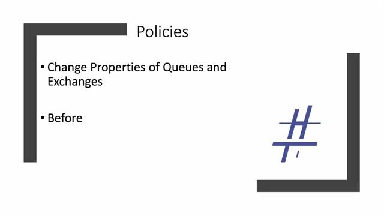
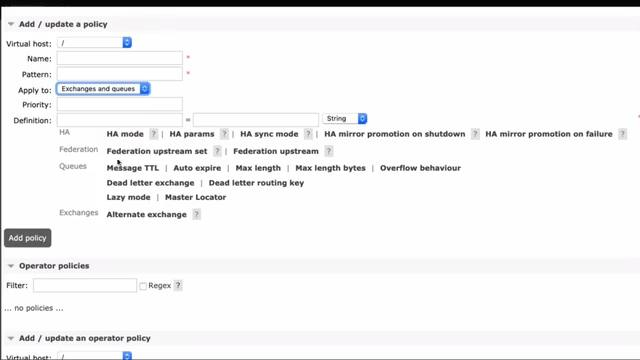
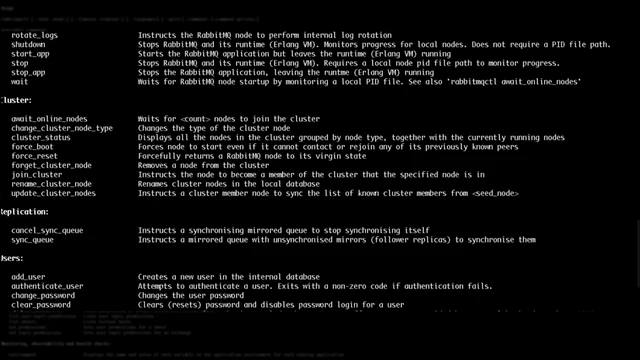
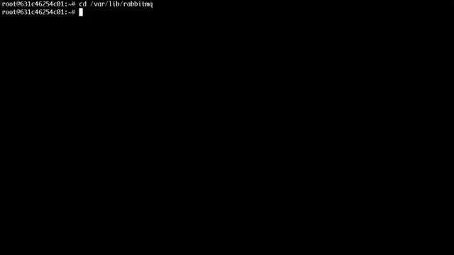
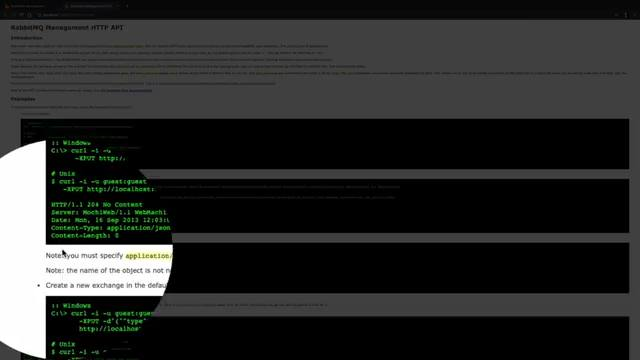
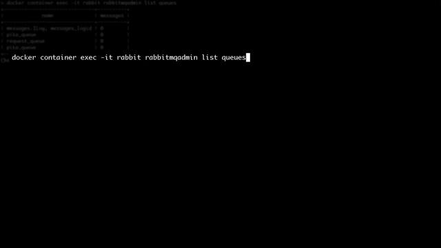
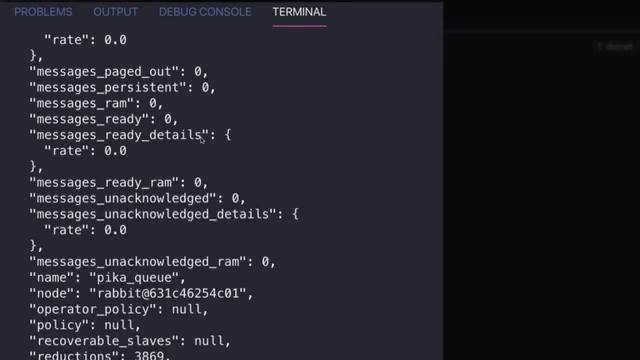
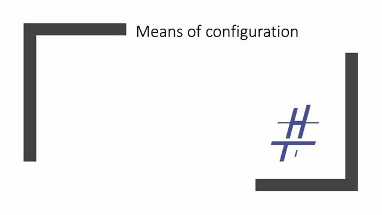
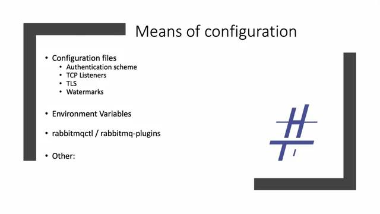

# RabbitMQ 策略、CLI、HTTP API 与配置：从零复现 `rabbitmq-policies-demo`

本文把 P33–P36 的内容重组成一条能跑起来的链路：先用 Docker 启动一个带管理界面的 RabbitMQ，创建 `picker-queue` 和 `picker-exchange`，用 Policy 给队列批量附加属性；然后用 `rabbitmqctl` 观察节点与策略；再用 HTTP API 和一个小型 .NET 控制台程序读取队列/交换机；最后把 Erlang Cookie、节点名等配置项落到 Docker 环境变量里。读者照着做，应能得到一个可查询、可观察、可继续扩展的 RabbitMQ 实验环境。

> 说明：课里没有指定 RabbitMQ 镜像版本，也没有逐字给出 `rabbitmqctl set_policy` 的完整参数。下面会明确标注哪些是课程原话、哪些是为了复现补上的操作。策略定义里的 `max-length`、`overflow` 具体键名请以你实际管理 UI 的下拉项/版本为准；课里只口述了 “max length / overflow behavior”。

---

## 1. 这一节做什么

这一节的项目目标不是“背概念”，而是做出一个可检查的 RabbitMQ 实例：

1. 用 Docker Compose 启动 RabbitMQ，开放 `5672`（AMQP）和 `15672`（管理 UI/HTTP API）。
2. 在默认虚拟主机 `/` 下创建队列 `picker-queue` 和交换机 `picker-exchange`。
3. 创建一条 Policy，pattern 匹配 `picker-queue`，让策略在队列已存在后自动附加属性。
4. 用 `rabbitmqctl` 查看节点、队列、交换机、策略；理解它“能管节点和运行时，但不能声明队列/交换机”的边界。
5. 用 HTTP API 读取 `/api/queues/%2F`、`/api/exchanges/%2F`，并写一个完整 .NET 控制台程序做同样的事。
6. 用 Docker 环境变量固定 Erlang Cookie 和节点名，为后续集群/高可用内容打基础。

最终目录如下：

```text
rabbitmq-policies-demo/
├─ docker-compose.yml
├─ scripts/
│  └─ init-rabbit.sh
└─ RabbitHttpProbe/
   ├─ RabbitHttpProbe.csproj
   └─ Program.cs
```

这一段的核心不是把命令抄一遍，而是先建立“检查点”意识：每一步都要有可见结果。启动容器后要能打开管理 UI；创建对象后要能在 `Queues`、`Exchanges` 页面看到；创建策略后要能在 `Admin > Policies` 和队列详情页看到；用 `rabbitmqctl` 与 HTTP API 查询时，要能得到同一批对象。这样后面遇到连接失败、404、认证失败、策略不生效时，就能快速判断问题出在容器启动、账号权限、vhost 编码、对象声明还是策略表达式上。

如果读者熟悉前端，可以把本节的对象关系先做一个粗略对照：Docker 容器像本地开发服务器；管理 UI 和 HTTP API 像后台管理接口；队列和交换机像后端资源；Policy 像一层运行时配置，它按名称模式批量附加到资源上；队列声明时显式写的属性则像组件自己的 props，通常会覆盖默认配置。这个对照不是 RabbitMQ 官方术语，只用于帮助理解为什么同一项属性可能来自多个地方。

---

## 2. 讲师原话（带「—— pNNN [MM:SS]」）

P33 讲 Policy 的价值时，重点不是“多一种配置方式”，而是“可以在队列创建前预设，也可以在创建后追加，而且队列自己声明的属性会覆盖策略”：

> "通过策略，你甚至可以在修改队列之前先修改属性……如果你在队列上指定了任何属性，这些属性会覆盖策略。"
> —— p033 [00:29]

这解释了我们为什么要先建 Policy 再建队列，也解释了为什么同一个队列上“显式声明属性”和“策略属性”可能同时存在，但前者优先。复现时要特别注意：如果你在声明队列时已经写了 `x-max-length` 之类的参数，而后又在 Policy 里写了同类属性，不要想当然认为 Policy 一定覆盖队列自身声明；课里强调的是队列显式属性覆盖策略。实际键名、优先级和版本差异，应以你的管理 UI 和服务端版本为准。

P34 讲 `rabbitmqctl` 的边界时，明确说它不能声明队列和交换机：

> "你在这里找不到的其实是创建……声明队列和声明交换机。因此，这是无法通过 RabbitMQ 控制台完成的事情。"
> —— p034 [01:27]

所以复现时，创建队列/交换机不能只靠 `rabbitmqctl`，要么用管理 UI，要么用 HTTP API/客户端。本文用 HTTP API 脚本完成，管理 UI 作为人工核对。这里也提醒读者不要把 `rabbitmqctl` 和 `rabbitmqadmin` 混为一谈：前者面向节点和运行时管理，后者走管理 HTTP API，能做的对象声明操作并不相同。

P35 讲 HTTP API 与 `rabbitmqadmin` 的用途时，强调监控/日志和声明对象：

> "大多数情况下，API 用于监控或日志记录。另一方面，我们可以使用 RabbitMQ 管理工具……列出所有队列……列出所有交换机……声明交换机……声明队列。"
> —— p035 [00:56]

这段话落到复现里，就是两条验证路线：一条用 `curl` 直接请求管理 API，确认 JSON 返回；另一条用 .NET 程序读取同样的端点，确认程序化访问可行。管理 UI 则作为人工观察界面，帮助确认对象和策略是否真的出现。

P36 讲配置方式时，把配置文件和環境变量区分开：配置文件更偏实例运行本身，环境变量则常用于节点名、Erlang Cookie 等：

> "此外还有环境变量，它们涉及节点名、Erlang cookie 等内容……"
> —— p036 [00:54]

这里的 “airline cookies” 是逐字稿转写误差，实际指 Erlang Cookie。本文在 Docker Compose 中用环境变量固定它。复现时可以把配置分成三层看：容器环境变量负责节点身份和 Cookie；RabbitMQ 自身配置文件负责实例级参数；Policy 负责队列/交换机这类运行时属性。三层不要混用，否则排查时会不知道某个值到底来自哪里。

---

## 3. 从零复现

### 3.1 准备环境

你需要：

- Docker Desktop（或 Docker Engine + Compose）。
- .NET SDK 8（只为运行最后的 HTTP API 小工具；课里演示的是 .NET 的 `WebRequest` + JSON 解析）。
- Windows 用户建议装 Git Bash 或使用 WSL 来跑 `scripts/init-rabbit.sh`；也可以不用脚本，照管理 UI 手动创建。

先建目录：

```bash
mkdir -p rabbitmq-policies-demo/scripts
mkdir -p rabbitmq-policies-demo/RabbitHttpProbe
cd rabbitmq-policies-demo
```

准备阶段可以先验证两个命令是否可用：`docker compose version` 应能输出版本信息，`dotnet --version` 应能输出 8.x 或你实际安装的 SDK 版本。如果 Docker 命令存在但 daemon 没启动，`docker compose up -d` 会报连接失败；这不是 RabbitMQ 配置问题，而是本机 Docker 服务未启动。Windows 下如果脚本因换行符报 `bash\r` 一类错误，可用 Git Bash 执行，或把脚本换行符调整为 LF；这类问题属于脚本运行环境问题，不要误判为 RabbitMQ 容器故障。

### 3.2 启动 RabbitMQ

把下面的 `docker-compose.yml` 保存到项目根目录。镜像用 `rabbitmq:3-management`，它带管理插件；课里没有指定 tag，实际可换成你环境可用的 3.x management tag。

```bash
docker compose up -d
docker compose logs -f rabbitmq
```

看到节点启动后，浏览器打开：

```text
http://localhost:15672
```

用户名 `guest`，密码 `guest`。课里 P33 就是在管理 UI 的 `Admin > Policies` 页面演示策略。下图是策略入口和策略列表的位置：



如果浏览器打不开，先查三件事：`docker compose ps` 里容器是否处于运行状态；`docker compose logs rabbitmq` 是否还在启动或已经报错；本机 `15672` 是否被其他进程占用。若能打开登录页但登录失败，先确认是否仍使用 `guest/guest`，以及 Compose 中是否改过默认用户名密码。若页面能打开但 API 请求返回 401，也要回到账号密码和 vhost 权限检查。

### 3.3 创建队列、交换机和策略

课里 P33 说 pattern 用 `picker queue` 这个例子。本文统一写成 `picker-queue`，策略 pattern 用 `^picker-queue$`，只匹配这一个队列。执行：

```bash
bash scripts/init-rabbit.sh
```

脚本会等待 `rabbitmqctl status` 可用，然后通过 HTTP API 创建队列和交换机，最后用 `rabbitmqctl set_policy` 创建策略。

策略创建后，回到管理 UI 的 `Queues` 页面点开 `picker-queue`，应能看到策略已经被附加。课里在 P33 演示了“策略匹配已有队列后自动生效”的效果：



这一步常见错误有三类。第一类是 `curl` 返回 404：通常是 API 路径里的 vhost 没有编码成 `%2F`，或者队列名、交换机名拼错。第二类是返回 401：账号密码不对，或 `guest` 访问受到限制。第三类是策略命令报参数错误：可能是 shell 引号导致 JSON 被拆开，或当前 RabbitMQ 版本对属性键名要求不同。遇到策略属性键名不确定时，先在管理 UI 的 `Admin > Policies` 里看下拉项和输入提示，再回到命令里照实际键名修改；不要在未确认版本行为时把某个键名当成所有版本通用。

### 3.4 用 `rabbitmqctl` 观察

`rabbitmqctl` 是课里 P34 说的标准管理方式，随 RabbitMQ 安装和 Docker 镜像一起提供。先看帮助：

```bash
docker exec rabbitmq-course rabbitmqctl help
```

下图对应课里展示 `rabbitmqctl help` 命令面的场景：



然后查看队列、交换机、策略：

```bash
docker exec rabbitmq-course rabbitmqctl list_queues
docker exec rabbitmq-course rabbitmqctl list_exchanges
docker exec rabbitmq-course rabbitmqctl list_policies
```

注意：`rabbitmqctl` 可以管理节点、用户、权限、策略等，但课里明确说它不能声明队列和交换机。创建对象还是走管理 UI / HTTP API / 客户端。观察命令也要有目的：`list_queues` 用来确认队列是否存在；`list_exchanges` 用来确认交换机是否存在；`list_policies` 用来确认策略名称、pattern、应用到 queue 还是 exchange。如果 `list_queues` 查不到对象，但管理 UI 能看到，先确认容器名是否写错、是否连到了另一个 RabbitMQ 实例；如果命令报 Cookie 认证失败，再检查 Erlang Cookie 是否一致。

P34 还讲到 `rabbitmqctl` 依赖 Erlang Cookie。本文在 Docker Compose 里固定了 Cookie，所以容器内可以直接执行。若你从宿主机直接装 `rabbitmqctl` 去连容器，需要让两边的 Cookie 一致。课程里展示的 Cookie 文件场景如下：



查看容器内 Cookie 路径（不要把真实 Cookie 内容贴到公开仓库）：

```bash
docker exec rabbitmq-course sh -c 'ls -la /var/lib/rabbitmq/.erlang.cookie'
```

从“前端对照”的角度看，`rabbitmqctl` 更像直接连到服务进程的管理终端，而不是业务接口。它适合排查节点状态、策略列表、用户权限，不适合替代业务侧声明队列和交换机。把这一点记住，后面看到“为什么 CLI 里没有 declare queue 子命令”时就不会困惑。

### 3.5 用 HTTP API 读取队列和交换机

管理 UI 背后的 HTTP API 是 P35 的重点。浏览器直接访问会要求登录，先打开 API 总览：

```text
http://localhost:15672/api/overview
```

下图对应课里进入 HTTP API overview 的页面：



也可以直接用 `curl` 验证。注意：`curl` 不是课里讲师演示的命令，这里只是复现 HTTP API 的辅助手段；课里演示的是 `rabbitmqadmin` 和 .NET 程序。

```bash
curl -u guest:guest http://localhost:15672/api/queues/%2F
curl -u guest:guest http://localhost:15672/api/exchanges/%2F
```

默认虚拟主机是 `/`，在 URL 路径里要编码成 `%2F`。这是实际使用 HTTP API 时很容易踩的点，课里没有展开讲编码细节。判断请求成功与否时，不只看浏览器是否显示 JSON，还要看 HTTP 状态码：200 表示能读取；401 多为认证失败；404 多为路径、vhost 编码或对象不存在；连接拒绝则说明 `15672` 没有开放或容器未启动。

课里还用 `rabbitmqadmin` 列出交换机/队列。`rabbitmqadmin` 是管理插件附带/可下载的命令行工具，不是 `rabbitmqctl` 的替代品；它底层走 HTTP API。下图是课里用 `rabbitmqadmin` 查看交换机的场景：



> 注意：官方 Docker 镜像不保证把 `rabbitmqadmin` 放在 `PATH` 里。课里说它随管理 UI 提供，但如果你执行 `rabbitmqadmin` 提示找不到命令，不要卡住：本文主流程用 `curl` + 管理 UI 已完成同样的事。你也可从管理 UI 的 `/cli/rabbitmqadmin` 下载脚本。

如果继续做前端或 Node 侧联调，可以把 HTTP API 看成普通 REST 接口：认证头是 Basic Auth，返回体是 JSON 数组或对象。区别只是 vhost 在路径里需要编码，且不要把管理端密码硬编码到前端代码里。浏览器直连管理 API 还可能受 CORS 和账号暴露影响，因此这类请求更适合放在本地脚本、服务端工具或调试程序中。

### 3.6 运行 .NET HTTP API 小工具

课里 P35 演示了一个 .NET 小程序：用 `System.Net` 的 `WebRequest` 请求管理 API，再用 Newtonsoft JSON 把响应解析成 JSON 文档。下面给出完整可运行版本。

进入项目目录：

```bash
cd RabbitHttpProbe
dotnet restore
```

设置环境变量。Windows PowerShell：

```powershell
$env:RABBITMQ_MANAGEMENT_URL="http://localhost:15672"
$env:RABBITMQ_USER="guest"
$env:RABBITMQ_PASSWORD="guest"
$env:RABBITMQ_VHOST="/"
$env:RABBITMQ_ENDPOINT="queues"
dotnet run
```

Linux/macOS/Git Bash：

```bash
export RABBITMQ_MANAGEMENT_URL="http://localhost:15672"
export RABBITMQ_USER="guest"
export RABBITMQ_PASSWORD="guest"
export RABBITMQ_VHOST="/"
export RABBITMQ_ENDPOINT="queues"
dotnet run
```

把 `RABBITMQ_ENDPOINT` 改成 `exchanges`，就能读取交换机列表：

```bash
export RABBITMQ_ENDPOINT="exchanges"
dotnet run
```

课里运行后能看到队列/交换机对象的输出，这类输出可以直接用于监控或配置变更检查：



如果 `dotnet restore` 失败，先确认网络和 NuGet 源可用；如果运行时报 `401 Unauthorized`，回到账号密码；如果报 `404`，检查 `RABBITMQ_ENDPOINT` 是 `queues` 还是 `exchanges`，以及 `RABBITMQ_VHOST` 是否为 `/`；如果输出了 JSON 但看起来不是预期对象，可把输出保存到文件后搜索 `picker-queue` 和 `picker-exchange`，不要只凭终端截断后的首屏判断。

### 3.7 配置方式落点：配置文件 vs 环境变量

P36 把配置方式分成几类：配置文件（认证、TCP listener、TLS、high watermark 等）、环境变量（节点名、Erlang Cookie 等）、`rabbitmqctl`/`rabbitmq-plugins` 这类运行时命令行，以及策略/参数等。下图对应课里列配置方式的 PPT：



本文的 Docker Compose 用环境变量固定了 Erlang Cookie 和节点名；配置文件方式课里说下一节会讲导入/导出 JSON，并继续用 Docker 环境变量演示。下图是课里继续说明配置文件与环境变量分工的页面：



复现时建议把每个配置项的来源记在笔记里：`RABBITMQ_DEFAULT_USER`、`RABBITMQ_DEFAULT_PASS` 影响首次创建的用户；`RABBITMQ_ERLANG_COOKIE` 影响 CLI 认证；`RABBITMQ_NODENAME` 影响节点身份。不要把 Policy 当成实例级配置：Policy 主要面向队列、交换机等对象属性，和节点名、Cookie 不是同一层概念。弄清层次后，再看管理 UI、CLI、HTTP API，就不会把所有“配置”混成一个入口。

---

## 4. 完整代码

### 4.1 `docker-compose.yml`

```yaml
services:
  rabbitmq:
    image: rabbitmq:3-management
    container_name: rabbitmq-course
    hostname: rabbitmq-course
    ports:
      - "5672:5672"
      - "15672:15672"
    environment:
      RABBITMQ_DEFAULT_USER: guest
      RABBITMQ_DEFAULT_PASS: guest
      RABBITMQ_ERLANG_COOKIE: course-cookie
      RABBITMQ_NODENAME: rabbit@rabbitmq-course
    volumes:
      - rabbitmq-data:/var/lib/rabbitmq

volumes:
  rabbitmq-data:
```

### 4.2 `scripts/init-rabbit.sh`

```bash
#!/usr/bin/env bash
set -euo pipefail

BASE="http://localhost:15672"
AUTH="guest:guest"
VHOST="%2F"
CONTAINER="rabbitmq-course"

until docker exec "$CONTAINER" rabbitmqctl status >/dev/null 2>&1; do
  echo "等待 RabbitMQ 启动..."
  sleep 2
done

echo "创建队列 picker-queue"
curl -fsS -u "$AUTH" -X PUT "$BASE/api/queues/$VHOST/picker-queue" \
  -H "content-type: application/json" \
  -d '{"durable":true}'

echo "创建交换机 picker-exchange"
curl -fsS -u "$AUTH" -X PUT "$BASE/api/exchanges/$VHOST/picker-exchange" \
  -H "content-type: application/json" \
  -d '{"type":"direct","durable":true}'

echo "创建策略 picker-policy"
docker exec "$CONTAINER" rabbitmqctl set_policy picker-policy "^picker-queue$" \
  '{"max-length":1000,"overflow":"reject-publish"}' --apply-to queues

echo "完成"
```

给予执行权限：

```bash
chmod +x scripts/init-rabbit.sh
```

### 4.3 `RabbitHttpProbe/RabbitHttpProbe.csproj`

```xml
<Project Sdk="Microsoft.NET.Sdk">
  <PropertyGroup>
    <OutputType>Exe</OutputType>
    <TargetFramework>net8.0</TargetFramework>
    <ImplicitUsings>enable</ImplicitUsings>
    <Nullable>enable</Nullable>
  </PropertyGroup>

  <ItemGroup>
    <PackageReference Include="Newtonsoft.Json" Version="13.0.3" />
  </ItemGroup>
</Project>
```

### 4.4 `RabbitHttpProbe/Program.cs`

```csharp
using System.Net;
using System.Text;
using Newtonsoft.Json;
using Newtonsoft.Json.Linq;

var baseUrl = Environment.GetEnvironmentVariable("RABBITMQ_MANAGEMENT_URL")
              ?? "http://localhost:15672";
var user = Environment.GetEnvironmentVariable("RABBITMQ_USER") ?? "guest";
var password = Environment.GetEnvironmentVariable("RABBITMQ_PASSWORD") ?? "guest";
var vhost = Environment.GetEnvironmentVariable("RABBITMQ_VHOST") ?? "/";
var endpoint = Environment.GetEnvironmentVariable("RABBITMQ_ENDPOINT") ?? "queues";

var vhostEncoded = Uri.EscapeDataString(vhost);
var url = $"{baseUrl.TrimEnd('/')}/api/{endpoint}/{vhostEncoded}";

Console.WriteLine($"GET {url}");

var request = WebRequest.Create(url);
request.Method = "GET";
request.Credentials = new NetworkCredential(user, password);
request.Timeout = 10_000;

using var response = (HttpWebResponse)request.GetResponse();
Console.WriteLine($"HTTP {(int)response.StatusCode} {response.StatusCode}");

var stream = response.GetResponseStream();
if (stream is null)
{
    throw new InvalidOperationException("响应没有内容流");
}

using var reader = new StreamReader(stream, Encoding.UTF8);
var text = reader.ReadToEnd();

var json = JToken.Parse(text);
Console.WriteLine(json.ToString(Formatting.Indented));
```

---

## 5. 逐行解释

### `docker-compose.yml`

- `image: rabbitmq:3-management`：带管理插件的镜像。课里没有指定具体版本；如果该 tag 在你的环境不可用，换成实际可用的 `3.x-management`。镜像 tag 不明确时，优先确保管理插件存在，因为后续 `15672`、HTTP API 和策略页面都依赖它。
- `container_name: rabbitmq-course`：固定容器名，后面的 `rabbitmqctl`、脚本都靠它。若你改名，`docker exec rabbitmq-course ...` 和脚本里的 `CONTAINER` 都必须同步修改，否则会出现“命令能执行但连错容器”的问题。
- `hostname: rabbitmq-course` 与 `RABBITMQ_NODENAME: rabbit@rabbitmq-course` 对应：P36 说环境变量可以指定节点名。节点名固定后，后续集群实验更容易复用。若节点名和 hostname 不一致，排查时容易把“容器网络名”和“RabbitMQ 节点名”混为一谈。
- `RABBITMQ_ERLANG_COOKIE: course-cookie`：固定 Erlang Cookie。P34 说 `rabbitmqctl` 用 Cookie 认证；P36 说 Cookie 可以用环境变量配置。生产环境当然不要用这么简单的值。Cookie 是敏感信息，公开仓库中应替换为占位值或使用外部密钥管理。
- `5672:5672` 是 AMQP 客户端端口；`15672:15672` 是管理 UI 和 HTTP API 端口。端口映射被占用时，容器可能启动失败或你访问到旧服务；排查时先 `docker compose ps`，再查 `15672` 被谁占用。
- `rabbitmq-data:/var/lib/rabbitmq` 持久化队列、策略、Cookie 等数据。副作用是：你改了 Cookie 或想彻底重置时，需要 `docker compose down -v` 删卷。删卷前要确认里面没有还需要保留的实验数据。

对前端来说，`vhost` 很像“数据库名/命名空间”，`policy` 很像运行时配置中心下发的配置；队列声明时写的属性则像组件自己的 props，会覆盖默认配置。课里 P33 说的“队列显式属性覆盖策略”，用 JS 类比就是 `{ ...policy, ...queueDeclareProps }` 的覆盖顺序。这个类比只帮助记忆，具体属性键名和优先级仍以实际 RabbitMQ 版本为准。

### `scripts/init-rabbit.sh`

- `set -euo pipefail`：任一命令失败就退出，避免脚本已经报错却继续显示“完成”。如果你在调试脚本，可以临时去掉 `-e` 观察后续步骤，但排错结束后要恢复。
- `until docker exec ... rabbitmqctl status`：等待节点可用，避免刚 `up -d` 就调 API 报连接失败。若这里一直循环，先看容器日志和 `docker compose ps`，不要只等脚本。
- 第一个 `curl -X PUT /api/queues/%2F/picker-queue`：通过 HTTP API 声明队列。`%2F` 是默认 vhost `/` 的 URL 编码。课里没有讲 `%2F` 细节，但这是实际必踩点。`-fsS` 的作用是让 HTTP 错误直接失败，同时保留错误输出；若看到 `curl: (22)`，要回看 HTTP 状态码和返回体。
- 第二个 `curl -X PUT /api/exchanges/%2F/picker-exchange`：声明交换机。示例用 `direct` 类型；课里只演示“可以声明交换机”，没有指定类型，实际按业务选。声明交换机时如果同名交换机已有不同类型，服务端可能返回冲突，需要先确认对象是否存在。
- `rabbitmqctl set_policy picker-policy "^picker-queue$" '{"max-length":1000,"overflow":"reject-publish"}' --apply-to queues`：创建策略。pattern 是正则，所以 `^picker-queue$` 只匹配这个名字。`max-length`/`overflow` 是示例属性名；课里只说了 “max length / overflow behavior”，具体键名请以你管理 UI 为准。若命令中的 JSON 引号被 shell 吞掉，常见表现是参数数量不对或 JSON 解析失败。
- `--apply-to queues`：只应用到队列。课里说策略可以给 queues、exchanges 或 both。若以后写 exchange 策略，要确认目标对象类型和 pattern 都匹配，否则列表里虽然能看到策略，但对象详情页可能没有生效。

### `Program.cs`

- `RABBITMQ_MANAGEMENT_URL`、`RABBITMQ_USER`、`RABBITMQ_PASSWORD`、`RABBITMQ_VHOST`、`RABBITMQ_ENDPOINT` 全部从环境变量读，避免把密码写死。`RABBITMQ_ENDPOINT` 可取 `queues` 或 `exchanges`。如果环境变量名拼错，程序会回退到默认值；所以运行前可先打印或复核变量是否已设置。
- `Uri.EscapeDataString(vhost)`：把 `/` 编码成 `%2F`，和脚本里的 `VHOST="%2F"` 对应。若你直接拼 URL 而忘了编码，常见结果是请求到错误路径或 404。
- `WebRequest.Create(url)`：课里明确说用的是 `System.Net` 命名空间里的 `WebRequest`。新项目也可以用 `HttpClient`，但课里没讲，本文保持原方法。保持原方法的好处是与课程代码一致，排错时不会引入两套 HTTP 客户端行为差异。
- `request.Credentials = new NetworkCredential(user, password)`：HTTP Basic 认证。对应前端 `fetch` 里手写 `Authorization: Basic ...` 的场景。注意不要把管理端账号密码放进浏览器公开代码，这里的程序只是本地实验工具。
- `request.Timeout = 10_000`：设置超时，避免网络不通时长时间挂起。若这里超时，先检查 `RABBITMQ_MANAGEMENT_URL` 是否可从当前终端访问，而不是继续怀疑 JSON 解析。
- `JToken.Parse(text)` 和 `ToString(Formatting.Indented)`：把响应解析成 JSON 文档并格式化输出。课里说用 Newtonsoft JSON 解析请求，这里一致。输出整个 JSON，不硬编码某个字段名，因此不依赖 RabbitMQ 版本里的具体字段；你可以直接在输出里找队列/交换机对象。

---

## 6. 复现检查清单

- [ ] `docker compose up -d` 后，`http://localhost:15672` 能打开，`guest/guest` 能登录。验证：浏览器访问登录页并成功进入 Overview；若失败，先看 `docker compose ps` 和日志。
- [ ] `docker exec rabbitmq-course rabbitmqctl status` 返回正常，不报 Cookie 认证失败。验证：命令退出码为 0，输出中包含节点状态信息；若报 Cookie 错误，检查 Compose 中 Cookie 与容器内文件是否一致。
- [ ] `bash scripts/init-rabbit.sh` 执行完成，没有 `curl: (22)` 或 404。验证：终端末尾出现“完成”；若失败，回看是哪一个 `curl` 步骤以及 HTTP 返回。
- [ ] 管理 UI 的 `Queues` 里能看到 `picker-queue`。验证：在 `Queues` 列表搜索队列名，点进详情页确认名称完全一致。
- [ ] 管理 UI 的 `Exchanges` 里能看到 `picker-exchange`。验证：在交换机列表查找名称，并确认类型为脚本声明的类型。
- [ ] `Admin > Policies` 里能看到 `picker-policy`，pattern 为 `^picker-queue$`。验证：在策略列表查看名称、pattern、apply-to 是否为 queues。
- [ ] 点开 `picker-queue`，Features/Policy 区域能看到策略已附加。验证：进入队列详情页，查看策略相关区域或属性区域，确认策略名称出现。
- [ ] `docker exec rabbitmq-course rabbitmqctl list_queues` 能看到 `picker-queue`。验证：命令输出中搜索队列名；若没有，确认容器名和 vhost 是否正确。
- [ ] `docker exec rabbitmq-course rabbitmqctl list_exchanges` 能看到 `picker-exchange`。验证：命令输出中搜索交换机名，注意默认交换机会很多，不要只看首屏。
- [ ] `docker exec rabbitmq-course rabbitmqctl list_policies` 能看到 `picker-policy`。验证：输出中检查策略名、pattern 和 apply-to 字段。
- [ ] `curl -u guest:guest http://localhost:15672/api/queues/%2F` 返回 JSON 数组。验证：状态码为 200；若返回 404，优先检查 `%2F` 编码和路径拼写。
- [ ] `dotnet run` 在 `RABBITMQ_ENDPOINT=queues` 时输出队列 JSON；改成 `exchanges` 后输出交换机 JSON。验证：终端先打印 `GET .../api/queues/%2F` 或 `GET .../api/exchanges/%2F`，随后打印格式化 JSON。
- [ ] `docker exec rabbitmq-course sh -c 'ls -la /var/lib/rabbitmq/.erlang.cookie'` 能找到 Cookie 文件。验证：命令输出文件路径和权限；不要把文件内容复制到公开文档或仓库。

---

## 7. 课里没讲但你会撞上的

| 现象 | 原因 | 怎么办 |
|---|---|---|
| 从另一台机器访问 `15672` 时，`guest/guest` 被拒绝 | RabbitMQ 默认 `guest` 只能从 localhost 登录；课里没讲这个限制 | 在管理 UI 创建新用户并赋权，或仅在本机实验；不要为图省事长期放开 `guest` 远程访问 |
| 执行 `rabbitmqadmin` 提示找不到命令 | 课里说它随管理 UI 提供，但官方 Docker 镜像不保证把它放在 `PATH` 里 | 先走管理 UI 或 `curl`；也可从管理 UI 的 `/cli/rabbitmqadmin` 下载脚本 |
| 想用 `rabbitmqctl declare queue` 却找不到对应子命令 | P34 明确说 `rabbitmqctl` 不能声明队列/交换机 | 用管理 UI、HTTP API 或客户端声明对象；`rabbitmqctl` 只做节点和运行时管理 |
| `picker-queue` 策略误匹配到 `my-picker-queue`、`picker-queue-2` | 策略 pattern 是正则；课里只口述了 pattern 示例，没展开正则细节 | 使用 `^picker-queue$` 这类锚定写法，并在 `Admin > Policies` 里核对匹配结果 |
| 队列上显式声明的属性没有体现策略值 | P33 明确说队列显式属性覆盖策略 | 检查队列声明参数；若想由策略统一管理，去掉队列声明里的同类属性，并注意版本差异 |
| 删除策略后，队列属性没有按预期回滚 | 删除策略后的回滚行为课里没讲；实际以版本行为为准 | 不要假设删除策略一定恢复原状；先在实验环境验证，必要时显式重新声明或调整队列属性 |
| `curl http://localhost:15672/api/queues//` 返回 404 | 默认 vhost `/` 在 URL 里要编码成 `%2F`；课里没讲这个细节 | 使用 `/api/queues/%2F`；用 `curl -i` 查看状态码，不要只看返回体 |
| 改了 `RABBITMQ_ERLANG_COOKIE` 或想彻底重来，旧状态仍存在 | Docker 卷会保留旧 Cookie/策略等数据 | 确认要删数据后执行 `docker compose down -v`；不要在有保留数据时随手删卷 |
| 新项目编译提示 `WebRequest` 过时 | `WebRequest` 在新 .NET 里是过时 API；课里用的就是它，能跑 | 按课程保持 `WebRequest` 以复现；新项目可换 `HttpClient`，但课里没讲 `HttpClient`，本文不擅自替换 |
| `docker compose up -d` 失败，提示端口被占用 | 本机已有 RabbitMQ 或其他服务占用 `5672`/`15672` | 改宿主机端口映射，或先停旧服务；用 `docker compose ps` 和系统端口工具确认占用 |
| 策略命令执行成功，但管理 UI 下拉项与示例键名不同 | 课里只说了 “max length / overflow behavior”，没有逐字给出 `max-length`、`overflow` 这些键名 | 以你实际管理 UI 的下拉项/版本为准；先在 UI 里确认键名，再改写命令 |
| 把真实 Cookie 或密码提交到了仓库 | Erlang Cookie 是敏感信息；P34 说它用于 `rabbitmqctl` 认证，集群节点还要共用同一个 Cookie | 立刻更换实验值，清理仓库历史；公开示例只保留占位值，不要提交真实生产 Cookie |