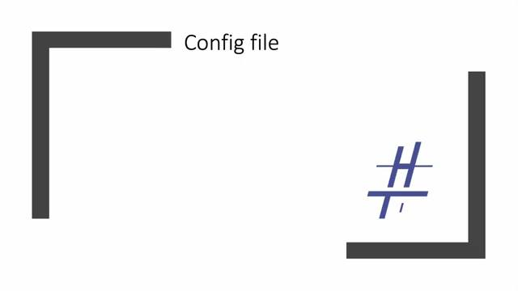
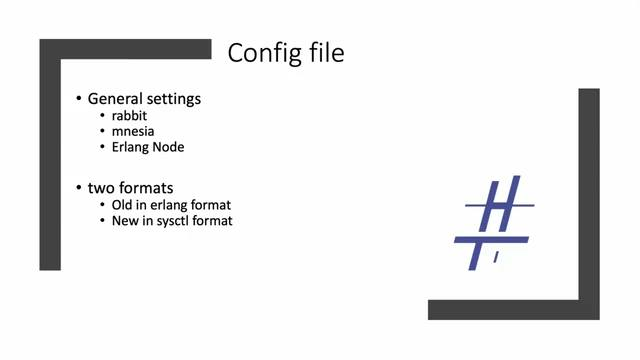
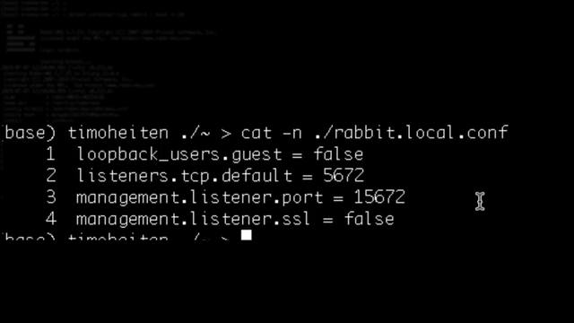
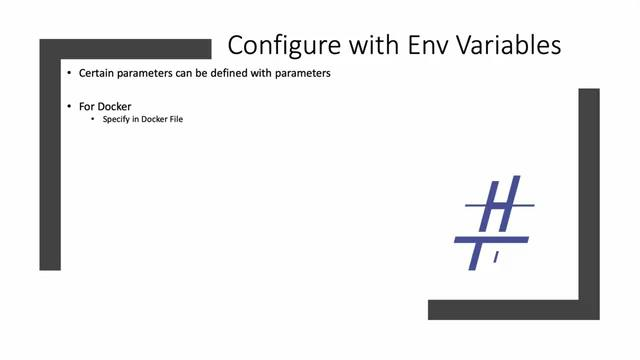
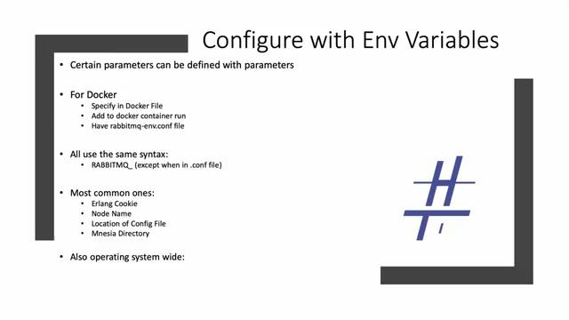
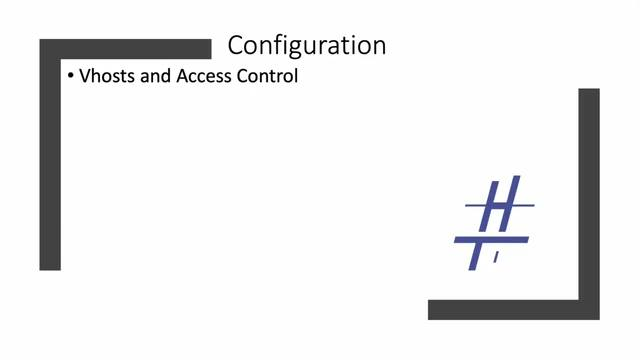
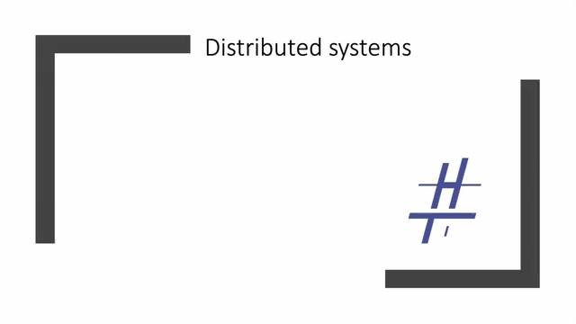
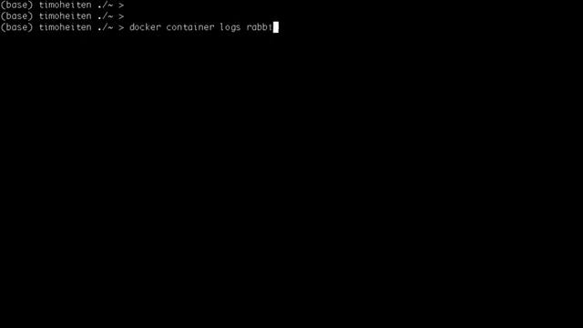

# RabbitMQ 配置与可运行实验环境（P37–P40）

> 说明：P37–P40 的主题是 RabbitMQ 的配置文件、环境变量、管理能力总结，以及吞吐量/高可用优化总览。逐字稿里**没有**生产者、消费者业务代码，也没有 Node 客户端代码。因此本文的“项目”严格限定为：**用 Docker 起一个可检查、可访问管理 UI、能验证配置来源的 RabbitMQ 实验环境**。课里没讲的消息收发程序，本文不编造。

---

## 1 这一节做什么

这一节要做出一个能反复启动、检查和对照的 RabbitMQ 配置实验室：

1. 用 Docker 启动 RabbitMQ，并挂载**新版 key/value 配置** `rabbitmq.conf`。
2. 用 Docker 启动另一套 RabbitMQ，并挂载**旧版 Erlang term 配置** `advanced.config`，观察“同一组配置，新旧格式写法不同”。
3. 用 Docker `-e` 环境变量配置节点名、Erlang cookie、端口，验证日志里能看到节点名、cookie hash、Mnesia 数据库目录等信息。
4. 用 `rabbitmq-env.conf` 演示 Unix 下用环境配置文件切换配置路径、Mnesia 目录。
5. 用 Dockerfile 写一组环境变量，理解“环境变量也可以固化进镜像”。
6. 最后把 P39 的管理面、P40 的优化取舍讲清楚：虚拟主机、用户权限、插件、策略、CLI/HTTP API；吞吐量 vs 高可用；连接 churn、队列 churn、clustering、shovel/federation。



这一节的重点不是写消息收发业务，而是把 RabbitMQ 当成一个“可配置的服务端”来观察。配置文件的用途，是给 RabbitMQ 服务端本身设置通用参数；环境变量和 `rabbitmq-env.conf` 则更偏向启动过程、节点名、cookie、配置路径、Mnesia 目录等运行时信息。两者会有交叉，但检查方法不同：配置文件通常进入容器看 `/etc/rabbitmq`，环境变量和启动参数则优先看 `docker run` 命令、Dockerfile 里的 `ENV`，以及容器日志里的启动信息。

从学习路径上说，建议按“新版配置容器 → 旧版配置容器 → `-e` 环境变量容器 → `rabbitmq-env.conf` 容器 → Dockerfile 固化环境变量容器”的顺序做。每启动一套容器，都用 `docker logs` 看前几十行，再用 `docker exec` 进入容器看配置文件。这样你能把“命令里写的参数”“容器里挂载的文件”“日志里实际生效的信息”三者对应起来，而不是只复制命令。

**与前端项目的对照**：前端项目通常用 `.env`、`docker-compose`、代理端口、开发服务器端口来管理不同环境。RabbitMQ 这里也有类似层次：`rabbitmq.conf` 像服务端的主配置，`rabbitmq-env.conf` 像启动环境文件，`docker run -e` 和 Dockerfile 里的 `ENV` 又像容器层的环境变量。不同点是，前端浏览器一般不直接连 AMQP；RabbitMQ 管理 UI 是服务端管理界面，业务前端通常通过后端 HTTP API 间接使用消息能力。本文只做环境验证，不编造前端直连 RabbitMQ 的代码。

做完后你应该得到：

- `http://localhost:15672` 能打开 management UI；
- `docker logs rabbit-config-lab` 能看到启动信息；
- `docker exec` 能进入容器看到 `/etc/rabbitmq/rabbitmq.conf`；
- 另有一套旧格式容器和管理端口；
- 一套环境变量容器，日志中节点名为 `rabbit2@docker3`；
- 一份可以直接保存运行的完整目录。

这里的管理 UI 端口、AMQP 端口分别来自不同映射。管理 UI 是浏览器访问的 HTTP 端口，AMQP 是客户端协议端口。学习时不要只看到 `docker ps` 里有端口就认为服务一定可用，还要结合 `docker logs`、`docker ps` 状态、浏览器访问结果和配置文件挂载情况一起判断。若启动失败，第一手信息通常不是 UI，而是容器日志和 `docker ps -a` 里的退出状态。

---

## 2 讲师原话（带「—— pNNN [MM:SS]」）

> “The configuration file is used for general settings… configure all the settings for the RabbitMQ server itself.”  
> 配置文件是给 RabbitMQ 服务端本身做通用设置的。—— p037 [00:00]

> “There are two config file formats. There's the old one… and the newer style with the SysControl format.”  
> 配置文件有两种格式：旧格式和新版 sysctl 风格。新版更易读，一行一个 key/value；旧格式适合复杂嵌套配置，所以有时会同时存在。—— p037 [00:58]



> “The config file is always located in different locations for different operating systems… we can do with the Docker container by using the logs command… pipe this to the head command.”  
> 配置文件位置随操作系统不同；课程里用 `docker logs` 加 `head` 找位置，再复制出来用 `cat` 看。—— p037 [01:54]

> “It's only four here because most of the values are default… loopback user… TCP listener default and the management UI default.”  
> 新版配置示例很短，因为大部分值走默认；课程提到 loopback user、TCP listener 默认值、management UI 默认值。—— p037 [02:53]

> “With the old style config it's 14 lines… But this is the same configuration.”  
> 旧格式写同一组配置会展开成更多行，因为有嵌套结构、数组、集合、对象。—— p037 [02:53]



> “All of the environment variables use the same syntax… RABBITMQ in uppercase letters, then underscore, then the name of the environment variable. The only exception is when you use it in the config file…”  
> 环境变量统一用 `RABBITMQ_` 前缀；但在环境配置文件里通常只写变量名和值。—— p038 [01:27]



> “The most common are… the Erlang cookie… node names… you can specify the standard config file… the Mnesia directory…”  
> 常见环境变量包括 Erlang cookie、节点名、标准配置文件路径、Mnesia 数据目录。—— p038 [01:56]

> “Because we specified the docker as a hostname, we also have to specify the hostname on our Docker container else this will not work because the hostname cannot be resolved.”  
> 如果节点名里带主机名，就要给容器设置可解析的 hostname，否则启动会出问题。—— p038 [03:51]



> “In this section, we looked at the management of the RabbitMQ server… virtual host and access control… user and their permissions… plugins… policies…”  
> P39 总结管理面：virtual host、访问控制、用户权限、插件、策略；并且强调 **arguments 的优先级高于 policies**。—— p039 [00:00]、[01:24]



> “Throughput means you want to push as much messages… High availability… no messages lost… there's some trade-offs between those two.”  
> P40 讲分布式系统的两个目标：吞吐量和高可用，两者有权衡。—— p040 [00:00]



> “Clients should not open and close lots of connections… TCP connections are really expensive… the same is true for queues.”  
> 想提高吞吐量，要避免频繁开关连接，也要避免频繁 declare/delete 队列。—— p040 [00:55]

> “Clustering is built into RabbitMQ… shovel or federation are plugins… not a substitute for clustering, but complementary.”  
> 集群是内置能力；shovel/federation 是插件，做跨实例消息转发，和集群互补。—— p040 [01:52]

---

## 3 从零复现

### 3.1 准备目录

在宿主机执行：

```bash
mkdir -p ~/rabbitmq-lab
cd ~/rabbitmq-lab
```

然后把第 4 节的 9 个文件保存到 `~/rabbitmq-lab` 下：

```text
rabbitmq-lab/
├── rabbitmq.conf
├── advanced.config
├── rabbitmq-env.conf
├── Dockerfile
├── start-new-config.sh
├── start-old-config.sh
├── start-env.sh
├── start-env-file.sh
└── inspect-container.sh
```

赋予脚本执行权限：

```bash
chmod +x ./*.sh
```

**命令解释**：`mkdir -p` 会递归创建目录，已存在时不报错；`cd` 切到实验目录，后面所有 `$PWD/...` 挂载都依赖当前目录。`chmod +x ./*.sh` 给当前目录所有 `.sh` 脚本加执行权限，否则直接 `./start-new-config.sh` 可能提示 Permission denied。

**常见错误与排查**：
- 如果提示 `No such file or directory`，先 `pwd`、`ls -la` 确认你在 `~/rabbitmq-lab`。
- 如果挂载时报路径不存在，Docker 有时会创建目录而不是文件，后续容器会把“目录”当配置文件，日志会报读取配置失败。启动前用 `ls -l rabbitmq.conf advanced.config rabbitmq-env.conf` 确认它们是文件。
- 如果脚本没有执行权限，可以临时用 `bash start-new-config.sh` 验证，再补 `chmod +x`。

**与前端项目的对照**：这类似前端项目先确认 `.env.development`、`vite.config.js`、`package.json` 是否在项目根目录。路径和文件名不对，后面命令看似执行，实际加载不到配置。

### 3.2 启动新版配置容器

```bash
./start-new-config.sh
```

等价的手工命令是：

```bash
docker rm -f rabbit-config-lab 2>/dev/null || true

docker run -d \
  --name rabbit-config-lab \
  --hostname rabbit-config-lab \
  -p 5672:5672 \
  -p 15672:15672 \
  -v "$PWD/rabbitmq.conf:/etc/rabbitmq/rabbitmq.conf:ro" \
  rabbitmq:management
```

查看日志：

```bash
docker logs rabbit-config-lab | head -20
```

课程里就是先用 `docker logs` 找配置文件位置，再把文件从容器里复制出来看。对应截图：



查看容器内 `/etc/rabbitmq` 下有哪些文件：

```bash
docker exec rabbit-config-lab sh -lc 'find /etc/rabbitmq -maxdepth 2 -type f -print'
```

把新版配置复制出来并带行号查看：

```bash
docker cp rabbit-config-lab:/etc/rabbitmq/rabbitmq.conf ./rabbitmq.container.conf
nl -ba rabbitmq.container.conf
```

打开管理 UI：

```text
http://localhost:15672
```

> 课里没讲默认账号密码。镜像如果保留默认初始用户，请以你实际镜像的初始化说明为准。本文的 `rabbitmq.conf` 为了开发环境能从宿主机浏览器访问，显式关闭了 guest 的 loopback 限制；生产环境不要直接照抄这个安全设置。

**命令解释**：`docker rm -f` 先删掉同名旧容器，`2>/dev/null || true` 让“没有旧容器”这种错误不打断脚本。`docker run -d` 后台运行；`--name` 固定容器名，方便后续 logs/exec；`--hostname` 给容器内一个主机名；`-p 5672:5672` 把宿主机 AMQP 端口映射到容器；`-p 15672:15672` 映射管理 UI；`-v "$PWD/rabbitmq.conf:/etc/rabbitmq/rabbitmq.conf:ro"` 把宿主机配置只读挂载到容器配置路径，`ro` 表示容器内不能改这个挂载文件。

`docker logs | head -20` 只取启动日志前 20 行，适合快速看节点名、配置路径、插件启用信息。`docker exec ... sh -lc` 是在容器内用 shell 执行命令；`find /etc/rabbitmq -maxdepth 2 -type f` 查两层内普通文件，避免只看一个固定路径。`docker cp` 把容器内文件复制出来；`nl -ba` 带行号显示，方便和讲师课堂文件对照。

**常见错误与排查**：
- 端口占用：`Bind for 0.0.0.0:15672 failed: port is already allocated`。先 `docker ps` 找占用容器，或换宿主机端口。
- 挂载路径不存在：`-v` 的宿主机文件必须存在。若不存在，Docker 可能创建目录，导致 RabbitMQ 读取失败；用 `ls -l rabbitmq.conf` 确认。
- guest 无法从宿主机登录：默认 loopback 限制可能仍生效。本文配置显式设置 `loopback_users.guest = false`，但这只用于开发实验；生产不要照抄。
- UI 打不开：先看 `docker ps` 是否 Up，再看 `docker logs` 是否启动失败，最后确认端口映射和防火墙。

**与前端项目的对照**：`-p 15672:15672` 类似前端开发服务器把容器端口映射到本机端口；浏览器访问 `localhost:15672` 是宿主机端口，不是容器内部端口。前端项目里常遇到“服务启动了但代理端口写错”，这里同样要检查宿主机端口、容器端口和访问 URL 三者一致。

### 3.3 启动旧格式配置容器

```bash
./start-old-config.sh
```

手工命令：

```bash
docker rm -f rabbit-old-config-lab 2>/dev/null || true

docker run -d \
  --name rabbit-old-config-lab \
  --hostname rabbit-old-config-lab \
  -p 5673:5672 \
  -p 15673:15672 \
  -v "$PWD/advanced.config:/etc/rabbitmq/advanced.config:ro" \
  rabbitmq:management
```

查看日志：

```bash
docker logs rabbit-old-config-lab | head -30
```

管理 UI：

```text
http://localhost:15673
```

> 逐字稿说课程里旧格式展示为 14 行，但**没有逐字给出那 14 行原文**。下面的 `advanced.config` 是可运行的最小等价示例，不是逐字抄课堂文件。不同 RabbitMQ 版本对旧格式文件名和插件配置键可能有差异，以你镜像实际日志为准。

**命令解释**：这里把宿主机 `advanced.config` 挂到容器 `/etc/rabbitmq/advanced.config`，同时用 `-p 5673:5672`、`-p 15673:15672` 避开新版配置容器的端口。`head -30` 比新版多看一些行，因为旧格式或插件配置出错时，日志里可能出现 Erlang term 解析或 merge 相关信息。

**常见错误与排查**：
- 旧格式文件名或键与版本不匹配：以 `docker logs` 报错为准，不要只看课堂行数。
- Erlang term 语法错误：缺少点号、括号不配对、列表结构错误都会导致启动失败；可以先用最小示例验证。
- 端口冲突：旧容器使用 5673/15673，不要和新版容器混用。
- 新旧格式同时挂载：某些版本会合并配置，若你只是想观察旧格式，先保持最小挂载，避免互相干扰。

**与前端项目的对照**：这类似前端项目里旧版 `webpack.config.js` 和新版 `vite.config.js` 并存。旧配置嵌套更深、可读性差一些；新版一行一个键值更直观。实验时不要假设两种格式完全逐字对应，以实际版本和日志为准。

### 3.4 用 `-e` 环境变量启动

```bash
./start-env.sh
```

手工命令：

```bash
docker rm -f environment_rabbit 2>/dev/null || true

docker run -d \
  --name environment_rabbit \
  --hostname docker3 \
  -e RABBITMQ_NODENAME=rabbit2@docker3 \
  -e RABBITMQ_ERLANG_COOKIE='I love cookies' \
  -p 5674:5672 \
  -p 15674:15672 \
  rabbitmq:management
```

查看日志：

```bash
docker logs environment_rabbit | head -40
```

你重点看三件事：

1. 节点名是否是 `rabbit2@docker3`；
2. 日志里是否有 Erlang cookie 的 hash（具体字段名以实际输出为准）；
3. 日志里是否出现 Mnesia 数据库目录。

课程里正是用容器日志确认这三类信息。

**命令解释**：`-e RABBITMQ_NODENAME=rabbit2@docker3` 设置节点名，`@` 前是节点名，`@` 后是主机名；因此必须同时设置 `--hostname docker3`，否则容器内主机名无法和 `@docker3` 对应，启动可能失败。`-e RABBITMQ_ERLANG_COOKIE='I love cookies'` 设置 Erlang cookie；cookie 影响节点间和命令行工具通信。`-p 5674:5672`、`-p 15674:15672` 继续错开端口。

**常见错误与排查**：
- 节点名带 `docker3` 但没有 `--hostname docker3`：日志可能出现无法解析主机名或节点启动异常。课程原话也强调 hostname 必须设置。
- cookie 含空格：shell 里要用引号包住，脚本里已经用单引号。
- 看日志时找不到 cookie hash：不同版本字段名不同，不要死记一个词；搜索日志中的 cookie、Erlang、node、Mnesia 等信息。
- 容器启动后立刻退出：用 `docker ps -a` 看状态，再 `docker logs environment_rabbit` 看完整错误。

**与前端项目的对照**：前端常用 `VITE_API_BASE_URL`、`NODE_ENV` 等环境变量区分环境；RabbitMQ 这里用 `RABBITMQ_` 前缀环境变量区分节点启动参数。前端环境变量写错通常表现为请求地址错；RabbitMQ 节点名或 cookie 写错可能直接导致节点启动失败，所以日志更重要。

### 3.5 用 `rabbitmq-env.conf` 启动

```bash
./start-env-file.sh
```

手工命令：

```bash
docker rm -f rabbit-env-file-lab 2>/dev/null || true

docker run -d \
  --name rabbit-env-file-lab \
  --hostname docker3 \
  -p 5676:5672 \
  -p 15676:15672 \
  -v "$PWD/rabbitmq.conf:/etc/rabbitmq/rabbitmq.conf:ro" \
  -v "$PWD/rabbitmq-env.conf:/etc/rabbitmq/rabbitmq-env.conf:ro" \
  rabbitmq:management
```

查看日志：

```bash
docker logs rabbit-env-file-lab | head -40
```

> P38 明确说 `rabbitmq-env.conf` 这种方式主要适用于 Unix 系统；Windows 上做法不同。Docker 容器是 Unix 环境，所以这里可以用。

**命令解释**：这个容器同时挂载 `rabbitmq.conf` 和 `rabbitmq-env.conf`。前者是服务端 key/value 配置，后者是 Unix 环境配置文件；`rabbitmq-env.conf` 里通常写变量名和值，不写 `RABBITMQ_` 前缀。`--hostname docker3` 仍然要保留，因为环境文件里 `NODENAME=rabbit2@docker3` 依赖这个主机名。

**常见错误与排查**：
- 在 `rabbitmq-env.conf` 里写成 `RABBITMQ_NODENAME=...`：课程指出环境配置文件里通常只写变量名和值，若写错可能不按预期生效。以日志为准。
- 只挂 `rabbitmq-env.conf` 没挂 `rabbitmq.conf`：如果环境文件里 `CONFIG_FILE` 指向不存在的文件，启动可能报配置读取问题。
- Windows 宿主机换行或路径差异：本文用 Docker Unix 容器，问题较少；若在 Windows 本地编辑文件，注意换行和路径。
- 端口冲突：本容器用 5676/15676。

**与前端项目的对照**：`rabbitmq-env.conf` 更像前端项目里的 `.env` 启动环境文件；`rabbitmq.conf` 更像应用主配置。前端项目里 `.env` 管启动变量，主配置管构建行为；这里两者都挂载后，日志能帮助你确认最终采用哪个路径和节点名。

### 3.6 用 Dockerfile 固化环境变量

```bash
docker build -t rabbitmq-env-lab .

docker rm -f environment_rabbit_from_dockerfile 2>/dev/null || true

docker run -d \
  --name environment_rabbit_from_dockerfile \
  --hostname docker3 \
  -p 5675:5672 \
  -p 15675:15672 \
  rabbitmq-env-lab
```

查看日志：

```bash
docker logs environment_rabbit_from_dockerfile | head -40
```

**命令解释**：`docker build -t rabbitmq-env-lab .` 用当前目录 Dockerfile 构建镜像并打标签；`.` 表示构建上下文是当前目录。运行时不写 `-e`，因为环境变量已经写进镜像。`--hostname docker3` 仍要保留，因为 Dockerfile 里节点名包含 `@docker3`。

**常见错误与排查**：
- Dockerfile 里 `ENV` 和运行时 `-e` 同时设置：运行时 `-e` 通常会覆盖镜像 `ENV`，排查时要看实际 `docker run` 命令。
- 构建缓慢或拉取失败：网络或镜像源问题，先看 `docker build` 输出。
- 容器名冲突：脚本已先 `docker rm -f`；手工执行时也要注意。
- hostname 不匹配：这是最容易被忽略的启动失败原因。

**与前端项目的对照**：Dockerfile 里的 `ENV` 类似前端在 CI 镜像里预置构建变量；`docker run -e` 类似本地启动时覆盖变量。排查线上问题时，不能只看 Dockerfile，还要看实际运行命令和平台环境变量。

### 3.7 统一检查脚本

```bash
./inspect-container.sh rabbit-config-lab
```

这个脚本会打印：

- 容器日志前 20 行；
- `/etc/rabbitmq` 下的文件列表；
- 尝试复制 `rabbitmq.conf` 和 `advanced.config` 到当前目录。

如果某个文件不存在，脚本不会中断，因为不同容器挂载的文件不同。

**命令解释**：脚本第一个参数是容器名，默认 `rabbit-config-lab`。它用 `docker logs "$NAME" 2>&1 | head -20 || true` 兼容容器不存在或日志为空；用 `find` 列出配置文件；用 `docker cp ... 2>/dev/null || true` 分别尝试复制两个文件。复制失败不报错是刻意设计，因为新版容器通常没有 `advanced.config`，旧格式容器也可能没有 `rabbitmq.conf`。

**常见错误与排查**：
- 容器名写错：脚本输出会提示找不到容器；先 `docker ps -a` 看名称。
- 当前用户没有 Docker 权限：需要调整权限或加 sudo，具体以你的环境为准。
- 复制出来的文件是空或不存在：先看 `docker exec` 的 `find` 输出，确认容器里实际文件名。

**与前端项目的对照**：这类似前端项目里的 `npm run inspect` 或健康检查脚本。它不替代人工判断，但能快速收集日志、文件列表和配置副本，减少在多个命令之间来回切换。

---

## 4 完整代码

下面所有文件都可以直接保存运行。

### 4.1 `rabbitmq.conf`

```conf
# P037: 新版 key/value 风格配置。
# 开发环境：关闭 guest 用户的 loopback 限制，方便宿主机浏览器访问 management UI。
# 生产环境不要直接这样放开。
loopback_users.guest = false

# P037 提到的 TCP listener 默认值。
listeners.tcp.default = 5672

# P037 提到的 management UI 默认端口；P038 也提到要映射这个端口。
management.tcp.port = 15672
```

### 4.2 `advanced.config`

```erlang
%% P037: 旧版 Erlang term 风格配置。
%% 这是可运行的最小等价示例；课堂里展示的 14 行原文逐字稿没有给出。
[
  {rabbit, [
    {loopback_users, []},
    {tcp_listeners, [5672]}
  ]},
  {rabbitmq_management, [
    {listener, [{port, 15672}]}
  ]}
].
```

### 4.3 `rabbitmq-env.conf`

```conf
# P038: Unix 下的环境配置文件。
# 在环境配置文件里，通常只写变量名和值，不写 RABBITMQ_ 前缀。
NODENAME=rabbit2@docker3
ERLANG_COOKIE='I love cookies'
CONFIG_FILE=/etc/rabbitmq/rabbitmq.conf
MNESIA_BASE=/var/lib/rabbitmq/mnesia
```

### 4.4 `Dockerfile`

```dockerfile
FROM rabbitmq:management

# P038: 把环境变量固化进镜像。
# 节点名里的 docker3 必须和 docker run 时的 --hostname docker3 对上。
ENV RABBITMQ_NODENAME=rabbit2@docker3
ENV RABBITMQ_ERLANG_COOKIE="I love cookies"

EXPOSE 5672 15672
```

### 4.5 `start-new-config.sh`

```bash
#!/usr/bin/env bash
set -euo pipefail

NAME="rabbit-config-lab"

docker rm -f "$NAME" 2>/dev/null || true

docker run -d \
  --name "$NAME" \
  --hostname "$NAME" \
  -p 5672:5672 \
  -p 15672:15672 \
  -v "$PWD/rabbitmq.conf:/etc/rabbitmq/rabbitmq.conf:ro" \
  rabbitmq:management

echo "已启动: $NAME"
echo "管理 UI: http://localhost:15672"
echo "查看日志: docker logs $NAME | head -20"
```

### 4.6 `start-old-config.sh`

```bash
#!/usr/bin/env bash
set -euo pipefail

NAME="rabbit-old-config-lab"

docker rm -f "$NAME" 2>/dev/null || true

docker run -d \
  --name "$NAME" \
  --hostname "$NAME" \
  -p 5673:5672 \
  -p 15673:15672 \
  -v "$PWD/advanced.config:/etc/rabbitmq/advanced.config:ro" \
  rabbitmq:management

echo "已启动: $NAME"
echo "管理 UI: http://localhost:15673"
echo "查看日志: docker logs $NAME | head -30"
```

### 4.7 `start-env.sh`

```bash
#!/usr/bin/env bash
set -euo pipefail

NAME="environment_rabbit"

docker rm -f "$NAME" 2>/dev/null || true

docker run -d \
  --name "$NAME" \
  --hostname docker3 \
  -e RABBITMQ_NODENAME=rabbit2@docker3 \
  -e RABBITMQ_ERLANG_COOKIE='I love cookies' \
  -p 5674:5672 \
  -p 15674:15672 \
  rabbitmq:management

echo "已启动: $NAME"
echo "管理 UI: http://localhost:15674"
echo "查看日志: docker logs $NAME | head -40"
```

### 4.8 `start-env-file.sh`

```bash
#!/usr/bin/env bash
set -euo pipefail

NAME="rabbit-env-file-lab"

docker rm -f "$NAME" 2>/dev/null || true

docker run -d \
  --name "$NAME" \
  --hostname docker3 \
  -p 5676:5672 \
  -p 15676:15672 \
  -v "$PWD/rabbitmq.conf:/etc/rabbitmq/rabbitmq.conf:ro" \
  -v "$PWD/rabbitmq-env.conf:/etc/rabbitmq/rabbitmq-env.conf:ro" \
  rabbitmq:management

echo "已启动: $NAME"
echo "管理 UI: http://localhost:15676"
echo "查看日志: docker logs $NAME | head -40"
```

### 4.9 `inspect-container.sh`

```bash
#!/usr/bin/env bash
set -euo pipefail

NAME="${1:-rabbit-config-lab}"

echo "== docker logs 前 20 行 =="
docker logs "$NAME" 2>&1 | head -20 || true

echo
echo "== /etc/rabbitmq 下的文件 =="
docker exec "$NAME" sh -lc 'find /etc/rabbitmq -maxdepth 2 -type f -print 2>/dev/null || true'

echo
echo "== 尝试复制 rabbitmq.conf =="
docker cp "$NAME:/etc/rabbitmq/rabbitmq.conf" "./${NAME}.rabbitmq.conf" 2>/dev/null || true

echo
echo "== 尝试复制 advanced.config =="
docker cp "$NAME:/etc/rabbitmq/advanced.config" "./${NAME}.advanced.config" 2>/dev/null || true

echo
echo "完成。若复制成功，可用 nl -ba 查看文件。"
```

---

## 5 逐行解释

### 5.1 `rabbitmq.conf` 的关键行

- `loopback_users.guest = false`  
  P37 提到配置文件里有 “loopback user”。RabbitMQ 默认会限制某些用户只能从本机连接。这里为了开发环境从宿主机浏览器访问 management UI，显式放开 guest 的 loopback 限制。生产环境不应这样直接放开。

- `listeners.tcp.default = 5672`  
  对应 P37 的 “TCP listener default”。这是 AMQP 客户端连接 RabbitMQ 的默认 TCP 端口，Docker 里映射 `5672:5672`。

- `management.tcp.port = 15672`  
  对应 P37 的 “management UI default” 和 P38 的端口映射。management 插件启用后，浏览器访问这个端口。

- 新版格式的特点：一行一个 key/value，嵌套少，易读。P37 说它更适合常见配置；旧格式适合复杂嵌套。

**常见错误与排查**：配置文件中的键名要和版本匹配；改完配置后必须重启容器；挂载 `:ro` 后不能指望在容器内修改并生效。若 UI 打不开，先用 `docker exec` 确认容器内配置存在，再看日志是否有配置解析错误。

### 5.2 `advanced.config` 的关键行

- 外层 `[ ... ].` 是 Erlang term 的列表结构。  
  P37 说旧格式有嵌套结构、数组、集合、对象；这里的 `{rabbit, [...]}`、`{rabbitmq_management, [...]}` 就是嵌套。

- `{loopback_users, []}`  
  等价于新版里放开 loopback 限制。空列表表示不再把用户限制在 loopback。

- `{tcp_listeners, [5672]}`  
  对应新版的 `listeners.tcp.default = 5672`。旧格式用列表表达。

- `{rabbitmq_management, [{listener, [{port, 15672}]}]}`  
  对应 management UI 端口。  
  注意：P37 没有逐字展示旧格式的完整 14 行内容，所以这里不是逐字复刻；它是可运行的最小等价示例。

- 课程还提到旧格式里可以配置 `amnesia`、Erlang 节点名等内容；P37 说“不会把所有 key 都过一遍”，所以本文也只保留能复现实验的最小集合。

**常见错误与排查**：Erlang term 对括号和标点敏感，末尾的点号不能漏；如果日志提示解析失败，先缩减到最小结构。旧格式的键名和插件名在不同版本可能不同，以实际镜像日志为准，不要只凭课堂行数判断。

### 5.3 `rabbitmq-env.conf` 的关键行

- `NODENAME=rabbit2@docker3`  
  P38 里节点名最终显示为 `rabbit2@docker3`。`@` 前是节点名，`@` 后是主机名。主机名必须能和容器 hostname 对上。

- `ERLANG_COOKIE='I love cookies'`  
  P38 里讲师用 “I love cookies” 作为 Erlang cookie。逐字稿把它转写成 “auranCookie”/“Ellen cookie”，按上下文就是 Erlang cookie。cookie 对命令行工具、集群通信很重要。

- `CONFIG_FILE=/etc/rabbitmq/rabbitmq.conf`  
  P38 说可以用环境变量指定标准配置文件，从而在开发配置和生产配置之间切换。

- `MNESIA_BASE=/var/lib/rabbitmq/mnesia`  
  P38 说 Mnesia 目录决定数据库把值存在哪里，常用环境变量设置。

- 注意：P38 说这种 `rabbitmq-env.conf` 方式只在 Unix 系统可用；Windows 不同。Docker 容器是 Unix 环境，所以可用。

**常见错误与排查**：环境配置文件里变量名前缀、引号、路径都要注意；`NODENAME` 中的主机名必须和 `--hostname` 一致。若日志里节点名不是预期值，先检查是否被 `docker run -e` 或镜像 `ENV` 覆盖。

### 5.4 `Dockerfile` 的关键行

- `FROM rabbitmq:management`  
  这是为了直接带 management 插件。P39 说 management UI 插件是课程里一直在用的插件。

- `ENV RABBITMQ_NODENAME=rabbit2@docker3`  
  等价于 `docker run -e RABBITMQ_NODENAME=...`。

- `ENV RABBITMQ_ERLANG_COOKIE="I love cookies"`  
  等价于 `docker run -e RABBITMQ_ERLANG_COOKIE=...`。注意引号只是 Dockerfile 语法的一部分，实际值是否包含引号要以镜像环境和日志为准。

- `EXPOSE 5672 15672`  
  这是声明容器打算使用的端口，方便阅读和镜像使用者理解；它本身不会自动把端口发布到宿主机，真正发布仍然靠 `docker run -p`。

**常见错误与排查**：`ENV` 固化后，运行时仍可用 `-e` 覆盖；排查时不要只看 Dockerfile。`EXPOSE` 不等于 `-p`，浏览器能否访问仍取决于 `docker run -p`。节点名含 `@docker3` 时，运行容器一定要带 `--hostname docker3`。

**与前端项目的对照**：Dockerfile 的 `ENV` 类似构建阶段写死的环境变量，`EXPOSE` 类似文档声明“这个服务用哪些端口”，但不会自动完成端口映射。前端项目里也常见 `EXPOSE 5173` 但仍需 `-p 5173:5173`。

### 5.5 `start-new-config.sh` 的关键行

- `#!/usr/bin/env bash`：指定用环境里的 bash 执行脚本。
- `set -euo pipefail`：遇错退出、未定义变量报错、管道中任一命令失败可被捕获，适合实验脚本。
- `NAME="rabbit-config-lab"`：固定容器名，后续 logs/exec 都用它。
- `docker rm -f "$NAME" 2>/dev/null || true`：清理旧容器，没有旧容器也不报错。
- `docker run -d`：后台运行。
- `--hostname "$NAME"`：容器主机名与容器名一致，便于日志阅读。
- `-p 5672:5672`、`-p 15672:15672`：发布 AMQP 和管理 UI 端口。
- `-v "$PWD/rabbitmq.conf:/etc/rabbitmq/rabbitmq.conf:ro"`：只读挂载新版配置。
- 最后几行 `echo`：提示容器名、UI 地址和日志命令，方便下一步操作。

**常见错误与排查**：`set -e` 下如果某个命令失败，脚本会提前退出；如果 `docker rm -f` 没有 `|| true`，第一次运行就会失败。端口占用和挂载路径错误是这套脚本最常见的两个问题。

### 5.6 `start-old-config.sh` 的关键行

- 与新版脚本结构相同，区别是容器名 `rabbit-old-config-lab`、宿主机端口 `5673/15673`、挂载文件 `advanced.config`。
- `head -30` 比新版多看一些日志，是为了观察旧格式或插件配置的加载信息。
- 旧格式容器的管理 UI 是 `http://localhost:15673`，不要和新版 `15672` 混用。

**常见错误与排查**：旧格式文件名在不同版本可能有差异；如果日志提示找不到文件或解析失败，先确认容器内 `/etc/rabbitmq/advanced.config` 是否存在，再确认 Erlang term 语法。端口错开是为了让两套容器能同时运行，便于对照。

### 5.7 `start-env.sh` 的关键行

- `--hostname docker3`：必须与 `RABBITMQ_NODENAME=rabbit2@docker3` 的主机名部分匹配。
- `-e RABBITMQ_NODENAME=rabbit2@docker3`：设置 Erlang 节点名。
- `-e RABBITMQ_ERLANG_COOKIE='I love cookies'`：设置 cookie，含空格要用引号。
- `-p 5674:5672`、`-p 15674:15672`：继续错开端口。
- 日志检查重点：节点名、cookie hash、Mnesia 目录。

**常见错误与排查**：如果节点名正确但启动失败，检查 hostname 是否解析；如果 cookie 不一致，后续命令行工具或集群通信可能受影响。日志字段名随版本变化，不要只搜一个固定英文词。

**与前端项目的对照**：这类似前端用命令行环境变量覆盖 `.env` 值。命令行覆盖很方便，但也容易忘记实际运行时用了哪一组变量，所以脚本里把完整命令写清楚，便于复查。

### 5.8 `start-env-file.sh` 的关键行

- `--hostname docker3`：配合 `rabbitmq-env.conf` 里的 `NODENAME=rabbit2@docker3`。
- 同时挂载 `rabbitmq.conf` 和 `rabbitmq-env.conf`：一个管服务端 key/value 配置，一个管 Unix 环境配置。
- `-p 5676:5672`、`-p 15676:15672`：与前面容器错开。
- `rabbitmq-env.conf` 里通常写 `NODENAME`、`ERLANG_COOKIE`、`CONFIG_FILE`、`MNESIA_BASE`，不写 `RABBITMQ_` 前缀。

**常见错误与排查**：如果环境文件写错前缀，可能不会按预期生效；如果 `CONFIG_FILE` 指向不存在路径，启动可能报配置读取错误。先用 `docker exec` 确认两个文件都在容器里，再看日志。

### 5.9 `inspect-container.sh` 的关键行

- `NAME="${1:-rabbit-config-lab}"`：第一个参数是容器名，不传则用默认名。
- `docker logs "$NAME" 2>&1 | head -20 || true`：把标准错误合并到标准输出，取前 20 行，失败也不中断。
- `docker exec "$NAME" sh -lc 'find ...'`：进入容器查 `/etc/rabbitmq` 下的文件。
- `docker cp` 两次：分别尝试复制新版和旧版配置文件；失败静默跳过。
- 最后提示可用 `nl -ba` 查看复制出来的文件。

**常见错误与排查**：容器不存在时，脚本前半段会失败但被 `|| true` 兜住；重点看输出是否为空。复制文件失败不代表容器一定有问题，可能只是该容器没有挂载那个文件。要判断配置是否生效，仍要结合日志和 UI。

---

## 6 复现检查清单

下面每条都给出“怎么验证”。建议按顺序做，失败时先停在该条，不要跳步。

1. **目录和 9 个文件齐全**  
   验证：`cd ~/rabbitmq-lab && ls -1`，应看到 `rabbitmq.conf`、`advanced.config`、`rabbitmq-env.conf`、`Dockerfile`、5 个 `.sh` 文件。再执行 `test -f rabbitmq.conf && echo ok` 确认关键文件存在。

2. **脚本有执行权限**  
   验证：`ls -l ./*.sh` 看是否有 `x` 权限；或 `test -x start-new-config.sh && echo executable`。没有就 `chmod +x ./*.sh`。

3. **新版配置容器处于运行状态**  
   验证：`docker ps --filter name=rabbit-config-lab --format '{{.Names}} {{.Status}}'`，状态应包含 `Up`。若没有，执行 `docker ps -a` 和 `docker logs rabbit-config-lab` 看退出原因。

4. **新版管理 UI 端口可访问**  
   验证：浏览器打开 `http://localhost:15672`，或用 `curl -I http://localhost:15672` 看是否有 HTTP 响应。打不开时先查端口占用：`docker ps` 看 15672 是否被别的容器占用。

5. **容器内能看到 `rabbitmq.conf`**  
   验证：`docker exec rabbit-config-lab sh -lc 'ls -l /etc/rabbitmq/rabbitmq.conf'`。如果文件不存在，检查 `-v "$PWD/rabbitmq.conf:..."` 的宿主机路径和当前目录。

6. **新版配置内容与宿主机一致**  
   验证：`docker cp rabbit-config-lab:/etc/rabbitmq/rabbitmq.conf ./rabbitmq.container.conf && diff -u rabbitmq.conf rabbitmq.container.conf`。若只读挂载正确，内容应一致；有差异时检查是否挂错文件。

7. **旧格式容器运行且 UI 可访问**  
   验证：`docker ps --filter name=rabbit-old-config-lab` 看 Up；浏览器打开 `http://localhost:15673`。失败时看 `docker logs rabbit-old-config-lab | head -40`，重点看 Erlang term 解析错误。

8. **旧格式文件在容器内存在**  
   验证：`docker exec rabbit-old-config-lab sh -lc 'ls -l /etc/rabbitmq/advanced.config'`。不存在时检查挂载路径和文件名大小写。

9. **`-e` 环境变量容器的节点名正确**  
   验证：`docker logs environment_rabbit | head -40`，查找 `rabbit2@docker3`。同时确认启动命令里有 `--hostname docker3`；没有 hostname 时节点名可能无法解析。

10. **`-e` 容器日志有 cookie 和 Mnesia 信息**  
    验证：`docker logs environment_rabbit | grep -i -E 'cookie|mnesia|node'`。不同版本字段名不同，找不到时先看完整前 60 行，不要只凭一个关键词下结论。

11. **`rabbitmq-env.conf` 容器运行并加载配置**  
    验证：`docker ps --filter name=rabbit-env-file-lab` 看 Up；`docker logs rabbit-env-file-lab | head -40` 看节点名和配置路径；`docker exec rabbit-env-file-lab sh -lc 'ls -l /etc/rabbitmq/rabbitmq-env.conf'` 确认文件在容器内。

12. **Dockerfile 镜像构建成功**  
    验证：`docker build -t rabbitmq-env-lab .` 输出无错误；`docker images | grep rabbitmq-env-lab` 能看到镜像。构建失败时先看 Dockerfile 是否有拼写错误。

13. **Dockerfile 容器运行时节点名仍正确**  
    验证：`docker logs environment_rabbit_from_dockerfile | head -40`，查找节点名；`docker ps --filter name=environment_rabbit_from_dockerfile` 看 Up。注意运行时端口是 15675。

14. **检查脚本能收集信息**  
    验证：`./inspect-container.sh rabbit-config-lab`，应输出日志前 20 行、`/etc/rabbitmq` 文件列表，并尝试复制配置。若某次复制失败但脚本继续，这是预期行为。

15. **端口没有互相冲突**  
    验证：`docker ps --format '{{.Names}} {{.Ports}}'`，检查 5672/15672、5673/15673、5674/15674、5675/15675、5676/15676 是否按容器分配。冲突时换宿主机端口或停掉无用容器。

16. **失败容器保留日志可查**  
    验证：容器退出后仍用 `docker ps -a` 能看到它，再用 `docker logs <name>` 查错误。不要急着 `docker rm`，否则第一手错误信息会丢。

---

## 7 课里没讲但你会撞上的（表格：现象 / 原因 / 怎么办）

| 现象 | 原因 | 怎么办 |
|---|---|---|
| `Bind for 0.0.0.0:15672 failed: port is already allocated` | 宿主机端口被其他容器或进程占用 | `docker ps` 找占用者；停掉旧容器；或把 `-p 15672:15672` 改成其他宿主机端口并同步改访问地址 |
| 容器启动后马上退出，`docker ps` 看不到 | 配置解析失败、hostname 不匹配、端口冲突、挂载错误等 | 用 `docker ps -a` 找退出容器，再 `docker logs <name>` 看完整错误；先修日志里的第一处错误 |
| 日志提示主机名无法解析或节点启动异常 | `RABBITMQ_NODENAME=rabbit2@docker3`，但 `docker run` 没写 `--hostname docker3` | 给容器加 `--hostname docker3`，或把节点名改成与容器 hostname 一致 |
| 挂载配置文件后容器报配置读取失败 | 宿主机文件不存在，Docker 把挂载点创建成目录；或挂载路径写错 | 启动前 `ls -l rabbitmq.conf` 确认是文件；用 `docker exec ... find /etc/rabbitmq -type f` 确认容器内实际文件 |
| management UI 打不开，但容器是 Up | 端口映射不对、访问了错误端口、插件未按预期启用、浏览器/代理/防火墙问题 | 先 `docker ps` 看端口映射；再 `curl -I http://localhost:15672`；最后看 `docker logs` 是否有 management 相关错误 |
| 浏览器登录 management UI 被拒 | guest 的 loopback 限制、用户权限或镜像初始化账号不同 | 开发实验可按本文配置放开 loopback；生产不要照抄。账号密码以实际镜像初始化说明为准，不要猜默认值 |
| 旧格式配置不生效或启动失败 | Erlang term 语法错误；不同版本文件名/键名差异；新旧配置互相影响 | 先用最小 `advanced.config` 验证；看 `docker logs` 的解析错误；确认容器内文件名和挂载路径 |
| `rabbitmq-env.conf` 不按预期生效 | 在环境文件里错误地写了 `RABBITMQ_` 前缀；路径或变量名写错；被其他环境变量覆盖 | 按课程说明在环境文件里写变量名和值；用 `docker logs` 看实际节点名和配置路径；检查是否同时用了 `-e` 或镜像 `ENV` |
| Dockerfile 里的 `ENV` 和运行时 `-e` 结果不一致 | 运行时 `-e` 通常覆盖镜像 `ENV`，排查时只看了一处 | 同时检查 Dockerfile、`docker run` 命令和 `docker inspect` 的环境变量；以实际运行配置为准 |
| `EXPOSE` 写了端口但浏览器还是访问不了 | `EXPOSE` 只声明端口，不做宿主机端口发布 | 仍然要用 `docker run -p 宿主机端口:容器端口` 发布端口；访问宿主机端口而不是容器内部端口 |
| `docker cp` 复制配置失败 | 容器内没有该文件；容器名错；该容器挂载的是另一种配置 | 先 `docker exec <name> find /etc/rabbitmq -type f` 看实际文件；不同容器挂载不同，复制失败不一定是故障 |
| Windows 编辑的配置文件进容器后报错 | 换行符、编码、路径差异；`rabbitmq-env.conf` 的 Unix 适用范围 | 尽量用 Unix 换行和 UTF-8；在 Docker Unix 容器中实验；必要时用 `file`、`cat -A` 检查换行 |
| 前端或本地工具访问 RabbitMQ 端口失败 | 把管理 UI 端口和 AMQP 端口混淆；或前端直接连 AMQP 的假设不成立 | 管理 UI 用 15672 系列；AMQP 用 5672 系列；业务前端通常走后端 HTTP API，不要假设浏览器能直接连 AMQP |
| 多套实验容器互相干扰 | 端口、容器名、hostname、cookie、Mnesia 目录混用 | 每套容器使用独立容器名和宿主机端口；节点名与 hostname 对齐；需要完全隔离时使用独立 volume 或清理旧容器 |
| 日志里找不到 cookie hash 或 Mnesia 目录 | 版本字段名不同；日志被截断；启动失败没走到那一步 | 增加 `head` 行数或直接 `docker logs <name>`；先确认容器 Up，再按 cookie、Erlang、Mnesia、node 等关键词搜索 |