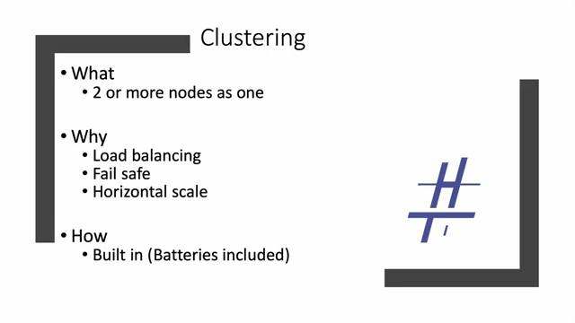
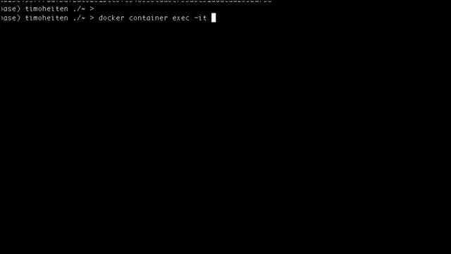
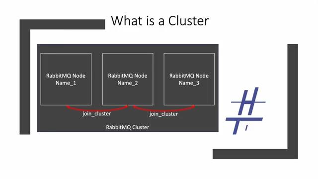
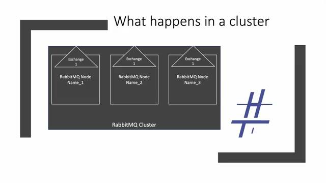
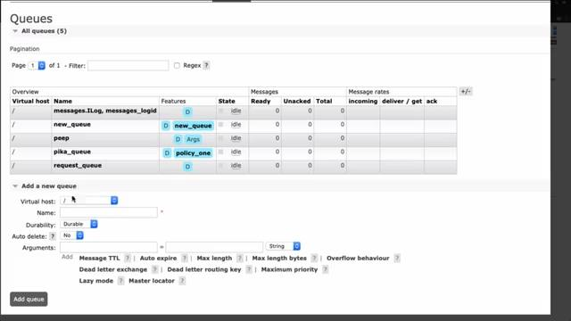
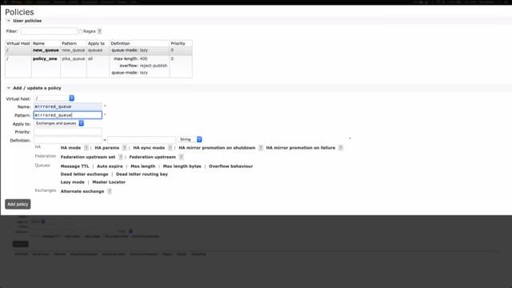
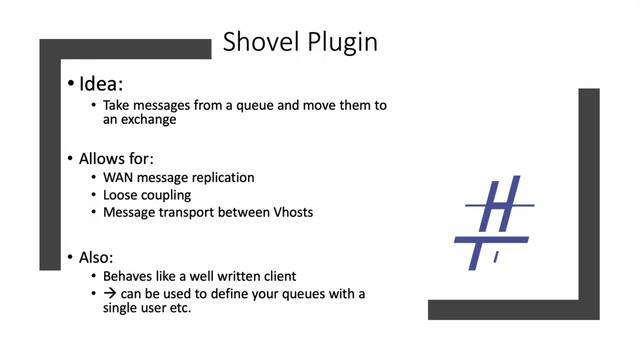
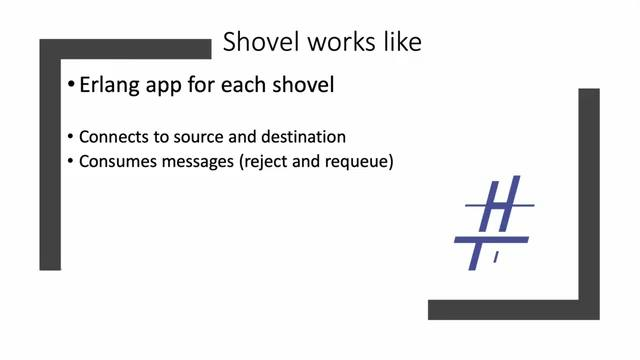

# RabbitMQ 集群、镜像队列与 Shovel：从零复现

## 1. 这一节做什么

这一节对应课程 P41–P44，目标不是背概念，而是在本机把下面这条链路跑通：

1. 用 Docker 启动两个 RabbitMQ 节点；
2. 把第二个节点加入第一个节点，形成一个两节点集群；
3. 通过管理 UI 观察“节点是一个集群，但队列只存在于声明它的节点”；
4. 创建队列并配置镜像队列策略，让队列有副本；
5. 理解镜像队列带来的吞吐量与高可用取舍；
6. 理解 Shovel 插件解决的是“跨 RabbitMQ 实例搬运消息”，不是集群本身。

最终你会得到：

- 一个可访问的管理 UI：`http://localhost:15673`
- 两个容器：`rabbitmq-cluster-1`、`rabbitmq-cluster-2`
- 两个 RabbitMQ 节点：`rabbit1@docker1`、`rabbit2@docker2`
- 一个策略：把 `mirrored-queue` 镜像到两个节点
- Shovel 插件启用命令与后续配置入口

这一节的重点不是“把 RabbitMQ 当成黑盒点几下”，而是让你能复述出三件事：第一，集群让多个 RabbitMQ 节点对外表现为一个逻辑实例；第二，集群会复制虚拟主机、交换机、绑定等元数据，但队列本体并不会天然完整复制到所有节点；第三，镜像队列和 Shovel 解决的是两类不同问题，前者是同一集群内队列副本与高可用，后者是把消息从源队列搬运到目标交换机，源和目标甚至可以是不同 RabbitMQ 实例。

对前端或 Node 同学可以这样对照：集群像你启动多个 Node 进程，但外面只暴露一个入口；元数据复制像多个进程共享同一份路由表；队列不复制则像某个内存 `Map` 只存在于一个进程里，别的进程只知道“有这个 Map”，但拿不到里面的数据。镜像队列更像主从复制，而不是把一条队列拆成多个分片。Shovel 则更像一个独立消费者加发布者：从源端消费，再向目标端交换机发布，只不过这个“消费者加发布者”由 RabbitMQ 插件托管。

> 说明：课程里讲的是概念 + 管理 UI 操作。本文为了“可直接照着复现”，把命令整理成完整脚本。课里没讲 RabbitMQ 镜像 tag，本文锁定 `rabbitmq:3.12-management`，原因是新版 RabbitMQ 对 classic mirrored queue 的支持有变化；这一点在第 7 节会说明。

复现时建议把本节当成一次“可验证实验”：每执行一步，都去管理 UI 或命令行确认结果，而不是只看命令有没有返回。这样遇到 cookie、hostname、端口、节点名不一致时，你能更快定位问题。

---

## 2. 讲师原话（带出处）

讲师对集群的定义说得很直接：

> “Clustering means that you have one or more instances of RabbitMQ, which seem to be as a single RabbitMQ instance from the outside for clients.”
>
> 意思是：集群对客户端透明，客户端以为自己连的是一个 RabbitMQ，实际上背后有多个节点。
>
> —— p041 [00:00]

这句话在复现里的含义是：你虽然启动了两个容器、两个节点，但客户端连接任意一个节点时，看到的是同一个集群的元数据视图。客户端不需要自己维护“我要连节点 1 还是节点 2”的拓扑，至少从概念上集群对外是一个逻辑实例。注意，这不等于队列数据会自动复制到所有节点，队列的放置和副本策略是另一件事。

关于“哪些东西会复制、哪些不会”，讲师特别强调了队列：

> “One thing which is important to know is that this is not true for queues. So if you declare queue on RabbitMQ Node 1, the queue only lives in this instance, or on this node, does not get replicated on the other nodes.”
>
> 意思是：虚拟主机、交换机、绑定等元数据会复制，但队列不会完整复制到其他节点；其他节点只有队列元数据/指针。
>
> —— p041 [02:52]

这句话是本节最容易误解的地方。复现时你会在管理 UI 里看到两个节点，也会看到节点 1 上声明的队列，但不要因此以为队列消息已经自动存在于节点 2。其他节点知道“这个队列存在”，但消息本体默认不在它们那里。也正因为如此，才需要后面的镜像队列策略。

创建集群时，讲师给的步骤是三步：

> “The first one is to stop the app. The second one is to reset the app with the RabbitMQ control. And then we use the RabbitMQ control join_cluster and specify the cluster name, which is Rabbit 1 at Docker 1.”
>
> 意思是：先 `stop_app`，再 `reset`，最后 `join_cluster`，然后重新 `start_app`。
>
> —— p042 [01:44]

复现时顺序不能乱。`stop_app` 是停 RabbitMQ 应用，不是停容器；`reset` 是清掉当前节点本地元数据；`join_cluster` 才是加入目标节点所在集群；最后 `start_app` 让节点以集群成员身份重新启动。对前端同学可以理解为：先停服务、清本地状态、注册到集群、再启动服务，不能跳过清理步骤直接加入。

镜像队列要解决的问题，是队列所在节点挂掉后消息不可用：

> “So if this node goes down we have a problem. Until the node comes back online we have no way of getting the messages out of this queue. So there's a solution built into RabbitMQ which is called mirrored queues.”
>
> —— p043 [00:28]

这句话说明镜像队列的动机是高可用，不是提升写入吞吐。副本越多，某个节点故障时越有机会从其他副本继续提供服务，但发布确认、同步和复制也会带来成本。复现时不要只看到“有副本”就认为性能更好，实际取舍要在第 5 节和第 7 节里结合理解。

配置镜像队列时，讲师建议用 `exactly`，不要用 `all`：

> “I absolutely suggest and recommend exactly, which will give you a number of exact slave copies. All will simply be too much.”
>
> —— p043 [03:51]

复现时本文只启动两个节点，所以策略参数要结合节点数看。`all` 表示尽量在所有节点上保留副本，节点多时成本会很高；`exactly` 表示精确指定副本数量，更适合你能明确控制副本数的场景。注意不同 RabbitMQ 版本对 `ha-params` 的语义表述可能有差异，实际以当前版本文档和管理 UI 展示为准。

Shovel 的核心动作，讲师概括为“从队列取消息，搬到交换机”：

> “The general idea is take a message from a queue and move it to an exchange. And this is really without any limitations. So the queue can be on one RabbitMQ instance and the exchange can be on a completely different RabbitMQ instance.”
>
> —— p044 [00:28]

这句话说明 Shovel 的关键词是“跨实例搬运”。它不是集群成员管理工具，也不是镜像队列的替代品。镜像队列解决同一集群内队列副本问题；Shovel 解决源队列到目标交换机的消息搬运问题，源和目标可以是不同 RabbitMQ 实例。

Shovel 的工作方式：

> “It connects to the source broker and the destination broker. And then it consumes all the messages which you declare in the configuration... and then it republishes those to the exchange specified in the configuration file.”
>
> —— p044 [02:49]

复现时要注意：课程讲了 Shovel 的原理、插件启用入口和静态/动态定义概念，但没有给出完整配置文件内容。因此本文只提供启用插件脚本，不编造配置字段。你可以把 Shovel 理解成一个由插件托管的“消费者 + 发布者”：它连接源 broker，消费指定队列，再把消息发布到目标 broker 的指定交换机。

---

## 3. 从零复现

### 3.1 前置条件

你需要：

- 本机安装 Docker，能执行 `docker` 命令；
- 端口 `5673`、`15673`、`25672` 没被占用；
- 能访问 `http://localhost:15673`；
- 默认管理 UI 账号：`guest / guest`。

目录结构建议如下：

```text
rabbitmq-cluster-demo/
├── scripts/
│   ├── 00-reset.sh
│   ├── 01-start-node1.sh
│   ├── 02-start-node2.sh
│   ├── 03-join-cluster.sh
│   ├── 04-create-mirrored-queue-cli.sh
│   ├── 05-enable-shovel.sh
│   └── 06-check.sh
└── README.md
```

前置条件里最容易忽略的是端口占用和 Docker 容器名冲突。`5673` 是宿主机 AMQP 端口，`15673` 是管理 UI 端口，`25672` 是集群节点通信端口。如果本机已经有 RabbitMQ 或其他容器占用这些端口，`docker run` 会失败。排查时先执行 `docker ps` 看是否已有同名容器，再用 `lsof -i :15673` 或系统对应工具检查端口占用。对前端同学可以类比为本地启动 dev server 时端口被占用，只不过这里要同时检查多个端口。

目录结构的作用是把“启动、加入集群、创建队列、启用插件、检查”拆成独立脚本。这样你复现失败时，可以只重跑某一步，而不是把所有命令混在一个终端历史里。脚本不是课程原话，而是为了可重复复现整理出来的。

### 3.2 启动第一个节点

先执行：

```bash
bash scripts/00-reset.sh
bash scripts/01-start-node1.sh
```

第一个节点映射了三个端口：

- `5673:5672`：AMQP 客户端端口；
- `15673:15672`：管理 UI；
- `25672:25672`：集群节点通信端口。


启动后打开：

```text
http://localhost:15673
```

用 `guest / guest` 登录。此时你只会看到一个节点。注意：此时它还只是“单机节点”，不是集群。

这一步的常见问题是管理 UI 还没启动完成就打开浏览器，页面可能连接失败或一直转圈。可以先用 `docker ps` 确认容器状态是 `Up`，再用 `docker logs rabbitmq-cluster-1` 查看启动日志。如果容器启动后马上退出，优先检查端口占用、容器名冲突和 Erlang cookie 环境变量是否写错。前端同学可以把这步理解为“服务进程已经拉起，但健康检查还没通过”，不要只看容器存在就认为服务可用。

另外，`00-reset.sh` 会强制删除旧容器。它的意义是保证每次复现从干净状态开始，避免旧容器、旧节点名、旧 cookie 干扰。第一次运行时容器不存在也没关系，脚本里用 `|| true` 让删除失败不阻断后续步骤。

### 3.3 启动第二个节点

执行：

```bash
bash scripts/02-start-node2.sh
```

第二个节点用 `--link rabbitmq-cluster-1:docker1` 连接到第一个容器，并把自己的 hostname 设为 `docker2`。课程里讲师明确用了 Docker 的 link 方式，虽然 link 已经逐渐不推荐，但本节为了和课程一致，继续使用它。



这一步的核心是 hostname 和节点名必须配套。第二个容器的 hostname 是 `docker2`，节点名是 `rabbit2@docker2`。如果 hostname 改了，节点名还写旧值，或者两个节点 cookie 不一致，后面的 `join_cluster` 就可能失败。`--link` 的作用是让第二个容器能通过别名 `docker1` 访问第一个容器，这样 `join_cluster rabbit1@docker1` 才能解析到目标节点。复现时如果 `join_cluster` 报连接失败，先检查 `--link` 是否写对、第一个容器是否还在运行、目标节点名是否和第一个节点的 `RABBITMQ_NODENAME` 完全一致。

对前端同学可以类比为：第二个服务要加入第一个服务的集群，必须知道第一个服务的内部地址，并且双方共享同一个认证密钥。这里内部地址是 `docker1`，共享密钥是 Erlang cookie，节点名则像服务实例 ID，不能随便变。

### 3.4 把第二个节点加入集群

执行：

```bash
bash scripts/03-join-cluster.sh
```

这个脚本做四件事：

```bash
docker exec rabbitmq-cluster-2 rabbitmqctl stop_app
docker exec rabbitmq-cluster-2 rabbitmqctl reset
docker exec rabbitmq-cluster-2 rabbitmqctl join_cluster rabbit1@docker1
docker exec rabbitmq-cluster-2 rabbitmqctl start_app
```

顺序不能乱。`reset` 会清掉第二个节点上的本地元数据，这是课程里讲师明确要求的步骤。



加入后回到管理 UI 的 `Nodes` 页面，应该能看到两个节点。

这一步的常见错误有三类。第一类是 cookie 不一致：两个容器必须使用完全相同的 `RABBITMQ_ERLANG_COOKIE`，只要有一个字符不同，节点之间就无法完成 Erlang 分布式认证。第二类是两个节点 hostname 或节点名冲突：节点名格式是 `名称@hostname`，第二个节点必须是 `rabbit2@docker2`，不能和第一个节点重名。第三类是跳过了 `stop_app` 或 `reset`：如果节点还在运行且带有旧元数据，直接加入集群可能失败或状态不符合预期。排查时可以先分别执行 `docker exec rabbitmq-cluster-2 rabbitmqctl cluster_status`，确认它当前是否已经认为自己在某个集群里。

对前端同学可以类比为：新实例加入集群前要先下线、清理本地缓存/注册信息、向集群注册、再上线。直接热加入虽然有些系统支持，但课程这里明确要求按顺序做，复现时就按课程顺序来。

### 3.5 理解“元数据复制，但队列不复制”

课程里讲师反复强调：虚拟主机、交换机、绑定等会被复制，但队列本体不会完整复制。



这意味着：

- 你在节点 1 声明一个 exchange，节点 2 能看到这个 exchange 的元数据；
- 你在节点 1 声明一个 queue，其他节点只知道“有这么个队列”，但队列里的消息不在其他节点上；
- 如果节点 1 挂了，这个队列就不可用，除非你配置了镜像队列。



复现时建议你亲自验证这一点：先在节点 1 创建一个队列，然后去管理 UI 的队列列表看它归属哪个节点；再去节点 2 的状态里看是否只是知道队列元数据。注意，管理 UI 是集群视图，所以两个节点都能看到队列条目，但“能看到”不等于“消息在本节点有完整副本”。这个区别是后面镜像队列策略存在的根本原因。

对前端同学可以类比为：集群共享的是路由表和服务发现信息，不是每个进程的内存数据。你能在任何一个节点看到“用户缓存 Map 存在”，不代表每个节点都持有这个 Map 的全部键值。镜像队列相当于给这个 Map 做主动复制，但复制有同步成本。

### 3.6 创建队列与镜像策略

课程里讲师用管理 UI 操作。你可以照做：

1. 打开 `http://localhost:15673`；
2. 进入 `Queues`，创建一个队列，名称：`mirrored-queue`；
3. 进入 `Admin -> Policies`；
4. 新增 policy：
   - Name：`mirrored-queue-ha`
   - Pattern：`^mirrored-queue$`
   - Apply to：`Queues`
   - Definition：
     - `ha-mode`：`exactly`
     - `ha-params`：`2`
     - `ha-sync-mode`：`automatic`



讲师在课里展示了 `all`、`exactly`、`nodes` 三种 HA mode，并建议用 `exactly`：



如果不想点 UI，也可以执行本文提供的 CLI 脚本：

```bash
bash scripts/04-create-mirrored-queue-cli.sh
```

该脚本用 HTTP API 创建队列，再用 `rabbitmqctl set_policy` 设置策略。课里没讲 CLI 写法，这是等价复现方式。

这一步的常见问题是策略 Pattern 写错，导致策略没有匹配到队列。`^mirrored-queue$` 表示只精确匹配 `mirrored-queue` 这个名称，`^` 和 `$` 都是正则锚点。如果你写成 `mirrored-queue`，可能匹配范围会不同；如果你把 Apply to 选成 `Exchanges`，队列也不会应用该策略。排查时去 `Admin -> Policies` 看策略是否存在，再去队列详情页看是否有策略生效。另一个常见问题是 `ha-params` 和节点数不匹配：本文只有两个节点，设为 `2` 表示目标副本数；如果你只启动了一个节点就设置副本数 2，可能无法达到预期副本数。具体语义仍以当前 RabbitMQ 版本为准。

对前端同学可以类比为：策略像一条全局中间件规则，Pattern 像路由匹配规则，Apply to 像指定中间件挂载到哪个对象上。规则写错时，不是命令失败，而是“看起来执行成功但没生效”，所以必须去目标对象详情页验证。

### 3.7 启用 Shovel 插件

课程 P44 没有给完整配置文件，只讲了 Shovel 的原理和启用入口。执行：

```bash
bash scripts/05-enable-shovel.sh
```

它会启用：

```bash
rabbitmq_shovel
rabbitmq_shovel_management
```



讲师说明 Shovel 在配置文件中定义，每个 shovel 会创建一个 Erlang 客户端应用，连接源 broker 和目标 broker：



注意：课里没有给出具体 Shovel 配置文件的完整内容。本文不会编造配置字段；如果你要继续做 Shovel 实验，需要按你实际 RabbitMQ 版本的官方配置格式写。

启用插件后，管理 UI 里是否出现 Shovel 相关入口取决于版本和启用的插件组合。`rabbitmq_shovel` 是核心插件，`rabbitmq_shovel_management` 提供管理 UI 支持。常见问题是插件已经启用但命令返回提示，或者管理 UI 没看到入口。排查时先执行 `docker exec rabbitmq-cluster-1 rabbitmq-plugins list` 看插件是否显示为启用状态，再确认你打开的是正确的管理 UI。对前端同学可以类比为：安装了某个后台管理插件，但还需要在应用里挂载对应路由或菜单，入口是否出现取决于插件和版本。

---

## 4. 完整代码

### 4.1 `scripts/00-reset.sh`

```bash
#!/usr/bin/env bash
set -euo pipefail

docker rm -f rabbitmq-cluster-1 rabbitmq-cluster-2 2>/dev/null || true
```

### 4.2 `scripts/01-start-node1.sh`

```bash
#!/usr/bin/env bash
set -euo pipefail

docker run -d \
  --name rabbitmq-cluster-1 \
  --hostname docker1 \
  -p 5673:5672 \
  -p 15673:15672 \
  -p 25672:25672 \
  -e RABBITMQ_ERLANG_COOKIE=CLUSTERCOOKIE \
  -e RABBITMQ_NODENAME=rabbit1@docker1 \
  rabbitmq:3.12-management

echo "Management UI: http://localhost:15673"
echo "AMQP: localhost:5673"
```

### 4.3 `scripts/02-start-node2.sh`

```bash
#!/usr/bin/env bash
set -euo pipefail

docker run -d \
  --name rabbitmq-cluster-2 \
  --hostname docker2 \
  --link rabbitmq-cluster-1:docker1 \
  -e RABBITMQ_ERLANG_COOKIE=CLUSTERCOOKIE \
  -e RABBITMQ_NODENAME=rabbit2@docker2 \
  rabbitmq:3.12-management
```

### 4.4 `scripts/03-join-cluster.sh`

```bash
#!/usr/bin/env bash
set -euo pipefail

docker exec rabbitmq-cluster-2 rabbitmqctl stop_app
docker exec rabbitmq-cluster-2 rabbitmqctl reset
docker exec rabbitmq-cluster-2 rabbitmqctl join_cluster rabbit1@docker1
docker exec rabbitmq-cluster-2 rabbitmqctl start_app

echo "Joined. Check: http://localhost:15673/#/nodes"
```

### 4.5 `scripts/04-create-mirrored-queue-cli.sh`

```bash
#!/usr/bin/env bash
set -euo pipefail

# 课里是在 Management UI 创建队列和策略。
# 这里用 HTTP API + rabbitmqctl 做等价复现。
curl -u guest:guest -X PUT \
  -H 'content-type: application/json' \
  -d '{"durable":true}' \
  http://localhost:15673/api/queues/%2F/mirrored-queue

docker exec rabbitmq-cluster-1 rabbitmqctl -p / set_policy \
  mirrored-queue-ha \
  '^mirrored-queue$' \
  '{"ha-mode":"exactly","ha-params":2,"ha-sync-mode":"automatic"}' \
  --apply-to queues

echo "Queue and policy created."
```

### 4.6 `scripts/05-enable-shovel.sh`

```bash
#!/usr/bin/env bash
set -euo pipefail

docker exec rabbitmq-cluster-1 rabbitmq-plugins enable rabbitmq_shovel
docker exec rabbitmq-cluster-1 rabbitmq-plugins enable rabbitmq_shovel_management

echo "Shovel plugins enabled on rabbitmq-cluster-1."
echo "课里没有给出具体 shovel 配置文件内容。"
```

### 4.7 `scripts/06-check.sh`

```bash
#!/usr/bin/env bash
set -euo pipefail

echo "=== node1 cluster status ==="
docker exec rabbitmq-cluster-1 rabbitmqctl cluster_status

echo "=== node2 cluster status ==="
docker exec rabbitmq-cluster-2 rabbitmqctl cluster_status

echo "=== queues on node1 ==="
docker exec rabbitmq-cluster-1 rabbitmqctl list_queues -p / name
```

### 4.8 `README.md`

```markdown
# RabbitMQ Cluster Demo

## Start

```bash
bash scripts/00-reset.sh
bash scripts/01-start-node1.sh
bash scripts/02-start-node2.sh
bash scripts/03-join-cluster.sh
```

Management UI:

```text
http://localhost:15673
guest / guest
```

## Create mirrored queue

```bash
bash scripts/04-create-mirrored-queue-cli.sh
```

## Enable Shovel

```bash
bash scripts/05-enable-shovel.sh
```

## Check

```bash
bash scripts/06-check.sh
```
```

---

## 5. 逐行解释

### 5.1 `set -euo pipefail`

这是 Bash 脚本的保险：

- `-e`：任何命令失败就退出；
- `-u`：使用未定义变量就报错；
- `-o pipefail`：管道中任意一段失败，整个管道失败。

对前端同学可以理解为：不要在错误被吞掉之后还继续往下跑，类似 Node 里让异常直接抛出，而不是空 `catch`。复现时这个设置能避免“某一步失败了但脚本继续执行，最后看到一堆莫名其妙的状态”。如果你自己改脚本调试，可以临时去掉 `-e` 观察全部输出，但正式复现建议保留。

### 5.2 `docker rm -f ... || true`

强制删除旧容器。`|| true` 表示即使容器不存在也不让脚本失败。否则第一次运行时容器不存在，`docker rm` 会返回非 0，脚本会退出。

这里的 `-f` 是强制删除正在运行的容器。它适合实验环境，不适合生产清理流程。对前端同学可以类比为清掉本地缓存目录：实验开始前先确保没有旧状态，避免旧容器名、旧端口映射、旧节点元数据影响结果。常见错误是以为删除容器就等于清掉所有数据；如果容器使用了具名卷，卷可能还在。本文脚本没有显式挂载卷，按课程复现时以当前脚本为准。

### 5.3 `docker run -d`

后台启动容器。

`-d` 让容器在后台运行，终端不会被阻塞。复现时建议紧接着执行 `docker ps` 确认容器处于运行状态。如果容器刚启动就退出，`docker ps` 看不到它，需要用 `docker ps -a` 查看退出状态，再用 `docker logs` 看日志。对前端同学可以类比为 `npm run dev &` 后台启动，但容器退出后要主动查看日志，而不是只看终端有没有报错。

### 5.4 `--name rabbitmq-cluster-1`

容器名。后面所有 `docker exec` 都用这个名字。

容器名是后续命令的定位符。如果你改了容器名，`03-join-cluster.sh`、`06-check.sh` 里的 `docker exec` 也要同步改。常见错误是之前已经有一个同名容器存在，`docker run` 报名称冲突。排查时执行 `docker ps -a | grep rabbitmq-cluster`，确认是否有残留容器。对前端同学可以类比为进程名或 PM2 应用名，后续操作都靠这个名字找到目标。

### 5.5 `--hostname docker1`

设置容器内部 hostname。RabbitMQ 节点名依赖 hostname，所以不能省。讲师也强调要设置 hostname，否则节点地址不好处理。

节点名 `rabbit1@docker1` 里的 `docker1` 就来自 hostname。如果容器 hostname 变化，节点名可能对不上，集群关系就会出问题。复现时保持 `docker1`、`docker2` 不变。常见错误是只改了 `RABBITMQ_NODENAME` 但没改 `--hostname`，或者反过来。对前端同学可以类比为服务实例 ID 和主机名必须配套，否则服务注册中心里的地址会指向错误实例。

### 5.6 `-p 5673:5672`

把宿主机 `5673` 映射到容器内 RabbitMQ AMQP 端口 `5672`。因为本机可能已经有 RabbitMQ 占用 `5672`，所以讲师用了 `5673`。

冒号左边是宿主机端口，右边是容器内端口。客户端连接时用宿主机端口 `5673`。常见错误是客户端仍然连 `5672`，结果连到了本机其他 RabbitMQ，或者连接失败。对前端同学可以类比为本地代理端口和容器内部端口的区别：浏览器访问的是宿主机映射端口，不是容器内端口。

### 5.7 `-p 15673:15672`

把宿主机 `15673` 映射到容器内管理 UI 端口 `15672`。

所以浏览器打开的是 `http://localhost:15673`，不是 `15672`。常见错误是端口映射写反，或者打开 `15672` 发现不是这个容器。对前端同学可以类比为 dev server 的端口映射：外部访问端口和内部服务端口可以不同，排查时要确认你访问的是映射后的端口。

### 5.8 `-p 25672:25672`

集群节点通信端口。讲师明确提到需要让其他节点能连到这个端口。

本文用 Docker link 让容器之间互通，宿主机映射主要用于理解端口含义。生产环境不要把“只开 25672”当成全部要求，实际还会涉及 Erlang 分布式、epmd 等端口，需按官方文档放通。常见错误是只映射了管理 UI，忘了集群通信，或者在跨主机场景下只开了一个端口导致节点无法握手。对前端同学可以类比为服务间 RPC 端口，不只是给浏览器看的 HTTP 端口。

### 5.9 `-e RABBITMQ_ERLANG_COOKIE=CLUSTERCOOKIE`

两个节点必须使用同一个 Erlang cookie。你可以理解为集群节点之间的共享密钥。cookie 不一致，`join_cluster` 会失败。

复现时两个脚本里的 cookie 必须完全一致，包括大小写。常见错误是复制脚本时改了其中一个，或者使用了不同版本的默认 cookie。对前端同学可以类比为多个服务共享的 `JWT_SECRET`，必须一致才能互信。排查时不要只看环境变量是否写了，还要确认容器实际启动时使用的是同一个值。

### 5.10 `-e RABBITMQ_NODENAME=rabbit1@docker1`

设置节点名。节点名格式是 `名称@hostname`。第二个节点对应 `rabbit2@docker2`。

`join_cluster rabbit1@docker1` 里的目标节点名必须和这里完全一致。常见错误是写成 `rabbit1@localhost`、`rabbit1` 或 `rabbit1@docker2`。对前端同学可以类比为集群中的服务实例 ID，注册和发现都依赖这个 ID。排查时用 `rabbitmqctl cluster_status` 看实际节点名，不要凭记忆猜。

### 5.11 `--link rabbitmq-cluster-1:docker1`

让第二个容器能通过 `docker1` 这个别名访问第一个容器。讲师在课里用的就是这个方式。它已经属于旧用法，但本实验为了和课程一致继续用。

`--link` 的格式是 `容器名:别名`。常见错误是别名写错，导致 `join_cluster` 里的 `docker1` 解析不到。对前端同学可以类比为 hosts 别名或本地 DNS 映射：第二个容器需要知道第一个容器的内部地址。生产环境更推荐自定义 Docker network，第 7 节会展开。

### 5.12 `rabbitmqctl stop_app`

停止 RabbitMQ 应用，但容器还在。加入集群前必须先停应用。

注意 `stop_app` 不是 `docker stop`。容器还在运行，只是 RabbitMQ 应用停了。常见错误是直接 `docker stop` 容器，然后执行 `docker exec` 失败。对前端同学可以类比为停掉应用进程但保留机器，方便执行注册/清理操作。

### 5.13 `rabbitmqctl reset`

清空当前节点的本地 RabbitMQ 元数据。讲师明确把这一步作为加入集群前的第二步。

`reset` 是有破坏性的操作，实验环境里用来保证干净加入。常见错误是在有重要数据的节点上执行 `reset`。复现时只对第二个节点执行，不要对已经承载数据的节点随意执行。对前端同学可以类比为清空本地注册信息和缓存，再重新加入集群。

### 5.14 `rabbitmqctl join_cluster rabbit1@docker1`

把当前节点加入目标节点所在集群。这里的目标节点名必须和第一个节点的 `RABBITMQ_NODENAME` 一致。

常见错误是 cookie 不一致、目标节点不可达、目标节点名写错。排查时先确认第一个容器在运行，再确认第二个容器能解析 `docker1`，最后确认两边 cookie 和节点名。对前端同学可以类比为调用集群注册接口，参数里的实例 ID 和地址必须和真实服务一致。

### 5.15 `rabbitmqctl start_app`

重新启动 RabbitMQ 应用，让节点以集群成员身份运行。

执行后回到管理 UI 的 `Nodes` 页面确认两个节点都在。常见错误是 `join_cluster` 成功了但忘了 `start_app`，结果节点还没真正提供服务。对前端同学可以类比为注册完成后重新上线，注册成功不等于服务已经可接收流量。

### 5.16 `curl -u guest:guest -X PUT ... /api/queues/%2F/mirrored-queue`

通过管理 HTTP API 创建队列。`%2F` 是虚拟主机 `/` 的 URL 编码。`-d '{"durable":true}'` 表示持久化队列。

`-u guest:guest` 是管理 UI 账号密码。`-X PUT` 表示创建或更新资源。常见错误是管理 UI 端口写错、虚拟主机编码写错、账号密码不对。对前端同学可以类比为调用 REST API 创建资源，URL 编码和认证头必须正确。排查时可以先在浏览器打开管理 UI，确认账号能登录，再用 `curl -i` 看 HTTP 状态码和响应体。

### 5.17 `rabbitmqctl set_policy`

创建策略。参数含义：

- `mirrored-queue-ha`：策略名；
- `^mirrored-queue$`：只匹配这个队列名；
- `ha-mode: exactly`：精确副本模式；
- `ha-params: 2`：两份副本；
- `ha-sync-mode: automatic`：自动同步；
- `--apply-to queues`：只应用到队列。

注意：`ha-params` 的具体语义在不同版本文档里表述可能不同，实际以你当前 RabbitMQ 版本为准。本文两节点集群设为 `2`，目标是让两个节点都持有该队列的副本。

常见错误是 Pattern 没有匹配到队列、`--apply-to` 写错、策略 JSON 格式不合法。对前端同学可以类比为写一条全局匹配规则，规则写错时不会报错，但目标对象不会生效。验证方式是去队列详情页看策略是否应用，而不是只看命令返回成功。

### 5.18 `rabbitmq-plugins enable rabbitmq_shovel`

启用 Shovel 插件。课程里说 Shovel 已经进入标准发行版，所以只需要启用，不需要额外下载。

常见错误是插件名拼错，或者在错误节点上启用。复现时在 `rabbitmq-cluster-1` 上执行。对前端同学可以类比为启用一个内置模块，启用后还需要配置才能真正工作。这里只启用插件，不代表已经配置好 shovel 任务。

### 5.19 `rabbitmq-plugins enable rabbitmq_shovel_management`

启用 Shovel 的管理 UI 支持。具体 UI 位置和可用性以实际版本为准。

常见错误是以为启用这个插件后一定会在所有版本出现完全一致的菜单。不同版本管理 UI 可能有差异。对前端同学可以类比为安装了后台管理扩展，菜单是否出现取决于版本和插件组合。排查时用 `rabbitmq-plugins list` 确认插件状态。

---

## 6. 复现检查清单

- [ ] `docker ps` 能看到 `rabbitmq-cluster-1` 和 `rabbitmq-cluster-2` 两个容器都在运行。
  - 验证方法：执行 `docker ps --format '{{.Names}}\t{{.Status}}'`，确认两个容器名都存在且状态为 `Up`。如果某个容器不在列表里，执行 `docker ps -a` 看它是否已退出，再执行 `docker logs <容器名>` 查看退出原因。
- [ ] 浏览器能打开 `http://localhost:15673`，并用 `guest / guest` 登录。
  - 验证方法：确认端口映射是 `15673:15672`，容器日志里管理 UI 已启动。如果打不开，先检查 `docker ps` 的端口映射，再检查本机 `15673` 是否被占用。
- [ ] 管理 UI 的 `Nodes` 页面能看到两个节点，而不是只有一个。
  - 验证方法：进入 `http://localhost:15673/#/nodes`，看节点列表是否有 `rabbit1@docker1` 和 `rabbit2@docker2`。如果只有第一个，回到 `03-join-cluster.sh` 检查 `join_cluster` 是否成功。
- [ ] 第二个节点的名字是 `rabbit2@docker2`，第一个节点是 `rabbit1@docker1`。
  - 验证方法：在 Nodes 页面逐个查看节点名，或执行 `docker exec rabbitmq-cluster-2 rabbitmqctl cluster_status` 看节点列表。节点名必须和启动脚本里的 `RABBITMQ_NODENAME` 一致。
- [ ] 执行 `bash scripts/06-check.sh` 时，两个节点都能返回集群状态，不报 cookie 或连接错误。
  - 验证方法：观察脚本输出里两个 `cluster_status` 是否都正常返回。如果报 cookie 错误，检查两个容器的 `RABBITMQ_ERLANG_COOKIE` 是否完全相同；如果报连接错误，检查目标节点名和容器网络是否可达。
- [ ] 管理 UI 中能看到队列 `mirrored-queue`。
  - 验证方法：进入 `Queues` 页面，搜索 `mirrored-queue`，确认队列存在。如果 CLI 创建失败，检查 `curl` 的 HTTP 状态码和虚拟主机 `%2F` 编码。
- [ ] `Admin -> Policies` 中能看到 `mirrored-queue-ha`，Pattern 为 `^mirrored-queue$`，Apply to 为 `Queues`。
  - 验证方法：进入策略页面逐项核对名称、Pattern、Apply to 和 Definition。再进入 `mirrored-queue` 队列详情页，确认策略已生效。
- [ ] 执行 `bash scripts/05-enable-shovel.sh` 后，插件启用命令没有报错。
  - 验证方法：执行 `docker exec rabbitmq-cluster-1 rabbitmq-plugins list`，确认 `rabbitmq_shovel` 和 `rabbitmq_shovel_management` 处于启用状态。命令返回成功不等于 UI 一定出现入口，需结合版本确认。
- [ ] 如果你停掉节点 1，节点 2 不应因为“队列只在节点 1”而完全失效；但客户端要连接节点 2 才能继续消费，这一步课程没有演示完整客户端重连，本文只要求理解原理。
  - 验证方法：先理解镜像队列与客户端重连是两件事。镜像队列提供副本，客户端仍需连接到可用节点并重新建立连接。不要在没有客户端重连逻辑的情况下，把“停节点 1 后客户端自动恢复”当成必然结果。若要实验，先确认队列有副本，再观察节点状态和客户端连接行为。

---

## 7. 课里没讲但你会撞上的

先给出一张排查速查表，表中现象、原因、怎么办都是围绕本复现实验的常见问题；表后保留并展开每一项细节，原有代码块和说明继续保留。

| 现象 | 原因 | 怎么办 |
| --- | --- | --- |
| 第二个节点 `join_cluster` 失败，提示认证或连接问题 | 两个节点 Erlang cookie 不一致，或目标节点名/网络不可达 | 检查两个容器的 `RABBITMQ_ERLANG_COOKIE` 是否完全一致；确认 `rabbit1@docker1` 节点名正确、第一个容器在运行、`--link` 别名可用 |
| 管理 UI 只能看到一个节点 | 第二个节点没有成功加入集群，或 `join_cluster` 后没有 `start_app` | 重新执行 `03-join-cluster.sh`，逐步检查 `stop_app`、`reset`、`join_cluster`、`start_app` 的输出 |
| 容器启动后立刻退出 | 端口被占用、容器名冲突、hostname/节点名配置错误 | 用 `docker ps -a` 和 `docker logs` 定位；清理旧容器，检查端口和启动参数 |
| 策略创建了但队列没有副本效果 | Pattern 没匹配到队列、Apply to 不是 Queues、`ha-params` 与节点数不匹配 | 在策略页面和队列详情页核对；按当前版本调整 `ha-params`，确认两个节点都在线 |
| 管理 UI 打不开 | 端口映射错误、管理 UI 未启动完成、宿主机端口被占用 | 检查 `-p 15673:15672`，查看容器日志，确认 `15673` 没有被其他进程占用 |
| Shovel 插件启用了但不知道下一步怎么配 | 课程只讲原理和启用入口，没有给出完整配置文件 | 不要猜字段；按实际 RabbitMQ 版本的官方配置格式编写，并先用 `rabbitmq-plugins list` 确认插件已启用 |
| 新版 RabbitMQ 上镜像队列行为与课程不一致 | classic mirrored queue 的支持随版本有变化 | 复现课程时锁定 `rabbitmq:3.12-management`；生产或新版实验先查版本文档，必要时评估 quorum queue |

### 7.1 Docker `--link` 已经过时

课程里讲师明确用了 `--link`，并说它“soon to be deprecated”。它适合课程演示，但不适合生产。生产更推荐自定义 bridge network：

```bash
docker network create rabbitmq-cluster-net

docker run -d \
  --name rabbitmq-cluster-1 \
  --hostname docker1 \
  --network rabbitmq-cluster-net \
  -p 5673:5672 \
  -p 15673:15672 \
  -p 25672:25672 \
  -e RABBITMQ_ERLANG_COOKIE=CLUSTERCOOKIE \
  -e RABBITMQ_NODENAME=rabbit1@docker1 \
  rabbitmq:3.12-management

docker run -d \
  --name rabbitmq-cluster-2 \
  --hostname docker2 \
  --network rabbitmq-cluster-net \
  -e RABBITMQ_ERLANG_COOKIE=CLUSTERCOOKIE \
  -e RABBITMQ_NODENAME=rabbit2@docker2 \
  rabbitmq:3.12-management
```

这属于课程之外的补充，不是讲师原话。它解决的是容器间稳定通信和网络隔离问题。对前端同学可以类比为不要用临时 hosts 别名做服务发现，而是用一个明确的本地网络让服务之间通过稳定名称互访。常见错误是创建了 network 但启动容器时忘了加 `--network`，结果两个容器仍在不同网络里，`join_cluster` 依然失败。

### 7.2 Erlang cookie 不一致会直接导致加入失败

两个容器的 `RABBITMQ_ERLANG_COOKIE` 必须完全一样。只要有一个字符不同，`join_cluster` 就会失败。讲师在课里反复强调“必须有 Erlang cookie”，但没有展开错误排查。

排查时不要只看脚本里写了什么，还要看容器实际环境变量。可以执行 `docker exec rabbitmq-cluster-1 env | grep RABBITMQ_ERLANG_COOKIE` 和 `docker exec rabbitmq-cluster-2 env | grep RABBITMQ_ERLANG_COOKIE` 对比。对前端同学可以类比为两个服务用了不同的签名密钥，接口互信一定失败。常见错误是复制脚本时只改了一个节点的 cookie，或者从别处复制了带空格的写法。

### 7.3 hostname 不要随便变

RabbitMQ 节点名里带 hostname。容器重建后如果 hostname 变了，节点名就变了，集群关系会对不上。复现时保持 `docker1`、`docker2` 不变。

节点名是集群身份的一部分。如果你删除容器后用不同的 hostname 重建，再用旧节点名去 `join_cluster`，可能失败或产生不一致状态。对前端同学可以类比为服务实例 ID 变了，注册中心里的旧记录就失效。常见错误是本地已有同名容器但 hostname 不同，复现时建议先执行 `00-reset.sh` 从干净状态开始。

### 7.4 集群通信不只用 25672

课程里讲师提到 `25672` 用于集群。实际 RabbitMQ/Erlang 分布式还会涉及 epmd 等端口。本文用 Docker link，容器之间可以互通，所以宿主机不额外映射也能做本实验。生产环境要按官方要求放通端口，不要只记一个 `25672`。

排查跨主机集群问题时，不要只检查 25672。先看节点是否能解析彼此 hostname，再看 Erlang 分布式端口和 epmd 是否可达。对前端同学可以类比为服务间调用不只依赖一个 HTTP 端口，还可能涉及注册中心、健康检查、DNS 解析等多个环节。本文本机实验依赖 Docker 网络互通，所以重点放在节点名和 cookie 上。

### 7.5 新版 RabbitMQ 可能不再支持 classic mirrored queue

本文锁定 `rabbitmq:3.12-management`，是为了复现课程里的 `ha-mode` 镜像队列。新版 RabbitMQ 对 classic mirrored queue 的支持有变化，可能要求改用 quorum queue。课程里没有讲 quorum queue，所以不要把这节内容直接套到 4.x 上而不看版本文档。

复现时如果发现策略参数行为与课程不一致，先确认镜像版本。对前端同学可以类比为课程基于某个旧版框架讲 API，你直接换到新大版本后行为可能变化。不要因为新版报错就认为课程内容错了，先确认版本边界。本文只承诺在锁定 tag 下按课程思路复现，不把镜像队列结论无条件推广到所有版本。

### 7.6 `ha-params` 的语义要按版本确认

讲师在课里用“三节点、HA params 2”举例，并建议用 `exactly`。本文实际只启动两个节点，所以策略参数必须按你的节点数调整。若策略没有按预期生效，先检查 `ha-params` 在当前版本里表示“总副本数”还是“镜像数”，以实际管理 UI 和版本文档为准。

复现时建议先确认两个节点都在线，再设置策略，然后去队列详情页看副本状态。对前端同学可以类比为配置副本数时，参数含义在不同基础设施里可能不同，不能只凭字段名猜。常见错误是节点数不足却设置较高副本数，然后误以为策略完全没生效。

### 7.7 第二个节点没有映射管理 UI 端口

课程里第二个节点没有指定端口，所以默认只能通过第一个节点的管理 UI 看集群。若第一个节点停了，管理 UI 也打不开。想方便验证，可以给第二个节点额外映射 `15674:15672`，但这不属于讲师原始命令。

复现时如果你停掉节点 1 后想看管理 UI，会发现入口不可用。这不是队列是否存在唯一问题，而是管理 UI 入口本身在节点 1。对前端同学可以类比为管理后台只部署在一个实例上，主实例挂了后台入口也挂了。本文保留课程原始做法，不额外改端口映射；如果你自己加映射，要明确这是实验补充。

### 7.8 Shovel 的具体配置课里没给

P44 只讲了 Shovel 的原理、启用方式和静态/动态定义的概念，没有给完整配置文件。本文只提供启用插件脚本，不编造 Shovel 配置字段。你要继续做 Shovel 实验，需要按实际 RabbitMQ 版本的官方格式写配置文件。

复现时可以把启用插件和创建 shovel 任务分成两步：先确认插件启用成功，再按官方格式写源 broker、目标 broker、源队列、目标交换机等配置。对前端同学可以类比为安装了一个任务调度插件，启用插件只是第一步，具体任务配置还要按插件文档写。常见错误是把“插件启用成功”误认为“Shovel 已经在搬运消息”。

### 7.9 对前端/Node 同学的类比

- RabbitMQ 集群对外像一个入口，类似 Node 用 PM2 cluster 或多进程加反向代理，但 RabbitMQ 节点之间还共享元数据。
- Erlang cookie 类似多个服务共享的 `JWT_SECRET`，必须一致。
- 镜像队列类似主从复制，不是分片。客户端只连 master，master 挂了才选举新 master。
- publisher confirm 等待所有副本确认，类似 `await Promise.all([...])` 等所有副本写完才返回；副本越多，吞吐越慢。
- 队列不复制类似一个内存 `Map` 只存在于一个 Node 进程里，其他进程只有路由表，没有那份数据本体。

这些类比只用于帮助理解，不替代 RabbitMQ 的正式行为。复现时仍以管理 UI、`rabbitmqctl cluster_status`、`rabbitmqctl list_queues` 和实际客户端表现为准。对前端同学来说，最重要的边界是：集群、镜像队列、Shovel 解决的是三个层面的问题，不能混为一谈。集群解决节点组织与元数据视图，镜像队列解决同一集群内队列副本与高可用，Shovel 解决跨实例消息搬运。把这三层分开，你在排查时就不会把“节点没加入集群”“队列没副本”“消息没搬运”混成同一个问题。