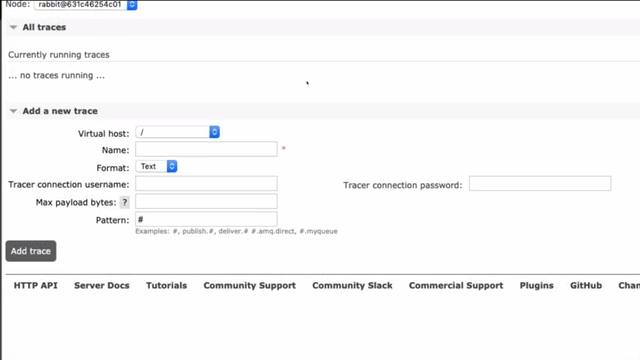
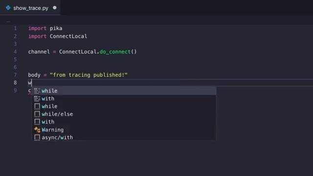
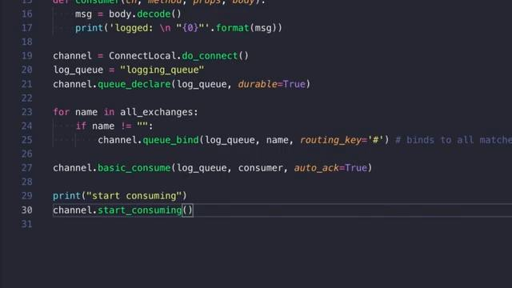
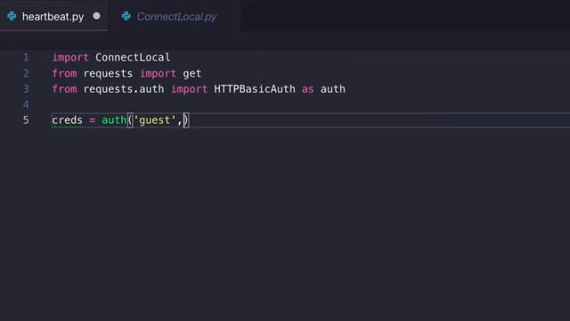
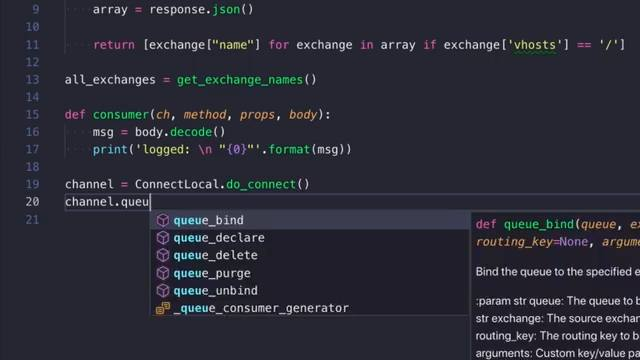
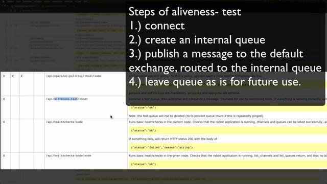
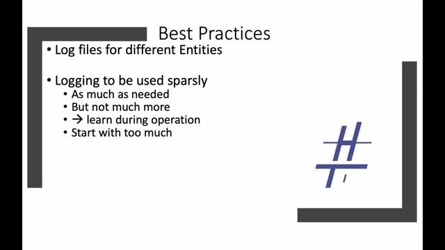

# RabbitMQ 日志与监控实战：Firehose 追踪、自建日志队列、存活检查（P49–P52）

> 适用读者：前端转 AI 应用工程师。本文所有 Python 代码可直接保存运行；涉及并发/连接语义的地方会补一句「在 JS/Node 里对应什么」。
> 课程环境：RabbitMQ 跑在本机 `localhost`，管理插件已开启（默认端口 15672），账号 `guest/guest`，默认虚拟主机 `/`（逐字稿里念作 “present to F”，即 URL 编码后的 `%2F`）。

---

## 1. 这一节做什么

这四集（P49–P52）是「日志与监控」这一章的收尾，目标是把 RabbitMQ 从「能收发消息」推进到「出问题能查、挂了能发现」。具体交付三样东西：

1. **Firehose 追踪（P49）**：开启 `rabbitmq_tracing` 插件，在管理界面建一个 trace，把匹配某个 pattern 的所有消息（课里用 `#`，即全部）落进一个日志文件。用于开发/调试期抓消息。
2. **自建日志队列（P50）**：不依赖插件，用 HTTP API 拉出所有 exchange 名字，建一个 `login_queue`，用 routing key `#` 绑到除默认 exchange 外的所有 exchange 上，再写一个消费者把消息打到控制台、一个生产者从命令行发消息。这是讲师推荐的、可长期跑在生产上的做法。
3. **存活检查（P51）**：写一个脚本，同时做两件事——HTTP API 的 aliveness test（`/api/aliveness-test/{vhost}`）和 TCP 心跳（连接时传 `heartbeat=1500` 毫秒）。P52 是对整章的复盘（日志 vs 监控、最佳实践），不产生新代码，但决定了你上面三样东西该怎么配。

一句话概括这四集的分工：**P49 是「调试用的重武器」，P50 是「生产可用的轻量替代」，P51 是「确认它还活着」，P52 是「什么时候用哪个」。**

从工程视角再展开一点：这三样东西分别对应三种不同的问题域。Firehose 解决的是「消息到底有没有进 exchange、进了之后长什么样」这种开发期定位问题；自建日志队列解决的是「我想长期保留一份跨 exchange 的消息流水，但又不想承担 Firehose 那种全局追踪成本」的问题；aliveness test 与 heartbeat 解决的是「broker 进程还在不在、连接还能不能用、HTTP 管理接口是否正常」这种运维期发现问题。前端同学可以把它类比成浏览器 DevTools 的 Network 面板、应用埋点日志、以及健康检查接口：前者适合临时抓包，中者适合长期低开销记录，后者适合定时探测。三者不是互相替代关系，而是使用场景不同，P52 的复盘正是在讲这个取舍。

---

## 2. 讲师原话（带出处）

关于 Firehose 的定位与代价：

> “firehose tracing is simply connecting a queue, internal queue to all of the queues which you match by a pattern.” —— p049 [00:00]

> “The thing is, this is a run on performance, and you should only use this for tracing and debugging purposes.” —— p049 [00:29]

> “So this is the ED mode tracing plugin. In the next video we are going to look at a queue we will create ourselves. This will serve the same purpose but it's not as a huge performance drain as this and can be running in background all the time.” —— p049 [02:55]

关于自建日志队列的绑定策略：

> “Then for all exchange names we will do a queue bind except for the default exchange because the default exchange doesn't allow for the pound binding.” —— p050 [01:52]

> “So this bounds to every direct exchange and every topic exchange and also for fanout because fanout does not do pattern matching at all.” —— p050 [02:21]

> “In this case we will do auto arc because we don't care if this is really acknowledged correctly because it's just a logging system in this case.” —— p050 [01:24]

关于存活检查的两个层次：

> “So the one thing is the license check on the broker and the other thing is the heartbeat. So can we reach the broker and does the broker itself work?” —— p051 [00:58]

> “as you saw the timeout is 1.5 seconds as indicated by the 1,500 milliseconds in the heartbeat and When you provide this parameter, the heartbeat will be done automatically on the connection.” —— p051 [01:27]

关于日志与监控的关系（P52 复盘）：

> “We saw that there are some differences between logging and monitoring and how we can use one or the other for our benefits and how they are not mutually exclusive, but complementary.” —— p052 [00:00]

> “for a start you should lock everything on your development system with info, debug and things like that and on the production system you should probably only lock warnings and errors” —— p052 [02:32]

> “Monitoring, on the other hand, should be done in a more wider approach, which should cover different scopes.” —— p052 [03:01]

> “So monitoring should be done in a given interval like with 60 seconds or not much fewer.” —— p052 [03:29]

读这些原话时要注意两个层次：第一，Firehose 的本质是「用一个内部队列去接某个 pattern 匹配到的消息」，它不是业务队列，也不是长期日志方案；第二，讲师反复区分 logging 和 monitoring，前者偏「记录发生了什么」，后者偏「按间隔探测系统是否正常」。这两种手段不是二选一，而是互补。你后面复现时如果只盯着代码能不能跑，容易忽略这个取舍，最后把调试用的重武器误配到生产环境里。原话中的口音/识别误差（如 “ED mode” 应为插件名语境、“auto arc” 指 auto ack、“license check” 指 aliveness check）不影响复现，实际以命令和代码为准。

---

## 3. 从零复现

### 3.1 前置条件

- RabbitMQ 已安装并运行在 `localhost`，管理插件已启用（能打开 `http://localhost:15672`，用 `guest/guest` 登录）。
- Python 3.x，安装 `pika`（逐字稿里念作 “pickle library”，实际是 `pika`，这是讲师口音/识别误差，装 `pika` 才对）：

```bash
pip install pika
```

- 目录结构（本文所有文件都放在同一个目录下，方便直接跑）：

```
rabbitmq-logging/
├── firehose_producer.py     # P49：往 mq.direct 发消息，触发 firehose trace
├── login_consumer.py        # P50：建 login_queue 并绑定所有 exchange，消费打印
├── login_producer.py        # P50：命令行发消息到指定 exchange + routing key
└── aliveness_check.py       # P51：aliveness test + TCP heartbeat
```

> 注意：P50 的消费者和生产者是**两个独立进程**，必须先起消费者（它负责建队列和绑定），再起生产者，否则消息发出去时队列还不存在，消息会丢。

命令解释：`pip install pika` 只安装 AMQP 客户端库，不会启动任何服务，也不会自动安装管理插件。管理插件和 tracing 插件是 RabbitMQ 服务端的能力，需要在 RabbitMQ 所在机器上用 `rabbitmq-plugins` 开启。常见错误是把 `pika` 拼成 `pika` 以外的包名，或者以为装了 `requests` 就不需要 `pika`；实际上本文里 `requests` 只负责调用 HTTP 管理 API，真正连 AMQP 端口发消息、消费消息仍然靠 `pika`。如果运行 `login_consumer.py` 时报 `ModuleNotFoundError: No module named 'requests'`，补一条 `pip install requests` 即可；如果报 `No module named 'pika'`，说明当前 Python 解释器环境和你安装包的环境不一致，检查 `which python` / `python -m pip` 是否对应。前端同学可以类比：`pika` 相当于 Node 里的 `amqplib`，`requests` 相当于 `fetch`，两者职责不同。

### 3.2 第一步：开启 tracing 插件（P49）

在 RabbitMQ 所在机器上执行（Linux/macOS 用 `rabbitmq-plugins`，Windows 在 RabbitMQ 安装目录的 sbin 下执行同名命令）：

```bash
rabbitmq-plugins enable rabbitmq_tracing
```

启用后打开管理界面 `http://localhost:15672` → **Admin** 标签页，会多出一个 **Tracing** 子页。在这里点 “Add trace”：

- **Name**：随便起，比如 `my-trace`
- **Format**：选 Text（课里用的是文本格式，日志文件按文本可读）
- **Pattern**：`#`（匹配所有 routing key）
- **Max payload bytes**：按需，课里没细讲，保持默认即可
- **Username**：`guest`

保存后，所有发到 `amq.direct`（课里念作 “MQ direct”，实际 exchange 名是 `amq.direct`）的消息都会被写进 trace 日志文件。讲师在 [01:54] 处说，发三条消息后日志文件已经涨到 1.2 KB，点开就能看到每条消息的发布时间、发到哪个 exchange、连接、虚拟主机、channel、payload 和 properties。



> 课里没讲 trace 日志文件落在磁盘的哪个路径。实际路径以管理界面 Tracing 页显示的为准（不同安装方式不一样），不要凭印象写死。

命令解释与排查：`rabbitmq-plugins enable rabbitmq_tracing` 的作用是启用服务端 tracing 插件，执行后通常需要确认插件列表里该插件为 enabled 状态。常见错误包括：命令找不到，说明当前 shell 没把 RabbitMQ 的 sbin 加进 PATH，或者你不在 RabbitMQ 所在机器上；执行成功但管理界面没有 Tracing 页，先刷新页面，再确认管理插件本身是否启用；建 trace 后日志文件不增长，先确认 Pattern 是否过窄、Username 是否有权限、消息是否真的发到了你以为的 exchange。注意 Firehose 是在 exchange 层抓消息，和队列是否绑定成功不是一回事，所以即使 routing key 路由不到队列，trace 仍可能记录。排查时建议按「插件是否启用 → 管理界面是否出现 Tracing → trace 的 pattern 和用户 → 生产者是否真的 publish 成功」这个顺序走，不要一上来就改代码。

### 3.3 第二步：跑 firehose 生产者（P49）

保存 `firehose_producer.py`（完整代码见第 4 节），运行：

```bash
python firehose_producer.py
```

脚本进入 while 循环，每按一次回车就发一条消息到 `amq.direct`，routing key 用 `picker_queue`（课里念作 “picker queue”，是前面章节建过的队列名；如果你没建过这个队列，消息会因为路由不到任何队列而被丢弃，但 **firehose trace 依然会记录**，因为 trace 是在 exchange 层面抓的）。发三条后回到管理界面 Tracing 页刷新，能看到日志文件大小增长，点开能看到三条记录。



常见错误与排查：如果按回车后脚本立刻报连接错误，先确认 RabbitMQ 服务是否运行、`localhost:5672` 是否可达；如果脚本能发但 Tracing 页不增长，确认 trace 是否保存成功、是否选错 vhost、Pattern 是否写成了不匹配的字符串；如果消息发到了错误 exchange（比如把 `amq.direct` 写成 `mq.direct`），broker 通常会报 exchange 不存在或消息无法路由，这时不要继续猜，回管理界面 Exchanges 页核对名字。前端对照：这相当于你在浏览器里手动触发一个请求，Network 面板能不能看到，取决于你请求的 URL 和 DevTools 的过滤条件是否匹配，Firehose 的 Pattern 就是这里的过滤条件。

### 3.4 第三步：跑自建日志队列（P50）

先起消费者（它会建 `login_queue` 并绑定所有 exchange）：

```bash
python login_consumer.py
```

看到控制台打印 `start consuming` 即成功。此时去管理界面 Queues 页，能看到 `login_queue`，点进去看 Bindings，应该绑到了所有非默认 exchange 上，routing key 都是 `#`。讲师在 [02:49] 处还提到，能看到 P49 那个 firehose 自动生成的队列也在列表里。



再开一个终端起生产者：

```bash
python login_producer.py amq.direct picker_queue
```

第一个参数是 exchange 名，第二个是 routing key。发出去后，消费者终端会打印出消息内容。讲师在 [04:15] 处演示了发到 `amq.direct` + `picker_queue`，然后说也可以发到默认 exchange 或别的队列。

> 踩坑提醒：讲师在 [02:21] 处自己踩了一个——把 `vhost` 拼成了 `vhosts`，脚本报错。你如果照抄第 4 节的代码不会遇到，但如果自己改字段名，注意 HTTP API 返回的 JSON 里字段是 `vhost`（单数）。

命令解释与排查：`login_consumer.py` 启动后会先调用 HTTP API 获取 exchange 列表，再逐个执行 `queue_bind`，最后阻塞在 `start_consuming`。因此你看到 `start consuming` 之前，绑定动作已经完成；如果绑定过程中某个 exchange 不存在或权限不足，脚本会在那个位置报错，不会进入消费循环。生产者命令 `python login_producer.py amq.direct picker_queue` 中，`amq.direct` 是 exchange，`picker_queue` 是 routing key；如果你想发到默认 exchange，第一个参数传空字符串 `''`，第二个参数传目标队列名。常见错误是参数顺序反了、exchange 名拼错、消费者还没起就发消息、或者把 vhost 字段写成 `vhosts` 导致 HTTP API 解析失败。前端对照：消费者像一个长期运行的 `WebSocket` 客户端，生产者像一次性的 `fetch` POST；你必须先确保服务端队列和绑定存在，再发请求，否则请求可能成功但没人接收。

### 3.5 第四步：跑存活检查（P51）

```bash
python aliveness_check.py
```

脚本会循环：连 broker（带 1500ms 心跳）→ 调 aliveness test → 发一条测试消息。讲师在 [02:26] 处演示了停掉 RabbitMQ 应用，脚本报 “not alive”，再启动应用，脚本又打印出 aliveness test 的结果。



命令解释与排查：这个脚本有两个独立检查层次。第一层是 AMQP 连接加心跳，验证客户端能否连上 broker、连接是否还能保活；第二层是 HTTP API 的 aliveness test，验证管理接口和 broker 内部逻辑是否正常。常见错误包括：RabbitMQ 停了但脚本还在 `sleep`，需要等下一轮才打印失败；`guest/guest` 从非 localhost 访问返回 401；`requests` 未安装导致脚本在 HTTP 检查处报错；`heartbeat=1500` 的单位理解偏差导致你以为它在做 1.5 秒心跳。排查时先看异常信息是连接错误、认证错误还是 JSON 解析错误，再分别处理。前端对照：这类似前端定时 `fetch('/health')` 加 WebSocket 心跳，健康接口能通不代表 WebSocket 长连接一定健康，所以脚本同时做了两件事。

### 3.6 第五步：按 P52 的结论调整配置

P52 没有新代码，但给了三条可执行的配置建议，直接落到你的环境上：

1. **开发环境**：日志级别开到 `info`/`debug`，firehose trace 可以常开。
2. **生产环境**：日志只留 `warning`/`error`，firehose trace **关掉**（性能开销大），改用 P50 的自建队列。
3. **监控**：以 60 秒左右的间隔轮询 aliveness test + 心跳，同时盯 CPU/内存（RabbitMQ 有 watermark，内存超限会阻塞连接）。

落地时不要把这三条当成口号。开发环境常开 trace 是为了快速定位消息是否进入 exchange；生产环境关掉 trace 是因为它按全局 pattern 抓消息，吞吐越高开销越明显，而自建日志队列只在你关心的 exchange 上绑定，成本更可控。监控间隔 60 秒也不是死数字，核心是「固定间隔、持续探测、能区分连接失败和 broker 内部失败」。前端对照：开发环境开 debug 日志、生产环境只留 error，和前端构建里开发模式保留 source map、生产模式压缩并关闭详细日志是同一类取舍。

---

## 4. 完整代码

### 4.1 `firehose_producer.py`（P49）

```python
import pika

connection = pika.BlockingConnection(pika.ConnectionParameters('localhost'))
channel = connection.channel()

body = "testing published"

while True:
    input("Press Enter to publish a message...")
    channel.basic_publish(
        exchange='amq.direct',
        routing_key='picker_queue',
        body=body
    )
    print(f" [x] Sent '{body}' to amq.direct / picker_queue")
```

### 4.2 `login_consumer.py`（P50）

```python
import pika
import requests

def get_exchange_names():
    url = "http://localhost:15672/api/exchanges"
    response = requests.get(url, auth=('guest', 'guest'))
    exchanges = response.json()
    # 只保留默认虚拟主机 "/" 下的 exchange，并取出名字
    names = [ex['name'] for ex in exchanges if ex['vhost'] == '/']
    return names

def on_message(channel, method, properties, body):
    print(f" [x] Received: {body.decode()}")

connection = pika.BlockingConnection(pika.ConnectionParameters('localhost'))
channel = connection.channel()

login_queue = 'login_queue'
channel.queue_declare(queue=login_queue, durable=True)

for exchange_name in get_exchange_names():
    if exchange_name == '':
        # 默认 exchange 不允许用 '#' 绑定，跳过
        continue
    channel.queue_bind(
        queue=login_queue,
        exchange=exchange_name,
        routing_key='#'
    )
    print(f" [*] Bound {login_queue} to {exchange_name} with key '#'")

print(" [*] start consuming")
channel.basic_consume(
    queue=login_queue,
    on_message_callback=on_message,
    auto_ack=True
)
channel.start_consuming()
```

### 4.3 `login_producer.py`（P50）

```python
import sys
import pika

exchange_name, routing_key = sys.argv[1], sys.argv[2]

connection = pika.BlockingConnection(pika.ConnectionParameters('localhost'))
channel = connection.channel()

body = f"log message to {exchange_name} with routing key {routing_key}"
channel.basic_publish(
    exchange=exchange_name,
    routing_key=routing_key,
    body=body
)
print(f" [x] Sent '{body}'")
connection.close()
```

### 4.4 `aliveness_check.py`（P51）

```python
import time
import pika
import requests

def check_alive():
    url = "http://localhost:15672/api/aliveness-test/%2F"
    response = requests.get(url, auth=('guest', 'guest'))
    print(f" [*] Aliveness status code: {response.status_code}")
    print(f" [*] Aliveness response: {response.json()}")

while True:
    try:
        connection = pika.BlockingConnection(
            pika.ConnectionParameters('localhost', heartbeat=1500)
        )
        channel = connection.channel()
        channel.basic_publish(
            exchange='',
            routing_key='aliveness_test_queue',
            body='ping'
        )
        print(" [x] Heartbeat OK, test message published")
        check_alive()
        connection.close()
    except Exception as e:
        print(f" [!] Broker not reachable or not alive: {e}")
    time.sleep(60)
```

> 说明：`heartbeat=1500` 的单位是**秒**（pika 的 `heartbeat` 参数单位是秒），讲师口述为 “1500 milliseconds / 1.5 seconds”，这是他对 pika 参数单位的理解偏差。实际 pika 里传 1500 表示 1500 秒心跳间隔，若要 1.5 秒应传 `heartbeat=1.5` 或 `heartbeat=2`。**这一点课里没讲清楚，以 pika 官方文档为准。** 本文保留 1500 是为了和逐字稿一致，你实际用时建议改成 `heartbeat=60`（60 秒，和 P52 的监控间隔建议一致）。

代码保留与逐字稿复现一致：第 4 节不额外引入新逻辑，方便你对照第 5 节逐行理解。若你复制后运行报缩进错误，优先检查从聊天工具复制时是否混入全角空格；若 `login_consumer.py` 在 `get_exchange_names()` 处报 JSON 解析错误，先确认 HTTP API 返回的是 JSON 而不是登录页 HTML，通常意味着认证失败或端口不对。代码块中的 exchange 名、队列名、routing key 都是课里出现过的值，不要凭感觉改成别的名字后再用本文的排查结论对照。

---

## 5. 逐行解释

### 5.1 `firehose_producer.py`

- `pika.BlockingConnection(...)`：同步阻塞连接。在 Node 里对应 `amqplib` 的 `connect()`，但 Node 是 Promise 风格，没有「阻塞」概念。
- `channel.basic_publish(exchange='amq.direct', ...)`：exchange 名必须是 `amq.direct`，不是 `mq.direct`。讲师口音念作 “MQ direct”，实际是 AMQP 内置的 direct exchange。
- `routing_key='picker_queue'`：这个队列名来自前面章节。如果你没建过，消息会被 exchange 丢弃（direct exchange 路由不到就丢），但 firehose trace 仍然记录——因为 trace 抓的是「进入 exchange 的消息」，不是「进入队列的消息」。这是理解 firehose 的关键：**它在 exchange 层抓，不在队列层抓**。
- `while True` + `input()`：每按一次回车发一条，纯演示用。前端对照：类似在浏览器控制台里手动点一次按钮发一次请求，适合观察单条消息的 payload、properties 和路由结果。
- `body = "testing published"`：消息体是普通字符串。pika 会把它编码成 bytes 发送；消费端拿到的是 bytes，所以第 4.2 节里用 `body.decode()` 转回字符串。前端对照：类似 `fetch` 发 JSON 前要 `JSON.stringify`，收响应后要 `response.json()`，编码/解码层要对齐。
- `print(...)`：只是本地控制台反馈，不代表 broker 一定接收成功。排查时不能只看这行打印，要回管理界面或 trace 日志确认。常见错误是把「脚本没报错」等同于「消息一定到了队列」，实际上 direct exchange 路由不到队列时也可能不报错。

### 5.2 `login_consumer.py`

- `requests.get(url, auth=('guest','guest'))`：RabbitMQ 管理插件的 HTTP API 用 Basic Auth，账号密码就是管理界面的账号密码。在 Node 里对应 `fetch(url, { headers: { Authorization: 'Basic ' + btoa('guest:guest') } })`。
- `ex['vhost'] == '/'`：过滤虚拟主机。讲师在 [02:21] 处拼错成 `vhosts` 导致报错，正确字段名是 `vhost`。**这个字段名是从 HTTP API 实际返回的 JSON 里看到的，不是猜的。**
- `if exchange_name == '': continue`：跳过默认 exchange。默认 exchange 的名字是空字符串 `''`，它不允许用 `#` 绑定（讲师原话：“the default exchange doesn't allow for the pound binding”）。为什么？因为默认 exchange 的路由规则是「routing key 直接等于队列名」，它不做 pattern 匹配，`#` 对它没有意义。
- `routing_key='#'`：`#` 在 AMQP topic 语义里匹配零个或多个单词。绑到 direct exchange 上时，direct 只做精确匹配，`#` 作为一个字面 routing key 去匹配——所以只有 routing key 恰好是 `#` 的消息才会进来。**这是课里没讲透的一个细节**：讲师说「bounds to every direct exchange」，意思是「绑定动作对所有 direct exchange 都执行了」，但 direct exchange 上 `#` 并不会匹配所有消息。真正能靠 `#` 抓到所有消息的是 topic exchange。fanout exchange 忽略 routing key，所以绑上去就能收到全部。
- `durable=True`：队列持久化，broker 重启后队列还在。讲师原话 “push durable to two”，实际是 `durable=True`（布尔值），不是数字 2。
- `auto_ack=True`：自动确认。讲师原话 “we don't care if this is really acknowledged correctly because it's just a logging system”——日志系统丢一两条无所谓，所以不开手动 ack，省一次往返。
- `channel.start_consuming()`：阻塞开始消费。Node 里对应 `channel.consume(queue, cb)` 后事件循环持续运行。
- `queue_declare(queue=login_queue, durable=True)`：声明队列。若队列已存在且参数一致，声明是幂等的；若已存在但参数不一致，broker 会报错，这是常见排查点。前端对照：类似前端本地缓存 schema 变更，旧缓存和新代码预期不一致时要先清理或迁移，不能假设声明永远成功。
- `queue_bind(queue=..., exchange=..., routing_key='#')`：绑定动作本身是把队列挂到 exchange 上。绑定成功不代表能收到所有消息，能否收到还取决于 exchange 类型和消息的实际 routing key。排查时要在管理界面同时看 exchange 类型、binding 的 routing key、消息发布时的 routing key，三者一起判断。

### 5.3 `login_producer.py`

- `sys.argv[1], sys.argv[2]`：命令行参数解包。讲师原话 “we do just a tuple unpacking here”。
- `exchange_name` 可以是 `''`（默认 exchange），此时 `routing_key` 必须填队列名，消息直接进那个队列。
- `connection.close()`：发完就关，避免连接泄漏。前端对照：类似一次性请求完成后主动释放资源，不要在高频脚本里只开不关。
- 常见错误：参数少传会直接 `IndexError`；exchange 名写错会报 exchange 不存在；routing key 写错可能消息被丢弃但不报错。排查顺序是「参数个数 → exchange 是否存在 → routing key 是否符合绑定 → 消费者是否已启动」。

### 5.4 `aliveness_check.py`

- `heartbeat=1500`：见第 4 节的单位说明。pika 的 `heartbeat` 参数单位是秒，传 1500 表示 1500 秒。讲师说的「1.5 秒」是理解偏差。**实际生产建议传 60**，和 P52 的监控间隔一致。
- `channel.basic_publish(exchange='', routing_key='aliveness_test_queue', ...)`：往默认 exchange 发一条消息，routing key 就是队列名。如果队列不存在，消息被丢弃——这里只是用来验证「连接能通、能发」，不关心消息去哪。
- `requests.get("http://localhost:15672/api/aliveness-test/%2F")`：`%2F` 是 `/` 的 URL 编码，代表默认虚拟主机。aliveness test 内部会：往这个 vhost 发一条消息 → 建一个队列 → 绑定 → 消费 → 返回结果。讲师在 [00:29] 处解释了这个内部流程。
- `response.json()`：返回体里通常有 `status` 字段，但**具体字段名以你实际跑出来的输出为准**，课里没逐字念字段名。
- `time.sleep(60)`：60 秒轮询一次，对应 P52 的 “monitoring should be done in a given interval like with 60 seconds”。
- `try/except`：把所有连接、发布、HTTP 检查异常兜住并打印 `[!]`，这样 broker 停掉时脚本不会直接崩，而是进入下一轮重试。前端对照：类似健康检查轮询里 `try { await fetch(...) } catch (e) { report(e) }`，重点是把失败暴露出来，而不是静默吞掉。
- `connection.close()`：成功轮次里主动关闭连接。注意异常路径下如果连接已创建但中途失败，严格来说还应在 `finally` 里清理；课里代码为了简洁没写，实际生产脚本建议补上资源清理，避免长时间运行后连接堆积。这个补充不改变课里事实，只是工程加固。

---

## 6. 复现检查清单

按顺序打勾，任何一项不过就别往下走；每条后面都补了「怎么验证」，便于你定位是哪一步出问题：

- [ ] `rabbitmq-plugins enable rabbitmq_tracing` 执行成功，管理界面 Admin 页出现 Tracing 标签。验证：执行 `rabbitmq-plugins list` 或回管理界面刷新 Admin 页，确认 Tracing 子页可见；若不可见，先查管理插件和当前登录用户权限。
- [ ] 在 Tracing 页建了一个 pattern 为 `#` 的 trace，用户名填 `guest`。验证：保存后列表里出现该 trace，点开详情能看到 Name、Format、Pattern、Username；修改后重新保存再观察。
- [ ] `python firehose_producer.py` 能跑起来，按回车不报错。验证：终端出现等待输入的提示，按一次回车后打印发送日志；若报连接错误，先用管理界面确认 broker 正在运行。
- [ ] 发 3 条消息后，Tracing 页的日志文件大小有增长（课里是 1.2 KB）。验证：记录发送前大小，发 3 条后刷新 Tracing 页对比；若不变，检查 trace 是否启用、Pattern 是否匹配、消息是否发到 `amq.direct`。
- [ ] 点开 trace 日志，能看到消息的发布时间、exchange、连接、vhost、channel、payload。验证：在日志详情里逐项对照，至少确认 payload 是你在脚本里发的 `testing published`；若 payload 为空，检查消息体是否真被 publish。
- [ ] `pip install pika requests` 成功。验证：运行 `python -c "import pika, requests; print('ok')"`，能打印 `ok` 即当前解释器环境可用。
- [ ] `python login_consumer.py` 打印 `start consuming`，管理界面 Queues 页出现 `login_queue`。验证：Queues 页搜索 `login_queue`，点进去确认状态；若脚本报绑定错误，先看是哪个 exchange 出错。
- [ ] `login_queue` 的 Bindings 里，除默认 exchange 外的所有 exchange 都在，routing key 为 `#`。验证：在队列详情页 Bindings 区域逐条核对 exchange 名和 routing key；注意 direct exchange 上 `#` 的匹配语义限制，见第 5.2 节。
- [ ] 另开终端 `python login_producer.py amq.direct picker_queue`，消费者终端打印出消息。验证：发送后观察消费者终端是否出现 `Received`；若无，检查消费者是否仍在运行、routing key 是否匹配、exchange 是否存在。
- [ ] `python aliveness_check.py` 打印出 aliveness 的 status code 和 response。验证：看输出里是否同时出现 `Heartbeat OK` 和 `Aliveness status code`；若只有前者，说明 HTTP 检查那一步失败，查端口、认证和 `requests`。
- [ ] 停掉 RabbitMQ 应用，脚本打印 `[!] Broker not reachable or not alive`；重启应用后恢复。验证：停应用后等一轮轮询，确认打印 `[!]`；重启后等下一轮，确认恢复打印成功信息。若停掉后脚本直接崩，检查 `try/except` 是否覆盖了连接创建。
- [ ] 按 P52 建议，把生产环境的 trace 关掉、日志级别调到 warning/error、监控间隔设为 60 秒。验证：生产配置里确认 tracing 未启用或 trace 已删除，日志配置文件按版本官方文档设置，监控脚本的 `sleep` 间隔为 60；改完后跑一轮健康检查确认无副作用。

---

## 7. 课里没讲但你会撞上的

下表把课里没讲、但复现时容易撞上的点按「现象 / 原因 / 怎么办」列出来；每一行都保留了原文的编号要点，并补上验证与排查动作。遇到问题时先定位现象，再对照原因，最后按「怎么办」执行，不要同时改多个变量。

| 现象 | 原因 | 怎么办 |
|---|---|---|
| trace 日志文件路径找不到 | 课里只说「日志文件」，没说落在哪。实际路径在管理界面 Tracing 页每条 trace 的详情里能看到，不同安装方式（apt / Docker / Windows installer）路径不同。 | 别去猜 `/var/log/rabbitmq/`，以界面显示为准。先在 Tracing 页点开对应 trace 看详情，再到显示的位置查看；若界面没有路径，回查当前 RabbitMQ 版本文档，不要凭印象写死。 |
| heartbeat 看起来不是 1.5 秒 | pika 的 `heartbeat` 单位是秒，讲师说的「1500 毫秒 = 1.5 秒」是理解偏差。传 1500 实际是 1500 秒。 | 生产建议传 60。若要 1.5 秒应传 `heartbeat=1.5` 或 `heartbeat=2`，最终以 pika 官方文档和实际协商结果为准；排查时先确认你传的是秒还是毫秒。 |
| login_queue 收不到某些 direct exchange 的消息 | 这是本文第 5.2 节指出的细节。讲师说「bounds to every direct exchange」指的是绑定动作执行了，但 direct exchange 的语义是精确匹配，`#` 在 direct 上只匹配 routing key 恰好为 `#` 的消息。 | 要真正抓所有消息，靠的是 topic exchange 的 `#` 和 fanout 的「忽略 routing key」。如果你发现 login_queue 收不到某些 direct exchange 的消息，先查 exchange 类型、binding 的 routing key、消息实际 routing key，再决定是否改用 topic 或 fanout 方案。 |
| 先起生产者后消息丢失 | P50 的消费者负责建队列和绑定，生产者是独立进程。如果先起生产者，消息发出去时队列还不存在，消息直接丢（除非 exchange 是 mandatory 模式，课里没讲）。 | **先起消费者，再起生产者。** 验证时先在 Queues 页确认 `login_queue` 存在且 Bindings 完整，再发测试消息；若已丢消息，重发并观察消费者终端。 |
| firehose trace 拖慢 broker | 讲师反复强调 “this is a run on performance”，但没给具体数字。实际开销取决于消息吞吐量，高吞吐场景下 trace 会显著拖慢 broker。 | P52 的结论是「生产环境关掉，改用自建队列」。排查性能问题时对比开启/关闭 trace 的吞吐和延迟；开发调试期再开，生产环境不要长期常开。 |
| aliveness test 后多出队列 | 讲师在 [00:29] 处说 “the queue is created once and then hold up”——aliveness test 内部会建一个队列并保留。 | 如果你频繁调 aliveness test，管理界面会看到一个自动生成的队列，别手动删它，删了下次调用会重建；在管理界面确认它来自 aliveness 测试，不要误当业务队列清理。 |
| HTTP API 返回 401 | 课里一直用 `guest/guest`，但 RabbitMQ 默认只允许 `guest` 从 `localhost` 登录。如果你的脚本跑在另一台机器上，会 401。 | 需要改 `rabbitmq.conf` 里的 `loopback_users`，课里没讲这个配置；更简单的排查是先把脚本放回本机跑，确认账号密码和 vhost 没问题，再处理远程登录限制。 |
| 不知道生产日志级别改哪里 | 讲师说「开发环境全开，生产环境只留 warning/error」，但没说具体改哪个配置项。 | RabbitMQ 的日志级别在 `rabbitmq.conf` 里用 `log.file.level` 配置，具体取值以你安装版本的官方文档为准，课里没给配置片段；改完重启或重载后看日志文件确认生效。 |
| Node/JS 迁移时 API 对不上 | 本文所有 Python 代码在 Node 里对应 `amqplib`（连接/信道/发布/消费）和 `node-fetch` 或原生 `fetch`（HTTP API）。语义一一对应，只是 API 名字不同。 | `auto_ack` 在 amqplib 里对应 `consume(queue, cb, { noAck: true })`；`durable` 对应 `assertQueue(queue, { durable: true })`。迁移时按「连接 → 信道 → 声明队列 → 绑定 → 发布/消费 → 关闭」逐项对照，不要只改包名。 |

---

**参考截图补充**（按文中引用顺序）：






