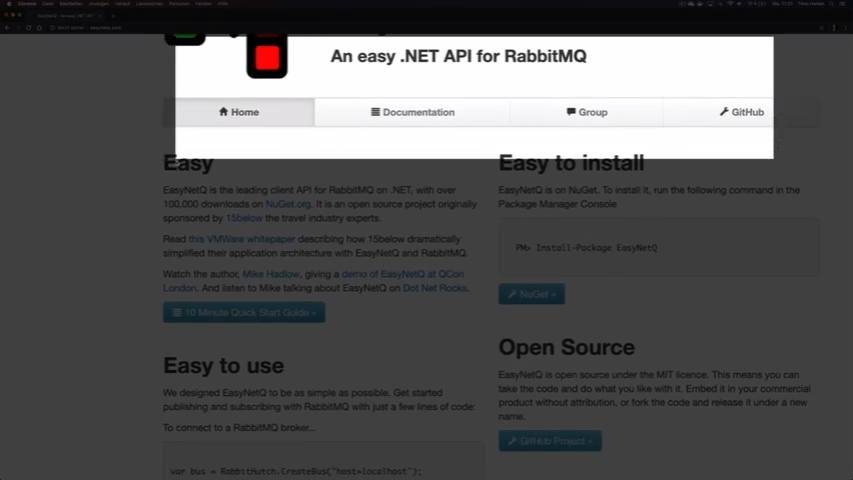
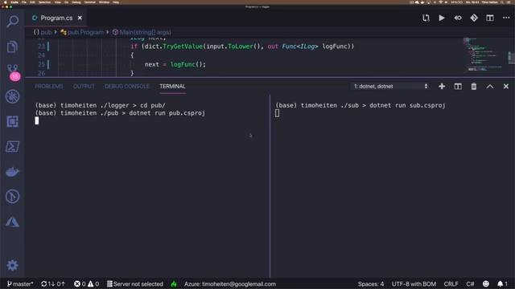
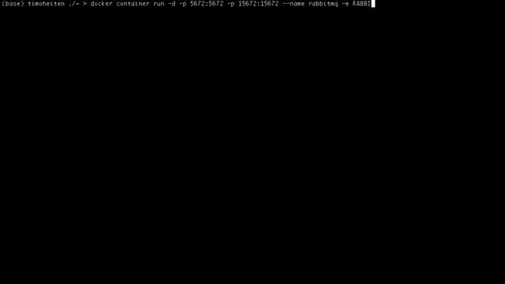
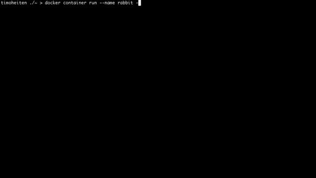
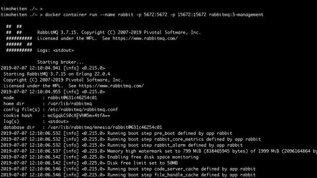
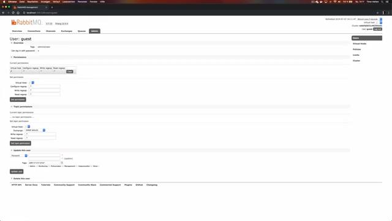
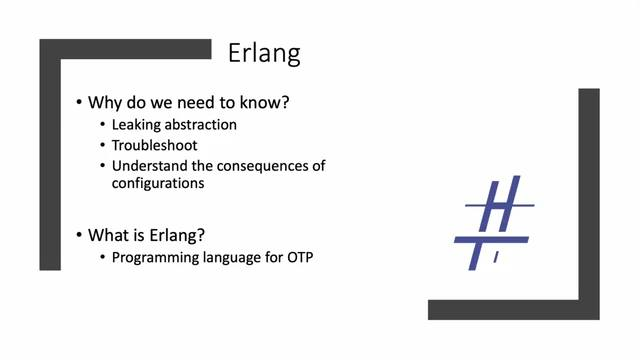

# RabbitMQ（P5–P8）可复现文档：用 Docker 跑通 RabbitMQ 管理后台

> 课程编号：BV1o39SBiEhD，覆盖 P5–P8

## 1. 这一节做什么

P5–P8 不是写业务代码，而是先把 RabbitMQ 的运行环境搭起来。课程实际完成了这几件事：

- P5 预览了两个客户端库：.NET 的 **EasyNetQ** 和 Python 的 **pika**。EasyNetQ 是对 RabbitMQ 客户端的封装，pika 是 Python 下的 RabbitMQ 客户端。这里要注意，P5 的重点是“认识客户端库”，不是完整写一套生产级代码；课程只是先让你知道 RabbitMQ 可以被不同语言的程序连接。
- P6 介绍了 RabbitMQ 底层使用的 **Erlang/OTP** 平台：节点（node）、应用（application）、Erlang cookie、节点间通信，以及存储元数据的 **Amnesia** 数据库。这一段偏原理，目的是让你知道 RabbitMQ 不是普通的“单进程小工具”，它依赖 Erlang 运行时，节点、cookie、元数据存储这些概念以后搭集群时会遇到。
- P7 从 Docker Hub 拉取 `rabbitmq:3-management` 镜像，这个镜像自带管理插件。也就是说，你不需要先装 Erlang，也不需要在容器里手动执行 `rabbitmq-plugins enable rabbitmq_management`，课程选择的镜像已经替你准备好了管理后台。
- P8 创建并启动 Docker 容器，映射 `5672` 和 `15672` 两个端口，然后在浏览器打开 `http://localhost:15672`，用 `guest / guest` 登录管理后台。到这里，环境搭建的核心目标就完成了：管理后台能打开，程序能通过 AMQP 端口连上 RabbitMQ。

所以本文的复现目标很明确：**你照着做，能在浏览器里看到 RabbitMQ 管理后台，并能用 5672 端口让程序连接 RabbitMQ。**

这一节用到的关键端口：

| 端口 | 作用 |
| --- | --- |
| 5672 | AMQP 客户端连接端口，给 pika、EasyNetQ 这类代码用 |
| 15672 | RabbitMQ 管理 Web UI / HTTP API 端口 |

注意：逐字稿里把 RabbitMQ 识别成了 “RevitMQ / RoboDemQ”，把 Erlang 识别成了 “Alarm / ALONG”，下面引用讲师原话时统一写成正确拼写。

从复现角度看，这一节其实分成两条线：一条是“容器线”，确认 Docker 能拉镜像、能启动容器、端口能映射出来；另一条是“应用线”，确认 5672 端口不是摆设，程序能连上并声明队列、发送消息、消费消息。管理后台只是让你用图形界面确认 RabbitMQ 已经跑起来，真正写业务时，代码连接的是 5672 端口，而不是 15672 端口。对前端背景的读者，可以这样对照：15672 类似你熟悉的“管理控制台 / Admin Dashboard”，5672 类似“后端 API 入口”；页面能打开不等于业务接口一定通，所以后面才需要 pika 做一次最小收发验证。

## 2. 讲师原话

> "第一个是 EasyNetQ，如你所见。这是用于 .NET 库的那个。它易于使用，因为它对 RabbitMQ 客户端做了轻量封装。"
> —— p005 [00:00]

> "第二个是 pika，它对应 Python 语言；我们马上要用它消费刚刚通过 .NET 消费过的同一条消息。"
> —— p005 [00:56]

> "Erlang 是一种用于 OpenTelecom 平台的编程语言，由电信公司爱立信开发，高度关注网络、可用性和容错。"
> —— p006 [00:29]

> "Erlang 的每次远程函数调用都像本地函数调用一样，因此二者没有区别。这使它具有很强的容错能力。"
> —— p006 [03:19]

> "不过还有很多不同的镜像，但我们只需要 3-management。"
> —— p007 [00:55]

> "我们用 -d 让它以守护进程模式在后台分离运行。然后用 -p 指定这个 Docker 容器可用的端口，先写外部可用端口，冒号后写容器内部端口。"
> —— p007 [01:54]

> "现在让我们通过 localhost:15672 连接管理界面，用户名和密码都是 guest。这个标准用户始终会为你提供。"
> —— p008 [00:29]





上面这些原话分别对应了客户端的选型、Erlang 的背景、镜像的选择、`-d` 和 `-p` 参数的含义，以及管理后台的默认账号。复现时不需要把每句话都背下来，但要知道它们对应的动作：看到 `pika` 就想到 Python 客户端，看到 `rabbitmq:3-management` 就想到“带管理插件的镜像”，看到 `-d` 就想到后台运行，看到 `-p 主机端口:容器端口` 就想到端口映射，看到 `guest / guest` 就想到默认管理员账号。

## 3. 从零复现

### 3.1 确认 Docker 已安装

课程里用 Docker 启动 RabbitMQ，不是直接在本机安装 Erlang 和 RabbitMQ。这样做的好处是：RabbitMQ 的 Erlang 运行时、插件、配置都封装在容器里，你不需要在本机处理 Erlang 版本冲突，也不容易把本机环境弄乱。

打开终端执行：

```bash
docker --version
```

如果还没有 Docker，先去 Docker 官网安装 Docker Desktop，装完后再执行上面的命令。

如果你是前端转 AI 应用工程师，可以把 Docker 理解成“把 RabbitMQ 装进一个隔离的盒子里，这个盒子自带运行环境，不会污染你本机的 Node.js / Python 环境。”这和前端项目里用 `nvm` 隔离 Node 版本、用虚拟环境隔离 Python 依赖是类似思路，只不过 Docker 隔离的是整个运行环境。

常见错误与排查：

- 如果提示 `docker: command not found`，说明 Docker CLI 没装，或者安装后终端没有重新打开、PATH 没生效。先确认 Docker Desktop 已经安装，再重开终端。
- 如果 `docker --version` 有输出，但后面执行 `docker ps` 报 `Cannot connect to the Docker daemon`，通常不是 Docker 没装，而是 Docker Desktop 没启动。先启动 Docker Desktop，等状态变成运行中再试。
- 如果公司网络限制下载镜像，`docker pull` 可能超时。这属于网络/镜像源问题，不是 RabbitMQ 配置问题；先确认能不能访问 Docker Hub，或按团队要求配置镜像加速。

### 3.2 拉取 RabbitMQ 镜像

```bash
docker pull rabbitmq:3-management
```

这个镜像既包含 RabbitMQ，也包含 `rabbitmq_management` 插件。课程里明确说：我们要的就是带 management 插件的版本。镜像名可以拆成两部分看：`rabbitmq` 是镜像仓库名，`3-management` 是标签。标签里的 `management` 表示这个变体自带管理插件；如果不带 `management`，容器仍然可以跑 AMQP，但你不一定能直接打开 15672 管理后台。

执行 `docker pull` 时，终端会分层下载镜像。第一次拉取会比较慢，后面本机已经有这个镜像时，通常会提示 `Image is up to date` 或直接复用本地层。拉取完成后，可以用 `docker images` 查看本地镜像列表，确认能看到 `rabbitmq` 和 `3-management` 标签。



常见错误与排查：

- 如果提示 `pull access denied` 或 `manifest unknown`，先检查镜像名和标签是否拼错。课程用的是 `rabbitmq:3-management`，注意中间是冒号，不是斜杠。
- 如果下载到一半失败，先重试一次；仍然失败时再排查网络、代理或 Docker Desktop 的磁盘空间。
- 如果 `docker images` 里已经有同名镜像，不一定要重复拉取；但如果你要确保和课程一致，重新执行 `docker pull` 也是安全的。

### 3.3 启动 RabbitMQ 容器

课程里的启动命令等价于：

```bash
docker container run -d \
  --name rabbit \
  -p 5672:5672 \
  -p 15672:15672 \
  rabbitmq:3-management
```

说明：

- `-d`：后台运行，容器不会占住当前终端。
- `--name rabbit`：给容器起名 `rabbit`，后面执行 `docker logs rabbit`、`docker exec rabbit ...` 比较方便。
- `-p 5672:5672`：把容器内的 5672 端口映射到本机的 5672 端口。代码连 RabbitMQ 时走这个端口。
- `-p 15672:15672`：把容器内的 15672 端口映射到本机。浏览器访问管理后台时走这个端口。
- 最后的 `rabbitmq:3-management` 是镜像名。

这里再强调一次 `-p` 的顺序：左边是“宿主机端口”，也就是你在浏览器或代码里访问的端口；右边是“容器内部端口”，也就是 RabbitMQ 在容器里监听的端口。写成 `-p 5672:5672` 时两边一样，看起来不直观；如果写成 `-p 5673:5672`，就表示你本机访问 5673，Docker 再转发到容器里的 5672。对前端读者，可以类比本地开发代理：浏览器访问一个地址，代理把请求转发到另一个内部服务地址。端口映射也是类似的中转关系。

常见错误与排查：

- 如果报 `Conflict. The container name "/rabbit" is already in use`，说明之前已经有一个叫 `rabbit` 的容器。可以先执行 `docker rm -f rabbit` 删掉旧容器，或者换一个 `--name`。
- 如果报 `Bind for 0.0.0.0:5672 failed: port is already allocated`，说明本机 5672 已被其他进程占用。可以先用 `lsof -i :5672` 或 `docker ps` 排查，也可以把宿主机端口改成其他值，例如 `-p 5673:5672`，然后代码连接时把端口改成 5673。
- 如果命令执行后没有报错，但 `docker ps` 看不到容器，说明容器可能启动后立刻退出了。执行 `docker ps -a --filter name=rabbit` 查看状态，再执行 `docker logs rabbit` 看退出原因。

### 3.4 查看启动日志

```bash
docker logs rabbit
```

课程里说，启动后会看到 RabbitMQ 的 ASCII 字符画，以及以下信息：

- 节点名称
- home 目录
- 日志文件路径
- 配置文件路径

具体字段名请以实际输出的日志为准。

日志的作用不是“看一眼就完了”，而是帮你确认容器内部到底有没有启动成功。比如日志里能看到节点名，说明 Erlang 节点已经起来了；如果日志里反复出现启动失败、cookie 错误、权限错误，就要根据报错继续排查。管理后台打不开时，第一步也应该是看 `docker logs rabbit`，而不是盲目重装。



如果你执行了上面的命令，但是启动过程有异常，可以再执行：

```bash
docker ps -a --filter name=rabbit
```

看看容器状态是否是 `Up`。

常见错误与排查：

- 如果提示 `No such container: rabbit`，说明容器还没创建成功，或者名字不是 `rabbit`。用 `docker ps -a` 查看所有容器名。
- 如果状态是 `Exited`，先看 `docker logs rabbit` 的最后几十行。常见原因是端口冲突、镜像标签错误、磁盘空间不足，或者挂载配置有误。
- 如果状态是 `Up` 但管理后台打不开，先确认端口映射是否包含 `15672:15672`，再确认浏览器访问的是 `http://localhost:15672`，不是 `https`。

### 3.5 打开管理后台

浏览器打开：

```text
http://localhost:15672
```

用户名：

```text
guest
```

密码：

```text
guest
```

这是 RabbitMQ 默认提供的标准账号。

登录后你会看到 RabbitMQ 管理后台的 Overview 页面。这个页面能看到：

- RabbitMQ 版本
- Erlang 版本
- 节点名称
- 已开启的端口：AMQP、clustering、HTTP
- Exchanges、Queues、Consumers 等统计数据

管理后台可以理解为 RabbitMQ 的“可视化总览页”。前端开发时你经常看浏览器 DevTools 的 Network 面板确认请求有没有发出去；这里则用 Overview、Exchanges、Queues 页面确认消息中间件的状态。页面能登录，说明 15672 端口和 management 插件是通的；但能否收发消息，还要看 5672 端口和应用代码。



课程还介绍了后台里的几个重要入口：

- **Exchanges**：默认会有 7 个 exchange，这是 RabbitMQ 自带创建的。课程口径是 7 个；如果你拉到的 3.x 小版本不同，界面上的默认项名称或数量可能略有差异，以实际镜像为准，但正常情况下不应是空列表。
- **Queues**：目前为 0，后面声明队列后会在这里看到。队列是消息真正堆积和等待消费的地方。
- **Admin**：可以创建用户、设置权限、管理 virtual host、policies、limits、clusters。课程 P8 只演示了入口，没有展开远程用户配置和集群配置。



常见错误与排查：

- 如果浏览器提示无法访问，先确认容器是 `Up`，再确认 `docker ps` 的 PORTS 列里出现了 `0.0.0.0:15672->15672/tcp` 或类似映射。
- 如果登录失败，确认用户名和密码都是 `guest`，不要多输空格。注意 `guest` 默认只允许从本机访问，浏览器访问 `localhost` 通常没问题；如果你从另一台机器访问 Docker 主机的 15672，可能需要在 Admin 页面创建新用户。
- 如果页面能打开但 Exchanges、Queues 数据异常，先刷新页面；仍然异常时看 `docker logs rabbit` 是否有插件或节点报错。

### 3.6 可选：用 pika 验证 5672 端口真的能收发消息

课程 P5 展示了 pika 代码，但逐字稿里没有给出完整可复制的代码文件。下面是一份最小验证代码，不是课程逐字稿原文，是我为了确认 5672 端口通信正常补写的。

先安装依赖：

```bash
pip install -r requirements.txt
```

这里默认当前目录已经有第 4 节给出的 `requirements.txt`。如果你还没创建这个文件，先看第 4.2 节。

先启动消费者：

```bash
python receive.py
```

再开一个新终端运行生产者：

```bash
python send.py
```

如果消费者终端打印出了 `Received`，说明 RabbitMQ 已经在 Docker 里正常工作了。

这个验证的意义是：管理后台能打开，只能证明 15672 和 management 插件正常；消费者能收到生产者发的消息，才证明 5672 的 AMQP 通信链路也正常。对前端读者，这有点像“页面能打开”和“接口能返回数据”是两件事：前者是管理界面，后者是业务通道。

常见错误与排查：

- 如果 `pip install` 失败，先确认 Python 和 pip 可用，再确认当前目录确实有 `requirements.txt`。
- 如果 `receive.py` 报连接拒绝，先确认容器在运行，且端口映射包含 `5672:5672`。
- 如果消费者一直停在 `Waiting for messages`，先确认 `send.py` 是在另一个终端运行的，并且两个脚本连接的是同一个 host、port 和队列名。

## 4. 完整代码

### 4.1 一键启动脚本：`run-rabbitmq.sh`

```bash
#!/usr/bin/env bash
set -euo pipefail

IMAGE="${RABBITMQ_IMAGE:-rabbitmq:3-management}"
CONTAINER_NAME="${RABBITMQ_CONTAINER_NAME:-rabbit}"

docker pull "$IMAGE"

# 如果已经存在同名容器，先删掉，避免重名冲突
docker rm -f "$CONTAINER_NAME" 2>/dev/null || true

docker container run -d \
  --name "$CONTAINER_NAME" \
  -p 5672:5672 \
  -p 15672:15672 \
  "$IMAGE"

echo "Waiting for RabbitMQ to start..."
for i in $(seq 1 30); do
  if docker exec "$CONTAINER_NAME" rabbitmq-diagnostics -q check_running >/dev/null 2>&1; then
    echo "RabbitMQ is running: http://localhost:15672 (guest/guest)"
    exit 0
  fi
  sleep 1
done

echo "RabbitMQ did not become ready in 30s. Run: docker logs $CONTAINER_NAME" >&2
exit 1
```

这个脚本把课程里的手动命令固化下来了：拉镜像、删旧容器、启动新容器、等待 RabbitMQ 真正进入运行状态。脚本不是课程逐字稿里的原文，是为了复现方便补的；但它执行的 Docker 动作和课程一致。

### 4.2 Python 依赖：`requirements.txt`

```txt
pika==1.3.2
```

固定版本的好处是复现结果更稳定，不会因为明天安装了新版本导致接口行为变化。

### 4.3 生产者：`send.py`

```python
import pika

credentials = pika.PlainCredentials("guest", "guest")
parameters = pika.ConnectionParameters(
    host="127.0.0.1",
    port=5672,
    credentials=credentials,
)

connection = pika.BlockingConnection(parameters)
channel = connection.channel()

channel.queue_declare(queue="hello")

channel.basic_publish(
    exchange="",
    routing_key="hello",
    body=b"Hello from pika",
)

print(" [x] Sent 'Hello from pika'")
connection.close()
```

### 4.4 消费者：`receive.py`

```python
import os
import sys
import pika


def main():
    credentials = pika.PlainCredentials("guest", "guest")
    parameters = pika.ConnectionParameters(
        host="127.0.0.1",
        port=5672,
        credentials=credentials,
    )

    connection = pika.BlockingConnection(parameters)
    channel = connection.channel()

    channel.queue_declare(queue="hello")

    def callback(ch, method, properties, body):
        print(f" [x] Received {body!r}")
        ch.basic_ack(delivery_tag=method.delivery_tag)

    channel.basic_consume(
        queue="hello",
        on_message_callback=callback,
        auto_ack=False,
    )

    print(" [*] Waiting for messages. To exit press CTRL+C")
    channel.start_consuming()


if __name__ == "__main__":
    try:
        main()
    except KeyboardInterrupt:
        print("Interrupted")
        try:
            sys.exit(0)
        except SystemExit:
            os._exit(0)
```

## 5. 逐行解释

### 5.1 `run-rabbitmq.sh`

- `set -euo pipefail`：脚本里任何一条命令失败就立刻退出，避免 RabbitMQ 没启动成功还继续往下走。拆开看，`-e` 是遇到错误退出，`-u` 是使用未定义变量时报错，`-o pipefail` 是管道中任意一段失败都让整条管道失败。
- `IMAGE="${RABBITMQ_IMAGE:-rabbitmq:3-management}"`：允许你通过环境变量替换镜像名，不设置时默认用课程的 `rabbitmq:3-management`。这样你想临时换镜像标签时，不用改脚本。
- `CONTAINER_NAME="${RABBITMQ_CONTAINER_NAME:-rabbit}"`：容器名也支持环境变量覆盖，默认叫 `rabbit`。
- `docker pull "$IMAGE"`：先拉镜像，避免启动时才发现本地没有镜像。
- `docker rm -f "$CONTAINER_NAME" 2>/dev/null || true`：如果之前启动过 `rabbit` 容器，先强制删掉。第一次运行会报“容器不存在”，用 `|| true` 忽略。`2>/dev/null` 是把错误输出丢掉，避免终端出现干扰信息。
- `docker container run -d`：后台启动容器，和课程里 `-d` 参数一样。
- `--name "$CONTAINER_NAME"`：给容器命名，后续日志、诊断命令都用这个名字。
- `-p 5672:5672`：主机端口映射到容器端口。左边是你在本机访问的端口，右边是容器内部 RabbitMQ 监听的端口。
- `-p 15672:15672`：管理后台端口映射。没有这一行，浏览器就打不开管理后台。
- `rabbitmq-diagnostics -q check_running`：脚本额外加的等待逻辑，课程里没有这个命令。作用是每隔 1 秒检查 RabbitMQ 是否真正 ready。`-q` 表示安静模式，减少输出；`>/dev/null 2>&1` 是把标准输出和错误输出都丢掉，只关心命令成功与否。
- `for i in $(seq 1 30)`：最多等 30 秒。容器启动后不是立刻就能接受连接，等待一下比马上访问更稳。
- `exit 1`：如果 30 秒还没 ready，脚本以失败状态退出，并提示你去看日志。

如果你不想用脚本，手动执行下面这一条命令就是课程里的核心动作：

```bash
docker container run -d --name rabbit -p 5672:5672 -p 15672:15672 rabbitmq:3-management
```

常见错误与排查：如果脚本在 `docker rm -f` 这一步失败，通常不是大问题，第一次运行没有旧容器时会返回非零；脚本已经用 `|| true` 处理。如果脚本最后提示 30 秒未 ready，先执行 `docker logs rabbit`，重点看端口冲突、Erlang cookie、磁盘权限等报错。

### 5.2 `send.py`

- `import pika`：导入 Python 的 RabbitMQ 客户端库。
- `pika.PlainCredentials("guest", "guest")`：RabbitMQ 默认账号密码。课程里管理后台也是用这个账号登录。
- `pika.ConnectionParameters(host="127.0.0.1", port=5672, credentials=credentials)`：指定连接地址。`127.0.0.1` 表示本机，`5672` 是 AMQP 协议端口。因为 Docker 做了端口映射，所以代码连本机 5672 就会转发到容器里的 RabbitMQ。
- `pika.BlockingConnection(...)`：建立一条阻塞式连接。这个写法是同步的，代码会一直等到连接建立完成。如果连接失败，这里会直接抛异常。
- `channel = connection.channel()`：创建通道。RabbitMQ 的很多操作都在 channel 上完成，而不是直接在 connection 上完成。
- `channel.queue_declare(queue="hello")`：确保名为 `hello` 的队列存在。RabbitMQ 里发消息之前，队列必须存在。这个声明是幂等的：队列不存在就创建，已存在就复用。
- `channel.basic_publish(exchange="", routing_key="hello", body=b"Hello from pika")`：发布消息到默认 exchange，路由键是 `hello`，消息内容是一段字节串。`exchange=""` 表示使用默认 exchange，消息会按 routing key 路由到同名队列。
- `print(" [x] Sent 'Hello from pika'")`：本地打印，表示发送动作已经执行。
- `connection.close()`：关闭连接。短脚本执行完关闭连接是正常做法。

在 JS/Node 里，这一步对应的通常是 `amqplib` 的异步写法：`await connection.createChannel()`，然后 `channel.assertQueue()`、`channel.sendToQueue()`。课程没有讲 Node.js 客户端，这里只是一个类比。对前端读者，`queue_declare` 有点像先确保某个接口或资源存在，再往里发数据；`basic_publish` 则像向某个队列投递一条事件。

### 5.3 `receive.py`

- `import os`、`import sys`、`import pika`：导入标准库和 pika。
- `def main():`：把主要逻辑放进函数，方便异常处理。
- `pika.PlainCredentials("guest", "guest")`、`pika.ConnectionParameters(...)`：和生产者一样，连接本机 5672。
- `connection = pika.BlockingConnection(parameters)`：建立阻塞连接。
- `channel = connection.channel()`：创建通道。
- `channel.queue_declare(queue="hello")`：消费者这里再声明一次队列是安全的。如果队列已经存在，这条命令不会重复创建；如果生产者还没启动，消费者先声明队列也能保证队列存在。
- `def callback(ch, method, properties, body):`：消息到达后的回调函数。`body` 是消息内容，`method` 里包含投递标签等信息。
- `print(f" [x] Received {body!r}")`：打印收到的消息。`!r` 会用 repr 形式显示，方便看到字节串格式。
- `ch.basic_ack(delivery_tag=method.delivery_tag)`：告诉 RabbitMQ“这条消息处理完了，可以删掉了”。如果消费者进程挂了，RabbitMQ 还会重新投递这条消息。这里用的是手动 ack，所以 `auto_ack=False`。
- `channel.basic_consume(queue="hello", on_message_callback=callback, auto_ack=False)`：开始消费队列。消息到达后，RabbitMQ 会调用 `callback`。`auto_ack=False` 表示不要自动确认，必须由代码显式 ack。
- `channel.start_consuming()`：进入阻塞监听状态，等待消息。按 `CTRL+C` 可以中断。
- `if __name__ == "__main__":`：脚本直接运行时才执行下面的异常处理。
- `except KeyboardInterrupt`：捕获用户按 `CTRL+C` 的中断，打印 `Interrupted` 后退出。后面的 `sys.exit(0)` 和 `os._exit(0)` 是为了让退出过程更干净。

对于前端背景的读者：这个 callback 形式类似于 Node.js 里的回调函数，但 RabbitMQ 的消费是网络层面的消息分发，不是同一个进程内的事件循环。你写的 `callback` 在消息到达时被调用，处理完要显式 ack，否则 RabbitMQ 会认为消息还没处理完。



## 6. 复现检查清单

按照下面清单打勾，全部满足说明你已经把课程 P5–P8 的环境复现成功。

- [ ] 执行 `docker --version` 不报错。验证方法：终端应输出 `Docker version ...`。如果提示 `command not found`，检查 Docker 是否安装、终端是否重开；如果后面 `docker ps` 报 daemon 错误，检查 Docker Desktop 是否启动。
- [ ] 执行 `docker pull rabbitmq:3-management` 成功结束。验证方法：最后应看到 `Status: Downloaded newer image for rabbitmq:3-management` 或 `Image is up to date`；执行 `docker images` 能看到 `rabbitmq` 和 `3-management`。
- [ ] 执行启动容器的命令后，`docker ps --filter name=rabbit` 能看到容器状态是 `Up`。验证方法：输出里 `STATUS` 列应为 `Up ...`，`PORTS` 列应包含 `5672` 和 `15672` 的映射。
- [ ] 执行 `docker logs rabbit` 能看到 RabbitMQ 启动信息，包含 node、home directory、log file。具体字段名请以实际输出为准。验证方法：日志里应出现节点启动、管理插件启动相关内容；如果容器已退出，先看日志最后几行定位原因。
- [ ] 浏览器打开 `http://localhost:15672` 能出现登录页。验证方法：地址必须是 `http`，端口必须是 `15672`；如果打不开，先确认容器 `Up` 且端口映射存在。
- [ ] 输入 `guest / guest` 能登录。验证方法：用户名和密码都区分大小写，默认都是小写 `guest`；登录失败时确认没有多余空格，并确认是从本机 `localhost` 访问。
- [ ] 管理后台 Overview 页面能看到 RabbitMQ 版本、Erlang 版本、node 名称。验证方法：登录后默认进入 Overview，页面上应有版本信息和节点信息；如果只看到登录页，说明还没登录成功。
- [ ] Exchanges 页面能看到 7 个默认 exchange。验证方法：点击顶部 Exchanges 标签，默认 exchange 应出现在列表里；课程口径是 7 个，不同小版本界面可能有细微差异，以实际镜像为准。
- [ ] Queues 页面当前是空的。验证方法：点击 Queues 标签，刚启动且还没运行生产/消费脚本时，队列列表应为空或没有 `hello` 队列；运行发送脚本后应能看到 `hello`。
- [ ] 可选：执行 `python receive.py` 后，再执行 `python send.py`，`receive.py` 能看到 `Received`。验证方法：先让消费者保持运行，再在另一个终端运行生产者；消费者终端应打印 `[x] Received b'Hello from pika'` 类似内容。

## 7. 课里没讲但你会撞上的

下面先把本段要展开的问题汇总成表格（现象 / 原因 / 怎么办）：

| 现象 | 原因 | 怎么办 |
| --- | --- | --- |
| 想照抄 P5 的客户端代码，但逐字稿里没有完整文件 | P5 只是预览 EasyNetQ 和 pika，P5–P8 没有展开完整业务代码 | 用本文第 4 节的最小 Python 代码验证 5672；.NET 示例看后续课程 |
| 浏览器能登录，但另一台机器上的程序连不上 5672 | `guest` 默认只允许本机访问，远程连接会被拒绝 | 到 Admin 页面创建新用户并设置权限，或用本机程序先验证 |
| 删除容器后，之前声明的队列、exchange、用户都没了 | 数据写在容器可写层，`docker rm` 删除容器时一起丢失 | 启动时加数据卷 `-v rabbitmq_data:/var/lib/rabbitmq` |
| 以后搭多节点时，节点之间无法通信 | P6 提到的 Erlang cookie 不一致，节点不認 | 集群节点使用相同 `.erlang.cookie`，先按官方集群步骤配置 |
| 不同时间拉镜像，RabbitMQ 版本不一样 | `rabbitmq:3-management` 是滚动标签，会指向 3.x 最新版 | 需要固定版本时改用具体标签，例如 `rabbitmq:3.13-management` |
| Node.js 项目里 import pika 失败 | pika 是 Python 客户端，不是 Node.js 库 | Node.js 使用 `amqplib` 等客户端，连接 5672 做同样的事 |
| 启动容器报端口已被占用 | 本机 5672 或 15672 已被其他进程/容器占用 | 停掉占用进程，或改宿主机端口映射并同步改代码/浏览器地址 |

### 7.1 P5–P8 没有给出完整客户端代码

P5 只是预览了 EasyNetQ 和 pika 的代码，逐字稿里没有完整可以复制的代码文件。上面第 4 节的 Python 代码是我补的最小验证版本，不是课程原文。如果你想复现课程里 .NET 的 EasyNetQ 示例，需要看这门课后续的视频，P5–P8 并没有展开。

这也意味着你不能把 P5 的截图当成“完整项目代码”直接照抄。复现时应该把目标拆成两层：第一层是环境层，确认 Docker、15672、5672 都正常；第二层才是客户端层，用 pika 发一条消息、收一条消息，证明环境可用。EasyNetQ 的 .NET 代码属于第二层的另一种语言实现，等后续课程展开时再看更合适。

### 7.2 `guest` 账号默认只允许本机访问

课程里用 `guest / guest` 能直接登录，是因为浏览器访问的是 `localhost`。RabbitMQ 的默认策略是：`guest` 只能从 localhost 连接。如果你的程序部署在另一台机器上，连 Docker 主机的 5672 端口可能会被拒绝。

解决办法是到管理后台 Admin 页面创建一个新用户，并设置权限。课程 P8 只提到了 Admin 页面可以管理用户和权限，没有演示完整远程连接配置。实际排查时，先区分是“15672 网页登录失败”还是“5672 程序连接失败”：网页登录看账号密码和访问地址，程序连接还要看用户权限、virtual host、防火墙和端口映射。

### 7.3 容器删除后，队列和配置会丢

`docker rm -f rabbit` 会删除容器，RabbitMQ 里声明的队列、exchange、用户等数据也会一起消失。如果想保留数据，需要在启动命令里加数据卷：

```bash
docker container run -d \
  --name rabbit \
  -p 5672:5672 \
  -p 15672:15672 \
  -v rabbitmq_data:/var/lib/rabbitmq \
  rabbitmq:3-management
```

这个 `-v` 参数不是 P5–P8 课程里讲的，是你以后长期使用一定会遇到的。加上命名卷后，即使删除容器，数据仍然保存在 `rabbitmq_data` 这个卷里；下次用同一个卷启动新容器，队列和配置还能恢复。验证方法是：加卷启动后声明一个队列，删除容器，再用同一个卷启动，看队列是否还在。

### 7.4 Erlang cookie 是多节点通信的关键

P6 提到，Erlang 节点之间通信需要配置相同的 Erlang cookie。课程只讲了概念，没有做多节点实验。以后你要搭 RabbitMQ 集群时，会遇到 `.erlang.cookie` 文件不匹配导致节点无法互相通信的问题。

单机 Docker 复现时，你通常不会直接碰到这个问题，因为只有一个节点。但只要开始做集群、做多容器编排，cookie 就会变成前置条件。排查时的思路是：先确认节点名、cookie、网络连通性，再去看 RabbitMQ 集群命令的输出；不要一上来就怀疑队列配置。

### 7.5 `rabbitmq:3-management` 是滚动标签

这个标签会一直指向 RabbitMQ 3.x 的最新版本，所以不同时间拉取，实际 RabbitMQ 版本可能不一样。如果你想固定版本，可以改成具体的镜像标签，例如：

```text
rabbitmq:3.13-management
```

但要注意，课程里用的是 `rabbitmq:3-management`，如果你改用其他标签，可能出现界面细节不同。固定标签适合需要稳定复现的实验环境；跟随滚动标签则更适合你想体验较新 3.x 版本的情况。两者没有绝对好坏，关键是把镜像标签记录下来，方便以后排查“为什么我的界面和课程截图不一样”。

### 7.6 Node.js 开发时不要用 pika

pika 是 Python 客户端。前端转 AI 应用工程师的你，如果要在 Node.js 项目里连接 RabbitMQ，常见选择是 `amqplib`。这不是课程内容，但和课程里 pika 做的事情是对应的：连接 5672 端口、声明队列、发布消息、消费消息。

对照关系可以这样记：Python 侧用 `pika`，Node.js 侧用 `amqplib`，.NET 侧课程提到了 `EasyNetQ`。语言不同，但核心动作相同：建立连接、创建 channel、声明队列、发送或消费、确认消息。只要你把本文第 4 节的 pika 流程跑通，再换成 Node.js 客户端时，概念是平移的。