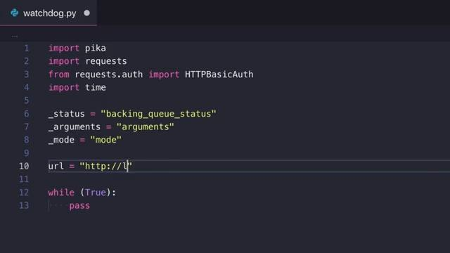
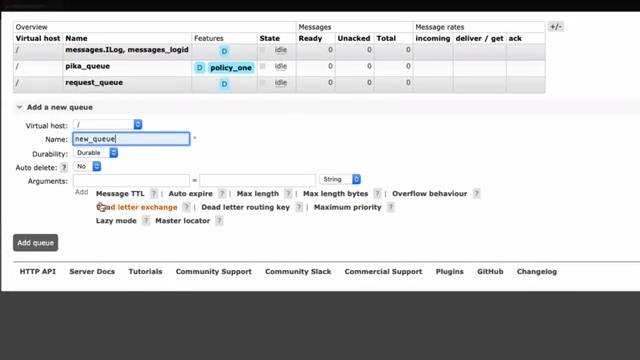
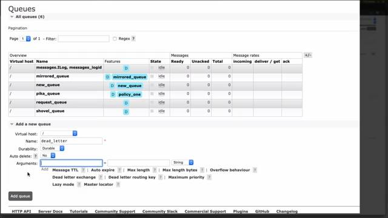
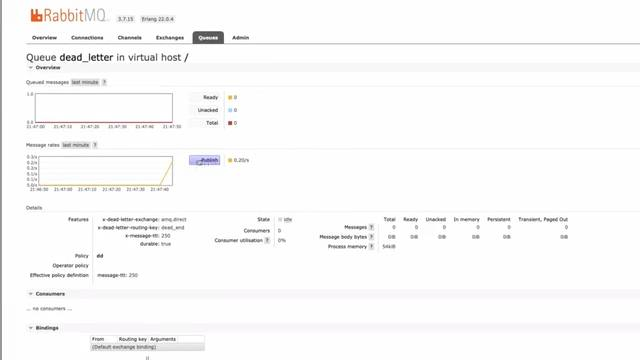
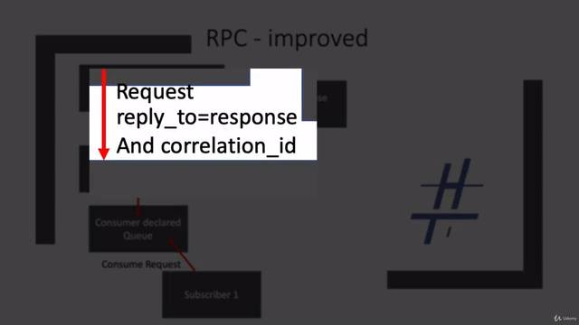
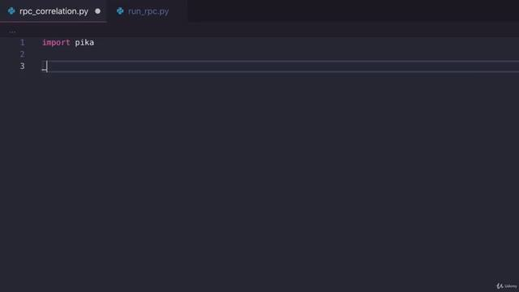
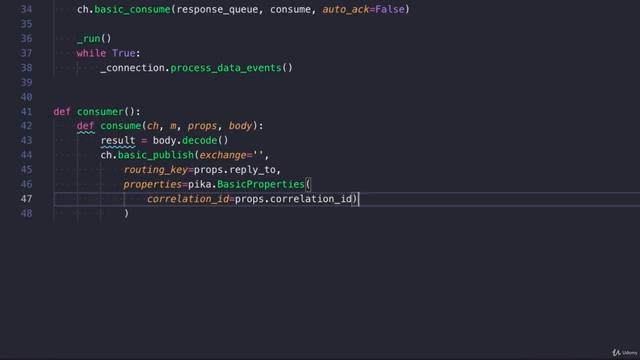

# RabbitMQ 实战：配置巡检 Watchdog、死信队列与低开销 RPC（P53–P56）

> 课程：BV1o39SBiEhD ｜ 覆盖 P53–P56
> 读者定位：前端转 AI 应用工程师。文中出现 Python 代码，语法层面只需“知道即可”；涉及并发/等待的地方我会补一句在 Node 里对应什么。

---

## 1. 这一节做什么

这四个视频（P53–P56）是同一门 RabbitMQ 课程里最后一段“工程化”内容，把它们串起来看，其实是三个可以独立落地的小工程：

**第一个是一个后台巡检程序（watchdog / daemon）。** 它不改队列，只是每隔一段时间通过 RabbitMQ 的 **HTTP 管理 API**（`15672` 端口）把某条队列的定义读出来，检查它的“队列模式”是不是 `lazy`。如果不是，就报警。为什么要做这个？讲师给的理由很实在：队列可能被别人删掉、可能是 auto-delete 队列、也可能被别人重新声明时漏了参数——只要有人有权限声明/删除队列，你期望的系统行为就有被悄悄改掉的风险。用一个几十行的脚本把它盯住，成本极低。

**第二个是死信队列（Dead Letter Exchange）的实验。** 建一条带 `250ms` 消息 TTL 的队列，消息一过期就被转发到另一个交换机（`MQDirectExchange`）再进另一条队列。这个实验的价值在于：你能亲眼看到消息在 250 毫秒内从“入口队列”穿过去，落到“兜底队列”里，从而理解 TTL + DLX 这套组合在生产里是怎么用来做“我处理不过来的消息先别丢”的。

**第三个是 RPC 的优化实现。** P55 是纯原理（PPT），P56 是代码。核心矛盾是：教科书式的 RabbitMQ RPC 会为**每一次请求**生成一条临时回复队列（server-generated queue，通常是 exclusive + auto-delete），一次问答结束队列就销毁——高频 RPC（比如一个 REST API 把活全甩给下游消费者）下会造成大量“队列抖动”（queue churn）。改进办法是：**每个 publisher 自己固定一条回复队列，用 correlation id 把响应和请求对上号**。队列只建一次，不再反复创建销毁。

产出物是一组可以直接跑起来的 Python 脚本，依赖 `pika`（AMQP 客户端）和 `requests`（调管理 API）。下面按“先备环境 → 再跑 watchdog → 再跑死信实验 → 最后跑 RPC”的顺序复现。

---

## 2. 讲师原话（带「—— pNNN [MM:SS]」）

关于 watchdog 的定位，讲师说得很直接：

> "在本视频中，我们将构建一个看门狗程序，让它在后台运行并测试我们的队列配置。为此，我们使用 HTTP API，向我们的 API 请求队列的各项取值。"
> —— p053 [00:00]

URL 的拼法他也讲了：主机、`15672`、`api/queues`、virtual host（要 URL 编码，`/` 编成 `%2F`）、最后是队列名（课里叫 `new_queue`）—— p053 [00:28]。请求用 `requests`，用 `guest/guest` 做 basic auth，拿 `response.json()`。

判断逻辑与“为什么要巡检”：

> "我们会测试队列模式是否为 lazy……如果不是 lazy，我们就抛出异常并打印“lazy 模式尚不可用”。这意味着我们得在 accept 块里加上某种告警……如果有人删除了队列，或者它是自动删除队列之类的情况，之后又被另一个用户声明，但他可能漏掉了一些东西。那么你预期的系统行为就会面临风险。"
> —— p053 [00:57]

然后是 arguments 与 policy 的优先级，这一段是全场最值钱的结论：

> "然后我们检查参数是否已设置，或者是否存在任何策略。……参数在这里以带下划线的 arguments 为标题，而当该属性通过策略设置时，我们使用带下划线的 status mode。"
> —— p053 [01:55]

以及后面实测出来的结论——**policy 覆盖不掉 arguments**：

> "我们还能看到之前谈过的内容，那就是参数始终是最重要的配置。因此你无法用策略覆盖参数。"
> —— p053 [02:53]

死信实验的目标：

> "那么在本视频中，我们创建一个队列，让它的消息在过期时路由到死信交换机。为此我们创建了那个死信队列，并带上死信交换机、消息 TTL 和死信路由键这几个参数。这里我们需要把 TTL 设为 250 毫秒，这样消息就会过期，死信交换机才能生效。"
> —— p054 [00:00]

发布端为什么用默认交换机：

> "我们基本是发布到默认交换机，也就是这里的空字符串。再次使用默认交换机，是因为所有队列都以自己的名字作为路由键绑定到默认交换机上。"
> —— p054 [01:25]

RPC 的问题定义：

> "在普通的远程过程调用中，你会创建大量队列。如果每个请求和响应周期都使用服务器生成的队列，这在队列频繁创建和销毁方面会是很重的负担，也就是之后还要把这些队列销毁掉。"
> —— p055 [00:00]

改进思路：

> "我们不为每个请求创建服务器生成的队列，而是为整个系统、或者至少为这一个发布者确定自己的响应队列。我们通过设置 reply to 头来实现这一点，填入我们自己响应队列的名字和我们的关联 ID。这个关联 ID 非常重要，因为它把这个请求与我们的发布者匹配起来。"
> —— p055 [02:18]

代码里的两个关键分支（客户端收到响应后怎么处理）：

> "我们会检查关联 ID 是否与客户端发送的相同……如果关联 ID 匹配，我们就对它执行 basic ack，并重新执行我们的 basic publish。另一方面，如果关联 ID 不匹配，我们就简单地执行 basic reject，这样之后它就能被正确的消费者消费。"
> —— p056 [01:27]

> 注：逐字稿是英文自动转写，`basic act` = `basic_ack`、`basic reject` = `basic_reject`、`Pico library` = `pika` 库。下文统一按真实 API 名书写。

---

## 3. 从零复现

### 3.1 目录结构

在任意空目录下建出这个结构（三个子目录对应三段课程内容，互不干扰）：

```
rabbitmq-lab/
├── requirements.txt
├── docker-compose.yml
├── watchdog/
│   └── queue_watchdog.py
├── dlx/
│   ├── producer.py
│   └── consumer.py
└── rpc/
    ├── rpc_correlation.py
    └── run.py
```

### 3.2 起一个 RabbitMQ（课里没讲，但你必须先有）

讲师全程是对着一个已经跑起来的 RabbitMQ 讲的，用浏览器开 `http://localhost:15672` 登录管理台。课里没有讲这台 RabbitMQ 是怎么装的。最省事的做法是用官方带管理插件的镜像：

```yaml
# docker-compose.yml
services:
  rabbitmq:
    image: rabbitmq:3-management
    container_name: rabbitmq-lab
    ports:
      - "5672:5672"     # AMQP 协议端口，pika 连这个
      - "15672:15672"   # 管理 HTTP API + 网页控制台，watchdog 调这个
    environment:
      RABBITMQ_DEFAULT_USER: guest
      RABBITMQ_DEFAULT_PASS: guest
```

```bash
docker compose up -d
docker compose logs -f rabbitmq   # 看到 "Server startup complete" 即可
```

浏览器打开 `http://localhost:15672`，用 `guest / guest` 登录。能进去，说明 `15672` 通了。

### 3.3 装 Python 依赖

```bash
python -m venv .venv
source .venv/bin/activate      # Windows: .venv\Scripts\activate
pip install -r requirements.txt
```

```text
# requirements.txt
pika==1.3.2
requests==2.32.3
```

> 版本说明：课里**没有**提任何版本号。上面两个是写作时可用的稳定版本；如果你机器上已经是 `pika 1.x` / `requests 2.x`，直接用现有的也能跑，本节的代码只用到最基础的 API。

### 3.4 第一段：把 watchdog 跑起来

1. **先在管理台建一条叫 `new_queue` 的队列**（Queues → Add a new queue，Name 填 `new_queue`，其它保持默认）。这一步对应讲师 p053 [02:23] 说的“we create one and add the lazy mute”。
2. 跑脚本：

   ```bash
   cd watchdog
   python queue_watchdog.py
   ```

3. **第一次运行必然报“lazy mode is not available yet”**——正常，队列还没开 lazy。讲师原话也是这个预期：“So lazy mode is initially not available.” —— p053 [02:05]
4. 回到管理台，把 `new_queue` 删掉重建，这次在 **Arguments** 里加一条 `x-queue-mode` = `lazy`。等最多 10 秒（脚本里 `time.sleep(10)`），终端变成 `[OK] lazy mode 生效`。
5. 再玩一次“policy 覆盖不掉 arguments”：给 `new_queue` 建一条 policy，把 queue-mode 设成 default，但队列自己的 arguments 里仍然是 lazy——脚本**依然**报 OK。这条实测就是讲师在 p053 [02:53] 强调的“arguments 永远优先级最高”。
6. 想看到报警：删掉队列，或者把 arguments 里的 `x-queue-mode` 去掉且不建 policy，终端会在下一轮打印 `[ALERT] lazy mode is not available yet`。





### 3.5 第二段：死信队列实验

队列名说明：讲师在 P54 里口头上出现过 “dead letter q” 和 “dead end” 两种叫法，并明确说路由键 “which will also be the name of the queue we will create soon”——即死信队列名和死信路由键同名。本节统一采用：

| 角色 | 名字 | 说明 |
| --- | --- | --- |
| 入口队列（带 TTL） | `dead_letter_q` | 消息在这里待 250ms 后过期 |
| 死信交换机 | `MQDirectExchange` | type = direct |
| 死信路由键 | `dead_end` | 与死信队列同名 |
| 死信队列 | `dead_end` | 过期消息最终落在这里 |

**三个名字必须三处一致**：`producer.py` 里的 `x-dead-letter-routing-key`、交换机绑定的 routing key、`consumer.py` 里消费的队列名。要改名就一起改。

操作顺序：

1. 先跑生产者（它会把交换机和两条队列都声明出来）：

   ```bash
   cd dlx
   python producer.py
   ```

   终端会连续打印 10 条 `sent: dead valley message N`。
2. **立刻**打开管理台看 `dead_letter_q`：消息数会一直是 0 或瞬间归零，因为 250ms 太短了，肉眼抓不到。讲师当时的观察是“there's a publishing going on but no messages are in the queue” —— p054 [01:54]。
3. 切到 `dead_end` 队列：消息全在这里。用管理台的 **Get messages** 拉一条出来，body 应该是 `dead valley message 1` 之类。
4. 现在跑消费者，让 `dead_end` 自动清空：

   ```bash
   python consumer.py
   ```

   终端会一条条打印收到的消息。讲师在这里补了一句：如果没有消费者，你也可以在管理台上手动 Get，一条一条“抽”出来 —— p054 [02:53]。





### 3.6 第三段：低开销 RPC

两条队列的角色先分清：

| 队列 | 谁声明 | 作用 |
| --- | --- | --- |
| `rpc_request_queue` | 客户端 + 服务端都声明（幂等） | 客户端发请求、服务端消费 |
| `rpc_response_queue` | 客户端声明 | **所有客户端共用一条**，靠 correlation id 区分 |

**关键点：`rpc_response_queue` 不再随每个请求创建销毁，全系统只有一条**。这是 P55 那张 PPT 的全部意思。

跑法（需要 4 个终端，先起客户端再起服务端，复刻讲师 p056 [02:55] 的演示顺序）：

```bash
# 终端 1、2：两个客户端先挂在那里等响应
cd rpc
python run.py 1
python run.py 2

# 终端 3：启动服务端
python run.py

# 终端 4：再来第三个客户端
python run.py 3
```

预期现象：

- 每个客户端发出请求后**阻塞等待**，直到收到 correlation id 与自己对得上的响应才打印并退出。
- 服务端每收到一条请求，打印一行，并往 `reply_to` 指定的回复队列里回一条，把 `correlation_id` 原样带回。
- 因为共用一条响应队列，某个客户端**可能先拿到别人的响应**。这时它会 `basic_reject(requeue=True)` 把消息塞回队列，并打印“丢弃非本客户端响应”——这正是讲师 p056 [01:27] 讲的那个分支。
- 最终三个客户端各拿到自己的响应。








---

## 4. 完整代码

### 4.1 `watchdog/queue_watchdog.py`

```python
"""
queue_watchdog.py

轮询 RabbitMQ 管理 HTTP API，确认 new_queue 的队列模式是 lazy。
对应课程 P53。

用法：
    python queue_watchdog.py
按 Ctrl+C 退出。
"""

import time

import requests

# 管理 API 的端口是 15672，不是 AMQP 的 5672。
# virtual host "/" 必须 URL 编码成 %2F，最后一段是队列名。
API_URL = "http://localhost:15672/api/queues/%2F/new_queue"

# 讲师在 p053 [00:28] 用的是 guest/guest 这套默认账号。
AUTH = ("guest", "guest")

# 讲师在 p053 [02:05] 提到脚本里加了 time.sleep(10)。
INTERVAL_SECONDS = 10


def fetch_queue():
    """向管理 API 取一次队列定义，返回解析后的 dict。"""
    response = requests.get(API_URL, auth=AUTH, timeout=5)
    response.raise_for_status()          # 404/401 直接抛异常，交给外层
    return response.json()


def judge_lazy(queue):
    """
    按课程里的判定顺序：先看队列自己的 arguments，
    再看是不是由 policy 设上了 queue mode。

    返回 (是否通过, 说明文字)。
    """
    arguments = queue.get("arguments") or {}
    if arguments.get("x-queue-mode") == "lazy":
        return True, "arguments.x-queue-mode = lazy"

    policy_name = queue.get("policy")
    if policy_name:
        # 命中 policy 但 arguments 里没有 x-queue-mode。
        # 课里没给这个分支的确切字段名，先如实报出来。
        return False, f"队列命中 policy={policy_name}，但 arguments 里没有 x-queue-mode"

    return False, "既没有 x-queue-mode 参数，也没有 policy"


def check_once():
    """跑一轮检查，返回 True/False。"""
    try:
        queue = fetch_queue()
    except Exception as exc:
        # 队列被删了、服务挂了、账号错了，都会走到这里。
        print(f"[ALERT] 读不到队列 {API_URL}: {exc}")
        return False

    ok, reason = judge_lazy(queue)
    if ok:
        print(f"[OK] lazy mode 生效：{reason}")
    else:
        # 讲师原话是 raise 一个异常、打印 "lazy mode is not available yet"。
        # 这里改成打印 + 返回 False，方便你在循环里连续观察。
        print(f"[ALERT] lazy mode is not available yet —— {reason}")
    return ok


def main():
    print(f"watchdog 启动，每 {INTERVAL_SECONDS}s 检查一次 {API_URL}")
    while True:
        check_once()
        time.sleep(INTERVAL_SECONDS)


if __name__ == "__main__":
    main()
```

### 4.2 `dlx/producer.py`

```python
"""
producer.py

向死信实验的入口队列投递消息。
对应课程 P54。

用法：
    python producer.py
"""

import pika

AMQP_HOST = "localhost"

# 入口队列：消息在这里活 250ms 就会过期
DEAD_LETTER_QUEUE = "dead_letter_q"

# 死信交换机（direct 类型）和死信路由键 / 死信队列名
DLX_EXCHANGE = "MQDirectExchange"
DLX_ROUTING_KEY = "dead_end"

MESSAGE_COUNT = 10


def main():
    connection = pika.BlockingConnection(pika.ConnectionParameters(AMQP_HOST))
    channel = connection.channel()

    # 声明死信交换机。课前讲师是在管理台手建的，
    # 用代码声明可以保证你本地一定有这个 exchange。
    channel.exchange_declare(
        exchange=DLX_EXCHANGE,
        exchange_type="direct",
        durable=True,
    )

    # 声明入口队列，并把三个死信相关的参数挂上去。
    # 注意：如果同名队列已经存在且参数不同，RabbitMQ 会直接报错，
    # 需要先在管理台把旧队列删掉。
    channel.queue_declare(
        queue=DEAD_LETTER_QUEUE,
        durable=True,
        arguments={
            "x-message-ttl": 250,                      # 毫秒
            "x-dead-letter-exchange": DLX_EXCHANGE,
            "x-dead-letter-routing-key": DLX_ROUTING_KEY,
        },
    )

    # 死信队列本身没有参数，但必须绑到死信交换机上，
    # 否则消息过期后没有落点。
    channel.queue_declare(queue=DLX_ROUTING_KEY, durable=True)
    channel.queue_bind(
        queue=DLX_ROUTING_KEY,
        exchange=DLX_EXCHANGE,
        routing_key=DLX_ROUTING_KEY,
    )

    # 发布到默认交换机（名字是空字符串），routing key 就是队列名。
    for i in range(1, MESSAGE_COUNT + 1):
        body = f"dead valley message {i}"
        channel.basic_publish(
            exchange="",
            routing_key=DEAD_LETTER_QUEUE,
            body=body,
        )
        print(f"sent: {body}")

    connection.close()
    print("全部发送完成，去管理台看 dead_end 队列")


if __name__ == "__main__":
    main()
```

### 4.3 `dlx/consumer.py`

```python
"""
consumer.py

消费死信队列 dead_end。
对应课程 P54 的后半段。

用法：
    python consumer.py
按 Ctrl+C 退出。
"""

import pika

AMQP_HOST = "localhost"
QUEUE = "dead_end"          # 与 DLX_ROUTING_KEY 保持一致


def on_message(channel, method, properties, body):
    print(f"[dead_end] 收到: {body.decode()}")
    # 手动 ack：处理完才告诉 RabbitMQ 可以删掉这条消息
    channel.basic_ack(delivery_tag=method.delivery_tag)


def main():
    connection = pika.BlockingConnection(pika.ConnectionParameters(AMQP_HOST))
    channel = connection.channel()

    channel.queue_declare(queue=QUEUE, durable=True)

    # prefetch_count 课里没讲，但加上它可以让一个消费者一次只拿一条，
    # 你观察管理台时更容易对上数。
    channel.basic_qos(prefetch_count=1)

    channel.basic_consume(
        queue=QUEUE,
        on_message_callback=on_message,
        auto_ack=False,
    )
    print(f"等待 {QUEUE} 上的死信，Ctrl+C 退出")
    channel.start_consuming()


if __name__ == "__main__":
    main()
```

### 4.4 `rpc/rpc_correlation.py`

```python
"""
rpc_correlation.py

改进版 RabbitMQ RPC：所有客户端共用一条响应队列，用 correlation id 对号。

对应课程 P55（原理）+ P56（实现）。

- client()：发一条请求，阻塞等自己的响应
- server()：一直消费请求队列，按 reply_to 回包
"""

import pika

AMQP_HOST = "localhost"

REQUEST_QUEUE = "rpc_request_queue"
RESPONSE_QUEUE = "rpc_response_queue"


def _connect():
    """建连 + 建 channel，两个角色共用。"""
    connection = pika.BlockingConnection(pika.ConnectionParameters(AMQP_HOST))
    channel = connection.channel()
    # 两条队列都声明成幂等的，客户端和服务端谁先起都不会 404。
    channel.queue_declare(queue=REQUEST_QUEUE, durable=False)
    channel.queue_declare(queue=RESPONSE_QUEUE, durable=False)
    return connection, channel


def client(correlation_id, message):
    """
    客户端：发布请求，然后从共享响应队列里等 correlation id 对得上的那一条。
    """
    connection, channel = _connect()
    print(f"[client {correlation_id}] 已连接，准备发送: {message}")

    # reply_to 指向共用的响应队列，correlation_id 用来区分是谁的响应
    properties = pika.BasicProperties(
        reply_to=RESPONSE_QUEUE,
        correlation_id=correlation_id,
    )

    channel.basic_publish(
        exchange="",                    # 默认交换机
        routing_key=REQUEST_QUEUE,
        body=message,
        properties=properties,
    )
    print(f"[client {correlation_id}] 请求已发出，等待响应…")

    def on_response(ch, method, props, body):
        if props.correlation_id == correlation_id:
            # 是我的响应：ack 掉，然后结束消费
            ch.basic_ack(delivery_tag=method.delivery_tag)
            print(f"[client {correlation_id}] 收到响应: {body.decode()}")
            ch.stop_consuming()
        else:
            # 不是我的：reject 并放回队列，让真正的客户端去拿
            ch.basic_reject(delivery_tag=method.delivery_tag, requeue=True)
            print(
                f"[client {correlation_id}] 丢弃非本客户端响应 "
                f"correlation_id={props.correlation_id}"
            )

    channel.basic_consume(
        queue=RESPONSE_QUEUE,
        on_message_callback=on_response,
        auto_ack=False,
    )
    channel.start_consuming()

    connection.close()
    print(f"[client {correlation_id}] 结束")


def server():
    """
    服务端：消费请求队列，把响应发回 reply_to 指定的队列，
    并把 correlation_id 原样带回去。
    """
    connection, channel = _connect()
    print(f"[server] 开始消费 {REQUEST_QUEUE}，Ctrl+C 退出")

    def on_request(ch, method, props, body):
        request_text = body.decode()
        response_text = f"response to: {request_text}"

        # routing_key 用请求里带过来的 reply_to，交换机仍是默认交换机
        ch.basic_publish(
            exchange="",
            routing_key=props.reply_to,
            body=response_text,
            properties=pika.BasicProperties(
                correlation_id=props.correlation_id,
            ),
        )
        # 回包成功后再 ack 请求，避免消息丢失
        ch.basic_ack(delivery_tag=method.delivery_tag)
        print(
            f"[server] 已处理 {request_text} "
            f"(reply_to={props.reply_to}, correlation_id={props.correlation_id})"
        )

    channel.basic_qos(prefetch_count=1)
    channel.basic_consume(
        queue=REQUEST_QUEUE,
        on_message_callback=on_request,
        auto_ack=False,
    )
    channel.start_consuming()


if __name__ == "__main__":
    print("请用 run.py 启动：python run.py          # 服务端")
    print("               python run.py <编号>      # 客户端")
```

### 4.5 `rpc/run.py`

```python
"""
run.py

课程 P56 里那个「解析命令行、决定起客户端还是服务端」的入口脚本。

用法：
    python run.py           # 起服务端
    python run.py 1         # 起一个 correlation id = "1" 的客户端
"""

import sys

from rpc_correlation import client, server

if __name__ == "__main__":
    if len(sys.argv) > 1:
        # 有参数 = 客户端。课里演示时用的是可读的编号，
        # 生产上应该换成 uuid.uuid4() 之类保证唯一。
        cid = sys.argv[1]
        client(correlation_id=cid, message=f"message {cid}")
    else:
        # 没参数 = 服务端
        server()
```

---

## 5. 逐行解释

### 5.1 watchdog 的三个判断点

- `API_URL = "http://localhost:15672/api/queues/%2F/new_queue"`：这一段就是讲师 p053 [00:28] 口述的拼接过程——主机、`15672`、`api/queues`、virtual host、队列名。**最容易错的是 virtual host**：默认 vhost 是 `/`，在 URL 路径里必须写成 `%2F`（讲师原话是 “the virtual host which will be present to f for the url encoded white space”，即 `%2F`）。写成 `/api/queues///new_queue` 会 404。
- `AUTH = ("guest", "guest")`：管理 API 走的是 HTTP Basic 认证，不是 AMQP 那套。这也是为什么 `requests` 就够了，不需要 `pika`。
- `response.raise_for_status()`：讲师把整段包在 `try/except` 里（p053 [00:57]：“we wrap all of our code in a try accept block”），目的是“任何异常都要能报警”，而不是让脚本静默死掉。这里 `raise_for_status()` 把 404（队列被删了）和 401（账号错了）都变成异常，正好落进 `except`。
- `judge_lazy()` 的顺序：**先 arguments，再 policy**。这对应讲师 p053 [01:55] 那段“check either if the arguments are set or if there's any policy”。`arguments.get("x-queue-mode") == "lazy"` 是确定性判断；policy 那条分支，逐字稿里那句 “we use the underscore status mode” 转写得太模糊，无法还原出确切字段名，所以代码里只做“命中 policy 但没有 arguments”的如实报告，把结论交给你在真实响应上确认。
- `time.sleep(10)`：讲师明确说脚本里加了 10 秒（p053 [02:05]），视频里因为快进所以看不出来。**在 Node 里这一行对应 `await new Promise(r => setTimeout(r, 10000))`**，语义完全一样，只是 JS 不阻塞事件循环、Python 会阻塞当前线程。

### 5.2 死信三参数，一个都不能少

```python
arguments={
    "x-message-ttl": 250,
    "x-dead-letter-exchange": DLX_EXCHANGE,
    "x-dead-letter-routing-key": DLX_ROUTING_KEY,
}
```

- `x-message-ttl: 250`：**单位是毫秒**。讲师在 p054 [00:00] 特意强调 “We need the TTL to be 250 milliseconds here so the messages expire”，因为 TTL 短到 250ms，你才能在管理台上“看到消息穿过去”而不是“看到消息堆着”。
- `x-dead-letter-exchange`：消息过期后要投到哪个交换机。这里是 `MQDirectExchange`，direct 类型。讲师原话是 “We use the MQDirectExchange” —— p054 [00:28]。
- `x-dead-letter-routing-key`：投过去时用什么 routing key。这里是 `dead_end`，**和死信队列同名**，所以 direct 交换机按 key 精确匹配就能落到那条队列上。
- 这三个参数名是 RabbitMQ 的固定参数名。逐字稿里讲师是用口语说的（“that letter exchange、message TTL、that letter routing key”），没有逐字念出带 `x-` 前缀的全名，代码里按官方固定名书写。
- **`queue_declare` 的坑**：如果同名队列已存在但 `arguments` 不一样，RabbitMQ 会直接拒绝声明并报错。所以如果你先前在管理台手建过 `dead_letter_q`，跑 `producer.py` 前先把它删掉。

### 5.3 为什么发布用空字符串交换机

```python
channel.basic_publish(exchange="", routing_key=DEAD_LETTER_QUEUE, body=body)
```

讲师在 p054 [01:25] 把理由讲透了：RabbitMQ 的默认交换机（名字是空字符串）会自动把**每条队列**以**队列名**为 routing key 绑上去。所以“exchange 留空 + routing key 写队列名”就等于“直接投给这条队列”，不需要额外 `queue_bind`。这也是整门课里所有 producer 的通用写法。

### 5.4 死信队列为什么要单独 bind

```python
channel.queue_declare(queue=DLX_ROUTING_KEY, durable=True)
channel.queue_bind(queue=DLX_ROUTING_KEY, exchange=DLX_EXCHANGE, routing_key=DLX_ROUTING_KEY)
```

默认交换机只自动绑“队列名 = routing key”这一种关系。`dead_end` 要被 `MQDirectExchange` 找到，必须显式绑定。讲师是在管理台点的（p054 [00:28]：“we need to bind it to the MQDirect”），代码里等价。

### 5.5 RPC 客户端：两行 properties 就是整个方案的核心

```python
properties = pika.BasicProperties(
    reply_to=RESPONSE_QUEUE,
    correlation_id=correlation_id,
)
```

- `reply_to=RESPONSE_QUEUE`：告诉服务端“回包请发到这条队列”。**注意它是一条约定的固定队列名，不是每次新建的临时队列**——这正是 P55 那张 PPT 和传统 RPC 的唯一区别。讲师 p055 [02:18]：“instead of creating a server-generated queue, we determine our own response queue for the whole system”。
- `correlation_id`：这条请求的“单号”。因为响应队列是共享的，多个客户端会同时往里收消息，只能靠单号认领。讲师 p055 [02:18]：“this correlation ID is very important because it matches this request to our publisher”。
- **前端类比**：这就是 `fetch()` 里你自己塞一个 `X-Request-Id` 请求头，响应回来时按它把 Promise resolve 掉。区别在于 HTTP 是“一问一答一条连接”，而 AMQP 是“多条请求共用一条回复通道”，所以必须靠 id 路由。

### 5.6 RPC 客户端的两个分支

```python
if props.correlation_id == correlation_id:
    ch.basic_ack(delivery_tag=method.delivery_tag)
    ch.stop_consuming()
else:
    ch.basic_reject(delivery_tag=method.delivery_tag, requeue=True)
```

- 匹配：`basic_ack` 确认消费 + `stop_consuming()` 退出阻塞。逐字稿对应 p056 [01:27] 的 “if the correlation ID matches, we will basic act it”。
- 不匹配：`basic_reject(requeue=True)` 把消息放回队列，让真正的客户端去拿。逐字稿对应 “if the correlation ID does not match … we will simply do a basic reject so it can be consumed from the correct consumer afterwards”。
- **`auto_ack=False` 是前提**：只有关掉自动确认，`basic_ack` / `basic_reject` 才有意义。这也意味着你要为每条消息负责，漏 ack 会让消息一直挂在 unacked 里。
- **并发说明**：`pika` 的 `BlockingConnection` 是单线程的，回调是串行执行的，所以这里不需要锁。**在 Node 的 `amqplib` 里同理**——单线程事件循环，`channel.consume` 的回调不会并发执行；但如果你的回调里有 `await`，就要注意“同一时刻只有一条消息在被处理”这个假设会被打破，那时才需要 `prefetch` 或显式队列控制（比如 `p-queue` 这类库）。

### 5.7 RPC 服务端：回包只用两行

```python
ch.basic_publish(
    exchange="",
    routing_key=props.reply_to,
    body=response_text,
    properties=pika.BasicProperties(correlation_id=props.correlation_id),
)
ch.basic_ack(delivery_tag=method.delivery_tag)
```

- `routing_key=props.reply_to`：讲师原话 “We set the routing key with the reply to” —— p056 [02:02]。因为响应队列也绑在默认交换机上（队列名 = routing key），所以 exchange 留空即可。
- `correlation_id=props.correlation_id`：**原样抄回去**，绝对不能自己生成新的，否则客户端永远对不上号。
- 先 `basic_publish` 再 `basic_ack`：顺序反过来的话，如果 publish 失败，请求已经被确认掉了，这条请求就永久丢了。这是手动 ack 场景下的通用原则。

---

## 6. 复现检查清单

跑之前逐条对一遍：

- [ ] `docker compose up -d` 成功，`http://localhost:15672` 能用 `guest / guest` 登录
- [ ] `pip install -r requirements.txt` 成功，`python -c "导入 pika 和 requests"` 不报错
- [ ] **watchdog**
  - [ ] 管理台里存在名为 `new_queue` 的队列（名字必须一字不差，否则 API 返回 404）
  - [ ] 未开 lazy 时，终端打印 `[ALERT] lazy mode is not available yet`
  - [ ] 队列 arguments 加 `x-queue-mode=lazy` 后，10 秒内变成 `[OK] lazy mode 生效`
  - [ ] 给队列加 policy 但不改 arguments，脚本仍报 OK（验证 arguments 优先级更高）
  - [ ] 删掉队列后，终端打印 `[ALERT] 读不到队列 …`（而不是崩掉）
- [ ] **死信**
  - [ ] `python producer.py` 打印 10 行 `sent:`
  - [ ] 管理台里 `dead_letter_q` 的消息数基本为 0（250ms 太快）
  - [ ] `dead_end` 队列能看到消息堆积
  - [ ] 管理台 Get messages 拉出来的 body 是 `dead valley message N`
  - [ ] `python consumer.py` 能把 `dead_end` 清空
  - [ ] 若 `queue_declare` 报 PRECONDITION_FAILED，说明有同名旧队列，删掉重建
- [ ] **RPC**
  - [ ] 先起 2 个客户端，终端停在“等待响应…”
  - [ ] 起服务端，终端打印 `[server] 已处理 message N`
  - [ ] 客户端先后打印 `[client N] 收到响应: response to: message N`
  - [ ] 中途再起第 3 个客户端，同样能拿到响应
  - [ ] 管理台里 `rpc_response_queue` 始终只有**一条**，消息堆积接近 0
  - [ ] 在客户端日志里能看到至少一行“丢弃非本客户端响应”（说明不匹配分支被触发过）

---

## 7. 课里没讲但你会撞上的

**1）`guest` 账号只能从 localhost 登录。** 课里一直用 `guest/guest`，那是讲师本机装的 RabbitMQ。如果你用 docker 端口映射从宿主机访问，RabbitMQ 看到的来源 IP 可能是 docker 网关地址，管理台和 AMQP 都可能被拒。解决办法：在 compose 里加 `RABBITMQ_DEFAULT_USER` / `RABBITMQ_DEFAULT_PASS` 换成自定义账号，并把 `queue_watchdog.py` 的 `AUTH` 和 `pika.ConnectionParameters` 的 `credentials` 一起改掉。这一条课里完全没提。

**2）`basic_reject(requeue=True)` 会“热循环”。** P56 的写法在多客户端下是对的，但如果你只起**一个**客户端去跑 `run.py`，而又恰好有别人留下的脏消息（correlation id 对不上），这条消息会被立刻放回队头、立刻又被同一个客户端拿到、立刻再 reject——CPU 打满、日志刷屏。讲师在 p056 里能跑通是因为同时起了 3 个客户端。规避办法：reject 前 `time.sleep(0.1)`，或者把 `requeue` 改成 `False` 并给响应队列配死信，把“过期的响应”收进一条 `rpc_response_dead` 队列。课里没讨论这个。

**3）响应队列没有设置过期。** 讲师在 P55 提到过“if there might be any expiry or something it will only be taken down once”（p055 [02:47]），但代码里没有给共享响应队列设置 `x-expires` 或 `x-message-ttl`。真实系统里如果某个客户端发完请求就崩了，响应会永久堆在 `rpc_response_queue` 里。建议加 `arguments={"x-message-ttl": 60000}`。**这条是我的建议，不是课里讲的。**

**4）correlation id 的生成方式。** 课里演示用的是可读编号（`1`、`2`、`3`），因为要肉眼对上号。生产上必须用 `str(uuid.uuid4())`——否则两个不同的用户撞了同一个 id，响应就会被错误的一方 ack 掉。这个替换点在 `run.py` 里已经注释出来了。

**5）管理 API 的返回字段随版本变化。** watchdog 里 `judge_lazy()` 只对 `arguments["x-queue-mode"]` 和 `queue["policy"]` 做了确定性判断。讲师 p053 [01:55] 还提到一个“policy 设置时去看某个 `_status` 之类字段”的分支，转写里听不出确切名字，我没有硬写。**你接手的 RabbitMQ 版本可能不一样**，建议先跑一次“把整个 JSON 打出来”：

```bash
curl -s -u guest:guest http://localhost:15672/api/queues/%2F/new_queue | python -m json.tool
```

看清楚你这一版里 policy 生效后到底落在哪个键上（`policy`、`effective_policy_definition`、`arguments` 三者含义不同），再补进 `judge_lazy()`。这一步比照抄任何人的代码都靠谱。

**6）`durable` 不一致会导致声明失败。** 如果先在管理台手建了 `dead_letter_q`（默认 durable=true，arguments 为空），再跑 `producer.py`，会因为 arguments 不同而报错。课里讲师是先建队列再写代码的，顺序和你从零复现的顺序相反，这是最容易踩的一脚。

**7）关于“锁/事务”。** 这四个视频里没有出现任何分布式锁或事务的概念：watchdog 是纯读取，死信是 RabbitMQ 内部的投递语义，RPC 的“并发”只体现在多个客户端抢同一条响应队列。在 Node 里对应的心智模型是：`channel.prefetch(n)` ≈ 控制同时 in-flight 的任务数；手动 ack ≈ 任务队列里“成功了才调 `job.done()`”；`correlation_id` ≈ 自己维护的 `Map<requestId, resolve>`。