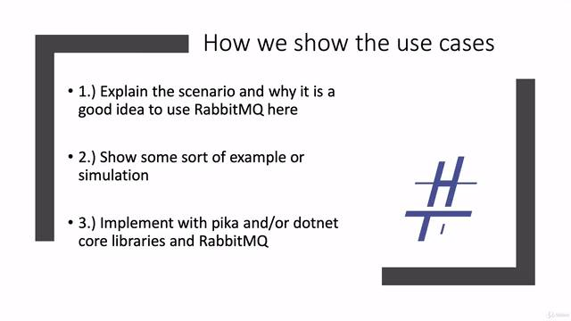
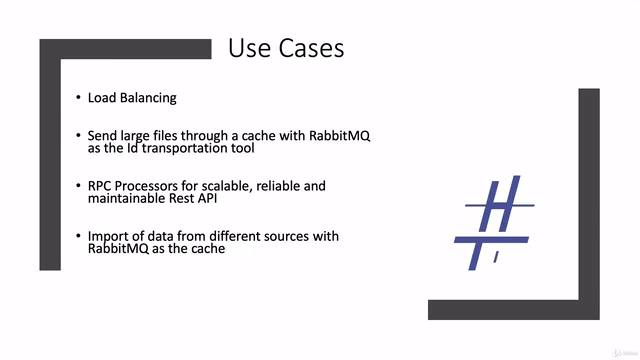
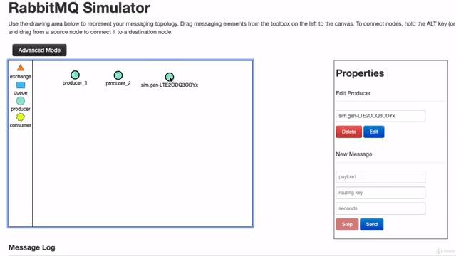
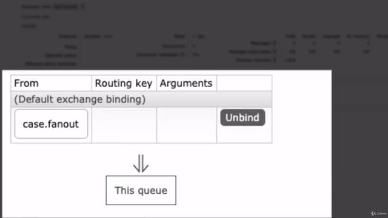
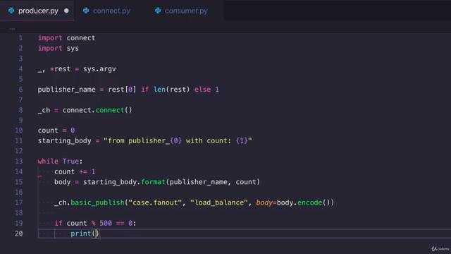
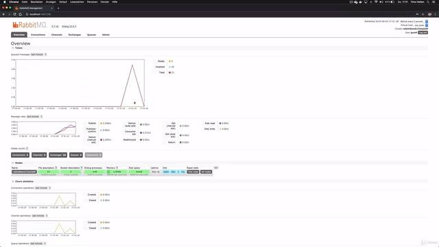
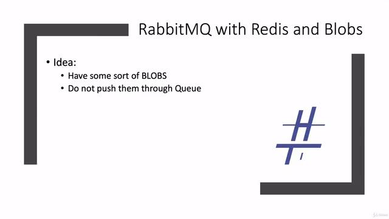
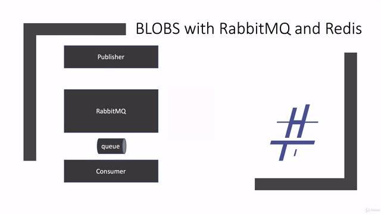

# RabbitMQ 真实用例（P57–P60）：负载均衡队列 + 用 Redis 缓存 Blob

> 读者定位：前端转 AI 应用工程师。本节用到的语言是 Python（pika）和 .NET（仅 P60 提及，不要求你会）。所有涉及并发的点都会补一句「在 Node/JS 里对应什么」。Python 语法只做必要提示，不需要精通。

---

## 1. 这一节做什么

P57 是一节「用例地图」：讲师先列出 RabbitMQ 在真实项目里能干哪些活，然后从 P58 开始逐个往下做。这四段里真正落到代码的只有 **P59**，P58 是模拟器演示，P60 是一个方案讲解（讲师说接下来要用 .NET Core + EasyNetQ + Redis 写，但本段逐字稿里没有出现这段实现代码）。

所以这一节的产出物是明确的四样东西：

1. **一套 RabbitMQ 拓扑**：虚拟主机 `use cases`、交换机 `case.fanout`（fanout 类型）、队列 `load balancing queue`、一条绑定（binding）。
2. **三个 Python 脚本**：`connect.py`（连接工厂）、`consumer.py`（消费者）、`producer.py`（生产者，命令行传发布者名字，计数递增，每秒发一条）。
3. **一个监控脚本** `monitor.py`：轮询 RabbitMQ 管理 HTTP API，读队列里的消息数和消费者数，消息数超过 1500 就打印告警——这是「自动扩缩容」的手工版，讲师明确说它可以被扩展成自动扩消费者。
4. **一份 blob 方案的设计决策表**（P60 的产物，不是代码）：为什么大文件不能直接塞进队列、Redis 存 blob + 队列只传 key 的流程、以及这个方案的代价。

**这节课不做什么**（讲师在 P57 开头专门强调了一次）：不要为了一个场景去引入 RabbitMQ。原文是「we assume that the rabbit mq is already built into the system … don't try to use rabbit mq just for one single case」——他是把 RabbitMQ 当成系统里已有的基础设施，然后讨论「既然已经有了，怎么把它用好」。你如果手上没有现成的 broker，本节照样能跑，但心里要清楚这是练习，不是架构建议。

后面第三节的复现步骤，你照着做能完整跑通：起 broker → 建拓扑 → 跑脚本 → 看到负载分摊 → 跑监控 → 触发告警。

---

## 2. 讲师原话（带时间码）

> "我们要介绍的用例来自真实场景，例如负载均衡……负载均衡是指有大量发布操作时，可以在下游队列上做负载均衡。因此，如果有大量消息发送到任一队列，只需增加消费者数量，系统就能处理更多负载。"
> —— p057 [00:29]

> "第二个用例是发送大文件，例如图像这类二进制文件或 base64 流等：将文件内容放到 Redis 缓存这样的缓存中，同时利用 RabbitMQ 以消息形式传输 ID 和附加数据。"
> —— p057 [01:27]

> "在这个例子中，我们会搭建一个模拟环境：三个生产者；一个交换机，为简单起见使用扇出交换机；一个用于负载均衡的队列，作为负载均衡示例；最初一个消费者，之后增加到两个消费者以实现自动扩缩容，从而展示负载均衡。"
> —— p058 [00:27]

> "然后我们让生产者每秒发送一条消息，初始消费者可以轻松处理……但如果用第二个生产者提高消息发送频率，就能看到消费者无法处理这些负载。"
> —— p058 [00:48]

> "接下来我们创建环境：新建一个名为 use cases 的虚拟主机，一个名为 load balancing queue 的队列，与模拟环境一致；以及一个名为 case.fanout 的交换机，当然也像模拟环境那样使用扇出类型。然后通过绑定把队列连接到交换机，这样就能向扇出交换机发送消息，再从队列中消费这些消息。"
> —— p059 [00:00]

> "除了虚拟主机之外，其他参数都使用默认值；这里的虚拟主机名是 use cases。"
> —— p059 [00:42]

> "然后我们只需对投递标签执行 basic acknowledgement，建立通道连接，开始消费，并调用 basic consume。"
> —— p059 [00:59]

> "我们会用 Python 写一个监控脚本，通过请求 HTTP API 获取队列中的消息数量和消费者数量。如果消息数量过高而消费者数量过低，就发出告警，以便我们知道可以对此做出反应。之后还可以扩展为自动扩缩容消费者。"
> —— p059 [02:26]

> "然后把这一切放在 while 循环中运行，并在这里启动监控……接着创建一个 monitor 方法，持续检查这些指标；如果消息数超过 1500，就打印告警。"
> —— p059 [02:55]

> "基本思路是：你有一类二进制大对象……不希望把它们直接推过队列。那有哪些选择？例如可以使用 Redis 缓存或其他缓存系统，先把这些二进制大对象临时放进去，并获取一个关联 ID，之后再用它从缓存中取出这些二进制大对象。"
> —— p060 [00:15]

> "这样就不会用过大的消息体积塞满队列，队列可以保持较小规模；为了获得更好的性能，消息体积应保持较小，因为不必通过 TCP 连接传输大消息，消费者也能更快确认这些消息，从而提升系统整体性能。"
> —— p060 [00:58]

> "消费者在处理任何内容之前，会使用消息中携带的键，这次从缓存中取出对应的二进制大对象。拿到这个二进制大对象后，它就可以进行一些处理、存储等操作。"
> —— p060 [02:23]





---

## 3. 从零复现

### 步骤 0：前置条件

- 一台能跑 Docker 的机器（或者你本地已经装了 RabbitMQ）。
- 已启用 **management 插件**的 RabbitMQ——P59 全程是在管理 UI 上点出来的，没有 UI 你没法照抄讲师的观察方式。
- Python 3.9+。

讲师在 P57 明确假设 broker 已存在（"我们假设 RabbitMQ 已经内置到系统中"），所以**他没有给启动 broker 的命令**。下面这条是补的：

```bash
docker run -d --name rabbitmq \
  -p 5672:5672 -p 15672:15672 \
  rabbitmq:3-management
```

`rabbitmq:3-management` 镜像自带 `rabbitmq_management` 插件。启动后等 10 秒左右，浏览器打开 `http://localhost:15672`，用 `guest / guest` 登录。



### 步骤 1：装 Python 依赖

```bash
python -m venv .venv
source .venv/bin/activate          # Windows 用 .venv\Scripts\activate
pip install pika==1.3.2 requests==2.31.0
```

（版本号是我给的，课里没指定；pika 1.x 的 API 和逐字稿里说的 `basic_consume` / `basic_ack` 对得上。）

### 步骤 2：建拓扑（照 P59 的做法，在管理 UI 里点）

讲师把这一步拆成四句：建 vhost、建 queue、建 exchange、binding。对应到 UI：

1. 顶部 **Admin → Virtual Hosts → Add a new virtual host**，Name 填 `use cases`，其余默认，Add。
2. 顶部 **Queues → Add a new queue**：Virtual host 选 `use cases`，Name 填 `load balancing queue`，Durability 选 `Durable`，Add。
3. 顶部 **Exchanges → Add a new exchange**：Virtual host 选 `use cases`，Name 填 `case.fanout`，Type 选 `fanout`，Durability 选 `Durable`，Add。
4. 回到该 exchange 的详情页，**Bindings** 区域，From exchange 填 `case.fanout`，To queue 填 `load balancing queue`，Routing key 留空（fanout 不靠 routing key 分发），Bind。

> UI 的菜单名会随版本略有差别，以你装的版本为准；但「vhost / queue / exchange / binding」这四层结构不会变。

**注意：vhost 名字里带空格**（`use cases`），这是讲师亲口定的。`pika.ConnectionParameters(virtual_host='use cases')` 能正常工作，但 **HTTP API 的 URL 里必须写成 `use%20cases`**，否则 404。这一条是本课程最容易让人卡住十秒的坑（详见第 7 节）。




如果你不想点鼠标，等价的 HTTP API 也可以（**课里没讲，纯备选**）：

```bash
curl -u guest:guest -X PUT http://localhost:15672/api/vhosts/use%20cases
curl -u guest:guest -X PUT http://localhost:15672/api/queues/use%20cases/load%20balancing%20queue \
  -H 'content-type: application/json' -d '{"durable":true,"arguments":{}}'
curl -u guest:guest -X PUT http://localhost:15672/api/exchanges/use%20cases/case.fanout \
  -H 'content-type: application/json' -d '{"type":"fanout","durable":true}'
curl -u guest:guest -X POST http://localhost:15672/api/bindings/use%20cases/e/case.fanout/q/load%20balancing%20queue
```

### 步骤 3：写四个脚本

目录结构：

```
rabbitmq-use-cases/
├── requirements.txt
├── connect.py      # 连接工厂（P59 的 "connect script"）
├── consumer.py     # 消费者
├── producer.py     # 生产者
└── monitor.py      # 监控 / 告警
```

内容见第 4 节，四个文件完整贴出，直接保存即可。

### 步骤 4：跑起来，先看「平衡」这件事

开三个终端，都在 `.venv` 环境下：

```bash
# 终端 1
python consumer.py
# 终端 2
python producer.py p1 1.0
# 终端 3（后开）
python consumer.py
```

回到管理 UI 的 **Queues → load balancing queue**，看 Consumers 这一列：应该是 2（两个消费者在轮流拿消息）。再开第四个终端 `python producer.py p2 0.2` 把发布速率拉高，队列的消息数会开始往上堆——这就是 P58 模拟器里演示的那一幕「一个消费者顶不住了」。

### 步骤 5：跑监控，触发告警

```bash
python monitor.py 1.0
```

它会每秒打印一行 `messages=… consumers=…`。把消费者全停掉、再多开两个生产者，消息数会一路涨过 1500，然后打印 `[ALERT]` 行。





### 步骤 6：P60 的 blob 方案，只复现「设计」，不写代码

讲师在 P60 结尾说「we are now going to implement this with .NET Core, EasyNetQ, and Redis. So deal in the code.」——但**本段逐字稿里没有出现这段实现**。所以这一步你只需要把第 4 节第 4.6 小节的设计表和流程图抄进你的设计文档，代码留到后面（或者你自己用 Node + ioredis + amqplib 写一版，那是你的发挥，不是课的内容）。

---

## 4. 完整代码

### 4.1 `requirements.txt`

```
pika==1.3.2
requests==2.31.0
```

### 4.2 `connect.py`（对应 P59 的 "connect script"）

讲师原话：**只用默认参数，唯一改动是 virtual host 换成 `use cases`**。下面把默认值显式写出来，方便你知道默认值是什么；删掉也能跑。

```python
# connect.py
# P59 [00:42] "We use all the default parameters except for the virtual holes which will be use cases here."
import pika

HOST = 'localhost'        # 课里没讲：pika 默认就是 localhost，这里写出来只为可读
PORT = 5672
USER = 'guest'
PASSWORD = 'guest'
VHOST = 'use cases'       # P59 [00:00] 新建的虚拟主机，名字里带空格


def connect():
    """返回一个 BlockingConnection。所有脚本共用。"""
    credentials = pika.PlainCredentials(USER, PASSWORD)
    parameters = pika.ConnectionParameters(
        host=HOST,
        port=PORT,
        virtual_host=VHOST,
        credentials=credentials,
        heartbeat=30,          # 课里没讲：默认 600 秒，长连接的对方可能已被网络设备掐断
    )
    return pika.BlockingConnection(parameters)


if __name__ == '__main__':
    conn = connect()
    print('connected, is_open =', conn.is_open)
    conn.close()
```

### 4.3 `consumer.py`

```python
# consumer.py
import json
import pika
from connect import connect

QUEUE = 'load balancing queue'   # P59 [00:00] 讲师建的队列名
PRINT_EVERY = 500                # 见第 5 节解释：逐字稿这句话表述含糊，这里是可调的采样打印


def main():
    connection = connect()
    channel = connection.channel()

    # 课里没讲：这里必须和 UI 里建队列时选的 Durable 一致，否则 PRECONDITION_FAILED
    channel.queue_declare(queue=QUEUE, durable=True)

    # 课里没讲：每消费者只预取 1 条，否则第一个消费者会把队列「吸干」，看起来负载没分摊
    channel.basic_qos(prefetch_count=1)

    handled = 0

    def callback(ch, method, properties, body):
        nonlocal handled
        handled += 1
        try:
            payload = json.loads(body)
        except json.JSONDecodeError:
            payload = {'publisher': 'unknown', 'count': -1}

        count = payload.get('count', -1)
        publisher = payload.get('publisher', 'unknown')

        # 逐字稿只说「打印到控制台」，没给打印频率；这里按 count 取模做采样
        if isinstance(count, int) and count >= 0 and count % PRINT_EVERY == 0:
            print(f'[consumer] publisher={publisher} count={count} handled={handled}', flush=True)

        # P59 [00:59] "simply a basic acknowledgement on delivery tag"
        ch.basic_ack(delivery_tag=method.delivery_tag)

    # P59 [00:59] "call the basic consume"
    channel.basic_consume(
        queue=QUEUE,
        on_message_callback=callback,
        auto_ack=False,          # 课里没讲：关掉自动 ack，才能演示「处理完再确认」
    )

    print('[*] waiting for messages in', QUEUE, flush=True)
    try:
        channel.start_consuming()
    except KeyboardInterrupt:
        channel.stop_consuming()
    finally:
        connection.close()


if __name__ == '__main__':
    main()
```

### 4.4 `producer.py`

讲师的做法：**从命令行参数取发布者名字**，计数自增，body 里带名字和编号，发布到 `case.fanout`。

```python
# producer.py
# P59 [01:15] "create the producer just with input parameters from the command line arguments"
import json
import sys
import time
import pika
from connect import connect

EXCHANGE = 'case.fanout'        # P59 [00:00] fanout 交换机
ROUTING_KEY = 'load_balance'    # 逐字稿口述为 "load balance"；fanout 不看 routing key，写成什么都行


def main():
    name = sys.argv[1] if len(sys.argv) > 1 else 'p1'
    interval = float(sys.argv[2]) if len(sys.argv) > 2 else 1.0   # 课里没讲：P58 模拟器是每秒一条

    connection = connect()
    channel = connection.channel()

    # 课里没讲：和 UI 里建的 Durable 一致，否则 PRECONDITION_FAILED
    channel.exchange_declare(exchange=EXCHANGE, exchange_type='fanout', durable=True)

    count = 0
    print(f'[producer {name}] exchange={EXCHANGE} interval={interval}s', flush=True)
    try:
        while True:
            count += 1
            body = json.dumps({'publisher': name, 'count': count})
            channel.basic_publish(
                exchange=EXCHANGE,
                routing_key=ROUTING_KEY,
                body=body,
                properties=pika.BasicProperties(
                    delivery_mode=2,              # 课里没讲：持久化消息，broker 重启不丢
                    content_type='application/json',
                ),
            )
            if count % 100 == 0:
                print(f'[producer {name}] sent count={count}', flush=True)
            time.sleep(interval)
    except KeyboardInterrupt:
        print(f'[producer {name}] stopped at count={count}', flush=True)
    finally:
        connection.close()


if __name__ == '__main__':
    main()
```

### 4.5 `monitor.py`

讲师的做法：请求管理 HTTP API，拿队列的**消息数**和**消费者数**，超过 1500 条消息就打印告警，外面套 `while` 循环。

```python
# monitor.py
# P59 [02:26] "request the HTTP API for the amount of messages in the queue and the amount of consumers"
import sys
import time
import requests
from requests.auth import HTTPBasicAuth

# 注意：vhost 名和队列名里的空格必须 URL 编码成 %20
API_URL = 'http://localhost:15672/api/queues/use%20cases/load%20balancing%20queue'
AUTH = HTTPBasicAuth('guest', 'guest')   # 逐字稿说的 "plain authentication"

ALERT_MESSAGES = 1500   # P59 [02:55] "if it contains more than 1500 messages we will print it alert"
MIN_CONSUMERS = 1       # 逐字稿另一处提到「消费者太少」也算告警，这里给个下限


def read_queue():
    resp = requests.get(API_URL, auth=AUTH, timeout=5)
    resp.raise_for_status()
    data = resp.json()
    # 字段名 messages / consumers 见逐字稿；其余字段请以实际输出为准
    return data.get('messages'), data.get('consumers')


def monitor():
    messages, consumers = read_queue()
    print(f'messages={messages} consumers={consumers}', flush=True)

    if messages is not None and messages > ALERT_MESSAGES and (consumers or 0) < MIN_CONSUMERS:
        print(
            f'[ALERT] backlog messages={messages} > {ALERT_MESSAGES} '
            f'and consumers={consumers} < {MIN_CONSUMERS}',
            flush=True,
        )


def main():
    interval = float(sys.argv[1]) if len(sys.argv) > 1 else 1.0
    try:
        while True:
            try:
                monitor()
            except requests.RequestException as exc:
                print(f'[monitor] request failed: {exc}', flush=True)
            time.sleep(interval)
    except KeyboardInterrupt:
        print('[monitor] stopped', flush=True)


if __name__ == '__main__':
    main()
```

### 4.6 P60 的产物：blob（Redis 缓存 + 队列只传 key）设计决策表

**课里没有代码，以下是把讲师口述的方案落成的表格与流程，不是实现。**

| 决策 | 讲师给的理由（原文要点） | 不这样做会怎样 |
|---|---|---|
| 大文件（图片、PDF、base64 流）**不进队列** | 「don't clutter your queues with huge message sizes so you can have the queues small」 | 队列被大消息占满，队列长度上限（字节维度）先被打爆，其他小消息一起被堵 |
| 文件先写 **Redis（或任意缓存）**，拿回一个 key | 「push the blobs temporarily to the cache and get any correlation ID」 | 消息体过大，TCP 传输时间长，消费者 ack 慢，整体吞吐下降 |
| 队列里的消息**只带 key + 附加数据** | 「which will transport the ID and additional data as a message」 | 同上；且丢消息时 blob 也跟着丢，无法重投 |
| 消费者**先取 key 里的 blob，再处理** | 「before anything with processing happens, it uses the key … gets the blob from the cache」 | 顺序反了会拿到空文件；或者处理完了才发现 blob 已被过期清掉 |
| 可以对缓存里的条目**续租 / 更新**，不重发消息 | 「you can … renew the lease on the item in the Redis cache so that it doesn't expire, or you can even change it if it is corrupted」 | 每次改文件都要重发一条大消息，队列又被撑爆 |
| 代价：**系统复杂度上升** | P60 开头明确承认这点 | 你会多一个需要运维的组件、多一类「消息到了但 blob 没了」的失败模式 |

流程（照 P60 [01:55]–[02:23] 的口述顺序）：

```
publisher ──1. SET blob → Redis（返回 key）──▶ Redis
   │
   └──2. publish { key, ...meta } ──▶ RabbitMQ [case.queue] ──▶ consumer
                                                                  │
                                         3. GET key ──▶ Redis ◀──┘
                                                                  │
                                                          4. 处理 / 落库 / 转存
```

---

## 5. 逐行解释

**`connect.py`**

- `virtual_host='use cases'`：这是全节唯一一个「非默认」参数，也是讲师在 P59 特意点出来的那一句。RabbitMQ 里 vhost 是隔离单元：不同 vhost 的同名队列互不相干。所以你连错 vhost 时的典型症状不是报错，而是**脚本跑得好好的、管理 UI 里那个队列死活不涨**。
- `PlainCredentials('guest','guest')`：逐字稿说的 "明文认证" 在 Python 侧就是这个。`guest` 用户默认只允许从本机连（见第 7 节）。
- `heartbeat=30`：**课里没讲**。长连接如果中间有 NAT/负载均衡，默认 600 秒的心跳间隔太长，连接会被静默掐断，脚本表现为「卡住不动也不报错」。30 秒是我的工程建议。

**`consumer.py`**

- `channel.queue_declare(queue=QUEUE, durable=True)`：这一步讲师没在脚本里明说（他是在 UI 里建的队列），但脚本里声明一次是幂等的好习惯。**关键陷阱**：声明参数必须和已存在的队列一致，否则 broker 直接回 `PRECONDITION_FAILED` 并关闭 channel。
- `channel.basic_qos(prefetch_count=1)`：**课里没讲**，但它决定了你能不能看到「负载分摊」。不加的话，pika 客户端会一次从队列预取一批消息到本地缓冲，第一个消费者把队列吸干，界面上第二个消费者看着像在摸鱼。这在 JS/Node 里对应 `channel.prefetch(1)`（amqplib）。本质和「并发控制里限制同时处理的请求数」是同一类问题，不需要锁。
- `def callback(ch, method, properties, body)`：pika 的四参数回调。`method.delivery_tag` 是这条消息的确认凭据，等价于 JS 里 `msg.fields.deliveryTag`。
- `handled += 1` 与 `nonlocal handled`：Python 闭包里改外层变量必须写 `nonlocal`（**Python 语法点，知道即可**；JS 里直接改外层 `let` 就行）。
- `if count % PRINT_EVERY == 0`：逐字稿那句原文是「print it to the console if it's one of the 500s methods」，语义含糊（听起来像「每 500 条打印一次」），课里没有澄清。我把它实现为**按消息里的计数做采样打印**，`PRINT_EVERY` 放成常量方便你改成 1 变成逐条打印。
- `auto_ack=False` + 手动 `basic_ack`：这是 P59 [00:59] 讲师明确讲的「basic acknowledgement on delivery tag」。关掉 auto_ack 的意义是：处理完才确认，消费者崩了消息会重投。**代价**是如果消费者卡死不 ack，消息会在 Unacked 里堆着，管理 UI 上 `messages` 不降——这是新手最常见的「我的队列堵住了」。
- `channel.start_consuming()`：阻塞式入口，一直跑在 IO 循环里，`Ctrl+C` 抛 `KeyboardInterrupt`，所以外面包了 try/finally 关连接。

**`producer.py`**

- `sys.argv[1]`：P59 [01:15] 说的「input parameters from the command line arguments」。所以 `python producer.py p1` 里的 `p1` 就是这个发布者名字，它会出现在 body 里，也会出现在消费者打印的那一行上——这是讲师为了让你在标准输出上分辨「这条消息是谁发的」。
- `channel.exchange_declare(..., exchange_type='fanout', durable=True)`：fanout 是 P58/P59 选的最简单类型：**广播给所有绑定到它的队列，完全忽略 routing key**。所以 `routing_key='load_balance'` 这个值在这里其实不起作用，讲师也在 P59 [01:41] 亲口说了 "这一点在这里并不重要，因为它是扇出交换机，不过我们仍然有一个"。
- `delivery_mode=2`：**课里没讲**。声明消息持久化。前提是队列本身 durable，否则消息在 broker 重启时照样丢。这是「声明和消息属性要配套」的经典坑。
- `time.sleep(interval)`：默认 1 秒，对齐 P58 模拟器的节奏。想快速把队列堆到 1500 触发告警，就传 `0.05`。

**`monitor.py`**

- URL 里 `use%20cases` / `load%20balancing%20queue`：空格必须编码。**这是本课程里最容易被忽略的一处**——因为讲师是在 UI 里看队列的，他也没在逐字稿里提这件事。
- `data.get('messages')` / `data.get('consumers')`：这两个字段是逐字稿点名的（"消息的数量……消费者的数量"）。管理 API 返回的 JSON 里还有其他字段，**具体字段名请以你实际输出为准**，别照着别人的博客往里加字段。
- `messages > 1500`：P59 [02:55] 的原话。`and consumers < MIN_CONSUMERS`：对应 P59 [02:26] 那句「消息太多**并且**消费者太少」。两个条件都写全了，只留一个也能跑。
- 外面套 `while True` + `time.sleep`：讲师原话「run this all in a while loop」。这就是最朴素的手工监控；讲师明确说它可以「be extended with automatic scaling of consumers」——也就是把这个 ALERT 分支换成调用一个扩容脚本/接口。**课里没有实现自动扩容**，别以为漏掉了。

---

## 6. 复现检查清单

跑之前对着勾一遍：

- [ ] `docker ps` 能看到 `rabbitmq` 容器；`http://localhost:15672` 能登录（`guest/guest`）。
- [ ] vhost 名字是 `use cases`（带空格），不是 `use_cases`、`use-cases`。
- [ ] 队列名是 `load balancing queue`（带空格）。
- [ ] 交换机名是 `case.fanout`，类型 `fanout`，位置在 `use cases` 这个 vhost 下。
- [ ] exchange 的 Bindings 里能看到 `→ load balancing queue`。
- [ ] 三个 Durable 一致性：队列 durable、交换机 durable、`exchange_declare` 里的 durable 一致。
- [ ] `python connect.py` 打印 `is_open = True`（连不通就在这一步断掉，别往下跑）。
- [ ] `python consumer.py` 打印 `[*] waiting for messages in load balancing queue` 且不退出。
- [ ] `python producer.py p1` 每 100 条打印一次 `sent count=`。
- [ ] 管理 UI 的 queue 详情页 `Consumers` 列 ≥ 1，`Ready` 数字在动。
- [ ] 起第二个 `consumer.py` 后，`Consumers` 列变成 2。
- [ ] `monitor.py` 每秒一行 `messages=… consumers=…`，没有 404/401。
- [ ] 把消费者全 Ctrl+C、生产者速率调到 `0.05`，`messages` 涨过 1500 后出现 `[ALERT]`。

**失败现象 → 最可能的原因**

| 症状 | 原因 |
|---|---|
| 脚本连不上，报 `AMQPConnectionError` | 容器没起，或端口 `5672` 没映射 |
| `PRECONDITION_FAILED - inequivalent arg 'durable'` | 脚本里 `durable=True`，UI 里建的是非 durable（或反之） |
| 脚本不报错、队列数就是不涨 | 连错 vhost（连到 `/` 去了） |
| 交换机里能 publish，但队列没消息 | binding 没建，或者 bind 到了别的 queue |
| `monitor.py` 返回 404 | URL 里的空格没换成 `%20` |
| `monitor.py` 返回 401 | 认证没传，或 `guest` 从非本机连 |
| 两个消费者，但只有一个在干活 | 没设 `prefetch_count`，第一个消费者把消息全预取走了 |

---

## 7. 课里没讲但你会撞上的

1. **vhost 名字带空格**。这是全课程最容易踩的坑，因为讲师是在 UI 里点、用眼睛看，感觉不到问题。Python `virtual_host='use cases'` 没问题，HTTP API 的 URL 路径必须 `use%20cases`。curl/浏览器里也是同理。

2. **Durable 三项要对齐**。UI 里建队列/交换机时默认勾 Durable，脚本里 `queue_declare(durable=True)`、`exchange_declare(durable=True)` 必须一致。不一致时 broker 不是「忽略」，是**直接断 channel**。

3. **`guest` 用户默认只能从 localhost 连**。同机跑没问题；一旦你把脚本放进容器、或者连远程 broker，就会 401/403。这个限制课里没提，因为讲师全程本地。

4. **不设 prefetch 就看不到「负载分摊」**。P58 的模拟器演示里，两个消费者是「看起来均匀」的；真实 pika 客户端不加 `basic_qos` 会一次性预取消息，队列秒空、两个消费者的工作量看起来完全不均。**这不是 RabbitMQ 的问题，是客户端预取策略**。Node 里对应 `channel.prefetch(1)`。

5. **Unacked 会骗你**。`messages` 这个数字是**队列里还没投递的**，投出去但没 ack 的进了 `messages_unacknowledged`（字段名以你实际输出为准）。所以「消费者死了但 messages 不涨」的现象，其实是 unacked 在堆。课里只强调 `messages`，你排查时要两个一起看。

6. **fanout 忽略 routing key**。P59 里讲师还在 publish 里传了个 `routing key load balance`，然后自己补了一句「not important here」。你可以传任意字符串；但如果哪天把 exchange 从 fanout 改成 direct，这个值就立刻变得决定生死。

7. **pika 版本差异**。课里是 `basic_consume` + `start_consuming` 这一套（pika 1.x 的写法）。网上很多 pika 0.x 的老教程用 `channel.basic_consume(callback, queue=...)` 的位置参数顺序，直接抄会报 `TypeError`。本文所有调用都是关键字参数，兼容 1.x。

8. **监控脚本的 `consumers` 字段是「当前连着的消费者数」**，不是「消费者进程数」。一个进程开两条 channel 会被算成几个，取决于 broker 的统计口径——**具体口径课里没讲，以你实际观察为准**。写自动扩容逻辑时别把它当成硬指标。

9. **P60 的 blob 方案，实现代码课里没给**。讲师原话是「we are now going to implement this with .NET Core, EasyNetQ, and Redis」，但本段逐字稿到这儿就结束了。`EasyNetQ` 是 .NET 生态的 RabbitMQ 高层封装库，**前端不必硬上**；你想练手，用 Node 的 `ioredis` + `amqplib` 按 4.6 那五步走一遍，效果等价。课里没讲的还有：blob 在 Redis 里的过期时间设多少、消息消费失败后 blob 谁来清（孤儿 blob）、Redis 挂了整个链路怎么办——这些全都得你自己拍。

10. **「自动扩缩容」只是一个告警**。讲师说的扩展方向是把 ALERT 换成动作，但课里从头到尾没有写扩容代码。真要做到自动，你得回答：谁来拉起消费者进程（K8s HPA？supervisor？自研调度？）、缩容时怎么优雅停（先 `stop_consuming` 让 unacked 落地）。这些课里都没讨论。



