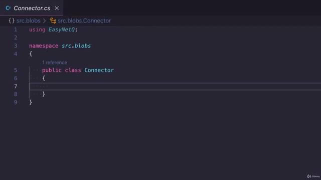
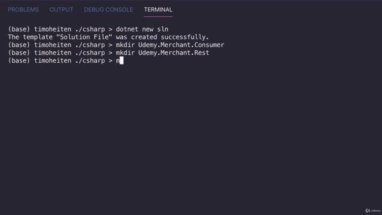
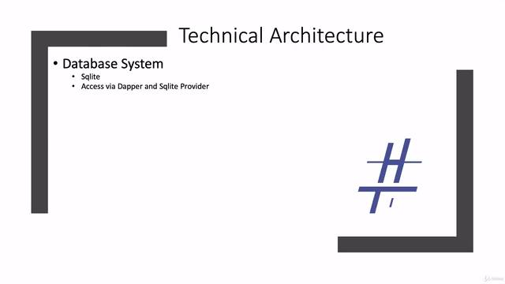
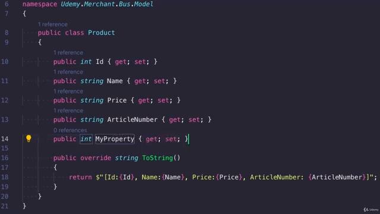
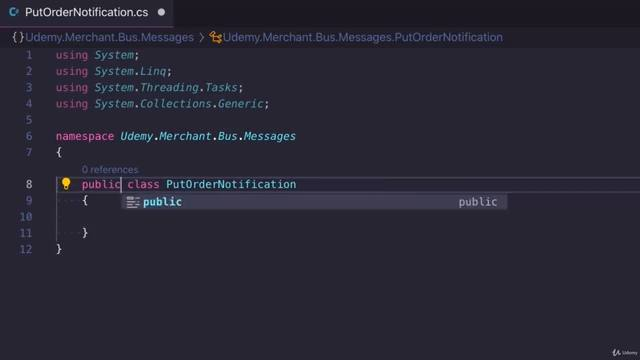
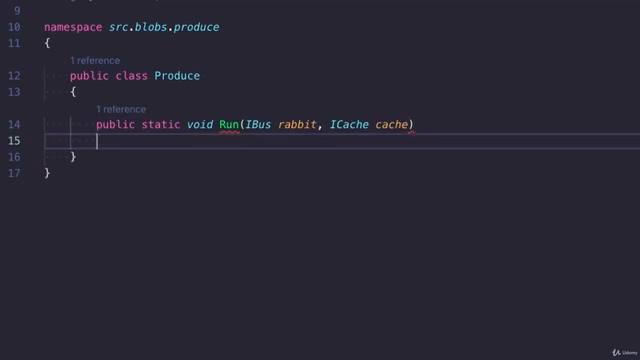
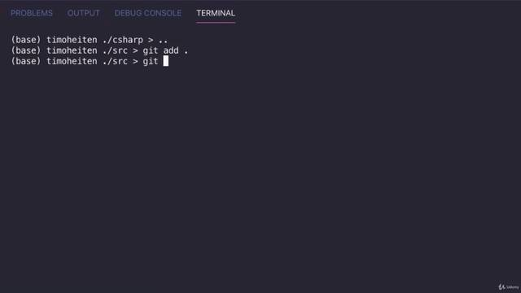
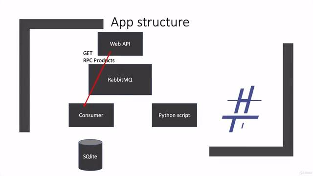

# RabbitMQ 分布式电商示例（P61–P64）复现文档

> 课程：BV1o39SBiEhD ｜ 覆盖 P61–P64
> 读者定位：前端转 AI 应用工程师。文中出现的 C# 语法只需「知道即可」，重点是消息流与工程结构。

---

## 1. 这一节做什么

这四集是整门课从「单点演示」走向「一个能跑起来的分布式应用」的转折点。P61 先用一个极小的例子把「消息队列 + 缓存」的组合讲通：生产者把一段二进制内容写进 Redis，拿到一个 GUID，然后只把 GUID 通过 RabbitMQ 发出去；消费者收到 GUID 后回到 Redis 把内容取出来。这就是所谓的「大对象走缓存、小引用走队列」模式。P62 是纯架构讲解，讲师画出了后面要实现的电商系统全貌：一个 .NET Web API、一个 .NET 消费者、一个 Python 脚本、一个 SQLite 数据库，中间用 RabbitMQ 串起来，用到 RPC（请求/响应）和发布/订阅两种消息模式。P63 开始动手搭解决方案骨架，创建三个 .NET 项目并装 EasyNetQ。P64 写消息模型和总线工厂。

按项目实现逻辑，这四集实际产出的是两样东西：

1. **一个可独立运行的最小验证程序**（P61）：证明「GUID + 缓存」这条链路真的能跑通，包括停掉消费者、改缓存、再启动消费者能看到新值。
2. **一个分布式电商应用的骨架**（P62–P64）：目录结构、三个项目、消息契约（Product / Order / 各类消息）、以及全应用唯一的 IBus 工厂。

下面按「先跑通最小验证，再搭大骨架」的顺序重组，你可以照着一步步做出来。

对前端读者可以这样理解：P61 不是要你学一个孤立的 RabbitMQ 小 demo，而是在解释一种非常常见的工程拆分方式。比如浏览器上传一张大图时，通常不会把图片二进制塞进每一个业务请求里，而是先上传得到一个文件 ID，后续下单、保存草稿、提交表单只带这个 ID。P61 里的 Redis 就相当于存放“大内容”的地方，GUID 就是“文件 ID”，RabbitMQ 则是负责把 ID 可靠地送到另一个进程的通道。P62 到 P64 则相当于从“单个接口 demo”走向一个 monorepo：有共享类型包（Merchant.Bus）、有后台消费者（Merchant.Consumer）、有对外 Web API（Merchant.Rest），三者通过消息队列而不是直接函数调用连接。这个结构一旦看懂，后面补数据库、补 Python 脚本时就不会迷路。

需要特别注意的是，本节的重点不是把业务做得完整，而是把“消息如何定义、连接如何创建、项目如何引用”这些骨架问题先固定下来。P61 证明最小闭环能运行，P62 说明为什么要拆成多个可独立部署的应用，P63 把解决方案和依赖装好，P64 把消息契约与 IBus 工厂补齐。复现时不要急着写完整电商逻辑，先把每一段的事实、命令和检查点跑通，再进入后续集数。

---

## 2. 讲师原话

> "那么按照之前的讨论，我们现在用代码来实现这个系统。首先搭建缓存系统，以 Redis 缓存作为抽象，配合 ICache 接口以及用于创建实例的工厂。"
> —— p061 [00:00]

> "我们从连接器开始，它使用以太网队列连接到本地的 RabbitMQ 实例。我们只需用这里的连接字符串调用 RabbitHatch 的 CreateBus，连接字符串为 localhost、用户名 .net user、虚拟主机 use cases、密码 .net。"
> —— p061 [00:55]

> "这是关键部分。你通过 GWT 从缓存中获取消息，然后对 Base64 内容（本例中是字节）执行 GetString，并直接从控制台输入；当然，对于更大的系统，这些会是二进制大对象。"
> —— p061 [01:52]

> "于是我们有 my user push 文件，现在把它改成另一个值，然后开始消费，就能收到我们刚在 Redis 缓存中改成的那个字节值。可以看到，确实从 Web 缓存和队列中取到了这条消息。"
> —— p061 [03:48]

> "那么这个示例应用的整体思路是什么？我们要构建一个分布式系统……如果你有多个可独立部署、服务于共同目标的应用，这就属于分布式系统。"
> —— p062 [00:53]

> "当然，我们还有一个数据库系统。本例中使用 SQLite，因为我可以轻松把它推到 GitHub 上，方便你下载全部代码……数据库访问使用 Dapper（.NET 的对象关系映射器）以及 .NET 的 SQLite 提供程序。"
> —— p062 [02:44]

> "然后我们会采用 RPC 消息模式，用于“展示可用产品”用例：从数据库取出所有产品并返回给 Web API。接着针对下单路由采用发布订阅模式。"
> —— p062 [03:42]

> "这个队列我们会手动创建，与示例应用中的其他队列不同，那些队列由 EasyNetQ 库创建。"
> —— p062 [06:01]

> "我们只需创建一些结构、一些目录，当然还需要三个项目并把它们加入解决方案。分别是 Udemy Merchant Consumer，用于处理 RPC 调用的 RabbitMQ 消息；Merchant Rest，作为 Web API；以及 bus，bus 包含所有消息类型，并作为抽象层使用。"
> —— p063 [00:00]

> "接下来添加 EasyNetQ 的依赖，因为这是本示例应用要使用的库。我们只需把 NuGet 包添加到 bus、consumer 和 rest API，因为这些地方都需要它。"
> —— p063 [01:26]

> "在本视频中，我们将创建消息、要通过队列发送的模型，以及为应用创建 bus 的工厂，这样每个应用只使用一个连接。"
> —— p064 [00:00]

> "因此我们需要为 localhost 和虚拟主机 merchant 创建连接字符串（虚拟主机我会在下一个视频中创建）。我们还会创建用户名和密码，它们来自调用方应用，对本例应用来说当然是 .NET user。然后通过 RabbitHatch 创建 bus，本视频就到这里。"
> —— p064 [02:52]

这些原话对应了本节最关键的几个事实：第一，P61 先建立缓存抽象和工厂，再建立 RabbitMQ 连接；第二，P61 的连接串明确使用 `localhost`、用户名 `.net`、虚拟主机 `use cases`、密码 `.net`；第三，消费者收到的是消息里的 GUID，真正的二进制内容要回缓存取；第四，P62 的系统是多个可独立部署的应用，数据库是 SQLite，访问数据库用 Dapper，消息模式分成 RPC 和发布/订阅；第五，P62 里有一个队列要手动建，因为它不由 EasyNetQ 自动创建；第六，P63 创建三个项目并把 EasyNetQ 装到三个项目里；第七，P64 负责消息模型和 Bus 工厂，并且每个应用只用一个连接。复现时如果某一步卡住，可以回到这些原话逐条对照，避免把 P61 的虚拟主机和 P62–P64 的虚拟主机混在一起。

---

## 3. 从零复现

### 3.1 前置环境

| 组件 | 版本 / 说明 |
|---|---|
| .NET SDK | 课里没给具体版本号，用当前 LTS 即可（`dotnet --version` 能跑就行） |
| RabbitMQ | 本地实例，管理端口 15672 |
| Redis | 讲师用 Docker 容器启动（p061 [02:48] 提到 "Redis，当然，是我在 Docker 容器中启动的。"） |
| EasyNetQ | 课里说「add the latest stable version」（p063 [01:26]），即 NuGet 最新稳定版 |
| Python | 课里没给版本，P62 只说要写一个 Python 脚本做日志/分析/模拟供应商 |

先起两个中间件（命令为通用写法，课里只说了「Docker 容器启动 Redis」，没给具体命令）：

```bash
# RabbitMQ（带管理界面）
docker run -d --name rabbitmq -p 5672:5672 -p 15672:15672 rabbitmq:3-management

# Redis
docker run -d --name redis -p 6379:6379 redis:latest
```

这两条命令的完整含义需要拆开看。`docker run` 表示创建并启动一个容器；`-d` 表示后台运行，不占用当前终端；`--name rabbitmq` 给容器起一个固定名字，方便后续用 `docker logs rabbitmq` 或 `docker stop rabbitmq` 操作；`-p 5672:5672` 把宿主机的 5672 端口映射到容器内的 RabbitMQ 协议端口，.NET 应用连接 RabbitMQ 时用的就是这个端口；`-p 15672:15672` 把管理界面端口映射出来，浏览器访问 `http://localhost:15672` 才能打开；`rabbitmq:3-management` 是带管理插件的镜像。Redis 的 `-p 6379:6379` 同理，宿主机和应用都通过 6379 访问 Redis。前端同学可以把它类比成在本地启动 mock server：端口没映射，浏览器或应用就访问不到。

常见错误与排查：如果提示容器名已存在，说明之前已经创建过同名容器，可以先 `docker ps -a` 查看，再用 `docker start rabbitmq` 重新启动，或者删除旧容器后重建；如果提示端口被占用，说明本机已有服务占用 5672、15672 或 6379，需要先停掉占用进程或改端口；如果管理界面打不开，先确认 Docker Desktop 或 Docker 守护进程已经启动，再确认端口映射没有写错。这里不要急着往下做，先把两个中间件跑起来，因为后面的连接失败大多来自这一步。

RabbitMQ 起来后，用管理界面（http://localhost:15672）手动建一个虚拟主机 `merchant`，以及用户 `.net`（密码 `.net`）——这是 P64 [02:52] 明确说的：连接串里 virtual host 是 `merchant`，用户名密码来自调用方，.NET 应用用 `.net` 用户。P61 用的是另一个虚拟主机 `use cases`，两个例子不共用。

虚拟主机在这里可以类比成前端项目里的环境隔离：开发、测试、生产各有各的配置，消息也不应该混在一起。P61 的 `use cases` 和 P62–P64 的 `merchant` 就是两个隔离空间。手动建用户时要注意权限：用户 `.net` 需要对 `merchant` 和 `use cases` 都有访问权限，否则会出现“连接建立成功但收不到消息”或“发布时权限不足”的问题。前端读者可以把它理解成 token 有权限访问某个 workspace，但没权限访问另一个 workspace。



> 注：清单里没有 `p061_0055s.jpg`，请以实际存在的帧为准；此处对应 p061 [00:55] 的讲解点。

### 3.2 第一步：跑通 P61 的最小验证程序

P61 的程序结构是：一个 `ICache` 抽象 + 一个工厂 + 一个连接器（建 IBus）+ 一个消息类型 + 一个消费者 + 一个生产者 + 一个 `Main` 按命令行参数分流。

**目录结构：**

```
rabbitmq-cache-demo/
├── CacheDemo.csproj
├── Program.cs
├── ICache.cs
├── RedisCache.cs
├── CacheFactory.cs
├── BusConnector.cs
├── PubWithId.cs
├── Consumer.cs
└── Producer.cs
```

这个目录结构体现了最小分层：`ICache` 是接口，`RedisCache` 是具体实现，`CacheFactory` 负责创建实例，`BusConnector` 负责创建 RabbitMQ 连接，`PubWithId` 是走队列的消息契约，`Consumer` 和 `Producer` 分别承载两种运行模式。前端读者可以把它类比成一个很小的 TypeScript 工程：`ICache` 像 interface，`RedisCache` 像实现了该 interface 的 class，`CacheFactory` 像工厂函数，`Program.cs` 像入口文件根据命令行参数决定启动生产者还是消费者。

**创建项目并装依赖：**

```bash
mkdir rabbitmq-cache-demo && cd rabbitmq-cache-demo
dotnet new console
dotnet add package EasyNetQ
dotnet add package StackExchange.Redis
```

这里每一行都有明确目的。`mkdir rabbitmq-cache-demo && cd rabbitmq-cache-demo` 创建目录并进入；`dotnet new console` 生成一个控制台项目；`dotnet add package EasyNetQ` 安装 RabbitMQ 客户端封装；`dotnet add package StackExchange.Redis` 安装 Redis 客户端。课里没点名 Redis 客户端库，只说了「Redis cache as an abstraction」。这里用 StackExchange.Redis 是通用选择；如果你换别的客户端，只要 `ICache` 的 get/set 语义不变即可。

常见错误：如果在错误目录执行 `dotnet new console`，会生成到别的地方；如果 NuGet 还原失败，先检查网络和包源；如果后面代码里提示找不到 `StackExchange.Redis` 命名空间，先确认包是否真的装到了当前 `CacheDemo.csproj` 所在项目。前端同学可以把它类比成 `npm install` 装到了错误的 package 目录，代码当然 import 不到。

**运行方式（对应 p061 [03:18] 的「检查参数是 producer 还是 consumer」）：**

```bash
# 终端 A
dotnet run -- consumer
# 终端 B
dotnet run -- producer
```

`dotnet run -- consumer` 里的 `--` 很关键：它表示后面的参数传给应用程序，而不是传给 `dotnet run` 命令本身。`Program.cs` 里用 `args[0]` 读取这个参数，如果等于 `producer` 就运行生产者，否则运行消费者。前端读者可以类比成 `npm run dev -- --port 3000`，`--` 后面的内容会进入脚本参数。常见错误是写成 `dotnet run consumer`，这时参数可能被 `dotnet run` 自己解释，导致应用没收到预期参数；另一个常见错误是两个终端不在同一个项目目录下启动，结果一个连上了项目 A，一个连上了项目 B。排查时先看启动日志里打印的模式，再确认两个终端的工作目录一致。

### 3.3 第二步：搭 P62–P64 的电商骨架

**解决方案结构（P63 [00:00] 明确给出三个项目名）：**

```
merchant/
├── Merchant.sln
├── Merchant.Bus/            # 类库：消息类型 + 总线工厂
│   ├── Merchant.Bus.csproj
│   ├── Messages/
│   │   ├── ProductRequest.cs
│   │   ├── ProductResponse.cs
│   │   ├── PutOrder.cs
│   │   └── NotifySupplier.cs
│   ├── Models/
│   │   ├── Product.cs
│   │   ├── Order.cs
│   │   └── Customer.cs
│   └── BusFactory.cs
├── Merchant.Consumer/       # 控制台应用：消费 RPC 与订单消息
│   └── Merchant.Consumer.csproj
└── Merchant.Rest/           # Web API：对外暴露两个路由
    └── Merchant.Rest.csproj
```

这个结构里，`Merchant.Bus` 是共享契约层，放消息类型、实体模型和 IBus 工厂；`Merchant.Consumer` 是后台消费者，处理 RabbitMQ 消息；`Merchant.Rest` 是对外 Web API。为什么要拆成三个项目？因为 P62 说的是多个可独立部署的应用，Web API 和消费者可以分别启动、分别部署，它们只通过消息队列和共享契约协作。前端读者可以把它类比成 monorepo 里的 `packages/shared`、`apps/api`、`apps/worker`：共享类型放 shared，入口应用各自独立。

**建项目命令（P63 用的是命令行，讲师在 Mac + VS Code 上操作）：**

```bash
mkdir merchant && cd merchant
dotnet new sln -n Merchant

dotnet new classlib -n Merchant.Bus -o Merchant.Bus
dotnet new console  -n Merchant.Consumer -o Merchant.Consumer
dotnet new webapi   -n Merchant.Rest -o Merchant.Rest

dotnet sln add Merchant.Bus/Merchant.Bus.csproj
dotnet sln add Merchant.Consumer/Merchant.Consumer.csproj
dotnet sln add Merchant.Rest/Merchant.Rest.csproj

# 三个项目都要装 EasyNetQ（P63 [01:26] 原话）
dotnet add Merchant.Bus/Merchant.Bus.csproj package EasyNetQ
dotnet add Merchant.Consumer/Merchant.Consumer.csproj package EasyNetQ
dotnet add Merchant.Rest/Merchant.Rest.csproj package EasyNetQ

# Consumer 和 Rest 引用 Bus（消息类型和工厂都在 Bus 里）
dotnet add Merchant.Consumer/Merchant.Consumer.csproj reference Merchant.Bus/Merchant.Bus.csproj
dotnet add Merchant.Rest/Merchant.Rest.csproj reference Merchant.Bus/Merchant.Bus.csproj

dotnet restore
dotnet build
```

这段命令可以按顺序理解。`dotnet new sln -n Merchant` 创建解决方案文件；`dotnet new classlib` 创建类库，适合放共享代码；`dotnet new console` 创建控制台程序，适合做长期运行的后台消费者；`dotnet new webapi` 创建 Web API，适合对外暴露 HTTP 路由；`-n` 指定项目名，`-o` 指定输出目录，这里让项目名和目录名一致，便于排查。`dotnet sln add` 把三个项目挂到解决方案里，这样在 IDE 里能一次看到全部项目。`dotnet add ... package EasyNetQ` 是给三个项目分别安装依赖，因为 Bus 里要写工厂，Consumer 和 Rest 里要调用工厂或使用消息类型。`dotnet add ... reference ...` 是项目引用，让 Consumer 和 Rest 能使用 Bus 里的类型；注意这里不是 NuGet 引用，而是同一个解决方案内的项目依赖。`dotnet restore` 还原依赖，`dotnet build` 编译验证。

常见错误与排查：如果 `dotnet sln add` 提示找不到项目文件，通常是当前目录不在 `merchant` 下，或者路径大小写不一致；如果 Consumer 或 Rest 编译时报“找不到 Merchant.Bus 中的类型”，先检查项目引用是否加上；如果三个项目都装了 EasyNetQ 但只有 Bus 能编译，检查是否在错误项目里写代码。前端读者可以把它类比成 workspace 里某个 package 忘了在 `package.json` 里声明依赖，运行时就会报模块找不到。



**数据库（P62 [02:44]）：** SQLite + Dapper。表有 orders、products、ordered_products（订单与产品的连接表）、customers、suppliers。建库脚本课里没给，你需要自己写一份 `schema.sql`，字段按 P64 的实体来定（见第 4 节）。

这里要明确：课里给的是表和实体方向，不是完整建表 SQL。复现时可以先按实体字段建最小表，再逐步补外键和连接表。`ordered_products` 是订单和产品的连接表，用来表达一个订单包含多个产品；`suppliers` 对应产品上的 `SupplierId`。前端读者可以把它类比成关系型数据库里的多对多连接表，类似文章和标签之间的中间表。常见错误是只建了 orders 和 products，忘了连接表，后面查询订单产品时会发现没有地方存关联关系。

**Python 脚本（P62 [04:12]）：** 负责日志、分析、模拟供应商 API。课里只说了职责，没给代码，你需要自己写一个订阅 fanout 交换机的消费者。

复现时不要把 Python 脚本当成 .NET 项目的一部分，它是另一个独立客户端。它的存在正好说明 P62 的“分布式”不是一句空话：不同语言、不同进程可以通过 RabbitMQ 协作。常见错误是误以为 Python 脚本也由 EasyNetQ 自动建队列；根据 P62 [06:01]，这个队列要手动建，所以 Python 侧或管理界面必须显式声明。前端读者可以把它类比成另一个独立的 Node worker，只不过这里用 Python 写。

---

## 4. 完整代码

### 4.1 P61 最小验证程序

**ICache.cs**

```csharp
namespace CacheDemo;

public interface ICache
{
    byte[]? Get(string key);
    string Set(byte[] value);
}
```

这个接口只有两个方法：`Get` 用 key 取二进制内容，`Set` 存二进制内容并返回 GUID。接口把缓存实现隔离掉，消费者和生产者只依赖抽象，不直接依赖 Redis。前端读者可以把它看成 `interface Cache { get(key: string): Uint8Array | null; set(value: Uint8Array): string }`。常见错误是误以为 `Set` 返回的是内容本身；这里返回的是 key，也就是后续走队列的引用。

**RedisCache.cs**

```csharp
using StackExchange.Redis;

namespace CacheDemo;

public class RedisCache : ICache
{
    private readonly IDatabase _db;

    public RedisCache(string connectionString)
    {
        var conn = ConnectionMultiplexer.Connect(connectionString);
        _db = conn.GetDatabase();
    }

    public byte[]? Get(string key)
    {
        var value = _db.StringGet(key);
        return value.HasValue ? (byte[])value! : null;
    }

    public string Set(byte[] value)
    {
        var guid = Guid.NewGuid().ToString();
        _db.StringSet(guid, value);
        return guid;
    }
}
```

这里构造函数创建 Redis 连接并拿到 database；`Get` 读取字符串值并转成字节数组，读不到返回 `null`；`Set` 生成 GUID 作为 key，把字节数组写进去，再返回 GUID。前端读者可以类比成 `redis.get(key)` 和 `redis.set(key, value)`，只是这里 value 是二进制。常见错误是 Redis 里存进去的类型和取出来时预期不一致；如果实际存的是字符串而代码强转字节数组，就会在运行时报错。排查时可以用 `redis-cli` 直接看 key 的类型和值。

**CacheFactory.cs**

```csharp
namespace CacheDemo;

public static class CacheFactory
{
    public static ICache Create()
    {
        // 课里没给 Redis 连接串，默认本地 6379
        return new RedisCache("localhost:6379");
    }
}
```

工厂的作用是把“创建哪个缓存实现”集中到一处。现在返回 `RedisCache`，以后要换实现只需要改这里。课里没给 Redis 连接串，所以这里用本地默认端口。前端读者可以把它类比成 `createCache()` 工厂函数，调用方不关心内部用的是 Redis 还是内存 Map。

**BusConnector.cs**

```csharp
using EasyNetQ;

namespace CacheDemo;

public static class BusConnector
{
    public static IBus Create()
    {
        // P61 [00:55]：localhost / 用户 .net / 虚拟主机 use cases / 密码 .net
        return RabbitHutch.CreateBus(
            "host=localhost;username=.net;virtualHost=use cases;password=.net");
    }
}
```

这段最关键的是连接串。`host=localhost` 指向本机 RabbitMQ，`username=.net` 和 `password=.net` 是用户凭据，`virtualHost=use cases` 是 P61 专用虚拟主机。注意 `use cases` 中间有空格，EasyNetQ 连接串里可以出现空格，但自己改虚拟主机名时尽量不要用空格，减少转义和肉眼排查成本。常见错误是把这里复制到电商项目却忘了改成 `merchant`，结果消费者和生产者挂在两个不同的 vhost 上。

**PubWithId.cs**

```csharp
namespace CacheDemo;

public class PubWithId
{
    public string Id { get; set; } = string.Empty;
    public string Username { get; set; } = string.Empty;
    public string RegistrationSource { get; set; } = string.Empty;
}
```

这是走队列的消息类型，核心字段是 `Id`，也就是缓存里的 GUID；`Username` 和 `RegistrationSource` 是演示用上下文。前端读者可以把它看成消息 payload 的 TypeScript type：`{ id: string; username: string; registrationSource: string }`。注意消息体里没有大内容，只有引用和小字段。

**Consumer.cs**

```csharp
using EasyNetQ;

namespace CacheDemo;

public static class Consumer
{
    public static void Run(IBus bus, ICache cache)
    {
        bus.PubSub.Subscribe<PubWithId>("cache_demo_sub", msg =>
        {
            Console.WriteLine($"[consumer] got id={msg.Id} from {msg.Username}");
            var bytes = cache.Get(msg.Id);
            if (bytes == null)
            {
                Console.WriteLine("[consumer] cache miss");
                return;
            }
            var text = System.Text.Encoding.UTF8.GetString(bytes);
            Console.WriteLine($"[consumer] content = {text}");
        });

        Console.WriteLine("[consumer] subscribed, press Enter to exit");
        Console.ReadLine();
    }
}
```

消费者订阅 `PubWithId` 类型，订阅 ID 是 `cache_demo_sub`；收到消息后用 `msg.Id` 回缓存取 bytes，取不到就打印 miss，取到就按 UTF-8 转成文本打印。这里 `Console.ReadLine()` 是为了让进程不要立刻退出，否则订阅还没收到消息进程就结束了。前端读者可以类比成 WebSocket 订阅后要保持在线的进程。常见错误是忘写阻塞逻辑，导致消费者启动后马上退出，看起来像“没收到消息”。

**Producer.cs**

```csharp
using EasyNetQ;

namespace CacheDemo;

public static class Producer
{
    public static void Run(IBus bus, ICache cache)
    {
        Console.WriteLine("输入内容（格式：用户名:内容），回车发送，空行退出");
        while (true)
        {
            var line = Console.ReadLine();
            if (string.IsNullOrWhiteSpace(line)) break;

            var idx = line.IndexOf(':');
            var user = idx > 0 ? line[..idx] : "anonymous";
            var content = idx > 0 ? line[(idx + 1)..] : line;

            var bytes = System.Text.Encoding.UTF8.GetBytes(content);
            var id = cache.Set(bytes);

            bus.PubSub.Publish(new PubWithId
            {
                Id = id,
                Username = user,
                RegistrationSource = "console"
            });
            Console.WriteLine($"[producer] published id={id}");
        }
    }
}
```

生产者从控制台读一行，按冒号拆出用户名和内容；把内容转成 UTF-8 字节写进缓存，拿到 GUID；然后发布 `PubWithId` 消息。注意先写缓存再发消息，顺序不能反：如果先发消息，消费者可能先到缓存里取，但此时内容还没写进去，就会 miss。前端读者可以类比成先上传文件拿到 fileId，再提交表单把 fileId 发给后端。常见错误是输入内容里包含冒号时拆分不符合预期，这个 demo 只取第一个冒号，后面的内容仍会保留。

**Program.cs**

```csharp
using CacheDemo;

var bus = BusConnector.Create();
var cache = CacheFactory.Create();

var mode = args.Length > 0 ? args[0] : "consumer";
if (mode == "producer")
    Producer.Run(bus, cache);
else
    Consumer.Run(bus, cache);
```

入口先创建 IBus 和缓存实例，再根据命令行参数选择模式。默认是 consumer，传 `producer` 才走生产者。这里体现了 P64 说的“每个应用一个连接”：一个进程创建一个 IBus，然后在生产者或消费者里复用。常见错误是每次发消息都 `RabbitHutch.CreateBus`，连接数会暴涨；前端同学可以类比成每个请求都新建数据库连接，既不必要也容易耗尽资源。

### 4.2 P64 消息模型与实体

**Models/Product.cs**

```csharp
namespace Merchant.Bus.Models;

public class Product
{
    public int Id { get; set; }
    public string ArticleNumber { get; set; } = string.Empty;
    public string Name { get; set; } = string.Empty;
    public decimal Price { get; set; }
    public int SupplierId { get; set; }

    public override string ToString()
        => $"Product(Id={Id}, ArticleNumber={ArticleNumber}, Name={Name}, Price={Price}, SupplierId={SupplierId})";
}
```

`Product` 是共享实体，包含 Id、货号、名称、价格和供应商 Id。`SupplierId` 是 P64 明确补上的字段，不能漏。`ToString` 方便打印排查。前端读者可以把它看成 `interface Product { id: number; articleNumber: string; ... }`，C# 的 `decimal` 对应需要精确计算的金额，不要在前端简单用浮点数类比。

**Models/Order.cs**

```csharp
namespace Merchant.Bus.Models;

public class Order
{
    public int Id { get; set; }
    public int CustomerId { get; set; }
    public List<Product> Products { get; set; } = new();

    public override string ToString()
        => $"Order(Id={Id}, CustomerId={CustomerId}, Products=[{string.Join(", ", Products)}])";
}
```

订单包含客户 Id 和产品列表。`Products` 是 `List<Product>`，对应 P62 提到的 `ordered_products` 连接表。前端读者可以把它看成订单对象里内嵌一个商品数组。常见错误是只保存产品 Id 而忘了在查询时组装完整 `Product`，导致 ToString 或响应里看不出商品详情。

**Models/Customer.cs**

```csharp
namespace Merchant.Bus.Models;

public class Customer
{
    public int Id { get; set; }
    public string Name { get; set; } = string.Empty;
}
```

客户模型目前很简单，只有 Id 和 Name。课里本节没有展开更多客户字段，复现时不要自行添加不存在的业务字段来“丰富”模型，先保持契约与课程一致。

**Messages/ProductRequest.cs**

```csharp
namespace Merchant.Bus.Messages;

// RPC 请求：无属性（P64 [01:55]）
public class ProductRequest { }
```

这是 RPC 请求类型，P64 明确说请求没有属性，因为“查询所有可用产品”不需要过滤条件。空类在消息契约里是合法占位，前端读者可以理解成 `type ProductRequest = {}`。

**Messages/ProductResponse.cs**

```csharp
using Merchant.Bus.Models;

namespace Merchant.Bus.Messages;

public class ProductResponse
{
    public List<Product> Products { get; set; } = new();
}
```

响应里携带产品集合。RPC 调用方拿到后可以序列化成 HTTP 响应返回给前端。常见错误是把响应定义成单个 `Product`，但课程场景是“拿所有产品”，所以必须是集合。

**Messages/PutOrder.cs**

```csharp
using Merchant.Bus.Models;

namespace Merchant.Bus.Messages;

public class PutOrder
{
    public Order Order { get; set; } = new();
    public int SupplierId { get; set; }
}
```

下单消息同时带 `Order` 和 `SupplierId`。`Order` 用于消费者写库，`SupplierId` 用于知道通知哪个供应商。前端读者可以把它类比成一个提交订单事件，里面既有完整订单对象，也有路由所需的供应商标识。

**Messages/NotifySupplier.cs**

```csharp
using Merchant.Bus.Models;

namespace Merchant.Bus.Messages;

public class NotifySupplier
{
    public int SupplierId { get; set; }
    public Order PlacedOrder { get; set; } = new();
}
```

通知供应商的消息里放 `PlacedOrder`，注意这是“已下单的订单”，不是原始请求。消费者应在写库后把带 Id 的订单放进这条消息。常见错误是直接把请求里的 Order 原样转发，导致通知里没有数据库生成的订单 Id。

**BusFactory.cs**

```csharp
using EasyNetQ;

namespace Merchant.Bus;

public static class BusFactory
{
    public static IBus Create(string username, string password)
    {
        // P64 [02:52]：localhost + 虚拟主机 merchant，用户名密码由调用方传入
        var connectionString =
            $"host=localhost;username={username};password={password};virtualHost=merchant";
        return RabbitHutch.CreateBus(connectionString);
    }
}
```

工厂把连接串拼装逻辑集中起来，用户名和密码由调用方传入，因为不同客户端使用不同账号。P64 明确说每个应用只用一个连接，所以调用方应该创建一次 IBus 并复用，而不是每次操作都新建。前端读者可以类比成单例的 API client：初始化一次，后续复用。

---

## 5. 逐行解释

**`ICache.Get` 返回 `byte[]?`**：P61 [00:00] 说「get returns the byte array by supplying the GUID」。返回可空是因为缓存可能过期或没写进去，消费者必须处理 miss。在 JS/Node 里对应 `redis.get(key)` 返回 `null` 的情况。前端排查时要养成先判空的习惯，不要假设缓存一定命中；如果后面把字节转字符串前不判空，运行时就会抛异常。

**`Set` 返回 GUID 而不是 void**：这是整个模式的关键——生产者写缓存后必须拿到一个「引用」，这个引用才是走队列的东西。P61 [02:22] 原话「use the set on the cache because we want to push our binary large object to the cache and return a GUID, which will be the key to this object」。前端读者可以把它类比成上传接口返回 `fileId`，后续业务只传 `fileId` 不传文件本身。常见错误是 `Set` 写完缓存但没有把返回值放进消息，消费者收到消息后没有 key 可取。

**`RabbitHutch.CreateBus` 的连接串**：P61 [00:55] 逐字给出 `localhost`、`username=.net`、`virtualHost=use cases`、`password=.net`。注意 `use cases` 中间有空格，EasyNetQ 连接串里空格是合法的，但如果你自己改虚拟主机名，别用空格。排查连接问题时，先看用户名、密码、虚拟主机三项是否和 RabbitMQ 管理界面一致；前端同学可以类比成 API baseURL、token、workspace 三处配置，任何一处错都会表现为“请求失败”。

**`bus.PubSub.Subscribe<PubWithId>("cache_demo_sub", ...)`**：P61 [01:23] 说「we have to supply a delegate and the key to provide the queue」。第一个参数是订阅 ID（决定队列名），第二个是回调。EasyNetQ 会自动建队列，这就是 P62 [06:01] 说的「那些队列由 EasyNetQ 库创建」。常见错误是订阅 ID 改了但以为队列名一定完全等于这个字符串；实际队列命名可能还包含类型信息，排查时以管理界面显示为准。

**`bus.PubSub.Publish`**：发布/订阅模式，消息会进所有订阅了该类型的队列。P61 的 demo 只有一个订阅者，所以看起来像点对点，但语义是 pub/sub。前端读者可以类比成事件总线：多个监听器可以监听同一个事件。常见错误是以为发布后只有一个消费者能收到；如果后续有多个订阅者，每个订阅队列都会收到一份。

**`Product.SupplierId`**：P64 [00:57] 讲师说「Now let's also add the supply ID to the product, which I forgot before」——这是补上的字段，别漏。常见错误是只按早期截图抄 Product，漏掉 SupplierId，后面 `PutOrder` 或通知供应商时会发现没有供应商信息可用。

**`Order.Products` 是 `List<Product>`**：P64 [00:28] 说 order「will contain a collection of products」。在 SQLite 里这对应 `ordered_products` 连接表（P62 [03:13] 列出的表之一）。前端读者可以把它理解成订单详情里包含商品数组；写查询时要注意一次订单可能对应多行产品记录，需要组装。

**`ProductRequest` 空类**：P64 [01:55] 明确「The request has no properties」。RPC 的请求体不需要参数，因为「查所有产品」不需要过滤条件。常见错误是自行给请求加 `Id` 或 `Category` 字段，虽然不一定报错，但已经偏离本节契约；复现阶段应尽量保持与课程一致。

**`ProductResponse.Products`**：P64 [02:25] 说 response「has a numeral or a collection of products」。这里用 `List<Product>`，序列化成 JSON 直接给 Postman 看。前端读者可以类比成接口返回 `{ products: [...] }`。常见错误是返回空列表时以为是消息没到，其实可能是数据库里没数据，排查要分清楚“传输问题”和“数据问题”。

**`PutOrder` 同时带 Order 和 SupplierId**：P64 [02:52] 说「we need the order and, of course, the supplier ID on this」。为什么两个都要？因为消费者要写库（需要完整 Order），还要知道通知哪个供应商（需要 SupplierId）。前端读者可以把它类比成提交订单事件里既有订单明细，也有用于路由的商家 ID。

**`NotifySupplier.PlacedOrder`**：P64 [01:55] 说「this needs to be the placed order」——注意是「已下单的订单」，不是原始请求，消费者应该在写库后把带 ID 的 Order 放进这条消息。常见错误是把未写库的对象直接发出去，导致通知里缺少数据库生成的 Id，后续对账或查询对不上。

**`BusFactory.Create(username, password)`**：P64 [02:52] 说用户名密码「will come from the calling application」。为什么不在工厂里写死？因为 P62 [04:40] 说「we will create a single user for the .NET and for the Python script, each will have its own user」——不同客户端用不同账号，工厂只负责拼连接串。前端读者可以类比成不同环境使用不同 token，工厂只负责组装请求客户端，不负责决定使用哪个账号。

**「一个应用一个 IBus」**：P64 [00:00] 说「we will only use one connection each application」，P64 [02:52] 又说「one bus equals one connection, so to speak」。在 Node 里对应「一个进程只 `amqp.connect()` 一次，复用 channel」，别每次发消息都新建连接。常见错误是把 `CreateBus` 写在循环里或每个请求里，导致连接数不断增加；正确做法是在应用启动时创建一次，然后通过依赖注入或静态字段复用。

---

## 6. 复现检查清单

- [ ] RabbitMQ 容器起来，15672 能打开管理界面 —— 验证方法：执行 `docker ps` 能看到 rabbitmq 容器处于 Up 状态；浏览器访问 `http://localhost:15672` 能出现登录页；用管理界面账号登录后能看到 Overview。
- [ ] Redis 容器起来，`redis-cli ping` 返回 PONG —— 验证方法：`docker ps` 能看到 redis 容器；本机有 `redis-cli` 时执行 `redis-cli -p 6379 ping`，返回 `PONG`；如果没有 redis-cli，可以用 `docker exec -it redis redis-cli ping` 验证容器内 Redis 是否正常。
- [ ] 管理界面里建好虚拟主机 `merchant`（P62–P64 用）和 `use cases`（P61 用）—— 验证方法：登录 RabbitMQ 管理界面，进入 Admin 的 Virtual Hosts 页面，确认两个名称都存在；注意 `use cases` 中间有空格，不要误建成 `use-cases`。
- [ ] 建好用户 `.net`，密码 `.net`，对两个虚拟主机都有权限 —— 验证方法：在 Admin 的 Users 页面确认用户存在；在用户权限里确认对 `merchant` 和 `use cases` 都有 Configure/Write/Read 权限；必要时用该用户重新登录管理界面验证。
- [ ] P61 demo：`dotnet run -- consumer` 和 `dotnet run -- producer` 两个终端都能启动 —— 验证方法：终端 A 出现订阅提示并保持不退出；终端 B 出现输入提示；如果启动即退出，检查 `Program.cs` 的模式判断和 `Console.ReadLine()` 是否存在。
- [ ] P61 demo：生产者输入 `Timo:hello`，消费者终端打印出 `content = hello` —— 验证方法：在生产者终端输入后回车，观察消费者终端是否打印缓存的文本；如果只看到收到 id 但看不到 content，检查缓存写入顺序和 Redis 连接串。
- [ ] P61 demo：**停掉消费者 → 生产者再发一条 → 用 redis-cli 改那个 GUID 的值 → 重启消费者**，消费者打印出改后的值（这是 P61 [03:48] 的验证动作）—— 验证方法：先记录生产者打印的 GUID；用 `redis-cli` 找到该 key 并改值；重启消费者后观察打印内容是否变成你改后的值。这个步骤验证的是消费者确实回缓存取内容，而不是把内容直接放在消息里。
- [ ] `dotnet sln list` 能看到三个项目 —— 验证方法：在 `merchant` 目录执行命令，输出中应包含 Merchant.Bus、Merchant.Consumer、Merchant.Rest 三个项目路径；若缺失，回到 `dotnet sln add` 步骤补齐。
- [ ] 三个项目都能 `dotnet build` 通过 —— 验证方法：在解决方案根目录执行 `dotnet build`，观察是否有错误；如果只有某个项目失败，进入该项目目录单独 build，定位是引用缺失还是代码错误。
- [ ] `Merchant.Bus` 里 `Messages/` 和 `Models/` 两个目录都存在，文件齐全 —— 验证方法：对照第 4 节目录树逐个确认 ProductRequest、ProductResponse、PutOrder、NotifySupplier、Product、Order、Customer 文件是否存在；文件名和命名空间要一致。
- [ ] `BusFactory.Create(".net", ".net")` 能成功连上 `merchant` 虚拟主机（写个临时 Main 调一下即可）—— 验证方法：临时在 Console 或 Rest 启动时调用工厂并打印成功日志；再到 RabbitMQ 管理界面的 Connections 页面确认连接挂在 `merchant` 虚拟主机下，而不是 `use cases`。
- [ ] SQLite 库文件已建，五张表都在（orders / products / ordered_products / customers / suppliers）—— 验证方法：用 SQLite 客户端执行 `.tables` 或查询 `sqlite_master`，确认五张表存在；再检查 `ordered_products` 是否有订单和产品的关联字段，避免只建了主表。

---

## 7. 课里没讲但你会撞上的

| 现象 | 原因 | 怎么办 |
|---|---|---|
| 在管理界面找不到叫 `cache_demo_sub` 的队列 | EasyNetQ 实际生成队列时不一定只用订阅 ID，还可能结合消息类型等信息命名；课里只说订阅时提供 key 作为队列名，没有展开命名细节 | 不要只按订阅 ID 搜索，先看该虚拟主机下的队列列表，再结合消息类型名排查；确认订阅是否真的成功建立，必要时查看 EasyNetQ 默认错误队列附近的相关队列 |
| Web API 调 RPC 时消费者没起来，请求直接报错而不是一直等待 | P62 说 RPC「handled from the Ethernet queue library」，但没讲超时；EasyNetQ 的 `Rpc.Request` 默认有超时机制 | 先启动消费者再调 Web API；排查时看异常信息是否与超时有关；前端同学可以类比 `fetch` 没有 `AbortController` 时也会受底层超时影响，但这里库帮你做了超时控制 |
| Python 端收不到任何 fanout 消息 | P62 [06:01] 明确说这个队列要手动建，和 EasyNetQ 自动创建的队列不同 | 在 RabbitMQ 管理界面或 Python 代码里显式声明并绑定队列到 fanout 交换机；确认绑定关系存在后，再从 .NET 侧发布消息验证 |
| 消费者和 Web API 同时写 SQLite 时出现 `database is locked` | P62 选 SQLite 是为了方便推 GitHub，但 SQLite 写锁是库级的，并发写会互相影响 | 单机 demo 可先串行化写操作；排查时减少并发写入，确认是否有长事务未提交；理解这是课程简化带来的限制，不要把它当成生产级并发方案 |
| 用 Dapper 查订单时，`Order.Products` 是空的 | P62 只说用 Dapper，没给查询代码；`ordered_products` 连接表到 `Order.Products` 需要手写映射 | 分两次查再组装，或用 `QueryMultiple`；先确认连接表里有数据，再确认查询条件是否正确；这是 P65 之后的内容，本节先把消息和骨架跑通 |
| 消息发出去了但消费者收不到 | P61 用 `use cases`，P62–P64 用 `merchant`，两个虚拟主机互相隔离；复制连接串时容易连错 vhost | 打开 RabbitMQ 管理界面的 Connections 页面，查看每个连接挂在哪个 vhost；核对 `BusConnector` 和 `BusFactory` 里的 `virtualHost`；确认用户对目标 vhost 有权限 |
| 现在就想验证 fanout，但找不到讲师给的 Python 代码 | P62 [04:12] 只描述了 Python 脚本职责（日志、分析、模拟供应商 API），P62 [06:27] 说后续才添加其他 Python 脚本，本节没有给出代码 | 先把 .NET 侧跑通；如果必须现在验证，可以用 `pika` 写一个很小的订阅脚本，但要明确那不是讲师提供的代码，只用于本地验证绑定和消息流 |











