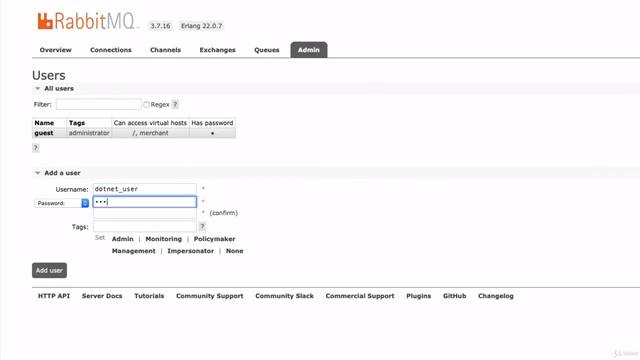
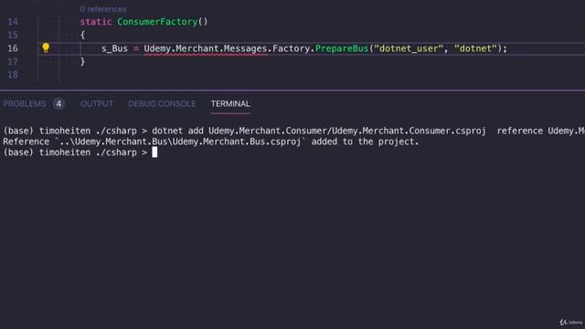
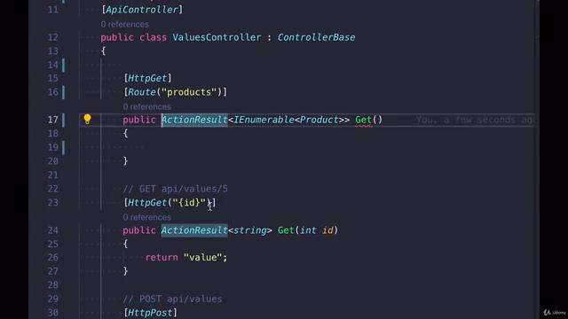
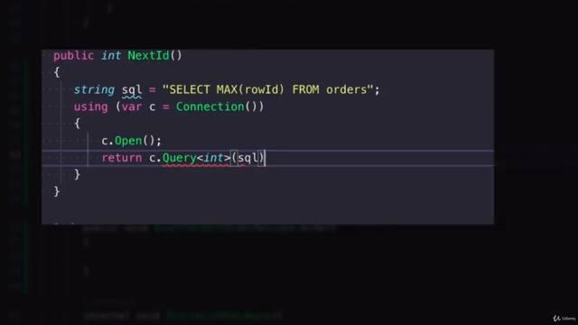
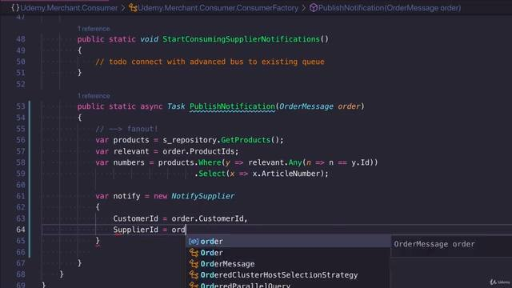
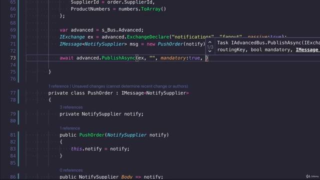
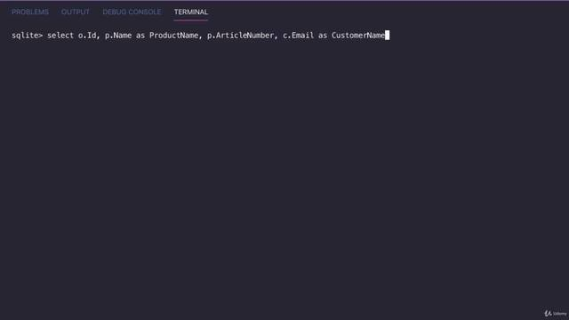

# RabbitMQ 实战：从 .NET 消费者到 Python 供应商的完整链路（P65–P69）

> 课程：BV1o39SBiEhD ｜ 覆盖 P65–P69
> 读者画像：前端转 AI 应用工程师，本文涉及 C# / .NET 语法只做「知道即可」级别的说明，重点放在**消息队列怎么串起来**。

---

## 1. 这一节做什么

这五集是整门课从「单点演示」走向「完整系统」的收口阶段。前面几集你已经有了一个 EasyNetQ 的工厂方法（`CreateBus`），这一节要做的事按依赖顺序是：

1. **P65**：写 .NET 消费者控制台程序（Consumer），用 `IBus` 订阅订单、响应商品请求、发布通知——此时数据库访问全是**模板方法**，返回硬编码数据。
2. **P66**：搭基础设施——RabbitMQ 的 virtual host（`merchant`）、两个用户（`.NET` / `RabbitMQ`）、权限、手动建 `notification` 队列；再用 SQLite + Dapper 建库建表、写仓储（Repository）的插入与查询。
3. **P67**：写 REST API（Controller），把「取商品」和「下单」两个用例通过 EasyNetQ 的 Request/Response 与 Publish 打到消费者。
4. **P68**：回到消费者，补上 `InsertOrder` 的落库逻辑（订单表 + 订单商品关联表两条 INSERT）。
5. **P69**：写 Python 脚本模拟供应商，消费 fanout 交换机上的通知；同时把 .NET 侧的 `PublishNotification` 改成走 **AdvancedBus + fanout exchange**，最终跑通「Postman 下单 → 消费者落库 → Python 供应商收到通知」的完整链路。

一句话：**这一节交付的是一个能端到端跑起来的、由 REST API 触发、经 RabbitMQ 分发、落 SQLite、再由 Python 消费通知的最小系统。**

如果你是从前端过来的，可以用一句话理解这五集的角色分工：**RestApi 相当于你写过的 Express / Next.js Route Handler（入口），Consumer 相当于 BullMQ / Celery 里的 worker（消费方），RabbitMQ 是它们之间的消息总线，SQLite 是 worker 自己管的数据存储，Python supplier 相当于另一个独立的第三方消费者**。这五集之所以按 P65→P69 这个顺序推进，是因为整条链路的「接收端」要先立起来（P65 的 Consumer），后面的 API、数据库、Python 才有对接对象——**没有消费者，光有 Publisher 是不知道消息到底去哪的**。所以复现时不要跳步，每一步都能独立验证，如果某一环不通，问题就被锁在很小的范围里。

---

## 2. 讲师原话（带时间戳）

> "我们首先要做的是消费已发布的订单。然后要消费产品响应，更准确地说，是要应答产品请求队列。当然，我们还要发送通知并接收通知。"
> —— p065 [00:29]

> "我们不给队列命名，因为队列由 EasyNetQ 命名；这里的订单字符串就是应用标识。所以每个不同的名称都会得到不同的通道。"
> —— p065 [01:35]

> "我们必须提供泛型类型 ProductRequest 和 ProductResponse；另外，我们还需要从数据库中取出这些数据，但目前还没有数据库访问代码……所以这里只是一个模板，我们只是根据编号 124 创建三个产品，货号和价格都是随机生成的。"
> —— p065 [02:51]

> "顺便说一句，逐步构建应用是常见做法；每完成一个增量步骤，你就离心中目标更近一步。"
> —— p065 [03:21]

> "首先我们需要 Merchant 的虚拟主机，然后需要两个用户，一个用于 .NET，一个用于 RabbitMQ……我们还会为这两个用户设置 Merchant 虚拟主机的权限。"
> —— p066 [00:00]

> "这里外键设置是 false，但我们很快会把它改成 true。因为必须针对每个 SQLite 连接单独设置外键 pragma。"
> —— p066 [01:24]

> "为什么用对象数组？因为这里使用了匿名类型，而这种方式下只能把它作为 object 传递。"
> —— p066 [02:23]

> "类的名称、命名空间以及项目名称，用逗号分隔。通知队列是我们手动创建的。"
> —— p066 [03:48]

> "这里本来也可以使用 FromHeader 特性，但我用了 HttpContext.Request，因为这样更明确。"
> —— p067 [02:22]

> "你可以把逻辑和数据传输对象分开；在本例中，数据传输对象就是订单消息。message 这个名称很好，因为队列或 RabbitMQ 本身就用 message 来表示消息对象。"
> —— p067 [03:19]

> "首先，我们必须插入订单本身，这个订单来自订单消息。然后还要在 OrderProduct 表中插入一条记录。因此，我们需要通过在这个表中建立关联，把产品与订单匹配起来。"
> —— p068 [00:26]

> "我们会拒绝所有不属于该供应商的消息。我们会从通知中获得的消息里取出供应商编号；如果它匹配应用启动时提供的参数，就确认这条消息，否则拒绝。"
> —— p069 [00:29]

> "这里我们显然需要 EasyNetQ 的 AdvancedBus，因为这不是 EasyNetQ 自己创建的队列，为此你需要改用 AdvancedBus。我们调用 ExchangeDeclare，只做幂等处理……同时使用 passive 标志，这样它就只是检查是否存在。"
> —— p069 [03:19]

> "这本可以在 SQL 里完成，但我不想为这种示例应用做过于复杂的东西。所以我们只是用之前创建的所有产品，在内存中执行一条 LINQ 语句。"
> —— p069 [02:49]

---

## 3. 从零复现

### 3.1 环境与目录结构

课里没有给出完整的 `dotnet new` 命令清单，但根据 P65–P69 的项目引用关系，可以还原出如下解决方案结构（**目录名以课里出现的项目名为准**）：

```
RabbitMQDemo/
├── RabbitMQDemo.sln
├── Shared/                         # 消息契约（OrderMessage / ProductRequest / ProductResponse / NotifySupplier）
│   └── RabbitMQDemo.Shared.csproj
├── Consumer/                       # P65 + P68：控制台消费者
│   ├── RabbitMQDemo.Consumer.csproj
│   ├── Program.cs
│   ├── ConsumerFactory.cs
│   └── Repository.cs
├── RestApi/                        # P67：REST API
│   ├── RabbitMQDemo.RestApi.csproj
│   ├── Program.cs
│   ├── Controllers/OrderController.cs
│   └── Models/OrderInput.cs
├── Database/
│   └── schema.sql                  # P66 的 SQLite 建表脚本
└── supplier.py                     # P69：Python 供应商模拟
```

依赖（P65–P69 明确提到的）：

- .NET 侧：`EasyNetQ`、`Microsoft.Data.Sqlite`（SQLite provider）、`Dapper`
- Python 侧：`pika`（课里只说「Python 脚本」，未点名库；下面代码用 pika，若你环境不同请以实际为准）

> 课里没讲 .NET 版本号，也没讲 `dotnet add package` 的具体版本。**请以你本地 `dotnet add package EasyNetQ` 拉到的版本为准**，本文不编造版本号。

如果你手边完全是空目录，可以按下面的命令把骨架搭起来（这些命令是根据上面的项目引用关系反推出来的，课里未逐条演示）：

```bash
dotnet new sln -n RabbitMQDemo
dotnet new classlib -n RabbitMQDemo.Shared -o Shared
dotnet new console  -n RabbitMQDemo.Consumer -o Consumer
dotnet new webapi   -n RabbitMQDemo.RestApi  -o RestApi

dotnet sln add Shared/RabbitMQDemo.Shared.csproj
dotnet sln add Consumer/RabbitMQDemo.Consumer.csproj
dotnet sln add RestApi/RabbitMQDemo.RestApi.csproj

# 让 Consumer / RestApi 引用 Shared（消息契约）
dotnet add Consumer/RabbitMQDemo.Consumer.csproj reference Shared/RabbitMQDemo.Shared.csproj
dotnet add RestApi/RabbitMQDemo.RestApi.csproj   reference Shared/RabbitMQDemo.Shared.csproj

# 装包（版本以本地源为准）
dotnet add Consumer/RabbitMQDemo.Consumer.csproj package EasyNetQ
dotnet add Consumer/RabbitMQDemo.Consumer.csproj package Microsoft.Data.Sqlite
dotnet add Consumer/RabbitMQDemo.Consumer.csproj package Dapper
dotnet add RestApi/RabbitMQDemo.RestApi.csproj  package EasyNetQ
```

前端工程视角对照一下：`dotnet new` 约等于 `npm init` + `npx create-*` 的组合，`dotnet sln add` 相当于把多个 workspace 包加进 monorepo（类似 `pnpm-workspace.yaml` 里登记），`dotnet add package` 就是 `npm install`（区别是它会把依赖写进 `.csproj` 而不是 `package.json`），`dotnet add ... reference` 约等于 monorepo 里的 `workspace:*` 依赖。构建入口是 `dotnet build`，跑起来是 `dotnet run --project <名字>`，这相当于 `npm run dev`。

常见的踩坑：如果 `dotnet add package EasyNetQ` 报错找不到源，先 `dotnet nuget list source` 确认 `nuget.org` 在源列表里；如果 `dotnet add reference` 报「项目未找到」，多半是路径写错或者该 `.csproj` 还没被 `dotnet sln add`。

### 3.2 第一步：RabbitMQ 服务端准备（P66）

课里明确要求：

1. 创建 virtual host：`merchant`
2. 创建两个用户：`.NET`（密码 `.NET`）和 `RabbitMQ`（课里说「one for .NET and one for RabbitMQ」，Python 侧用的是 `.NET` 用户，见 P65 [00:59]「we do put in the .NET user and the password, which is .NET」）
3. 给两个用户在 `merchant` vhost 上授权
4. **手动创建 `notification` 队列**（P66 [00:29]：「we also create a notification queue because I told before this will be done manually」）



具体操作是在管理界面（默认 `http://localhost:15672`）里：`Admin → Virtual Hosts` 添加 `merchant`；`Admin → Users` 添加两个用户；回到 vhost 权限行点 `Set permission` 给两个用户授权。`notification` 队列在 `Queues` 页手动建。

如果你更习惯命令行，也可以用 `rabbitmqctl` 等价完成：

```bash
rabbitmqctl add_vhost merchant
rabbitmqctl add_user .NET .NET
rabbitmqctl set_permissions -p merchant .NET ".*" ".*" ".*"
rabbitmqctl add_user RabbitMQ <密码>
rabbitmqctl set_permissions -p merchant RabbitMQ ".*" ".*" ".*"
```

> 注意：课里说「in a real application you would probably use some domain specific names and not the client implementation」——即真实项目别用 `.NET` 这种名字当用户名，这里只是为了区分。

常见错误：vhost 名字拼错（比如写成 `Merchant` 大写），用户建了但忘了在 vhost 上 Set permission，导致后续连接被拒 `ACCESS_REFUSED`；`.NET` 用户名在管理界面里回车后会自动变成小写吗？不会——RabbitMQ 用户名是大小写敏感的，`.NET` 与 `.net` 是两个不同账号，一定按课里的大小写来。

### 3.3 第二步：SQLite 建库（P66）

课里用 SQLite CLI 执行了一个 `schema.sql`（讲师说「I also created is script here」）。四张表：`Customers`、`Suppliers`、`Products`、`Orders`，外加关联表 `OrderedProducts`（P68 用到）。**课里没有逐字念出建表语句**，下面给出与 P66/P68 字段引用一致的版本（字段名以 P68 的 `select join` 和 P66 的 insert 语句为准）：

```sql
-- Database/schema.sql
PRAGMA foreign_keys = ON;

CREATE TABLE Customers (
    Id    INTEGER PRIMARY KEY,
    Name  TEXT NOT NULL,
    Email TEXT NOT NULL
);

CREATE TABLE Suppliers (
    Id    INTEGER PRIMARY KEY,
    Name  TEXT NOT NULL,
    Email TEXT NOT NULL
);

CREATE TABLE Products (
    Id            INTEGER PRIMARY KEY,
    ArticleNumber TEXT NOT NULL,
    Price         REAL NOT NULL
);

CREATE TABLE Orders (
    Id         INTEGER PRIMARY KEY,
    CustomerId INTEGER NOT NULL,
    SupplierId INTEGER NOT NULL,
    FOREIGN KEY (CustomerId) REFERENCES Customers(Id),
    FOREIGN KEY (SupplierId) REFERENCES Suppliers(Id)
);

CREATE TABLE OrderedProducts (
    OrderId   INTEGER NOT NULL,
    ProductId INTEGER NOT NULL,
    PRIMARY KEY (OrderId, ProductId),
    FOREIGN KEY (OrderId)   REFERENCES Orders(Id),
    FOREIGN KEY (ProductId) REFERENCES Products(Id)
);
```

执行：

```bash
sqlite3 rabbitmqdemo.db < Database/schema.sql
```

命令拆开看：`sqlite3 <文件>` 是打开/创建数据库（文件不存在就创建），`< Database/schema.sql` 是把文件内容作为 SQL 输入喂进去，等价于进交互模式后 `.read Database/schema.sql`。如果只想确认表建出来了，用 `sqlite3 rabbitmqdemo.db ".tables"` 会打印所有表名，`.schema OrderedProducts` 能打印单表定义，`.quit` 退出。

> 课里强调「foreign keys is false, but we will soon correct this to be true. Because you have to set foreign key pragma for each SQLite connection individually」——**SQLite 的外键开关是 per-connection 的**，所以下面 Repository 的连接字符串里必须带 `Foreign Keys=True`，否则建表时的 FK 不生效。

前端视角对照一下：SQLite 之于 C# 应用，很像 `better-sqlite3` 之于 Node —— 都是一个**嵌入式的、单文件的、不需要起服务的数据库**，用 `sqlite3 xxx.db` 就能查。跟 `Prisma` / `Drizzle` 那种 ORM 不同，这里用的是更底层的 `Dapper`（几乎就是手写 SQL），好处是透明、无可动魔法，坏处是拼接、事务、异常处理都得自己来。schema.sql 里那行 `PRAGMA foreign_keys = ON;` 只是一个「提醒语义」，它仅在你用 CLI 这个 session 里有效；应用侧一定要靠连接串里的 `Foreign Keys=True` 兜底——这一点后面 5.3 会再展开。

常见错误：第一条 `INSERT` 就报 `no such table: Products`，多半是 schema.sql 没执行或者执行的是一个空的 db 文件（`sqlite3` 不会主动提示「你输错路径了」，它会默默创建一个空库）。验证方式：`sqlite3 rabbitmqdemo.db ".tables"`，看到 5 张表才算成功。

### 3.4 第三步：消费者程序骨架（P65）

P65 的核心是 `Program.cs` 里三件事：`StartConsumeOrders`、`StartRespondProducts`、`StartConsumeSupplyNotifications`。此时数据库访问是**模板方法**（P65 [02:51] 原话：「this will be just a template where we simply create three products」）。



这一步值得强调的是**「先跑通再补数据」的开发节奏**——讲师在 P65 [03:21] 原话里说的「create an application step by step」就是这个意思：先让 P65 的 Consumer 拿着三件硬编码商品把三条订阅路都打通（订单、响应、通知各跑一次），此时你不必关心数据库长什么样。等 P66 把库建好、P68 把落库补上，再把硬编码替换掉。**如果你一上来就把三件事全写完，很难定位是哪一层（MQ、SQL、HTTP）出问题**。

前端对照：`Program.Main` 是入口，等价于 Node 里的 `src/index.js` 顶层 `await main()`；`Console.ReadKey()` 阻塞主线程保持进程存活，等价于 `process.stdin.resume()`；`ConsumerFactory` 就是「把一堆 `bus.subscribe(...)` 折到一堆方法里的封装」，一点都不神秘。

常见错误：`Console.ReadKey()` 在 IDE 之外的**被重定向的终端**里会抛 `InvalidOperationException: Cannot read keys when either application does not have a console or when console input has been redirected`。如果你用 `dotnet run` 前重定向了 stdin（比如 CI），换成 `await Task.Delay(Timeout.Infinite)` 或者 `Console.ReadLine()`。

### 3.5 第四步：REST API（P67）

两个路由：

- `GET /api/version1/products` → 走 EasyNetQ 的 `RequestAsync<ProductRequest, ProductResponse>`
- `PUT /api/version1/order` → 从 body 取 `OrderInput`，从 **header** 取 `CustomerId`（P67 [02:22]：「I used the HTTP context request because it's more explicit」），然后 `PublishAsync(OrderMessage)`



这里涉及一个前端容易忽略的点：**Request/Response 是同步阻塞语义，但它不是 HTTP**。`RequestAsync` 会发消息、等 Consumer 处理、再取回响应；如果 Consumer 没起，调用会挂住直到超时（EasyNetQ 有默认超时）。这意味着**在启动 WebApi 之前一定要先起 Consumer**，否则第一次 `GET products` 就会卡住或返回超时错误，而不是你预期的「返回 404」。

前端对照：`[FromBody]` 相当于 Express 里的 `req.body`；但 `CustomerId` 这里没有走 `[FromHeader]`，而是直接读 `HttpContext.Request.Headers["CustomerId"]`（P67 [02:22] 讲得清楚——「more explicit」）。这两种写法在行为上等价，只是后者在代码里能一眼看出「这是从 header 取的」，也方便加日志。如果你未来做前端联调，Postman 里记得在 Headers 中加一行 `CustomerId: 1`，否则 `int.Parse("")` 会直接抛 `FormatException`，被 `catch` 兜成 400。

常见错误：一是 `CustomerId` header 漏了（Postman 里 `Params` 页和 `Headers` 页是两个地方，容易加错）；二是 `[HttpPut("order")]` 路由与前端 `fetch` 的 URL 大小写不一致（.NET 路由默认不区分大小写，但如果中间加了反代就要注意）；三是 `PublishAsync` 之后忘记检查返回，导致消息其实没投出去但前端拿到 200。

### 3.6 第五步：补落库（P68）

`InsertOrder` 要做**两条 INSERT**：一条进 `Orders`，一条进 `OrderedProducts`（P68 [00:26] 原话）。课里还提到先 `GetNextId` 拿下一个订单 ID。



前端对照：这相当于把一次「创建订单 + 写入订单明细」写成了两个独立 `INSERT`。在 ORM（Prisma / TypeORM）里通常是一个 `create({ data: { ..., items: { create: [...] } } })` 的事；Dapper 这里则是手写两条 SQL。**课里显然没有包事务**（P68 [00:54] 说「I know that that's probably different ways to achieve this with SQL, but it's the easiest way with Dapper」），这在示例中是 OK 的，但在生产代码里，第二条 INSERT 失败会让 Orders 里留下一个“有单无明细”的孤儿订单——**这就是下面第 7 段要展开的话题**。

常见错误：`OrderedProducts` 插入时外键约束报错，多半是因为 `OrderId` 不对——`GetNextId(conn) - 1` 这个写法很绕，因为它假设「插入后立刻再调一次 `GetNextId` 会返回刚插入的 ID+1」；如果你的 Orders 主键是自增、不是手填的 `MAX(Id)+1`，这个减法就完全对不上。**跑之前先 `SELECT * FROM Orders`** 看一眼 ID 是不是 1、2、3……再决定要不要沿用讲师这套逻辑。

### 3.7 第六步：Python 供应商 + fanout 通知（P69）

P69 的关键改动是：`PublishNotification` 从普通 `IBus.PublishAsync` 改成 **`IAdvancedBus` + `ExchangeDeclare`（fanout, passive）+ `PublishAsync`**，因为 `notification` 队列是手动建的、不是 EasyNetQ 自动建的（P69 [03:19] 原话）。



这里 fanout 的语义需要说清楚：**fanout 交换机把消息广播给所有绑定到它的队列**，它与 routing key 无关。所以课里 `_bus.PublishAsync(exchange, "", ...)` 的第二个参数传空字符串是合理的——fanout 不靠 routing key 分流。这跟前端熟悉的 WebSocket 广播频道很像：你连进一个 channel，所有广播都能收到，至于「这条消息我管不管」是靠客户端自己过滤的（后面的 `supplierId` 判断就是过滤动作）。

Python 侧代码 `channel.queue_declare(queue="", exclusive=True)` 建的是**临时队列**（名字由 broker 随机生成，连接关闭后自动删除），这样多个 supplier 进程各有一个独立队列，都能收到同一个 fanout 的全量消息。

常见错误：`exchange_declare(passive=True)` 报 404，说明 `notification` exchange 不存在——**这就是启动顺序的重要性**（3.8 会讲）；如果只声明了队列没声明 exchange，会报 `PRECONDITION_FAILED - inequivalent arg 'type'`，多半是以前某个脚本用 `direct` 建过同名 exchange，得去管理界面删掉重建。

### 3.8 启动顺序（P69 [04:18]）

讲师演示的启动顺序是：

1. 启动 .NET Consumer（`dotnet run --project Consumer`）
2. 启动 .NET Web API（`dotnet run --project RestApi`）
3. 启动两个 Python 脚本：`python supplier.py 1` 和 `python supplier.py 2`
4. 打开 Postman，`PUT http://localhost:5000/api/version1/order`，body 里 `supplierId=1`、`productIds=[1,3]`，header 里带 `CustomerId`



三条 `dotnet run --project <name>` 命令里的 `--project` 参数是「指定 csproj 路径或所在目录」，不写的话会尝试在当前目录找 csproj；在解决方案根目录下必须写。如果你嫌切目录麻烦，可以开三个终端窗口分别 `cd` 到项目目录里 `dotnet run`，效果一样。

前端对照：启动顺序 ≈ 一个微服务 split 的 `compose` 里先起 worker 再起 gateway——只是这里没有 docker，靠手动。**先起 Consumer 不但保证订阅关系注册好，也保证 P69 里 `passive` 声明的 `notification` exchange 已经存在**。

常见错误：先启动 Python 脚本会直接抛 404（exchange 不存在），先启动 WebApi 后调用 `GET products` 会卡住（`RequestAsync` 超时），先启动 Consumer 但忘了 `InitializeDatabase()` 会插一堆积数据和 FK 冲突。**按顺序来，出问题一次定位一层。**

---

## 4. 完整代码

> 说明：以下代码按 P65–P69 逐字稿描述还原，**文件级完整、可直接保存**。逐字稿未念出的部分（如 using 列表、异常消息文案）按 .NET 常规写法补全，已在注释里标注「课里未明确」。

### 4.1 `Shared/Contracts.cs`（消息契约）

这个文件是整条链路的「类型中枢」——Consumer、RestApi、Python 三方共用的字段定义都集中在这里。把消息契约抽到独立 `Shared` 项目是常见做法，等价于前端 monorepo 里 `packages/shared` 放 TS 接口定义，两边 import 同一个类型。

```csharp
// Shared/Contracts.cs
// 课里 P65/P67/P69 反复提到这些消息类型，但未给出完整定义，以下按字段引用还原
namespace RabbitMQDemo.Shared
{
    public class ProductRequest
    {
        public int[] ProductIds { get; set; }
    }

    public class ProductResponse
    {
        public Product[] Products { get; set; }
    }

    public class Product
    {
        public int Id { get; set; }
        public string ArticleNumber { get; set; }
        public decimal Price { get; set; }
    }

    // P67 [03:19]：OrderMessage 与 OrderInput 字段相同，但分属不同层
    public class OrderMessage
    {
        public int CustomerId { get; set; }
        public int SupplierId { get; set; }
        public int[] ProductIds { get; set; }

        public override string ToString()
            => $"OrderMessage(CustomerId={CustomerId}, SupplierId={SupplierId}, ProductIds=[{string.Join(",", ProductIds ?? new int[0])}])";
    }

    // P69 [02:49]：NotifySupplier 只带供应商 ID 和商品货号
    public class NotifySupplier
    {
        public int CustomerId { get; set; }
        public int SupplierId { get; set; }
        public string[] ArticleNumbers { get; set; }
    }
}
```

### 4.2 `Consumer/Program.cs`（P65 + P68）

`Program.cs` 是消费者进程入口，干的事就是「创建 bus → 初始化 DB → 把三个订阅启动起来 → 阻塞住别退出」。跟 Node worker 的 `index.js` 完全同构。

```csharp
// Consumer/Program.cs
using System;
using System.Threading.Tasks;
using EasyNetQ;
using RabbitMQDemo.Shared;

namespace RabbitMQDemo.Consumer
{
    public static class Program
    {
        // P65 [00:29]：bus 用 static 方式创建
        private static IBus _bus;

        public static async Task Main(string[] args)
        {
            // P65 [00:59]：工厂方法里传 .NET 用户 / 密码 .NET
            _bus = RabbitMQDemo.Shared.BusFactory.CreateBus("host=localhost;virtualHost=merchant;username=.NET;password=.NET");

            var repository = new Repository();
            repository.InitializeDatabase();

            var factory = new ConsumerFactory(_bus, repository);

            // P65 [03:48]：三个启动方法
            await factory.StartConsumeOrders();
            await factory.StartRespondProducts();
            await factory.StartConsumeSupplyNotifications();

            Console.WriteLine("Consumer started. Press any key to exit.");
            Console.ReadKey();
        }
    }
}
```

> 课里 P65 [00:59] 说「from our factory method we created in the last video」——`BusFactory` 是上一集的产物，这里直接调用。若你没有上一集代码，把 `CreateBus` 内联成 `RabbitHutch.CreateBus(connStr)` 即可。

### 4.3 `Consumer/ConsumerFactory.cs`（P65 + P69）

这个文件是 P65 的核心，也是 P69 改动的主战场（`PublishNotification` 从 `IBus` 升级到 `IAdvancedBus`）。三个方法各对应一条消息路：

```csharp
// Consumer/ConsumerFactory.cs
using System;
using System.Linq;
using System.Threading.Tasks;
using EasyNetQ;
using EasyNetQ.Topology;
using RabbitMQDemo.Shared;

namespace RabbitMQDemo.Consumer
{
    public class ConsumerFactory
    {
        private readonly IBus _bus;
        private readonly Repository _repository;

        public ConsumerFactory(IBus bus, Repository repository)
        {
            _bus = bus;
            _repository = repository;
        }

        // P65 [01:28]：订阅订单，applicationId = "orders"
        public async Task StartConsumeOrders()
        {
            await _bus.SubscribeAsync<OrderMessage>(
                "orders",
                async order =>
                {
                    // P68 [00:26]：先落库
                    _repository.InsertOrder(order);

                    // P65 [02:25]：发布通知给客户与供应商
                    await PublishNotification(order);
                });
        }

        // P65 [02:51]：响应商品请求（P69 改为查库）
        public async Task StartRespondProducts()
        {
            await _bus.RespondAsync<ProductRequest, ProductResponse>(
                async request =>
                {
                    // P69 [01:52]：改为从数据库取
                    var products = _repository.GetProducts(request.ProductIds);
                    return new ProductResponse { Products = products.ToArray() };
                });
        }

        // P65 [00:29]：消费供应商通知（此处仅打印，P69 由 Python 侧真正消费）
        public async Task StartConsumeSupplyNotifications()
        {
            await _bus.SubscribeAsync<NotifySupplier>(
                "supply-notifications",
                notification =>
                {
                    Console.WriteLine($"[NotifySupplier] SupplierId={notification.SupplierId}, " +
                                      $"ArticleNumbers=[{string.Join(",", notification.ArticleNumbers ?? new string[0])}]");
                    return Task.CompletedTask;
                });
        }

        // P69 [02:20]：改为 AdvancedBus + fanout exchange
        private async Task PublishNotification(OrderMessage order)
        {
            // P69 [02:49]：内存里 link 出商品货号
            var allProducts = _repository.GetProducts(order.ProductIds);
            var articleNumbers = allProducts
                .Where(p => order.ProductIds.Contains(p.Id))
                .Select(p => p.ArticleNumber)
                .ToArray();

            var notify = new NotifySupplier
            {
                CustomerId = order.CustomerId,
                SupplierId = order.SupplierId,
                ArticleNumbers = articleNumbers
            };

            // P69 [03:19]：notification 队列是手动建的，必须用 AdvancedBus
            var advancedBus = _bus.Advanced;
            var exchange = await advancedBus.ExchangeDeclareAsync(
                "notification",
                ExchangeType.Fanout,
                durable: true,
                autoDelete: false,
                passive: true);   // passive = 只做存在性检查

            var message = new Message<NotifySupplier>(notify);
            await advancedBus.PublishAsync(exchange, string.Empty, false, message);
        }
    }
}
```

> 课里 P69 [03:49] 提到「create a message and this has to be an iMessage of the type notifySupplier... with a private class here」——即 `Message<NotifySupplier>` 包装。上面已按此写。

### 4.4 `Consumer/Repository.cs`（P66 + P68）

`Repository` 是 Consumer 侧数据库访问的唯一入口（前端视角 ≈ 一个极简版的 Prisma Client），负责初始化样例数据、查商品、落订单。P66 只写了 `GetProducts` + `InitializeDatabase`（且是模板数据），P68 补上 `InsertOrder`。

```csharp
// Consumer/Repository.cs
using System.Collections.Generic;
using System.Data;
using System.Linq;
using Dapper;
using Microsoft.Data.Sqlite;
using RabbitMQDemo.Shared;

namespace RabbitMQDemo.Consumer
{
    public class Repository
    {
        // P66 [01:24]：Foreign Keys=True 必须写在连接串里
        private const string ConnectionString =
            "Data Source=rabbitmqdemo.db;Foreign Keys=True";

        private IDbConnection CreateConnection() => new SqliteConnection(ConnectionString);

        // P66 [03:21]：初始化示例数据
        public void InitializeDatabase()
        {
            using var conn = CreateConnection();
            conn.Open();

            // 课里未给出完整 INSERT 文案，以下按 P66 描述的四张表还原
            conn.Execute(
                "INSERT INTO Customers (Id, Name, Email) VALUES (@Id, @Name, @Email)",
                new[]
                {
                    new { Id = 1, Name = "Customer 1", Email = "customer1@merchant.com" },
                    new { Id = 2, Name = "Customer 2", Email = "customer2@merchant.com" },
                    new { Id = 3, Name = "Customer 3", Email = "customer3@merchant.com" }
                });

            conn.Execute(
                "INSERT INTO Suppliers (Id, Name, Email) VALUES (@Id, @Name, @Email)",
                new[]
                {
                    new { Id = 1, Name = "Supplier 1", Email = "supplier1@merchant.com" }
                });

            conn.Execute(
                "INSERT INTO Products (Id, ArticleNumber, Price) VALUES (@Id, @ArticleNumber, @Price)",
                new[]
                {
                    new { Id = 1, ArticleNumber = "A-001", Price = 10.0m },
                    new { Id = 2, ArticleNumber = "A-002", Price = 20.0m },
                    new { Id = 3, ArticleNumber = "A-003", Price = 30.0m }
                });
        }

        // P66 [02:52]：Dapper 的 Query 扩展方法
        public IEnumerable<Product> GetProducts(int[] productIds)
        {
            using var conn = CreateConnection();
            conn.Open();
            return conn.Query<Product>(
                "SELECT Id, ArticleNumber, Price FROM Products WHERE Id IN @Ids",
                new { Ids = productIds });
        }

        // P68 [00:26]：两条 INSERT
        public void InsertOrder(OrderMessage order)
        {
            using var conn = CreateConnection();
            conn.Open();

            // 1) 插入订单
            conn.Execute(
                "INSERT INTO Orders (Id, CustomerId, SupplierId) VALUES (@Id, @CustomerId, @SupplierId)",
                new[]
                {
                    new { Id = GetNextId(conn), CustomerId = order.CustomerId, SupplierId = order.SupplierId }
                });

            // 2) 插入订单商品关联
            var orderId = GetNextId(conn) - 1;
            var orderedProducts = order.ProductIds
                .Select(pid => new { OrderId = orderId, ProductId = pid })
                .ToArray();

            conn.Execute(
                "INSERT INTO OrderedProducts (OrderId, ProductId) VALUES (@OrderId, @ProductId)",
                orderedProducts);
        }

        // P68 [00:14]：next ID 方法
        private static int GetNextId(IDbConnection conn)
        {
            var max = conn.ExecuteScalar<int?>("SELECT MAX(Id) FROM Orders");
            return (max ?? 0) + 1;
        }
    }
}
```

> 课里 P68 [00:14] 原话是「we need to create a next ID method because when we create a new order we want to have the next ID that comes after this」——上面用 `MAX(Id)+1` 实现，**课里未给出具体 SQL**，若你的表用自增主键可省略此方法。

### 4.5 `RestApi/Program.cs`（P67）

这里是 WebApi 的启动入口，关键动作只有两件：把 `IBus` 注册为单例、把 Controller 挂载进管道。跟前端写 `new Express()` + `app.use(router)` 是同一个位置。

```csharp
// RestApi/Program.cs
using EasyNetQ;
using Microsoft.AspNetCore.Builder;
using Microsoft.Extensions.DependencyInjection;

var builder = WebApplication.CreateBuilder(args);

builder.Services.AddControllers();

// P67 [04:16]：IBus 注册为 Singleton
builder.Services.AddSingleton<IBus>(_ =>
    RabbitHutch.CreateBus("host=localhost;virtualHost=merchant;username=.NET;password=.NET"));

var app = builder.Build();
app.MapControllers();
app.Run();
```

### 4.6 `RestApi/Models/OrderInput.cs`（P67）

DTO（Data Transfer Object）——**只承载 HTTP body 的输入形态，不是消息契约**。P67 [03:19] 讲师特意区分了 `OrderInput` 和 `OrderMessage`，就是为了不让 HTTP 边界的概念污染 MQ 边界的概念。

```csharp
// RestApi/Models/OrderInput.cs
namespace RabbitMQDemo.RestApi.Models
{
    public class OrderInput
    {
        public int SupplierId { get; set; }
        public int[] ProductIds { get; set; }
    }
}
```

### 4.7 `RestApi/Controllers/OrderController.cs`（P67）

Controller 是整条链路的入口，靠两个方法分别把 GET / PUT 打到 EasyNetQ 上：

```csharp
// RestApi/Controllers/OrderController.cs
using System;
using System.Threading.Tasks;
using EasyNetQ;
using Microsoft.AspNetCore.Mvc;
using RabbitMQDemo.RestApi.Models;
using RabbitMQDemo.Shared;

namespace RabbitMQDemo.RestApi.Controllers
{
    [ApiController]
    [Route("api/version1")]
    public class OrderController : ControllerBase
    {
        private readonly IBus _bus;

        public OrderController(IBus bus) => _bus = bus;

        // P67 [01:25]：GET 商品
        [HttpGet("products")]
        public async Task<IActionResult> GetProducts()
        {
            try
            {
                var response = await _bus.RequestAsync<ProductRequest, ProductResponse>(
                    new ProductRequest { ProductIds = new[] { 1, 2, 3, 4 } });
                return Ok(response);
            }
            catch (Exception ex)
            {
                Console.WriteLine(ex);
                return BadRequest(ex.Message);
            }
        }

        // P67 [02:22]：PUT 下单，CustomerId 从 header 取
        [HttpPut("order")]
        public async Task<IActionResult> PutOrder([FromBody] OrderInput input)
        {
            try
            {
                var customerId = int.Parse(HttpContext.Request.Headers["CustomerId"].ToString());

                var message = new OrderMessage
                {
                    CustomerId = customerId,
                    SupplierId = input.SupplierId,
                    ProductIds = input.ProductIds
                };

                await _bus.PublishAsync(message);
                return Ok();
            }
            catch (Exception ex)
            {
                Console.WriteLine(ex);
                return BadRequest(ex.Message);
            }
        }
    }
}
```

### 4.8 `supplier.py`（P69）

Python 侧模拟供应商，是 P69 里「多消费者」那一环。用 `sys.argv[1]` 区分不同 supplier 进程，用 `supplierId` 过滤消息。

```python
# supplier.py
# 用法：python supplier.py <supplierId>
import sys
import pika

supplier_id = int(sys.argv[1])

connection = pika.BlockingConnection(
    pika.ConnectionParameters(
        host="localhost",
        virtual_host="merchant",
        credentials=pika.PlainCredentials(".NET", ".NET"),
    )
)
channel = connection.channel()

# P69 [01:23]：绑定到 fanout exchange，无 routing key
channel.exchange_declare(exchange="notification", exchange_type="fanout", passive=True)
result = channel.queue_declare(queue="", exclusive=True)
queue_name = result.method.queue
channel.queue_bind(exchange="notification", queue=queue_name)


def callback(ch, method, properties, body):
    # P69 [00:29]：只处理属于本供应商的消息
    import json
    msg = json.loads(body)
    if msg.get("supplierId") == supplier_id:
        print(f"[supplier {supplier_id}] received: {msg}")
        ch.basic_ack(delivery_tag=method.delivery_tag)
    else:
        ch.basic_reject(delivery_tag=method.delivery_tag, requeue=False)


channel.basic_consume(queue=queue_name, on_message_callback=callback)
print(f"Supplier {supplier_id} waiting for notifications...")
channel.start_consuming()
```

> 课里 P69 [00:58] 说「we consume on the notification queue which we created manually before」——但同时又用 `queue_declare(queue="")` 建临时队列再 bind 到 fanout，这是 fanout 的标准用法。**课里未给出 Python 库名**，上面用 `pika`，若你环境不同请以实际为准。

---

## 5. 逐行解释

### 5.1 为什么 `SubscribeAsync` 的第一个参数是 `"orders"` 而不是队列名？

P65 [01:35] 原话：「instead of naming the queue, because the queue is named by easy net queue, the order string is the application ID. So for each different name here you will get a different channel.」

EasyNetQ 的订阅 API 第一个参数是 **subscriptionId**，不是队列名。EasyNetQ 会用它拼出队列名（P66 [03:48] 说命名约定是「class name + namespace + project name」）。所以 `"orders"` 只是给这个订阅起个 ID，**真正的队列名由 EasyNetQ 生成**。这解释了为什么 P66 里你能在管理界面看到一长串自动生成的队列名。

> 在 JS/Node 里对应什么？amqplib 里 `channel.consume(queue, cb)` 的 `queue` 是**真实队列名**，没有 EasyNetQ 这层抽象。所以从 Node 转过来要特别注意：EasyNetQ 的「订阅 ID」≠ 队列名。

沿用这套机制有一个直接后果：**同一个 `subscriptionId` 注册两次，EasyNetQ 会认为你要用一个共享队列**（类似 Node 的 work queue，多个消费者分摊消息）；换成两个不同的 ID 就是两条独立的队列（各自收到全量消息）。演示时如果发现「另一个消费者抢到了消息」，先看两边传的 subscriptionId 是不是同一个字符串。

### 5.2 `RespondAsync<ProductRequest, ProductResponse>` 为什么是泛型两个类型？

P65 [02:51] 原话：「We have to supply the generic types product requests and product response」。EasyNetQ 的 Request/Response 是**强类型**的：请求类型和响应类型都要在编译期确定，EasyNetQ 内部用它们生成 correlationId 和回复队列。这跟 HTTP 的「一个 URL 对应一个 handler」不同——**消息队列的 RPC 是靠类型系统路由的**。

对比一下 amqplib：那边你要手写 `c.sendToQueue(queue, content, { replyTo, correlationId })`，再自己挂一个 `channel.consume(replyQueue)` —— 通用但啰嗦。EasyNetQ 把这一整套姿势封在 `RespondAsync` / `RequestAsync` 里，代价是**必须强类型**。前端对照：就像 GraphQL schema 只有一种类型组合会被执行，类型不对直接匹配不上，报错信息不是「404 Not Found」而是「no responder」。

### 5.3 `Foreign Keys=True` 为什么必须写在连接串里？

P66 [01:24] 原话：「you have to set foreign key pragma for each SQLite connection individually」。SQLite 的 `PRAGMA foreign_keys` 是**连接级**开关，不是数据库级。Dapper 每次 `new SqliteConnection(...)` 都是新连接，所以必须把 `Foreign Keys=True` 写进连接串，让 provider 在每次 Open 时自动执行 PRAGMA。

> 在 JS/Node 里对应什么？`better-sqlite3` 里是 `db.pragma('foreign_keys = ON')`，同样是连接级。**这是 SQLite 的通用坑，不是 .NET 特有。**

验证方式：写一条故意违规的 INSERT（比如 `INSERT INTO OrderedProducts VALUES (999, 1)` 但 Orders 里没有 Id=999），如果 FK 生效会报 `FOREIGN KEY constraint failed`，如果没生效则静默插入。如果一遍跑下来从没看到这个报错，多半是你**没开 FK**，不是数据没问题。

### 5.4 `new[] { new { ... } }` 为什么是 object 数组？

P66 [02:23] 原话：「Why object array? Because we use anonymous types here and this is the way you can only pass it as object.」Dapper 的 `Execute` 第二个参数是 `object`，传匿名类型数组时编译器推断成 `object[]`，Dapper 内部按数组长度批量执行。**这是 Dapper 的批量插入惯用法**，不是 .NET 语法要求。

前端对照：在 Prisma 里等价于 `prisma.user.createMany({ data: [{...}, {...}] })`，差别只在「异常类型」——Dapper 不预先校验 schema，报错要等真正打到 SQLite 才出来。

### 5.5 `InsertOrder` 为什么是两条 INSERT？

P68 [00:26] 原话：「First of all, we have to insert the order itself... And also we have to put in an entry into the order product.」因为订单和商品是**多对多**关系，`Orders` 表只存订单头，商品明细在 `OrderedProducts` 关联表。这是关系型数据库的标准建模，**不是 RabbitMQ 的要求**。

> 课里 P68 [00:54] 说「I know that that's probably different ways to achieve this with SQL, but it's the easiest way with Dapper」——即用两条独立 INSERT 而不是事务/存储过程，是为了示例简单。**生产环境应该包事务**，课里没讲。

前端对照：常见 ORM 里叫 relation / many-to-many，`Prisma` 就是 `Order { items OrderItem[] }` 这样嵌套一次写完；这里是显式拆两条 SQL，好处是你能看清每条 SQL 的作用。

### 5.6 为什么 `PublishNotification` 要用 `AdvancedBus`？

P69 [03:19] 原话：「We obviously need the advanced bus from easynetq here because it's a queue that is not created by easynetq itself」。`notification` 队列是 P66 手动建的，EasyNetQ 的 `IBus.PublishAsync` 只会往它自己管理的 exchange 发。要用**外部 exchange**，必须降级到 `IAdvancedBus`，手动 `ExchangeDeclare` + `PublishAsync`。

`passive: true` 的含义是「只检查存在，不存在就抛异常」——P69 [03:19] 原话「use the passive flag so it is only an exist check」。这防止代码意外创建出配置错误的 exchange。

前端类比：`IBus` 是一层高端封装（类似 `tRPC` 那种编译期绑类型 + 运行时约定好的 transport），`IAdvancedBus` 是把手动 `fetch` / `WebSocket` 露给你，让你自己拼 URL、自己挂消息。要跟外部系统对接时，通常要「钻到下面一层」。

### 5.7 Python 侧为什么 `basic_reject(requeue=False)`？

P69 [00:29] 原话：「if it matches our provided arguments for the start of this application, we will acknowledge this message and else we will reject it」。`requeue=False` 表示**不重新入队**，直接丢弃——因为这条消息本来就不属于这个供应商，重新入队只会造成死循环。这是 fanout 场景下「每个消费者只处理自己关心的消息」的标准写法。

前端对照：`channel.basic_ack` 相当于 `messageChannel.port1.postMessage({ ok: true })`，只是发生在 MQ 层；`requeue=False` 相当于「我不处理，而且丢掉」，如果误用 `requeue=True`，你会看到这条消息被无限次重新投递——现象是 CPU 飙高、日志刷屏。

### 5.8 启动顺序为什么重要？

P69 [04:18] 讲师演示的顺序是 Consumer → WebApi → Python。原因：

- Consumer 先启动，才会**声明队列和 exchange**（EasyNetQ 在 `SubscribeAsync` / `RespondAsync` 时自动声明）
- WebApi 后启动，`RequestAsync` 才能找到响应队列
- Python 最后启动，`exchange_declare(passive=True)` 才能找到已存在的 exchange

**如果顺序反了，passive 声明会抛 404。**

实战小技巧：每次演示前先清一次现场（清队列、删临时队列、`sqlite3 rabbitmqdemo.db` 里清数据），否则上一次的残留会影响判断。前端的等价经验是「跑 E2E 之前先 reset 一次 test DB」。

---

## 6. 复现检查清单

按顺序勾选，每项都能在终端/管理界面看到明确输出。**每一条都附了验证命令**，不只是「你觉得对了就行」：

- [ ] RabbitMQ 管理界面能看到 vhost `merchant`
  - 验证：打开 `http://localhost:15672/#/vhosts`，列表里有 `merchant`；或用 `rabbitmqctl list_vhosts`
- [ ] 用户列表里有 `.NET` 和 `RabbitMQ`，且在 `merchant` 上有权限
  - 验证：`rabbitmqctl list_permissions -p merchant`，输出里能看到两行
- [ ] 手动创建的 `notification` 队列存在（P66 [00:29]）
  - 验证：管理界面 `Queues` 页搜 `notification`，或 `rabbitmqctl list_queues -p merchant`
- [ ] `sqlite3 rabbitmqdemo.db ".tables"` 输出 5 张表
  - 验证：应能看到 `Customers` / `Suppliers` / `Products` / `Orders` / `OrderedProducts`
- [ ] `dotnet run --project Consumer` 启动后，管理界面出现 EasyNetQ 自动生成的队列（P66 [03:48] 的命名约定）
  - 验证：`rabbitmqctl list_queues -p merchant`，应看到三组长名字队列（`RabbitMQDemo.Shared.OrderMessage:RabbitMQDemo.Consumer` 之类）
- [ ] `dotnet run --project RestApi` 启动后，`GET http://localhost:5000/api/version1/products` 返回 3 个商品（P67 [04:45]：「the four products we created」——课里说 4 个，实际 P65 模板是 3 个，**以你实际插入数为准**）
  - 验证：Postman 里发 GET，状态 200 且 body 是 JSON 数组
- [ ] Postman `PUT /api/version1/order`，header 带 `CustomerId: 1`，body `{"supplierId":1,"productIds":[1,3]}`，返回 200
  - 验证：Postman 里 `Headers` 页签确认有 `CustomerId`，不是加在 `Params` 里
- [ ] Consumer 控制台打印 `OrderMessage(...)`（P67 [05:13]：「this is order merge and pass messages」）
  - 验证：Console 窗口出现 `OrderMessage(CustomerId=1, SupplierId=1, ProductIds=[1,3])` 这一行；如果只出现类名，说明 `ToString()` 没重写
- [ ] `sqlite3 rabbitmqdemo.db "SELECT * FROM Orders; SELECT * FROM OrderedProducts;"` 能看到新订单和两条关联（P68 [01:49] 的 join 查询）
  - 验证：`Orders` 最后一行是 1/1/1，`OrderedProducts` 最后两行是 `1|1` 和 `1|3`
- [ ] `python supplier.py 1` 控制台打印收到的通知，`python supplier.py 2` 不打印（P69 [05:16]）
  - 验证：two-terminal 分别起动后，Postman PUT 一次，应该只在 supplier 1 的窗口出现 `[supplier 1] received: {...}`



---

## 7. 课里没讲但你会撞上的

| 现象 | 原因 | 怎么办 |
|---|---|---|
| 第二条 INSERT 失败后，`Orders` 里留下一条没有明细的孤儿订单 | P68 的两条 INSERT 没包事务 | 生产环境里 `using var tx = conn.BeginTransaction()`，两条 Execute 都用 `transaction: tx`，最后 `tx.Commit()`；异常路径 `tx.Rollback()` |
| 并发下单时报 `UNIQUE constraint failed: Orders.Id` | `GetNextId` 用 `MAX(Id)+1`，并发会撞主键 | 演示场景单线程跑没问题；生产该换成自增主键（`INTEGER PRIMARY KEY AUTOINCREMENT`）或数据库侧序列 |
| 进程退出后 RabbitMQ 连接没优雅关闭 | P67 里 `IBus` 注册成 Singleton 但没在 `app.Lifetime.ApplicationStopping` 里 Dispose | 在 `Program.cs` 里 `app.Lifetime.ApplicationStopping.Register(() => bus.Dispose())`，或者在 `Consumer/Program.cs` 尾部 `Console.ReadKey()` 之后 `_bus.Dispose()` |
| `channel.basic_consume(...)` 报参数名不识别 | `pika` 1.x 与 0.x 的 API 有差异（回调参数