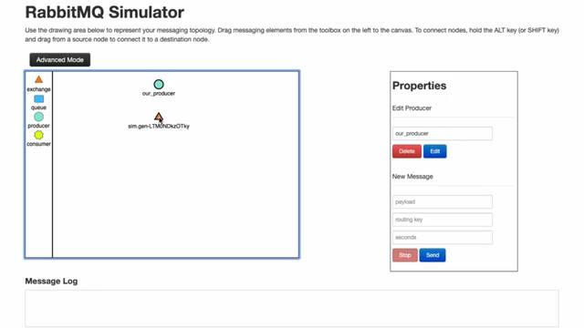
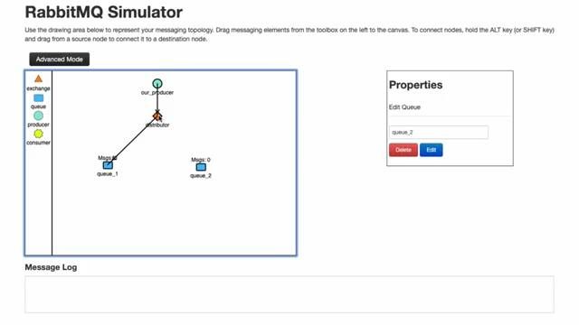
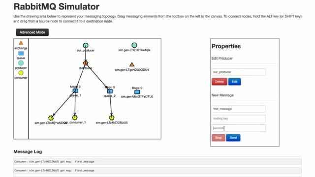
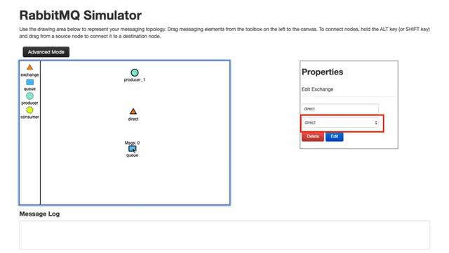
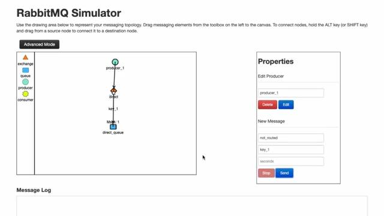
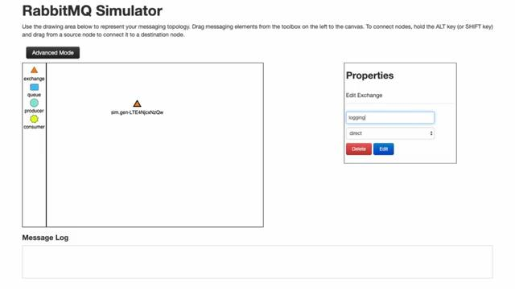
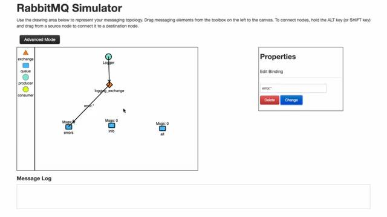
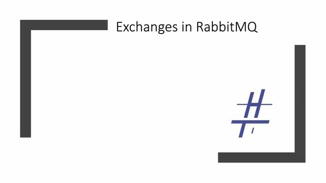

# RabbitMQ 可视化入门：Fanout / Direct / Topic Exchange（P9–P12 复现）

适用视频：`BV1o39SBiEhD`，覆盖 P9–P12。  
这门课不是命令行教程，而是在一个网页版 RabbitMQ 模拟器里，通过“拖拽组件 + 发消息”的方式，把 RabbitMQ 的核心消息流跑通。下面我会按「你能照着复现」的顺序重排，而不是按视频流水账写。

## 1. 这一节做什么

这一节要让你亲手跑起来三套 RabbitMQ 消息路由场景：

1. **Fanout Exchange**：生产者发一条消息，消息被复制到所有绑定的队列。
2. **Direct Exchange**：消息上的 `routing key` 必须和队列绑定上的 `binding key` **完全一致**，才会被路由到对应队列。
3. **Topic Exchange**：用 `error.*`、`*.log` 这类通配符，把消息路由到匹配的队列。

最后，视频还总结了一下 RabbitMQ 的四种 Exchange 类型：`fanout`、`direct`、`topic`、`headers`。其中 `headers exchange` 虽然存在，但性能差、没人直接用。

你在复现时要把注意力放在三个东西上：**Exchange 负责按规则路由，Queue 负责存消息，Consumer 负责取消息**。Producer 不直接把消息塞进队列，而是先发给 Exchange；Exchange 再根据类型和绑定关系，把消息投递到一个或多个队列。页面上的连线不是装饰，而是 RabbitMQ 里真实的绑定关系。只要某条绑定没连、连错队列、或 `routing key` / `binding key` 不一致，消息就可能被丢弃，或者进入你意料之外的队列。

> 注意：课程本身没有写代码，用的是 RabbitMQ 网页模拟器。第 4 节我会额外补一个“本地可运行的 Node.js 验证脚本”，方便你在没有模拟器时也能看到相同的队列计数结果；这部分在课里没讲。

## 2. 讲师原话

> "有一个很好用的工具，我会把链接放在简介里；我们可以直接用组成 RabbitMQ 的那些部件把它搭建出来。首先当然是生产者，因为你要发送消息，而生产者总是把消息推送到交换机。"
> —— p009 [00:06]

> "我们想要消费这些消息并对其做些处理。于是我们创建一个消费者，给它命名为消费者一号，然后把它关联到含有这两条消息的队列上。"
> —— p009 [01:25]

> "绑定键用于告诉交换机，消息应该路由到哪个队列。"
> —— p010 [00:29]

> "使用主题交换机时，我们在这里直接使用正则表达式模式即可。"
> —— p011 [01:23]

> "第四个我们甚至还没看的是头交换机。它和直连交换机的工作方式完全一样，但性能上要慢得多，所以没人会直接使用它。"
> —— p012 [01:57]

## 3. 从零复现

### 3.0 前置条件

1. 打开视频简介里链接的 **RabbitMQ Simulator**。视频里没有把具体网址念出来，只说了 “I will link in the description”。
2. 你只需要浏览器，不需要安装 RabbitMQ、不需要写代码。
3. 建议按下面的顺序操作，否则你可能会被 `binding key`、`routing key` 搞晕。

在开始拖拽之前，先认清模拟器里四类组件：

- **Producer**：消息生产者。它只负责把消息发给 Exchange，不直接关心队列。
- **Exchange**：交换机，相当于路由器。它根据类型和绑定关系决定消息去哪些队列。
- **Queue**：队列，暂存消息。消息没有被消费前，会留在队列里。
- **Consumer**：消费者，连接到某个队列后，会从该队列取走消息并消费。

如果你有前端经验，可以这样对照：Exchange 像前端里的路由表或事件总线，`binding key` 像订阅规则，`routing key` 像事件名。`fanout` 类似向所有订阅者广播，`direct` 类似只触发完全同名的事件，`topic` 类似带通配符的事件订阅。这里只是帮助理解，RabbitMQ 的真实行为仍以 Exchange 类型和绑定规则为准。

复现时最常见的错误不是“不会点”，而是把 **Producer 到 Exchange 的连接** 和 **Exchange 到 Queue 的绑定** 混为一谈。前者只表示“消息从哪里发”，后者才决定“消息按什么规则进入哪些队列”。如果只连了 Producer 和 Exchange，却没有把 Exchange 绑定到 Queue，那么发送后队列计数不会变化。

### 3.1 场景一：Fanout Exchange（广播）

目标：让一条消息同时进入两个队列。

操作步骤：

1. 创建一个 **Producer**。
2. 创建一个 **Fanout Exchange**。
3. 创建两个队列，分别命名为 `queue1`、`queue2`。
4. 把 Producer 连接到 Exchange。
5. 把 Exchange 分别连接到 `queue1`、`queue2`。



在 Producer 面板里输入消息内容，然后发送。你会看到：

- `queue1` 消息数从 0 变成 1；
- `queue2` 消息数也从 0 变成 1。

这就是 Fanout：消息被复制到所有绑定的队列。



复现时注意：Fanout Exchange **不依赖 routing key**。即使模拟器里还保留着某个 routing key 输入框，你发消息时也不需要靠它来决定路由。真正决定消息进入哪些队列的，是 Exchange 上绑定了哪些队列。如果你发现只进了一个队列，优先检查另一个队列是否真的绑定到了这个 Fanout Exchange 上，而不是去改 routing key。

接着创建一个 **Consumer**，连接到 `queue1`。队列里的消息会立刻被消费掉。再创建一个 Consumer 连接到 `queue2`，另一个队列里的消息也会被消费。

然后做视频里的高级验证：让两个 Consumer 连接到**同一个队列**，持续发送多条消息。你会看到消息被自动**轮流分给两个消费者**，也就是 round-robin。



这里的易错点要特别说明：**同一个队列挂两个 Consumer 不是广播**。队列里的消息只会被其中一个消费者取走，两个消费者是竞争关系，RabbitMQ 默认会轮流分发。真正想让两个消费者都收到同一条消息，应该建两个队列，再用 Fanout Exchange 分别绑定这两个队列；而不是把两个 Consumer 挂到同一个队列上。

验证方式：先不要急着放 Consumer，先发送 4 条消息到两个队列，观察 `queue1` 和 `queue2` 是否都变成 4。然后分别给两个队列各挂一个 Consumer，确认两边都被消费。最后把两个 Consumer 挂到同一个队列上，发送多条消息，观察消费记录是否大致交替，而不是全部进入同一个 Consumer。

### 3.2 场景二：Direct Exchange（精确匹配）

目标：让消息只进入 `routing key` 精确匹配的队列。

操作步骤：

1. 创建一个 **Direct Exchange**。
2. 创建一个 Producer，连接到这个 Direct Exchange。
3. 创建一个队列 `direct queue 1`。
4. 把这个队列绑定到 Direct Exchange 上。
5. 绑定的时候，设置 `binding key = key1`。

现在 Producer 发消息时，消息上有一个 `routing key`。  
只有当 `routing key` 和 `binding key` 完全一样时，消息才会进入队列。



验证点：

- 发送 `routing key = key1`：消息进入 `direct queue 1`。
- 发送 `routing key = key2`：消息不到任何队列，因为当前没有队列绑定 `key2`。

再添加第二个队列 `direct queue 2`，绑定 `binding key = key2`。  
现在：

- `routing key = key1`：只进 `direct queue 1`。
- `routing key = key2`：只进 `direct queue 2`。
- 如果 `routing key` 谁都不匹配：消息被丢弃，视频里叫 blackholed。



Direct 的关键词是“完全一致”。它不做模糊匹配，也不做大小写忽略。`key1`、`Key1`、`key1 ` 后面的空格，在 RabbitMQ 看来都可能不是同一个字符串。复现时如果消息没有进队列，先逐字对比 Producer 面板里的 routing key 和队列绑定上的 binding key，再检查队列是否真的绑定到了当前的 Direct Exchange 上。

可以按下面的顺序验证：

| 操作 | `direct queue 1` 的 binding key | `direct queue 2` 的 binding key | 发送 routing key | 预期结果 |
|---|---|---|---|---|
| 初始 | `key1` | 未绑定 | `key1` | 只进 `direct queue 1` |
| 加队列 | `key1` | `key2` | `key1` | 只进 `direct queue 1` |
| 精确匹配 | `key1` | `key2` | `key2` | 只进 `direct queue 2` |
| 无匹配 | `key1` | `key2` | `key3` | 两个队列都不增加 |

最后，给同一个队列挂两个 Consumer，持续发送多条消息。  
消息仍然按 round-robin 方式分发。这里的现象和 Fanout 场景里的“同一队列两个 Consumer”一样：一个队列里的消息被多个消费者分摊，而不是每个消费者都收到一份。

### 3.3 场景三：Topic Exchange（通配符匹配）

目标：做一个日志系统，包含 `errors`、`info`、`all` 三个队列。

操作步骤：

1. 创建一个 **Topic Exchange**，命名为 `logging exchange`。
2. 创建一个 Producer，命名为 `logger`。
3. 创建三个队列：`errors`、`info`、`all`。
4. 给每个队列设置不同的 `binding key`：

| 队列 | binding key | 含义 |
|---|---|---|
| `errors` | `error.*` | 匹配所有以 `error.` 开头的主题 |
| `info` | `info.*` | 匹配所有以 `info.` 开头的主题 |
| `all` | `*.log` | 匹配所有以 `.log` 结尾的主题 |



然后开始发消息：

- 发送 `routing key = error.log`：会进入 `errors` 队列，同时进入 `all` 队列。因为 `error.*` 匹配 `error.log`，`*.log` 也匹配 `error.log`。
- 发送 `routing key = debug.log`：只进入 `all` 队列。
- 发送 `routing key = info.log`：进入 `info` 队列，同时进入 `all` 队列。
- 发送 `routing key = info.nothing`：只进入 `info` 队列，因为 `info.*` 匹配 `info.nothing`，但 `*.log` 不匹配。



如果消息的 `routing key` 不匹配任何队列的 `binding key`，消息会被丢弃。

这里要纠正一个说法：视频里讲师说 “regex pattern”，但 Topic Exchange 用的并不是编程语言里的正则表达式。它使用的是 RabbitMQ 自己的通配符规则：`*` 匹配一个单词，`#` 匹配零个或多个单词。单词之间通常用点 `.` 分隔。例如 `error.*` 可以匹配 `error.log`，但不要把它当成 `error\..*` 那种正则来理解。视频里主要演示的是 `*`，所以复现时先严格照 `error.*`、`info.*`、`*.log` 来写，不要自作主张改成 `/error.*/`。

可以用下面的顺序验证：

| 先发送的 routing key | `errors` 队列 | `info` 队列 | `all` 队列 |
|---|---|---|---|
| `error.log` | 增加 1 | 不变 | 增加 1 |
| `debug.log` | 不变 | 不变 | 增加 1 |
| `info.log` | 不变 | 增加 1 | 增加 1 |
| `info.nothing` | 不变 | 增加 1 | 不变 |

复现时最容易错的地方有三个：第一，把 `*` 当成“匹配任意字符串”，结果以为 `error.*` 能匹配 `error.log.extra`；第二，忘记点号分隔，把 `error.log` 写成 `errorlog`；第三，队列没有绑定到正确的 Topic Exchange 上。出现“消息消失”时，先确认 routing key 是否至少匹配一条 binding key，再确认队列是否真的绑在了 `logging exchange` 上。

### 3.4 场景四：Exchange 类型总结

在模拟器里看到这几种 Exchange 之后，可以做一张自己的对照表：

| Exchange 类型 | 是否需要 routing key / binding key | 路由规则 |
|---|---|---|
| `fanout` | 不需要 | 复制给所有绑定队列 |
| `direct` | 需要 | `routing key` 必须完全等于 `binding key` |
| `topic` | 需要 | `routing key` 匹配通配符模式 |
| `headers` | 不用 routing key | 按照消息头属性匹配，性能差，不建议用 |



视频最后还提了一个容易忽略的点：Exchange 本身只是一张“路由表”，真正的路由实现是在 `channel` 里完成的。  
这句话你现在不用完全理解，只要记住：客户端连接 RabbitMQ 时会走 `channel`，所有的消息发送、消费都是基于 `channel` 的。

如果你从前端视角理解，可以把它类比成“事件总线”：`fanout` 是广播给所有订阅者；`direct` 是精确事件名订阅；`topic` 是通配符事件订阅；`headers` 则像按消息元数据筛选，但因为性能和可维护性问题，常规业务里很少直接使用。这个类比不改变 RabbitMQ 的事实，只是帮助你在复现时快速判断消息应该走哪条线。

## 4. 完整代码

课程本身没有代码。  
为了让你在本地也能“跑起来”，我补了一个最小可运行的 Node.js 版本。它会用 RabbitMQ 官方 AMQP 协议，复现 Fanout、Direct、Topic 三种 exchange 的队列路由结果。

> 这部分是本文档补充的本地验证代码，**课程里没讲**。如果你只想跟着原视频复现，可以跳过，直接看第 6 节检查清单。

### 4.1 目录结构

```
rabbitmq-exchanges-repro/
├── docker-compose.yml
├── package.json
└── rabbit-demo.js
```

### 4.2 `docker-compose.yml`

```yaml
services:
  rabbitmq:
    image: rabbitmq:3-management
    ports:
      - "5672:5672"
      - "15672:15672"
```

### 4.3 `package.json`

```json
{
  "name": "rabbitmq-exchanges-repro",
  "version": "1.0.0",
  "private": true,
  "dependencies": {
    "amqplib": "^0.10.4"
  }
}
```

### 4.4 `rabbit-demo.js`

```javascript
const amqp = require("amqplib");

const AMQP_URL = process.env.AMQP_URL || "amqp://localhost:5672";

const sleep = (ms) => new Promise((resolve) => setTimeout(resolve, ms));

async function messageCount(channel, queue) {
  const result = await channel.checkQueue(queue);
  return result.messageCount;
}

async function prepareQueue(channel, queue) {
  await channel.assertQueue(queue, { durable: false });
  await channel.purgeQueue(queue);
}

async function showCounts(channel, title, queues) {
  const counts = {};
  for (const queue of queues) {
    counts[queue] = await messageCount(channel, queue);
  }
  console.log(title, counts);
}

async function main() {
  const connection = await amqp.connect(AMQP_URL);
  const channel = await connection.createChannel();

  // 1) Fanout Exchange
  const fanExchange = "demo.fanout";
  const fanQueues = ["demo.fanout.q1", "demo.fanout.q2"];

  await channel.assertExchange(fanExchange, "fanout", { durable: false });
  for (const queue of fanQueues) {
    await prepareQueue(channel, queue);
    await channel.bindQueue(queue, fanExchange, "");
  }

  await channel.publish(fanExchange, "", Buffer.from("fanout message"));
  await sleep(200);
  await showCounts(channel, "Fanout after publish:", fanQueues);

  // 2) Direct Exchange
  const directExchange = "demo.direct";
  const directQueues = ["demo.direct.q1", "demo.direct.q2"];

  await channel.assertExchange(directExchange, "direct", { durable: false });
  await prepareQueue(channel, directQueues[0]);
  await prepareQueue(channel, directQueues[1]);
  await channel.bindQueue(directQueues[0], directExchange, "key1");
  await channel.bindQueue(directQueues[1], directExchange, "key2");

  await channel.publish(directExchange, "key1", Buffer.from("direct key1"));
  await sleep(200);
  await showCounts(channel, "Direct after routing key key1:", directQueues);

  await channel.publish(directExchange, "key2", Buffer.from("direct key2"));
  await sleep(200);
  await showCounts(channel, "Direct after routing key key2:", directQueues);

  await channel.publish(directExchange, "key3", Buffer.from("direct key3"));
  await sleep(200);
  await showCounts(channel, "Direct after routing key key3 (no match):", directQueues);

  // 3) Topic Exchange
  const topicExchange = "demo.topic";
  const topicQueues = ["demo.topic.errors", "demo.topic.info", "demo.topic.all"];

  await channel.assertExchange(topicExchange, "topic", { durable: false });
  for (const queue of topicQueues) {
    await prepareQueue(channel, queue);
  }

  await channel.bindQueue(topicQueues[0], topicExchange, "error.*");
  await channel.bindQueue(topicQueues[1], topicExchange, "info.*");
  await channel.bindQueue(topicQueues[2], topicExchange, "*.log");

  const topicMessages = [
    ["error.log", "topic error.log"],
    ["debug.log", "topic debug.log"],
    ["info.log", "topic info.log"],
    ["info.nothing", "topic info.nothing"],
  ];

  for (const [routingKey, body] of topicMessages) {
    await channel.publish(topicExchange, routingKey, Buffer.from(body));
    await sleep(200);
    await showCounts(channel, `Topic after routing key ${routingKey}:`, topicQueues);
  }

  await channel.close();
  await connection.close();
}

main().catch((err) => {
  console.error(err);
  process.exit(1);
});
```

本地运行命令如下。`docker compose up -d` 会启动带管理插件的 RabbitMQ，`-d` 表示后台运行；`npm install` 安装 `amqplib`；`node rabbit-demo.js` 执行验证脚本。若你的机器上仍是旧版 Docker Compose，把第一条换成 `docker-compose up -d` 即可。

```bash
docker compose up -d
npm install
node rabbit-demo.js
```

脚本运行后，控制台会依次打印 Fanout、Direct、Topic 三个场景下各个队列的 `messageCount`。看到 Fanout 两个队列计数相同、Direct 只让匹配队列增加、Topic 按 `error.*` / `info.*` / `*.log` 分别进入对应队列，就说明本地复现成功。

## 5. 逐行解释

`const amqp = require("amqplib");` 引入 AMQP 客户端库。前端里类似引入一个 HTTP 请求库，只不过这里不是请求网页接口，而是连接 RabbitMQ 的 AMQP 端口。`amqp.connect(AMQP_URL)` 建立到 broker 的连接，`connection.createChannel()` 创建 channel。RabbitMQ 的发送和消费大多在 channel 上完成，这也是视频里说“路由实现是在 channel 里完成”的实践体现。

`const AMQP_URL = process.env.AMQP_URL || "amqp://localhost:5672";` 默认连接本机 5672 端口。这里要注意：**5672 是 AMQP 协议端口，15672 是管理后台 HTTP 端口**。如果你把脚本里的地址写成 `http://localhost:15672`，就会连不上；如果你在浏览器里打开 `http://localhost:15672`，那是看管理界面，不是给 `amqplib` 用的连接地址。

`sleep` 只是让脚本在 publish 之后等一小会儿，再查询队列计数。真实业务里不应该靠固定 sleep 判断消息是否处理完成，而应该使用消费者回调、消息确认、发布确认等机制。这里的 sleep 是为了让本地演示稳定：消息从 Exchange 路由到 Queue 需要一瞬间，如果查得太快，可能看到旧计数。

`messageCount` 里调用 `channel.checkQueue(queue)`，返回结果里包含 `messageCount` 和 `consumerCount`。`messageCount` 可以理解成“当前队列里待消费的消息数”；如果已经有 Consumer 在消费，计数可能很快变成 0，所以你看到 0 不等于消息一定没发出去。复现计数时，最好先不要挂 Consumer，或者临时暂停消费。

`prepareQueue` 先 `assertQueue` 声明队列，再 `purgeQueue` 清空旧消息。这样重复运行脚本时，不会被上一次遗留的消息干扰。`assertQueue` 的名字叫“断言”，如果队列不存在就创建；如果已存在且参数兼容，就复用。若同名队列的 `durable` 等参数和脚本不一致，RabbitMQ 可能返回 `PRECONDITION_FAILED`，这时候需要删除旧队列或换一个队列名。

`showCounts` 把一组队列的计数打印出来，方便你对照第 3 节的验证表。Fanout 场景里，`bindQueue(queue, fanExchange, "")` 的第三个参数 routing key 对 fanout 不重要，所以写空字符串即可。`channel.publish(fanExchange, "", Buffer.from(...))` 把消息发到 Fanout Exchange，两个绑定队列都应该收到一份。

Direct 场景里，`bindQueue(directQueues[0], directExchange, "key1")` 表示 `demo.direct.q1` 只接收 routing key 精确等于 `key1` 的消息；`key2` 绑定到第二个队列。发布 `key3` 时没有队列匹配，消息不会进入这两个队列，这就是视频里说的 blackholed。Topic 场景里，`error.*`、`info.*`、`*.log` 分别绑定到三个队列，发布不同 routing key 后，通过计数可以看到每个队列是否增加。

脚本最后关闭 channel 和 connection，避免进程挂住。`main().catch(...)` 负责捕获异常并打印，方便排查连接失败、队列不存在、权限不足等问题。

## 6. 复现检查清单

1. **模拟器里已经创建 Producer、Exchange、Queue、Consumer 四类组件。**  
   验证方式：页面上能分别看到你命名的 Producer、Exchange 和至少一个 Queue；点击组件能看到它的连接或绑定关系。

2. **Fanout Exchange 已经绑定到两个队列。**  
   验证方式：给 Fanout Exchange 发送一条消息，分别查看 `queue1`、`queue2` 的待消费计数是否都从 0 变成 1。只增加一个，就说明另一个队列没绑上。

3. **Fanout 场景下消息是复制，不是竞争。**  
   验证方式：在没有任何 Consumer 的情况下发送一条消息，两个队列计数应各增加 1。如果只增加一个，检查 Exchange 类型是否真的是 `fanout`。

4. **同一队列挂两个 Consumer 时，消息是轮询消费。**  
   验证方式：给同一个队列挂两个 Consumer，连续发送多条消息，观察消费记录是否被两个 Consumer 分摊，而不是每个 Consumer 都收到全部消息。要广播，应使用两个队列加 Fanout。

5. **Direct 的 binding key 与 routing key 完全一致。**  
   验证方式：发送 `routing key = key1`，只检查绑定 `key1` 的队列是否增加；发送 `key2`，只检查绑定 `key2` 的队列是否增加；发送 `key3`，确认两个队列都不增加。若不符合，逐字核对大小写、空格和拼写。

6. **Direct 无匹配消息会被丢弃。**  
   验证方式：先记录两个队列计数，再发送一个没有绑定过的 routing key，等待后刷新计数，两个队列都不应变化。若消息进入了某个队列，说明该队列存在意外的绑定。

7. **Topic 的三个 binding key 设置正确。**  
   验证方式：检查 `errors` 队列绑定 `error.*`，`info` 队列绑定 `info.*`，`all` 队列绑定 `*.log`。注意这里的 `*` 是 RabbitMQ 通配符，不是正则表达式。

8. **Topic 消息按预期进入多个队列。**  
   验证方式：依次发送 `error.log`、`debug.log`、`info.log`、`info.nothing`，对照第 3.3 节表格检查每个队列的增量。`error.log` 应同时进入 `errors` 和 `all`；`info.nothing` 只进入 `info`。

9. **没有 Consumer 时才能稳定看到队列计数。**  
   验证方式：如果你刚发送消息就看到计数为 0，先检查该队列是否已经连接了 Consumer。Consumer 会自动取走消息，队列计数表示的是“待消费消息数”。

10. **本地 Node.js 脚本可以复现同样结果。**  
    验证方式：运行 `node rabbit-demo.js`，观察控制台输出。Fanout 两个队列计数应相同；Direct 在 `key1`、`key2` 时分别只增加对应队列；Topic 输出应与第 3.3 节表格一致。

## 7. 课里没讲但你会撞上的（表格：现象 / 原因 / 怎么办）

| 现象 | 原因 | 怎么办 |
|---|---|---|
| 模拟器里发送消息后，队列计数完全不变 | Exchange 没有绑定到队列，或绑到了别的 Exchange | 检查 Exchange 与 Queue 之间的连线，确认绑定关系挂在当前 Exchange 上 |
| Fanout 场景只进入一个队列 | 另一个队列没有绑定，或绑定到了别的 Exchange | 给当前 Fanout Exchange 补上第二个队列的绑定，再发送验证 |
| Direct 场景消息消失 | `routing key` 与所有 `binding key` 都不完全一致 | 逐字核对字符串；先发送与某个 binding key 完全相同的值验证链路 |
| Topic 场景 `error.log` 没有进入 `errors` | binding key 写成了 `error*`、`error.log` 或带正则符号的形式 | 使用 RabbitMQ topic 语法 `error.*`；`*` 只匹配一个单词 |
| 以为 `*` 可以匹配任意长字符串 | 把 Topic 通配符当成正则 `.*` | 记住 `*` 匹配一个单词，`#` 匹配零个或多个单词；先按课程用 `*` 复现 |
| 同一个队列的两个 Consumer 没有各收到一份消息 | 同一队列是竞争消费，消息会被分摊 | 要广播就建多个队列，用 Fanout Exchange 分别绑定 |
| 消费者连上后队列计数立刻变成 0 | 消息被 Consumer 自动消费了 | 先看计数再启动 Consumer，或查看消费记录判断是否已消费 |
| 本地脚本报 `ECONNREFUSED` | RabbitMQ 没启动，或端口没映射到本机 | 执行 `docker compose up -d`，确认 `5672:5672` 已映射 |
| 本地脚本连 `15672` 失败 | 15672 是管理界面 HTTP 端口，不是 AMQP 端口 | 连接地址使用 `amqp://localhost:5672`，浏览器再开 `http://localhost:15672` |
| 报 `ACCESS_REFUSED` | 用户权限不足，或 `guest` 用户不允许从远程连接 | 本机用 `localhost` 验证；远程或容器场景创建有权限的用户 |
| 报 `PRECONDITION_FAILED` | 同名 Exchange 或 Queue 已存在，但类型、durable 等参数与当前声明不一致 | 删除旧 Exchange/Queue，或换一个名字重新声明 |
| 报 `NOT_FOUND` | 队列或 Exchange 名称写错，或尚未声明 | 先 `assertQueue` / `assertExchange`，再发布消息，并核对名称 |
| Direct/Topic 消息没有报错但谁都没收到 | 没有匹配的 binding，消息被丢弃 | 设计兜底队列或备用 Exchange；发送前确认 routing key 有匹配规则 |