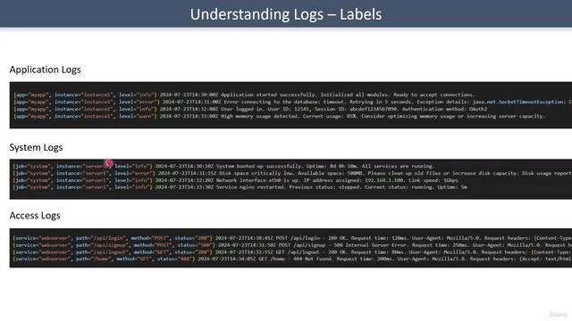
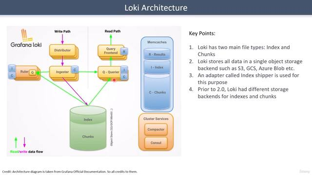
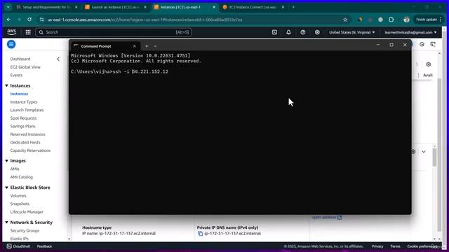
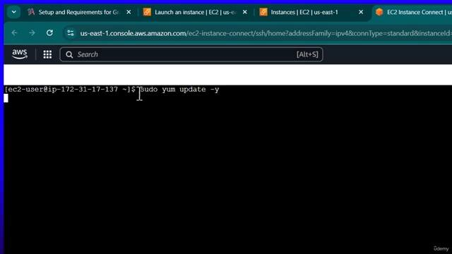
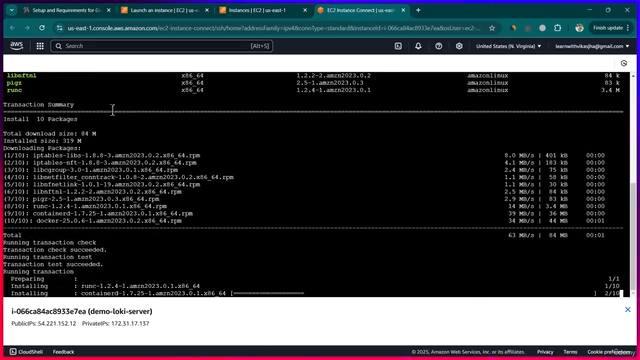
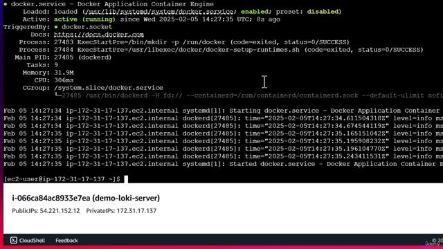
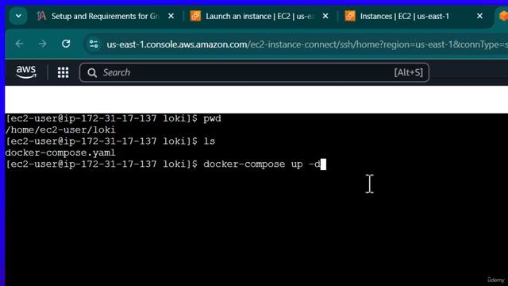
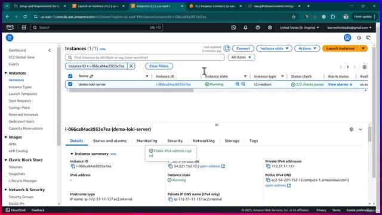
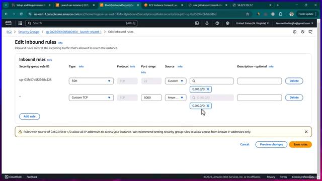

# Loki & Grafana 实战：用 Docker Compose 搭一套日志聚合平台（P1–P2）

> 对应课程：BV1NLj16mECA 第 1–2 讲
> 目标读者：前端转 AI 应用工程师。你把日志当 `console.log` 用了很多年，这一节要把「散落在各个容器/服务器里的 `console.log`」集中到一个地方，并且能用浏览器查。
> 最终成果：一台 Linux 机器上跑起 3 个容器（Loki / Promtail / Grafana），打开浏览器 `http://<你的服务器IP>:3000`，能按 `job=varlogs` 过滤出机器上的系统日志，并展开看到每条日志的 `file_name`、`job`、`service_name` 标签。

> 名词说明：逐字稿的中文/英文转写在多处把 Loki 写成了 “Locky”、把 Promtail 写成了 “Promptail”，把 Grafana 写成了 “Gryphana”。本文统一用官方拼写 Loki / Promtail / Grafana，引用原话时保留讲师原词。

---

## 1. 这一节做什么

这一节分两半：

**前半（P1）是概念**：为什么需要日志聚合、Loki 和 Prometheus 是什么关系、Loki 凭什么比传统方案便宜、日志在 Loki 里到底是怎么存的（label 索引 + chunk 压缩）、Loki 的读写两条链路各有哪些组件。

**后半（P2）是动手**：在一台 AWS EC2（Amazon Linux）上装 Docker → 装 Docker Compose → 建目录 → 拉一份 `docker-compose.yml` → `docker-compose up -d` 起三个容器 → 去安全组放行 3000/3100 → 在 Grafana 里连 Loki 数据源 → 在 Explore 里按 label 过滤出日志。

**这一节不做的事**（别期待，课里也没讲）：没有讲 LogQL 的具体语法（讲师明确说下一节再讲：「in the next lesson we are going to go into the details of starting querying all of these logs」—— p002 [21:31]）；没有讲生产级的高可用部署；没有讲 Loki 的配置文件细节（讲师只展示了 `docker-compose.yml` 这个文件的存在和它里面「有三个服务」，没有逐行念）。

**前置条件**：

| 项 | 要求 | 说明 |
|---|---|---|
| 机器 | 一台能装 Docker 的 Linux | 课里用 AWS EC2 + Amazon Linux；你本机装个 Ubuntu 虚拟机、或云厂商任意 Linux 都行 |
| 规格 | 建议 2 vCPU / 4 GB 起 | 讲师原话：t2.micro 只有 1 vCPU + 1 GB「which I think is not enough」，他自己选了 t2.medium —— p002 [01:18] |
| 磁盘 | 讲师把默认 8 GB 改成了 20 GB | 「20 GB is going to give you I think more than enough to store all the logs」—— p002 [02:42] |
| 网络 | 需要有公网 IP，且能改安全组/防火墙 | 不开端口的话浏览器一定连不上，这是课上真实踩到的坑 |
| 本地 | 一个 SSH 客户端 + 下载好的 `.pem` 私钥 | 课里演示了浏览器直连和本地 `ssh -i` 两种方式 |

---

## 2. 讲师原话（带出处）

**Loki 是什么、为什么和 Prometheus 搭配：**

> "Grafana Loki 基本上是一个日志聚合工具，可以帮助收集、存储和搜索来自各种数据源的日志数据……借助 Prometheus 可以监控指标，而借助 Grafana Loki 则可以查看上下文细节。"
> —— p001 [00:00]

翻译成人话：Prometheus 告诉你「CPU 80%」，Loki 告诉你「CPU 80% 是因为哪个服务的哪一行日志在报错」。讲师在后面又强调了一次这个「指标 → 日志」的下钻路径：「key matrix and then going down to the log level」—— p001 [02:32]。

**为什么需要日志聚合：**

> "如果你想了解问题的上下文，或者想获得关于某个问题背后原因的更多信息……日志聚合工具正是能帮助我们获取这些上下文信息的工具。"
> —— p001 [02:32]

讲师列的几条理由：排障调试（p001 [03:02]）、微服务数量变多后日志必须能关联（p001 [03:02]）、合规与审计、集中管理（p001 [03:29]），还有一条他特别补充的：「nowadays all these logs are used for generative AI learning or generative AI strategies」—— p001 [03:47]。这条对你要做的 AI 应用是有直接意义的：日志本身就是语料。

**Loki 解决的五个问题：**

> "Loki 通过提供轻量级组件简化了这一过程……Loki 并不会真正索引所有内容，也不会逐行索引所有日志。它只索引元数据，其余所有日志行都会被压缩，然后保存在 S3 这类成本更低的存储中。"
> —— p001 [04:16] / p001 [04:46]

后面几条依次是：可水平扩展（「you can literally run Loki on 5 servers or 50 servers」—— p001 [05:16]）、和 Prometheus 生态一致所以学习成本低、不用另学一门查询语言（他点名对比了 Splunk 的 SPL：「you have to learn SPL which is Splunk Processing Language」—— p001 [06:16]）、能接异构日志源（JSON / flat file / CSV）—— p001 [06:20]。

**日志的结构与 label：**

> "用 Loki 的术语来说，这些内容都被称为标签……例如这里有三个标签，一个标签叫 app，另一个标签叫 instance，还有一个标签叫 level。所有这些标签都会被索引，而其他所有信息都不会被索引。"
> —— p001 [09:37]



这段话是整节课最重要的一句，P2 里你在 Grafana 里点的那几个 label filter（`job`、`service_name`、`file_name`），就是这句话的直接落地。

**架构：读写两条路：**

> "写日志到 Loki 时会走单独的写入路径，查询 Loki 时会走单独的读取路径。当某个组件或代理向 Loki 发送日志时，它会先连接到 distributor，然后由 distributor 将请求发送给 ingester。"
> —— p001 [11:16]

> "读取日志的所有请求都会先到达 query front end，然后从 query front end 转到 query，最后由 query 实际执行查询处理。"
> —— p001 [11:44]



关于存储，讲师专门提了一句版本差异：2.0 之前 index 和 chunks 是分开的存储后端，2.0 之后「there is only single storage backend, which you can use for index and chunks」，负责把索引刷到对象存储的组件叫 **index shipper**—— p001 [12:27]。

**装之前先搞清楚依赖：**

> "如果你想安装 Loki……还需要某种能够抓取日志并将其发送给 Loki 的代理。为此，我们将使用 Promtail 代理……当然，我们还需要 Grafana 来连接 Loki，并将所有日志可视化。"
> —— p002 [00:19]

**为什么用 Docker Compose：**

> "我建议使用 Docker Compose 来安装，因为这样很简单，也能让你轻松启动并运行。"
> —— p002 [00:00]

**动手过程中的关键节点：**

- 装 Docker 前要先更新软件源，且需要提权：「we are prefixing every commands using sudo this is required because in order to run these commands like updating repository you basically need to have elevated privileges」—— p002 [06:22]
- 让 Docker 开机自启：「if you want Docker services to automatically come up when server reboots, in that case, you need to run this command, which is `sudo systemctl enable docker`」—— p002 [08:11]
- 加 docker 组之后必须重新登录才生效：「we even though we added our current user to the docker group but still our permissions are not reflected」—— p002 [09:37]
- 后台跑：「-d is going to run these services in the detached mode… it is not going to cancel… when you close this session」—— p002 [13:15]
- 端口不通是安全组问题：「in AWS when you create any instance by default, all the incoming connections are blocked other than the one which we selected during the time of the creation of this EC2 instance」—— p002 [15:24]

---

## 3. 从零复现

下面每一步都写死了命令。路径统一用 `~/loki`（课里是 `/home/ec2-user/loki`，讲师说「we are into `/home/ec2-user`, we are going to do `mkdir loki`」—— p002 [11:24]）。

### 步骤 0：确认你在一台干净的 Linux 上

```bash
pwd          # 课里演示过，应该在 /home/<你的用户>
id           # 课里演示过，看当前用户名（EC2 上是 ec2-user）
```



如果你用 AWS：控制台 → EC2 → Launch instance → 名称 `demo-loki-server` → AMI 选 Amazon Linux → 实例类型选 `t2.medium` → 选/新建 key pair（`.pem` 会立刻下载，**只能下这一次**）→ 安全组先只放行 SSH 22 → 存储从 8 GB 改成 20 GB → Launch。等状态变成 running，复制 **Public IPv4 address**。

登录（二选一）：

```bash
# 方式 A：浏览器里点 Connect，全部用默认值再点 Connect
# 方式 B：本地终端
ssh -i /path/to/your-key.pem ec2-user@<公网IP>
```

### 步骤 1：更新软件源并安装 Docker

```bash
# Amazon Linux 2 用 yum；Amazon Linux 2023 / Fedora 用 dnf，把下面 yum 换成 dnf 即可
sudo yum update -y
sudo yum install -y docker
```



### 步骤 2：让 Docker 开机自启并立即启动

```bash
sudo systemctl enable docker
sudo systemctl start docker
sudo systemctl status docker
```

`status` 输出里出现 `Active: active (running)` 就对了。课里讲师看完状态是手动按 `Ctrl+C` 退出的（`status` 会占住终端直到你按键）—— p002 [08:40]。



### 步骤 3：把当前用户加进 docker 组（然后必须重新登录）

```bash
sudo usermod -aG docker $USER
```

然后**关掉这个 SSH 会话，重新登录一次**。讲师的原话是「we will need to log in again to have these permission issues fixed」—— p002 [09:37]。重登后用 `docker info` 验证：没有 `permission denied` 就成功了。

```bash
docker info
```

### 步骤 4：安装 Docker Compose（独立二进制）

```bash
sudo curl -SL https://github.com/docker/compose/releases/latest/download/docker-compose-linux-x86_64 \
  -o /usr/local/bin/docker-compose
sudo chmod +x /usr/local/bin/docker-compose
docker-compose version
```

> 课里只说了「从 GitHub 的 release 地址把 docker compose 拉下来」，然后 `sudo chmod +x /usr/local/bin/docker-compose`（p002 [10:30]），具体下载 URL 课里没念出来，上面这条是官方标准地址，属于我补的。**注意架构**：如果你的机器是 ARM（比如 `t4g` 系列），把文件名里的 `x86_64` 换成 `aarch64`，否则会报 `Exec format error`。

讲师执行 `docker-compose version` 打出来的版本是 **v2.32.4**（p002 [10:55]），你装到的版本可能更新，不影响。



### 步骤 5：建目录并写三个文件

```bash
mkdir -p ~/loki/grafana-provisioning/datasources ~/loki/positions
cd ~/loki
ls
```

课里是 `mkdir loki` 然后 `cd loki`，再用一条命令把 `docker-compose.yml` 下载进来，下载完用 `cat docker-compose.yml` 看了一眼内容（p002 [11:48] / p002 [12:18]）。课里那个文件是从讲师自己的仓库拉的，**内容没有逐行展示**，所以下面第 4 节我给的是等价的可运行版本，并且额外拆出了 promtail 配置和数据源 provisioning 两个文件（课里讲师的 compose 是「已经内置了一个 Loki 数据源」，你在第 4 节会看到它对应哪一段）。

三个文件分别是：

| 文件 | 作用 |
|---|---|
| `~/loki/docker-compose.yml` | 定义 loki / promtail / grafana 三个服务 |
| `~/loki/promtail-config.yml` | 告诉 Promtail 采哪些日志、打什么 label、往哪儿推 |
| `~/loki/grafana-provisioning/datasources/loki.yml` | Grafana 启动时自动创建 Loki 数据源 |

用 heredoc 一次性写完（内容见第 4 节，直接照抄）。

### 步骤 6：启动

```bash
cd ~/loki
docker-compose up -d
```

第一次会从 Docker Hub 拉三个镜像，AWS 上「it is probably going to take a couple of minutes」—— p002 [13:44]。



### 步骤 7：确认三个容器都在跑

```bash
docker ps
```

你应该看到三行：`promtail`、`loki`、`grafana`。讲师在课上也是这个输出（「we see three containers running… first is Promtail, second is Loki, and the third is Grafana」—— p002 [14:34]）。他特别注意到了端口：「Loki services are available on port 3100, and Grafana services are available on port 3000」—— p002 [14:34]。

（`docker ps` 的列名因版本而异，具体列名以你机器实际输出为准；你只需要确认三个容器状态是 `Up`，并且端口映射里能看到 `3100->3100`、`3000->3000`。）



### 步骤 8：放行 3000 和 3100 端口

这一步**不做一定连不上**。讲师在这里实测了失败：「it is not going to work and it is going to show not reachable」—— p002 [15:24]。

AWS 控制台 → EC2 → 选中实例 → Security → 点那个 Security group → Edit inbound rules → Add rule：

| 类型 | 端口 | 源 |
|---|---|---|
| Custom TCP | 3000 | 0.0.0.0/0 |
| Custom TCP | 3100 | 0.0.0.0/0 |
| SSH（已有） | 22 | 你的 IP |

保存后规则立即生效。讲师原话：「essentially what it means is make our Grafana IP address and port available to the public so anyone can now connect to this」—— p002 [16:22]。



> 生产环境绝对不要 `0.0.0.0/0` 开 Grafana，这节课是演示环境。你在公司做的时候至少限制到办公网段。

### 步骤 9：验证 Loki 活着

浏览器打开：

```
http://<公网IP>:3100/metrics
```

直接访问 `http://<公网IP>:3100` 会返回一段看起来像报错的内容，这是正常的。讲师原话：「now if you hit it is going to give you something like this and this is common… we need to put `/metrics` after this」—— p002 [17:33]。[`/metrics`](http:///metrics) 页面能刷出大量 Prometheus 格式的指标，就说明 Loki 起来了。

### 步骤 10：在 Grafana 里看日志

1. 浏览器打开 `http://<公网IP>:3000`。
2. 左侧 **Connections → Data sources**。正常情况下你会看到已经有一个 Loki 数据源——它来自我们第 4 节里那个 provisioning 文件（讲师说课里那个也是 compose 自带的：「there is already a connection which is available for Loki. And now why this connection is available, this is coming from this configuration」—— p002 [18:23]）。
3. 如果想手把手再连一个：**Add new data source → 搜 `loki` → 选 Loki**，Name 随便填（讲师填了 `demo-loki-ds`），URL 填 `http://loki:3100`（在同一套 compose 网络里用服务名最稳；课里填的是 EC2 公网 IP + `:3100` 并且**不要**带 `/metrics` 后缀—— p002 [19:14]），认证留空，**Save & test**，应显示 `Data source connected successfully`。
4. 左侧 **Explore** → 数据源选 `Loki`（或你刚建的那个）→ 展开 **Label filters**，你会看到 `file_name`、`job`、`service_name` 这几个 label → 选 `job`，值选 `varlogs` → 点 **Run query**。
5. 右侧出现日志流。随便展开一条，能看到 `file_name`（日志文件路径）、`job`、`service_name` 三个 label，以及日志原文。

讲师在课上就是这么点的：「let's click on job and in the values we can select varlogs and then we can click on run query」—— p002 [20:07]；展开后「you can see in the file name this log is coming from… the job name is called varlogs, service name is called …」—— p002 [20:23]。

6. 关键的一句话：「where this job name is coming from, where this service name is coming from, this is also coming from Promtail configuration」—— p002 [20:46]。也就是说，Grafana 里能点出来什么 label、值是什么，**完全由你的 `promtail-config.yml` 决定**，不是 Loki 说了算。

---

## 4. 完整代码

### 4.0 目录结构

```
~/loki/
├── docker-compose.yml
├── promtail-config.yml
├── grafana-provisioning/
│   └── datasources/
│       └── loki.yml
├── positions/          # 自动生成，Promtail 记录"读到哪个文件第几行了"
├── loki-data/          # 自动生成，Loki 的 index + chunks
└── grafana-data/       # 自动生成，Grafana 的 sqlite / 插件
```

### 4.1 `~/loki/docker-compose.yml`

> 说明：这是一份**可按本文步骤跑通**的等价版本。课里讲师的 `docker-compose.yml` 只展示了「它里面配了 loki、promtail、grafana 三个服务」和「它自带一个 Loki 数据源」，具体每一行没有念出来。下面的镜像 tag 和配置项是我补的，跑不通时可把 tag 换成 `latest` 再试。

```yaml
# ~/loki/docker-compose.yml
# 作用：一条命令拉起 Loki(存储+查询) / Promtail(采集) / Grafana(展示)
# 注意：新版 docker compose 不再需要顶层 version 字段

services:

  # ---------- 1. Loki：日志的存储与查询服务 ----------
  loki:
    image: grafana/loki:2.9.0
    container_name: loki
    ports:
      - "3100:3100"                      # 3100 是 Loki 的 HTTP 端口，Grafana 和 /metrics 都走它
    command: -config.file=/etc/loki/local-config.yaml
    volumes:
      - ./loki-data:/loki                # index 和 chunks 落到宿主机目录
    restart: unless-stopped

  # ---------- 2. Promtail：采集日志并推给 Loki 的 agent ----------
  promtail:
    image: grafana/promtail:2.9.0
    container_name: promtail
    command: -config.file=/etc/promtail/config.yml
    volumes:
      - ./promtail-config.yml:/etc/promtail/config.yml:ro
      - /var/log:/var/log:ro                            # 采集宿主机的系统日志
      - /var/run/docker.sock:/var/run/docker.sock:ro    # 采集容器日志（用于拿到 service_name）
      - ./positions:/tmp/positions                      # 记录读取位置，重启不重复推送
    depends_on:
      - loki
    restart: unless-stopped

  # ---------- 3. Grafana：查询与可视化 ----------
  grafana:
    image: grafana/grafana:10.4.2
    container_name: grafana
    ports:
      - "3000:3000"                      # 浏览器访问 3000
    environment:
      # 演示环境：允许匿名访问并给 Admin 角色，省掉登录步骤
      # 想用默认账号登录就把这两行删掉，用户名/密码都是 admin
      - GF_AUTH_ANONYMOUS_ENABLED=true
      - GF_AUTH_ANONYMOUS_ORG_ROLE=Admin
    volumes:
      - ./grafana-data:/var/lib/grafana
      - ./grafana-provisioning:/etc/grafana/provisioning   # 启动时自动建数据源
    depends_on:
      - loki
    restart: unless-stopped
```

### 4.2 `~/loki/promtail-config.yml`

```yaml
# ~/loki/promtail-config.yml
# 作用：告诉 Promtail —— 采哪些文件、打什么 label、推到哪个 Loki

server:
  http_listen_port: 9080      # Promtail 自己的 HTTP 端口（容器内，不用暴露）
  grpc_listen_port: 0         # 0 = 关闭 gRPC

positions:
  # 记录"每个文件读到第几字节了"，等价于日志采集的 checkpoint
  filename: /tmp/positions/positions.yaml

clients:
  # 推送目标：compose 网络里用服务名 loki 即可
  - url: http://loki:3100/loki/api/v1/push

scrape_configs:

  # ---- 采集任务 1：宿主机的 /var/log/*.log ----
  # 会产生 label：job=varlogs、filename、以及 Loki 自动补的 instance 等
  - job_name: varlogs
    static_configs:
      - targets:
          - localhost
        labels:
          job: varlogs              # ← Grafana 里你选的就是这个值
          __path__: /var/log/*.log  # 双下划线开头的是"给 Promtail 自己看的"，不会变成 Loki label

  # ---- 采集任务 2：所有 Docker 容器的 stdout/stderr ----
  # 这个任务负责产出 service_name 这个 label
  - job_name: docker
    docker_sd_configs:
      - host: unix:///var/run/docker.sock
        refresh_interval: 5s
    relabel_configs:
      # 容器名默认带一个前导 "/"，这里剥掉，作为 service_name
      - source_labels: ['__meta_docker_container_name']
        regex: '/(.*)'
        target_label: 'service_name'
      # 固定打一个 job 标签，方便在 Grafana 里过滤
      - target_label: 'job'
        replacement: 'docker'
```

### 4.3 `~/loki/grafana-provisioning/datasources/loki.yml`

```yaml
# ~/loki/grafana-provisioning/datasources/loki.yml
# 作用：Grafana 启动时自动创建 Loki 数据源，省掉手动点"Add data source"
# 对应讲师说的"there is already a connection which is available for Loki"
# —— p002 [18:23]

apiVersion: 1

datasources:
  - name: Loki
    type: loki
    access: proxy
    url: http://loki:3100     # 注意：不要带 /metrics 后缀
    isDefault: true
    editable: true
```

### 4.4 一次性写入三个文件（复制即用）

```bash
cd ~/loki

cat > docker-compose.yml <<'EOF'
services:
  loki:
    image: grafana/loki:2.9.0
    container_name: loki
    ports:
      - "3100:3100"
    command: -config.file=/etc/loki/local-config.yaml
    volumes:
      - ./loki-data:/loki
    restart: unless-stopped

  promtail:
    image: grafana/promtail:2.9.0
    container_name: promtail
    command: -config.file=/etc/promtail/config.yml
    volumes:
      - ./promtail-config.yml:/etc/promtail/config.yml:ro
      - /var/log:/var/log:ro
      - /var/run/docker.sock:/var/run/docker.sock:ro
      - ./positions:/tmp/positions
    depends_on:
      - loki
    restart: unless-stopped

  grafana:
    image: grafana/grafana:10.4.2
    container_name: grafana
    ports:
      - "3000:3000"
    environment:
      - GF_AUTH_ANONYMOUS_ENABLED=true
      - GF_AUTH_ANONYMOUS_ORG_ROLE=Admin
    volumes:
      - ./grafana-data:/var/lib/grafana
      - ./grafana-provisioning:/etc/grafana/provisioning
    depends_on:
      - loki
    restart: unless-stopped
EOF

cat > promtail-config.yml <<'EOF'
server:
  http_listen_port: 9080
  grpc_listen_port: 0

positions:
  filename: /tmp/positions/positions.yaml

clients:
  - url: http://loki:3100/loki/api/v1/push

scrape_configs:
  - job_name: varlogs
    static_configs:
      - targets:
          - localhost
        labels:
          job: varlogs
          __path__: /var/log/*.log

  - job_name: docker
    docker_sd_configs:
      - host: unix:///var/run/docker.sock
        refresh_interval: 5s
    relabel_configs:
      - source_labels: ['__meta_docker_container_name']
        regex: '/(.*)'
        target_label: 'service_name'
      - target_label: 'job'
        replacement: 'docker'
EOF

cat > grafana-provisioning/datasources/loki.yml <<'EOF'
apiVersion: 1

datasources:
  - name: Loki
    type: loki
    access: proxy
    url: http://loki:3100
    isDefault: true
    editable: true
EOF

# 校验 & 启动
docker-compose config        # 检查 yml 语法和变量替换
docker-compose up -d
docker ps
```

常用运维命令：

```bash
docker-compose ps                    # 三个服务的状态
docker-compose logs -f promtail      # 看采集有没有报错（最常出问题的是这个）
docker-compose logs -f loki
docker-compose restart promtail      # 改完 promtail-config.yml 后必须重启
docker-compose down                  # 停止并删除容器（数据在 ./loki-data 里还在）
```

---

## 5. 逐行解释

### 5.1 `docker-compose.yml`

**`ports: - "3100:3100"` / `"3000:3000"`**
左边是宿主机端口，右边是容器内端口。为什么必须映射？因为你是从浏览器（宿主机之外）访问的。讲师在 `docker ps` 输出里看到 3100/3000 之后才去开安全组，正是这两层：**Docker 端口映射**打通「宿主 → 容器」，**安全组**打通「外网 → 宿主」。两层缺一层都连不上，课里 [15:24] 卡的正是第二层。

**`volumes: - ./loki-data:/loki`**
命名卷 vs 绑定挂载的区别在这里很直观：用 `./loki-data`，数据就躺在你当前目录里，`ls loki-data` 看得见文件；不用的话 `docker-compose down` 一删容器数据就没了。Loki 里 `/loki` 是默认 `local-config.yaml` 指定的数据目录。

**`command: -config.file=/etc/loki/local-config.yaml`**
`grafana/loki` 镜像自带这个配置文件，所以这一行只是为了明确：我们用的是单机模式（single binary），loki 容器同时扮演了讲师架构图里的 distributor、ingester、query frontend、query、index shipper 全部角色。**这就是本地玩和生产的最大区别**：图上那些组件在单机模式下全塞进一个进程，靠 `-target=xxx` 参数才能拆开。

**`./promtail-config.yml:/etc/promtail/config.yml:ro`**
`:ro` = read-only。容器只能读不能改，防止容器把宿主机上的配置改坏。这是个好习惯：配置文件一律 `:ro`。

**`/var/log:/var/log:ro`**
把宿主机的 `/var/log` 挂进容器，Promtail 才采得到系统日志。不挂这个，你会看到 `job=varlogs` 有值但一条数据都没有。课里展开日志看到的 `file_name` 是 `/var/log/...` 下的文件，就是因为做了这个挂载（讲师说「this log is coming from… dnf …log」—— p002 [20:23]，具体文件名以你的机器实际输出为准，Amazon Linux 上 `/var/log` 内容因镜像版本而异）。

**`/var/run/docker.sock:/var/run/docker.sock:ro`**
让 Promtail 能通过 Docker 守护进程的 socket 发现有哪些容器在跑。没有它，`docker_sd_configs` 那段会报错，你就拿不到 `service_name`。

**`GF_AUTH_ANONYMOUS_ENABLED` / `GF_AUTH_ANONYMOUS_ORG_ROLE`**
Grafana 的环境变量前缀是 `GF_`，下划线代替配置文件里的点号。这两行让匿名用户直接拿到 Admin 权限，省掉登录。**这两个变量课里没讲**，是我为了让你少一步操作加的；删掉之后 Grafana 会用默认账号 `admin` / `admin` 让你登录并强制改密码。

**`depends_on`**
只保证启动顺序（先起 loki 再起 promtail），**不保证 loki 已经 ready**。所以第一分钟你可能在 promtail 日志里看到几次「连接被拒」，这是正常的，`restart: unless-stopped` 会把它拉起来。这就是最朴素的并发问题：两个容器并行启动，A 依赖 B，但 B 还没监听端口。在 Node 里你写 `await connect()` 之前先 `await sleep(1000)` 也是这个味道——正确做法是重试，不是 sleep。

### 5.2 `promtail-config.yml`

**`positions.filename`**
这是整个采集流程里唯一有「状态」的东西：一个 YAML 文件，记录「哪个文件读到第几字节」。进程重启后再读这个文件，从上次位置继续，避免重复推送。

> 前端类比：相当于你读一个大文件流时的 `offset` / `createReadStream` 的 `start` 参数。**并发提醒**：如果你为了高可用跑两个 Promtail 副本、又共用一个 positions 文件或各读同一个文件，同一行日志会被推送两次。Loki 不做去重（同一时间戳 + 同一 label 组合的重复行会都存下来）。课里没讲这一点，但这是由「按位置增量读文件」这个机制直接推出来的。

**`clients[].url`**
`http://loki:3100/loki/api/v1/push`。注意三点：(1) 用 compose 服务名 `loki`，不是 `localhost`——容器里的 `localhost` 是容器自己；(2) 路径必须是 `/loki/api/v1/push`，这是 Promtail 推日志的专用端点；(3) 这里的 `/loki` 是 **API 路径的一部分**，跟上面挂载的 `/loki` 数据目录毫无关系，别混淆。

**`static_configs[].labels`**
这里写的键值对会变成 Loki 的 **label**，也就是讲师说的「会进索引」的那部分。你写 `job: varlogs`，Grafana 的 label filter 里就会出现 `job` 这个下拉框、值里有 `varlogs`。**改这个文件 = 改 Grafana 里能点什么**，这就是 p002 [20:46] 那句话的机制。

**`__path__`（双下划线）**
双下划线开头的键是 Promtail 的**内部指令**，被解释掉、不会变成 Loki label。`__path__: /var/log/*.log` 是 glob 写法，匹配到的每个文件都会带上一个自动生成的 `filename` 标签（课里看到的 `file_name` 就是这一类）。

**`docker_sd_configs`**
「sd」= service discovery，服务发现。Promtail 定期（`refresh_interval: 5s`）问 Docker「现在有哪些容器」，然后自动为每个容器建立采集任务。好处是：你后面 `docker run` 一个新容器，Promtail 5 秒内自动开始采它的日志，不用改配置、不用重启。

**`relabel_configs` + `__meta_docker_container_name`**
Docker 返回的容器名前面带一个 `/`（比如 `/grafana`），`regex: '/(.*)'` + `target_label: 'service_name'` 就是「把 `/` 去掉，剩下的部分存成 `service_name` 标签」。这是 `relabel_configs` 的标准用法，和 Prometheus 的 relabel 是同一套语法——这也正是讲师说的「follows the kind of same querying mechanism」在配置层面的体现（p001 [05:16]）。

> **高基数警告（课里没讲，但会咬你）**：既然只有 label 进索引，就绝对不能把 `request_id`、`user_id`、`trace_id`、`timestamp` 这类「每条日志都不一样」的字段做成 label。那会让索引爆炸、写入变慢、内存被打满。Loki 的正确用法是：**label 只放枚举型、低基数的维度**（服务名、环境、级别、实例），请求 ID 这种放进日志正文，用 LogQL 的文本过滤去搜。这就是讲师讲的「indexes only metadata… all of the remaining line of logs are just compressed」的另一面（p001 [04:46]）。

### 5.3 `grafana-provisioning/datasources/loki.yml`

**`apiVersion: 1`** —— Grafana provisioning 的固定版本号，写死即可。
**`type: loki`** —— 决定用哪个数据源插件。
**`access: proxy`** —— 查询请求由 Grafana 后端代发（而不是浏览器直连 Loki）。几乎所有场景都用 `proxy`。
**`url: http://loki:3100`** —— 因为走 proxy，这个 URL 是**从 Grafana 容器内部**去解析的，所以填服务名；如果你填公网 IP，在 AWS 上虽然常常也能通，但绕了一圈公网，慢且依赖安全组。讲师手动加数据源时填的是公网 IP（p002 [19:14]），因为课里是演示；你自己搭建议填 `http://loki:3100`。
**`isDefault: true`** —— Explore 打开时默认选中它，少点一次下拉框。

### 5.4 三个概念，对着讲师的话回看一遍

| 概念 | 讲师怎么说 | 在你刚跑起来的系统里对应什么 |
|---|---|---|
| Label（索引） | 「all of these labels are going to get indexed」—— p001 [09:37] | `job` / `service_name` / `filename` / `instance` 这几个键；Grafana 里那个 Label filters 下拉框 |
| Chunk（不索引的日志体） | 「all of the remaining line of logs are just compressed」—— p001 [04:46] | 你展开一条日志看到的正文文本 |
| 写入链路 | 「distributor… send the request to one of the available ingester」—— p001 [11:16] | 单机模式下都在 `loki` 这一个容器里；Promtail 推给它的 `/loki/api/v1/push` |
| 读取链路 | 「query front end… query… perform the query processing」—— p001 [11:44] | 你在 Explore 里点 Run query，Grafana 代你打 Loki 的 `/loki/api/v1/query_range` |
| Index shipper | 「index shipper is used for the purpose of sending the logs to object storage」—— p001 [12:27] | 本地跑用的是 filesystem（`./loki-data`），不是 S3，但角色一样 |

---

## 6. 复现检查清单

按顺序打勾，卡在哪一步就看对应提示。

**环境准备**

- [ ] 能 `ssh` 进机器，`pwd` 输出在 `/home/<user>` 下（课里演示过 `pwd` 和 `id`—— p002 [04:16]）
- [ ] `sudo yum update -y`（或 `dnf`）执行成功，无网络错误
- [ ] `docker info` 不报 `permission denied`（说明 docker 组生效了，**已重新登录**）
- [ ] `docker-compose version` 能打印版本号（课里是 v2.32.4）
- [ ] `ls ~/loki` 能看到 `docker-compose.yml`、`promtail-config.yml`、`grafana-provisioning`

**启动**

- [ ] `docker-compose config` 没有语法报错
- [ ] `docker-compose up -d` 没有 `Error` / `failed to pull`
- [ ] `docker ps` 有且仅有 3 个容器在 `Up` 状态：`loki` / `promtail` / `grafana`
- [ ] 端口映射里能看到 `3100->3100` 和 `3000->3000`
- [ ] `docker-compose logs promtail` 里没有 `permission denied` / `no such file or directory`

**网络**

- [ ] 安全组入站规则里有 3000 和 3100（自定义 TCP，0.0.0.0/0）
- [ ] `http://<公网IP>:3100/metrics` 能刷出指标
- [ ] `http://<公网IP>:3000` 能打开 Grafana 页面（不是 `This site can't be reached`）

**数据链路**

- [ ] Grafana → Connections → Data sources 里已存在 `Loki`（来自 provisioning）
- [ ] 手动加数据源时，**Save & test** 显示 `Data source connected successfully`（讲师原话—— p002 [19:14]）
- [ ] Explore → Label filters 里能展开 `job`，值列表里有 `varlogs`
- [ ] `job=varlogs` + Run query 后右侧有日志行
- [ ] 展开一条日志，能看到 `file_name` / `job` / `service_name` 三个 label

**如果某一项失败，最常见的三个原因**

1. 端口不通 → 99% 是安全组/防火墙没开，或 `docker ps` 里端口没映射。
2. 查询无数据 → 先看 `docker-compose logs promtail`；再看 `__path__` 指的路径在容器里到底存不存在（`docker-compose exec promtail ls /var/log`）。
3. 数据源 test 失败 → URL 里多写了 `/metrics`，或者 URL 用了 `localhost`（容器里的 localhost 是它自己）。

---

## 7. 课里没讲但你会撞上的

**1）`t2.micro` 真的会 OOM。**
讲师提醒过 t2.micro 只有 1 vCPU + 1 GB「is not enough」（p002 [01:18]）。三个容器（Loki 的 ingester 内存开销最大）加上系统占用，1 GB 很容易被 OOM killer 干掉进程，表现是「`docker ps` 里 loki 反复重启」。如果你只能用免费额度，就把 promtail 的采集范围收窄（`__path__` 只写一两个文件），别采整个 `/var/log`。

**2）Grafana 默认账号密码。**
课里没讲，因为演示环境是直接进的。标准安装的默认是 `admin` / `admin`，首次登录强制改密码。如果你按我上面加了 `GF_AUTH_ANONYMOUS_*` 就不需要登录；如果想要登录态，把这两个环境变量删掉再 `docker-compose up -d`。

**3）`docker-compose` 和 `docker compose` 是两个东西。**
带连字符的是**独立二进制**（装在 `/usr/local/bin/docker-compose`，课里就是这么装的）；带空格的是 **Docker CLI 的插件**（docker 内置，用 `docker compose` 调）。两种都能跑同一份 yml，但命令不能混写。你如果 `docker compose version` 报 `unknown command`，说明插件没装，用连字符版本。

**4）改完 `promtail-config.yml` 必须重启容器。**
Promtail 不做热加载。改 label、改 `__path__` 之后 `docker-compose restart promtail`，再回 Grafana 刷新 label 列表。这一步漏了会以为配置没生效。

**5）`positions.yaml` 会让你「看起来数据丢了」。**
如果某次 promtail 崩在推送前，位置已经写了但日志没送到，那几行就永久丢了（默认的 at-least-once 语义在这里退化成 at-most-once）。排查时如果想重头采一次，删掉 `positions/positions.yaml` 再重启 promtail —— 代价是会把现有文件重新推一遍，产生重复日志。这就是分布式系统里「至少一次 / 至多一次」的经典取舍，Loki 不做去重（课里没讲这点，但你迟早会问「为什么同一条日志出现两次」）。

**6）`/var/log/*.log` 在有的发行版上采不到东西。**
Amazon Linux 上很多日志在 `/var/log/messages`、`/var/log/secure`、`/var/log/dnf.librepo.log`，不一定都以 `.log` 结尾。glob 写宽一点（`/var/log/*`）或者按你的发行版改路径。这和课里看到的文件名对不上是正常的——「具体文件名以你机器实际输出为准」。

**7）单机模式 ≠ 生产架构。**
讲师 P1 画的 distributor / ingester / query frontend / query / index shipper（p001 [11:16]–[12:27]）是**微服务模式**的部署拓扑；你 `docker-compose up` 起来的 `loki` 容器是**单机模式**，所有组件在一个进程里。两者用同一份存储格式、同一套 API，所以你本地跑通