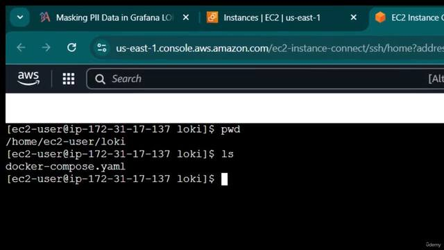
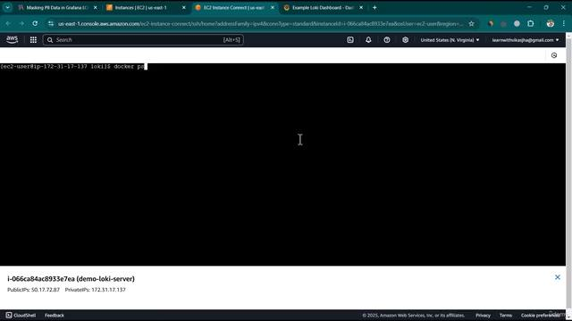
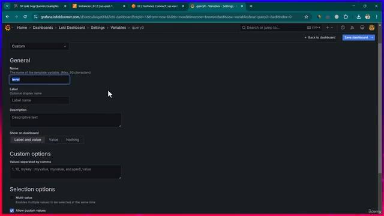
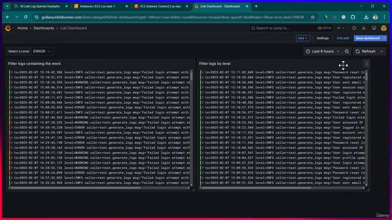
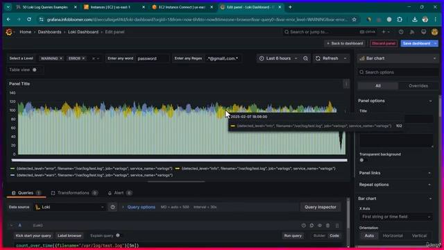
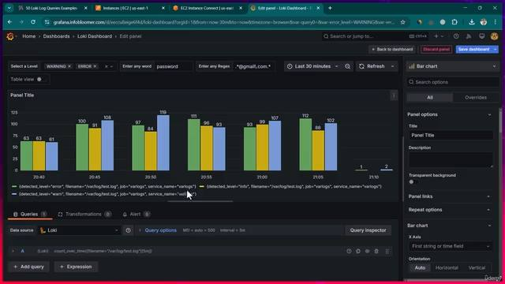
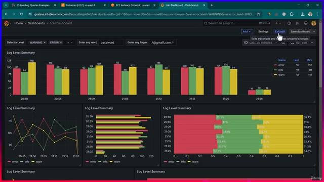
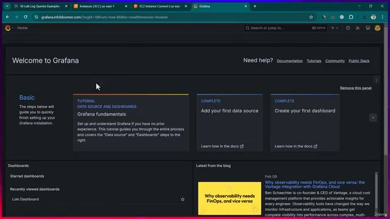
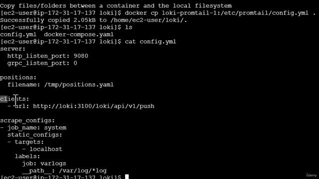
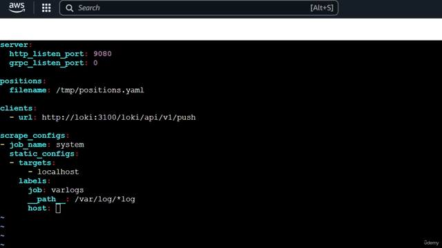

# Loki & Grafana：用 LogQL 搭一个可复用的动态 Dashboard（P10–P13）

## 1. 这一节做什么

这一节不是讲新概念，而是把前面 Explore 里练过的 LogQL 查询**固化成 Grafana Dashboard**，并解决三个工程问题：

1. **从硬编码到动态**：把 `level="info"`、`|= "failed"` 这种写死的过滤条件，换成 Grafana 变量（Custom 下拉、TextBox 输入框），让同一个面板可以切换 level、输入关键字、输入正则。
2. **从日志到指标**：用 `count_over_time` 把日志行变成按时间分桶的计数，再用 Bar chart / Time series / State timeline 展示 error/warning/info 的趋势。
3. **从开发到生产**：把 Dashboard 导出成 JSON，在目标环境导入；把 Promtail 的配置文件从容器里 `docker cp` 出来，加上 `host` label，再用 volume 挂回去，实现按主机过滤日志。

最终你会得到：一个带 3 个变量、4 个面板的 Dashboard，以及一个可通过 `docker cp` 修改、通过 volume 挂载生效的 Promtail 配置。

**前置条件**：本地已经用 Docker Compose 跑着 Loki + Promtail + Grafana，Grafana 里已经配好 Loki 数据源，并且 Promtail 正在往 Loki 推日志。P13 的逐字稿默认你已经拥有这个环境；如果没有，课程前面（P10 之前）应该已经讲过，但**本节逐字稿没有重复搭建步骤**，所以下文第 3 节会给出一个可运行的最小 Compose 配置作为复现基线。

> 说明：P10–P13 的逐字稿里，P10/P11 是 Grafana UI 操作，P12 是导出导入，P13 是终端 + 配置文件。逐字稿**没有展示** `docker-compose.yml` 和 `promtail/config.yml` 的完整内容，只展示了片段和修改动作。下文第 4 节的完整文件是**按逐字稿描述补全的最小可运行版本**，镜像版本、日志路径、label selector 需要按你的实际环境替换；凡是课程没讲的地方，我会明确标注「课里没讲」。

---

## 2. 讲师原话

> "这个查询编辑器与我们在探索部分练习过的完全相同。所以你学到的内容，可以直接拿来用。"
> —— p010 [00:50]
> 中文：这个查询编辑器跟我们在 Explore 里练的一模一样，你学过的查询可以直接搬过来。

> "在生产环境中，通常并不希望创建这种硬编码的仪表盘。所以我们希望能按 info、error 或其他关键词进行过滤。通常的做法是创建变量来保存这些不同的关键词。"
> —— p010 [03:23]
> 中文：生产环境不要做硬编码的 Dashboard，要能切 info/error/任意关键字，所以我们创建变量来存这些关键字。

> "当我们选择全部时，后端实际传入的是 info、warning 和 error 这三个值。而我们的查询里用的是等于条件。其实除了等于，也可以用正则匹配。"
> —— p010 [06:47]
> 中文：选 All 时后端会把 info、warning、error 三个值都传过来，而查询里用的是 `=`，所以匹配不到；应该改成正则匹配。

> "我们可以用类似 count over time 的方式，它会显示某段时间内的日志行数。"
> —— p011 [00:29]
> 中文：用 `count_over_time` 可以展示某段时间内日志行的数量。

> "借助这一点，你可以快速判断错误率是否在上升。比如原本显示 100 个错误，突然变成 500 个错误，这就清楚地表明在这个时间点出了问题。"
> —— p011 [03:15]
> 中文：靠这个图可以快速判断错误率是否在上升，比如从 100 个错误突然变成 500 个，就说明这个时间点出问题了。

> "导出时不应处于编辑模式。所以我们先点击退出编辑。如果你看不到退出编辑选项，说明你当前不在编辑模式。"
> —— p012 [01:06]
> 中文：导出前不能处于编辑模式，先点 Exit edit；看不到 Exit edit 就说明你本来就不在编辑模式。

> "在目标环境中，你也必须要有对应的数据源。否则虽然可以导入仪表盘，但它不会显示任何内容，因为仪表盘所关联的数据源不存在。"
> —— p012 [01:35]
> 中文：目标环境也必须先有同名数据源，否则 Dashboard 能导入但不出数据，因为它链不到数据源。

> "启动服务时，我们也会给 Promtail 传入配置文件。该配置文件的位置就在这里。这个位置目前当然是在 Docker 容器内部。"
> —— p013 [00:32]
> 中文：Promtail 启动时传了配置文件，这个路径现在是 Docker 容器内的路径。

> "现在我们又多了一个名为 host 的标签。选择 host，可以看到这里有 demo loki server。这就是我们新添加的标签。"
> —— p013 [04:29]
> 中文：现在多了一个 host label，选 host 就能看到 demo-loki-server，这就是我们新加的 label。

---

## 3. 从零复现

### 3.1 目录结构与基线环境

P13 里讲师 `pwd` 后确认当前目录下有 `docker-compose.yml`，然后才 `mkdir promtail`、`mv config.yml promtail/`。所以复现时先建一个项目目录：

```bash
mkdir loki-grafana-demo
cd loki-grafana-demo
```

目标目录结构如下：

```text
loki-grafana-demo/
├── docker-compose.yml
├── promtail/
│   └── config.yml
└── loki/                 # 可选：Loki 数据持久化目录
```

P13 中讲师打开 `docker-compose.yml` 时，能看到 loki、promtail、grafana 三段配置，并且 Promtail 启动命令里带了配置文件路径。下图是讲师展示 Compose 文件的画面：



> 课里没讲：镜像的具体版本号、端口映射、Loki 的存储配置。第 4 节给出的 Compose 文件是按逐字稿描述补全的最小版本，镜像 tag 请按你实际拉取的版本替换。

### 3.2 启动三个容器

在项目根目录执行：

```bash
docker compose up -d
docker ps
```

P13 里讲师用 `docker ps` 确认了 promtail、grafana、loki 三个容器都在运行：



如果某个容器反复重启，先看日志：

```bash
docker compose logs -f promtail
```

Promtail 起不来最常见的原因是 `config.yml` 路径写错，或者挂载的日志目录没有读权限。

### 3.3 在 Grafana 里确认 Loki 数据源

浏览器打开 `http://localhost:3000`。P10 里讲师从首页点「+」→「New dashboard」→「Add visualization」，然后看到数据源列表里只有一个 Loki 连接：

> "在我们的场景中只有一个连接，所以只看到一个连接。"
> —— p010 [00:23]

如果你有多个数据源（MySQL、Oracle 等），这里会列出多个；选中 Loki 即可。**目标环境导入 Dashboard 前，也必须先有同名 Loki 数据源**，这是 P12 反复强调的点。

### 3.4 建第一个面板：按 level 过滤日志

操作路径：

1. 左侧「+」→「New dashboard」→「Add visualization」。
2. 数据源选 Loki。
3. 右上角可视化类型从默认的 `Time series` 改成 `Logs`。讲师原话：

   > "By default time series is selected for Loki logs. Generally what we can do is we can select logs."
   > —— p010 [01:20]

4. 面板标题改成 `Filter logs by level`。
5. 打开 Code editor，粘贴按 level 过滤的 LogQL（完整语句见第 4 节）。
6. 点「Run query」，应该只看到 `level="info"` 的日志。
7. 「Save dashboard」，命名为 `loki-dashboard`。

这里的关键认知是：**面板的 Query editor 和 Explore 里的编辑器是同一个组件**，语法、label 补全、时间范围行为完全一致。你在 Explore 里调通的查询，可以直接复制到面板里。

### 3.5 用 Custom 变量把硬编码变成下拉

第一个面板的 `level="info"` 是写死的。P10 的做法是去 Dashboard Settings 里建变量：

1. Dashboard 右上角「Settings」→「Variables」→「New variable」。
2. Select variable type 选 `Custom`。
3. Name 填 `level`，Label 填 `Select a level`。
4. Custom options 填 `info,warning,error`。
5. 点「Run query」，Preview of values 里应该出现 `info`、`warning`、`error`。
6. 回到 Dashboard，顶部会出现一个下拉框。

下图是讲师创建变量后的画面：



然后编辑第一个面板，把查询里的 `level="info"` 改成 `level=~"$level"`。注意两个变化：

- `$level` 是变量引用；
- `=` 改成 `=~`，因为变量可能是多值。

讲师在这里口误过一次，先说变量叫 `level`，后面又说 "我想我们的变量名是 error level。"（p010 [05:36]）。以 Variables 列表里实际显示的 `level` 为准。

### 3.6 开启 Include All 和 Multi-value

变量建好后，回到 Settings → Variables → 点 `level`：

- 勾选 `Include All option`，下拉里会多一个 `All`。
- 勾选 `Multi-value`，下拉变成可多选。

P10 里讲师先只开 All，发现选 All 没反应：

> "如果我选择全部，什么也不会发生。这是因为选择全部时，后端实际传入的是 info、warning 和 error 这三个值，而我们的查询里用的是等于条件。"
> —— p010 [06:47]

原因就是 `=` 只能匹配单值，All 传过来的是三个值，必须用 `=~`。改成 `level=~"$level"` 后，All 就能匹配全部。

再开 Multi-value 后，可以同时选 `warning` 和 `error`，面板会同时展示这两类日志：



> **前端类比**：Grafana 变量很像 React 里的 `useState`——变量值变，面板重新发查询；多值变量则像把 `level: string` 改成 `level: string[]`，后端查询要从 `=` 改成 `IN (...)` 或正则。

### 3.7 再加两个 TextBox 变量：keyword 和 regex

第一个面板按 level 过滤，第二个面板要按任意关键字过滤。P10 的做法是再建一个 TextBox 变量：

1. Settings → Variables → New variable → type 选 `Text box`。
2. Name 填 `keyword`，Label 填 `Enter any word`。
3. 保存回 Dashboard，顶部出现输入框。
4. 编辑第二个面板，把 `|= "failed"` 改成 `|= "$keyword"`。

然后同样建第三个 TextBox 变量：

1. Name 填 `regex`，Label 填 `Enter any regex`。
2. 第三个面板的查询把写死的正则换成 `|~ "$regex"`。

讲师演示时输入 `login`、`password`、邮箱正则、IP 正则，面板都会跟着刷新：

> "如果我想搜索 login，只需在这里输入 login。如果想搜索其他关键词，比如 password，就在这里输入 password，然后它就会刷新。"
> —— p010 [09:28]

### 3.8 建 log level summary 柱状图

P11 新建一个面板，可视化类型选 `Bar chart`，查询用 `count_over_time`：

```logql
sum by (detected_level) (count_over_time({job="varlogs"}[5m]))
```

讲师原话：

> "我们可以用类似 count over time 的方式，它会显示某段时间内的日志行数。我们可以把它改成五分钟。"
> —— p011 [00:29]

下图是讲师把查询改成 `count_over_time` 后的画面：



关键配置：

- Query options 里的 `Min interval` 改成 `5m`。如果不改，Grafana 会自动按 30s 一个点画，点太密。
- Legend 格式填 `{{detected_level}}`。讲师特别强调要按帮助文本里的双花括号语法写：

  > "We have to put this opening curly braces two times and then closing curly braces two times and then inside this we have to put the name of the label which we want to show."
  > —— p011 [02:28]

- 颜色：error 改红、warning 改黄、info 保持绿/蓝。

下图是讲师配置 legend 和颜色后的柱状图：



### 3.9 图表格式调整（P11 的可选项）

P11 后半段是纯 Grafana 可视化调参，逐字稿讲得很细，但不影响查询正确性。可以按需选做：

| 配置项 | 位置 | 讲师演示值 | 效果 |
|---|---|---|---|
| Orientation | Bar chart 右侧 | horizontal | 柱状图横过来 |
| Stack | 搜索框搜 `stack` | 100% | 三个 level 堆叠成一根柱 |
| Line style | Time series → Lines | smooth | 折线变平滑 |
| Line width | Time series → Lines | 4 | 线加粗 |
| Field opacity | Time series | 20 | 面积透明度 |
| Gradient mode | Time series | opacity | 渐变填充 |
| Null values | Time series | never | 缺点不连线 |
| Point size | Time series | 调大 | 数据点变大 |
| Tooltip | Time series | all | 悬停显示三条线的值 |
| Min | Standard options | 200 | 低于 200 的不显示 |
| Visualization | 顶部下拉 | State timeline | 按时间区间显示状态 |

讲师对 Tooltip 的解释很实用：

> "当我把光标移到这里时，我想看到这三项的值。这种情况下它由 tooltip 控制，我们可以选择全部。"
> —— p011 [08:41]

对 Min 的解释：

> "小于 100 的你并不关心，所以可以把最小值设为 200。这样它就只会显示大于 100 的行。"
> —— p011 [09:20]

### 3.10 导出 Dashboard JSON

P12 的流程：

1. 确认不在编辑模式。如果右上角有 `Exit edit`，先点它。
2. 点 `Export` → `Export as JSON`。
3. 点 `Download file`，得到一个 `.json` 文件。

下图是讲师导出 JSON 的画面：



导出前必须退出编辑模式，这是讲师踩过的点：

> "导出时不应处于编辑模式。所以我们先点击退出编辑。如果你看不到退出编辑选项，说明你当前不在编辑模式。"
> —— p012 [01:06]

### 3.11 在目标环境导入 Dashboard

1. 目标 Grafana 先确认有同名 Loki 数据源（Data sources 页面能看到）。
2. 「+」→「Import dashboard」→「Upload dashboard JSON file」。
3. 选择刚才下载的 JSON。
4. 导入页会带出原 Dashboard 名称，可以改名，比如 `example Loki dashboard`。
5. 点 `Import`。

下图是导入上传界面：



导入后如果面板空白，先检查两件事：数据源 UID 是否匹配、时间范围是否覆盖了有日志的时间段。P12 只讲了「目标环境要有数据源」，**没讲 UID 不匹配的具体处理**，这一点放在第 7 节。

### 3.12 把 Promtail 配置从容器里复制出来

P13 的核心操作是改 Promtail 配置。原配置在容器内，先复制到宿主机：

```bash
docker ps
docker cp loki-promtail-1:/etc/promtail/config.yml .
ls
cat config.yml
```

讲师第一次执行 `docker cp` 时漏了容器名后面的冒号，报了语法错误，补上冒号后才成功：

> "现在语法上有点问题，我们需要做的是在容器名后面写上冒号，然后给出路径。"
> —— p013 [01:33]

下图是讲师 `cat config.yml` 展示配置内容的画面：



> 容器名以你 `docker ps` 的实际输出为准。讲师口播的是 `locky-promptail-1`，这是拼写口误，实际容器名通常是 `loki-promtail-1` 或 Compose 项目名加 `-promtail-1`。

### 3.13 给 Promtail 加 host label 并挂载回去

编辑 `config.yml`，在 `scrape_configs` 的 `labels` 下加一行：

```yaml
host: demo-loki-server
```

讲师原话：

> "我们再添加一个标签，我把它叫做 host，在 host 里可以填入这台服务器的任意 IP 地址或主机名。"
> —— p013 [02:20]

下图是讲师在 `vi` 里编辑配置、加入 host label 的画面：



然后：

```bash
docker compose down
mkdir promtail
mv config.yml promtail/
vi docker-compose.yml
```

在 `docker-compose.yml` 的 promtail 服务 `volumes` 下加一行：

```yaml
- ./promtail:/etc/promtail
```

再启动：

```bash
docker compose up -d
docker ps
```

回到 Grafana Explore，展开 Label filters，应该能看到新的 `host` label，值为 `demo-loki-server`。选中它再 Run query，日志仍然能出来，说明 label 生效。

---

## 4. 完整代码

> 再次说明：以下 `docker-compose.yml` 和 `promtail/config.yml` 的完整内容**课程没有逐字展示**，是根据 P13 中出现的 loki/promtail/grafana 三段服务、Promtail 启动传配置文件、`scrape_configs`、`clients`、`labels`、volume 挂载等片段补全的最小可运行版本。镜像 tag、日志路径、端口请按你的环境调整。

### 4.1 `docker-compose.yml`（初始版，未加 promtail volume）

```yaml
services:
  loki:
    image: grafana/loki:2.9.8
    ports:
      - "3100:3100"
    command: -config.file=/etc/loki/local-config.yaml
    volumes:
      - ./loki:/loki

  promtail:
    image: grafana/promtail:2.9.8
    volumes:
      - /var/log:/var/log:ro
    command: -config.file=/etc/promtail/config.yml
    depends_on:
      - loki

  grafana:
    image: grafana/grafana:10.4.2
    ports:
      - "3000:3000"
    environment:
      - GF_AUTH_ANONYMOUS_ENABLED=true
      - GF_AUTH_ANONYMOUS_ORG_ROLE=Admin
    depends_on:
      - loki
```

### 4.2 `promtail/config.yml`（初始版，无 host label）

```yaml
server:
  http_listen_port: 9080
  grpc_listen_port: 0

positions:
  filename: /tmp/positions.yaml

clients:
  - url: http://loki:3100/loki/api/v1/push

scrape_configs:
  - job_name: system
    static_configs:
      - targets:
          - localhost
        labels:
          job: varlogs
          __path__: /var/log/*.log
```

### 4.3 `promtail/config.yml`（P13 修改后，加 host label）

```yaml
server:
  http_listen_port: 9080
  grpc_listen_port: 0

positions:
  filename: /tmp/positions.yaml

clients:
  - url: http://loki:3100/loki/api/v1/push

scrape_configs:
  - job_name: system
    static_configs:
      - targets:
          - localhost
        labels:
          job: varlogs
          __path__: /var/log/*.log
          host: demo-loki-server
```

### 4.4 `docker-compose.yml`（P13 修改后，加 promtail volume）

```yaml
services:
  loki:
    image: grafana/loki:2.9.8
    ports:
      - "3100:3100"
    command: -config.file=/etc/loki/local-config.yaml
    volumes:
      - ./loki:/loki

  promtail:
    image: grafana/promtail:2.9.8
    volumes:
      - ./promtail:/etc/promtail
      - /var/log:/var/log:ro
    command: -config.file=/etc/promtail/config.yml
    depends_on:
      - loki

  grafana:
    image: grafana/grafana:10.4.2
    ports:
      - "3000:3000"
    environment:
      - GF_AUTH_ANONYMOUS_ENABLED=true
      - GF_AUTH_ANONYMOUS_ORG_ROLE=Admin
    depends_on:
      - loki
```

### 4.5 LogQL 查询清单

> 课程没有逐字展示完整查询表达式，只展示了查询编辑器里的操作。以下查询是按逐字稿中出现的 `level`、`failed`、`keyword`、`regex`、`detected_level`、`count_over_time` 重建的示例。你的实际 label selector（`{job="..."}`）和 label 名以 Grafana Explore 里看到的为准。

```logql
# 面板 1：按 level 变量过滤（支持 All / Multi-value）
{job="varlogs"} | json | level=~"$level"

# 面板 2：按关键字变量过滤
{job="varlogs"} |= "$keyword"

# 面板 3：按正则变量过滤
{job="varlogs"} |~ "$regex"

# 面板 4：按 detected_level 统计每 5 分钟日志条数
sum by (detected_level) (count_over_time({job="varlogs"}[5m]))
```

### 4.6 变量配置汇总

| 变量名 | 类型 | 配置 | 在查询中的用法 |
|---|---|---|---|
| `level` | Custom | 值：`info,warning,error`；勾选 Include All option、Multi-value | `level=~"$level"` |
| `keyword` | Text box | Label：`Enter any word` | `\|= "$keyword"` |
| `regex` | Text box | Label：`Enter any regex` | `\|~ "$regex"` |

---

## 5. 逐行解释

### 5.1 `docker-compose.yml`

- `services:` 下定义三个服务，Compose 会为每个服务创建一个容器。
- `loki` 的 `command: -config.file=/etc/loki/local-config.yaml` 是 Loki 官方镜像自带的单机配置入口；`./loki:/loki` 把索引和块数据落到宿主机，避免容器删了数据丢。
- `promtail` 的 `command: -config.file=/etc/promtail/config.yml` 指定配置文件路径。P13 加 volume 后，宿主机的 `./promtail/config.yml` 会覆盖容器内这个路径，所以改宿主机文件、重启容器就生效。
- `./promtail:/etc/promtail` 是 P13 加的挂载。左边是宿主机相对路径，右边是容器内绝对路径。**注意**：如果容器内原来有 `/etc/promtail/config.yml`，挂载目录会把它遮住，所以必须先 `docker cp` 出来再挂，否则 Promtail 启动时找不到配置。
- `grafana` 的 `GF_AUTH_ANONYMOUS_ENABLED=true` 和 `GF_AUTH_ANONYMOUS_ORG_ROLE=Admin` 是为了本地演示免登录；生产环境不要这么配。
- `depends_on` 只保证启动顺序，不保证 Loki 已经 ready。如果 Promtail 启动时报连接拒绝，重启一次 promtail 即可。

### 5.2 `promtail/config.yml`

- `server.http_listen_port: 9080` 是 Promtail 自己的 HTTP 端口，用来暴露 metrics 和调试信息，不是 Loki 的端口。
- `positions.filename: /tmp/positions.yaml` 记录每个日志文件读到哪一行了。容器重启后 `/tmp` 可能丢，导致重复采集；生产环境应该挂一个持久化目录。
- `clients.url: http://loki:3100/loki/api/v1/push` 是 Loki 的推送地址。`loki` 是 Compose 服务名，Docker 内置 DNS 会解析成 loki 容器 IP。
- `scrape_configs[0].job_name: system` 是任务名，会作为 `job` label 的一部分（这里又手动写了 `job: varlogs`，以 labels 里的为准）。
- `static_configs.targets: [localhost]` 是 Promtail 的静态目标写法，单机采集固定写 `localhost` 即可。
- `labels.__path__: /var/log/*.log` 告诉 Promtail 采集哪个路径。双下划线开头是 Promtail 的保留字段，不会成为 Loki label。
- `labels.host: demo-loki-server` 是 P13 新加的。它会成为所有日志的 `host` label，之后在 Grafana 里可以用 `{host="demo-loki-server"}` 过滤。

### 5.3 LogQL 查询

- `{job="varlogs"}` 是**流选择器**，必须至少有一个非空匹配条件，否则 Loki 拒绝执行。
- `| json` 是**解析器**，把 JSON 日志的字段变成临时 label。如果你的日志不是 JSON，这一行会解析失败或没有效果，可以去掉。
- `level=~"$level"` 是**label filter**，`=~` 表示正则匹配。Grafana 会把 `$level` 替换成当前选中的值；多选时替换成 `info|warning|error` 这种形式，所以必须用 `=~` 而不是 `=`。
- `|= "$keyword"` 是**行过滤**，表示日志行里包含该子串。它不区分大小写吗？LogQL 的 `|=` 是大小写敏感的；需要不敏感可以用 `|~ "(?i)$keyword"`。
- `|~ "$regex"` 是**正则行过滤**。用户输入的正则会直接拼进查询，**生产环境要限制输入**，否则恶意正则可能拖慢 Loki。
- `count_over_time({...}[5m])` 是**范围聚合**，统计每个 series 在 5 分钟窗口内的行数。
- `sum by (detected_level)` 是**向量聚合**，把相同 `detected_level` 的 series 加起来。`detected_level` 是 Loki 自动检测的 level label；如果你用的是自己打的 `level` label，把这里换成 `sum by (level)`。

### 5.4 变量替换的边界

- `$level` 在 Grafana 里是**文本替换**，不是参数化查询。变量值里如果有引号、反斜杠，可能破坏 LogQL 语法。Custom 变量限定为 `info,warning,error` 就是为了避免这个问题。
- TextBox 变量 `$keyword`、`$regex` 没有白名单，用户可以输入任意内容。讲师在演示里直接粘贴正则，这在教学环境没问题，生产环境要加输入校验或改用 Custom 变量。
- **前端类比**：这就像前端把用户输入直接拼进 `fetch('/api?q=' + input)`，不做 `encodeURIComponent`。Grafana 变量没有自动转义，拼查询时要自己保证安全。

---

## 6. 复现检查清单

- [ ] `docker compose up -d` 后，`docker ps` 能看到 loki、promtail、grafana 三个容器都是 `Up` 状态。
- [ ] 浏览器打开 `http://localhost:3000`，Grafana 能正常登录/匿名进入。
- [ ] Data sources 页面能看到 Loki 数据源，点「Save & test」通过。
- [ ] Grafana Explore 里能查到日志，至少有一个非空的 label selector。
- [ ] 新建 Dashboard，Add visualization 时能选到 Loki 数据源。
- [ ] 第一个面板可视化类型改成 `Logs`，查询能出日志行。
- [ ] 创建 Custom 变量 `level`，Preview of values 显示 `info,warning,error`。
- [ ] 变量开启 Include All option 和 Multi-value 后，下拉框能多选。
- [ ] 把 `level="info"` 改成 `level=~"$level"` 后，选 All 能出全部日志。
- [ ] 创建 TextBox 变量 `keyword`，输入 `login` 后面板刷新。
- [ ] 创建 TextBox 变量 `regex`，输入邮箱正则后面板能过滤出邮箱。
- [ ] `count_over_time` 面板能出柱状图，Legend 显示 `{{detected_level}}`。
- [ ] Query options 的 Min interval 改成 `5m` 后，数据点密度明显下降。
- [ ] Dashboard 能正常 Save，刷新页面后变量和面板都还在。
- [ ] 点 `Exit edit` 后能看到 `Export` 按钮，能下载 JSON。
- [ ] 删除 Dashboard 后，用 Import dashboard 上传 JSON 能恢复。
- [ ] `docker cp loki-promtail-1:/etc/promtail/config.yml .` 能成功复制出文件（容器名以 `docker ps` 为准）。
- [ ] `cat config.yml` 能看到 `

## 7. 课里没讲但你会撞上的

| 现象 | 原因 | 怎么办 |
|---|---|---|
| `docker compose up -d` 拉镜像失败，或容器起不来 | 补充（课里没讲）：课程没有讲镜像 tag、端口映射和 Loki 存储配置，示例里的 tag/端口要按实际环境替换。 | 按本地实际拉取版本替换 `image`；检查 `ports` 左侧宿主机端口是否可用，冲突时改宿主机端口。 |
| Promtail 容器反复重启/Exited | 补充（课里没讲）：课程没讲 Promtail 启动失败时常见原因是 `config.yml` 路径不对，或挂载的日志目录没有读权限。 | `docker compose logs -f promtail` 看错误；确认 `-config.file=/etc/promtail/config.yml` 对应的文件存在，`/var/log` 挂载可读。 |
| 目标环境导入 JSON 后面板空白 | 补充（课里没讲）：P12 只讲了目标环境要有 Loki 数据源，没讲 JSON 里的数据源 UID 与目标环境不一致时怎么处理。 | 在目标环境 Data sources 确认 Loki 的 UID，改 JSON 里的数据源 UID，或导入后编辑面板重新选数据源；再确认时间范围覆盖有日志的时间段。 |
| 查询无结果，或报流选择器错误 | 补充（课里没讲）：课程没有逐字展示完整查询，示例 `{job="varlogs"}` 可能不匹配你的实际环境；流选择器必须至少有一个非空匹配条件。 | 去 Explore 用 Label filters 找到实际的 `job`、`host` 等 label，替换查询里的 selector。 |
| 面板 1 加了 `\| json` 仍没有 `level`，或查询报解析错误 | 补充（课里没讲）：日志不是 JSON 时，`\| json` 会解析失败或没有效果。 | 先在 Explore 确认日志格式；非 JSON 日志去掉 `\| json`，或换成匹配实际格式的 parser。 |
| `sum by (detected_level)` 分组不是预期的 info/warning/error，或没有数据 | 补充（课里没讲）：`detected_level` 是 Loki 自动检测的 level label，不等于你自己在日志里打的 `level` label。 | 在 Explore 确认实际 label 名；如果你用的是自定义 `level`，把查询改成 `sum by (level)`。 |
| 改宿主机 `promtail/config.yml` 重启后不生效，或 Promtail 报找不到配置 | 补充（课里没讲）：volume 挂载目录会遮住容器内原来的 `/etc/promtail/config.yml`；没先 `docker cp` 出来就挂载会丢配置。 | 按 P13 顺序：先 `docker cp` 到宿主机，放进 `./promtail/`，再在 Compose 加 `./promtail:/etc/promtail`，然后 `docker compose down && docker compose up -d`。 |
| Promtail 启动日志报连接 `loki:3100` 被拒绝/反复重试 | 补充（课里没讲）：`depends_on` 只保证启动顺序，不保证 Loki 已经 ready。 | 等 Loki 起来后执行 `docker compose restart promtail`。 |
| 容器重启后同一批日志重复出现，`count_over_time` 计数偏高 | 补充（课里没讲）：`positions.filename: /tmp/positions.yaml` 放在 `/tmp`，容器重启后可能丢失。 | 复现时留意重启后的重复采集；生产环境把 positions 文件挂到持久化目录。 |
| `docker cp` 报 `No such container` | 补充（课里没讲）：容器名要以 `docker ps` 的实际输出为准；讲师口播的 `locky-promptail-1` 是拼写口误。 | `docker ps` 复制真实容器名（如 `loki-promtail-1`），再按 `容器名:/etc/promtail/config.yml .` 复制。 |
| TextBox 输入带引号、反斜杠或不完整正则后，面板报 LogQL 语法错误或查不出日志 | 补充（课里没讲）：Grafana 变量是文本替换、不会自动转义，值会直接拼进 `\|= "$keyword"` / `\|~ "$regex"`。 | 避免特殊字符；生产环境改 Custom 白名单或加输入校验；先在 Explore 里验证完整表达式。 |
