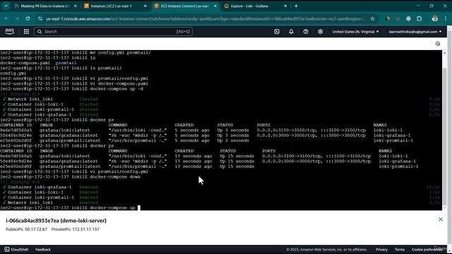
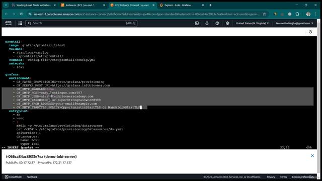
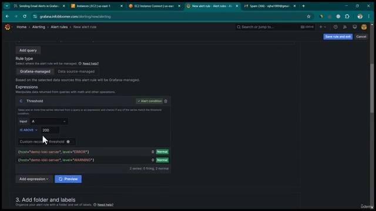
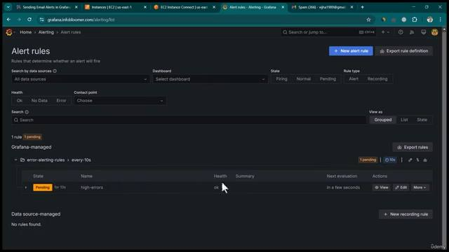
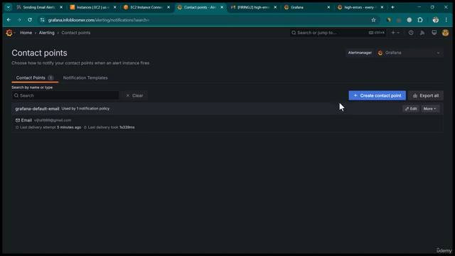
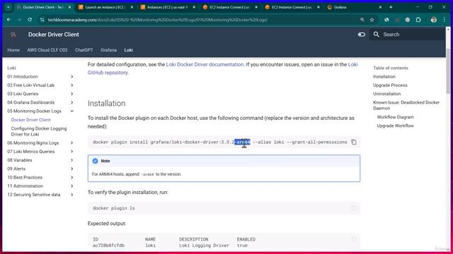
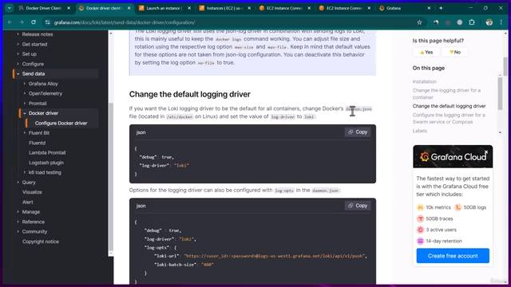
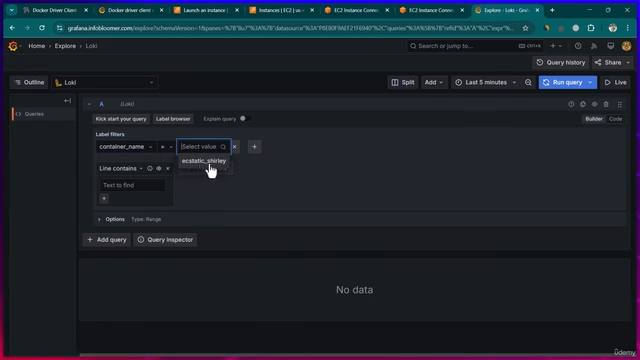
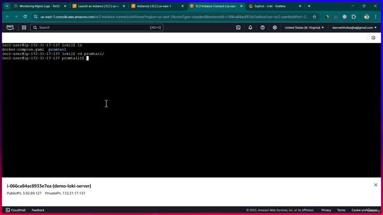
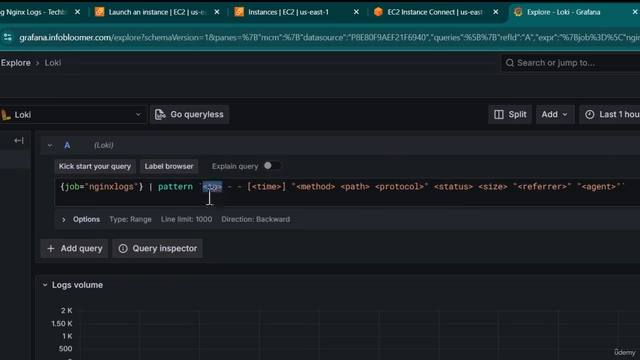

# Loki & Grafana（BV1NLj16mECA）P14–P18 复现文档：日志脱敏 → 邮件/Telegram 告警 → Docker 容器日志 → Nginx 日志解析

> 阅读前提：这是一门「在 AWS EC2 上用 Docker Compose 跑 Loki + Promtail + Grafana」的实操课。P14–P18 五节不是五个独立知识点，而是一条完整的收尾链路：**先把日志里的密码打码，再让日志能触发告警（邮件 → Telegram），最后把「非文件类」日志源（Docker 容器）和「业务日志」（Nginx）也接进来**。
> 本文按「要做出什么」重组，不按集数顺序叙述。所有配置都以「能保存、能 `docker compose up` 起来」为准。

---

## 1. 这一节做什么

P14–P18 做完之后，你手上应该有一个这样的系统（目录名沿用课里的 `loki`）：

```
~/loki/
├── docker-compose.yml          # loki + promtail + grafana，Grafana 的 SMTP 在这里注入
└── promtail/
    └── config.yml              # 两个 scrape job：system（带密码脱敏）、nginx-logs

# 另一台（可丢弃的）EC2 上：
/etc/docker/daemon.json         # 装 loki 日志驱动插件，让容器日志直接推给 Loki
```

五节各自交付的东西：

| 能力 | 你要改的文件 | 验收方式 |
|---|---|---|
| 日志脱敏（把 password 打成 `****`） | `promtail/config.yml` 里加 `pipeline_stages.replace` | Grafana Explore 里看不到明文密码 |
| 邮件告警 | `docker-compose.yml` 加 `GF_SMTP_*` 环境变量 + Grafana 里建 contact point / alert rule | 收到测试邮件、规则状态从 `normal` → `pending` → `alerting` |
| 告警静默（silence） | Grafana UI | 静默期间不再发邮件，但规则仍在评估 |
| Telegram 告警 | Grafana contact point + BotFather 建 bot | 群里收到告警消息 |
| Docker 容器日志进 Loki | `/etc/docker/daemon.json` | Explore 里多出 `container_name` 标签 |
| Nginx 日志进 Loki 并能按字段查 | `promtail/config.yml` 加 job + LogQL `pattern` 解析 | 展开日志行能看到 `ip / method / path / status` 等字段 |

一句话总结这一段的定位：**前面几节是「能查日志」，这五节是「日志能用来报警、而且日志本身不能变成安全事故」**。

---

## 2. 讲师原话（带出处）

关于为什么要脱敏：

> "就演示目的而言，这些都没问题……不过，在生产环境中，你知道，把密码之类的东西暴露在日志里，大概不是个好主意。然后，你知道，把这些包含敏感数据的日志发送到 Loki，也完全不是个好主意。"
> —— p014 [00:00]

> "替换的作用是，它会找出任何与我们在这里给出的模式相匹配的模式……把它替换成 ****，所以基本上，你知道，我们是在遮蔽所有与密码相关的数据。"
> —— p014 [00:52]

关于告警的整条链路（谁发邮件）：

> "Grafana 服务器会从 Grafana 的 configuration.ini 文件中的 SMTP 配置里获取所有 SMTP 详细信息，也就是邮件服务器详细信息，然后根据这些信息发送电子邮件。"
> —— p015 [00:26]

关于 `pending period` 为什么必须存在：

> "你可以看到，这里提示待处理时段必须大于或等于评估间隔，也就是说这个时段不能小于评估间隔。"
> —— p015 [10:45]

> "你其实并不希望每 10 秒就发送一封邮件……所以待处理时段可以帮你做到这一点。"
> —— p015 [13:02]

关于 Docker 日志为什么能进 Loki：

> "为了把 Docker 日志发送到 Loki，Grafana 已经创建了一个插件，我们可以按照这些步骤在 Docker 容器上安装它。"
> —— p017 [00:00]

> "唯一新增的变化是，我们现在有了一个名为 container name 的新标签……借助 container name，你可以定位任意一个容器，也可以使用正则表达式模式定位多个容器。"
> —— p017 [06:22]

关于 Nginx 日志为什么需要 `pattern` 解析器：

> "我们的日志行始终以 IP 地址开头，然后日志中包含“空格、连字符、空格、连字符、空格”。我们在这里放的就是这个。"
> —— p018 [03:48]

---

## 3. 从零复现

> 说明：课里是接着前面几节的环境继续做的（Loki 那台 EC2 上已经有 `loki/docker-compose.yml` 和 `loki/promtail/config.yml`）。下面的步骤从「已有环境」开始；如果你完全从零，先把第 4 节的两个完整文件落地，再回来按 3.2 之后操作。
> 逐字稿是语音转写，`Locky / lucky / promptail / engine X` 分别对应 `Loki / Promtail / nginx`，命令里的 `hyphen` 就是 `-`。本文已按实际命令写法还原。

### 3.0 前置检查（在 Loki 那台 EC2 上）

```bash
# 确认你人在 loki 目录（里面有 docker-compose.yml）
cd ~/loki
pwd
ls            # 应该看到 docker-compose.yml 和 promtail/
docker compose ps
```

### 3.1 把「密码脱敏」加进 Promtail（p014）

1. 编辑 Promtail 配置：

```bash
vi ~/loki/promtail/config.yml
```

2. 在那个抓取应用日志的 job（课里 job 名是 `system`）下面，新增一段 `pipeline_stages`，只加一个 `replace` 动作：**匹配到密码模式的行，把值替换成 `****`**。完整文件见第 4 节。

3. 重启：

```bash
cd ~/loki
docker compose down
docker compose up -d
```

讲师原话是「其实也可以只重启 promtail 一个容器，但为了省事全下一遍最稳」。

4. 去 Grafana → Explore → 查应用日志，原来形如 `user registered with password=<明文>` 的行，现在值是 `****`：



> 这一步在 JS/Node 世界里等价于 `pino` 的 `redact: ['*.password']`、或者一个 Express 中间件在写日志前把敏感字段替换掉。区别是：课里做在**采集端**（Promtail），好处是「数据从来没进过 Loki」，比在应用里打码、或进 Loki 后再改，安全边界更靠前。

### 3.2 配 SMTP，让 Grafana 有能力发邮件（p015）

1. 打开 compose 文件：

```bash
cd ~/loki
vi docker-compose.yml
```

2. 在 `grafana` 服务的 `environment:` 下追加 SMTP 相关变量（值来自你的邮件服务商，课里用的是 Hostinger 的 SMTP，端口 `587`）：

```yaml
      - GF_SMTP_ENABLED=true
      - GF_SMTP_HOST=smtp.hostinger.com:587
      - GF_SMTP_USER=alert@your-domain.com
      - GF_SMTP_PASSWORD=你的邮箱密码
      - GF_SMTP_FROM_ADDRESS=alert@your-domain.com
      - GF_SMTP_STARTTLS_POLICY=MandatoryStartTLS
```



> ⚠️ 逐字稿只逐条念了这些字段的**含义**（enabled 设 true、host+端口、user、password、from address、start TLS policy 设 mandatory），**没有念出完整的环境变量名**。上面 `GF_` 前缀是 Grafana 容器化时把 `grafana.ini` 的 `[smtp]` 段映射成环境变量的通用写法，你实际粘贴时以讲师那份文件为准。
> 另外讲师特别说明：端口不一定是 `587`，`STARTTLS` 设 `opportunistic` 还是 `mandatory`，**由你的 SMTP 管理员确认**，他没给建议。

3. 重启并验证 Grafana 读到了配置：

```bash
docker compose down
docker compose up -d
```

Grafana 里点开左侧菜单 → **Administration** → **General** → **Settings**，搜索 `SMTP`，能看到刚配的值就说明生效了。

4. 先做一次连通性测试（不要直接上规则）：
   Grafana → **Alerting** → **Contact points** → 编辑默认的 `grafana-default-email` → 填入你的收件邮箱 → 点 **Test** → 显示 "test alert sent"。
   邮件可能落进垃圾箱（讲师的就进了 spam），能收到即算通。

### 3.3 建告警规则（p015）

1. **决定用什么查询报警**：讲师复用了 dashboard 里「最近 5 分钟错误行数」那条查询，思路是「错误数量超过某个数就发邮件」。
2. Grafana → **Alerting** → **Alert rules** → **New alert rule**：
   - 名称：`high errors`
   - 第 2 步 Query 切到 **Code**，粘 LogQL（见第 4 节「告警规则的查询」）；
   - 只保留 `error` 和 `warning` 两个级别（用 `level=~"error|warning"`）；
   - 关键一步：**在查询外层加聚合** `sum`，否则「每一条日志都会产生一条告警」。讲师原话：不希望「one alert message for each kind of message」；
   - 再进一步 `sum by (level)`，得到 error 91 行、warning 118 行这种按级别分组的数（数字会随你的数据变）。
3. 第 3 步 Expressions：条件设为 **IS ABOVE `200`** → 点 Preview，状态是 `normal`（当前系统健康）；改成 `50` 再 Preview，变成 `firing`，因为 error 和 warning 两组都超过 50 → **会触发两条告警**。



4. **Folder**：新建 `error alerting rules`，用来归类错误相关规则。
5. **Evaluation behavior**：新建 evaluation group，先叫 `every five minutes`、间隔 5 分钟；为了演示快，后来又改成 `every 10 s` / 10 秒。
6. **Notification**：contact point 选上一步测通的邮件联系点。
7. 保存时会报错：`pending period must be greater than or equal to the evaluation interval`。把 pending period 也设成和评估间隔一样（先 5 分钟，后改 10 秒），保存成功。



理解这三态很重要（讲师在 [12:32]–[13:53] 完整演示了一遍）：

- `normal`：条件不满足；
- `pending`：条件满足了，但**还没满足够久**（pending period）；
- `alerting`：pending 期满仍满足 → 真发通知。讲师等到状态变 `alerting` 后，邮箱收到了同时包含 `level=error` 和 `level=warning` 两个条件的告警邮件。

> 这里的 `pending period` 就是前端非常熟的 **debounce**：不是「值一超阈值就发」，而是「持续超阈值 N 秒才发」。评估间隔 = 轮询频率，pending period = 去抖窗口。**课里没有讲锁/事务/并发的内容**；唯一和并发沾边的是「规则每 10 秒评估一次」，多次评估之间是否会重叠排队，课里没讲。

### 3.4 建静默（silence）（p015）

场景（讲师原话的意思）：你已经在处理这个错误了，不想它继续每 10 秒发一封邮件；或者你在做已知的补丁/变更，知道会误报。

两种入口：
- 告警邮件里点 **Silence**；
- 或 Grafana → Alerting → 规则右侧 **more** → **Silence notifications**（注意：只是不发通知，**规则照旧每 10 秒评估**）。

创建静默时设置 duration（课里留了 2 小时）→ **Save silence**。之后在 **Alerting → Silences** 能看到列表。

### 3.5 加 Telegram 通道（p016）

1. 先在 Telegram 里造 bot：
   - 搜索 **BotFather** → 发 `/newbot` → 起显示名（课里 `loki alert`）→ 起用户名（必须以 `bot` 结尾；课里连试了 `loki alert bot`、`loki alert 9999 bot` 都被占用，最后一个可用）；
   - BotFather 返回一个 **token**，复制它。
2. 建群：New Group → 名字 `loki alerts` → 把刚创建的 bot 加进群。
3. 拿群 ID：**再加一个叫 `chat ID` 的 bot** 进群，它会直接把该群的 chat id 回在群里，复制它。
4. Grafana → Alerting → **Contact points** → **Create contact point**：
   - 名称 `telegram`，Integration 选 **Telegram**；
   - 填 Bot API token 和 Chat ID；
   - 点 **Test** → 群里收到消息即通。



5. 可选设置（讲师逐条念了）：
   - **Disable notifications**：静默发送，用户收到但无声音；
   - **Protect content**：禁止转发/保存这条消息（适合组织内部）。
6. 切换到 Telegram 通道：Alerting rules → 编辑 `every 10 s` 那条规则 → contact point 从 `grafana default email` 改成 `telegram` → Save。
7. **先把 3.4 建的 silence 删掉**，否则你等不到消息。之后规则变成 `firing`，群里收到告警，消息里点 **source** 能跳回产生它的告警规则和查询结果。

### 3.6 把 Docker 容器日志送进 Loki（p017）

1. 新开一台**用完就删**的 EC2（课里叫 `demo docker logs`，t2.micro/t2.medium 都行，AMI 选 Amazon Linux，选已有 key pair）。
2. 装 Docker 并启动：

```bash
sudo su -
yum install -y docker
systemctl start docker
systemctl status docker     # 看到 active (running) 即可
```

3. 装 Grafana 官方的 Loki Docker 日志驱动插件（**注意架构**：课里给的命令带 `-arm64`，Amazon Linux 是 AMD，要改成 `amd64`）：

```bash
docker plugin install grafana/loki-docker-driver:latest --alias loki --grant-all-permissions
docker plugin ls
```

`docker plugin ls` 里能看到 `loki` 且状态为 true，说明插件装好了。命令输出的字段名以你机器上的实际输出为准。



4. 配置 `/etc/docker/daemon.json`。讲师第一次只贴了「最简那份」，随后发现**没告诉它 Loki 在哪**，于是换成带 `loki-url` 的写法：

```bash
vi /etc/docker/daemon.json
```

（文件内容见第 4 节。讲师强调：文件名 `daemon.json` 拼错就完全不生效。）



5. 重启 Docker 让配置生效：

```bash
systemctl restart docker
```

6. 造两条日志验证：

```bash
docker run hello-world
docker run --name hello-world-container hello-world
```

7. 回 Grafana → Explore → Builder，刷新后 Label filters 里会多出 **`container_name`**；点 **Run query** 就能看到该容器的日志。课里第一条是匿名跑出来的自动命名容器，第二条是 `hello-world-container`。



> 之后查 Docker 日志、做 dashboard，用的还是前面学过的同一套 LogQL，**唯一的新东西就是 `container_name` 这个标签**，可以用来精确锁定一个容器，或用正则匹配一批容器。

### 3.7 接 Nginx 日志并解析字段（p018）

1. 先人工确认日志位置（在 Loki 那台机器上）：

```bash
sudo su -
cd /var/log/nginx
ls
```

要关注的是 `access.log` 和 `error.log`；课里的做法是**直接监控整个目录** `/var/log/nginx`。



2. 回到 EC2 普通用户，改 Promtail 配置：

```bash
su - ec2-user
cd ~/loki/promtail
vi config.yml
```

做法是**把现有的 `system` job 整段复制一份**（从 `job_name` 到 `pipeline_stages` 结束），粘在后面，然后改四处：

- `job_name:` → `nginx-logs`
- `targets:` 保持 `localhost`（Nginx 和 Promtail 在同一台机器）
- `labels.job:` → 与 job_name 一致
- `__path__:` → `/var/log/nginx/*.log`
- `labels.host:` 保持 `demo-loki-server` 不动

3. 回到 compose 目录重启：

```bash
cd ~/loki
docker compose down
docker compose up -d
```

4. Grafana → Explore，`job` 标签里能选到新值，Run query 能看到 Nginx 日志——但**此时没有可用的字段**，只能整行看。所以切到 **Code**，加 `pattern` 解析器：

```
{job="nginx-logs"} | pattern `<ip> - - [<time>] "<method> <path> <protocol>" <status> <size> "<refer>" "<agent>"`
```



5. Run query，展开任意一行，能看到多出 `ip / method / path / status / protocol / refer / agent` 等字段——之后就能用前面学过的 LogQL 对这些字段做过滤、聚合、画图。

---

## 4. 完整代码

> 三处说明，避免你照抄后对不上：
> 1. 课里**没有把 `docker-compose.yml` 和 `promtail/config.yml` 完整念一遍**，只在编辑时露出片段。下面两份是「与本段所有操作（SMTP 变量、两个 scrape job、脱敏 pipeline stage）完全兼容」的完整版本，镜像 tag 课里没念，用 `latest`。
> 2. `daemon.json` 的 `loki-url` 里，课里的域名转写不清，用占位符代替，格式是 `http(s)://<你的Loki地址>/loki/api/v1/push`。
> 3. Promtail 的脱敏正则课里**没有逐字念出**，只演示了效果（密码值变成四个星号）。下面给的是按效果还原的写法，你需要按自己日志格式微调。

### 4.1 `~/loki/docker-compose.yml`

```yaml
version: "3.8"

services:
  loki:
    image: grafana/loki:latest
    container_name: loki
    ports:
      - "3100:3100"
    command: -config.file=/etc/loki/local-config.yaml
    restart: unless-stopped

  promtail:
    image: grafana/promtail:latest
    container_name: promtail
    volumes:
      - ./promtail/config.yml:/etc/promtail/config.yml
      - /var/log:/var/log
    command: -config.file=/etc/promtail/config.yml
    depends_on:
      - loki
    restart: unless-stopped

  grafana:
    image: grafana/grafana:latest
    container_name: grafana
    ports:
      - "3000:3000"
    environment:
      # ---- 数据源 ----
      - GF_LOKI_URL=http://loki:3100
      # ---- SMTP（p015 新增；值换成你自己的） ----
      - GF_SMTP_ENABLED=true
      - GF_SMTP_HOST=smtp.hostinger.com:587
      - GF_SMTP_USER=alert@your-domain.com
      - GF_SMTP_PASSWORD=change-me
      - GF_SMTP_FROM_ADDRESS=alert@your-domain.com
      - GF_SMTP_STARTTLS_POLICY=MandatoryStartTLS
    depends_on:
      - loki
    restart: unless-stopped
```

### 4.2 `~/loki/promtail/config.yml`

```yaml
server:
  http_listen_port: 9080
  grpc_listen_port: 0

positions:
  filename: /tmp/positions.yaml

clients:
  - url: http://loki:3100/loki/api/v1/push

scrape_configs:
  # ---------- job 1：系统/应用日志（原有），带密码脱敏 ----------
  - job_name: system
    static_configs:
      - targets:
          - localhost
        labels:
          job: system
          host: demo-loki-server
          __path__: /var/log/*.log
    pipeline_stages:
      - replace:
          expression: "(?i)(password[=:]\\s*)\\S+"
          replace: "$1****"

  # ---------- job 2：Nginx 日志（p018 新增，整段复制 job 1 后修改） ----------
  - job_name: nginx-logs
    static_configs:
      - targets:
          - localhost
        labels:
          job: nginx-logs
          host: demo-loki-server
          __path__: /var/log/nginx/*.log
```

> 讲师在 p018 是把 job 1 **整段（含 pipeline_stages）**复制过去的，所以 nginx 那个 job 里也会带着 `replace`。这里为了清晰没带——它不影响功能（nginx 访问日志里没有 `password=`），你可以照讲师原样保留。
> 另外讲师把 `job` 的值读作「nginx logs」，中间**带空格**。空格在标签值里合法，但查询时要写成 `{job="nginx logs"}`，很容易手滑；本文统一用 `nginx-logs`。如果你要和自己屏幕对上，就把两处都改成带空格的形式。

### 4.3 告警规则的查询（Grafana Alert rule → 第 2 步 Query → Code）

```
sum by (level) (count_over_time({job=~".+"} | logfmt | level=~"error|warning" [5m]))
```

- `job` 的 selector：课里直接用了他那条现成查询，**没有念出完整的标签**；上面用 `{job=~".+"}` 保证能跑通，请按你实际的 job 值收紧（例如 `{job="system"}`）。
- `level` 的取值：课里日志的级别是 `error` / `info` / `warning`（讲师筛的是 error + warning）。你自己的日志如果是 `warn`，把正则改成 `error|warn`。
- `[5m]`：对应讲师说的「最近 5 分钟」。
- 阈值：Expression 里设 **IS ABOVE 50**（先用 200 看他演示 `normal`，再改 50 看 `firing`）。

### 4.4 `/etc/docker/daemon.json`（在 demo Docker 那台 EC2 上）

```json
{
  "log-driver": "loki",
  "log-opts": {
    "loki-url": "http://<你的Loki域名或IP:3100>/loki/api/v1/push",
    "loki-batch-size": "400"
  }
}
```

### 4.5 Grafana 里需要手工点的东西（没法写成文件，列成表）

| 位置 | 名字 | 关键值 |
|---|---|---|
| Contact points | `grafana-default-email`（编辑） | 你的收件邮箱 |
| Contact points | `telegram`（新建） | Integration=Telegram，Bot token，Chat ID；Protect content 可选 |
| Alert rules → Folder | `error alerting rules` | — |
| Alert rules → Evaluation group | `every 10 s`（先建 `every five minutes`） | interval = 10s |
| Alert rule | `high errors` | 查询见 4.4，条件 IS ABOVE 50，pending period = 10s（必须 ≥ 评估间隔） |
| Silences | 临时静默 | duration 2 小时 |

---

## 5. 逐行解释

### 5.1 `docker-compose.yml`

- `./promtail/config.yml:/etc/promtail/config.yml`：把宿主机上的配置**挂载**进容器。所以改完配置不需要 rebuild 镜像，`docker compose down && up -d` 就够——这也是讲师为什么一直用这两条命令。
- `- /var/log:/var/log`：Promtail 是**读宿主机日志文件**的，不挂这一层它只能看到容器内部（空的）`/var/log`。p018 之所以能读到 `/var/log/nginx/*.log`，靠的就是这一行。**没有这一行，你的 `__path__` 写得再对也采不到东西**。
- `GF_SMTP_ENABLED=true`：对应 `grafana.ini` 的 `[smtp] enabled`。讲师明确说「必须设成 true」，否则 Grafana 有 SMTP 配置也不会发信。
- `GF_SMTP_HOST=smtp.hostinger.com:587`：**host 和 port 写在一起**，冒号分隔。讲师强调端口不一定是 587，按服务商给的填。
- `GF_SMTP_STARTTLS_POLICY=MandatoryStartTLS`：可选 `OpportunisticStartTLS` / `MandatoryStartTLS`。讲师说自己「没有建议」，让问 SMTP 管理员——因为选错会直接连不上，报错还很不直观。
- 为什么用环境变量而不是改 `grafana.ini`：讲师的原话是「因为我们是用 Docker Compose 装的 Grafana，所以直接通过 compose 文件把这些细节传进去，一切都变得简单很多」。容器化场景下改 ini 要额外挂载文件，env 更省事。

### 5.2 `promtail/config.yml` 与脱敏

- `pipeline_stages` 是 Promtail 的**处理流水线**，一条日志进来后依次经过每个 stage。讲师说「pipeline stages 里可以有多个 action」（stage）。
- `- replace:` 这个 stage 做的是**正则替换**：`expression` 匹配到什么，就把匹配部分按 `replace` 换成什么。讲师的原话是「看到匹配这个 pattern 的行，就替换成 star star star star」。
- `expression: "(?i)(password[=:]\\s*)\\S+"` 的拆解：
  - `(?i)` 忽略大小写，防止 `Password=` 漏网；
  - `(password[=:]\s*)` 是一个**捕获组**，匹配 `password=` 或 `password: ` 连同后面的空白；
  - `\S+` 是密码值本身（非空白字符）；
  - `replace: "$1****"` 里的 `$1` 表示「把第一个捕获组原样保留」，只把值换成 `****`。所以你看到的还是 `user registered with password=****` 这种可读的日志，只是值没了。
  - ⚠️ 这个正则**课里没念**，是按讲师演示的效果（密码变成四个星号）还原的。如果你日志里是 JSON（`{"password":"xxx"}`），上面这条不会命中，需要改成 `expression: '("password"\s*:\s*")[^"]+'` 之类。这也解释了为什么课里做完以后要**回 Grafana 刷新确认**，而不是改完就信。
- 讲师顺带提了适用面：「credit card information 或任何其他 PII 数据」都能用同样的手法打码。
- `scrape_configs` 下两个 job 的区别只在 `job_name` / `labels.job` / `__path__`。**`labels` 里的 `job` 才是你在 Grafana 里用来筛选的标签**，promtail 自己的 `job_name` 只是配置项名字，两者课里都改成了同一个值，别只改一个然后纳闷为什么筛不出来。
- `host: demo-loki-server`：讲师说这个标签「在 Promtail 装到多台服务器上时才有用」，当前只有一台，留着或删掉都行。

### 5.3 告警查询的每一层

```
sum by (level) ( count_over_time( {job=~".+"} | logfmt | level=~"error|warning" [5m] ) )
```

1. `{job=~".+"}`：选流（Loki 必须有流选择器）。
2. `| logfmt`：**日志格式解析器**，把形如 `level=error msg=...` 的行拆成字段。讲师明确指出：「因为用了 log format parser，我们才能用 `level` 这个字段」。如果换 `pattern` 解析器（p018 用的那种），字段名就是你自己在 `<...>` 里起的名字。
3. `| level=~"error|warning"`：**行过滤**。讲师先跑了一次，看到有 `error / info / warning` 三个级别，然后说「只关心 error 和 warning」，于是加了这一行。注意这里是 `=~`（正则匹配）而不是 `=`。
4. `count_over_time(...[5m])`：统计 5 分钟窗口内的行数。
5. `sum by (level) (...)`：**这一步决定了告警条数**。讲师的原话是「不希望每条消息都产生一个告警」，所以先 `sum` 把行合成一个数，再 `sum by (level)` 按级别分组，最终得到「error 91 / warning 118」两组。于是阈值 50 会触发**两条**告警——这正是他在邮件里看到的。
6. 阈值和 pending period 的关系（这是本节最容易踩的坑）：
   - 评估间隔 10s + pending 5min = 条件要**连续 5 分钟**为真才发；
   - pending 不能小于评估间隔，否则 Grafana 直接报错，讲师现场撞了一次。
   - 换算成前端语言：评估间隔是 `setInterval` 的频率，pending period 是「必须连续 N 次为真」的计数门槛。

### 5.4 `daemon.json`

- `"log-driver": "loki"`：把 Loki 插件设为**这台机器所有容器**的默认日志驱动。所以讲师跑完 `docker run hello-world`，日志就自动进 Loki 了，**一行代码都不用改**。
- `"loki-url"`：讲师第一次贴的配置漏了这个，于是「Loki 不知道在哪」，采不到东西。他第二次换成带 url 的写法才成功。**这是本节唯一一个必须手改的字段**。
- `"loki-batch-size": "400"`：讲师贴的这份最简配置里自带这个参数，**但他没解释含义**，你照抄即可。
- 重启 `systemctl restart docker` 是必须的：Docker 只在启动时读 `daemon.json`。
- 只对**新创建**的容器生效——这也是为什么讲师先重启 docker，再 `docker run`。已经存在的容器不会自动改用新驱动（课里没讲这点，但你会撞上，见第 7 节）。

### 5.5 Nginx 的 `pattern` 解析器

```
| pattern `<ip> - - [<time>] "<method> <path> <protocol>" <status> <size> "<refer>" "<agent>"`
```

- 讲师讲这条的思路是**逐字对齐日志**：「日志总是以 IP 开头」→ `<ip>`；「然后是一个空格 连字符 空格 连字符 空格」→ 字面量 ` - - `；「然后是中括号里的时间」→ `[<time>]`；后面依次是 `"请求行"`、状态码、大小、`"referer"`、`"user-agent"`。
- `<...>` 里的名字**是你自己起的**，讲师反复强调：第一个字段叫 `ip` 也行、叫 `ip_address` 也行、「doesn't really matter」。
- 尖括号里的内容会变成**可查询的 label/字段**，所以展开日志行能看到 `ip / method / path / status / protocol / refer / agent`。讲师说有了这些，「就可以用前面学过的任何 Loki 查询来做各种可视化」。
- 未命名的部分可以用 `<_>` 跳过（课里的写法是把 `- -` 直接当字面量写死，两种都可以）。
- 前提是**日志格式固定**：Nginx 的 combined 格式改了，或者你开了自定义 `log_format`，这条 pattern 就整条对不上，字段全空。课里没讲怎么改 Nginx 日志格式。

---

## 6. 复现检查清单

按顺序打勾，任何一项不过就别往下走：

**环境**
- [ ] `~/loki` 下 `docker compose ps` 三个容器（loki / promtail / grafana）都是 Up
- [ ] Grafana 能登进去，Explore 里 Loki 数据源能查到历史日志

**脱敏（p014）**
- [ ] `promtail/config.yml` 里有 `pipeline_stages` → `replace`
- [ ] `docker compose down && docker compose up -d` 之后容器都起来了（配置 YAML 缩进错会导致 promtail 起不来，先看 `docker compose logs promtail`）
- [ ] Explore 里搜 `password`，值显示为 `****`，**没有任何明文**

**邮件（p015）**
- [ ] `docker-compose.yml` 里 6 个 `GF_SMTP_*` 都填了，`GF_SMTP_ENABLED=true`
- [ ] Grafana → Administration → General → Settings 搜 `SMTP` 能看到值
- [ ] Contact point 点 **Test** 成功，邮箱（含垃圾箱）收到测试邮件

**规则（p015）**
- [ ] 查询单独跑一次，`sum by (level)` 能出 error/warning 两组数
- [ ] 阈值 200 时状态 `normal`
- [ ] 阈值改 50 后状态从 `pending` → 过一段时间 `alerting`
- [ ] 保存时如果报 `pending period must be greater than or equal to the evaluation interval`，把 pending period 调到 ≥ 评估间隔

**静默（p015）**
- [ ] 建 2 小时 silence 后，规则仍显示在评估，但**不再收到邮件**
- [ ] 切 Telegram 之前记得把 silence 删掉

**Telegram（p016）**
- [ ] BotFather `/newbot` 拿到 token，用户名以 `bot` 结尾
- [ ] bot 已加入群，`chat ID` bot 已回出群 ID
- [ ] Contact point 的 **Test** 能在群里看到消息
- [ ] 规则 contact point 已切到 telegram，群里收到包含 error + warning 两条的告警

**Docker 日志（p017）**
- [ ] `docker plugin ls` 能看到 loki 插件且状态正常
- [ ] `/etc/docker/daemon.json` 文件名没拼错（`daemon.json`），JSON 语法正确
- [ ] `systemctl restart docker` 后 `docker run hello-world` 成功
- [ ] Explore 的 label filters 里出现 `container_name`，Run query 能看到日志
- [ ] 用 `--name` 指定名字的容器也能被 `container_name` 值精确筛出

**Nginx（p018）**
- [ ] `/var/log/nginx/` 下确认有 `access.log`
- [ ] `config.yml` 里第二个 job 的 `__path__` 是 `/var/log/nginx/*.log`
- [ ] 重启后 Explore 的 `job` 里能选到新 job
- [ ] 加 `pattern` 后展开日志行，能看到 `ip / method / path / status` 等字段
- [ ] `pattern` 写错时字段全空而不是报错——所以必须展开一行肉眼确认

---

## 7. 课里没讲但你会撞上的

1. **SMTP 的证书校验**：用公司内网 SMTP 或自签证书时，Grafana 会连不上且报错含糊。课里没提 `GF_SMTP_SKIP_VERIFY` 这类开关，你可以去查 Grafana 文档的 `[smtp]` 段，不要以为是密码错了。
2. **邮件里的 View alert 链接点不开**：邮件里的链接基于 Grafana 的 root URL。课里没配，如果是在 EC2 上通过 IP 访问，链接可能指向 `localhost:3000`。排查方向是 `GF_SERVER_ROOT_URL`，课里没讲。
3. **587 vs 465**：课里用的是 587 + STARTTLS。465 是 implicit TLS，配置写法不同（不是把 policy 一改就行）。讲师明确说「端口不一定是 587，问管理员」，但没讲 465 怎么配。
4. **`daemon.json` 是全局的**：`"log-driver": "loki"` 会影响这台机器上**所有新容器**，而且 Loki 不可用时容器启动/写日志可能被拖住。生产上更常见的做法是只在个别容器上用 `--log-driver=loki`。课里没讲这个取舍。
5. **老容器不会自动换驱动**：`daemon.json` 只对之后新建的容器生效，已经在跑的容器要重建。课里恰好是先重启 docker 再 `docker run`，所以没暴露这个问题。
6. **插件命令的架构后缀**：课里给的命令带 `-arm64`，讲师让你改成 `amd64`。架构选错时的报错很不友好（`no matching manifest`）。版本 tag 课里没念清楚，建议直接去插件的 Docker Hub 页面选当前版本，别硬抄本文的 `latest`。
7. **Loki 的 URL 是内网还是外网**：p017 那台 EC2 要能把日志推到 Loki，所以 `loki-url` 必须是**从这台机器可达**的地址。课里用的是域名 + `/loki/api/v1/push` 路径；如果你只暴露了 3100 端口没配反向代理，就要写 `http://<公网IP>:3100/loki/api/v1/push`。
8. **`container_name` 标签名**：课里显示的是 `container_name`，但不同版本的 Docker 插件给出的标签集合可能不同。你在 Explore 的 label filters 里**以实际看到的为准**，不要凭记忆写查询。
9. **Nginx 本身**：p018 假设这台机器上已经有 Nginx 并且日志在 `/var/log/nginx`。**课里没有讲怎么装 Nginx、怎么改 `log_format`**。如果你换了自定义格式，`pattern` 必须跟着重写，否则字段全空。
10. **`pattern` 里的空格**：`pattern` 是**按字符严格对齐**的，多一个空格、少一个引号都会静默失配（不报错，只是没字段）。写之前先把一条原始日志复制到编辑器里对着数。
11. **带空格的 label 值**：讲师把 job 值读作 `nginx logs`。它在 Loki 里合法，但在 LogQL 里要写 `{job="nginx logs"}`，和 URL/shell 转义混在一起时非常容易出错。本文统一改成 `nginx-logs`，你要和自己屏幕对齐就两处一起改。
12. **告警风暴**：讲师演示时把评估间隔和 pending 都压到 10 秒，是为了快点看到邮件。他自己也说「生产上不希望每 10 秒发一封」。真实项目里通常评估 1 分钟、pending 5 分钟以上——这个数字课里没给建议，只给了原理。