# Loki & Grafana 实战：关掉匿名登录 → 反代 + HTTPS → 数据持久化 → 界面导览

> 对应课程：BV1NLj16mECA，P3–P6
> 读者画像：前端转 AI 应用工程师，没做过运维。涉及后端概念的地方会补一句「在 JS/Node 里对应什么」。
> 本文目标：**照着敲，你最后会得到一个 `https://grafana.你的域名.com` 可以登录、重启不丢数据、`https://loki.你的域名.com` 可以查日志的栈。**

---

## 0. 先看全貌：文件与目录结构

课程里所有操作都发生在两个位置，先记住它们，后面每条命令都围绕这两个目录：

```
# 1) 你的 docker compose 工作目录（讲师机器上是这个路径，pwd 打印出来就是它）
/home/ec2-user/loki/
├── docker-compose.yml          # Loki + Promtail + Grafana 三个服务
└── promtail-config.yml         # Promtail 采集配置（P1–P2 建立，本课未改动）

# 2) nginx 的站点配置目录（p004 里 cd 进去的那个）
/etc/nginx/conf.d/
├── grafana.conf                # grafana.你的域名.com -> localhost:3000
└── loki.conf                   # loki.你的域名.com   -> localhost:3100
```

端口约定（**这一条一定要记牢，讲师在这里口误过一次**）：

| 服务 | 容器内端口 | 宿主机端口 | 谁反代它 |
|---|---|---|---|
| Grafana | 3000 | 3000 | `grafana.conf` → `localhost:3000` |
| Loki | 3100 | 3100 | `loki.conf` → `localhost:3100` |

> ⚠️ 在 p004 [06:53] 讲师说成「grafana services are listening on 3100 and loki is listening on 3000」，这句是口误。他在 [07:46] 明确说 grafana 转发到 `localhost 3000`，在 [08:56] 明确说 loki 转发到 `HTTP localhost 3100`。**以 3000=Grafana、3100=Loki 为准。**

---

## 1. 这一节做什么

P3–P6 不是讲新组件，而是把 P1–P2 已经跑起来的「裸奔版」Grafana/Loki 变成「能上生产边缘」的版本，一共四件事：

1. **关掉 Grafana 匿名登录**（P3）。默认 compose 里有两个环境变量，让**任何人不用登录**就能进 Grafana，而且是 **Admin 权限**，可以直接加数据源。
2. **套 nginx 反向代理 + Let's Encrypt 证书**（P4）。不再用 `http://IP:3000` 访问，改成 `https://grafana.你的域名.com`，并且 Cloudflare → 源站这一段也加密（端到端）。
3. **给 Loki 和 Grafana 挂持久化卷**（P5）。不挂卷的话，`docker compose down` 一次，你建的 dashboard、改的密码全没，Grafana 回到出厂状态——讲师当场演示了这个「惨案」。
4. **Grafana UI 导览**（P6）。左侧菜单每一项是干什么的、Explore 怎么查 Loki 数据、Connections 怎么加 Prometheus、Users/Teams/Service Account 怎么用。

**前置条件**（不满足的话先回去补 P1–P2）：

- 一台云主机（讲师用的是 AWS EC2，登录用户 `ec2-user`），已装 Docker 与 Docker Compose 插件。
- 一个自己的域名，且 DNS 托管在 Cloudflare（讲师用的是 `infobloomer.com`；用别的服务商也行，只要能加 A 记录）。
- P1–P2 的 `docker-compose.yml` 已经能 `docker compose up -d` 起三个容器。

**最终产物验收**：浏览器打开 `https://grafana.你的域名.com` → 弹登录框 → `admin` / 你改过的密码 → 左侧 Dashboards 里能看到重启前建的 dashboard。

---

## 2. 讲师原话（关键决策点）

> "到目前为止，我们已经可以配置好 Grafana、Promtail 和 Loki，但如果你留意到的话，有一个问题：我们无需任何身份认证就能登录 Grafana。……所以，我们的第一个目标就是禁用这种匿名访问。"
> —— p003 [00:00]
> （中译：Grafana 现在不用登录就能进，第一个目标就是关掉匿名访问。）

> "这里你可以看到这些参数，比如 `GF_AUTH_ANONYMOUS_ENABLED`。这基本上表示 Grafana 已启用匿名认证，而且该值被设为了 `true`。"
> —— p003 [01:06]
> （中译：compose 里这个变量把匿名认证打开了。）

> "所以当时的情况就是这样：连匿名用户都拥有管理员权限。也正因如此，匿名用户甚至能够去添加新的数据源。"
> —— p003 [01:58]
> （中译：匿名用户居然有 Admin 权限，所以才能随便加数据源。）

> "nginx 会部署在最前面，负责处理所有请求，并且它会判断是需要将请求重定向到 Grafana，还是重定向到 Loki。"
> —— p004 [00:43]
> （中译：nginx 站最前面，按域名把请求分给 grafana 或 loki。）

> "它表达的意思是：如果有人访问 `grafana.infobloomer.com`，就把该请求发送到 `localhost` 的 `3000` 端口。"
> —— p004 [07:20]
> （中译：访问 grafana 子域名就转给本机 3000。）

> "从 Cloudflare 到我们的源站服务器（也就是 EC2 服务器），请求仍然是以 HTTP 方式发来的。……我们希望实现端到端加密。"
> —— p004 [10:02]
> （中译：Cloudflare 到源站还是 HTTP，我们要做端到端加密，所以装 certbot。）

> "由于它运行在容器里，无论它存储了什么数据，只要停止这个容器，这些数据都会被自动销毁或删除。"
> —— p005 [00:00]
> （中译：数据存在容器里，容器一停就没了。）

> "创建一个名为 `loki-data` 的本地存储，将它挂载到容器内，并挂载到这个路径：`/loki`。"
> —— p005 [03:43]
> （中译：建一个叫 loki-data 的本地卷，挂到容器里的 /loki。）

> "接下来我们看看能否再次创建一个示例仪表板……这样我们就不会丢失任何数据。"
> —— p005 [06:42]
> （中译：重建 dashboard 再重启一次，验证数据确实留住了。）

> "指标功能是在 Grafana 11 中新增的，之前在 Grafana 10 中并没有提供。"
> —— p006 [03:33]
> （中译：Metrics 这个入口是 Grafana 11 才有的，10 没有。）

> "当我们想向 Grafana 之外的人提供 Grafana API 访问权限时，就会使用服务账号……它会生成一个令牌。"
> —— p006 [06:46]
> （中译：Service Account 是给「Grafana 外部程序」用的，生成 token 来做 API 认证。）

---

## 3. 从零复现

按下面 9 步走，每一步都有「验证点」，验证不过别往下走。

### 步骤 1：登进机器，确认你在正确的目录

```bash
pwd
# /home/ec2-user

cd /home/ec2-user/loki
ls
# docker-compose.yml
```

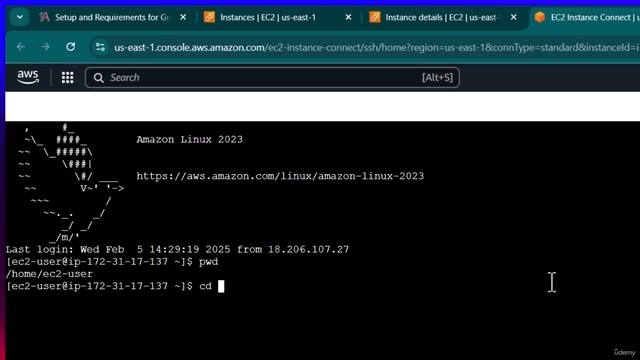

先看一眼现在的「病情」：浏览器打开 `http://<EC2公网IP>:3000`，**不登录**就能进 Grafana，还能点开 Connections → Data sources 随意加数据源。

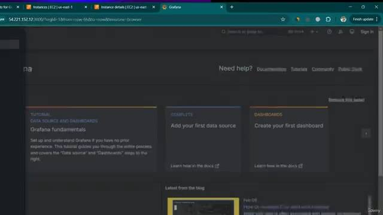

### 步骤 2：删掉匿名登录的两个环境变量（P3）

```bash
vi docker-compose.yml     # 用 nano 也行，步骤一样
```

在 `grafana` 服务的 `environment` 里找到这两行，**直接删掉**（或者注释掉）：

```yaml
      - GF_AUTH_ANONYMOUS_ENABLED=true
      - GF_AUTH_ANONYMOUS_ORG_ROLE=Admin
```

保存退出（`vi` 是 `Esc` → `:wq` → 回车）。删完的完整文件见第 4 节。

### 步骤 3：重启栈，验证匿名访问已失效

```bash
docker compose stop          # 只停容器
# 此时刷新浏览器，页面打不开了 —— 说明 Grafana 确实停了

docker compose down          # 停容器 + 删掉 compose 创建的 network
docker compose up -d         # 后台重新拉起
```

> 讲师对 `stop` 和 `down` 都演示了一遍：`stop` 只停容器，`down` 还会把 compose 建的 network 清掉。日常改配置用 `up -d`（它会自己重建有变化的容器），要彻底重来才用 `down`。

再访问 `http://<IP>:3000`，这次应该弹登录页：

- 用户名 `admin`
- 密码 `admin`（默认）
- 登录后 Grafana 强制要求改密码，随便设一个（**记下来**，步骤 8 要用它验证持久化）

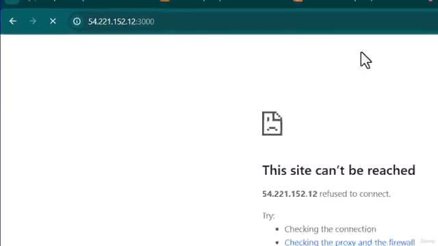

✅ **验证点**：不登录进不去了；用 `admin/admin` 能进并要求改密码。

### 步骤 4：加 `GF_SERVER_ROOT_URL`（P4 第一步）

还是在 `grafana` 的 `environment` 下，新增一行（把域名换成你自己的）：

```yaml
      - GF_SERVER_ROOT_URL=https://grafana.你的域名.com
```

> 课里这一段是让「把文档里的 `example.com` 换成自己的域名」后粘贴进去的（p004 [02:57]–[03:45]）。讲师的原文档写的是 `grafana.example.com` 这种形式，**具体是否带 `https://` 前缀逐字稿没有念出来**；按 Grafana 官方要求这里要写**完整 URL（含协议）**，本文按 `https://` 写。

然后 `docker compose up -d` 让配置生效。

### 步骤 5：加 DNS 记录（Cloudflare）

Cloudflare → 你的域名 → DNS → Add record，加两条 **A 记录**，值都是 EC2 的**公网 IP**：

| Type | Name | IPv4 address |
|---|---|---|
| A | `grafana` | `<EC2 公网 IP>` |
| A | `loki` | `<EC2 公网 IP>` |

保存后，`grafana.你的域名.com` 和 `loki.你的域名.com` 就指向你的机器了。讲师是在 Cloudflare 里开着代理（橙色云朵）的，所以浏览器那一段的 HTTPS 由 Cloudflare 先接管。

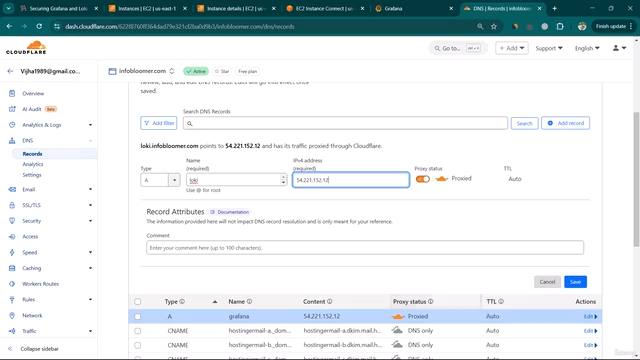

### 步骤 6：装 nginx、开安全组、确认默认页

```bash
# Amazon Linux 2023 / RHEL 系
sudo dnf install -y nginx

# Ubuntu / Debian 系
# sudo apt update && sudo apt install -y nginx

sudo systemctl start nginx
sudo systemctl enable nginx      # 开机自启
sudo systemctl status nginx
```

> 安装命令讲师是**从配套文档里复制的，逐字稿里没有念出包名**，上面按发行版给了两种写法，选一个即可。

然后去 EC2 控制台 → 安全组 → 编辑入站规则，放行 **HTTP(80)** 和 **HTTPS(443)**（来源 `0.0.0.0/0`）。课程里之前已经放行过 3000，现在再加这两条。

浏览器打开 `http://<EC2 公网 IP>`，应该看到 nginx 的欢迎页。

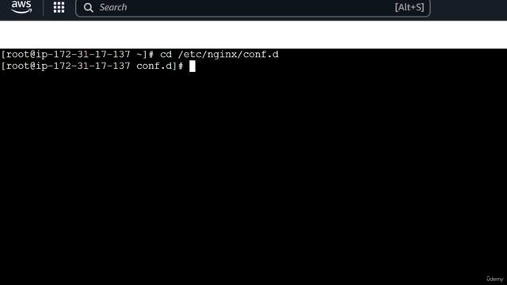

### 步骤 7：写两个 nginx 站点配置

```bash
cd /etc/nginx/conf.d
ls                     # 默认是空的
sudo vi grafana.conf   # 内容见第 4 节
sudo cp grafana.conf loki.conf
sudo vi loki.conf      # 把 server_name 和 proxy_pass 改成 loki 的
sudo systemctl restart nginx
```

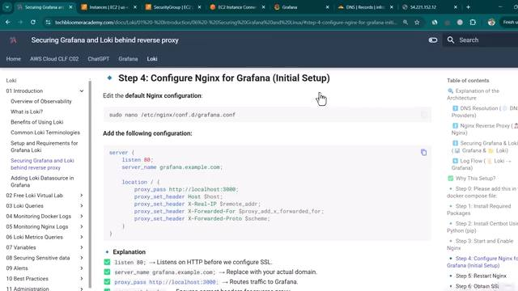

✅ **验证点**：
- `https://grafana.你的域名.com` → Grafana 登录页（内容与第 4 节的两个文件一一对应）
- `https://loki.你的域名.com/metrics` → 一大坨 Loki 指标（讲师在 p004 [09:23] 就是这么验的）

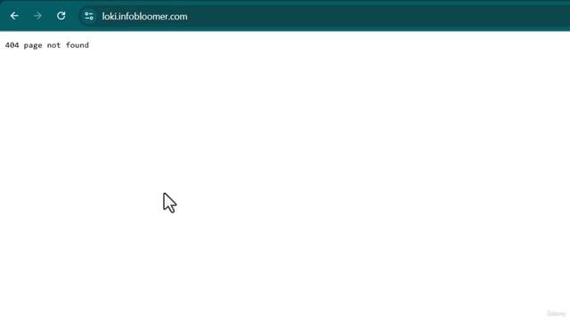

### 步骤 8：certbot 签证书，Cloudflare 改 Full

```bash
# 装 certbot 与 nginx 插件（同样按发行版二选一）
sudo dnf install -y certbot python3-certbot-nginx
# sudo apt install -y certbot python3-certbot-nginx

certbot --version        # 讲师机器上输出 certbot 3.1.0

# 第一个域名：会问邮箱、同意条款、是否接收邮件
sudo certbot --nginx -d grafana.你的域名.com

# 第二个域名：同一主域下的子域，复用上面的信息，不再问邮箱
sudo certbot --nginx -d loki.你的域名.com
```

certbot 会**自动改写** `grafana.conf` / `loki.conf`，加上 443、证书路径等（配置由 certbot 托管，**实际内容以你机器上 cat 出来的为准**）。

然后 Cloudflare → SSL/TLS → Configure → Custom SSL/TLS，把加密模式从 **Flexible** 改成 **Full**，Save。改完浏览器地址栏是锁标，Cloudflare → 源站这一段也变成 HTTPS 了。

✅ **验证点**：`https://grafana.你的域名.com` 用改过的密码能登录，地址栏是安全连接。

### 步骤 9：给 Loki 和 Grafana 挂持久化卷（P5）

**先复现故障**（强烈建议做一遍，记忆深刻）：在 Grafana 里随手指建一个 dashboard 保存成 `my first dashboard`，然后：

```bash
docker compose down
docker compose up -d
```

刷新浏览器 → 你改的密码登不进去了，只能用 `admin/admin` 登；进去后 Dashboards 空空如也。

然后修：

1. `loki` 服务下加 `volumes: - loki-data:/loki`
2. `grafana` 服务下加 `volumes: - grafana-data:/var/lib/grafana`
3. 文件末尾加顶层 `volumes:`

```bash
docker compose down
docker compose up -d
```

再登录 `admin/admin`、改密码、建一个 `my first dashboard`，然后**再来一次** `down` + `up -d`：

✅ **验证点**：用**新密码**能登录，Dashboards 里 `my first dashboard` 还在 → 持久化成功。

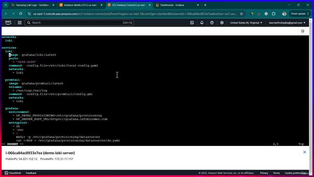

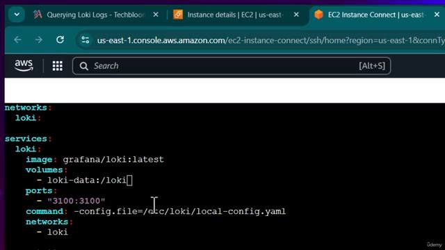

### 步骤 10：Grafana UI 导览验收（P6）

用 `admin/admin` 登录一次，挨个点一遍左侧菜单，对照第 6 节的检查清单打勾。

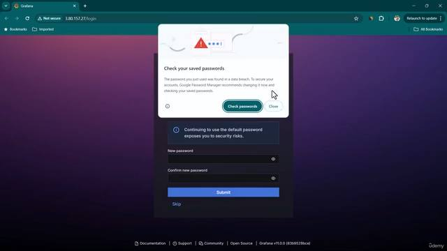

---

## 4. 完整代码

### 4.1 `/home/ec2-user/loki/docker-compose.yml`（P3–P5 全部做完后的最终形态）

```yaml
# /home/ec2-user/loki/docker-compose.yml
# 说明：P1–P2 建立的原始内容逐字稿未完整给出，
#      下面 Promtail/Loki 的镜像与启动参数为按官方单机用法补全，
#      P3/P4/P5 的改动点用注释标出（这些是本课的核心）。

services:
  loki:
    image: grafana/loki:3.1.0
    container_name: loki
    command: -config.file=/etc/loki/local-config.yaml
    ports:
      - "3100:3100"
    volumes:
      - loki-data:/loki                    # ← P5 新增

  promtail:
    image: grafana/promtail:3.1.0
    container_name: promtail
    command: -config.file=/etc/promtail/config.yml
    volumes:
      - /var/log:/var/log:ro
      - ./promtail-config.yml:/etc/promtail/config.yml:ro
    depends_on:
      - loki

  grafana:
    image: grafana/grafana:11.0.0
    container_name: grafana
    ports:
      - "3000:3000"
    environment:
      # ↓↓ P3：这两行被删掉了（匿名登录 + 匿名用户拿 Admin）
      # - GF_AUTH_ANONYMOUS_ENABLED=true
      # - GF_AUTH_ANONYMOUS_ORG_ROLE=Admin
      # ↓↓ P4：新增，域名换成你自己的
      - GF_SERVER_ROOT_URL=https://grafana.example.com
    volumes:
      - grafana-data:/var/lib/grafana      # ← P5 新增

volumes:
  loki-data:
  grafana-data:
```

> 版本号说明：讲师只明确说过 **Grafana 11**（p006 [03:33]），具体小版本号课里没讲，这里写 `11.0.0`；Loki/Promtail 用与 Grafana 11 同期的 `3.1.0`。你可以按需改，但三个镜像建议同代。

### 4.2 `/home/ec2-user/loki/promtail-config.yml`

```yaml
# /home/ec2-user/loki/promtail-config.yml
# 说明：P1–P2 的内容，本课未改动；课里没讲过这份配置的细节，
#      下面是一份可直接跑的最小可用配置。

server:
  http_listen_port: 9080
  grpc_listen_port: 0

positions:
  filename: /tmp/positions.yaml

clients:
  - url: http://loki:3100/loki/api/v1/push

scrape_configs:
  - job_name: varlogs
    static_configs:
      - targets:
          - localhost
        labels:
          job: varlogs
          __path__: /var/log/*log
```

### 4.3 `/etc/nginx/conf.d/grafana.conf`（certbot 之前）

```nginx
# /etc/nginx/conf.d/grafana.conf
server {
    listen 80;
    server_name grafana.你的域名.com;

    location / {
        proxy_pass http://localhost:3000;

        # 课里只念了 server_name 和 proxy_pass 两行，
        # 下面四行是让 Grafana 知道"用户真实访问的是什么域名/协议"所必需的，课里没讲。
        proxy_set_header Host              $host;
        proxy_set_header X-Real-IP         $remote_addr;
        proxy_set_header X-Forwarded-For   $proxy_add_x_forwarded_for;
        proxy_set_header X-Forwarded-Proto $scheme;
    }
}
```

### 4.4 `/etc/nginx/conf.d/loki.conf`（certbot 之前）

```nginx
# /etc/nginx/conf.d/loki.conf
# 由 grafana.conf 复制而来，只改了两处：server_name 和 proxy_pass 的端口
server {
    listen 80;
    server_name loki.你的域名.com;

    location / {
        proxy_pass http://localhost:3100;

        proxy_set_header Host              $host;
        proxy_set_header X-Real-IP         $remote_addr;
        proxy_set_header X-Forwarded-For   $proxy_add_x_forwarded_for;
        proxy_set_header X-Forwarded-Proto $scheme;
    }
}
```

### 4.5 certbot 跑完之后的样子（示意，**以你机器上 `cat` 出来的为准**）

```nginx
# /etc/nginx/conf.d/grafana.conf（certbot 改写后）
server {
    server_name grafana.你的域名.com;
    location / {
        proxy_pass http://localhost:3000;
        proxy_set_header Host              $host;
        proxy_set_header X-Real-IP         $remote_addr;
        proxy_set_header X-Forwarded-For   $proxy_add_x_forwarded_for;
        proxy_set_header X-Forwarded-Proto $scheme;
    }

    listen 443 ssl; # managed by Certbot
    ssl_certificate     /etc/letsencrypt/live/grafana.你的域名.com/fullchain.pem; # managed by Certbot
    ssl_certificate_key /etc/letsencrypt/live/grafana.你的域名.com/privkey.pem;   # managed by Certbot
}

server {
    if ($host = grafana.你的域名.com) {
        return 301 https://$host$request_uri;
    } # managed by Certbot

    listen 80;
    server_name grafana.你的域名.com;
    return 404; # managed by Certbot
}
```

> 讲师在 p004 [12:45] 说 certbot「自动检测到我们的配置文件并做了修改」，然后 `cat /etc/nginx/conf.d/grafana.conf` 确认「SSL certificates 被 Certbot 管理」。具体行文由 certbot 版本决定，**不要手抄上面的路径**，以 `sudo cat /etc/nginx/conf.d/grafana.conf` 的实际输出为准。

### 4.6 一键自检脚本（可选）

```bash
#!/usr/bin/env bash
# save.sh —— 保存后跑一遍，四项全绿再打开浏览器
set -u
DOMAIN="你的域名.com"

echo "== 容器 ==";      docker compose ps
echo "== Grafana ==";   curl -s -o /dev/null -w "%{http_code}\n" http://localhost:3000/login
echo "== Loki ==";      curl -s -o /dev/null -w "%{http_code}\n" http://localhost:3100/ready
echo "== nginx ==";     sudo nginx -t
echo "== 证书 ==";      echo | openssl s_client -servername "grafana.$DOMAIN" -connect "grafana.$DOMAIN:443" 2>/dev/null | openssl x509 -noout -dates
```

---

## 5. 逐行解释

### 5.1 `GF_AUTH_ANONYMOUS_ENABLED` / `GF_AUTH_ANONYMOUS_ORG_ROLE`

```yaml
- GF_AUTH_ANONYMOUS_ENABLED=true      # 允许「没有账号」的人直接以匿名身份进站
- GF_AUTH_ANONYMOUS_ORG_ROLE=Admin    # 给这个匿名身份什么角色 —— Admin 就是最高权限
```

Grafana 的环境变量命名规则是 `GF_` 前缀 + 配置段 + 配置项，下划线分隔。这两个变量拼起来就是 `[auth.anonymous] enabled / org_role`。值 `Admin` 意味着**任何一个知道你 IP 的人**都能进后台改数据源、加用户、删 dashboard。

**在 JS/Node 里对应什么**：相当于你写了这么一段中间件，然后把它挂在了所有路由最前面：

```js
// 自杀式中间件，等价于 GF_AUTH_ANONYMOUS_ENABLED=true + ORG_ROLE=Admin
app.use((req, res, next) => {
  if (!req.user) req.user = { name: 'anonymous', role: 'admin' };
  next();
});
```

删掉这两行后，Grafana 回到默认行为：没登录 = 401 → 跳登录页。首次启动的默认账号密码都是 `admin`，第一次登录会强制改密。

### 5.2 `GF_SERVER_ROOT_URL`

```yaml
- GF_SERVER_ROOT_URL=https://grafana.example.com
```

Grafana 需要知道「用户是从哪个 URL 访问我的」，因为它要把这个值拼进重定向、静态资源路径、邮件里的链接。

**在 JS/Node 里对应什么**：等价于前端的 `PUBLIC_URL` / `basePath`，或者 Express 里的 `app.set('trust proxy', 1)` + 反向代理头。级联思考：反代没配对会导致「登录完一直跳回登录页」，本质就是 root_url 和实际访问域名不一致造成的 Cookie/重定向域不匹配。

### 5.3 nginx 的 `server_name` + `proxy_pass`

```nginx
server {
    listen 80;
    server_name grafana.你的域名.com;     # 只匹配这个域名发来的请求
    location / {
        proxy_pass http://localhost:3000; # 原样转给本机 3000 端口
    }
}
```

`conf.d/` 下的每个 `.conf` 都是一个**虚拟主机**：nginx 收到请求，先看 `Host` 头，哪个 `server_name` 匹配就用哪个块。所以 `grafana.x.com` 进 3000、`loki.x.com` 进 3100 —— 一个 80 端口，两个后端，这就是讲师说的「nginx 知道该转给谁」。

**在 JS/Node 里对应什么**：就是 `http-proxy-middleware` 的路由表：

```js
app.use('/grafana', createProxyMiddleware({ target: 'http://localhost:3000' }));
app.use('/loki',    createProxyMiddleware({ target: 'http://localhost:3100' }));
```

区别只是 nginx 按**域名**分流，Node 的中间件通常按**路径**分流。

### 5.4 `proxy_set_header` 四行（课里没讲，但必须加）

```nginx
proxy_set_header Host              $host;              # 保留原始域名，Grafana 用它判断 root_url
proxy_set_header X-Real-IP         $remote_addr;       # 真实客户端 IP
proxy_set_header X-Forwarded-For   $proxy_add_x_forwarded_for;  # 代理链
proxy_set_header X-Forwarded-Proto $scheme;            # 告诉后端"用户那边是 https"
```

没有 `X-Forwarded-Proto`，Grafana 会以为用户在访问 http，于是把 https 页面里的资源重定向到 http，浏览器直接拦掉（混合内容警告）。

### 5.5 `volumes` 的三层写法

```yaml
services:
  loki:
    volumes:
      - loki-data:/loki      # ① 服务里声明"容器内 /loki 用名为 loki-data 的卷"
volumes:
  loki-data:                 # ② 文件顶层必须声明这个卷，否则 compose 报错
```

- 冒号左边是**宿主机侧的名字**（`loki-data` 是命名卷；`./xxx:/yyy` 这种是绑定挂载）。
- 冒号右边是**容器内路径**，必须是镜像真正写数据的地方：Loki → `/loki`，Grafana → `/var/lib/grafana`。
- 顶层 `volumes:` 是**卷的声明区**，不写会报 `Service "loki" refers to undefined volume loki-data`。

**在 JS/Node 里对应什么**：容器的可写层 = 一个 `node:20` 容器里的 `/app/node_modules`，`docker compose down` 就像把整个 `node_modules` 删了重装；命名卷 = 把数据目录 `-v ./data:/app/data` 挂到宿主机上，容器删了数据还在。类似 SQLite 的 `.db` 文件放宿主机 vs 放容器。

> 关于「锁/事务/并发」：本课没有涉及数据库锁或事务。唯一需要理解的「并发」概念是——**两个容器同时往同一个命名卷写**会出问题，所以 Loki 和 Grafana 各用各的卷，别共用。

### 5.6 `loki.conf` 里唯一的改动

```nginx
server_name loki.你的域名.com;    # 从 grafana. 改成 loki.
proxy_pass http://localhost:3100; # 从 3000 改成 3100
```

讲师在 [08:56] 特别回头改了一次 `server_name`，因为直接用 `cp` 复制过来忘了改，导致 `loki.x.com` 的请求还是匹配到 grafana 那个块。**这是自动补全最容易漏的一行**。

---

## 6. 复现检查清单

| # | 检查项 | 怎么验 | 期望结果 |
|---|---|---|---|
| 1 | 匿名访问已关闭 | 隐身窗口打开 `https://grafana.你的域名.com` | 弹登录页，不是直接进首页 |
| 2 | 匿名 Admin 已关闭 | 未登录状态访问 `/connections/datasources` | 被踢回登录页 |
| 3 | `GF_SERVER_ROOT_URL` 生效 | 登录后看浏览器地址栏 | 一直是 `https://grafana.你的域名.com/...`，不会跳回 IP:3000 |
| 4 | DNS 生效 | `dig +short grafana.你的域名.com` | 返回 EC2 公网 IP（或 Cloudflare 的代理 IP） |
| 5 | nginx 配置语法 | `sudo nginx -t` | `syntax is ok` / `test is successful` |
| 6 | Grafana 反代 | `curl -I http://localhost:3000/login` | 200 |
| 7 | Loki 反代 | 浏览器 `https://loki.你的域名.com/metrics` | 有指标文本输出 |
| 8 | 安全组 | EC2 入站规则 | 80 / 443 / 3000 / 3100 / 22 都在 |
| 9 | 证书签发 | `sudo certbot certificates` | 两个域名各一条，未过期 |
| 10 | 端到端加密 | Cloudflare → SSL/TLS | 模式为 **Full**（不是 Flexible） |
| 11 | 卷已挂载 | `docker inspect loki --format '{{json .Mounts}}'`（字段名以实际输出为准） | 能看到 `/loki` 对应一个卷 |
| 12 | 数据持久化 | 建 dashboard → `docker compose down && up -d` → 重新登录 | 新密码能登、dashboard 还在 |
| 13 | Loki 数据持久化 | 重启后再查一次日志 | 历史日志仍可查（`/loki` 卷生效） |
| 14 | Explore 能出数据 | Explore → 选 Loki → 选 job → Logs | 有日志行 |
| 15 | UI 菜单齐全 | 左侧菜单 | Dashboards / Explore / Metrics / Alerts / Connections / Administration / Users and access 都在 |

**P6 UI 导览对照表**（点一遍，知道它是干什么的就行）：

| 菜单位置 | 作用 | 本课/后续会用到 |
|---|---|---|
| Grafana 图标 | 回首页 | — |
| 折叠按钮 | 收起/展开侧栏 | — |
| Starred | 收藏（置顶）常用 dashboard | — |
| Dashboards | 新建 dashboard、建文件夹、导入 JSON、Playlist（多个 dashboard 轮播，每个停留 N 秒）、Snapshot | P5 建 `my first dashboard` 就在这 |
| Explore | 临时查数据、跑查询、看原始数据 | 验证 Loki/Prometheus 接入 |
| Metrics（Grafana 11 新增） | 10 版本没有的入口 | — |
| Alerts | Alert rules（阈值/条件）、Contact points（邮件/Telegram 群）、Notification policies（多久发一次、发给谁）、Silences（静音）、Groups | 后续告警课 |
| Connections | 数据源列表 → Add new data source → 填 URL → Save & test | 接 Prometheus / InfluxDB / MySQL / PostgreSQL / Splunk / Dynatrace |
| Administration | Settings → General（能看到 SMTP 等默认配置与实际值）、Plugins and data（装插件） | 管理员专用 |
| Users and access | Users（建用户）、Teams（按部门分组、组级授权）、Service accounts（给外部程序生成 token 调 Grafana API） | 团队协作 / 自动化 |
| 右上 `+` | 快速新建 dashboard / 导入 dashboard / 建告警规则 | — |
| 右上帮助 | 版本信息、社区、文档、快捷键 | 查版本（Grafana 11） |
| 右上 RSS | Grafana 官方博客动态 | — |
| 右上头像 | 改密码、改资料、Sign out | P5 验证持久化时用到 |
| 首页搜索框 | 直接跳转到任意功能（比如直接搜 Users） | — |

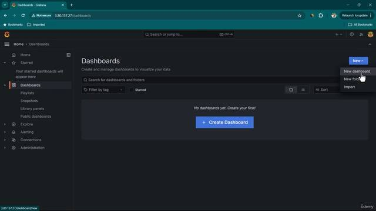

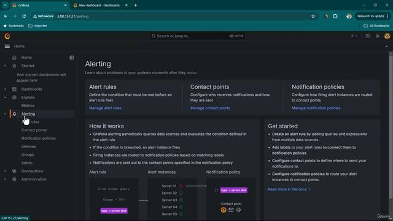

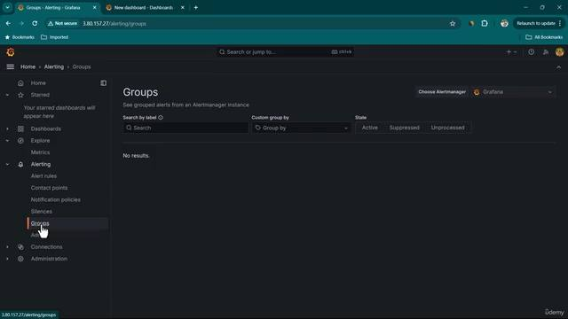

---

## 7. 课里没讲但你会撞上的

1. **`docker compose down -v` 会连卷一起删。** 讲师只用了 `down`（保留卷）。加了 `-v` 之后，`loki-data` / `grafana-data` 全清，你的验证会「莫名其妙失败」。排查顺序：先确认命令里没有 `-v`，再 `docker volume ls` 看卷还在不在。
2. **Cloudflare 用 Flexible 会出现「https 页面里的 http 请求」**。Flexible 下 Cloudflare → 源站是 HTTP，而 `GF_SERVER_ROOT_URL` 你写的是 `https://`，两者不一致时可能登录后反复跳登录页。要么像课程一样签证书改 Full，要么临时把 root_url 写成 `http://`（不推荐）。课程选的是前者。
3. **certbot 有频率限制。** 同一域名一周内签发次数有限，调试时别反复删了重签。调试阶段可以先用 `--dry-run`：
   ```bash
   sudo certbot --nginx -d grafana.你的域名.com --dry-run
   ```
4. **`/etc/nginx/conf.d` 是空的，但 80 端口仍然有页面。** 因为 `listen 80 default_server` 写在 `/etc/nginx/nginx.conf` 里。你加的站点配置是**追加**虚拟主机，不是替换默认主机。
5. **证书续期不会自动生效到浏览器如果你的 nginx 没 reload。** certbot 安装时一般会装好定时任务，可手动确认：
   ```bash
   sudo certbot renew --dry-run
   systemctl list-timers | grep certbot
   ```
6. **Loki 本身没有认证。** 课程里只给 Grafana 关了匿名、加了 HTTPS，但 `loki.你的域名.com/metrics` 是**谁都能访问**的（讲师就是这么直接打开确认的）。生产环境要么只在内网暴露 Loki，要么在 nginx 层加 `allow/deny` 或 basic auth。课里没讲这部分。
7. **Grafana 容器的文件权限。** 挂载 `/var/lib/grafana` 后如果 dashboard 存不下来，检查宿主机卷的属主（Grafana 镜像内是 grafana 用户，UID 通常是 472）。课里没讲，遇到 `permission denied` 就往这查。
8. **Grafana Live（实时推送）走 WebSocket。** 课里没提过 WebSocket，但用 nginx 反代 Grafana 时，`/api/live/ws` 需要 `Upgrade` / `Connection` 头，否则实时面板连不上。解决办法是在 `location` 里补：
   ```nginx
   proxy_http_version 1.1;
   proxy_set_header Upgrade $http_upgrade;
   proxy_set_header Connection "upgrade";
   ```
   本课没用到实时面板，不加也能跑通全部验收项。
9. **安全组和系统防火墙是两道门。** AWS 安全组放行了 80/443，机器上如果还开着 `firewalld`（Amazon Linux 2023 有时会），浏览器还是打不开。`sudo systemctl status firewalld` 看一眼。
10. **`docker compose` vs `docker-compose`。** 讲师用的是带空格的 v2 插件写法 `docker compose`，老教程的 `docker-compose`（v1，有连字符）在多数新机器上已经装不上了。命令照抄带空格的。
11. **`Metrics` 菜单在 Grafana 10 上看不到。** 讲师在 p006 [03:33] 明确说这是 Grafana 11 新增的。如果你按本文跑出来没有这一项，先看右上帮助里的版本号。
12. **Service Account 的 token 只显示一次。** 关掉弹窗就再也看不到了，只能重新建一个。要做 CI/CD 调 Grafana API 的话，生成后立刻写进密钥管理里。