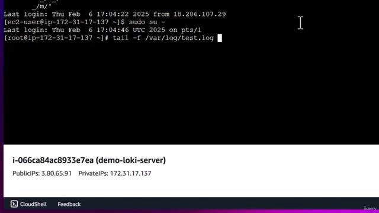
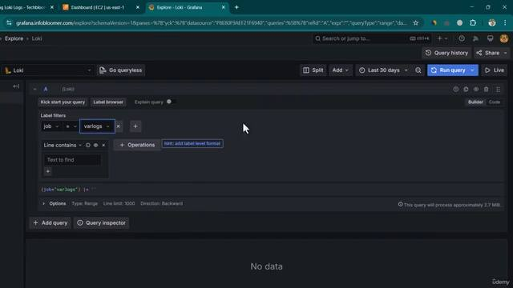
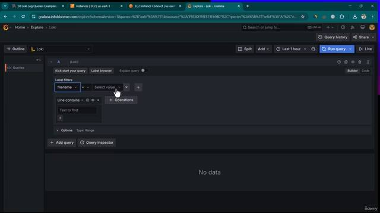
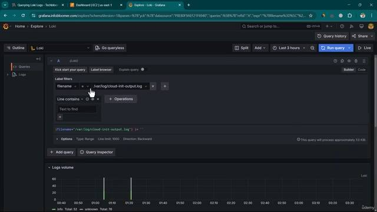
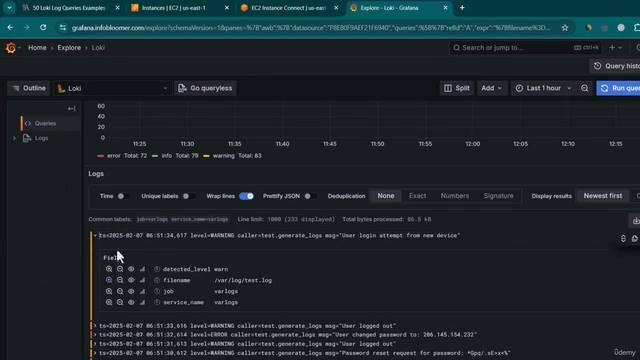
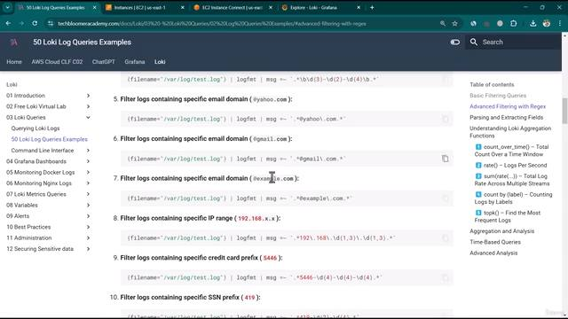
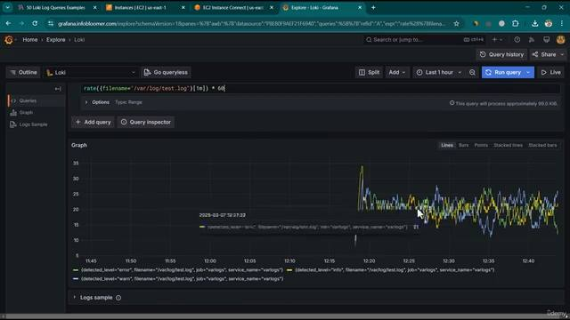

# Loki & Grafana 查询实战（基于 P7–P9）

## 1. 这一节做什么

P7–P9 的核心是：**把日志从 Loki 里查出来，并且查得快、查得准**。  
你会动手做这几件事：

1. 用 Grafana 的 Explore 面板查询 Loki 日志；
2. 写 LogQL：标签过滤、行过滤、`logfmt` 解析、正则提取；
3. 跑一个 Python 脚本生成测试日志，故意造出 `INFO / WARNING / ERROR` 日志，里面带 `email`、`IP`、`credit card` 等字段；
4. 用聚合函数做“每 5 分钟日志量”“每秒日志速率”等统计；
5. 为下一步做 Dashboard 准备好所有 LogQL 查询。

> 本课时不涉及锁、事务、并发。前端读者可以把 LogQL 理解成「对日志数组做 filter / map / reduce」：`{标签过滤器}` 是选数组，`| logfmt` 是 map 出字段，`sum by (level)` 是 reduce 分组统计。

这一节的目标不是背语法，而是建立一条稳定的查询思路：先缩小时间范围，再选日志流，再做行过滤，然后解析字段，最后才做正则和聚合。这个顺序既能减少 Loki 扫描的数据量，也能减少 Grafana 页面上的等待时间。对前端读者来说，可以把它类比成先根据路由参数拿到一个列表，再用字符串条件过滤，再用解析器把非结构化文本变成对象，最后用 `groupBy` 和 `reduce` 得到统计结果。每一步都应该有明确目的，不要一上来就把所有过滤条件堆在一起，否则查不到数据时很难判断是哪一步出了问题。

本节还会反复出现“先验证有没有数据，再验证字段有没有解析出来，最后验证聚合结果是否符合预期”的排查方式。你可以在 Grafana Explore 里一条一条运行查询，观察日志行、字段展开结果和图表曲线。只要某个中间查询没有结果，就先停下来检查前置条件，而不是继续叠加更复杂的 LogQL。

---

## 2. 讲师原话

> "绝不要尝试查询实际上并不需要的数据。"
> —— p007 [01:45]

> "我们应该始终先应用时间范围过滤器，再应用标签过滤器，然后应用行过滤器，最后始终应用解析器表达式。"
> —— p007 [07:00]

> "我们应该避免使用正则表达式，因为它们速度更慢。"
> —— p007 [05:57]

> "现在请记住，这是一个正则表达式解析器。"
> —— p009 [05:03]

> "对于按时间计数聚合，我们不能使用分组。所以我们可以先求和，然后再执行分组。"
> —— p009 [19:59]

这些原话对应到实际查询时，可以理解为几条操作原则。第一，查询范围要尽量小，不要查当前练习不需要的数据。第二，查询条件有先后顺序：时间范围、标签过滤、行过滤、解析表达式。第三，正则虽然灵活，但成本更高，能不用就不用。第四，`regexp` 是正则解析器，写它的时候要意识到自己正在做正则匹配和字段提取。第五，`count_over_time` 不能直接像 `sum by` 那样分组，需要先聚合再分组。前端读者可以把这些原则类比成：先缩小数组范围，再用低成本条件过滤，最后才用正则或复杂解析；复杂逻辑越靠后，越容易定位问题。

---

## 3. 从零复现

### 3.1 前提条件

本课程假设你已经有一套能跑的：

- Loki
- Grafana
- Promtail

并且 Promtail 已经配置为抓取：

```text
/var/log/test.log
```

如果这个文件路径不在 Promtail 配置里，后文所有查询都会查不到数据。  
课程里没有重新讲 Promtail 配置，这一步如果卡住，请先检查 Promtail 的 `scrape_configs`。

检查时不要只看 Grafana 页面，因为 Grafana 没数据不一定代表 Loki 坏了，也可能是 Promtail 没有采集到文件，或者采集到了但没有打上你查询时使用的标签。你需要确认三件事：日志文件是否真的在持续写入、Promtail 是否正在运行并读取该文件、Loki 中是否能通过对应标签查到日志。课程环境里查询使用的是 `filename` 标签，所以如果 Promtail 配置出来的标签名不是 `filename`，就要把后文查询里的标签替换成你环境里实际存在的标签。对前端读者来说，这就像你请求接口时用了错误的 query 参数名：接口本身可能正常，但参数名不对就返回空结果。

### 3.2 生成测试日志

课程里讲师用了一个 Python 脚本来随机生成测试日志。  
**逐字稿里没有给出这个脚本的完整源码**，下面这个脚本是按照课程描述还原的等价实现，能生成可用于练习的日志。

先 SSH 登录你的 EC2，并切到 root：

```bash
sudo su -
```

`sudo su -` 的作用是切换到 root 用户，并加载 root 的环境。之所以先切 root，是因为 `/var/log/test.log` 这类路径在 Linux 上通常需要较高权限才能写入。执行后命令提示符通常会发生变化，表示当前已经是 root 会话。如果这一步提示没有权限，说明当前账号没有 sudo 权限，需要换有权限的账号或让环境管理员处理。

创建脚本：

```bash
vi /tmp/test.py
```

`vi /tmp/test.py` 会打开编辑器创建或编辑 `/tmp/test.py`。把第 4 节的 `test.py` 完整内容粘贴进去，保存退出。常见问题是粘贴不完整、缩进被破坏、或者文件保存到了其他路径。保存后可以用 `ls -l /tmp/test.py` 确认文件存在，用 `python3 -m py_compile /tmp/test.py` 检查语法是否能通过。

把第 4 节的 `test.py` 完整内容粘贴进去，保存退出。

第一个 SSH 会话里运行：

```bash
python3 /tmp/test.py
```

`python3 /tmp/test.py` 会启动脚本，脚本进入 `while True` 循环后不会主动退出，所以这个终端会被占用。它不会把日志打印到终端，而是写入 `/var/log/test.log`，因此终端看起来“没有输出”并不一定是失败；只要没有报错并且进程还在运行，就继续用第二个会话查看日志。如果命令立刻返回，或者出现 `Traceback`，就说明脚本有语法错误、路径权限问题或 Python 环境问题。

第二个 SSH 会话里查看日志：

```bash
sudo su -
tail -f /var/log/test.log
```

`tail -f` 会持续跟踪文件末尾，新追加的日志会不断显示出来。按 `Ctrl+C` 可以退出跟踪。如果提示 `No such file or directory`，优先检查第一个会话里的脚本是否还在运行，以及路径是否确实是 `/var/log/test.log`；如果提示 `Permission denied`，检查当前用户是否有读权限，必要时用 root 会话查看。

你会看到类似下面的日志不断出现：

```text
level=INFO message="user alice logged in email alice.123@gmail.com ip 192.168.1.5" color=blue
level=ERROR message="failed login attempt for bob email bob.7@yahoo.com ip 192.168.2.10" color=red
```



看到日志持续出现后，再回到 Grafana 查询。如果这里看不到新日志，后面所有 LogQL 练习都没有意义，所以这一步是后续排查的基准点。前端读者可以把 `test.py` 理解成一个 mock 数据生成器：它按照固定格式不断追加“日志对象”的文本版本，后面的 `logfmt` 解析就是把这些文本恢复成可查询的字段。

### 3.3 打开 Grafana Explore

1. 打开 Grafana；
2. 左侧菜单点 **Explore**；
3. 右上角时间选择器选择 **Last 3 hours**；
4. 默认进入 Builder 模式。



时间范围要尽量贴近日志实际产生的时间。如果你刚运行脚本几分钟，却选择 `Last 30 days`，页面可能因为范围内数据分布和查询成本问题表现得不直观；如果选择的时间范围完全错过了日志产生时间，就会显示 No data。课程里强调先选窄时间范围，就是为了减少无关数据扫描，也方便确认查询条件是否生效。

在 Builder 模式里：

1. 在 **Label filters** 中选择：
   - 字段：`filename`
   - 操作：`=`
   - 值：`/var/log/test.log`
2. 点击 **Run query**。



Builder 模式适合先确认标签和日志流是否存在。它本质上是在帮你拼一个基础 LogQL 查询。如果 Builder 里选不到 `filename`，或者选完后没有日志，先不要怀疑 LogQL 写错，而应回到 Promtail 和文件路径检查。前端读者可以把 Builder 类比成可视化筛选表单，Code 模式则是直接写原始查询语句；表单适合确认基础条件，复杂表达式再切到 Code。

然后切换到 **Code** 模式：



接下来所有 LogQL 都可以直接粘贴到 Code 模式里运行。切换后建议先保留最简单的 `{filename="/var/log/test.log"}` 运行一次，确认有数据，再逐条叠加 `|=`、`| logfmt`、字段过滤和聚合。常见错误是直接从复杂查询开始，结果页面报语法错误或 No data，却不知道是哪一段造成的。排查时可以把复杂查询拆回几个中间查询：先只留标签选择器，再加行过滤，再加解析器，最后加聚合。

---

## 4. 完整代码

### 4.1 `/tmp/test.py`

```python
#!/usr/bin/env python3
"""
生成用于 Loki 查询练习的假日志。

课程里没有给出 test.py 原文，这里是按课程描述的日志格式还原的等价实现。
运行后会一直向 /var/log/test.log 追加日志。
"""

import random
import time
from pathlib import Path

LOG_FILE = Path("/var/log/test.log")

LEVELS = ["INFO", "WARNING", "ERROR"]
COLORS = ["red", "blue", "green", "yellow", "purple"]
USERS = ["alice", "bob", "carol", "dave", "eve"]
DOMAINS = ["gmail.com", "yahoo.com", "example.com"]
ACTIONS = [
    "user logged in",
    "user registered",
    "user session expired",
    "password reset link sent",
    "failed login attempt",
    "user made payment",
]


def fake_email() -> str:
    """生成一个假邮箱。"""
    return f"{random.choice(USERS)}.{random.randint(1, 999)}@{random.choice(DOMAINS)}"


def fake_ip() -> str:
    """生成一个假 IP。"""
    return f"192.168.{random.randint(0, 255)}.{random.randint(1, 254)}"


def fake_credit_card() -> str:
    """生成一个 16 位假信用卡号。"""
    return "".join(str(random.randint(0, 9)) for _ in range(16))


def generate_log_line() -> str:
    """生成一行 logfmt 风格的日志。"""
    level = random.choice(LEVELS)
    action = random.choice(ACTIONS)
    user = random.choice(USERS)
    email = fake_email()
    ip = fake_ip()
    color = random.choice(COLORS)

    message = f"{action} for {user} email {email} ip {ip}"

    if "payment" in action:
        message += f" credit_card {fake_credit_card()}"

    return f'level={level} message="{message}" color={color}'


def main() -> None:
    LOG_FILE.parent.mkdir(exist_ok=True)
    with LOG_FILE.open("a", encoding="utf-8") as f:
        while True:
            line = generate_log_line()
            print(line, file=f, flush=True)
            time.sleep(random.uniform(0.5, 2.0))


if __name__ == "__main__":
    main()
```

这份脚本的用途是稳定生成练习数据，不需要它具备业务真实性。它每次随机选择等级、动作、用户、邮箱、IP 和颜色，拼成一行 logfmt 风格日志。`message` 字段用双引号包起来，因此 `logfmt` 解析器可以把它当成一个字段值；邮箱、IP、信用卡号放在 `message` 内部，后面才能通过正则从 `message` 中提取。运行脚本时如果出现权限错误，优先检查 `/var/log/test.log` 的写入权限；如果日志文件没有新内容，检查脚本是否还在运行、路径是否一致。

### 4.2 LogQL 查询集合

你可以把这些查询复制到 Grafana Explore 的 Code 模式里逐条运行。

```logql
# 1. 只按标签过滤
{filename="/var/log/test.log"}

# 2. 标签过滤 + 行过滤：只保留包含 INFO 的行
{filename="/var/log/test.log"} |= "INFO"

# 3. 用 logfmt 解析，并过滤 level 字段
{filename="/var/log/test.log"} | logfmt | level="INFO"

# 4. 用 logfmt 解析，过滤 message 包含 failed 的日志
{filename="/var/log/test.log"} | logfmt | message=~"failed"

# 5. 多个条件：level=ERROR，并且 message 包含 login
{filename="/var/log/test.log"} | logfmt | level="ERROR" | message=~"login"

# 6. 正则过滤：日志中包含邮箱地址
{filename="/var/log/test.log"} | logfmt | message=~"\b[A-Za-z0-9._%+-]+@[A-Za-z0-9.-]+\.[A-Za-z]{2,}\b"

# 7. 正则过滤：日志中包含 IP 地址
{filename="/var/log/test.log"} | logfmt | message=~"\b\d{1,3}(\.\d{1,3}){3}\b"

# 8. 正则过滤：日志中包含 16 位信用卡号
{filename="/var/log/test.log"} | logfmt | message=~"\b\d{16}\b"

# 9. 正则过滤：只要 @gmail.com
{filename="/var/log/test.log"} | logfmt | message=~"@gmail\.com"

# 10. 用 regexp 解析器提取 email 字段
{filename="/var/log/test.log"} | logfmt | regexp "(?P<email>[A-Za-z0-9._%+-]+@[A-Za-z0-9.-]+\.[A-Za-z]{2,})"

# 11. 提取 email 后再过滤
{filename="/var/log/test.log"} | logfmt | regexp "(?P<email>[A-Za-z0-9._%+-]+@[A-Za-z0-9.-]+\.[A-Za-z]{2,})" | email=~"alice"

# 12. 提取 IP 字段，并且 IP 不为空
{filename="/var/log/test.log"} | logfmt | regexp "(?P<ip>\d{1,3}(\.\d{1,3}){3})" | ip!=""

# 13. 每 5 分钟有多少条日志
sum(count_over_time({filename="/var/log/test.log"}[5m]))

# 14. 每秒日志速率，再乘以 60 变成每分钟速率
sum(rate({filename="/var/log/test.log"}[1m])) * 60

# 15. 按 level 分组统计每 5 分钟日志量
sum by (level) (count_over_time({filename="/var/log/test.log"} | logfmt[5m]))

# 16. 先提取 IP，再按 IP 分组统计
sum by (ip) (count_over_time({filename="/var/log/test.log"} | logfmt | regexp "(?P<ip>\d{1,3}(\.\d{1,3}){3})" [5m]))

# 17. failed login attempt 的速率
sum(rate({filename="/var/log/test.log"} | logfmt | message=~"failed login attempt"[1m]))

# 18. 出现最多的前 5 种颜色
topk(5, sum by (color) (count_over_time({filename="/var/log/test.log"} | logfmt[5m])))
```

这些查询是从简单到复杂排列的。建议一次只粘贴一条，确认结果后再换下一条。第 1 条用于确认日志流存在；第 2 到第 5 条用于练习行过滤和字段过滤；第 6 到第 9 条用于练习正则过滤；第 10 到第 12 条用于练习字段提取；第 13 到第 18 条用于练习聚合和分组。如果某条查询报解析错误，先检查大括号、竖线和引号是否完整；如果查询不报错但没有结果，先回到上一条简单查询确认数据还在产生。

---

## 5. 逐行解释

### 5.1 `test.py` 的关键行

```python
LOG_FILE = Path("/var/log/test.log")
```

日志输出路径。Promtail 必须正在抓这个文件。  
这一行使用 `Path` 表示路径，后续调用 `.parent.mkdir()` 和 `.open()` 都基于这个路径。如果 Promtail 抓的是别的文件，或者路径拼写不同，Grafana 里用 `{filename="/var/log/test.log"}` 就查不到数据。前端读者可以把它理解成 mock 服务写入的目标 endpoint，路径必须和采集端配置一致。

```python
LEVELS = ["INFO", "WARNING", "ERROR"]
COLORS = ["red", "blue", "green", "yellow", "purple"]
```

随机生成日志等级和颜色，方便后面按 `level`、`color` 分组。  
这里的值会原样写进日志，因此后面过滤时必须注意大小写。`INFO` 和 `info` 在 LogQL 字段过滤里不是同一个值。

```python
message = f"{action} for {user} email {email} ip {ip}"
```

构造 `message` 字段。邮箱和 IP 被放在 `message` 内部，这样后面才能用正则从 `message` 里提取出 `email`、`ip` 字段。  
如果邮箱或 IP 被单独写成顶层字段，后面的正则提取练习就失去意义。这里的设计是为了让你练习“从非结构化文本中提取字段”。

```python
return f'level={level} message="{message}" color={color}'
```

输出 logfmt 风格的日志行。  
LogQL 里的 `logfmt` 解析器会把这一行解析成：

- `level`
- `message`
- `color`

三个字段。

注意 `message` 的值用双引号包起来，这是 logfmt 能正确解析带空格文本的关键。如果去掉引号，解析器可能会把 `message` 后面的单词当成其他字段，导致字段缺失或值不完整。常见错误是修改脚本时误删了引号，然后 Grafana 里 `| logfmt` 展开后看不到完整的 `message`。

### 5.2 基础 LogQL

```logql
{filename="/var/log/test.log"}
```

这是 LogQL 的标签选择器，相当于 SQL 的 `FROM`。  
它只负责选日志流，不负责文本内容过滤。前端读者可以把它理解为先从一个大的日志数组中按标签筛出候选集合。这个查询应该最先运行，因为它能告诉你“当前时间范围内到底有没有日志”。

```logql
{filename="/var/log/test.log"} |= "INFO"
```

`|= "INFO"` 是行过滤器，表示“只要包含 INFO 的行”。  
类似 JS 里的 `line.includes("INFO")`。它不解析字段，只在原始日志行里做包含判断。优点是成本低、容易排查；缺点是它可能匹配到任意位置的 `INFO`，不区分字段名。

```logql
{filename="/var/log/test.log"} | logfmt | level="INFO"
```

`| logfmt` 把日志解析成字段，然后 `level="INFO"` 过滤字段。  
这里的顺序很重要：必须先 `| logfmt`，后面才能使用 `level` 字段。如果写成先过滤 `level` 再解析，LogQL 会因为字段不存在而无法按预期工作。前端读者可以理解为先 `parseLogfmt(line)` 得到对象，再执行 `obj.level === "INFO"`。

> 注意：字段值区分大小写。如果日志里是 `INFO`，你写 `level="info"` 就查不到。

常见错误是把 `logfmt` 写成 `log format`，或者忘记在字段过滤前加解析器。排查时先运行 `{filename="/var/log/test.log"} | logfmt`，展开一条日志，看字段是否出现，再添加 `level="INFO"`。

### 5.3 正则过滤

```logql
{filename="/var/log/test.log"} | logfmt | message=~"@gmail\.com"
```

`=~` 是正则匹配，`!~` 是正则不匹配。  
这里的意思是在 `message` 字段里找 `@gmail.com`。注意域名里的点号需要写成 `\.`，否则 `.` 在正则里表示任意字符。前端读者可以把它类比成 `new RegExp("@gmail\\.com").test(message)`。

常见错误是写成 `@gmail.com`，这样虽然有时也能匹配，但语义不准确；另一个常见问题是转义层级混乱，在 Grafana Code 模式里通常写 `\.`，如果查询被放进 JSON 或其他需要二次转义的场景，可能要写成 `\\.`。排查时先用普通行过滤 `|= "@gmail.com"` 确认数据里确实有该字符串，再换成正则。

### 5.4 提取字段

```logql
{filename="/var/log/test.log"} | logfmt | regexp "(?P<email>[A-Za-z0-9._%+-]+@[A-Za-z0-9.-]+\.[A-Za-z]{2,})"
```

`regexp` 解析器会把正则里 `(?P<email>...)` 捕获到的内容变成一个新的 `email` 字段。  
前端读者可以理解为：

```js
const match = line.match(/(?P<email>...)/);
if (match) fields.email = match.groups.email;
```

这里的 `(?P<email>...)` 是命名捕获组，名字必须和后面要过滤的字段名一致。如果正则没有匹配到，新的字段可能不会出现，后面的 `email=~"alice"` 也就没有结果。常见错误是捕获组名字拼错，或者正则只匹配了邮箱的一部分。排查时先只运行到 `regexp`，展开日志行看 `email` 字段是否出现，再加后续过滤。

### 5.5 聚合

```logql
sum(count_over_time({filename="/var/log/test.log"}[5m]))
```

`count_over_time` 统计每个 5 分钟桶里的日志条数。  
`sum` 把多个日志流的结果合并成总数。`[5m]` 是范围窗口，表示按 5 分钟范围做统计。前端读者可以理解为先按时间窗口分桶，再对每个桶执行计数，最后把所有流的结果相加。

```logql
sum(rate({filename="/var/log/test.log"}[1m])) * 60
```

`rate` 返回每秒日志条数。  
乘 60 就是把“每秒”转成“每分钟”。如果曲线看起来很小，先确认乘 60 是否保留；如果曲线为 0，先确认脚本是否还在产生日志、时间范围是否覆盖了数据。

```logql
sum by (level) (count_over_time({filename="/var/log/test.log"} | logfmt[5m]))
```

按 `level` 分组统计。  
相当于 JS 里的：

```js
groupBy(logs, "level").map(([level, arr]) => [level, arr.length])
```

这里必须先 `| logfmt`，否则 `level` 字段不存在。另一个常见错误是试图把 `by (level)` 直接写在 `count_over_time` 后面；课程里明确说过 `count_over_time` 不能这样分组，要用外层 `sum by (level)`。`topk` 查询也是同样思路：先按字段分组统计，再取前几名。

---

## 6. 复现检查清单

- [ ] 已确认 Promtail 正在抓取 `/var/log/test.log`  
  验证方式：先确认脚本正在写文件，再在 Grafana Explore 里用 `{filename="/var/log/test.log"}` 查询最近时间范围。如果能返回日志，说明 Promtail 到 Loki 的链路基本通了；如果没有数据，检查 Promtail 是否运行、`scrape_configs` 是否包含该路径、标签名是否真的是 `filename`。

- [ ] `python3 /tmp/test.py` 能持续运行  
  验证方式：第一个 SSH 会话执行后不应立刻退出，也不应出现 `Traceback`。由于脚本把日志写入文件而不是打印到终端，终端没有输出是正常的；用第二个会话 `tail -f` 看文件是否有新行即可。

- [ ] 另一个终端执行 `tail -f /var/log/test.log` 能看到新日志不断出现  
  验证方式：观察几秒钟，应该每隔一段时间出现一行新日志。若没有，检查脚本是否还在运行、文件路径是否一致、当前用户是否有读权限。看到日志后再去 Grafana 查询，能排除“根本没有数据”的问题。

- [ ] Grafana Explore 里 `{filename="/var/log/test.log"}` 能返回日志  
  验证方式：时间范围选 `Last 1 hour` 或 `Last 3 hours`，数据源选 Loki，Code 模式粘贴该查询。若返回 No data，先检查时间范围、标签名和数据源；不要直接叠加复杂解析器。

- [ ] 把查询切到 Code 模式后，`| logfmt` 展开日志行能看到 `level`、`message`、`color` 字段  
  验证方式：运行 `{filename="/var/log/test.log"} | logfmt`，在日志行左侧展开字段区域，确认三个字段都存在。若字段缺失，检查日志行是否是 `level=... message="..." color=...` 这种 logfmt 格式，尤其检查 `message` 的引号是否完整。

- [ ] `level="ERROR"` 后只显示 error 日志  
  验证方式：在 `| logfmt` 后加 `| level="ERROR"`，观察返回行是否都包含 `level=ERROR`。若没有结果，检查大小写是否写成 `error`，以及测试数据里是否真的产生了 ERROR。

- [ ] `message=~"failed"` 后只显示包含 failed 的日志  
  验证方式：运行后检查每条日志的 `message` 是否包含 `failed`。若结果为空，先用 `|= "failed"` 做普通行过滤确认数据存在，再换成正则字段过滤。

- [ ] `regexp "(?P<email>...)"` 后展开日志行能看到 `email` 字段  
  验证方式：先只运行到 `regexp`，展开日志行查看是否多出 `email` 字段。若没有，检查命名捕获组写法、正则转义以及 `message` 里是否确实包含邮箱。看到字段后，再加 `| email=~"alice"` 做二次过滤。

- [ ] `sum(rate({filename="/var/log/test.log"}[1m])) * 60` 能画出一条每分钟日志数的曲线  
  验证方式：切到 Graph 或 Table 视图，确认时间范围内曲线有点。若曲线为空，先回到基础查询确认有日志；若数值很小，检查是否忘记乘 60。

- [ ] `sum by (level) (count_over_time(... | logfmt[5m]))` 能按等级分组统计  
  验证方式：运行后观察图例或表格中是否出现按 `level` 分组的系列。若没有分组，检查 `| logfmt` 是否在 `count_over_time` 内部，检查外层是否是 `sum by (level)`，而不是把 `by` 写在 `count_over_time` 后面。







---

## 7 课里没讲但你会撞上的

| 现象 | 原因 | 怎么办 |
| --- | --- | --- |
| 按课程操作时找不到 `test.py` 的完整原文 | 逐字稿里说“复制这个 Python 程序”，但没有展示完整源码；第 4 节给的是按课程描述还原的等价实现 | 直接用第 4 节的脚本练习；如果你有讲师提供的配套仓库，用仓库里的原版脚本更稳妥。两者目的都是生成带 `level`、`message`、`color`、邮箱、IP、信用卡号的日志。 |
| 查询页面显示 No data | 时间范围不对，日志只产生了几分钟，却查了很大的时间窗口；或者数据源、标签选错 | 先选 `Last 1 hour` 或 `Last 3 hours`，确认脚本还在写日志，再用最简单的 `{filename="/var/log/test.log"}` 查询。不要一上来就叠加复杂解析器。 |
| `{filename="/var/log/test.log"}` 查不到数据 | `filename` 是 Promtail 配置出来的标签；如果换了日志路径，或者 Promtail 没有把 `filename` 作为 label，该查询就不成立 | 检查 Promtail 的 `scrape_configs` 和实际标签名；如果环境里用的是 `{job="varlogs"}` 之类，就改成你自己的标签。先确认标签存在，再写后续 LogQL。 |
| 写 `log format` 报错或无效 | LogQL 的关键字是 `logfmt`，不是英文短语 `log format` | 把解析器写成 `logfmt`。字段过滤必须放在解析器之后，例如先 `logfmt`，再 `level="INFO"`。 |
| `level="info"` 查不到 `level=INFO` 的日志 | 字段值区分大小写 | 按日志里的实际大小写写查询；先用 `logfmt` 展开字段确认值，再复制准确的值做过滤。 |
| 查询很慢或页面等待明显 | 正则比普通行过滤更慢；课程里明确说“avoid regular expressions as they are slower” | 能用 `|= "error"` 这类普通行过滤就不要一上来写正则；必须用正则时，尽量先缩小时间范围和标签范围。 |
| 写 `count_over_time(...) by (level)` 报错 | `count_over_time` 不能直接这样分组；课程原话是不能对 count over time aggregation 直接使用 grouping | 用外层 `sum by (level)` 包住 `count_over_time`。先确认 `logfmt` 已解析出 `level`，再做分组统计。 |
| `sum by (ip)` 结果为空或分组不对 | `ip` 字段原本不存在，必须先通过 `regexp` 从 `message` 中提取 | 先加 `regexp "(?P<ip>...)"` 提取字段，再在 `sum by (ip)` 中使用；先用不带聚合的查询展开日志行确认 `ip` 字段已经出现。 |
| 日志里的 error、warning 有颜色，但自己查询时字段不可用 | Grafana 的 detected level 功能会自动识别并着色，但这不等于 LogQL 已经解析出可过滤的 `level` 字段 | 颜色显示和字段查询是两件事；要用 `level` 过滤，仍然要先 `| logfmt` 解析。 |
| `python3 /tmp/test.py` 立刻退出或提示找不到命令 | Python 环境不可用、脚本语法错误、路径权限不足，或者命令拼写不对 | 先看终端报错；用 `python3 -m py_compile /tmp/test.py` 检查语法；确认 `/var/log/test.log` 可写。若环境没有 `python3`，按实际 Python 命令调整。 |
| `tail -f` 提示文件不存在 | 脚本没有运行、路径写错，或者日志还没创建 | 回到第一个会话确认脚本没有退出；检查 `/var/log/test.log` 是否真的存在；确认脚本里的 `LOG_FILE` 没有被改到其他路径。 |
| `tail -f` 提示 Permission denied | 当前用户没有读取该日志文件的权限 | 用有权限的账号查看，或按课程方式切到 root 会话；不要为了看日志随意修改系统文件权限。 |
| `| logfmt` 后字段缺失或 `message` 不完整 | 日志行不是合法 logfmt，常见原因是 `message` 的双引号丢失、字段之间格式被改坏 | 对照第 4 节脚本的输出格式，确认是 `level=... message="..." color=...`；先用 `tail -f` 看原始行，再在 Grafana 展开字段验证。 |
| 正则过滤邮箱、IP、信用卡号没有结果 | 正则写错、转义层级不对，或者数据里根本没有对应内容 | 先用普通行过滤确认字符串存在；再检查 `\.`、`\b`、`\d` 等转义；在 Grafana Code 模式里通常按课程查询原样粘贴，不要额外加一层转义。 |
| 复杂查询报 parse error | 大括号、竖线、引号、方括号不完整，或者解析器顺序不对 | 把查询拆回最简单形式：先 `{filename="/var/log/test.log"}`，再加 `|=`，再加 `| logfmt`，最后加聚合。每加一段运行一次，定位出错位置。 |
| Explore 里切换 Builder/Code 后查询行为不一致 | Builder 生成的是基础查询，Code 模式里可能保留了旧条件或手动改坏了语法 | 切到 Code 后先清空，只粘贴一条完整查询；确认数据源和时间范围没有变；用最简单的标签查询重新建立基准。 |

原第 7 节涉及的关键代码块保留如下：

```logql
| logfmt
```

```logql
| log format
```

```logql
count_over_time({...} | logfmt[5m]) by (level)
```

```logql
sum by (level) (count_over_time({...} | logfmt[5m]))
```

```logql
sum by (ip) (count_over_time({filename="/var/log/test.log"}[5m]))
```

这些代码块对应的结论是：解析器关键字是 `logfmt`；`count_over_time` 不能直接按上面的错误写法分组，要用外层 `sum by`；按 `ip` 聚合前必须先通过 `regexp` 提取出 `ip` 字段。遇到问题时，先回到最简单的标签查询确认有数据，再逐段加回过滤、解析和聚合，这样最容易定位是标签、行过滤、解析器还是聚合写法出的问题。