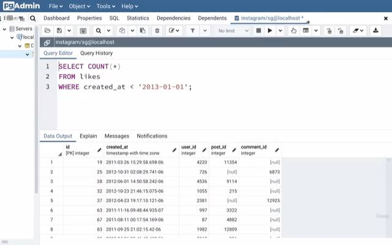
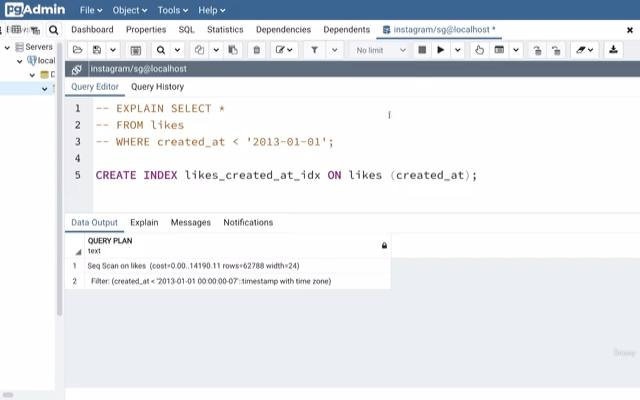
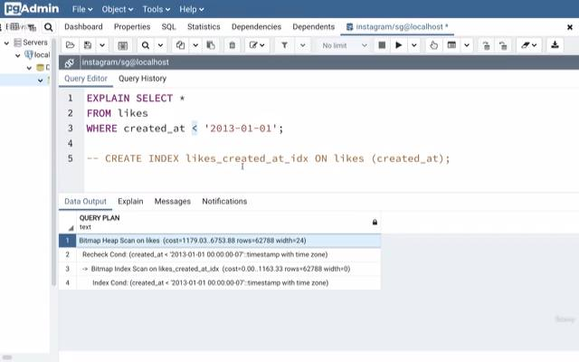
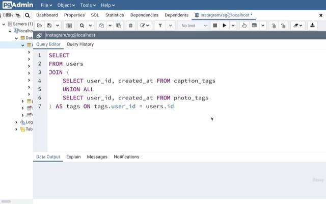
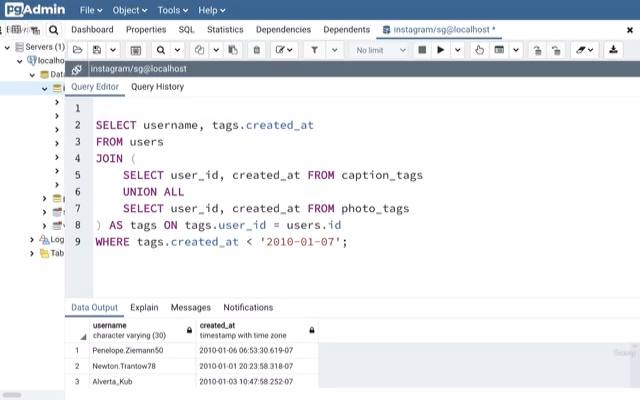
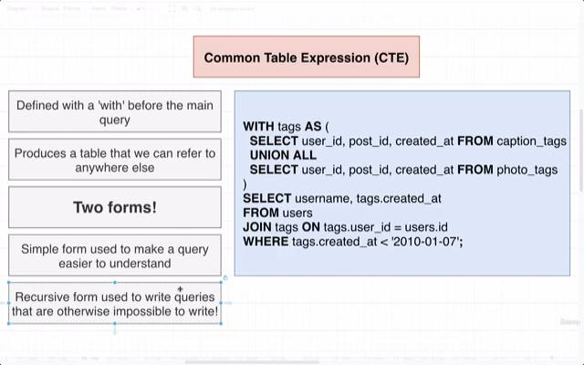
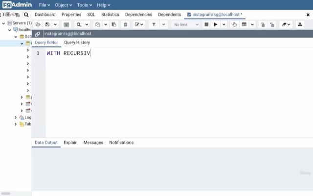
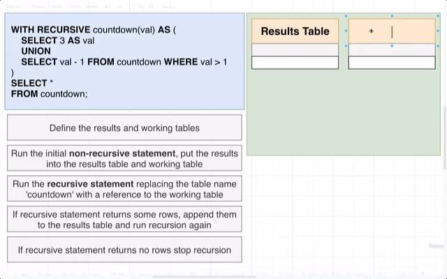
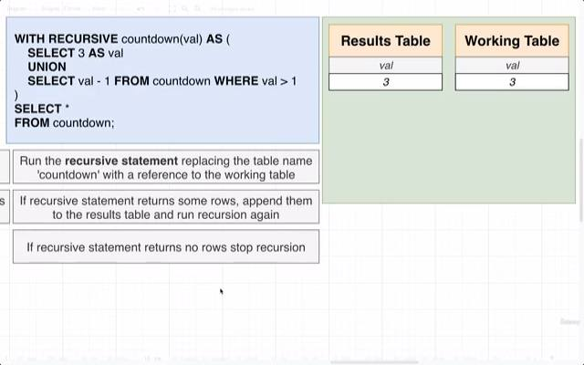

# SQL & PostgreSQL 实战文档：索引诊断、简单 CTE 与递归 CTE（P1–P6）

> 复现说明：课程里使用的是讲师已有的 Instagram 示例库，逐字稿只展示查询，没有给完整建表语句和造数脚本。下面按逐字稿中出现的 `users`、`caption_tags`、`photo_tags`、`likes` 四张表，搭一个**最小可运行复现库**。课程没讲 Docker 安装、PostgreSQL 版本、建表与造数；本文件用 Docker + SQL 脚本补齐，保证读者可以从空目录跑起来。SQL 逻辑来自 P1–P6。

---

## 1. 这一节做什么

P1–P6 实际做两件事。

第一件是 **P1 的索引实验**：对 `likes` 表的 `created_at` 字段做 `EXPLAIN ANALYZE`，先观察没有索引时的 sequential scan，再创建索引，观察查询计划是否改成索引相关节点。然后把条件从「早于 2013-01-01」改成「晚于 2013-01-01」，结果行数从大约 63,000 变成大约 688,000，Postgres 又可能放弃索引，改回顺序扫描。讲师想说明的是：**索引不是越多越好，写了索引也不等于 Postgres 一定用；要用 EXPLAIN 读计划，不要强行让数据库用索引**。

第二件是 **P2–P6 的 CTE**：先用 `caption_tags` 和 `photo_tags` 的 `UNION ALL` 子查询，查「2010-01-07 之前被 tag 的 username 和 tag 时间」；再用 `WITH tags AS (...)` 把子查询改写成简单 CTE，让 SQL 更好读。之后进入递归 CTE：用 `WITH RECURSIVE countdown(val) AS (...)` 写一个从 3 倒数到 1 的查询，并解释结果表、工作表、初始查询、递归查询、`UNION`、停止条件。

本节最终产出不是一个 Web 应用，而是一套可以反复执行的 SQL 实验环境：

```text
sql-cte-index-demo/
├── docker-compose.yml
├── init/
│   ├── 01_schema.sql
│   └── 02_seed.sql
└── sql/
    ├── 01_likes_before.sql
    ├── 02_likes_after.sql
    ├── 03_create_index.sql
    ├── 04_simple_cte.sql
    └── 05_recursive_cte.sql
```

这套目录的分工很清晰：`docker-compose.yml` 负责启动 PostgreSQL 容器；`init/01_schema.sql` 负责建表；`init/02_seed.sql` 负责造出足够的测试数据；`sql/` 下的文件分别对应索引实验、建索引、简单 CTE、递归 CTE。复现时不要把 SQL 文件当成前端代码“看一眼就懂”，而要按顺序执行，并把每次 `EXPLAIN ANALYZE` 的输出保留下来做前后对比。

从学习方式上看，这一节更接近“数据库性能小实验”，而不是“实现一个业务页面”。前端里我们常打开浏览器 DevTools，看某个请求耗时、哪个资源慢、哪个查询重复；这里则是用 `EXPLAIN ANALYZE` 看 PostgreSQL 准备怎么执行、实际扫描了多少行、花了多少时间。前端对照时可以把它理解成：**SQL 是请求，执行计划是 PostgreSQL 的“性能面板”，索引是数据库侧的一种“加速设施”，但数据库会不会用，不由开发者主观决定，而由优化器估算决定**。

需要特别提醒的是：本节的 63,000、688,000、750,000 都是按逐字稿规模复现出来的实验数据，不是业务硬性指标。你在自己机器上得到的耗时、是否走索引、节点名称可能不同，尤其是数据量小、统计信息刚更新、缓存冷热不同的时候。判断实验是否成功时，不要只盯某一个节点名，而要看三件事：扫描方式是否变化、估算行数与实际行数是否接近、查询耗时和执行次数是否在合理范围内。

---

## 2. 讲师原话（带「—— pNNN [MM:SS]」）

- 「我们先写一个查询，对 `likes` 表里 `created_at` 早于 2013-01-01 的记录做 `EXPLAIN ANALYZE`。」—— p001 [00:00]
- 「现在 `created_at` 列没有任何索引，所以只能做 sequential scan，一条一条看所有 like。」—— p001 [00:56]
- 「创建索引后，我们看到了某种索引检查，出现了 `bitmap index scan`，以及逐字稿里称为 `bitmap deep scan` 的节点；具体做什么先不展开。」—— p001 [01:55]
- 「把小于改成大于后，结果从 63,000 左右变成 688,000 左右，Postgres 又做了 sequential scan。」—— p001 [03:51] 到 p001 [04:19]
- 「索引适合找非常具体、通常很小的记录集；如果要取 70% 甚至 90% 的记录，走索引再随机回表可能更贵，顺序打开 heap file 反而更简单。」—— p001 [04:49] 到 p001 [05:48]
- 「不要强迫 Postgres 用索引。Postgres 已经算过账，认为忽略索引更高效。」—— p001 [07:11]
- 「简单 CTE 只是把子查询提到 `WITH` 里，让查询更容易读；可以用 `EXPLAIN` 证明底层计划没有变化。」—— p004 [00:00]、p004 [02:52] 到 p004 [03:21]
- 「每个递归 CTE 里都会有 `UNION`；`UNION` 上面是初始查询/非递归查询，下面是递归查询。」—— p005 [00:25]、p006 [00:00] 到 p006 [00:26]
- 「Postgres 会在后台维护 result table 和 working table；初始查询结果放进两张表，递归查询不断用 working table 计算，把结果追加到 result table，直到递归查询不返回行。」—— p006 [01:24] 到 p006 [07:40]

下面先看 P1 的索引实验截图位置：







P2–P4 的简单 CTE 与 UNION 子查询：







P5–P6 的递归 CTE：







这些截图和引用只用于定位课程里的关键观察点。截图里的具体执行计划、节点顺序、耗时、估算行数，应当以你自己 PostgreSQL 16 环境中的实际输出为准；这不影响本节要传达的结论：先看计划，再讨论索引是否值得存在。

---

## 3. 从零复现

### 3.1 前置环境

你需要：

- Docker Desktop，或 Docker Engine + Docker Compose v2。
- 一个终端。
- 至少约 1–2 GB 空闲磁盘；`likes` 表会造 750,000 行。
- 本机 `5432` 端口没有被别的 PostgreSQL 占用。如果被占用，把 `docker-compose.yml` 里的 `"5432:5432"` 改成 `"5433:5432"`，后面连接端口也要相应改。

课程里没讲 PostgreSQL 版本；本复现固定使用 `postgres:16`。不同版本的 `EXPLAIN` 输出节点名、CTE 是否内联可能不同，**以你机器实际输出为准**。

补充排查：如果执行 `docker compose up -d` 时提示 `Cannot connect to the Docker daemon`，先确认 Docker Desktop 或 Docker Engine 已经启动；如果提示 `permission denied while trying to connect to the Docker daemon socket`，说明当前用户没有 Docker socket 权限，可以改用有权限的账户，或按系统文档调整 Docker 权限。如果提示端口已被占用，不要反复重启容器，先执行 `docker compose ps` 和系统端口检查，确认是不是本机已有 PostgreSQL 或其他容器占用了 `5432`。如果你把宿主机端口改成 `5433`，容器内部 PostgreSQL 仍然是 `5432`，所以 `docker compose exec db psql` 这类“在容器内部执行”的命令不需要改端口；只有从宿主机客户端连接时才需要用 `5433`。

与前端对照：这一步类似于跑前端项目前的 Node 版本、包管理器、开发端口检查。前端项目起不来，常见原因是 Node 版本不对、端口占用、依赖没装；这里起不来，常见原因则是 Docker 没启动、端口冲突、初始化脚本报错、数据卷状态不对。先把环境检查清楚，再排查 SQL，否则很容易把环境问题误判成 SQL 问题。

### 3.2 创建目录

```bash
mkdir -p sql-cte-index-demo/init
mkdir -p sql-cte-index-demo/sql
cd sql-cte-index-demo
```

然后把第 4 节的 7 个文件分别保存到对应路径。

注意，上面命令会创建两层目录：`init/` 放初始化 SQL，`sql/` 放课堂实验 SQL。`docker-compose.yml` 必须放在 `sql-cte-index-demo/` 根目录，因为 compose 文件里的相对路径 `./init` 和 `./sql` 都是相对于 compose 文件所在目录解析的。如果你把文件放错一层，最常见的结果是容器能启动，但 `\dt` 看不到表，或者执行 `-f /sql/01_likes_before.sql` 时提示文件不存在。此时先用 `pwd` 和 `ls -R` 确认目录层级，再检查 compose 文件中的挂载路径，不要急着改 SQL。

Windows 上如果终端不支持 `mkdir -p`，可以在 PowerShell 或资源管理器中手工创建同样的目录结构；关键不是命令形式，而是目录层级和文件名必须与第 4 节一致。前端项目里我们经常强调 `src/`、`public/`、`.env` 的相对位置，这里同样如此：`init` 和 `sql` 是给容器挂载用的，不是随便放的文件名。

### 3.3 启动数据库

```bash
docker compose up -d
docker compose logs -f db
```

看到数据库 ready 之后，按 `Ctrl+C` 退出日志跟随。初始化脚本 `init/01_schema.sql` 和 `init/02_seed.sql` 只会在数据卷第一次创建时执行。

检查表：

```bash
docker compose exec db psql -U demo -d instagram_demo -c "\dt"
```

预期能看到 `users`、`caption_tags`、`photo_tags`、`likes`。

检查数据量：

```bash
docker compose exec db psql -U demo -d instagram_demo -c "SELECT count(*) FROM likes;"
```

预期：

```text
750000
```

再查两个日期范围的数量：

```bash
docker compose exec db psql -U demo -d instagram_demo -c "SELECT count(*) FROM likes WHERE created_at < '2013-01-01';"
docker compose exec db psql -U demo -d instagram_demo -c "SELECT count(*) FROM likes WHERE created_at > '2013-01-01';"
```

预期分别是：

```text
63000
687000
```

这里的 `docker compose exec db psql -U demo -d instagram_demo` 可以拆成几部分理解：`docker compose exec` 表示在已经运行的 `db` 服务容器内部执行命令；`psql` 是 PostgreSQL 客户端；`-U demo` 指定数据库用户；`-d instagram_demo` 指定数据库名；`-c` 表示执行一段 SQL 后退出；`-f` 则表示执行一个 SQL 文件。`\dt` 是 psql 元命令，用来列出当前 schema 下的表，它不是 SQL，不需要分号结尾。正因为这些命令跑在容器内部，所以宿主机上即使没安装 `psql` 也不影响复现。

常见错误排查：如果 `docker compose logs -f db` 先出现初始化脚本错误，容器可能启动后退出，或者表只建了一部分。先看日志里的第一条 `ERROR`，通常比看最后一行更有用。如果日志显示数据库 ready，但 `\dt` 没有表，先确认你是不是在第一次启动后修改过 `init/` 文件却没有删卷；`docker-entrypoint-initdb.d` 只在空数据卷初始化时执行，不会在你每次重启时重新跑。验证数据量时，如果 `likes` 不是 750,000，也先检查初始化是否完整执行，而不是先怀疑日期条件写错。

与前端对照：`docker compose logs -f db` 类似于看前端 dev server 的启动日志，`docker compose exec db psql ...` 类似于进入运行中的后端容器做一次接口 smoke test。前端联调时我们会先确认服务端口、健康检查、数据库连接；这里则先确认容器健康、表存在、种子数据行数正确。只有这一步稳定，后面的 `EXPLAIN` 和 CTE 对比才有意义。

### 3.4 复现 P1：先看没有索引的查询计划

执行：

```bash
docker compose exec db psql -U demo -d instagram_demo -f /sql/01_likes_before.sql
```

文件里会先做 `count(*)`，再对 `SELECT * FROM likes WHERE created_at < '2013-01-01'` 做 `EXPLAIN ANALYZE`。此时 `created_at` 没有索引，你应该能看到顺序扫描相关描述。逐字稿里称为 sequential scan。

读输出时建议按顺序看：先看最外层节点是不是 `Seq Scan` 或类似的全表扫描节点；再看 `actual rows` 和 `actual time`；最后看过滤条件是否发生在扫描节点上。无索引时，数据库通常要读取 `likes` 表的大量页面，然后对每一行判断 `created_at < '2013-01-01'` 是否成立。这里先执行一次 `count(*)` 不会改变索引有无这一事实，但可能影响缓存状态，所以后续比较计划时不必把毫秒级差异看得过重，重点看扫描方式和行数估算。

常见错误：如果你还没建索引，但计划里已经出现 `Index Scan` 或 `Bitmap Index Scan`，先执行 `\d likes` 检查是否已经有旧索引残留。可能是你之前跑过 `03_create_index.sql`，或者数据卷不是全新的。另一个常见错误是把 `EXPLAIN` 和 `EXPLAIN ANALYZE` 混用：`EXPLAIN` 只看估算计划，不真实执行查询；`EXPLAIN ANALYZE` 会执行查询并给出实际耗时、实际行数。本实验需要看实际执行，所以脚本里用的是后者。

与前端对照：这一步很像在浏览器 Performance 面板里录一次页面加载，先看真实链路，而不是凭感觉猜“这里应该慢”。前端里你可能会先看 Network 请求瀑布流，再决定要不要拆包、加缓存；这里先看 PostgreSQL 的扫描方式和实际行数，再决定要不要建索引、是否需要改查询。不要一开始就说“加索引肯定快”，要先有执行计划作为证据。

### 3.5 创建索引，再对比

执行：

```bash
docker compose exec db psql -U demo -d instagram_demo -f /sql/03_create_index.sql
```

然后重新执行：

```bash
docker compose exec db psql -U demo -d instagram_demo -f /sql/01_likes_before.sql
docker compose exec db psql -U demo -d instagram_demo -f /sql/02_likes_after.sql
```

第一类查询「早于 2013-01-01」只命中约 8.4% 的行，通常更容易看到索引被使用。第二类查询「晚于 2013-01-01」命中约 91.6% 的行，Postgres 很可能仍然选择 sequential scan，即使索引存在。这正是 P1 的重点：**有索引不等于一定用索引**。

`03_create_index.sql` 里先 `DROP INDEX IF EXISTS`，再 `CREATE INDEX`，最后 `ANALYZE likes`。`DROP INDEX IF EXISTS` 是为了让脚本可以重复执行，避免第二次运行时直接报“索引已存在”。`ANALYZE` 是更新统计信息，让优化器知道 `created_at` 的分布情况；如果刚插入大量数据却不更新统计信息，优化器可能基于旧估算做决定。复现时如果发现建了索引但计划完全没变化，先检查索引是否创建成功，再检查 `ANALYZE` 是否执行，最后再考虑数据分布和 PostgreSQL 版本差异。

常见错误排查：如果 `\di` 看不到 `likes_created_at_idx`，说明建索引脚本没有成功执行，先看是否有语法错误或权限错误。如果 `\di` 能看到索引，但“早于”查询仍然走顺序扫描，不要立刻认为实验失败；可能是表太小、缓存太热、统计信息估算认为顺序扫描更便宜，或者查询返回的行比例并没有你想象中那么小。可以用 `SELECT count(*)` 再核实命中比例，并用 `EXPLAIN` 看估算行数。注意不要用 `SET enable_seqscan = off` 这种方式强行“做出索引被使用”的效果来冒充实验结论；那会掩盖优化器本来要表达的信息。

与前端对照：建索引有点像给前端资源加缓存或给列表接口加专用查询，但“加了缓存”不等于“每次请求都会命中缓存”。数据库优化器会根据数据分布、选择率、成本估算决定是否使用索引；前端缓存也会受命中率、过期策略、请求参数影响。正确的做法都是看实际运行数据和性能面板，而不是只看配置文件里有没有写这一项。

### 3.6 复现 P2–P4：简单 CTE

执行：

```bash
docker compose exec db psql -U demo -d instagram_demo -f /sql/04_simple_cte.sql
```

文件里同时跑两遍：

1. 原始写法：`JOIN (SELECT ... UNION ALL SELECT ...) AS tags`。
2. CTE 写法：`WITH tags AS (SELECT ... UNION ALL SELECT ...) SELECT ... JOIN tags ...`。

逐字稿中讲师的结论是：简单 CTE 只是让查询更好读，底层执行计划没有变化。你机器上如果看到计划节点名不同，不必惊讶，重点看是否是同一组扫描/连接步骤。

这个文件里还有第三段：带 `ORDER BY tags.created_at LIMIT 20` 的实际结果查看。它用 `WITH tags AS (...)` 再 join `users`，方便你确认返回的 `username`、`created_at` 是否都满足 `created_at < '2010-01-07'`。查看结果时要注意，`UNION ALL` 保留两张 tag 表的所有行，不去重；如果同一个用户在同一天有多个 tag，就可能出现多行。不要因为同一 `username` 出现多次就误判为重复 bug，这要看原始 tag 表里是否真的有多条记录。

常见错误排查：如果执行 `04_simple_cte.sql` 时报“列不存在”，先检查 `caption_tags`、`photo_tags` 是否有 `user_id` 和 `created_at`，以及 `users` 是否有 `username`。如果 CTE 写法和子查询写法的结果数量不一致，先不要怀疑 CTE 本身；通常要检查是否误把 `UNION ALL` 写成了 `UNION`，或者是否在 CTE 外层多加了过滤条件。`UNION ALL` 和 `UNION` 的语义不同：前者直接拼接，后者去重，结果行数可能变化，执行成本也可能变化。

与前端对照：原始子查询像在一个页面组件里塞了一大段取数逻辑，能跑但可读性差；简单 CTE 像把这段取数逻辑抽成一个有名字的中间结果，后面的 join 读起来更清楚。前端有“抽函数/抽 hook 不改变业务行为”的说法，这里类似：简单 CTE 的主要收益是可读性和结构化，不是自动加速。是否真的改变执行计划，要以 `EXPLAIN` 为准，而不是凭感觉。

### 3.7 复现 P5–P6：递归 CTE

执行：

```bash
docker compose exec db psql -U demo -d instagram_demo -f /sql/05_recursive_cte.sql
```

预期第一个查询输出：

```text
val
3
2
1
```

第二个查询如果把初始值改成 10，就会输出 10 到 1。

递归 CTE 在 JS/Node 里的直觉可以这样理解：

```js
let result = [];
let working = [3];

// 初始查询：SELECT 3 AS val
result.push(...working);

while (working.length > 0) {
  // 递归查询：SELECT val - 1 FROM working WHERE val > 1
  const next = working
    .filter(row => row.val > 1)
    .map(row => ({ val: row.val - 1 }));

  if (next.length === 0) break;

  result.push(...next);
  working = next;
}
```

SQL 里的 `working table` 和 `result table` 就是类似的循环状态。只是数据库帮你做了类型、列名和终止判断。

如果你在 `psql` 里执行递归脚本后发现停不下来，先按 `Ctrl+C` 取消，再检查递归部分的 `WHERE` 条件是否仍然能让下一轮返回空集。例如 `val > 1` 会让 `1` 不再产生下一行，所以能停；如果写成永远成立的条件，数据库就会不断计算新行。常见错误还有：递归 CTE 第一段没有给列起名，导致后续引用列名失败；上下两段返回列数不一致；递归部分引用了 CTE 名称却写错别名。排查这类问题时，先把递归查询缩小成最小的 `countdown` 示例，确认能返回 3、2、1，再放回更大的业务 SQL 中。

与前端对照：这段 JS 代码展示的是“用循环维护结果集和工作集”的直觉，但不要误以为 SQL 真的在 Node 里执行这个数组循环。SQL 的递归 CTE 在数据库内部执行，`FROM countdown` 在递归查询里的含义更接近“读取上一轮的工作表”，而不是一次性读取最终结果。前端可以把递归 CTE 类比成一个有明确终止条件的 reduce/while 过程；区别是 SQL 里必须写清楚初始行、递归步进和停止条件，否则数据库不会自动猜你想停在哪里。

---

## 4. 完整代码

本节保留所有可执行文件。建议严格按文件名和路径保存，再按第 3 节顺序执行。代码本身是复现实验的最小闭环；如果你修改了造数规模或日期，记得同步调整第 6 节检查清单里的预期值。

### 4.1 `docker-compose.yml`

```yaml
services:
  db:
    image: postgres:16
    container_name: sql-cte-index-demo
    environment:
      POSTGRES_USER: demo
      POSTGRES_PASSWORD: demo
      POSTGRES_DB: instagram_demo
    ports:
      - "5432:5432"
    volumes:
      - ./init:/docker-entrypoint-initdb.d:ro
      - ./sql:/sql:ro
      - pgdata:/var/lib/postgresql/data

volumes:
  pgdata:
```

说明：`image` 固定 PostgreSQL 16；`POSTGRES_USER/POSTGRES_PASSWORD/POSTGRES_DB` 创建演示数据库和用户；`ports` 把宿主机 `5432` 映射到容器 `5432`；两个只读挂载分别把初始化 SQL 和课堂 SQL 放进容器；`pgdata` 是命名数据卷，用来持久化数据库文件。常见错误是本机已有 PostgreSQL 占用 `5432`，此时需要把左侧端口改成 `5433`。由于宿主机端口改了不影响容器内部端口，`docker compose exec db psql ...` 仍然照原样使用。

### 4.2 `init/01_schema.sql`

```sql
DROP TABLE IF EXISTS likes, caption_tags, photo_tags, users CASCADE;

CREATE TABLE users (
  id bigserial PRIMARY KEY,
  username text NOT NULL UNIQUE,
  created_at timestamptz NOT NULL
);

CREATE TABLE caption_tags (
  id bigserial PRIMARY KEY,
  user_id bigint NOT NULL REFERENCES users(id),
  created_at timestamptz NOT NULL
);

CREATE TABLE photo_tags (
  id bigserial PRIMARY KEY,
  user_id bigint NOT NULL REFERENCES users(id),
  created_at timestamptz NOT NULL
);

CREATE TABLE likes (
  id bigserial PRIMARY KEY,
  user_id bigint NOT NULL REFERENCES users(id),
  post_id bigint,
  comment_id bigint,
  created_at timestamptz NOT NULL
);
```

说明：这里只复现课程查询所需的字段和关系。`users.id` 是主键；两张 tag 表的 `user_id` 通过外键指向 `users.id`；`likes` 的 `post_id`、`comment_id` 允许 NULL，是因为课程没有展开点赞对象的完整业务约束。不要自行把这套最小 schema 当成完整 Instagram 数据模型。

### 4.3 `init/02_seed.sql`

```sql
INSERT INTO users (username, created_at)
SELECT
  'user_' || g,
  timestamptz '2008-01-01 00:00:00+00' + make_interval(mins => g::int)
FROM generate_series(1, 2000) AS t(g);

INSERT INTO caption_tags (user_id, created_at)
SELECT
  (g % 2000) + 1,
  timestamptz '2009-12-31 00:00:00+00' + make_interval(mins => g::int)
FROM generate_series(1, 20000) AS t(g);

INSERT INTO photo_tags (user_id, created_at)
SELECT
  (g % 2000) + 1,
  timestamptz '2009-12-30 00:00:00+00' + make_interval(mins => g::int)
FROM generate_series(1, 20000) AS t(g);

INSERT INTO likes (user_id, post_id, comment_id, created_at)
SELECT
  (g % 2000) + 1,
  g,
  NULL,
  timestamptz '2012-01-01 00:00:00+00' + make_interval(secs => g::int)
FROM generate_series(1, 63000) AS t(g);

INSERT INTO likes (user_id, post_id, comment_id, created_at)
SELECT
  (g % 2000) + 1,
  100000 + g,
  NULL,
  timestamptz '2013-01-01 00:00:00+00' + make_interval(secs => g::int)
FROM generate_series(1, 687000) AS t(g);

ANALYZE users;
ANALYZE caption_tags;
ANALYZE photo_tags;
ANALYZE likes;
```

说明：造数依赖插入顺序。先插 `users`，再插 tag 和 likes，否则外键检查会失败。`% 2000` 把生成序号映射回已有用户 id。日期分布刻意让 `likes` 分为两批：63,000 行早于 2013-01-01，687,000 行晚于 2013-01-01。最后的 `ANALYZE` 用来更新统计信息，减少“明明有索引却因为统计信息不新而计划异常”的干扰。

### 4.4 `sql/01_likes_before.sql`

```sql
\timing on

SELECT count(*)
FROM likes
WHERE created_at < '2013-01-01';

EXPLAIN ANALYZE
SELECT *
FROM likes
WHERE created_at < '2013-01-01';
```

说明：先 `count(*)` 确认行数，再执行 `EXPLAIN ANALYZE` 看早于 2013-01-01 的查询计划。`\timing on` 是 psql 的计时开关，不是 SQL 语法。`SELECT *` 会取所有列，适合观察真实查询，但生产里如果只需要少数字段，应明确列名，减少不必要的数据读取。

### 4.5 `sql/02_likes_after.sql`

```sql
\timing on

SELECT count(*)
FROM likes
WHERE created_at > '2013-01-01';

EXPLAIN ANALYZE
SELECT *
FROM likes
WHERE created_at > '2013-01-01';
```

说明：这段查询命中约 91.6% 的行。即使 `created_at` 已有索引，PostgreSQL 也可能认为顺序扫描更便宜。不要为了让输出“好看”而强制关闭顺序扫描；课程要观察的正是优化器在数据分布变化后的选择。

### 4.6 `sql/03_create_index.sql`

```sql
DROP INDEX IF EXISTS likes_created_at_idx;

CREATE INDEX likes_created_at_idx
ON likes (created_at);

ANALYZE likes;
```

说明：`DROP INDEX IF EXISTS` 允许脚本重复执行；`CREATE INDEX` 在 `likes.created_at` 上建普通 B-tree 索引；`ANALYZE likes` 更新统计信息。执行后可以用 `\di` 或 `\d likes` 查看索引是否存在。

### 4.7 `sql/04_simple_cte.sql`

```sql
\timing on

-- 原始写法：JOIN 一个 UNION ALL 子查询
EXPLAIN ANALYZE
SELECT
  users.username,
  tags.created_at
FROM users
JOIN (
  SELECT user_id, created_at
  FROM caption_tags
  UNION ALL
  SELECT user_id, created_at
  FROM photo_tags
) AS tags
  ON tags.user_id = users.id
WHERE tags.created_at < '2010-01-07';

-- CTE 写法：把子查询提到 WITH 里
EXPLAIN ANALYZE
WITH tags AS (
  SELECT user_id, created_at
  FROM caption_tags
  UNION ALL
  SELECT user_id, created_at
  FROM photo_tags
)
SELECT
  users.username,
  tags.created_at
FROM users
JOIN tags
  ON tags.user_id = users.id
WHERE tags.created_at < '2010-01-07';

-- 实际结果示例，限制 20 行方便查看
WITH tags AS (
  SELECT user_id, created_at
  FROM caption_tags
  UNION ALL
  SELECT user_id, created_at
  FROM photo_tags
)
SELECT
  users.username,
  tags.created_at
FROM users
JOIN tags
  ON tags.user_id = users.id
WHERE tags.created_at < '2010-01-07'
ORDER BY tags.created_at
LIMIT 20;
```

说明：前两条 `EXPLAIN ANALYZE` 用来对比子查询写法和 CTE 写法；最后一条去掉 `EXPLAIN`，直接查看结果。`ORDER BY` 和 `LIMIT` 只用于查看示例结果，不影响前两条的执行计划对比。

### 4.8 `sql/05_recursive_cte.sql`

```sql
\timing on

-- 从 3 倒数到 1
WITH RECURSIVE countdown(val) AS (
  SELECT 3 AS val
  UNION
  SELECT val - 1
  FROM countdown
  WHERE val > 1
)
SELECT *
FROM countdown;

-- 从 10 倒数到 1
WITH RECURSIVE countdown(val) AS (
  SELECT 10 AS val
  UNION
  SELECT val - 1
  FROM countdown
  WHERE val > 1
)
SELECT *
FROM countdown;
```

说明：第一个查询是课程里从 3 倒数到 1 的最小例子；第二个查询把初始值改成 10，用来验证递归会继续进行更多轮。脚本本身没有给外层 `SELECT` 加 `ORDER BY`，所以严谨地说，外层输出顺序不应被当成 SQL 语义保证；复现时可观察实际输出，若要做稳定验证，可以在外层加 `ORDER BY val DESC`。

---

## 5. 逐行解释

### 5.1 表结构为什么这样设计

`users` 存用户，`caption_tags` 和 `photo_tags` 分别存「用户在 caption 里被 tag」「用户在 photo 里被 tag」。两张 tag 表都有 `user_id` 和 `created_at`，所以可以用 `UNION ALL` 拼成一个临时 tags 集合。

`likes` 表按逐字稿的意思，是「user 对 comment 或 post 点赞」。为了复现 P1 的 `created_at` 查询，关键字段是 `created_at`。`post_id`、`comment_id` 只是占位，允许 NULL，因为课程没有展开 likes 的完整业务约束。**课里没讲 likes 的完整建表语句，也没有讲 comment 表结构**，所以这里不硬编不存在的字段关系。

逐字段看：`id bigserial PRIMARY KEY` 生成自增主键，便于快速定位一行；`username text NOT NULL UNIQUE` 保证用户名非空且唯一；`created_at timestamptz NOT NULL` 用带时区时间戳，避免日期比较时被时区问题误导。两张 tag 表的 `user_id bigint NOT NULL REFERENCES users(id)` 是外键，插入时必须先有对应用户，否则会报外键错误。`likes.user_id` 同样有外键；`post_id`、`comment_id` 没有外键，是因为本复现只关心 `created_at`，没有完整 post/comment 表。不要把“允许 NULL”误解为业务上永远允许，它只是为了不编造课程未提供的关系。

与前端对照：前端 TypeScript 里写 `User`、`Tag`、`Like` 类型；数据库里则用列类型、主键、外键约束兜底。前端类型检查发生在编译期和运行期校验里，数据库约束发生在写入时。复现时如果插入 seed 数据报外键错误，应当先查插入顺序和 `user_id` 是否落在 1–2000 范围内，而不是先改表结构。

### 5.2 造数脚本

`users` 用 `generate_series(1, 2000)` 生成 2000 个用户。`username` 加 `UNIQUE`，这样后面 join 时语义清楚。

`caption_tags` 和 `photo_tags` 各 20000 行。`created_at` 从 2009 年底开始往后加分钟，保证一部分记录落在 `2010-01-07` 之前，能复现 P2–P4 的查询。

`likes` 分两批插入：

- 63,000 行从 `2012-01-01` 开始加秒，全部早于 `2013-01-01`。
- 687,000 行从 `2013-01-01` 开始加秒，全部晚于 `2013-01-01`。

总数 750,000，和逐字稿里的规模一致。`ANALYZE` 是让 Postgres 更新统计信息；如果不做，执行计划可能因为统计信息不准而和预期不同。

逐句理解：`generate_series(1, N)` 生成连续整数；`make_interval(mins => g::int)` 或 `secs => g::int` 按分钟/秒偏移时间；`timestamptz '...' + interval` 得到新的带时区时间。`caption_tags` 从 `2009-12-31` 起加分钟，`photo_tags` 从 `2009-12-30` 起加分钟，所以两者都有机会落在 `2010-01-07` 之前。`likes` 第一批全部早于 2013-01-01，第二批从 2013-01-01 开始加秒，因此第二批中大部分晚于边界；这正好用来制造“选择率高低不同”的对比。

常见排查：如果 `likes` 总数不是 750000，先确认两段 `INSERT` 都执行完；如果 `63000` 和 `687000` 的总和对不上，检查第一条的日期起点和第二条的日期起点是否有重叠边界。`ANALYZE` 失败一般意味着表不存在或连接错库；先重新执行 `\dt` 和 `SELECT current_database();` 确认当前库。

与前端对照：造数脚本像前端开发里的 mock fixture，但这里写进了真实数据库。前端 mock 数据可以随手改，数据库种子数据一旦写进数据卷，就会影响后续每次实验。想重新开始时，先删卷再启动，而不是反复手工补插入。

### 5.3 `EXPLAIN ANALYZE`

`EXPLAIN` 是看计划，`EXPLAIN ANALYZE` 是**真实执行并给出实际耗时/行数**。P1 里讲师反复用它对比有无索引。对于 `SELECT * FROM likes WHERE created_at < ...`，没有索引时通常要顺序扫描；有索引时可能走索引相关节点。

注意：逐字稿里讲师说到 `bitmap index scan` 和 `bitmap deep scan`。其中 `bitmap deep scan` 很可能是口误或转写误差，实际输出名称请以你的 PostgreSQL 为准。本文不硬填具体字段名。

更细地读计划，可以先关注 `Seq Scan`、`Index Scan`、`Bitmap Index Scan`、`Bitmap Heap Scan` 这些常见节点名，再关注 `rows`、`actual rows`、`loops`、`actual time`。估算行数和实际行数差距过大，说明统计信息或条件估算可能不准；如果同一查询多次运行耗时差异很大，也可能是缓存冷热和磁盘状态影响。`EXPLAIN (ANALYZE, BUFFERS)` 还能看到缓冲区命中情况，但课程没有展开，本复现不把它作为必需检查项。

常见错误：把 `EXPLAIN ANALYZE` 用在写语句上。对 `SELECT` 是安全的；对 `INSERT/UPDATE/DELETE`，它会真实执行写操作，除非你明确知道后果并且处在可回滚事务里。另一个错误是只看总耗时，不看实际行数和循环次数；有些节点总耗时看着小，是因为循环次数少或数据已被缓存，不代表逻辑一定最优。

与前端对照：`EXPLAIN` 像看编译产物或路由表，`EXPLAIN ANALYZE` 像带真实数据跑一次性能测试。前端里只看 bundle 大小不等于页面一定快，数据库里只看“有没有索引”也不等于查询一定走索引；要看真实执行路径和数据量。

### 5.4 创建索引

```sql
CREATE INDEX likes_created_at_idx
ON likes (created_at);
```

这行给 `likes.created_at` 建 B-tree 索引。建完后 `ANALYZE likes` 更新统计信息。索引名字用 `likes_created_at_idx`，和逐字稿里讲师手动命名的风格一致。

`DROP INDEX IF EXISTS` 是为了让脚本可重复执行；课程里没讲重复执行，但实际复现时很有用。

建索引会增加磁盘占用，也会让 `INSERT/UPDATE/DELETE` 多一份索引维护成本。P1 的结论不是“索引没用”，而是“索引是否被用要看查询选择率和优化器估算”。如果某张表写多读少，或者某列只会在很少情况下被过滤，索引未必值得长期保留。删除索引前要确认没有业务查询依赖它，不能因为一次实验没走索引就武断删掉。

常见排查：如果 `CREATE INDEX` 报关系已存在，说明已有同名索引；先用 `DROP INDEX IF EXISTS` 或换名字。如果建索引很慢，先检查数据量是否远大于预期，或者容器资源是否不足。`\di` 能列出索引，`\d likes` 能看表结构和索引名；验证时不要只看命令没报错，要实际看到索引对象。

与前端对照：索引像给频繁查询的外键或过滤字段加数据库侧“索引表”，但这张表要占空间、写时也要更新。前端资源缓存加太多可能造成版本混乱，数据库索引加太多也会增加写成本和维护负担。两边都需要根据真实访问模式做取舍。

### 5.5 简单 CTE 与 UNION ALL

原始写法：

```sql
JOIN (
  SELECT user_id, created_at FROM caption_tags
  UNION ALL
  SELECT user_id, created_at FROM photo_tags
) AS tags
```

`UNION ALL` 要求上下两个 SELECT 的列数和类型一致。它不去重。逐字稿里讲师特意说了：这里用 `UNION ALL`，是因为不想因为去重丢掉任何 tag 记录。

CTE 写法：

```sql
WITH tags AS (
  SELECT user_id, created_at FROM caption_tags
  UNION ALL
  SELECT user_id, created_at FROM photo_tags
)
SELECT ...
FROM users
JOIN tags ON tags.user_id = users.id
WHERE tags.created_at < '2010-01-07';
```

`WITH tags AS (...)` 定义了一个只在当前语句里存在的临时结果集。后面的 `tags` 就像一个表名。讲师在 P4 里说，简单 CTE 不改变底层执行；它的价值是可读性。

在 JS/Node 里可以类比为：

```js
const tags = [
  ...captionTags.map(t => ({ userId: t.user_id, createdAt: t.created_at })),
  ...photoTags.map(t => ({ userId: t.user_id, createdAt: t.created_at }))
];
```

但 SQL 不保证行顺序，也不把结果缓存成 JS 变量；它只是查询结构。

常见错误：`UNION ALL` 上下两段列数不一致会直接报错；列名以第一段为准，后续引用时不要以为第二段的列名会被保留。CTE 后的 `WHERE` 写在外层查询里和写在 CTE 里语义可能不同，优化器是否内联也受版本和查询形态影响。验证时建议分别运行原始写法和 CTE 写法，比较返回行数和关键字段是否一致，再用 `EXPLAIN ANALYZE` 对比计划。

与前端对照：把 `captionTags` 和 `photoTags` 拼成一个 `tags` 数组，很像前端先把两个接口返回的列表合并，再统一过滤和渲染。区别是 SQL 里的 CTE 是查询结构，不是实际缓存对象；它不会跨请求保留结果，也不会自动替你处理重复数据。是否去重、是否排序、是否分页，都要在 SQL 中明确写出来。

### 5.6 递归 CTE 的执行过程

代码：

```sql
WITH RECURSIVE countdown(val) AS (
  SELECT 3 AS val
  UNION
  SELECT val - 1
  FROM countdown
  WHERE val > 1
)
SELECT * FROM countdown;
```

`WITH RECURSIVE` 声明递归 CTE。括号里的 `val` 是列名。

`UNION` 上面的 `SELECT 3 AS val` 是初始查询/非递归查询。它先执行，结果放进 result table 和 working table。

`UNION` 下面的 `SELECT val - 1 FROM countdown WHERE val > 1` 是递归查询。讲师在 P6 里给了一个关键理解方式：**递归查询里的 `FROM countdown`，可以理解成 `FROM working table`**。它从 working table 里找 `val > 1` 的行，把 `val - 1` 算出来，得到新行。

每一轮：

1. 递归查询从 working table 取数。
2. 返回的新行追加到 result table。
3. working table 被替换成这一轮递归查询的结果。
4. 如果递归查询没有返回任何行，停止递归。
5. result table 重命名为 `countdown`，供外层 `SELECT * FROM countdown` 使用。

在 JS 里对应一个 `while` 循环维护 `result` 和 `working` 两个数组。`WHERE val > 1` 是终止条件；如果没有终止条件，递归 CTE 会一直跑，直到你手动取消。

更具体地走一遍从 3 开始的流程：初始查询产生 `(3)`，result 和 working 都是 `{3}`；第一轮递归读取 working 的 3，因为 `3 > 1`，产生 `(2)`，追加到 result，working 变成 `{2}`；第二轮读取 2，产生 `(1)`，追加到 result，working 变成 `{1}`；第三轮读取 1，因为 `1 > 1` 不成立，递归查询不返回行，循环停止；最终 result 中有 3、2、1。`UNION` 会处理重复行，如果递归产生重复值，可能影响后续轮次；本示例的值单调递减，不会重复，所以容易观察。

常见错误：递归部分忘记写终止条件；初始查询和递归查询列数或类型不一致；递归部分引用了错误的 CTE 名；外层查询误以为结果一定按某个顺序返回。严谨验证时可以在

## 6. 复现检查清单

- [ ] **目录和挂载路径正确**：在 `sql-cte-index-demo` 根目录执行 `pwd` 和 `ls`，应看到 `docker-compose.yml`、`init/`、`sql/`；执行 `docker compose exec db ls /sql`，应看到 `01_likes_before.sql` 到 `05_recursive_cte.sql`。如果 `/sql` 为空，先检查 compose 文件里的 `./sql:/sql:ro` 挂载路径和当前工作目录。

- [ ] **数据库容器已运行**：执行 `docker compose ps`，应看到 `db` 服务处于运行状态；执行 `docker compose logs db`，初始化日志里不应出现 `init/01_schema.sql` 或 `init/02_seed.sql` 的 `ERROR`。如果容器启动后立即退出，先看日志里的第一条错误，不要先改 SQL。

- [ ] **表和库正确**：执行 `docker compose exec db psql -U demo -d instagram_demo -c "\dt"`，应看到 `users`、`caption_tags`、`photo_tags`、`likes` 四张表。如果连接报数据库不存在，检查 `POSTGRES_DB` 是否为 `instagram_demo`；如果表不存在，检查初始化是否在空数据卷上执行过。

- [ ] **种子数据量正确**：执行 `docker compose exec db psql -U demo -d instagram_demo -c "SELECT count(*) FROM likes;"`，应看到 `750000`。再执行 `SELECT count(*) FROM likes WHERE created_at < '2013-01-01';` 和 `SELECT count(*) FROM likes WHERE created_at > '2013-01-01';`，应分别看到 `63000` 和 `687000`。逐字稿里的 `688000` 是约数，本复现脚本按精确 `687000` 设计。

- [ ] **索引前基线是顺序扫描**：在还没执行 `03_create_index.sql` 时执行 `docker compose exec db psql -U demo -d instagram_demo -f /sql/01_likes_before.sql`，应先看到 count 为 `63000`，后面的 `EXPLAIN ANALYZE` 计划里应能看到 `Seq Scan` 一类顺序扫描节点。若这里已经出现 `Index Scan` 或 `Bitmap Index Scan`，先用 `\d likes` 检查是否有旧索引残留。

- [ ] **索引创建成功且脚本可重复执行**：执行 `docker compose exec db psql -U demo -d instagram_demo -f /sql/03_create_index.sql`，命令不应报错；执行 `docker compose exec db psql -U demo -d instagram_demo -c "\di"` 或 `-c "\d likes"`，应看到 `likes_created_at_idx`。再次执行 `03_create_index.sql` 也不应因索引已存在而失败，因为脚本里先做了 `DROP INDEX IF EXISTS`。

- [ ] **小结果集查询能看到索引相关节点**：建索引后重新执行 `/sql/01_likes_before.sql`，count 仍应为约 `63000`；`EXPLAIN ANALYZE` 里应通常出现 `Bitmap Index Scan`、`Bitmap Heap Scan` 或 `Index Scan` 一类节点。不同 PostgreSQL 版本节点名可能不同；如果仍是 `Seq Scan`，按第 7 节排查，不要用 `SET enable_seqscan = off` 强行伪造结果。

- [ ] **大结果集查询仍可能顺序扫描**：建索引后执行 `/sql/02_likes_after.sql`，count 应约为 `687000`；即使索引存在，计划里仍常见 `Seq Scan`。应确认这是优化器基于选择率做出的选择，而不是实验失败；不要为了“看起来走了索引”而强制关闭顺序扫描。

- [ ] **子查询写法和简单 CTE 写法结果等价**：执行 `/sql/04_simple_cte.sql`，前两条 `EXPLAIN ANALYZE` 都应成功完成；对比两条计划，节点结构和顶层实际行数应基本一致，不应因为改成 `WITH tags AS (...)` 就改变查询语义。若计划文本不是逐字相同，先 비교扫描/连接步骤和实际行数，不要只看字符串差异。

- [ ] **简单 CTE 示例结果日期正确**：`/sql/04_simple_cte.sql` 第三段应返回最多 `20` 行；逐行检查 `created_at`，应全部早于 `2010-01-07`，`username` 不应为 `NULL`。同一个 `username` 出现多次不一定是 bug，因为 `UNION ALL` 不去重，原始 tag 表里可能有多条记录。

- [ ] **递归 CTE 最小示例能停止并返回 3、2、1**：执行 `/sql/05_recursive_cte.sql`，第一个递归查询应返回 `val` 的集合 `{3,2,1}`，实际常见显示顺序为 `3`、`2`、`1`；不应出现 `0`、`4` 或无限增长。由于脚本外层没有 `ORDER BY`，若要做严格顺序验证，可在查询末尾加 `ORDER BY val DESC`。

- [ ] **递归 CTE 扩大初始值后仍能停止**：同一脚本第二个递归查询应返回 `{10,9,...,1}`，不应继续出现 `0` 或负数。如果执行后长时间不结束，先按 `Ctrl+C` 取消，再检查递归部分的 `WHERE val > 1` 是否存在且写对。

## 7. 课里没讲但你会撞上的

| 现象 | 原因 | 怎么办 |
|---|---|---|
| `docker compose up -d` 报 `Cannot connect to the Docker daemon` | 课里没讲：Docker Desktop 或 Docker Engine 没有启动，或当前用户没有 Docker socket 权限。 | 补充：先启动 Docker Desktop/Engine；权限问题则改用有权限的账户，或按系统文档调整 Docker socket 权限，然后重新执行 `docker compose up -d`。 |
| 启动时报 `port is already allocated` 或宿主机 `5432` 被占用 | 课里没讲：本机已有 PostgreSQL 或其他容器占用了 `5432`。 | 补充：把 `docker-compose.yml` 里的 `"5432:5432"` 改成 `"5433:5432"`；宿主机客户端连接改用 `5433`，但 `docker compose exec db psql ...` 仍在容器内部使用 `5432`。 |
| `docker compose logs -f db` 报 `no such service: db` | 课里没讲：当前终端不在 `sql-cte-index-demo` 根目录，或 compose 文件路径不对。 | 补充：先 `cd sql-cte-index-demo`，用 `pwd` 和 `ls` 确认 `docker-compose.yml` 在当前目录，再执行 compose 命令。 |
| 容器显示已启动，但 `\dt` 看不到四张表 | 课里没讲：`init/` 脚本只在空数据卷第一次初始化时执行；你改了初始化脚本或之前启动过旧容器，数据卷里仍是旧状态。 | 补充：确认 `init/01_schema.sql`、`init/02_seed.sql` 路径正确；需要彻底重建时执行 `docker compose down -v` 再 `docker compose up -d`。注意 `-v` 会删除当前演示数据卷。 |
| `likes` 数量不是 `750000`，或两个日期范围数量不对 | 课里没讲：初始化脚本执行到一半报错，或旧数据卷没有重新初始化，或只执行了部分 seed 语句。 | 补充：先看 `docker compose logs db` 的第一条 `ERROR`；再确认 `likes` 总数。需要重跑初始化时删卷重建，不要手工补几行来冒充完整 seed。 |
| Windows 终端执行 `mkdir -p` 失败 | 课里没讲：PowerShell 默认不支持这个写法。 | 补充：在 PowerShell 或资源管理器里手工创建 `sql-cte-index-demo/init` 和 `sql-cte-index-demo/sql`，关键是目录层级和文件名与文档一致。 |
| 第一次跑 `01_likes_before.sql` 就已经看到索引扫描 | 课里没讲：之前执行过 `03_create_index.sql`，或数据卷不是全新的，`likes_created_at_idx` 仍然存在。 | 补充：执行 `\d likes` 检查索引；要恢复“无索引基线”，先执行 `DROP INDEX IF EXISTS likes_created_at_idx;`，再重新跑 `01_likes_before.sql`。 |
| 建索引后，小结果集查询仍显示 `Seq Scan` | 课里没讲：统计信息、缓存冷热、表实际大小、版本差异或选择率估算都可能影响优化器；课程只讲了优化器可能放弃索引这一结论。 | 补充：先确认 `likes_created_at_idx` 存在，再确认 `03_create_index.sql` 里的 `ANALYZE likes` 已执行；用 `EXPLAIN` 看估算行数，并核实 `created_at < '2013-01-01'` 的实际行数。不要用 `SET enable_seqscan = off` 强行改计划。 |
| 按逐字稿找 `bitmap deep scan`，实际输出里没有这个节点名 | 课里没讲：逐字稿里的 `bitmap deep scan` 很可能是口误或转写误差，具体节点名应以本机 PostgreSQL 输出为准。 | 补充：关注实际出现的 `Bitmap Index Scan`、`Bitmap Heap Scan`、`Index Scan`、`Seq Scan` 等节点，不要把逐字稿里的疑似节点名当成必须出现的字符串。 |
| 逐字稿说约 `688000`，复现脚本查到 `687000` | 课里没讲：逐字稿是口语约数，复现 seed 按精确 `63000 + 687000 = 750000` 设计。 | 补充：以复现脚本预期为准核对：总数 `750000`，早于 `2013-01-01` 为 `63000`，晚于 `2013-01-01` 为 `687000`；不要把约数差异误判为数据损坏。 |
| 简单 CTE 和子查询的 `EXPLAIN` 文本不是逐字相同 | 课里没讲：不同 PostgreSQL 版本、统计信息、缓存状态和计划格式化都可能让计划文本有差异；课程强调的是简单 CTE 不改变底层查询语义。 | 补充：对比扫描/连接节点结构和顶层实际行数是否一致，并确认两条查询返回的业务结果一致；不要只按 `EXPLAIN` 文本字符串逐字比较。 |
| 递归 CTE 输出顺序和 `3,2,1` 不完全一致 | 课里没讲：脚本外层 `SELECT * FROM countdown` 没有写 `ORDER BY`，SQL 不保证输出顺序。 | 补充：把结果按集合验证为 `{3,2,1}` 或 `{10,...,1}`；需要稳定顺序时，在外层加 `ORDER BY val DESC`。 |
| 递归 CTE 长时间不结束，或结果一直增长 | 课里没讲：递归部分的终止条件缺失、写错，或初始查询/递归查询列数、类型不一致导致递归没有按预期返回空集。 | 补充：先按 `Ctrl+C` 取消；回到最小 `countdown` 示例，确认递归部分有 `WHERE val > 1`，上下两段列数和类型一致，再放回更大的查询里。 |
