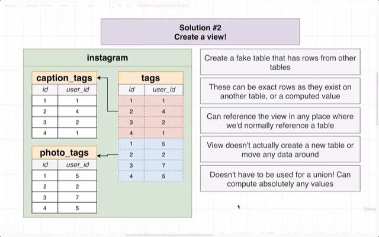
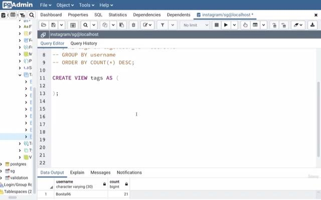
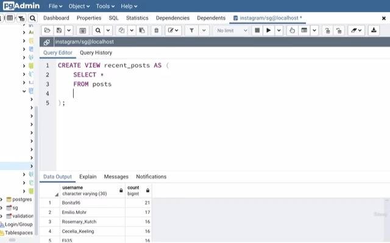
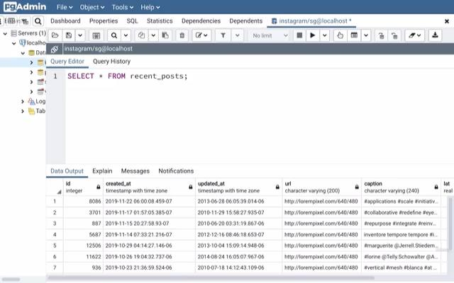
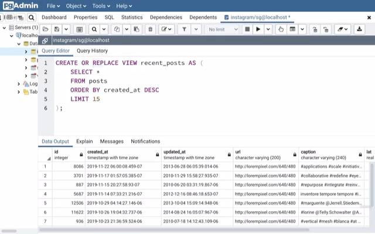
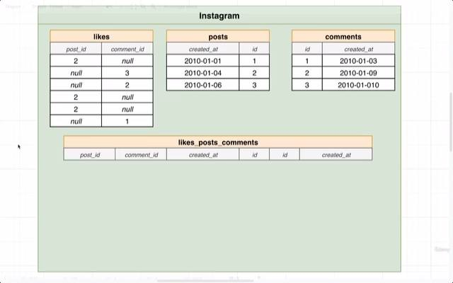
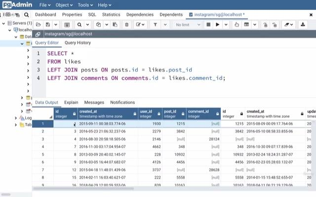
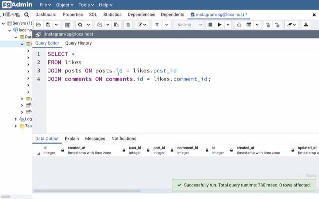
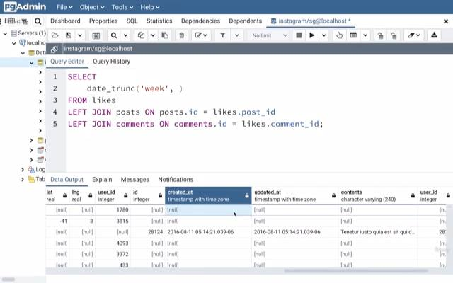
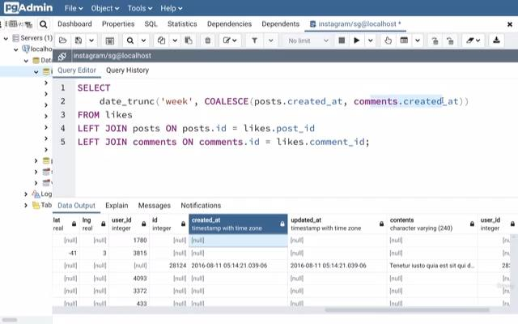

## 1. 这一节做什么

这一节覆盖 P12–P18，主线不是“再学几个 SQL 关键字”，而是把前面写过的查询**封装成数据库里的可复用对象**，并用一个真实复杂查询说明为什么需要物化视图。

具体产物有四个：

1. 用 `tags` 视图把 `photo_tags` 和 `caption_tags` 合并成一张“假表”，以后查询标签时不用重复写 `UNION ALL`。
2. 用 `recent_posts` 视图封装“最近 10 篇帖子”的查询，后续六类统计都可以复用它。
3. 用 `CREATE OR REPLACE VIEW` 把最近帖子从 10 条改成 15 条，用 `DROP VIEW` 删除视图。
4. 写一个三表 `LEFT JOIN` 的周统计查询：从 `likes` 出发，左连接 `posts` 和 `comments`，用 `date_trunc('week', ...)` 把帖子/评论创建时间归到周，用 `COUNT(posts.id)` 和 `COUNT(comments.id)` 统计每周帖子点赞数和评论点赞数。

最后讲师说明：这个查询在讲师的机器上要两三秒，在较旧机器上可能 10–30 秒；如果每天频繁运行，就应该考虑物化视图。**物化视图的具体创建/刷新 SQL，P12–P18 没有写出来**，本节只复现到复杂查询为止，不把后续内容编进来。

课里使用 PGAdmin 操作。本文为了“可复制命令直接跑”，同时给出 `psql` 方式；你也可以把 SQL 文件内容贴到 PGAdmin 的 Query Tool 里执行。

---

## 2. 讲师原话（带「—— pNNN [MM:SS]」）

> "视图可以理解成一张“假表”，它引用数据库里其他表的行或数据。"
> —— p012 [00:00]

> "视图的好处是行为很相似：我们可以把某个已有查询包起来，也可以提前创建视图，然后在以后任何时候、任何其他查询里引用它。"
> —— p012 [00:27]

> "为此，我们会写 `CREATE OR REPLACE`。关键就在于 `OR REPLACE` 这部分。"
> —— p014 [00:00]

> "物化视图也是我们要包起来或封装起来的查询，但该查询只会在非常特定的时机执行。不过，每次实际执行该查询时，Postgres 都会取走结果并保存下来。"
> —— p015 [00:29]

> "要解这个查询，我们必须使用左连接。"
> —— p017 [00:00]

> "`date_trunc` 函数可以从时间戳中取出某一项信息。这里，我们要从所有不同的 `created_at` 值中取出周。"
> —— p018 [02:47]

> "记住，`COUNT` 函数不会统计 `NULL` 值。"
> —— p018 [07:05]



---

## 3. 从零复现

### 3.1 环境与目录

课里没有讲 PostgreSQL 的具体版本、安装方式、服务启动命令，也没有给出建表 SQL。下面给出一个**可复现的参考环境**；其中版本、安装命令、`psql` 环境变量是本文补充，不是讲师原话。

参考环境：

- PostgreSQL 15 或更高版本（课里没讲版本；实际以你环境为准）
- PGAdmin 4，或命令行 `psql`
- 操作系统不限；下面命令以 macOS/Linux 的 shell 为例

目录结构：

```text
sql-course-views/
├── README.md
└── sql/
    ├── 00_schema_and_seed.sql
    ├── 01_create_tags_view.sql
    ├── 02_query_tags_view.sql
    ├── 03_create_recent_posts_view.sql
    ├── 04_query_recent_posts_with_users.sql
    ├── 05_replace_recent_posts_view.sql
    ├── 06_drop_recent_posts_view.sql
    └── 07_weekly_likes_query.sql
```

环境变量（`psql` 使用；课里用 PGAdmin，没有讲这些变量名）：

```bash
export PGHOST=localhost
export PGPORT=5432
export PGUSER=postgres
export PGPASSWORD=postgres
export PGDATABASE=sql_course
```

如果你的 PostgreSQL 用户/密码不同，改成你的。本文不假设你一定用 `postgres` 用户。

### 3.2 创建数据库并执行 schema

先创建数据库：

```bash
psql -d postgres -c "CREATE DATABASE sql_course;"
```

如果数据库已存在，这条会报错，可以跳过，或先删除再建。然后进入项目目录，执行完整 schema 与种子数据：

```bash
psql -d sql_course -f sql/00_schema_and_seed.sql
```

注意：`00_schema_and_seed.sql` 是本文为了让你不依赖前序视频也能跑通而补的**最小示意 schema**。逐字稿只出现了 `users`、`posts`、`comments`、`likes`、`photo_tags`、`caption_tags` 这些表名和查询里用到的列名；建表类型、约束、种子数据不是讲师原话，课里没讲。真实课程数据库如果已经存在，直接跳过这个文件，按你已有的表执行后面 SQL 即可。

### 3.3 创建 `tags` 视图

执行：

```bash
psql -d sql_course -f sql/01_create_tags_view.sql
```

这个文件把 `photo_tags` 和 `caption_tags` 合并成 `tags` 视图。讲师在 P12 是先写 `CREATE VIEW tags AS (...)`，然后查询 `SELECT * FROM tags`，再查 `WHERE type = 'caption_tag'` 验证两类行都在。



验证：

```bash
psql -d sql_course -f sql/02_query_tags_view.sql
```

你应该看到 `tags` 里既有 `type = 'photo_tag'` 的行，也有 `type = 'caption_tag'` 的行。本文种子数据里两类各有 2 行。

### 3.4 创建 `recent_posts` 视图

执行：

```bash
psql -d sql_course -f sql/03_create_recent_posts_view.sql
```

视图定义是：

```sql
SELECT *
FROM posts
ORDER BY created_at DESC
LIMIT 10;
```

讲师在 P13 用这个视图解决“最近 10 篇帖子在六个查询里反复出现”的问题。创建后可以查：

```bash
psql -d sql_course -c "SELECT * FROM recent_posts;"
```



再执行与 `users` 的 join：

```bash
psql -d sql_course -f sql/04_query_recent_posts_with_users.sql
```

对应讲师原话里的连接条件：

```sql
JOIN users ON users.id = recent_posts.user_id
```

### 3.5 修改视图：10 条改成 15 条

执行：

```bash
psql -d sql_course -f sql/05_replace_recent_posts_view.sql
```

然后验证：

```bash
psql -d sql_course -c "SELECT * FROM recent_posts;"
```

应该从 10 行变成 15 行。讲师在 P14 强调关键点是 `CREATE OR REPLACE` 里的 `OR REPLACE`。



### 3.6 删除视图

执行：

```bash
psql -d sql_course -f sql/06_drop_recent_posts_view.sql
```

再查：

```bash
psql -d sql_course -c "SELECT * FROM recent_posts;"
```

应该报错，提示关系不存在。讲师在 P14 还演示了在 PGAdmin 里刷新 `Schemas -> Public -> Views` 确认视图消失。



### 3.7 运行周统计复杂查询

执行：

```bash
psql -d sql_course -f sql/07_weekly_likes_query.sql
```

查询长这样：

```sql
SELECT
  date_trunc('week', COALESCE(posts.created_at, comments.created_at)) AS week,
  COUNT(posts.id) AS num_posts,
  COUNT(comments.id) AS num_comments
FROM likes
LEFT JOIN posts ON posts.id = likes.post_id
LEFT JOIN comments ON comments.id = likes.comment_id
GROUP BY week
ORDER BY week;
```

讲师在 P17 先用图解释三表左连接：从 `likes` 出发，保留所有点赞行；点赞帖子时 `comments` 列是 `NULL`，点赞评论时 `posts` 列是 `NULL`。所以必须用 `LEFT JOIN`，否则三表内连接会把两边不匹配的行都丢掉，结果为空。



P18 执行左连接后，讲师展示结果列结构：每行同时包含 like、post、comment 三组列，其中一组必然是 `NULL`。



然后用 `date_trunc` 把时间归到周：



最后 `GROUP BY week` 并计数：



最终输出应包含 `week`、`num_posts`、`num_comments` 三列。具体周起点和数字以你的种子数据/真实数据为准。

---

## 4. 完整代码

以下文件均可直接保存运行。注意 `00_schema_and_seed.sql` 是本文补充的示意 schema，不是讲师原话；其余 SQL 与逐字稿中出现的查询逻辑对应。

### `sql/00_schema_and_seed.sql`

```sql
-- 00_schema_and_seed.sql
-- 注意：课里没有给出建表 SQL。
-- 以下是为了让本节能独立运行而补的最小示意 schema。
-- 表名和列名来自逐字稿中出现的查询；类型、约束、种子数据是补充，不是讲师原话。
-- 如果你已经有课程前序数据库，请跳过本文件，直接执行后面的视图和查询文件。

DROP VIEW IF EXISTS tags CASCADE;
DROP VIEW IF EXISTS recent_posts CASCADE;
DROP TABLE IF EXISTS likes CASCADE;
DROP TABLE IF EXISTS comments CASCADE;
DROP TABLE IF EXISTS photo_tags CASCADE;
DROP TABLE IF EXISTS caption_tags CASCADE;
DROP TABLE IF EXISTS posts CASCADE;
DROP TABLE IF EXISTS users CASCADE;

CREATE TABLE users (
  id integer PRIMARY KEY,
  username text NOT NULL,
  created_at timestamptz NOT NULL DEFAULT now()
);

CREATE TABLE posts (
  id integer PRIMARY KEY,
  user_id integer NOT NULL REFERENCES users(id),
  created_at timestamptz NOT NULL
);

CREATE TABLE comments (
  id integer PRIMARY KEY,
  user_id integer NOT NULL REFERENCES users(id),
  post_id integer NOT NULL REFERENCES posts(id),
  created_at timestamptz NOT NULL
);

CREATE TABLE likes (
  id integer PRIMARY KEY,
  user_id integer NOT NULL REFERENCES users(id),
  post_id integer REFERENCES posts(id),
  comment_id integer REFERENCES comments(id),
  created_at timestamptz NOT NULL,
  CHECK ((post_id IS NOT NULL) <> (comment_id IS NOT NULL))
);

CREATE TABLE photo_tags (
  id integer PRIMARY KEY,
  created_at timestamptz NOT NULL,
  user_id integer NOT NULL REFERENCES users(id),
  post_id integer NOT NULL REFERENCES posts(id)
);

CREATE TABLE caption_tags (
  id integer PRIMARY KEY,
  created_at timestamptz NOT NULL,
  user_id integer NOT NULL REFERENCES users(id),
  post_id integer NOT NULL REFERENCES posts(id),
  caption_tag text NOT NULL
);

INSERT INTO users (id, username, created_at) VALUES
  (1, 'alice', '2010-01-01'),
  (2, 'bob',   '2010-01-01'),
  (3, 'carol', '2010-01-01');

INSERT INTO posts (id, user_id, created_at) VALUES
  (1, 1, '2010-01-04'),
  (2, 2, '2010-01-05'),
  (3, 3, '2010-01-06'),
  (4, 1, '2010-01-07'),
  (5, 2, '2010-01-08'),
  (6, 3, '2010-01-09'),
  (7, 1, '2010-01-10'),
  (8, 2, '2010-01-11'),
  (9, 3, '2010-01-12'),
  (10, 1, '2010-01-13'),
  (11, 2, '2010-01-14'),
  (12, 3, '2010-01-15'),
  (13, 1, '2010-01-16'),
  (14, 2, '2010-01-17'),
  (15, 3, '2010-01-18'),
  (16, 1, '2010-01-19'),
  (17, 2, '2010-01-20'),
  (18, 3, '2010-01-21'),
  (19, 1, '2010-01-22'),
  (20, 2, '2010-01-23');

INSERT INTO comments (id, user_id, post_id, created_at) VALUES
  (1, 2, 1, '2010-01-04'),
  (2, 3, 1, '2010-01-11'),
  (3, 1, 2, '2010-01-12');

INSERT INTO likes (id, user_id, post_id, comment_id, created_at) VALUES
  (1, 1, 1, NULL, '2010-01-05'),
  (2, 2, NULL, 1, '2010-01-06'),
  (3, 3, NULL, 2, '2010-01-12'),
  (4, 1, 2, NULL, '2010-01-13'),
  (5, 3, 2, NULL, '2010-01-14'),
  (6, 2, NULL, 3, '2010-01-15'),
  (7, 1, NULL, 1, '2010-01-16'),
  (8, 2, 3, NULL, '2010-01-20');

INSERT INTO photo_tags (id, created_at, user_id, post_id) VALUES
  (1, '2010-01-04', 1, 1),
  (2, '2010-01-05', 2, 2);

INSERT INTO caption_tags (id, created_at, user_id, post_id, caption_tag) VALUES
  (1, '2010-01-06', 1, 1, 'caption_tag'),
  (2, '2010-01-07', 2, 2, 'caption_tag');
```

### `sql/01_create_tags_view.sql`

```sql
-- 课里第一次用的是 CREATE VIEW。
-- 这里用 CREATE OR REPLACE VIEW，方便重复执行；P14 也讲了 OR REPLACE。
CREATE OR REPLACE VIEW tags AS
SELECT
  id,
  created_at,
  user_id,
  post_id,
  'photo_tag'::text AS type
FROM photo_tags
UNION ALL
SELECT
  id,
  created_at,
  user_id,
  post_id,
  caption_tag AS type
FROM caption_tags;
```

### `sql/02_query_tags_view.sql`

```sql
-- 查看合并后的全部标签行
SELECT * FROM tags;

-- 只查看 caption_tags 来源的行
SELECT * FROM tags
WHERE type = 'caption_tag';
```

### `sql/03_create_recent_posts_view.sql`

```sql
CREATE OR REPLACE VIEW recent_posts AS
SELECT *
FROM posts
ORDER BY created_at DESC
LIMIT 10;
```

### `sql/04_query_recent_posts_with_users.sql`

```sql
SELECT users.username
FROM recent_posts
JOIN users ON users.id = recent_posts.user_id;
```

### `sql/05_replace_recent_posts_view.sql`

```sql
CREATE OR REPLACE VIEW recent_posts AS
SELECT *
FROM posts
ORDER BY created_at DESC
LIMIT 15;
```

### `sql/06_drop_recent_posts_view.sql`

```sql
DROP VIEW IF EXISTS recent_posts;
```

### `sql/07_weekly_likes_query.sql`

```sql
SELECT
  date_trunc('week', COALESCE(posts.created_at, comments.created_at)) AS week,
  COUNT(posts.id) AS num_posts,
  COUNT(comments.id) AS num_comments
FROM likes
LEFT JOIN posts ON posts.id = likes.post_id
LEFT JOIN comments ON comments.id = likes.comment_id
GROUP BY week
ORDER BY week;
```

讲师在 P18 最后提醒：`num_posts` / `num_comments` 这两个别名有点误导，它们不是“创建了多少帖子/评论”，而是“帖子/评论收到了多少个赞”。更清晰的别名可以是 `num_likes_for_posts`、`num_likes_for_comments`，但课里最终演示时用的是 `num_posts` 和 `num_comments`。

---

## 5. 逐行解释

### 5.1 `tags` 视图为什么能合并两张表

`CREATE OR REPLACE VIEW tags AS ...` 创建的是一个**命名查询**，不是把数据复制到新表。每次 `SELECT * FROM tags` 时，PostgreSQL 会执行视图里的底层查询。所以删除视图不会删除 `photo_tags` 或 `caption_tags` 的数据；讲师在 P12 明确说“不是永久改变，底层数据都还在”。

`UNION ALL` 把两个 `SELECT` 的结果上下拼起来。`UNION ALL` 不去重，保留所有行。讲师说做 `UNION` 时两边列和类型要匹配，所以我们两段都选：

```text
id, created_at, user_id, post_id, type
```

第一段用 `'photo_tag'::text AS type` 造一个字面量列，第二段用 `caption_tag AS type` 从 `caption_tags` 表里取。`type` 的唯一作用就是区分这行来自照片标签还是文字标签，讲师在 P12 说“That's the only reason type is in here”。

注意：`caption_tags` 表里的 `caption_tag` 列名和 `tags` 视图里的别名 `type` 不是同一个东西。前者是源表列，后者是视图输出列。你在自己的数据库里如果列名不同，需要按实际表结构调整。

### 5.2 `recent_posts` 视图为什么能复用

`recent_posts` 的定义是：

```sql
SELECT *
FROM posts
ORDER BY created_at DESC
LIMIT 10;
```

这是普通视图。普通视图不缓存结果；每次查询 `recent_posts`，都会重新执行 `ORDER BY ... LIMIT 10`。所以如果 `posts` 表新增了帖子，下一次查视图会反映最新数据。讲师在 P13 说“最近 10 篇帖子”在六个查询里都重要，所以把它封装成视图，避免每个查询重复写排序和 limit。

`CREATE OR REPLACE VIEW recent_posts AS ... LIMIT 15` 是替换视图定义，不是新增一个同名视图。执行后，原来引用 `recent_posts` 的查询会自动使用新的 15 条逻辑。`DROP VIEW recent_posts` 只删除视图定义，不删除 `posts` 表数据；删除后再查视图会报错。

### 5.3 为什么必须用 `LEFT JOIN`

查询从 `likes` 出发：

```sql
FROM likes
LEFT JOIN posts ON posts.id = likes.post_id
LEFT JOIN comments ON comments.id = likes.comment_id
```

`likes` 行有两种：点赞帖子时 `post_id` 有值、`comment_id` 为 `NULL`；点赞评论时 `comment_id` 有值、`post_id` 为 `NULL`。`LEFT JOIN` 会保留左表 `likes` 的所有行：

- 点赞帖子的行：匹配到 `posts`，`comments` 列补 `NULL`。
- 点赞评论的行：`posts` 列补 `NULL`，匹配到 `comments`。

如果写成默认的 `JOIN`（内连接），三表内连接要求一条 like 同时匹配 post 和 comment。但每条 like 只可能匹配其中一个，所以结果会变成 0 行。讲师在 P18 现场去掉 `left` 验证过：结果集完全为空。这是排查“join 写错没写错”的一个很实用的信号。



### 5.4 `date_trunc` 和 `COALESCE`

`COALESCE(posts.created_at, comments.created_at)` 取两个时间中第一个非 `NULL` 的。因为每行 like 要么对应帖子、要么对应评论，所以两个时间必有一个是 `NULL`。

`date_trunc('week', ...)` 把时间截断到“周”这一级。讲师在 P18 用 `DateTrunk` 来称呼它，实际 PostgreSQL 函数名是 `date_trunc`。它会把时间向下归到周起点。注意：PostgreSQL 的 `date_trunc('week', ...)` 按 ISO 周习惯，周起点通常是周一；讲师在 P16 用 1 月 1 日、1 月 8 日做示意，是教学简化。你实际跑出来的 `week` 值以数据库和时区为准，课里没有展开讲时区。

### 5.5 `COUNT(posts.id)` 为什么能分开统计

`COUNT(column)` 不统计 `NULL`。在三表左连接结果里：

- 点赞帖子的行：`posts.id` 非空，`comments.id` 为空。
- 点赞评论的行：`posts.id` 为空，`comments.id` 非空。

所以：

```sql
COUNT(posts.id) AS num_posts
COUNT(comments.id) AS num_comments
```

分别统计“点赞指向帖子”

## 6. 复现检查清单

- [ ] 确认能连上 PostgreSQL：运行 `psql -d postgres -c "选择 version();"`；应看到版本信息而不是连接失败。课里没讲安装、服务启动和账号配置，这里的环境变量是本文补充。
- [ ] 确认目标数据库存在：运行 `psql -d sql_course -c "选择 current_database();"`；应返回 `sql_course`。若 `CREATE DATABASE` 报已存在，跳过建库即可。
- [ ] 确认 `00_schema_and_seed.sql` 已执行：运行 `psql -d sql_course -c "\dt"`；应看到 `users`、`posts`、`comments`、`likes`、`photo_tags`、`caption_tags`。课里没讲建表 SQL，本文 schema 和种子数据是补充。
- [ ] 确认示意种子数据量：分别查 `SELECT count(*) FROM users;`、`posts`、`comments`、`likes`、`photo_tags`、`caption_tags`；按本文种子应分别为 3、20、3、8、2、2。课里没给种子数据，数字只用于验证本文复现环境。
- [ ] 确认 `tags` 视图创建并合并两类标签：执行 `01`、`02` 后运行 `SELECT * FROM tags;`；应看到 `id, created_at, user_id, post_id, type` 这些列，且既有 `photo_tag` 也有 `caption_tag`。再运行 `SELECT * FROM tags WHERE type = 'caption_tag';`；本文种子下应返回 2 行。
- [ ] 确认 `recent_posts` 初始为 10 行：执行 `03` 后运行 `SELECT * FROM recent_posts;`；应返回 10 行，且 `created_at` 按降序排列。再执行 `04`；应能通过 `users.id = recent_posts.user_id` 连接并返回用户名，不报错。
- [ ] 确认替换视图后变成 15 行：执行 `05` 后再次运行 `SELECT * FROM recent_posts;`；应返回 15 行，仍按 `created_at` 降序。若仍是 10 行，先确认执行的是同一个数据库、并已运行 `05`。
- [ ] 确认删除视图后的预期报错：执行 `06` 后运行 `SELECT * FROM recent_posts;`；应报关系不存在。此时再运行 `04` 也应报错，因为 `recent_posts` 已被删除，这是预期现象。
- [ ] 确认周统计查询的列与排序：执行 `07` 后应返回三列 `week`、`num_posts`、`num_comments`，并按 `week` 升序排列。`week` 应是按周截断后的时间值；具体周起点和数字以你的数据库时区、种子数据为准。
- [ ] 确认 `COUNT` 与左连接结果的对应关系：在 `07` 的结果中，每个 `week` 行应分别统计帖子收到的赞和评论收到的赞；由于 `COUNT(column)` 不计 `NULL`，每行左连接结果里帖子列和评论列通常只有一边有值。具体数字不要和讲师结果硬对，本文种子数据与课程数据不同。
- [ ] 确认没有把本节写成物化视图实现：运行完 `07` 后，检查目录和 SQL 中是否只有普通视图与复杂查询，没有创建/刷新物化视图的语句。P12–P18 没写物化视图具体 SQL；若你耗时较长，本节只记录耗时，不补写物化视图创建/刷新。

## 7. 课里没讲但你会撞上的

| 现象 | 原因 | 怎么办 |
|---|---|---|
| `psql: error: connection to server ... failed` 或角色/密码错误 | 课里没讲 PostgreSQL 安装、服务启动、端口和账号配置；本文的 `PGHOST/PGUSER/PGPASSWORD` 是补充。 | 先确认服务已启动、端口正确，把环境变量改成你本机用户和密码；也可以直接用 PGAdmin 连接。 |
| `CREATE DATABASE sql_course;` 报数据库已存在 | 课里没讲建库的幂等处理；重复执行或已有同名库都会报错。 | 跳过这条建库命令，直接连接已有 `sql_course`；不要在不确认的情况下随意删库。 |
| 执行 `01` 或后面的 SQL 报 `relation "users" does not exist`、`relation "posts" does not exist` | 课里没讲建表 SQL；你可能没执行本文补充的 `00_schema_and_seed.sql`，或连到了错误的数据库。 | 先确认 `current_database()` 是目标库，再执行 `00_schema_and_seed.sql`；如果你用的是前序课程已有数据库，则按已有表名和列名调整。 |
| 执行 `00_schema_and_seed.sql` 后，原有表或数据被删掉 | 课里没讲建表脚本；本文 `00` 是补充的最小示意 schema，里面有 `DROP TABLE ... CASCADE`。 | 真实课程库或已有数据的库不要直接跑 `00`；先备份，或跳过 `00`，只执行视图和查询文件。 |
| `01` 报列不存在，例如 `column "caption_tag" does not exist`，或 `UNION` 两边类型不匹配 | 课里没讲真实表结构；本文 schema 的 `caption_tag` 列名和类型是示意，你的前序库可能不同。 | 查看实际表结构，把 `caption_tag`、`user_id`、`post_id` 等列名改成真实列名；必要时加显式类型转换。 |
| `DROP VIEW recent_posts;` 报有其他对象依赖它 | 课里只演示了简单删除视图，没讲依赖对象和 `CASCADE` 的影响。 | 先删除依赖该视图的对象，或确认影响后使用 `DROP VIEW ... CASCADE`；不要在看不清依赖时直接级联删除。 |
| `07` 的 `week` 起点与讲师图里的 1 月 1 日、1 月 8 日不完全一致 | 课里没讲时区和 ISO 周边界；`date_trunc('week', ...)` 的周起点会受数据库时区影响，讲师图示是教学简化。 | 接受数据库实际输出，先验证“按周分组”的逻辑；需要固定边界时再显式处理时区或周边界。 |
| `07` 的 `num_posts`、`num_comments` 数字与讲师演示的 29、31、3 等不一致 | 课里没给完整建表 SQL 和种子数据；本文种子数据是补充，和课程数据不同。 | 只核对列结构、分组逻辑和左连接结果；要复现讲师数字，需要课程原始数据库，而不是本文示意种子。 |
| 跑完 `07` 后想优化，却找不到物化视图的创建/刷新 SQL | 课里没讲；P12–P18 只讲到复杂查询和“应该考虑物化视图”，没有给出物化视图 SQL。 | 本节只复现到复杂查询为止；不要把后续物化视图内容编进来，记录耗时后留到后续章节。 |
| 用 `psql -f` 执行 `02` 时看到两个结果集，或输出比 PGAdmin 里多 | 课里用 PGAdmin 逐条执行，没讲 `psql -f` 对多语句文件的展示方式；本文 `02` 文件里包含两条 `SELECT`。 | 这是正常现象；想逐条看就用 `psql -c` 分开执行，或在 PGAdmin 的 Query Tool 里逐条选中运行。 |
