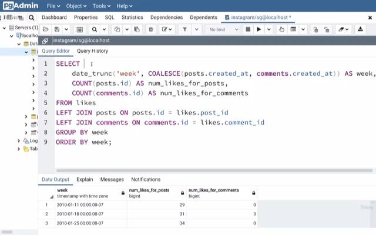
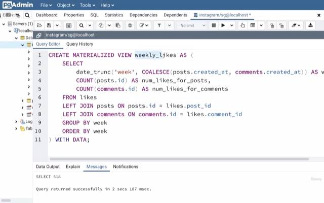
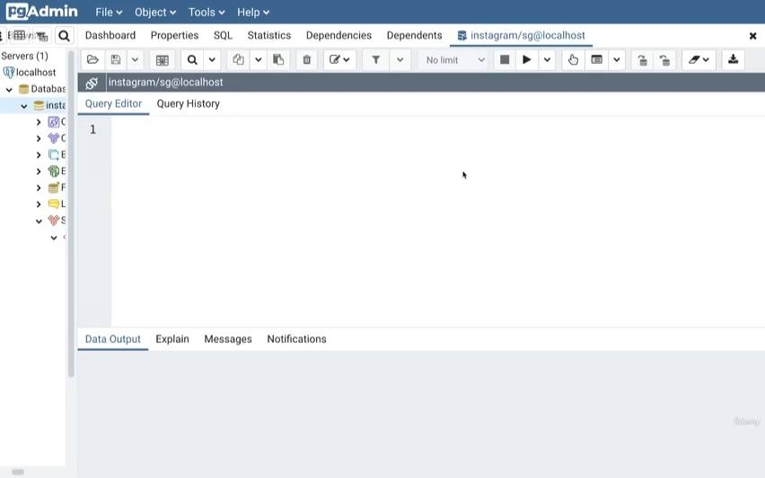
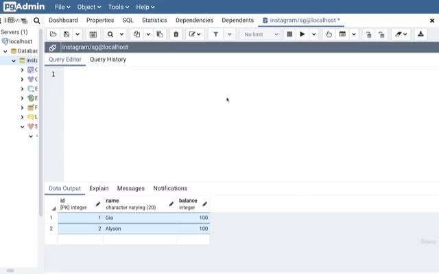
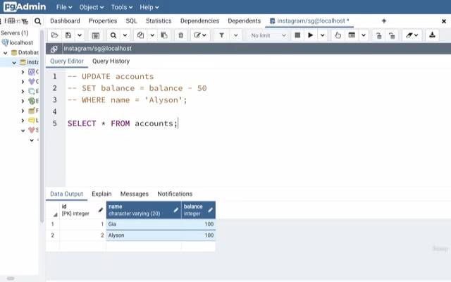
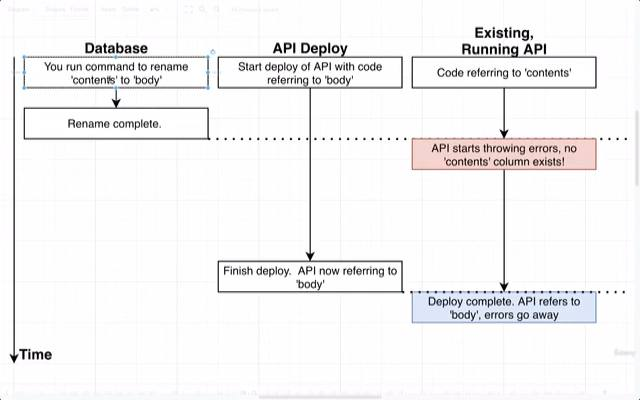
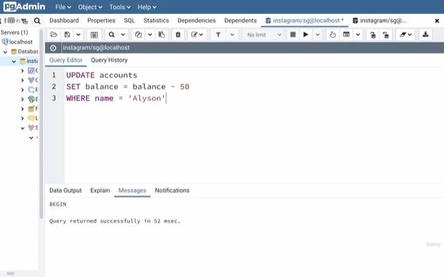

# PostgreSQL 物化视图、事务与 Schema Migration 复现文档（P019–P025）

## 1 这一节做什么

这一节不是从零做一个 Web 应用，而是围绕一个 PostgreSQL 实验库，把课程 P019–P025 的三个核心能力跑通：

1. **物化视图**：把一条昂贵的聚合查询结果缓存下来，用 `weekly_likes` 保存“按周统计 posts / comments 的 likes 数”。之后查询物化视图会非常快；但底层数据变了以后，物化视图不会自动更新，必须手动 `REFRESH MATERIALIZED VIEW`。—— p019 [00:29]、[04:53]
2. **事务**：用 `accounts` 表模拟银行转账。先 `BEGIN` 打开事务，再执行“Allison 减 50、Gia 加 50”。四类结束方式要分别复现：`COMMIT`、`ROLLBACK`、事务内报错后进入 aborted 状态再 `ROLLBACK`、连接崩溃后 PostgreSQL 自动回滚。—— p020 [03:16]、p022 [06:13]、p024 [00:58]
3. **Schema migration 的问题意识**：课程用一个“把 `comments.contents` 改名为 `body`，但旧 API 还在写 `contents`”的故事，说明数据库结构变更必须和客户端代码同步；否则旧代码会立刻报错。—— p025 [06:36]、[16:29]

最终你会得到一个可重复初始化的本地实验目录：`sql-course-lab/`，里面有 Docker Compose、初始化 SQL、物化视图 SQL、事务 SQL、报错回滚 SQL、列改名 SQL。每个 SQL 文件都能直接保存并运行。

这一节的目标不是背语法，而是建立三个判断：第一，物化视图是“结果快照”，不是自动同步的缓存；第二，事务是“同一连接上的一组语句”，不是随便把几条 SQL 发出去就自动生效；第三，数据库结构变更不是只改数据库，还必须考虑正在运行的客户端、API、后台任务和迁移脚本。复现时建议每执行完一个 SQL 文件就停下来观察结果，不要一口气全部跑完，否则很难判断到底是哪一步导致状态变化。

> 说明：课程原始 Instagram 数据表结构和 P019 的完整底层聚合 SQL，逐字稿没有完整给出。本文为了“照着能跑”，补了一套最小可运行 schema；凡是补全的地方都会标注“课里没讲完整原始 SQL”。不会把补全内容说成讲师原话。

---

## 2 讲师原话（带出处）

下面引用逐字稿里的关键原话，并给出中文解释。引用保留英文原文，避免翻译改变原意。

> “To make a materialized view, we take some query that we essentially want to kind of persist or hold on to the results from. Then right before the query, we will write out create materialized view...”  
—— p019 [00:40]  
中文：物化视图就是把一条查询的结果持久化保存下来；创建时写 `CREATE MATERIALIZED VIEW`。复现时要理解“持久化”指的是结果被存成一张可查询的关系，而不是每次查询都重新跑底层聚合 SQL。

> “...with data right here means that when we first create the materialized view, we want Postgres to automatically run this query one time and hold on to all the results.”  
—— p019 [01:28]  
中文：`WITH DATA` 表示创建物化视图时立刻执行一次查询，并把结果存下来。若省略或使用 `WITH NO DATA`，物化视图本身会创建，但里面没有可查询结果，直到执行刷新。

> “...if we now modify any of this underlying data... that is not going to modify those kind of cached results... we have to manually tell Postgres that it needs to go back and update the materialized view.”  
—— p019 [02:52]  
中文：底层表数据变了，物化视图里的缓存结果不会自动变；必须手动刷新。复现时删除一月 posts 后再次查询物化视图仍能看到一月数据，就是这一点在起作用。

> “...to update the data that is being held by materialized view, we write out refresh materialized view, weekly likes.”  
—— p019 [04:53]  
中文：刷新物化视图使用 `REFRESH MATERIALIZED VIEW weekly_likes;`。刷新会重新执行创建物化视图时定义的那条查询，并用新结果替换旧结果。

> “We're going to use a transaction to solve this kind of problem where we want to run some kind of updates in series. And we need to make sure that all the different updates are always executed or none of them are executed.”  
—— p020 [03:16]  
中文：事务用来保证一组更新要么全部成功，要么全部不生效。复现转账时，Allison 减 50 和 Gia 加 50 应该被视为一个整体。

> “...we create a transaction or we begin a transaction by running just the keyword begin by itself.”  
—— p022 [01:57]  
中文：开启事务就是单独执行 `BEGIN`。之后同一连接上的语句处于同一个事务块中，直到 `COMMIT` 或 `ROLLBACK`。

> “...if we want to merge those changes back into the main data pool... we can run the commit keyword by itself... if we decide for any reason that we don't want to save those changes... we can run the rollback keyword.”  
—— p022 [06:13]、[06:42]  
中文：`COMMIT` 把事务内变更合并回主数据；`ROLLBACK` 丢弃事务内变更。复现时应分别观察提交后余额变化和回滚后余额恢复。

> “...if you have some kind of error... the transaction... enters an aborted state. You have to manually run a command of rollback to get out of that aborted state.”  
—— p022 [07:11]  
中文：事务内一旦报错，事务进入 aborted 状态；必须手动 `ROLLBACK` 才能继续使用该连接。复现时故意查询不存在的表，就能触发这个状态。

> “It says current transaction is aborted. Everything's going to be ignored until the end of the transaction block.”  
—— p024 [00:58]  
中文：你会看到 `current transaction is aborted...` 这类错误；此时后续语句都会被忽略，直到事务块结束。排查时要记住：不是后面的 SQL 写错了，而是前面的事务已经失败。

> “...any time that we make a change to our database structure, we have to synchronize that and deploy it at the same time that we change our clients as well.”  
—— p025 [06:36]  
中文：数据库结构变更必须和客户端代码变更同步部署。复现里把 `contents` 改名为 `body` 后，旧 API 仍写 `contents` 就会报列不存在。

> “...whenever you are working with other engineers, it is extremely important that you have a very easy way to tie the structure of your database or changes to the structure of your database to your code as well.”  
—— p025 [16:29]  
中文：团队协作时，必须能把数据库结构版本和代码版本绑定起来。复现实验只展示问题，不展开完整迁移框架；实际项目里通常需要迁移文件、版本记录和部署顺序。



---

## 3 从零复现

### 3.1 目录结构

在你的工作目录下创建：

```text
sql-course-lab/
├── docker-compose.yml
├── .env.example
└── sql/
    ├── 00_setup.sql
    ├── 01_materialized_view.sql
    ├── 02_transactions_commit.sql
    ├── 03_transactions_crash.sql
    ├── 04_transactions_aborted.sql
    └── 05_schema_migration_demo.sql
```

目录结构的作用是把“环境”和“实验 SQL”分开：`docker-compose.yml` 负责起数据库，`.env.example` 负责保存可覆盖的默认参数，`sql/` 下的文件按实验顺序命名。这样你重跑实验时只需要重新执行 `00_setup.sql`，不必反复删容器。若你本机已有 PostgreSQL，也可以不使用 Docker，但要保证数据库名、用户名和 `psql` 连接参数与后面命令一致，否则会出现“文件没错但连不上库”的问题。

### 3.2 启动环境

课程里讲师使用 PGAdmin 操作 PostgreSQL。本文用 Docker 起一个 PostgreSQL 16 和一个 PGAdmin 4，方便你直接复现。**课里没讲 Docker**；如果你本机已经有 PostgreSQL 16，也可以跳过 Docker，直接建库后执行 `sql/` 下的文件。

```bash
cp .env.example .env
docker compose up -d
docker compose ps
```

等待数据库可用：

```bash
until docker compose exec -T db pg_isready -U app -d sql_course_lab; do
  sleep 1
done
```

初始化表和数据：

```bash
docker compose exec -T db psql -U app -d sql_course_lab -f /sql/00_setup.sql
```

这里的 `cp .env.example .env` 是把示例环境变量复制成实际使用的 `.env`；Docker Compose 会自动读取 `.env`。`docker compose up -d` 表示后台启动服务；`docker compose ps` 用来确认容器状态。`pg_isready` 是 PostgreSQL 自带探活命令，返回 accepting connections 才说明数据库准备完成。`docker compose exec -T db psql ...` 中的 `-T` 表示不分配伪终端，适合脚本执行；`-U app` 和 `-d sql_course_lab` 必须与 `.env` 中的用户、数据库名一致。常见错误是端口 5432 已被本机 PostgreSQL 占用，此时改 `.env` 里的 `POSTGRES_PORT`，例如 5433，再重新启动。若执行 SQL 报“文件不存在”，检查 `docker-compose.yml` 是否把 `./sql` 挂载到 `/sql`，并且命令里使用的是容器路径 `/sql/00_setup.sql`。

### 3.3 运行物化视图实验

```bash
docker compose exec -T db psql -U app -d sql_course_lab -f /sql/01_materialized_view.sql
```

这个文件会：建 `weekly_likes` 物化视图、查询它、删除一月 posts、再次查询物化视图（仍是旧缓存）、执行 `REFRESH MATERIALIZED VIEW`、再查询（缓存更新）。

验证时重点看三次查询的差异：第一次查询展示创建时缓存的一月与二月聚合结果；删除一月 posts 后第二次查询仍应看到一月相关周的数据，因为物化视图没有自动刷新；执行 `REFRESH MATERIALIZED VIEW weekly_likes;` 后第三次查询中一月相关周应消失或减少。若第二次查询已经看不到一月数据，说明你可能误删并重建了物化视图，或者执行了刷新；若刷新后仍没变化，检查 `DELETE FROM posts` 是否真的删到了行，以及外键级联是否生效。前端对照：如果页面直接查询物化视图，底层数据变更后页面不会自动更新，必须由后台任务或管理操作触发刷新；不要误以为数据库会自动推送新结果。



### 3.4 运行事务提交实验

```bash
docker compose exec -T db psql -U app -d sql_course_lab -f /sql/02_transactions_commit.sql
```

它会先把两个账户重置为 100，然后在一个事务里完成 Allison 减 50、Gia 加 50，最后 `COMMIT`。

执行后应看到最终 Allison 为 50、Gia 为 150。若中间 SELECT 看到变化但最终没有变化，检查是否执行了 `COMMIT`；若最终只扣了 Allison 没加 Gia，说明事务中途失败或你只执行了部分 SQL。常见错误是把 `BEGIN`、`UPDATE`、`COMMIT` 分散到不同连接执行；在 psql 单文件里它们默认在同一连接，所以能复现；在应用连接池里则必须显式使用同一个 client。前端对照：API 层不要把“转账”拆成两个互不相关请求，否则用户刷新页面可能看到只完成一半的状态。



### 3.5 运行“连接崩溃自动回滚”实验

```bash
docker compose exec -T db psql -U app -d sql_course_lab -f /sql/03_transactions_crash.sql
```

该文件在事务内更新 Allison 余额后执行 `\q` 断开连接，不提交。PostgreSQL 会回滚这个未提交事务。随后你新开连接查询：

```bash
docker compose exec -T db psql -U app -d sql_course_lab -c "SELECT * FROM accounts ORDER BY name;"
```

应看到 Allison 和 Gia 都恢复为 100。

> 如果你在 PGAdmin 里复现：执行 `BEGIN` 和 `UPDATE` 后，不要点提交；到 Dashboard 里终止该连接，效果等同于断开连接。课程里也是用终止连接来模拟崩溃。—— p023 [02:21]

排查时注意：`03_transactions_crash.sql` 中的 `\q` 会让 psql 立即退出，因此文件里 `\q` 后面的内容不会继续执行。如果你把多个实验拼到一个文件里，后面语句被跳过就是正常现象。新连接查询很重要，因为未提交事务中的变化只在原连接内可见；原连接断开后，PostgreSQL 会清理该事务。前端对照：请求超时、进程被杀、连接池回收连接时，数据库不会保留未提交事务；业务层应把这类情况当作“操作未完成”，而不是假设已经成功。



### 3.6 运行“事务内报错进入 aborted 状态”实验

```bash
docker compose exec -T db psql -U app -d sql_course_lab -f /sql/04_transactions_aborted.sql
```

它会 `BEGIN` 后查询一个不存在的表，制造错误；然后查询 `accounts` 会得到 aborted 事务错误；最后 `ROLLBACK`，再查询恢复正常。

执行时你会看到第一条错误来自不存在的表，第二条错误类似 `current transaction is aborted, commands ignored until end of transaction block`。这不是 `accounts` 表有问题，而是当前事务块已经失败。若没有执行 `ROLLBACK` 就继续发业务 SQL，后面都会被忽略。排查时先找“事务内第一条报错”，不要只盯最后一条被忽略的语句。前端对照：API 捕获到数据库错误后，必须保证同一连接执行 `ROLLBACK`，再把错误返回；不能吞掉错误继续复用这个事务连接。



### 3.7 运行 Schema Migration 故事复现

先重新初始化一次，保证 `comments.contents` 存在：

```bash
docker compose exec -T db psql -U app -d sql_course_lab -f /sql/00_setup.sql
docker compose exec -T db psql -U app -d sql_course_lab -f /sql/05_schema_migration_demo.sql
```

这个文件模拟：直接把 `contents` 改名成 `body`；旧 API 仍然写 `contents`，于是报错；随后紧急改回 `contents`，旧 API 语句恢复可用。

验证时重点看第 3 步的 INSERT：报错应指出 `contents` 列不存在，因为此时表上只有 `body`。第 4 步改回后，第 5 步同形状的旧 INSERT 应成功。常见错误是只执行了改名但没有观察 `information_schema.columns`，导致误以为改名没生效；也可能因为前面 `00_setup.sql` 没重跑，表状态不是预期。前端对照：浏览器或 App 不应该直接拼 SQL 访问数据库，真正的旧 API 是服务端代码；迁移时要同时考虑服务端 SQL、ORM 映射、缓存、后台任务和部署顺序，而不是只看数据库里列名改了没有。



---

## 4 完整代码

### 4.1 `docker-compose.yml`

```yaml
services:
  db:
    image: postgres:16
    container_name: sql-course-lab-db
    environment:
      POSTGRES_USER: ${POSTGRES_USER:-app}
      POSTGRES_PASSWORD: ${POSTGRES_PASSWORD:-app_password}
      POSTGRES_DB: ${POSTGRES_DB:-sql_course_lab}
    ports:
      - "${POSTGRES_PORT:-5432}:5432"
    volumes:
      - ./sql:/sql
      - pgdata:/var/lib/postgresql/data

  pgadmin:
    image: dpage/pgadmin4:8
    container_name: sql-course-lab-pgadmin
    environment:
      PGADMIN_DEFAULT_EMAIL: ${PGADMIN_DEFAULT_EMAIL:-admin@example.com}
      PGADMIN_DEFAULT_PASSWORD: ${PGADMIN_DEFAULT_PASSWORD:-admin_password}
    ports:
      - "${PGADMIN_PORT:-5050}:80"
    depends_on:
      - db

volumes:
  pgdata:
```

### 4.2 `.env.example`

```dotenv
POSTGRES_USER=app
POSTGRES_PASSWORD=app_password
POSTGRES_DB=sql_course_lab
POSTGRES_PORT=5432

PGADMIN_DEFAULT_EMAIL=admin@example.com
PGADMIN_DEFAULT_PASSWORD=admin_password
PGADMIN_PORT=5050
```

### 4.3 `sql/00_setup.sql`

```sql
-- 00_setup.sql
-- 说明：课程原始 Instagram schema 和 P019 的完整底层查询未在逐字稿中给出。
-- 本文件是为了复现 P019-P025 的实验而补全的最小 schema。
-- 重新运行会重建实验表并清空实验数据。

DROP MATERIALIZED VIEW IF EXISTS weekly_likes;
DROP TABLE IF EXISTS likes;
DROP TABLE IF EXISTS comments;
DROP TABLE IF EXISTS posts;
DROP TABLE IF EXISTS accounts;

CREATE TABLE accounts (
  id serial PRIMARY KEY,
  name varchar(20) NOT NULL,
  balance integer NOT NULL CHECK (balance >= 0)
);

INSERT INTO accounts (name, balance) VALUES
  ('Gia', 100),
  ('Allison', 100);

CREATE TABLE posts (
  id serial PRIMARY KEY,
  created_at date NOT NULL
);

CREATE TABLE comments (
  id serial PRIMARY KEY,
  post_id integer NOT NULL REFERENCES posts(id) ON DELETE CASCADE,
  contents text NOT NULL,
  created_at date NOT NULL
);

CREATE TABLE likes (
  id serial PRIMARY KEY,
  post_id integer REFERENCES posts(id) ON DELETE CASCADE,
  comment_id integer REFERENCES comments(id) ON DELETE CASCADE,
  created_at date NOT NULL,
  CHECK (
    (post_id IS NOT NULL AND comment_id IS NULL)
    OR
    (post_id IS NULL AND comment_id IS NOT NULL)
  )
);

INSERT INTO posts (created_at) VALUES
  ('2010-01-04'),
  ('2010-01-05'),
  ('2010-01-11'),
  ('2010-01-12'),
  ('2010-02-01'),
  ('2010-02-02');

INSERT INTO comments (post_id, contents, created_at) VALUES
  (1, 'first comment', '2010-01-04'),
  (2, 'second comment', '2010-01-05');

-- 造一批一月 posts 的 likes
INSERT INTO likes (post_id, created_at)
SELECT p.id, p.created_at
FROM posts p
CROSS JOIN generate_series(1, 3) AS g(n)
WHERE p.created_at < DATE '2010-02-01';

-- 造一批一月 comments 的 likes
INSERT INTO likes (comment_id, created_at)
SELECT c.id, c.created_at
FROM comments c
CROSS JOIN generate_series(1, 2) AS g(n)
WHERE c.created_at < DATE '2010-02-01';

-- 造一批二月 posts 的 likes
INSERT INTO likes (post_id, created_at)
SELECT p.id, p.created_at
FROM posts p
WHERE p.created_at >= DATE '2010-02-01';
```

### 4.4 `sql/01_materialized_view.sql`

```sql
-- 01_materialized_view.sql
-- 复现 P019：创建物化视图、查询、修改底层数据、刷新物化视图。
-- 注意：课程原始 weekly_likes 的完整底层查询未给出；
-- 下面查询是按“按周统计 posts/comments 的 likes 数”这一课程语义补全的可运行版本。

DROP MATERIALIZED VIEW IF EXISTS weekly_likes;

CREATE MATERIALIZED VIEW weekly_likes AS
SELECT
  date_trunc('week', l.created_at)::date AS week_start,
  COUNT(*) FILTER (WHERE l.post_id IS NOT NULL) AS post_likes,
  COUNT(*) FILTER (WHERE l.comment_id IS NOT NULL) AS comment_likes
FROM likes l
GROUP BY 1
WITH DATA;

-- 查看物化视图结果
SELECT * FROM weekly_likes ORDER BY week_start;

-- 删除一月的 posts；本实验 schema 使用 ON DELETE CASCADE，
-- 所以相关 comments/likes 会一起被删除。
DELETE FROM posts
WHERE created_at < DATE '2010-02-01';

-- 此时物化视图仍是旧缓存：一月数据还在
SELECT * FROM weekly_likes ORDER BY week_start;

-- 手动刷新物化视图
REFRESH MATERIALIZED VIEW weekly_likes;

-- 刷新后一月数据消失
SELECT * FROM weekly_likes ORDER BY week_start;
```

### 4.5 `sql/02_transactions_commit.sql`

```sql
-- 02_transactions_commit.sql
-- 复现 P022：BEGIN -> 两条 UPDATE -> COMMIT。

UPDATE accounts SET balance = 100;

BEGIN;

UPDATE accounts
SET balance = balance - 50
WHERE name = 'Allison';

SELECT id, name, balance
FROM accounts
ORDER BY name;

UPDATE accounts
SET balance = balance + 50
WHERE name = 'Gia';

SELECT id, name, balance
FROM accounts
ORDER BY name;

COMMIT;

SELECT 'after commit' AS phase, id, name, balance
FROM accounts
ORDER BY name;
```

### 4.6 `sql/03_transactions_crash.sql`

```sql
-- 03_transactions_crash.sql
-- 复现 P023：事务执行到一半，连接断开，PostgreSQL 自动回滚。
-- 下面 \q 是 psql 的退出命令；退出时未 COMMIT 的事务会被回滚。

UPDATE accounts SET balance = 100;

BEGIN;

UPDATE accounts
SET balance = balance - 50
WHERE name = 'Allison';

SELECT id, name, balance
FROM accounts
ORDER BY name;

-- 不写 COMMIT。\q 让 psql 断开连接。
\q
```

### 4.7 `sql/04_transactions_aborted.sql`

```sql
-- 04_transactions_aborted.sql
-- 复现 P024：事务内报错后，事务进入 aborted 状态；
-- 必须 ROLLBACK 才能继续正常使用连接。

UPDATE accounts SET balance = 100;

BEGIN;

-- 故意查询不存在的表，制造错误
SELECT * FROM table_that_does_not_exist;

-- 下面这条会触发 current transaction is aborted 一类错误
SELECT id, name, balance
FROM accounts
ORDER BY name;

ROLLBACK;

-- 回滚后连接恢复正常
SELECT id, name, balance
FROM accounts
ORDER BY name;
```

### 4.8 `sql/05_schema_migration_demo.sql`

```sql
-- 05_schema_migration_demo.sql
-- 复现 P025 的“直接改列名导致旧 API 崩掉”的故事。
-- 这个文件最后会把 body 改回 contents，方便你继续实验。

-- 1. 模拟直接把 contents 改名为 body
BEGIN;
ALTER TABLE comments RENAME COLUMN contents TO body;
COMMIT;

-- 2. 查看 comments 表当前列
SELECT column_name, data_type
FROM information_schema.columns
WHERE table_name = 'comments'
ORDER BY ordinal_position;

-- 3. 模拟旧 API 仍然按 contents 写数据：会报错
INSERT INTO comments (post_id, contents, created_at)
VALUES (
  (SELECT id FROM posts ORDER BY id LIMIT 1),
  'old api write',
  DATE '2010-01-06'
);

-- 4. 模拟紧急回滚：把 body 改回 contents
BEGIN;
ALTER TABLE comments RENAME COLUMN body TO contents;
COMMIT;

-- 5. 旧 API 的 INSERT 恢复可用
INSERT INTO comments (post_id, contents, created_at)
VALUES (
  (SELECT id FROM posts ORDER BY id LIMIT 1),
  'old api write after revert',
  DATE '2010-01-06'
);

SELECT id, post_id, contents, created_at
FROM comments
ORDER BY id;
```

---

## 5 逐行解释

### 5.1 Docker Compose 文件

- `image: postgres:16`：使用 PostgreSQL 16。课程没有指定版本，这是复现环境的建议版本。
- `POSTGRES_USER`、`POSTGRES_PASSWORD`、`POSTGRES_DB`：容器初始化数据库时使用的用户名、密码、数据库名。后面 `psql -U app -d sql_course_lab` 要和这里一致。
- `./sql:/sql`：把宿主机的 `sql/` 挂载到容器 `/sql`，所以可以直接执行 `-f /sql/00_setup.sql`。
- `pgdata:/var/lib/postgresql/data`：命名卷保存数据库数据，避免容器删除后数据全丢。
- `dpage/pgadmin4:8`：PGAdmin 4。课程里讲师使用 PGAdmin，这里保留同样操作体验。你也可以只使用 `psql`，**课程没有强制要求 PGAdmin 之外的工具**。
- `ports` 的写法 `${POSTGRES_PORT:-5432}:5432`：左边是宿主机端口，右边是容器端口。若宿主机 5432 被占用，改 `.env` 即可，不需要改 Compose 文件。常见排查是 `docker compose ps` 看端口映射，`docker compose logs db` 看数据库启动错误。
- 前端对照：Compose 只是本地实验环境，不要把默认密码当成生产配置；应用连接数据库时使用环境变量或密钥管理，而不是把密码写进前端代码。

### 5.2 `00_setup.sql`

- `DROP MATERIALIZED VIEW IF EXISTS weekly_likes;`：物化视图依赖 `likes` 表，必须先删视图，否则后面删表会受依赖影响。
- `DROP TABLE IF EXISTS likes; comments; posts; accounts;`：按依赖倒序删除，方便反复重置实验。若顺序反了，可能因为外键依赖报错。
- `accounts` 表：`id serial PRIMARY KEY` 自增主键；`name varchar(20) NOT NULL`；`balance integer NOT NULL CHECK (balance >= 0)`。课程里提到可以加 check 防止余额变负，也可以用默认值 0，这里采用 `CHECK`。
- `INSERT INTO accounts ...`：课程 P021 里创建了 Gia 和 Allison，各 100。
- `comments.post_id REFERENCES posts(id) ON DELETE CASCADE`：课程里执行了 `DELETE FROM posts` 并观察到 likes 变化。这里用级联删除让实验可复现；课程原始 schema 是否级联，逐字稿没讲。
- `likes` 表有 `post_id` 和 `comment_id` 两个可空外键，并用 `CHECK` 保证一条 like 要么属于 post，要么属于 comment，不能同时属于两者，也不能两者都为空。
- `generate_series(1, 3)` 和 `generate_series(1, 2)`：批量造重复 like 行。这是复现补全，不是课程原 SQL。
- 最后插入二月 posts 的 likes，用来观察刷新前后一周聚合值的差异。
- 常见错误：重复执行 `00_setup.sql` 是安全的，因为它先删后建；但如果你在其他连接里打开着依赖对象，删除可能被阻塞。若 `CREATE TABLE accounts` 报已存在，说明你没有按顺序执行删表语句。前端对照：初始化脚本只用于实验，生产迁移不能用“删表重建”代替。

### 5.3 `01_materialized_view.sql`

- `CREATE MATERIALIZED VIEW weekly_likes AS ... WITH DATA;`：这就是 P019 的核心语法。`WITH DATA` 表示创建时立刻执行查询并保存结果。
- `date_trunc('week', l.created_at)::date AS week_start`：把 like 的创建日期截断到“周”，再转成 date 作为分组列。课程里说的是 week by week，这里用 PostgreSQL 的 `date_trunc` 实现。
- `COUNT(*) FILTER (WHERE l.post_id IS NOT NULL) AS post_likes`：统计这一周内属于 posts 的 likes 数。
- `COUNT(*) FILTER (WHERE l.comment_id IS NOT NULL) AS comment_likes`：统计这一周内属于 comments 的 likes 数。
- `GROUP BY 1`：按第一列 `week_start` 分组。
- 第一次 `SELECT * FROM weekly_likes`：看到物化视图缓存结果。
- `DELETE FROM posts WHERE created_at < DATE '2010-02-01';`：模拟底层数据变更。讲师在 P019 里也是删除一月 posts，然后观察物化视图仍保留旧数据。
- 删除后再次 `SELECT`：物化视图不会自动变，仍然显示旧的一月数据。
- `REFRESH MATERIALIZED VIEW weekly_likes;`：手动刷新。刷新后再查，一月数据消失。
- 常见错误：如果删除 posts 时报外键错误，说明你的 schema 没有级联删除；可先删相关 `likes` 和 `comments`，或按本实验 schema 重建。若 `REFRESH` 长时间等待，可能有其他事务持有物化视图锁；默认刷新会阻塞对物化视图的查询。前端对照：物化视图适合报表、排行榜等允许“稍旧”的数据；需要强实时时不要把它当自动缓存。



### 5.4 `02_transactions_commit.sql`

- `UPDATE accounts SET balance = 100;`：实验前重置。这个语句不在事务里，会自动提交。
- `BEGIN;`：开启事务。P022 里讲师强调就是单独执行 `begin`。
- 第一条 `UPDATE ... Allison ... balance - 50`：从 Allison 扣 50。
- 中间 `SELECT`：在事务内部能看到 Allison 已变成 50。
- 第二条 `UPDATE ... Gia ... balance + 50`：给 Gia 加 50。
- `COMMIT;`：两条更新一起生效。如果中间任何一步失败，你应该执行 `ROLLBACK`，避免只扣钱不转钱。
- 最后带 `'after commit' AS phase` 的查询：确认提交后的最终余额。

在 JS/Node 里对应什么：如果你用 Node 的 PostgreSQL 驱动，事务必须绑定在**同一个连接/客户端**上。不要用连接池的 `pool.query('BEGIN')` 然后在另一次 `pool.query('UPDATE ...')` 里继续，因为这两次可能落到不同连接。通常写法是先从池里取一个 client，在这个 client 上依次执行 `BEGIN`、业务 SQL、`COMMIT` 或 `ROLLBACK`，最后释放 client。常见错误是忘记在 `catch` 中 `ROLLBACK`，导致连接回到池里时仍处于失败事务状态；另一个错误是把 `COMMIT` 写在业务异常分支之后，导致错误时仍然提交。

### 5.5 `03_transactions_crash.sql`

- 先重置余额为 100。
- `BEGIN;` 后执行 Allison 减 50。
- `SELECT` 能看到事务内 Allison 是 50。
- `\q` 是 psql 的退出命令。此时没有执行 `COMMIT`，连接断开，PostgreSQL 会清理这个连接对应的事务，变更不会进入主数据。
- 这不是“业务代码主动回滚”，而是连接级异常导致的自动回滚。课程 P022 [08:07] 说：如果连接突然终止，Postgres 会自动清理事务，不提交任何变更。
- 在 PGAdmin 中对应操作是：到 Dashboard 找到该连接，手动终止连接。课程 P023 [02:21] 就是这样模拟的。
- 常见错误：在 `\q` 后面继续写 SQL，期待它执行；实际上 psql 已经退出。若你使用 GUI 工具，关闭查询窗口不一定等于终止数据库会话，要确认连接确实断开。前端对照：请求被取消、进程崩溃、网络断开都可能造成未提交事务回滚；客户端不能把“请求发出去了”当成“数据库已提交”。

### 5.6 `04_transactions_aborted.sql`

- `BEGIN;` 开启事务。
- `SELECT * FROM table_that_does_not_exist;` 故意报错。
- 报错后，事务进入 aborted 状态。后续 `SELECT accounts` 即使语句本身合法，也会被拒绝，并出现类似 `current transaction is aborted...` 的错误。课程 P024 [00:58] 要求记住这条错误文本。
- `ROLLBACK;` 关闭事务块并丢弃事务内所有操作。
- 最后再查询 `accounts`，连接恢复普通状态。
- 这一节对应 JS/Node 里的错误处理：事务中任何一条 SQL 抛错后，不要继续在同一事务里执行后续语句；应立即 `ROLLBACK`，再把错误抛给上层或重试整个事务。常见错误是只 `ROLLBACK` 了外层，但连接池客户端没有释放；或者捕获错误后继续 `COMMIT`，这会得到回滚或报错，而不是保存业务数据。前端对照：API 返回 500 时，数据库层应保证事务已回滚，不能留下半完成状态。

### 5.7 `05_schema_migration_demo.sql`

- `ALTER TABLE comments RENAME COLUMN contents TO body;`：模拟 P025 故事里直接把列名改掉。数据库层面改名会成功，但所有仍按 `contents` 写 SQL 的客户端代码会立刻失效。
- `SELECT column_name, data_type FROM information_schema.columns ...`：确认表结构已经变成 `body`。排查迁移问题时，先看实际列名，不要凭记忆判断。
- 第 3 步 `INSERT INTO comments (post_id, contents, created_at)`：模拟旧 API 仍写 `contents`。由于列已改名，这条语句会报列不存在。这里的错误不是数据问题，而是“数据库结构版本”和“客户端 SQL 版本”不一致。
- 第 4 步再 `ALTER TABLE ... RENAME COLUMN body TO contents;`：模拟紧急回滚。现实中回滚也要考虑依赖对象和正在运行的客户端。
- 第 5 步同样的旧 INSERT 恢复可用：说明问题确实来自列名不匹配，而不是 posts 数据或权限问题。
- 关键结论：迁移不是“数据库里执行成功”就结束，而是要保证部署窗口内所有客户端都能兼容。常见工程做法是先加新列、双写或回填、切换读、再删除旧列；课程这里只用一个最小故事展示风险，没有展开完整迁移流程。
- 前端对照：服务端 ORM 映射、手写 SQL、缓存序列化字段、后台任务都可能引用旧列名。前端页面即使不改，也可能因为后端 API 报错而无法提交评论；因此迁移计划要包含客户端发布、回滚和验证。

---

## 6 复现检查清单

下面每条都给出“怎么验证”和“失败时先查什么”。建议按顺序执行，不要跳步。

1. **Docker 服务已启动，数据库可连接。** 验证：执行 `docker compose ps`，确认 `db` 状态为 running；执行 `docker compose exec -T db pg_isready -U app -d sql_course_lab`，看到 accepting connections。失败排查：端口冲突看 `.env` 的 `POSTGRES_PORT`；容器反复退出看 `docker compose logs db`；用户名或库名不一致看 `.env` 与命令参数是否一致。
2. **`00_setup.sql` 可重复执行并建出实验表。** 验证：执行初始化命令后，运行 `docker compose exec -T db psql -U app -d sql_course_lab -c "\dt"`，应看到 `accounts`、`posts`、`comments`、`likes`；再查 `SELECT COUNT(*) FROM accounts;` 应为 2。失败排查：若表已存在，检查是否执行了文件开头的 DROP；若外键依赖阻塞，先删物化视图和相关表。
3. **物化视图创建成功且有缓存结果。** 验证：执行 `01_materialized_view.sql` 后，第一次 `SELECT * FROM weekly_likes ORDER BY week_start;` 应有行。失败排查：若报 `relation "likes" does not exist`，先跑 `00_setup.sql`；若报聚合函数或 `FILTER` 语法错误，确认 PostgreSQL 版本足够新。
4. **删除底层 posts 后物化视图仍显示旧缓存。** 验证：比较 `01_materialized_view.sql` 中删除前后两次查询结果，删除后仍应看到一月相关周的数据。失败排查：若已经变化，检查是否误执行了 `REFRESH`，或是否删掉并重建了物化视图；也检查 `DELETE` 是否真的删到了行。
5. **执行 `REFRESH MATERIALIZED VIEW` 后缓存更新。** 验证：刷新后再次 `SELECT * FROM weekly_likes ORDER BY week_start;`，一月相关周应消失或减少；可同时查 `SELECT COUNT(*) FROM posts WHERE created_at < DATE '2010-02-01';` 应为 0。失败排查：若刷新被阻塞，检查是否有其他事务长时间持有锁；若结果仍旧，确认刷新的是 `weekly_likes` 而不是其他视图。
6. **`02_transactions_commit.sql` 提交后余额正确。** 验证：执行后查询 `SELECT name, balance FROM accounts ORDER BY name;`，应为 Allison 50、Gia 150。失败排查：若仍为 100，检查 `COMMIT` 是否执行；若只完成一半，检查两条 UPDATE 的 `WHERE name` 是否匹配；若报 CHECK 约束，检查是否重复扣款导致负数。
7. **`03_transactions_crash.sql` 断开连接后自动回滚。** 验证：执行该文件后，**新开连接**查询 `SELECT name, balance FROM accounts ORDER BY name;`，应为 Allison 100、Gia 100。失败排查：若 Allison 仍为 50，说明事务可能已提交；检查文件中是否误加了 `COMMIT`；若查询仍在同一会话，先断开再查。
8. **`04_transactions_aborted.sql` 能复现 aborted 状态并恢复。** 验证：执行时应看到不存在的表错误，随后看到 `current transaction is aborted...`；执行 `ROLLBACK` 后最后一条查询能正常返回。失败排查：若没有 aborted 错误，检查是否在报错后自动回滚或换了连接；若最后仍报错，检查是否真正执行了 `ROLLBACK`。
9. **`05_schema_migration_demo.sql` 能复现旧 API 写旧列名失败。** 验证：第 2 步查询应看到 `body` 列；第 3 步 INSERT 应报 `contents` 列不存在；第 5 步改回后 INSERT 成功，最后 SELECT 能看到两条新增 comment。失败排查：若第 3 步成功，说明列名没改或你查错了表；若第 5 步失败，检查是否已执行第 4 步改回。
10. **实验可重复初始化。** 验证：任意实验后重新执行 `00_setup.sql`，再查 `accounts` 和 `weekly_likes` 状态应回到初始预期。失败排查：若旧物化视图阻塞删表，先执行文件开头的 `DROP MATERIALIZED VIEW`；若数据卷状态混乱，可 `docker compose down -v` 后重建，但要知道这会删掉本地实验数据。

---

## 7 课里没讲但你会撞上的（表格：现象 / 原因 / 怎么办）

下表是复现环境和常见工程使用中容易遇到的问题，不属于讲师逐字稿内容；列出来是为了让你在“照着跑”时能定位问题。遇到报错时先看第一条错误，再看事务状态和连接状态。

| 现象 | 原因 | 怎么办 |
|---|---|---|
| `docker compose up` 报端口被占用 | 宿主机 5432 已被本机 PostgreSQL 或其他容器占用 | 改 `.env` 中 `POSTGRES_PORT=5433`，重新 `docker compose up -d`，并同步改连接命令端口 |
| `psql: error: connection to server ... failed` | 容器没起好、端口不对、用户名/库名不匹配 | 先 `docker compose ps` 和 `docker compose logs db`；再用 `pg_isready` 验证；核对 `.env` 与 `-U/-d` 参数 |
| `psql: /sql/00_setup.sql: No such file or directory` | 文件没挂载到容器，或命令路径写错 | 检查 `docker-compose.yml` 的 `./sql:/sql`；容器内用 `/sql/...`，宿主机才用 `sql/...` |
| `relation "weekly_likes" already exists` | 重复执行创建物化视图，前面没有 DROP | 先执行 `DROP MATERIALIZED VIEW IF EXISTS weekly_likes;`，或重跑 `00_setup.sql` |
| `materialized view "weekly_likes" has not been populated` | 创建时用了 `WITH NO DATA` 或物化视图未初始化 | 执行 `REFRESH MATERIALIZED VIEW weekly_likes;`；本实验使用 `WITH DATA`，一般不会遇到 |
| 删除 posts 时报外键约束错误 | 相关 comments/likes 仍引用 posts，且没有级联删除 | 先删 likes、comments 再删 posts，或使用本实验带 `ON DELETE CASCADE` 的 schema |
| 底层数据删了，物化视图结果仍不变 | 物化视图不会自动刷新 | 执行 `REFRESH MATERIALIZED VIEW weekly_likes;`；需要定期刷新就放到任务里 |
| `REFRESH MATERIALIZED VIEW` 一直等待 | 默认刷新需要较强锁，可能被其他查询或事务阻塞 | 查 `pg_stat_activity` 找阻塞会话；实验环境可先结束其他会话；生产可评估 `CONCURRENTLY` 和唯一索引 |
| `BEGIN` 后看不到另一连接的未提交变化 | 未提交事务只对当前连接可见 | 这是事务隔离的正常表现；提交后再从其他连接查，或明确接受“未提交不可见” |
| 应用里 `BEGIN` 成功但后续 UPDATE 不在同一事务 | 连接池把不同 SQL 分到不同连接 | 从池中取同一个 client，依次执行 `BEGIN`、业务 SQL、`COMMIT/ROLLBACK`，最后释放 |
| 转账只扣了 Allison 没加 Gia | 事务中途失败、未提交或部分 SQL 未执行 | 查事务内第一条错误；确保两条 UPDATE 和 COMMIT 在同一事务；异常时 ROLLBACK |
| `current transaction is aborted, commands ignored...` | 事务内已有语句报错，事务进入 aborted 状态 | 立即 `ROLLBACK`；不要继续在同一事务里执行后续 SQL；修复第一条错误后重试 |
| 连接断开后余额没有变化 | 未提交事务被 PostgreSQL 自动回滚 | 这是预期行为；如果希望保存，必须在断开前 COMMIT |
| `ALTER TABLE ... RENAME COLUMN contents TO body` 后旧 INSERT 报列不存在 | 数据库列名已变，旧客户端 SQL 仍写旧列名 | 同步发布客户端；或采用先加新列、双写/回填、切换、再删旧列的迁移方式；准备回滚 |
| 迁移后只有部分接口报错 | ORM 映射、手写 SQL、后台任务、缓存字段引用不一致 | 全局搜索列名；检查迁移顺序；在预发环境同时验证读写路径；保留可回滚版本 |
| `DROP TABLE` 被依赖对象阻塞 | 视图、物化视图或外键依赖该表 | 按依赖倒序删除；先删物化视图/视图；实验环境可查 `pg_depend` 定位依赖 |
| `CHECK (balance >= 0)` 导致更新失败 | 扣款后余额会变负，或重复扣款 | 先查当前余额；业务层做余额校验；实验中先重置为 100 再跑 |
| `date_trunc('week', ...)` 的周起点和预期不同 | PostgreSQL 周起点按 ISO 周（通常周一）计算 | 查实际结果确认边界；需要自定义周起点时改写聚合表达式，不要假设从周日开始 |
| 物化视图查询很慢 | 可能查了底层表而不是物化视图，或刷新本身慢 | 确认 `SELECT * FROM weekly_likes`；检查执行计划；刷新慢就接受定时刷新或优化底层查询 |
| 初始化后数据仍在变化 | `00_setup.sql` 没重跑，或连接到了另一个数据库/端口 | 确认 `-d sql_course_lab` 和端口；重跑初始化；查 `current_database()` 确认当前库 |