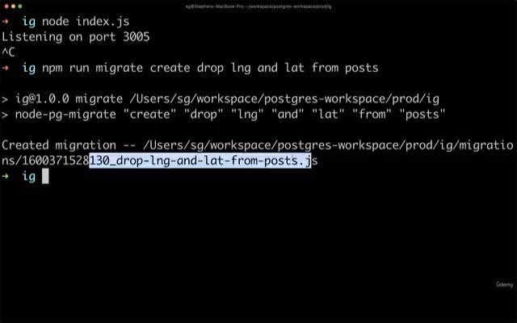
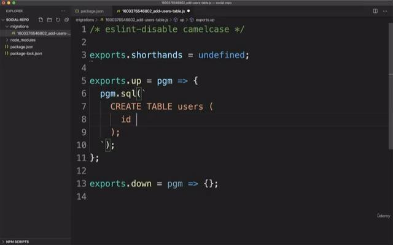
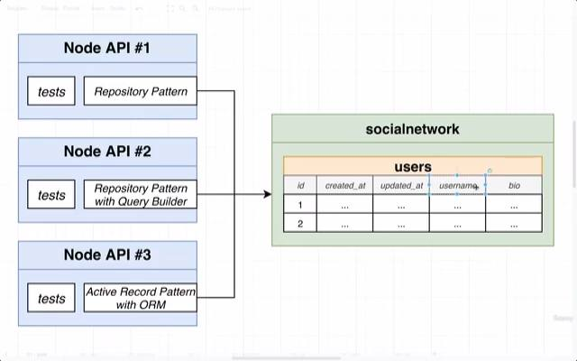
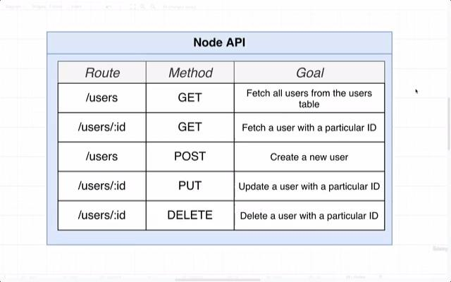
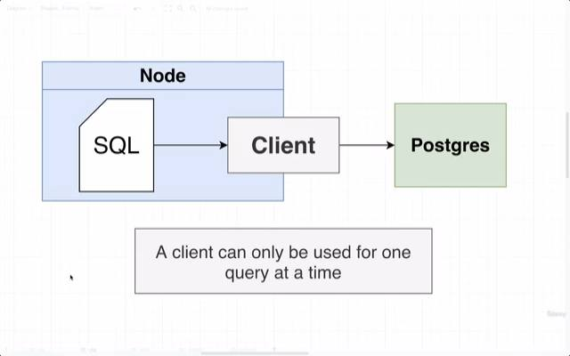
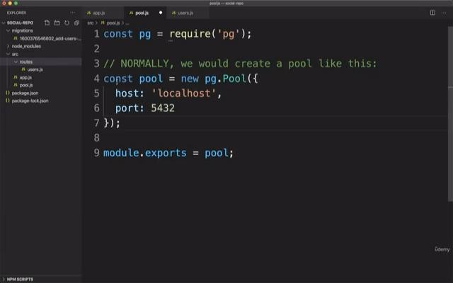
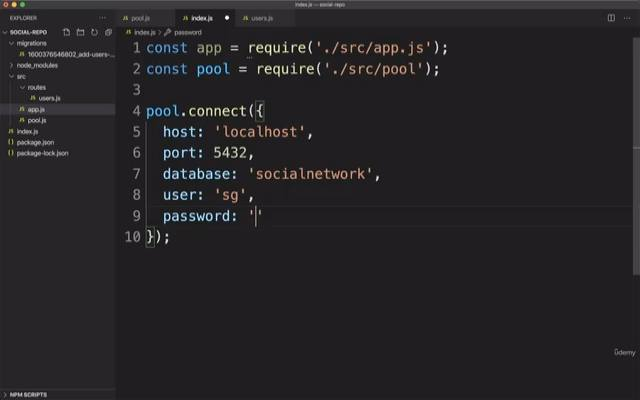

# SQL & PostgreSQL Guide（P43–P50）复现文档：删列迁移收尾 + 从零搭一个连 Postgres 的 Node API 骨架

> **读者对象**：前端转 AI 应用工程师，会 JS、用过 npm，没系统写过 Node 后端。
> **本节结束时的状态**：`social` 项目能启动，能连上 Postgres 的 `social network` 库，`users` 表已建好，5 条 REST 路由已注册但 handler 还是空的（请求会挂起，这是预期）。下一节才会往 handler 里填真正的查询。
> **环境基准**：macOS + Postgres.app（讲师环境），数据库用户 `SG`、端口 `5432`、密码空串。Windows 上用户名通常是 `postgres`，密码是安装时设的那个。

---

## 1. 这一节做什么

这一节其实是两件事拼在一起。

**前半件（P43）是上一个 `posts` 项目的最后一步**：把 `posts` 表里的 `lat`、`lng` 两列删掉。注意这不是「新建列」，而是「删列」——讲师特意强调，这是整个课程里第一次在迁移的 `up` 里做「减法」，`down` 里反而做「加法」把列加回来。跑完这条迁移、重启服务确认一切正常，前面那套「结构迁移 + 数据迁移」的完整流程就收尾了。

**后半件（P44–P50）开了一个全新的小项目 `social`**：一个极小的 Node/Express API，连一个叫 `social network` 的数据库，库里只有一张 `users` 表（`id`、`created_at`、`updated_at`、`bio`、`username`）。这一节只搭骨架，不做业务：

1. `package.json` 里配 `migrate` 和 `start` 两个脚本；
2. 用迁移建出 `users` 表；
3. `src/app.js` 导出一个「创建 Express 实例」的函数（注意：不是直接 `listen`）；
4. `src/routes/users.js` 用 `express.Router()` 把 5 条 REST 路由先占位注册上；
5. `src/pool.js` 把 `pg.Pool` 包进一个自定义类，提供 `connect` / `close` / `query` 三个方法；
6. 根目录 `index.js` 先连库、连成功后再 `listen(3005)`；
7. 最后引出 **repository 模式**：用一个对象集中管理对 `users` 表的访问（`find`、`findById`、`insert`、`update`、`delete`），下一节才真正写。

所以复现成功的标志不是「API 能返回用户列表」，而是：**`node index.js` 打印出监听日志、`users` 表在 pgAdmin 里能看到、故意写错连接凭据时进程会报错退出而不是假装启动成功**。

---

## 2. 讲师原话

> "好了，最后一步，我们要删除那两列。再说明一次，做法仍然只是再生成一个迁移并运行它。"
> —— p043 [00:00]
> （删列没什么特殊仪式，还是「生成迁移 → 跑迁移」两板斧。）

> "很有意思的是，这一次我们实际上是在 up 中删除一列，而不是创建一列。其他所有情况下，我们一直在 up 语句里添加内容；这一次则有点反过来。"
> —— p043 [00:27]
> （up 里做减法、down 里做加法，方向反过来了。）

> "我们将构建一个非常小的 Node API。然后连接到一个数据库，我们把它叫作 social network。在这个数据库里，我们会有一张用户表，里面只有几列。"
> —— p044 [00:00]

> "在整个过程中，我们真正关注的是如何从真实应用出发与数据库交互。因此，我们会更关注实际如何对接数据库，而不是搭建一个 API 之类的东西。"
> —— p044 [00:27]
> （这门课的重点是「应用怎么跟数据库打交道」，Express 只是载体，所以讲师写路由写得很快。）

> "PG 模块专门用于建立到 Postgres 的连接并执行一些 SQL。就是这样。PG 模块不负责构建查询，所以它不会帮你编写任何 SQL，也不做任何校验。"
> —— p047 [00:00]
> （`pg` 只负责连接和执行 SQL，不负责帮你拼 SQL、不做校验。）

> "创建 client 时，它一次只能执行一条查询。……我们通常不会直接使用 client，而是改用一种叫作 pool 的东西。"
> —— p047 [00:56]
> （client 一次只能跑一个查询；pool 内部维护一组 client，谁空闲谁上。）

> "有一种场景你会直接使用 client，那就是当你需要编写或运行一个事务时。"
> —— p047 [01:51]
> （要跑事务时必须自己拿一个 client，因为事务里的语句必须落在同一条连接上。）

> "事实证明，当你第一次创建 pool 时，它实际上完全不会与 Postgres 建立任何连接。只有创建 client 时，我们才会与 Postgres 建立连接。"
> —— p048 [02:54]
> （`new pg.Pool()` 是懒的，不会立刻连库，所以凭据写错了你也发现不了。）

> "我们将使用所谓的仓储模式。……这个用户仓储将成为我们访问用户表的中心入口。"
> —— p050 [00:29]
> （所有对 `users` 表的读写都收口到一个对象里。）

> "只需记住一个核心要点：在数据库里访问某一类资源时，要有一个中心入口。"
> —— p050 [03:20]
> （repository 模式一句话就能说完：一类资源，一个入口。）

---

## 3. 从零复现

### 3.0 前置条件

- Node.js（要能跑 class fields 语法，Node 12+ 就够；建议 18/20 LTS）
- PostgreSQL 已安装并启动，监听 `localhost:5432`
- pgAdmin（讲师用它删库、建库、看表；你也可以用 `psql` 或 `createdb` 代替）
- 上一个 `posts` 项目还在（只有 P43 那一步需要它）

先确认能连上：

```bash
psql -h localhost -p 5432 -U SG -d postgres -c "select version();"
```

> 课里没演示这一步，但连不上库后面全白搭。

### 3.1 P43：在 `posts` 项目里删掉 `lat` / `lng`

> 这一步依赖前面课程建好的 `posts` 项目（有 `posts` 表、有 `migrations/` 目录、`package.json` 里已有 `migrate` 脚本）。如果你没有那个项目，这一小节跳过，不影响后面 `social` 项目。

```bash
cd /path/to/posts        # 进上一个项目
npm run migrate create "drop lat and lng from posts"
```

> npm 7+ 如果发现参数没传进去，改成 `npm run migrate -- create "从 posts 表中删除 lat 和 lng 字段"`。

生成的文件在 `migrations/` 下，文件名是一串时间戳 + 你给的名字。打开它，把 `up` / `down` 写成第 4 节里的样子，然后：

```bash
npm run migrate up
```

再按你项目原来的方式重启服务，确认接口还能正常返回。讲师原话：「we should be able to start our server back up one last time. And still have everything working as expected.」



### 3.2 新建 `social` 项目并装依赖

```bash
mkdir social && cd social
npm init -y
npm install express pg
npm install node-pg-migrate
```

> 课里没展示安装过程（P45 开头只说「initial installation is all complete」），上面是按项目需要补的命令。`node-pg-migrate` 放 `dependencies` 还是 `devDependencies` 都可以，课里没区分。

### 3.3 改 `package.json` 的 `scripts`

讲师删掉了 `npm init` 自带的 `test` 脚本，换成 `migrate`，再加一个 `start`：

```json
{
  "scripts": {
    "migrate": "node-pg-migrate",
    "start": "node index.js"
  }
}
```

此时 `index.js` 还不存在，直接 `npm start` 会报错，这是正常的。

### 3.4 重建数据库

讲师特意没用旧的 `social network` 库，而是**先删再建**，保证是干净的空库。用 pgAdmin 的步骤是：

1. 关掉所有已经打开的 Query Tool 窗口（讲师原话：「make sure I close all the different query tool windows」——不关掉，drop 会失败）；
2. 右键 `social network` → Delete/Drop；
3. 右键 Databases → Create Database，名字仍然叫 `social network`。

用命令行等价操作：

```bash
dropdb -h localhost -p 5432 -U SG "social network"
createdb -h localhost -p 5432 -U SG "social network"
```

> 库名带空格，命令行和 SQL 里都必须加引号。这一点课里没明说，但库名确实是 `social network`。

### 3.5 生成并运行建表迁移

```bash
npm run migrate create "add users table"
```

打开 `migrations/` 下新生成的文件，写 `up` / `down`（见第 4 节），然后跑：

```bash
DATABASE_URL="postgres://SG@localhost:5432/social%20network" npm run migrate up
```

> 讲师原话是「I'm going to change that username to SG. And then after that entire environment variable, I will make sure I've got npm run migrate up.」——也就是在环境变量里把用户名换成 `SG`。`node-pg-migrate` 默认读 `DATABASE_URL`；如果你前面课程里的 `migrate` 脚本用了别的变量名或参数，以你项目里的写法为准。库名里的空格在 URL 里要写成 `%20`。

跑完去 pgAdmin 里看：`social network` → Schemas → public → Tables，应该能看到 `users`。





### 3.6 搭 Express 骨架

目录结构：在项目根目录新建 `src/`，里面放 `app.js`；`src/routes/` 里放 `users.js`。

`app.js` 的关键点：**导出一个函数，函数里创建 app 并返回**，而不是在文件里直接 `app.listen()`。讲师明确说这是为了后面的测试策略（测试时要能创建多个 app 实例）。文件内容见第 4 节。

`routes/users.js` 先按 RESTful 约定把 5 条路由占位注册好，handler 全部留空：

| 方法 | 路径 | 目标（讲师 PPT 的路由表） |
|---|---|---|
| GET | `/users` | 返回所有用户 |
| GET | `/users/:id` | 返回指定 id 的用户 |
| POST | `/users` | 新建用户 |
| PUT | `/users/:id` | 更新指定用户 |
| DELETE | `/users/:id` | 删除指定用户 |



然后在 `app.js` 里 `require` 这个 router 并 `app.use(usersRouter)`。

### 3.7 写 `src/pool.js`

讲师先讲了常规写法（`module.exports = new pg.Pool({...})`），然后说这种写法**测试时没法方便地连多个数据库**，所以改成用一个类把 pool 包起来：

- `connect(options)`：`new pg.Pool(options)` 赋给 `this._pool`，然后**跑一条 `SELECT 1 + 1` 探活**；
- `close()`：`this._pool.end()`；
- `query(sql)`：`this._pool.query(sql)`。

最后 `module.exports = new Pool()` 导出单例。





### 3.8 写根目录 `index.js`

两件事：连库、起服务。顺序很重要——**先 `pool.connect(...)`，`.then()` 里再 `listen`**，`.catch()` 里 `console.error`。这样凭据错了进程直接报错退出，不会出现「服务起来了但连不上库」的假成功。



### 3.9 跑起来，并验证失败路径

```bash
node index.js
# 或
npm start
```

预期输出：

```
Listening on port 3005
```

然后故意把 `index.js` 里的 `host` 改成一段乱码，再跑一次：应该看到错误被 `console.error` 打印出来，进程退出，**不会**出现监听日志。

最后访问一下路由（可选）：

```bash
curl -i http://localhost:3005/users
```

**会卡住直到超时**，因为 handler 是空的、没有任何 `res.send`。这不是 bug，是本节故意留的骨架状态。下一节实现 handler 后才会有响应。

---

## 4. 完整代码

### 目录结构

```
social/
├── package.json
├── index.js
├── migrations/
│   └── <时间戳>_add-users-table.js      # 文件名由命令生成，不要手写
└── src/
    ├── app.js
    ├── pool.js
    └── routes/
        └── users.js
```

### `package.json`

```json
{
  "name": "social",
  "version": "1.0.0",
  "description": "",
  "main": "index.js",
  "scripts": {
    "migrate": "node-pg-migrate",
    "start": "node index.js"
  },
  "dependencies": {
    "express": "^4.19.2",
    "node-pg-migrate": "^6.2.2",
    "pg": "^8.11.5"
  }
}
```

> 版本号课里没讲，上面只是能跑通的组合；装完以你 `package-lock.json` 里的实际版本为准。

### `migrations/<时间戳>_add-users-table.js`

```js
exports.up = (pgm) => {
  pgm.sql(`
    CREATE TABLE users (
      id SERIAL PRIMARY KEY,
      created_at TIMESTAMP WITH TIME ZONE DEFAULT CURRENT_TIMESTAMP,
      updated_at TIMESTAMP WITH TIME ZONE DEFAULT CURRENT_TIMESTAMP,
      bio VARCHAR(400),
      username VARCHAR(30) NOT NULL
    );
  `);
};

exports.down = (pgm) => {
  pgm.sql(`
    DROP TABLE users;
  `);
};
```

> 生成的文件顶部通常还有 `exports.shorthands = undefined;` 之类的模板头，保留即可，不要删。

### （P43 用）`migrations/<时间戳>_drop-lat-and-lng-from-posts.js`

```js
exports.up = (pgm) => {
  pgm.sql(`
    ALTER TABLE posts
      DROP COLUMN lat,
      DROP COLUMN lng;
  `);
};

exports.down = (pgm) => {
  pgm.sql(`
    ALTER TABLE posts
      ADD COLUMN lat NUMERIC,
      ADD COLUMN lng NUMERIC;
  `);
};
```

> 讲师口述时说成 "add column long"，实际列名是 `lng`（原来就有的列名）。

### `src/app.js`

```js
const express = require('express');
const usersRouter = require('./routes/users');

module.exports = () => {
  const app = express();
  app.use(express.json());
  app.use(usersRouter);
  return app;
};
```

### `src/routes/users.js`

```js
const express = require('express');

const router = express.Router();

router.get('/users', async (req, res) => {});
router.get('/users/:id', async (req, res) => {});
router.post('/users', async (req, res) => {});
router.put('/users/:id', async (req, res) => {});
router.delete('/users/:id', async (req, res) => {});

module.exports = router;
```

### `src/pool.js`

```js
const pg = require('pg');

class Pool {
  _pool = null;

  connect(options) {
    this._pool = new pg.Pool(options);
    return this._pool.query('SELECT 1 + 1;');
  }

  close() {
    return this._pool.end();
  }

  query(sql) {
    return this._pool.query(sql);
  }
}

module.exports = new Pool();
```

### `index.js`

```js
const app = require('./src/app');
const pool = require('./src/pool');

pool
  .connect({
    host: 'localhost',
    port: 5432,
    database: 'social network',
    user: 'SG',
    password: '',
  })
  .then(() => {
    app().listen(3005, () => {
      console.log('Listening on port 3005');
    });
  })
  .catch((err) => {
    console.error(err);
  });
```

---

## 5. 逐行解释

**迁移的 `up` / `down` 必须成对。** `pgm.sql()` 里放的是原样 SQL，node-pg-migrate 不会帮你改。P43 这条迁移的方向和以往相反：`up` 是 `DROP COLUMN`，`down` 是 `ADD COLUMN`。`down` 只能把「列」加回来，**加不回数据**——删列时列里的值已经没了。这一点和「在 JS 里删对象属性」不一样，数据库的 DDL 是不可逆操作，回滚只回滚结构。

**`SERIAL PRIMARY KEY`**：`SERIAL` 是 Postgres 的语法糖，自动建一个自增序列，插入时不传 `id` 也会自动填。对应到前端：类似 `Date.now()` 做 id 的土办法，但由数据库保证唯一。`PRIMARY KEY` 隐含 `NOT NULL` + 唯一索引。

**`TIMESTAMP WITH TIME ZONE DEFAULT CURRENT_TIMESTAMP`**：带时区的时间戳，插入时默认取当前时间。注意 `CURRENT_TIMESTAMP` 只在 **INSERT 时**生效一次；`updated_at` 不会因为你 UPDATE 而自动变化，要自动更新得靠触发器或应用层显式赋值。课里没讲这一层。

**`VARCHAR(30) NOT NULL`**：限长 30，且必须有值。`bio` 是 `VARCHAR(400)` 但可以为 `NULL`。

**为什么 `app.js` 导出一个函数，而不是直接 `listen`？** 讲师原话是「tied to our testing strategy」。如果文件一被 `require` 就 `listen`，测试时想开多个实例、想换端口、想跑完就关，都做不到。导出工厂函数后，`index.js` 负责「启动」，测试文件也可以自己造一个 app。这是前端也熟悉的思路：把「创建」和「启动」分开。

**`express.json()`**：解析请求体里的 JSON，解析结果挂在 `req.body`。没有它，POST/PUT 拿到的 `req.body` 是 `undefined`。

**`express.Router()` + `app.use(router)`**：router 是一组路由的容器，挂到 app 上就生效。讲师这里把路径写全（`/users`、`/users/:id`），没有用 `router.use('/users', ...)` 的前缀写法。

**`pg.Pool` vs `pg.Client`**：client 是一条连接，同一时刻只能跑一个查询；pool 是一组 client，`pool.query()` 会自动借一个空闲 client、跑完还回去。**事务必须自己 `pool.connect()` 拿一个 client**，因为 `BEGIN ... COMMIT` 之间的语句必须落在同一条连接上——这也是为什么 `pg` 同时提供两种 API。对应到 Node 世界：pool 很像 HTTP 客户端的 keep-alive 连接池；事务则像「同一件事必须在同一个会话里做完」。

**为什么要把 pool 包进类？** 常规写法 `module.exports = new pg.Pool({...})` 把连接参数写死在模块加载时，测试时想连另一个库（比如 `social network_test`）就得改代码。包一层后，`pool.connect(newOptions)` 可以随时切库。代价是：**所有调用方都得先调 `connect()`**，不能直接 `pool.query()`——这一点课里没强调，但你的代码必须遵守。

**`SELECT 1 + 1` 是干什么的？** `new pg.Pool()` 不会立刻连库，凭据错了也不报错。跑一条最便宜的查询会强制 pool 建一个 client、真正连一次 Postgres；连不上就 reject。讲师说 ORM 初始化时也干同样的事。所以 `connect()` 返回的是 Promise，`index.js` 里 `.then()` 才启动服务。

**`class Pool { _pool = null; }`** 是 class fields 语法（Node 12+）。下划线前缀只是约定「内部字段」，JS 没有真正的私有（除非用 `#pool`）。如果 Node 版本太老报 `SyntaxError`，改成 `constructor() { this._pool = null; }`。

**`module.exports = new Pool()`**：导出的是**单例**，整个进程共用同一个 pool。`index.js` 里 `require('./src/pool')` 拿到的就是这个实例。

**repository 模式**：讲师在 P50 说得很清楚——「一类资源，一个入口」。`users` 表的所有读写都走 `userRepository.find()` / `findById()` / `insert()` / `update()` / `delete()`，路由 handler 里不再直接写 SQL。好处是 SQL 集中、好改、好测；讲师也说了，实现形式随意（普通对象、类、静态方法都行），关键是「只有一个入口」。本节只讲了概念，代码下一节才写。

---

## 6. 复现检查清单

- [ ] `psql -h localhost -p 5432 -U SG -d postgres -c "select 1"` 能通
- [ ] `package.json` 里有 `migrate` 和 `start` 两个脚本，`test` 已删
- [ ] `npm run migrate create "add users table"` 在 `migrations/` 下生成了文件
- [ ] `DATABASE_URL=... npm run migrate up` 输出成功，没有报错
- [ ] pgAdmin 里 `social network` → public → Tables 能看到 `users`
- [ ] `users` 的列是：`id`（自增主键）、`created_at`、`updated_at`、`bio`、`username`（NOT NULL）
- [ ] `npm start`（或 `node index.js`）打印 `Listening on port 3005`
- [ ] 把 `host` 改成乱码再跑，会打印错误且**没有**监听日志
- [ ] `curl -i http://localhost:3005/users` 会挂起/超时（handler 为空，预期行为）
- [ ] 改回正确配置，`npm start` 恢复正常
- [ ] （可选）`npm run migrate down` 能把 `users` 表删掉，再 `up` 能建回来

---

## 7. 课里没讲但你会撞上的

1. **`npm run migrate create` 参数没传进去。** npm 7+ 对 `npm run script arg` 的行为有变化，保险写法是 `npm run migrate -- create "add users table"`，`up` / `down` 同理。讲师演示时没加 `--`，你照抄可能没反应。
2. **库名 `social network` 带空格。** `DATABASE_URL` 里要写 `social%20network`；SQL 里要写 `"social network"`。想省事可以把库名改成 `social_network`，但讲师全程用的是带空格的名字，改名前先确认前面课程的脚本没依赖它。
3. **`DATABASE_URL` 这个变量名是 `node-pg-migrate` 的默认约定**，课里只说了「把用户名换成 SG」，没念完整的命令。如果你前面课程的 `migrate` 脚本用了 `--database-url-var` 或别的参数，以你项目为准。
4. **空 async handler 会让请求挂起。** Express 4 里 async 函数抛错也不会自动进错误中间件，得自己 `try/catch` 或包一层；Express 5 才默认捕获。课里没讲版本差异，但你现在用的是 4.x，写 handler 时要留意。
5. **端口 3005 被占用**会报 `EADDRINUSE`。换个端口或先杀掉旧进程。
6. **Postgres 没启动**时，`pool.connect()` 会报连接被拒（`ECONNREFUSED`），不是凭据错误。先确认服务在跑。
7. **class fields 语法**需要 Node 12+。老环境报错就改 `constructor` 写法。
8. **`pool.query(sql)` 只接受一个参数，是临时版。** 讲师在 P49 明确说这里「有安全 issue」，后面会讲 `$1`、`$2` 占位符（P43 末尾也提过）。现在别拿它拼用户输入。
9. **事务要用 client，不是 pool。** 讲师 P47 提了但本节没写代码。自己写事务时用 `const client = await pool._pool.connect()`（或给类加一个 `connectClient()` 方法），`BEGIN` / `COMMIT` / `ROLLBACK` 都在同一个 client 上做，最后 `client.release()`。
10. **`updated_at` 不会自动更新。** 默认值只在 INSERT 时生效，UPDATE 时要手动 `SET updated_at = CURRENT_TIMESTAMP`，或建触发器。课里没讲。
11. **pgAdmin 删库前要关掉所有 Query Tool**，否则 drop 会失败（讲师在 P45 特意做了这一步）。
12. **`npm init -y` 生成的 `main` 字段指向 `index.js`**，和 `start` 脚本一致，不用改。`node-pg-migrate` 的迁移目录默认是 `migrations/`，也不用配。
13. **Windows 用户**：连接配置里的 `user` 通常是 `postgres`，`password` 是安装时设的密码；macOS + Postgres.app 默认密码是空串。这两个值