# SQL & PostgreSQL Guide（BV1qa3v6tEoC）P51–P56 复现文档：给 users 表接上 Repository 层，然后亲手打一次 SQL 注入

> 读者画像：前端转 AI 应用工程师。本文所有命令都能直接复制执行；凡是课程没讲、我为了「能跑起来」补的东西，都会用 **【补充】** 明确标出，课程没讲的地方会写「课里没讲」。

---

## 1. 这一节做什么

P51–P56 这 6 集是同一个连续动作，串起来是一条完整的数据链路：

```
HTTP 请求  →  Express 路由 (src/users.js)  →  Repository (src/repos/user-repo.js)
           →  连接池 (src/pool.js)         →  PostgreSQL (social_network.users 表)
```

做完之后你会得到四个可验证的结果：

1. `GET /users` 能把 Postgres 里 `users` 表的全部记录以 JSON 数组返回；
2. `GET /users/:id` 能按 id 返回单条记录，查不到时返回 404；
3. 数据库里的 `created_at` / `updated_at`（下划线命名，SQL 的规范）在返回给前端时自动变成 `createdAt` / `updatedAt`（驼峰，JS 的规范）；
4. 你会**亲手**用一行 URL 把 `users` 表删掉，理解「字符串拼接 SQL」到底有多致命——这是本节的高潮，也是下一节（参数化查询）的引子。

本节的产出物目录（`【补充】`标注的是课程在前面章节建好、本节只 require 而没有重新展示内容的文件）：

```
sql-social-network/
├── package.json
├── .env                       【补充】课程没讲环境变量，可跳过
├── request.http               ← P52 新建，用来发请求
└── src/
    ├── index.js               【补充】Express 入口，本节只出现「listening on port 3005」
    ├── pool.js                【补充】课程前面已建，P51 只是 require 它
    ├── users.js               ← P51/P55 修改（路由）
    └── repos/
        ├── user-repo.js       ← P51 新建，P54/P55 修改
        └── utils/
            └── to-camel-case.js  ← P54 新建
```

一个重要的前置事实：**P51 开头讲师说 `pool.js` 里「还有一个很大的安全问题」**（`Inside of our pool.js file, we still have a really big security issue in here` —— p051 [08:00]），但 P51–P56 全程没有回去改 `pool.js`，也没有说明那个问题具体是什么。所以本节你可以先照下面的最小版本用，别把它当讲师原版。

---

## 2. 讲师原话（带时间戳）

关于「Repository 有几种写法、选哪种」：

> "我们可以用很多种不同方式来定义这个仓储……归根结底，这三种方式基本等价，也确实没有太好的理由说一定要用其中某一种而不用另一种。"
> —— p051 [00:57]

> "我个人更喜欢这种静态方法的写法，因为它让这个类非常易读。"
> —— p051 [03:16]

关于为什么每个方法都要 `async`：

> "每当我们使用这个连接池对象执行查询时，它始终是一个异步操作。连接池对象需要花一些时间访问 Postgres、执行该查询并把结果返回。"
> —— p051 [04:13]

关于 `pool.query()` 的返回值不是你要的数据：

> "这里的这个结果对象并不会是实际的行数组……我们真正关心的实际数据在这个结果对象的 rows 属性上。"
> —— p051 [05:38]

关于测试工具二选一：

> "你可以下载一个叫 Postman 的独立客户端……如果你使用 Visual Studio Code，也可以下载一个小扩展，通过下载并运行一个名为 REST Client 的扩展，直接从编辑器里发起请求。"
> —— p052 [00:29]

关于字段命名冲突（这是本节最容易被忽略的设计决策）：

> "JavaScript 里的标准命名大小写格式是驼峰命名法……第二种选择是回到数据库里，直接把这些列重命名。不过，如果我们重命名这些列，就不再真正遵循 SQL 世界里的正确命名规范了……第三种选择，你大概也猜到了，就是我们要采用的做法：每当我们执行查询并拿到一些结果时，可以对这些结果做一些处理或解析。"
> —— p053 [02:44]

关于把这段脏代码抽成工具函数：

> "我们很可能需要在代码仓库里的多个不同位置复用它……所以我们也许应该把那段代码提取到一个单独的文件里，以便将来复用。"
> —— p054 [04:13]

关于 P55 那段代码的定性：

> "我们代码的第一个版本会有一个非常大的安全问题……我想先写出某种你可能会在自己项目里不小心写出来的幼稚代码，或者说不太好的代码。"
> —— p055 [02:00]

> "请任何时候都不要写出这样的代码。"
> —— p055 [03:19]

关于注入的危害：

> "我们把这种场景称为 SQL 注入漏洞利用……用户可以修改自己提供的值，并在你的数据库里执行他们想要的任意操作。"
> —— p056 [03:49]

> "无论在任何场景下，我们都绝不能直接拿用户提供的输入，用某种直接的字符串拼接方式把用户提供的值拼进查询里。"
> —— p056 [04:16]

> "如果你任何时候写出这样的代码，并最终把 SQL 注入漏洞利用引入到应用里，那是非常糟糕的事情。这绝对足以让你被公司开除。"
> —— p056 [04:45]

---

## 3. 从零复现

### 步骤 0：环境与依赖

需要：Node.js（课程用 CommonJS，即 `require` / `module.exports`，所以 `package.json` 里**不要**加 `"type": "module"`）、PostgreSQL、一个能连上的数据库（讲师在 pgAdmin 里看到的库叫 `social network`，实际连接用的库名以你自己的为准，本文按 `social_network` 写）、以及 `users` 表（表在本节之前已建好；本节只 insert 了 `bio` 和 `username` 两列就成功，说明 `id` / `created_at` / `updated_at` 有默认值）。

**课程没讲具体版本号**。`【补充】`下面是可以直接跑起来的参考版本：

```bash
npm init -y
npm install express@^4.19.2 pg@^8.12.0
```

`package.json`（完整文件）：

```json
{
  "name": "sql-social-network",
  "version": "1.0.0",
  "private": true,
  "scripts": {
    "start": "node src/index.js"
  },
  "dependencies": {
    "express": "^4.19.2",
    "pg": "^8.12.0"
  }
}
```

注意 `"start": "node src/index.js"` 这一行是刚需——讲师在 P52 用的启动命令就是 `npm run start`，终端随后打印出监听 3005 端口。

### 步骤 1：建目录

在 `src/` 下新建 `repos/` 文件夹，`repos/` 里再建 `utils/` 文件夹。讲师的顺序是：

> "在 src 目录里，我要新建一个名为 repos 的文件夹。然后在里面新建一个名为 user-repo.js 的文件。"
> —— p051 [00:00]

```bash
mkdir -p src/repos/utils
touch src/repos/user-repo.js
touch src/repos/utils/to-camel-case.js
touch request.http
```

### 步骤 2：确认 pool.js 可用（课程没给内容）

`pool.js` 是前面章节建的，本节只做一件事：在 `user-repo.js` 顶部 `require('../pool')`。讲师原话：

> "为了访问数据库，我们创建了那个 pool.js 文件……我们需要通过 require 把那个连接池引入到 user-repo 文件里。"
> —— p051 [00:29]

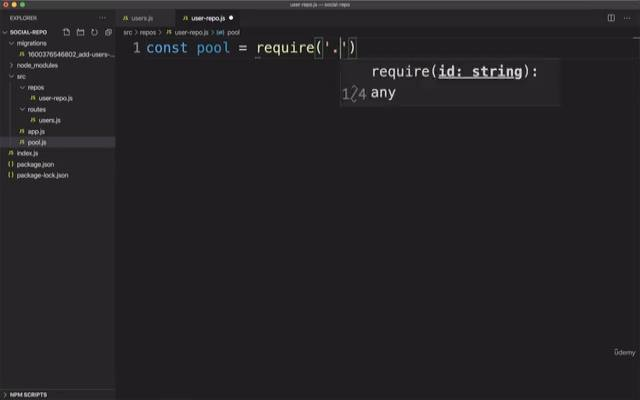

**课程没讲 `pool.js` 的内容**。`【补充】`下面是一个能用 `pool.query()` 跑通本节代码的最小实现（如果你前面章节已经写好了，别覆盖它，只要确认 `require('../pool')` 拿到的东西有 `.query()` 方法即可）：

```js
// src/pool.js  【补充】课程本节未展示此文件内容
const { Pool } = require('pg');

module.exports = new Pool({
  host: process.env.PGHOST || 'localhost',
  port: Number(process.env.PGPORT) || 5432,
  database: process.env.PGDATABASE || 'social_network',
  user: process.env.PGUSER || 'postgres',
  password: process.env.PGPASSWORD || '',
});
```

对应 `.env`（`【补充】`，课程没讲环境变量，可不用，直接改上面的默认值也行）：

```
PGHOST=localhost
PGPORT=5432
PGDATABASE=social_network
PGUSER=postgres
PGPASSWORD=你的密码
```

> 如果你用 `.env`，需要自己 `npm install dotenv` 并在 `index.js` 顶部 `require('dotenv').config()`。这一整套是本文件的补充，不是讲师讲的。

### 步骤 3：写 user-repo.js —— 三种写法选一种

讲师明确说三种写法「100% equivalent」，只是开发者的个人偏好：

- **写法一：导出一个普通对象**，对象上挂 `find` / `findById` / `insert`；
- **写法二：写一个 class + 实例方法**，最后 `module.exports = new UserRepo()`；
- **写法三（讲师选这个）：写一个 class + `static` 方法**，最后 `module.exports = UserRepo`，外部直接 `UserRepo.find()`。

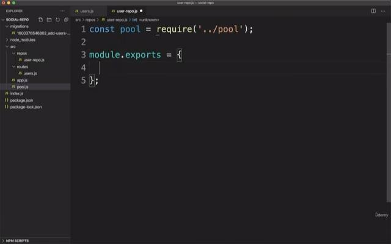

讲师选 static 的理由是「读起来干净」。**对前端同学的一句话对照**：`static` 方法就是挂在类本身上的方法，等价于你在 JS 里写 `const userRepo = { find() {} }` 然后直接 `userRepo.find()`，不用 `new`。这也是为什么下面的路由文件里写的是 `userRepo.find()` 而不是 `userRepo.find` 前先 `new`。

先只写 `find`（这是 P51 唯一实现了的函数），`insert` / `update` / `delete` 在 P51 只是**声明**了空壳，函数体是后面的章节才写的：

```js
// src/repos/user-repo.js
const pool = require('../pool');

class UserRepo {
  static async find() {
    const { rows } = await pool.query('SELECT * FROM users;');
    return rows;
  }

  // P51 只声明了这几个方法名，函数体是后面章节补的
  static async findById(id) {}
  static async insert() {}
  static async update() {}
  static async delete() {}
}

module.exports = UserRepo;
```

`find` 里的核心就是讲师反复强调的那一句：`pool.query()` 拿回来的**不是**行数组，行数组在 `result.rows` 上：

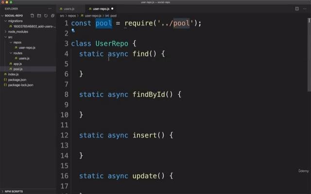

```js
const result = await pool.query('SELECT * FROM users;');  // result 上有很多统计信息
const rows = result.rows;                                  // 真正要的数据
// 等价写法：const { rows } = await pool.query('SELECT * FROM users;');
```

### 步骤 4：把 repository 挂到路由上

回到 `src/users.js`，顶部 require repository，然后在 `GET /users` 的 handler 里调用它：

```js
const express = require('express');
const userRepo = require('./repos/user-repo');

const router = express.Router();

router.get('/', async (req, res) => {
  const users = await userRepo.find();
  res.send(users);
});

module.exports = router;
```

> `【补充】` `express.Router()` 和 `module.exports = router` 的骨架、以及 `src/index.js` 里 `app.use('/users', usersRouter)` 这件事，课程本节没有重新演示（属于前面章节内容）。完整文件见第 4 节。

### 步骤 5：启动服务并发出第一个请求

终端里，在项目根目录：

```bash
npm run start
```

讲师终端打印出监听 3005 端口：

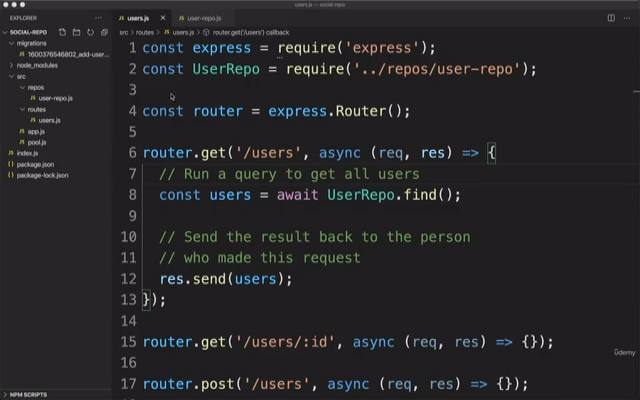

然后二选一发请求：

- **Postman**：`postman.com` 下载安装（可能要注册账号），新建 tab，方法 `GET`，URL `http://localhost:3005/users`，点 Send；
- **REST Client（讲师后续一直用这个）**：VS Code 扩展面板搜 `REST Client` 装第一个结果，然后在项目根目录新建 `request.http`：

```
http://localhost:3005/users

###

http://localhost:3005/users/1
```

用 `###` 分隔多个请求（讲师原话是 `put down hash, hash, hash`），右键某个 URL → `Send Request`，结果显示在右侧面板。

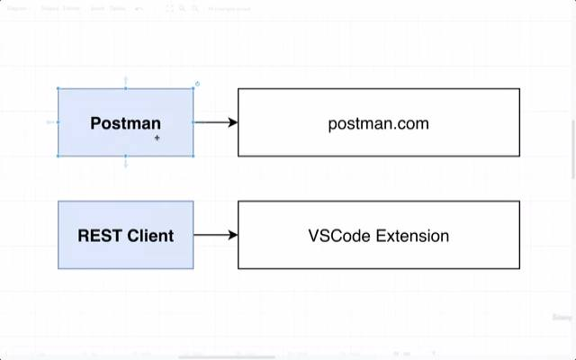

此时因为 `users` 表是空的，你会拿到 `[]`。这不是 bug，是本节给你的第一个「绿勾」。

### 步骤 6：手动插两条数据，再请求一次

打开 pgAdmin → `social network` 库 → Query Tool：

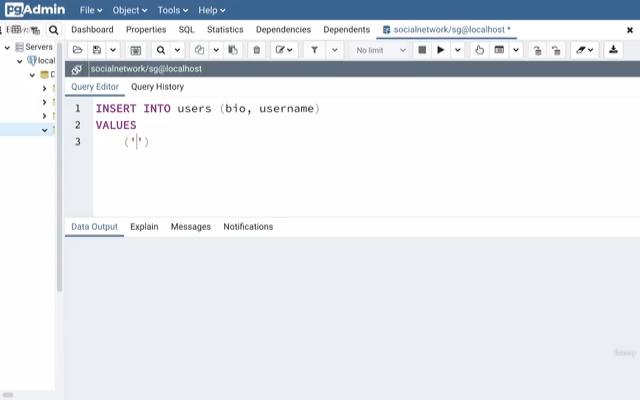

```sql
INSERT INTO users (bio, username)
VALUES
  ('This is my bio', 'Allison14'),
  ('This is about me', 'GIA67');

SELECT * FROM users;
```

执行成功后 `SELECT` 会返回两条记录。这里要点出来的是：`users` 表里除了 `id` / `bio` / `username`，还有 `created_at` 和 `updated_at` 两列（讲师特意让你「keep that in mind for a moment」）。

再回到 `request.http` 发一次 `GET /users`，这次拿到真实数据了——注意字段名是 `created_at`、`updated_at`：

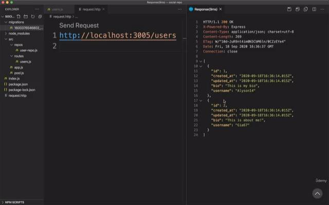

### 步骤 7：把下划线字段名转成驼峰（本节的技术核心）

问题：数据库里叫 `created_at`，JavaScript 里你希望写 `user.createdAt`。讲师给了三条路：忍着用下划线 / 改数据库列名（会破坏 SQL 命名规范）/ **在拿到结果后做一次转换**，他选第三条。

先写成一个普通函数，`rows.map` 遍历每一行，再 `for...in` 遍历每一行的 key，用正则把 `_x` 变成 `X`：

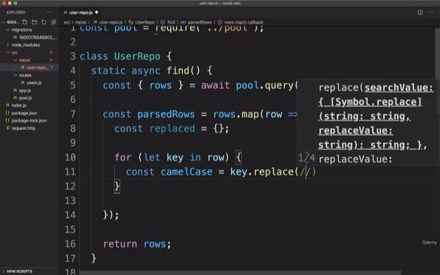

```js
function toCamelCase(rows) {
  return rows.map((row) => {
    const replaced = {};

    for (let key in row) {
      const camelCase = key.replace(/([-_][a-z])/gi, ($1) =>
        $1.toUpperCase().replace('_', '')
      );
      replaced[camelCase] = row[key];
    }

    return replaced;
  });
}
```

然后讲师立刻把它抽成独立文件 `src/repos/utils/to-camel-case.js`，因为后面的 `findById` / `insert` / `update` / `delete` 全都要用：

![p054 03:17 讲师把转换逻辑抽到独立文件，并在替换对象里写 replaced[camelCase] = row[key]](images/p054_0197s.jpg)

`user-repo.js` 里改成：

```js
const toCamelCase = require('./utils/to-camel-case');

static async find() {
  const { rows } = await pool.query('SELECT * FROM users;');
  return toCamelCase(rows);
}
```

再请求一次，返回的字段变成 `createdAt` / `updatedAt`：

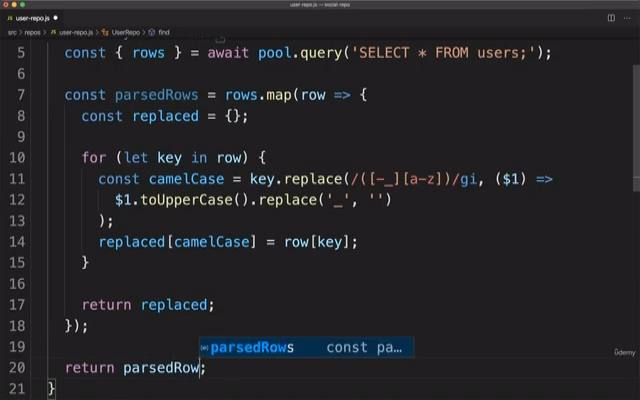

### 步骤 8：实现 findById（先写「坏版本」）

先写路由，因为要确认 `req.params.id` 是怎么拿到的。讲师的做法是把 `id` 从 `params` 解构出来，用它调 `findById`，然后判空——**查不到就 404**：

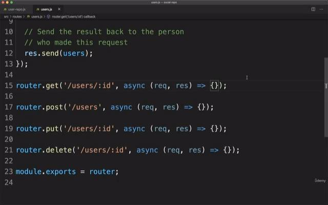

```js
router.get('/:id', async (req, res) => {
  const { id } = req.params;
  const user = await userRepo.findById(id);

  if (user) {
    res.send(user);
  } else {
    res.status(404).send();
  }
});
```

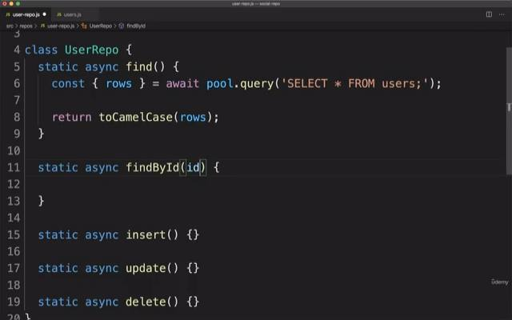

然后 `findById` —— **P55 给的是故意有漏洞的版本**，讲师连说了四五次「这是坏代码」「任何时候都不要这么写」：

```js
static async findById(id) {
  const { rows } = await pool.query(`SELECT * FROM users WHERE id = ${id};`);
  return toCamelCase(rows)[0];
}
```

几个细节：`req.params.id` **永远是字符串**（哪怕 URL 里写的是 `1`）；`id` 列唯一，所以理论上一行；`toCamelCase(rows)[0]` 在数组为空时返回 `undefined`，正好被路由里的 `if (user)` 接住变成 404。验证：`/users/1` 返回用户，`/users/3` 返回 404。

### 步骤 9：亲手复现 SQL 注入（只在本地演练库做！）

把 `request.http` 里的 URL 改成：

```
http://localhost:3005/users/1; drop table users;
```

发送。你看不到正常数据，返回是空的；但**去服务端终端看**，报错信息里有 `relation "users" does not exist`。

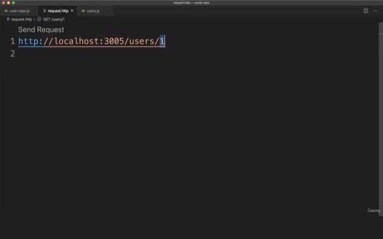

再去 pgAdmin：`SELECT * FROM users;` 同样报错，Tables 列表里 `users` 表已经没了。

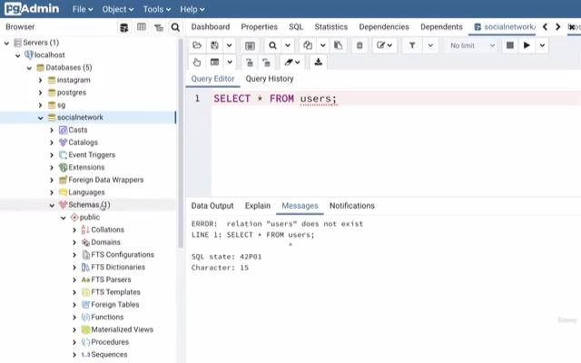

原因一目了然：字符串拼接之后，数据库实际收到的是两条语句——

```sql
select * from users where id = 1; drop table users;
```

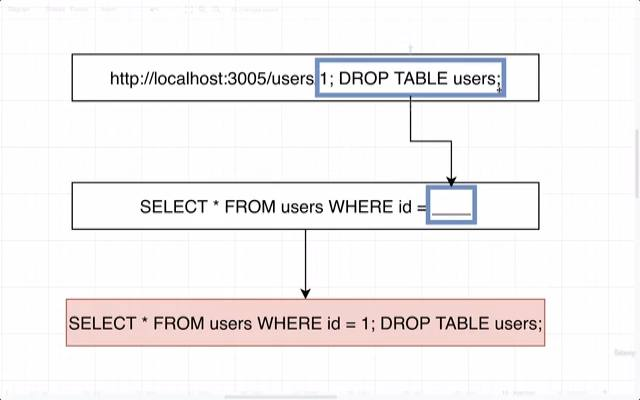

讲师的结论只有一句：**永远不要把用户提供的值用字符串拼接/模板字符串插值的方式拼进 SQL**。他同时明确说，安全写法是存在的，「next video」再讲——也就是说 **P51–P56 没有给出修复代码**，`$1` 占位符那套是下一节的内容。

### 步骤 10：把表重建回来（课程没讲）

**课程没讲怎么恢复**。`【补充】`一个能让你重复演练的建表语句（字段名取自你刚才在接口返回里看到的 `id` / `bio` / `username` / `created_at` / `updated_at`；具体的约束、类型以课程前面章节的建表脚本为准）：

```sql
CREATE TABLE users (
  id SERIAL PRIMARY KEY,
  bio TEXT,
  username TEXT UNIQUE,
  created_at TIMESTAMP DEFAULT CURRENT_TIMESTAMP,
  updated_at TIMESTAMP DEFAULT CURRENT_TIMESTAMP
);
```

建完把步骤 6 的 `INSERT` 再跑一遍，`GET /users` 恢复正常。

---

## 4. 完整代码

以下 6 个文件按顺序保存即可运行。标注 `【补充】` 的不是讲师本节展示的原文。

### 4.1 `package.json`

```json
{
  "name": "sql-social-network",
  "version": "1.0.0",
  "private": true,
  "scripts": {
    "start": "node src/index.js"
  },
  "dependencies": {
    "express": "^4.19.2",
    "pg": "^8.12.0"
  }
}
```

### 4.2 `src/pool.js`【补充】

```js
// src/pool.js  【补充】课程本节只 require 它，没有展示内容
const { Pool } = require('pg');

module.exports = new Pool({
  host: process.env.PGHOST || 'localhost',
  port: Number(process.env.PGPORT) || 5432,
  database: process.env.PGDATABASE || 'social_network',
  user: process.env.PGUSER || 'postgres',
  password: process.env.PGPASSWORD || '',
});
```

### 4.3 `src/index.js`【补充】

```js
// src/index.js  【补充】课程本节只出现 "listening on port 3005"
const express = require('express');
const usersRouter = require('./users');

const app = express();

app.use(express.json());
app.use('/users', usersRouter);

const PORT = process.env.PORT || 3005;

app.listen(PORT, () => {
  console.log(`Listening on port ${PORT}`);
});
```

### 4.4 `src/users.js`

```js
// src/users.js
const express = require('express');
const userRepo = require('./repos/user-repo');

const router = express.Router();

// GET /users  -> 返回 users 表全部记录
router.get('/', async (req, res) => {
  const users = await userRepo.find();
  res.send(users);
});

// GET /users/:id  -> 返回单个用户，查不到返回 404
router.get('/:id', async (req, res) => {
  const { id } = req.params;
  const user = await userRepo.findById(id);

  if (user) {
    res.send(user);
  } else {
    res.status(404).send();
  }
});

module.exports = router;
```

### 4.5 `src/repos/user-repo.js`

```js
// src/repos/user-repo.js
const pool = require('../pool');
const toCamelCase = require('./utils/to-camel-case');

class UserRepo {
  // 查询全部用户
  static async find() {
    const { rows } = await pool.query('SELECT * FROM users;');
    return toCamelCase(rows);
  }

  // ⚠️ 危险示范：这是 P55 故意写出的「坏代码」，仅用于本地复现 SQL 注入。
  // 下一节才给出安全写法，不要在真实项目里保留这段。
  static async findById(id) {
    const { rows } = await pool.query(`SELECT * FROM users WHERE id = ${id};`);
    return toCamelCase(rows)[0];
  }

  // P51 只声明了方法名，函数体是后面章节的内容
  static async insert() {}
  static async update() {}
  static async delete() {}
}

module.exports = UserRepo;
```

> 如果你想用讲师说的另外两种写法，把上面替换成下面任一版本，其余文件不用改（因为外部调用的都是 `userRepo.find()` / `userRepo.findById()`）：
>
> ```js
> // 写法一：普通对象
> module.exports = {
>   async find() {
>     const { rows } = await pool.query('SELECT * FROM users;');
>     return toCamelCase(rows);
>   },
> };
> ```
>
> ```js
> // 写法二：class + 实例方法，导出一个实例
> class UserRepo {
>   async find() {
>     const { rows } = await pool.query('SELECT * FROM users;');
>     return toCamelCase(rows);
>   }
> }
> module.exports = new UserRepo();
> ```

### 4.6 `src/repos/utils/to-camel-case.js`

```js
// src/repos/utils/to-camel-case.js
module.exports = (rows) => {
  return rows.map((row) => {
    const replaced = {};

    for (let key in row) {
      const camelCase = key.replace(/([-_][a-z])/gi, ($1) =>
        $1.toUpperCase().replace('_', '')
      );
      replaced[camelCase] = row[key];
    }

    return replaced;
  });
};
```

### 4.7 `request.http`

```
http://localhost:3005/users

###

http://localhost:3005/users/1
```

### 4.8 手动造数据用的 SQL

```sql
-- 在 pgAdmin 的 Query Tool 里执行
INSERT INTO users (bio, username)
VALUES
  ('This is my bio', 'Allison14'),
  ('This is about me', 'GIA67');

SELECT * FROM users;
```

---

## 5. 逐行解释

**`const pool = require('../pool');`**
`user-repo.js` 在 `src/repos/` 里，`pool.js` 在 `src/` 里，所以是 `../pool`。因为 `pool.js` 里 `module.exports = new Pool({...})`，这里拿到的**不是类而是一个已经实例化的连接池**，所以下面直接 `pool.query(...)`，不需要 `new`。**对前端同学**：这相当于一个模块级的单例服务对象，全应用共享一个连接池。

**`static async find()`**
`static` 让方法挂在 class 上而不是实例上，于是 `module.exports = UserRepo` 之后，外部写 `userRepo.find()` 就能用，不用 `new UserRepo()`。`async` 是因为 `pool.query()` 返回 Promise——讲师的原话是「它总是异步操作，要花时间到 Postgres 执行查询再拿回结果」（p051 [04:13]）。有了 `async` 才能在函数体里用 `await` 等待结果。**在 JS/Node 里对应什么**：`async/await` 就是 Promise 的语法糖，`await pool.query(...)` 相当于 `.then(result => ...)`，只是写法更像同步代码。

**`const { rows } = await pool.query('SELECT * FROM users;')`**
这一行有两个知识点。第一，`pool.query()` 走的是预处理/简单查询通道，返回的是一个**结果对象**，不是行数组；第二，用对象解构把 `rows` 取出来。讲师非常明确：「the actual data that we really care about on that result object is on the rows property」（p051 [05:38]）。`rows` 是「对象组成的数组」，每个对象是一行。**注意**：`result` 上还有别的字段，但 P51–P56 只用到 `rows`，其它字段名请以你实际的 `console.log(result)` 输出为准，课里没讲。

**`return rows;` → `return toCamelCase(rows);`**
第一次实现是直接返回，第二次改成先转换。转换发生在「数据库出口」，也就是每一处 `pool.query` 之后都要过一次，这也是为什么讲师要把它抽成独立文件（p054 [04:13]）。

**`rows.map((row) => { ... })`**
逐行处理。`map` 返回新数组，不修改原 `rows`，所以不会污染驱动返回的对象。

**`const replaced = {};` + `for (let key in row)`**
给每一行造一个新对象，遍历原行的所有 key（`id` / `bio` / `username` / `created_at` / `updated_at`）。`for...in` 遍历的是可枚举属性名，对普通对象够用。

**`key.replace(/([-_][a-z])/gi, ($1) => ...)`**
正则 `([-_][a-z])` 匹配「一个下划线或短横线 + 紧跟的一个小写字母」，比如 `_a`。`g` 全局匹配（`created_at` 只有一个，但 `some_long_name` 有多个），`i` 忽略大小写。回调参数 `$1` 就是整个匹配到的两字符片段（如 `_a`）。

**`$1.toUpperCase().replace('_', '')`**
先 `toUpperCase()` 把 `_a` 变成 `_A`，再把剩下的 `_` 换成空字符串，得到 `A`。所以 `created_at` → `createdAt`，`updated_at` → `updatedAt`，而 `id` / `bio` / `username` 因为没有匹配，原样返回。

**`replaced[camelCase] = row[key];`**
把值搬过去。注意新 key 是 `camelCase`，旧 key 是 `key`——写反了数据就全丢。

**`return toCamelCase(rows)[0];`（findById）**
`toCamelCase` 永远返回数组，`[0]` 取第一项；数组为空时 `[0]` 是 `undefined`，路由里的 `if (user)` 会走 else 分支返回 404。讲师在 P54 就说过「也许我们得对 rows 做进一步处理，不能直接返回」（p051 [07:33]）——这里就是那个「进一步处理」。

**`const { id } = req.params;`**
Express 会把 `/users/:id` 匹配到的部分放进 `req.params.id`，**类型是字符串**。即使 URL 写的是 `1`，`typeof id === 'string'`。这对后面的注入至关重要：字符串拼接时它不带任何引号，所以能直接接上 `1; drop table users;`。

**`pool.query(\`SELECT * FROM users WHERE id = ${id};\`)`**
**这是本节唯一要你记住「不要这么写」的一行。** 模板字符串把 id 原样插进 SQL 文本，数据库看到的是一段「合法 SQL」而不是「一个值」。所以 `id` 传 `1; drop table users;` 就变成两条语句。P56 整集都在讲这个：讲师说这类问题叫 **SQL injection exploit**（p056 [03:49]），并且强调「绝对不能写」，还补了一句「真在生产里引入这个漏洞，是会被开掉的水平」（p056 [04:45]）。

**`if (user) { res.send(user); } else { res.status(404).send(); }`**
404 的语义是「资源不存在」。注意这里没有 `try/catch`——一旦 `pool.query` 抛错（比如表被删了），这个 async handler 里的异常会变成未处理的 Promise rejection，Express 4 不会自动兜住，服务端终端会打出一大坨错误。课程里能看到这一点（P56 讲师回终端就看到报错），但**课程没有讲怎么加错误处理**。

---

## 6. 复现检查清单

按顺序打勾，每一条都有可观察的结果：

- [ ] `npm install express pg` 成功，`node -v` 正常，`package.json` 里有 `"start": "node src/index.js"`
- [ ] 目录结构是 `src/repos/user-repo.js`、`src/repos/utils/to-camel-case.js`、`src/users.js`、`src/pool.js`、`src/index.js`
- [ ] `pool.js` 能被 require，且导出的对象有 `.query()` 方法（在 `user-repo.js` 里 `console.log(typeof pool.query)` 应为 `function`）
- [ ] `npm run start` 终端打印 `Listening on port 3005`（或你改的端口）
- [ ] 数据库 `users` 表存在，`SELECT * FROM users;` 能查出 `id` / `bio` / `username` / `created_at` / `updated_at`
- [ ] `GET http://localhost:3005/users` 在表为空时返回 `[]`
- [ ] pgAdmin 执行 `INSERT INTO users (bio, username) VALUES (...), (...);` 成功，`SELECT *` 看到两行，且 `created_at` / `updated_at` 有值
- [ ] 再请求 `GET /users`，返回数组长度为 2，字段名是 `createdAt` / `updatedAt`（不是下划线）
- [ ] `GET /users/1` 返回单个 JSON 对象
- [ ] `GET /users/3` 返回 404（假设只有 2 条数据）
- [ ] 在**本地演练库**把 URL 改成 `/users/1; drop table users;` 发送后：服务端终端出现 `relation "users" does not exist` 一类错误；pgAdmin 里 `users` 表消失 —— 这一步做完请立刻用 4 节/步骤 10 的建表语句恢复
- [ ] 恢复表并重新插入数据后，`GET /users` 再次正常返回 2 条记录

---

## 7. 课里没讲但你会撞上的

**① P51 提到的 `pool.js` 安全问题，到 P56 都没解决。**
讲师在 p051 [08:00] 说 `Inside of our pool.js file, we still have a really big security issue in here`，但 P51–P56 全程没有再打开 `pool.js`，也没有说问题是什么。所以：你按本文的最小 `pool.js` 跑出来的东西，在安全上**不等于**课程最终状态。「它到底哪里不安全」——课里没讲，需要看后续章节。

**② 参数化查询（`$1` 占位符）在本节没有出现。**
P56 结尾原话是「there's a very clear solution… let's take a look at how we're going to solve this problem in the next video」（p056 [06:10]）。所以本文里的 `findById` 停留在漏洞版，这是**故意的**，为了让你亲眼看到 `drop table`。**不要在真实项目里留着它。** 至于 `$1` 的具体写法，课里（本节范围）没讲。

**③ 为什么恶意请求的响应体是空的、但表真的被删了？**
课里只展示了「发送后没反应」+「服务端报错」，没有解释底层原因。这和你用的驱动/查询方式有关，**该行为请以你自己的实际输出为准**，不要照本文猜。

**④ 错误处理完全没有。**
`find()` 和 `findById()` 都没有 `try/catch`，路由 handler 也没有 `next(err)`。表被删之后，`GET /users` 会一直抛错。**课里没讲**如何处理，但你会立刻撞上。生产代码里至少要在路由层包一层 async 错误捕获（这是补充建议，不是讲师内容）。

**⑤ 表结构是谁建的、`id` 是不是自增、`created_at` 默认值是什么。**
本节只做了 `INSERT INTO users (bio, username)` 就成功了，说明其它列有默认值；但**建表语句课里没讲**。步骤 10 的 `CREATE TABLE` 是补充，仅供演练恢复。

**⑥ `id` 从数据库回到 JS 时的类型。**
`SERIAL`（int4）回到 Node 里是 `number`，而 `req.params.id` 是 `string`——两者比较/拼接时容易出坑。**课里没讲**类型转换，本文也故意没加转换，因为注入演示依赖它保持字符串。

**⑦ 端口被占用。**
讲师固定用 `3005`。如果启动时报端口占用，改 `PORT` 环境变量（本文 `index.js` 支持）或杀掉占用进程。**课里没讲**。

**⑧ 事务、锁、并发。**
本节一个都没涉及。如果你后面要写「转账」这类需要原子性的逻辑，会用到事务；**在 JS/Node 里**对应的是从连接池里 `connect()` 拿一个 client，手动 `BEGIN / COMMIT / ROLLBACK`，而不是直接用 `pool.query`（因为 `pool.query` 每次可能拿到不同连接）。**这条是补充，课里没讲**。

**⑨ `insert` / `update` / `delete` 是空壳。**
P51 只写了方法签名，函数体没写。所以现在调 `userRepo.insert()` 会返回 `undefined`，别以为是 bug。

**⑩ 关于命名风格的选择，讲师给的结论值得记一下。**
他明确说不要为了 JS 的驼峰去改数据库列名（会破坏 SQL 的下划线规范），而是在「数据出口」做一次转换（p053 [02:44]）。这条决策会影响你以后所有 repository 方法——每写一个新的查询，都要记得过一遍 `toCamelCase`。