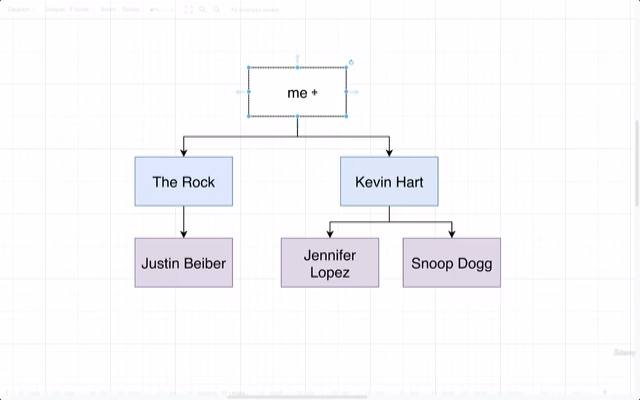
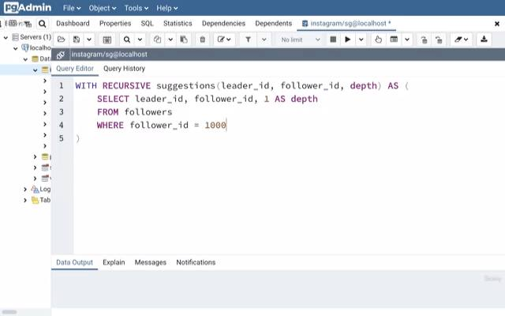
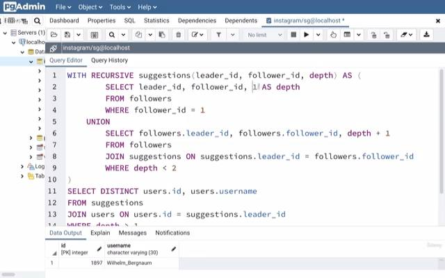
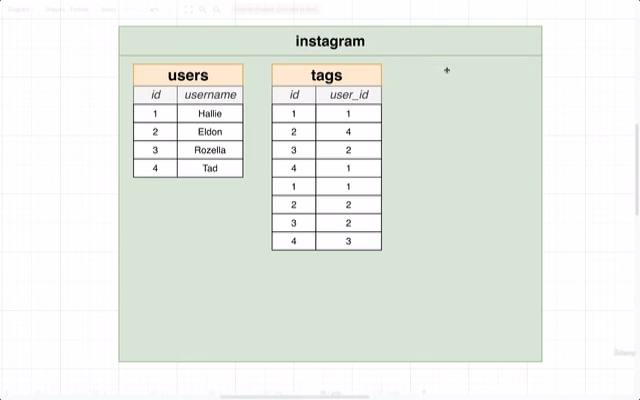
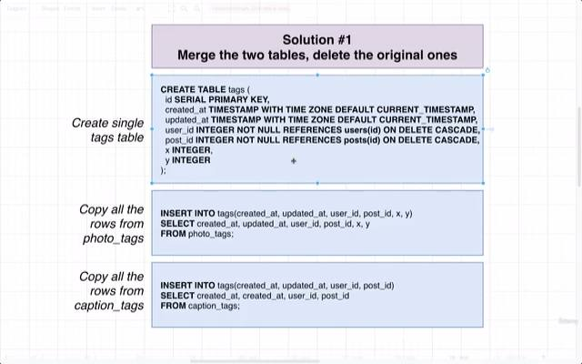

# SQL & PostgreSQL Guide（P7–P11）复现文档：递归 CTE、热门用户统计与 tags 表合并方案

> 覆盖 P7–P11。课程本身使用的是 Instagram 示例库；逐字稿没有给出完整建表 DDL，所以本文在“从零复现”里给出一个**按逐字稿出现过的表名/字段名重建的最小可运行库**。凡是逐字稿没有明说的内容，我会标注“课里没讲”或“本文为跑通而补全”。

---

## 1. 这一节做什么

这一节围绕三个任务展开：

1. **用递归 CTE 做“关注推荐”**：  
   从一个用户出发，先找出他直接关注的人，再找出“他关注的人所关注的人”，一层层往下扩展。课程用 Instagram 的“Suggested for you”页面作为场景。
2. **统计最受欢迎用户**：  
   把 `photo_tags` 和 `caption_tags` 通过 `UNION ALL` 合成一个“标签用户集合”，再和 `users` 连接，按用户名分组计数，按标签数倒序排出最受欢迎用户。
3. **复盘一个表设计问题**：  
   课程认为把标签拆成 `photo_tags` 和 `caption_tags` 可能是一个设计错误，因为很多查询都要反复 `UNION`。P11 先讲“方案一：新建一张 `tags` 表，把两张旧表数据插入进去，再删除旧表”，并指出它的两个大问题：ID 不能直接复制、已有查询/外键会被破坏。课程明确说不会采用方案一，下一节再讲更好的方案。

最终你会得到一套可以直接用 `psql` 执行的 SQL 文件：建表、造数、递归查询、热门用户查询、以及 P11 的方案一迁移脚本。

阅读这一节时，建议把三个任务分别看成三种能力：第一是“递归查询树/图结构”的能力，第二是“合并多张结构相似的表再聚合”的能力，第三是“识别表设计代价并评估迁移风险”的能力。课程的重点不是让你背下每条 SQL，而是让你在遇到类似关注关系、推荐关系、层级关系、标签关系时，知道可以用什么 SQL 结构去表达；同时在看一个看似可以直接执行的迁移脚本时，能意识到它可能破坏哪些外部依赖。本文后面的复现会严格围绕这三个任务展开，不会额外引入课程没有讲的新业务。




---

## 2. 讲师原话（译述/节选）

> 以下不是逐字中文翻译，而是根据逐字稿做的中文节选/译述；时间点和 P 号保留。

- “我们先从 Instagram 的一张截图开始，这个页面在给我推荐应该关注谁。我想弄清楚为什么这些人会被推荐给我。”  
  —— p007 [00:00]
- “我关注了 The Rock 和 Kevin Hart；The Rock 又关注 Justin Bieber，Kevin Hart 关注 Jennifer Lopez 和 Snoop Dogg。Instagram 的假设是：如果我关注这些人，而这些人又关注那些人，那我可能也会对他们感兴趣。”  
  —— p007 [00:29]
- “这个结构本质上是树；更严格说，关注关系会形成图，因为我可以关注 Kevin Hart，Kevin Hart 也可以关注我。但为了这个练习，我们先假设它是严格的树，这样查询更容易理解。”  
  —— p007 [03:13]
- “我们要写 `WITH RECURSIVE`，把这个 CTE 叫 `suggestions`，结果表有 `leader_id`、`follower_id` 和一个 `depth`。`depth` 不是原表字段，而是记录我们找到这个建议时处在第几层。”  
  —— p008 [02:48]
- “初始查询里，我们从 `followers` 取 `leader_id`、`follower_id`，并把 `depth` 硬编码为 1；条件是 `follower_id = 1000`，意思是我们先给 ID 为 1000 的这个用户找建议。”  
  —— p008 [05:06]
- “递归部分写 `SELECT followers.leader_id, followers.follower_id, depth + 1 FROM followers JOIN suggestions ON suggestions.leader_id = followers.follower_id`，再加 `WHERE depth < 3`。”  
  —— p008 [05:38]
- “外层查询从 `suggestions` 里 `SELECT DISTINCT users.id, users.username`，连接 `users`，条件是 `users.id = suggestions.leader_id`，再过滤 `depth > 1`，最后 `LIMIT 30`。”  
  —— p008 [06:32]
- “执行递归 CTE 时，可以先定义结果表和 working table。非递归语句的结果会同时放进 working table 和结果表。”  
  —— p009 [01:24]
- “理解递归部分有个小技巧：找到 CTE 名字的引用，在脑子里把它替换成 working table。不要真的把 `working table` 写进 SQL。”  
  —— p009 [02:45]
- “如果递归语句没有返回任何行，我们就停止递归；结果表就可以被当成 CTE 的名字 `suggestions` 来用。”  
  —— p009 [07:07]
- “你不需要自己能完整复现这条查询。重点是理解：当数据是树或图结构时，可以用递归 CTE 取数据。”  
  —— p009 [09:00]
- “我们要找最受欢迎用户：定义成在整个平台的所有帖子中被 tag 最多的用户。先把 `photo_tags` 和 `caption_tags` 合成一个 tags 集合，再和 users 连接、按 username 分组、计数、倒序。”  
  —— p010 [00:27]
- “这里用 `UNION ALL`，因为不想去重；子查询放在 JOIN 里必须给别名，所以我们叫它 `tags`。”  
  —— p010 [03:17]
- “跑出来 Bonita 96 在最上面，看起来他们有 21 个左右的标签。这个查询能工作，但尴尬的是我们又做了一次 `UNION`。”  
  —— p010 [04:49]
- “我们已经多次不得不对 `caption_tags` 和 `photo_tags` 做 `UNION`，但没发现拆成两张表有什么好处。所以这可能是设计错误。”  
  —— p010 [05:38]
- “方案一很直接：新建一张 `tags` 表，把两张旧表的数据插进去，然后删除旧表。但它有两个大问题：第一，不能把旧表的 ID 直接复制过来，因为两张表都可能有重复 ID；第二，已有查询会引用旧表，删除后就会坏掉。”  
  —— p011 [00:29] / [01:54] / [02:49]




---

## 3. 从零复现

### 3.1 目录结构

在你自己的工作目录里建：

```text
sql-postgres-recursive/
├── db/
│   ├── 01_schema.sql
│   ├── 02_seed.sql
│   ├── 03_suggestions_depth3.sql
│   ├── 04_suggestions_depth2.sql
│   ├── 05_popular_users.sql
│   └── 06_merge_tags_solution1.sql
└── README.md
```

这个目录结构不是课程要求，而是本文为复现方便补的。把建表、造数、查询、迁移拆成不同文件，好处是每次出错时可以单独重跑某一步；例如递归 CTE 写错时，不需要重新造数，只需要重新执行 `03_suggestions_depth3.sql` 或 `04_suggestions_depth2.sql`。如果你在 VS Code、DataGrip、pgAdmin 里执行，也可以把文件内容直接复制到 SQL 编辑器里，但要保证先执行 `01_schema.sql`，再执行 `02_seed.sql`，否则表或数据不存在。

### 3.2 依赖与版本

课程没有演示安装 PostgreSQL，也没有给版本号。本文按 PostgreSQL 14+ 可运行来写；`psql` 随 PostgreSQL 安装。

| 依赖 | 版本 | 说明 |
|---|---|---|
| PostgreSQL | 14+，课里没讲具体版本 | 递归 CTE、`UNION ALL`、`serial` 在这些版本都可用 |
| psql | 随 PostgreSQL | 用来执行 SQL 文件 |
| 数据库名 | `instagram_demo` | 本文自定义的复现库名 |

如果你的机器上已经有一个 PostgreSQL 服务，只需要确认 `psql --version` 能输出版本号。若命令不存在，说明 PostgreSQL 客户端没有安装或没有加入 `PATH`；这时不是 SQL 语法问题，而是环境问题。本文使用的 `serial`、`WITH RECURSIVE`、`UNION ALL`、`GROUP BY` 都是 PostgreSQL 常见能力，不依赖额外扩展。课程没有要求安装扩展，也没有使用存储过程或自定义函数。

### 3.3 环境变量

课程没有讲连接配置。用 `psql` 时常用这些环境变量；如果你的 PostgreSQL 是本机默认配置，通常只需要改用户名/密码：

```bash
export PGHOST=localhost
export PGPORT=5432
export PGUSER=postgres
export PGPASSWORD=postgres
export PGDATABASE=instagram_demo
```

> 课里没讲：这些变量名不是讲师演示过的内容，是本文为了让你能连上本机 PostgreSQL 补的。

这些环境变量的作用是减少每次 `psql` 命令里重复写连接参数。比如设置 `PGDATABASE=instagram_demo` 后，`psql -f db/01_schema.sql` 会默认连接到 `instagram_demo`，而不需要每次都写 `-d instagram_demo`。如果连接失败，优先检查三件事：PostgreSQL 服务是否启动、用户名密码是否正确、端口是否被本机其他 PostgreSQL 实例占用。前端开发者可以把它类比成 `.env` 里的数据库连接配置；不同的是这里由 `psql` 直接读取 `PG*` 变量，不需要在 SQL 文件里写连接串。

### 3.4 建库与执行顺序

```bash
# 1. 建库
createdb instagram_demo

# 2. 建表
psql -d instagram_demo -f db/01_schema.sql

# 3. 造演示数据
psql -d instagram_demo -f db/02_seed.sql

# 4. 递归 CTE：depth < 3 版本
psql -d instagram_demo -f db/03_suggestions_depth3.sql

# 5. 递归 CTE：depth < 2 版本，和 P9 演示一致
psql -d instagram_demo -f db/04_suggestions_depth2.sql

# 6. 最受欢迎用户
psql -d instagram_demo -f db/05_popular_users.sql

# 7. P11 的方案一：合并 tags 表。注意这是“一次性迁移演示”，执行后会删除旧表
psql -d instagram_demo -f db/06_merge_tags_solution1.sql
```

如果你要重新跑整套流程，重新执行 `01_schema.sql` 和 `02_seed.sql` 即可；`01_schema.sql` 会先删旧表再建。

上面每条命令都可以拆开理解。`createdb instagram_demo` 的作用是创建一个空数据库；如果数据库已经存在，会报 `database "instagram_demo" already exists`，这时可以改用 `dropdb instagram_demo` 后重建，或者直接进入已有数据库并重新执行建表脚本。`psql -d instagram_demo -f db/01_schema.sql` 中的 `-d` 指定数据库，`-f` 指定要执行的 SQL 文件；如果文件路径写错，会报 `No such file or directory`，和 SQL 语法无关。`02_seed.sql` 负责插入演示数据；如果重复执行而没有先清理数据，可能触发主键冲突或唯一约束冲突。`03` 到 `05` 是只读查询，通常可以重复执行。`06_merge_tags_solution1.sql` 不是只读脚本，它会建新表、插入数据并删除旧表，因此应把它当成一次性迁移演练；执行后如果要回到初始状态，需要重新执行 `01_schema.sql` 和 `02_seed.sql`。

常见错误与排查可以从命令层和 SQL 层分开看。命令层常见的是 `createdb: command not found`、`psql: error: connection to server ... failed`、`psql: error: ... No such file or directory`；前两个通常是 PostgreSQL 未安装、服务未启动或连接参数错误，最后一个通常是当前工作目录不对。SQL 层常见的是 `relation "users" does not exist`，说明建表脚本没执行或执行顺序错了；`duplicate key value violates unique constraint`，说明重复插入了唯一数据；`syntax error at or near`，说明复制 SQL 时漏了括号、逗号或分号。遇到这些错误时，不要先怀疑递归 CTE，先确认表是否存在、数据是否插入、当前连接的是不是 `instagram_demo`。

从与前端对照的角度看，`createdb` 有点像创建一个独立的数据存储实例，`01_schema.sql` 像初始化数据库结构，`02_seed.sql` 像 mock 数据，`03` 到 `05` 像一次 API 查询，`06` 像一次破坏性数据迁移。前端项目里改字段名通常要同步改接口、组件和测试；数据库里删表或改表也一样，不只是 SQL 文件本身的事，还要考虑已有查询、外键、后端代码和报表任务。课程在 P11 强调“已有查询会坏掉”，意思就在这里。

### 3.5 关于 schema 的说明

逐字稿里出现过这些表和字段：

- `users`：`id`、`username`
- `followers`：`leader_id`、`follower_id`
- `photo_tags`、`caption_tags`：`user_id`、`post_id`，P11 还提到 `id`、`created_at/updated_at`、`x`、`y`
- `suggestions` 的 `leader_id`、`follower_id`、`depth`

但逐字稿没有给完整 `CREATE TABLE`。下面这份 schema 是为跑通 P7–P11 重建的最小版本；字段名优先采用逐字稿出现过的。`caption_tags` 没有 `x/y` 字段，因此 P11 合并时给 `NULL`，这不代表课程原始库一定如此，课里没给完整列定义。

这份 schema 的设计目标不是完整模拟 Instagram，而是让本文出现的查询有表可查、有数据可跑。`users.id` 使用 `serial`，方便在插入时自动生成主键；`followers` 使用 `(leader_id, follower_id)` 联合主键，表示同一个关注关系不重复；`photo_tags` 和 `caption_tags` 都保存 `user_id` 和 `post_id`，并额外保留 `created_at/updated_at`，其中 `photo_tags` 还有 `x/y`，用于对应 P11 合并时“不是所有旧表都有相同列”的情况。真实课程库可能有更多字段、更多约束、更多数据，但本文只需要这些字段就能复现递归、聚合和合并方案的核心逻辑。



---

## 4. 完整代码

### 4.1 `db/01_schema.sql`

```sql
-- db/01_schema.sql
-- 说明：逐字稿没有给完整建表语句。
-- 下面是按 P7-P11 出现过的表名/字段重建的最小可运行 schema。
-- 执行顺序：先执行本文件，再执行 02_seed.sql。

DROP TABLE IF EXISTS tags CASCADE;
DROP TABLE IF EXISTS photo_tags CASCADE;
DROP TABLE IF EXISTS caption_tags CASCADE;
DROP TABLE IF EXISTS followers CASCADE;
DROP TABLE IF EXISTS users CASCADE;

CREATE TABLE users (
    id serial PRIMARY KEY,
    username text NOT NULL UNIQUE
);

CREATE TABLE followers (
    leader_id integer NOT NULL REFERENCES users(id),
    follower_id integer NOT NULL REFERENCES users(id),
    PRIMARY KEY (leader_id, follower_id)
);

CREATE TABLE photo_tags (
    id serial PRIMARY KEY,
    user_id integer NOT NULL REFERENCES users(id),
    post_id integer NOT NULL,
    x integer,
    y integer,
    created_at timestamptz NOT NULL DEFAULT now(),
    updated_at timestamptz NOT NULL DEFAULT now()
);

CREATE TABLE caption_tags (
    id serial PRIMARY KEY,
    user_id integer NOT NULL REFERENCES users(id),
    post_id integer NOT NULL,
    created_at timestamptz NOT NULL DEFAULT now(),
    updated_at timestamptz NOT NULL DEFAULT now()
);
```

### 4.2 `db/02_seed.sql`

```sql
-- db/02_seed.sql
-- 说明：这是一份“迷你 Instagram 数据集”，用于复现 P7-P9 的关注树。
-- 课程完整库里的 ID / 用户名数量不同，结果数量会不同，但查询逻辑一致。

INSERT INTO users (id, username) VALUES
    (1, 'Haley'),
    (2, 'Jennifer Lopez'),
    (3, 'Snoop Dogg'),
    (4, 'Kevin Hart'),
    (5, 'The Rock'),
    (6, 'Justin Bieber'),
    (7, 'Miley Cyrus'),
    (8, 'Justin Timberlake'),
    (9, 'Selena Gomez'),
    (10, 'Bonita 96'),
    (11, 'Emilio Moore');

-- 显式插入 id 后，把 users 的 serial 序列往后推
SELECT setval(
    pg_get_serial_sequence('users', 'id'),
    (SELECT MAX(id) FROM users)
);

-- followers 的语义：
-- leader_id = 被关注的人
-- follower_id = 关注者
-- 例如 (5, 1) 表示 user 1（Haley）关注 user 5（The Rock）
INSERT INTO followers (leader_id, follower_id) VALUES
    (5, 1),  -- Haley 关注 The Rock
    (4, 1),  -- Haley 关注 Kevin Hart
    (6, 5),  -- The Rock 关注 Justin Bieber
    (2, 4),  -- Kevin Hart 关注 Jennifer Lopez
    (3, 4),  -- Kevin Hart 关注 Snoop Dogg
    (7, 2);  -- Jennifer Lopez 关注 Miley Cyrus

-- photo_tags
INSERT INTO photo_tags (user_id, post_id, x, y) VALUES
    (10, 1, 0, 0),
    (10, 2, 1, 1),
    (10, 3, 2, 2),
    (10, 4, 3, 3),
    (11, 5, 4, 4),
    (11, 6, 5, 5),
    (1, 7, 6, 6),
    (2, 8, 7, 7),
    (3, 9, 8, 8),
    (4, 10, 9, 9);

-- caption_tags
INSERT INTO caption_tags (user_id, post_id) VALUES
    (10, 1),
    (10, 2),
    (10, 3),
    (11, 4),
    (11, 5),
    (1, 6),
    (1, 7),
    (2, 8),
    (3, 9),
    (4, 10);
```

### 4.3 `db/03_suggestions_depth3.sql`

```sql
-- db/03_suggestions_depth3.sql
-- 课程 P8 的递归 CTE。
-- 课程完整库演示时目标是 follower_id = 1000；
-- 本文迷你库把目标用户设为 Haley（id = 1）。
-- 你想给别的用户找建议，把 WHERE follower_id = 1 里的 1 换掉即可。

WITH RECURSIVE suggestions(leader_id, follower_id, depth) AS (
    SELECT
        leader_id,
        follower_id,
        1 AS depth
    FROM followers
    WHERE follower_id = 1

    UNION

    SELECT
        followers.leader_id,
        followers.follower_id,
        suggestions.depth + 1
    FROM followers
    JOIN suggestions
        ON suggestions.leader_id = followers.follower_id
    WHERE suggestions.depth < 3
)
SELECT DISTINCT
    users.id,
    users.username
FROM suggestions
JOIN users
    ON users.id = suggestions.leader_id
WHERE suggestions.depth > 1
LIMIT 30;
```

### 4.4 `db/04_suggestions_depth2.sql`

```sql
-- db/04_suggestions_depth2.sql
-- P9 为了演示递归停止，把 depth 条件从 <3 调整成了 <2。
-- 运行结果会停在第二层：Justin Bieber / Jennifer Lopez / Snoop Dogg。

WITH RECURSIVE suggestions(leader_id, follower_id, depth) AS (
    SELECT
        leader_id,
        follower_id,
        1 AS depth
    FROM followers
    WHERE follower_id = 1

    UNION

    SELECT
        followers.leader_id,
        followers.follower_id,
        suggestions.depth + 1
    FROM followers
    JOIN suggestions
        ON suggestions.leader_id = followers.follower_id
    WHERE suggestions.depth < 2
)
SELECT DISTINCT
    users.id,
    users.username
FROM suggestions
JOIN users
    ON users.id = suggestions.leader_id
WHERE suggestions.depth > 1
LIMIT 30;
```

### 4.5 `db/05_popular_users.sql`

```sql
-- db/05_popular_users.sql
-- P10：找被 tag 最多的用户。
-- 课程口述是 SELECT username 和 COUNT(*)；
-- 这里加了 AS tag_count 只是让输出列名稳定，方便阅读。

SELECT
    users.username,
    COUNT(*) AS tag_count
FROM users
JOIN (
    SELECT user_id
    FROM photo_tags

    UNION ALL

    SELECT user_id
    FROM caption_tags
) AS tags
    ON tags.user_id = users.id
GROUP BY users.username
ORDER BY COUNT(*) DESC;
```

### 4.6 `db/06_merge_tags_solution1.sql`

```sql
-- db/06_merge_tags_solution1.sql
-- P11 的方案一：新建 tags，把 photo_tags / caption_tags 的数据插入进去，再删除旧表。
-- 注意：这是一次性迁移演示，执行后会删除 photo_tags 和 caption_tags。
-- 课程指出这个方案有两个大问题：ID 不能直接复制、已有查询/外键会被破坏。
-- 因此课程没有采用它，下一节会讲更好的方案。

DROP TABLE IF EXISTS tags;

CREATE TABLE tags (
    id serial PRIMARY KEY,
    created_at timestamptz NOT NULL DEFAULT now(),
    updated_at timestamptz NOT NULL DEFAULT now(),
    user_id integer NOT NULL REFERENCES users(id),
    post_id integer NOT NULL,
    x integer,
    y integer
);

-- 从 photo_tags 复制数据。
-- 注意：这里没有复制旧表的 id，而是让 tags.id 重新生成。
INSERT INTO tags (created_at, updated_at, user_id, post_id, x, y)
SELECT
    created_at,
    updated_at,
    user_id,
    post_id,
    x,
    y
FROM photo_tags;

-- 从 caption_tags 复制数据。
-- caption_tags 没有 x/y，所以填 NULL。
-- 同样没有复制旧表 id。
INSERT INTO tags (created_at, updated_at, user_id, post_id, x, y)
SELECT
    created_at,
    updated_at,
    user_id,
    post_id,
    NULL,
    NULL
FROM caption_tags;

-- 删除旧表。
DROP TABLE photo_tags;
DROP TABLE caption_tags;
```






---

## 5. 逐行解释

### 5.1 先理解 `followers` 的方向

本文约定：

- `leader_id`：被关注的人
- `follower_id`：关注者

例如：

```sql
(5, 1)
```

表示 `user 1` 关注 `user 5`。所以“Haley 关注了谁”就是：

```sql
SELECT leader_id
FROM followers
WHERE follower_id = 1;
```

P8 的初始查询正是这个方向。

这里的字段命名容易让初学者混淆：`leader_id` 不是“关注者”，而是“被关注的人”，也就是关系箭头指向的人；`follower_id` 才是“发起关注的人”。如果把它和前端数据结构对照，可以想象成：

```js
// 只是帮助理解，不是课程里的代码
const followers = [
  { leader_id: 5, follower_id: 1 }, // 1 关注 5
  { leader_id: 4, follower_id: 1 }, // 1 关注 4
];
```

因此要找“用户 1 关注了谁”，过滤条件应写在 `follower_id = 1`，返回的 `leader_id` 才是被关注对象。很多递归 CTE 写错，第一步就错在把方向写反：如果写成 `leader_id = 1`，得到的是“谁关注了用户 1”，不是“用户 1 关注了谁”。后续递归 JOIN 条件也会全部错位。

### 5.2 P8/P9 递归 CTE 逐行拆解

```sql
WITH RECURSIVE suggestions(leader_id, follower_id, depth) AS (
```

`WITH RECURSIVE` 表示后面这个 CTE 会引用自己。括号里的 `leader_id, follower_id, depth` 是这个 CTE 结果表的列名。`depth` 不是 `followers` 原表字段，而是递归层级。

```sql
    SELECT
        leader_id,
        follower_id,
        1 AS depth
    FROM followers
    WHERE follower_id = 1
```

这是**非递归的初始语句**，也叫锚点部分。它找出 Haley 直接关注的人：`leader_id = 5` 和 `leader_id = 4`，并把它们的 `depth` 标成 1。P9 说这一步的结果会同时进入 `working table` 和 `results table`。

```sql
    UNION
```

课程用的是 `UNION`，不是 `UNION ALL`。`UNION` 会去重。这里因为结果里有 `depth`，不同层的同一行通常不会被当作完全相同；但它仍然表达了“把初始结果和递归结果合并”的语义。

```sql
    SELECT
        followers.leader_id,
        followers.follower_id,
        suggestions.depth + 1
    FROM followers
    JOIN suggestions
        ON suggestions.leader_id = followers.follower_id
    WHERE suggestions.depth < 3
```

这是递归部分。P9 给的理解技巧是：在脑子里把 `suggestions` 替换成 `working table`。也就是：拿“上一层找到的 leader”，去 `followers` 里找“谁关注了这些 leader”。

举例：

- 第一层 working table 有 `leader_id = 5`、`leader_id = 4`。
- 去 `followers` 里找 `follower_id = 5` 或 `follower_id = 4` 的行。
- 找到 `(6,5)`、`(2,4)`、`(3,4)`。
- 输出这些行，并把 `depth + 1`，得到 depth 2。

`WHERE suggestions.depth < 3` 是终止条件的一部分。它表示“上一层 depth 还小于 3 才继续扩展”。所以 depth 1 可以扩到 depth 2，depth 2 可以扩到 depth 3，depth 3 不再扩。P9 把条件改成 `< 2` 后，depth 2 不再扩，递归很快停止。

```sql
)
SELECT DISTINCT
    users.id,
    users.username
FROM suggestions
JOIN users
    ON users.id = suggestions.leader_id
WHERE suggestions.depth > 1
LIMIT 30;
```

递归 CTE 结束后，`suggestions` 就是一张临时结果表。外层查询：

- `JOIN users ON users.id = suggestions.leader_id`：把 `leader_id` 映射成用户名。
- `WHERE suggestions.depth > 1`：过滤掉 depth 1。因为 depth 1 是 Haley 已经直接关注的人，不是“推荐”。
- `SELECT DISTINCT users.id, users.username`：去重，防止同一个人在多条路径里出现。
- `LIMIT 30`：只取 30 条。课程里也提醒，如果查询太慢，可以把 `LIMIT` 调小；但严格说 `LIMIT` 是外层最后生效的，不能保证减少递归内部工作量，课里没有展开执行计划。

你也可以把它类比成 JS/Node 里的递归函数：

```js
// 只是帮助理解，不是课程里的代码
function getSuggestions(userId, depth = 1) {
  if (depth >= 3) return [];
  const direct = followers.filter(f => f.follower_id === userId);
  return direct.flatMap(f => [
    { leader_id: f.leader_id, follower_id: f.follower_id, depth },
    ...getSuggestions(f.leader_id, depth + 1)
  ]);
}
```

`working table` 像每一层递归的返回值，`results table` 像不断累积的数组。

### 5.3 P9 的 working table / results table 过程

P9 的核心不是让你背 SQL，而是理解递归 CTE 的执行模型：

1. 定义 `results table` 和 `working table`，列是 `leader_id, follower_id, depth`。
2. 执行非递归初始语句，把结果同时放进 `working table` 和 `results table`。
3. 执行递归语句：把 CTE 名视为 `working table`，做 JOIN、过滤、`depth + 1`。
4. 如果递归语句返回了行，把这些行追加到 `results table`，并用它们替换 `working table`。
5. 重复第 3 步，直到递归语句返回 0 行。
6. 最终 `results table` 就是 CTE 名 `suggestions` 的内容，外层查询开始使用它。

用本文迷你数据跑 `04_suggestions_depth2.sql`，第二层会得到：

- Justin Bieber
- Jennifer Lopez
- Snoop Dogg

再下一层因为 `depth < 2` 不再继续，所以递归停止。外层再过滤 `depth > 1`，正好只留下第二层这三个推荐对象。如果换成 `03_suggestions_depth3.sql`，则 depth 2 的 `Jennifer Lopez` 还会继续连到 `Miley Cyrus`，因此结果会多出 `Miley Cyrus`。这说明 `depth` 条件控制的是“还能不能从当前层继续往下扩展”，而外层 `depth > 1` 控制的是“最终展示哪些层级”。

这个执行模型和前端里常见的广度优先遍历很像：`working table` 可以理解为“当前层待处理队列”，`results table` 可以理解为“所有已访问结果”。区别是 SQL 里不需要你手写 `while` 循环，递归 CTE 的 `UNION` 和终止条件会把迭代过程交给数据库执行。前端递归函数容易写出无限递归，SQL 递归 CTE 如果忘了 `WHERE depth < ...` 或忘了让条件收敛，也可能一直扩展，直到触发资源限制或查询非常慢，所以终止条件必须明确。

**热门用户查询逐行解释。** `05_popular_users.sql` 先构造一个子查询：

```sql
SELECT user_id FROM photo_tags
UNION ALL
SELECT user_id FROM caption_tags
```

这里的 `UNION ALL` 表示把两张表的 `user_id` 行直接拼接，不做去重。为什么不去重？因为“被 tag 最多的用户”统计的是标签记录数量，同一个用户如果在 `photo_tags` 和 `caption_tags` 里各出现一次，就代表两条标签记录，应该分别计数。如果改成 `UNION`，数据库会去掉完全相同的 `user_id`，统计结果会变小，不符合“所有帖子中被 tag 最多”的定义。课程明确说这里用 `UNION ALL`，原因就是不想去重。

子查询放在 `JOIN` 后面时必须给别名，代码里叫 `AS tags`。然后：

```sql
FROM users
JOIN (...) AS tags
  ON tags.user_id = users.id
```

这一步把标签记录关联到用户表，从而拿到 `username`。接着：

```sql
GROUP BY users.username
ORDER BY COUNT(*) DESC;
```

按用户名分组，统计每个用户名对应的标签记录数，再按数量倒序。严格说，如果两个用户重名，按 `username` 分组可能把不同用户合并；本文 schema 给 `username` 加了 `UNIQUE`，所以不会出现这个问题。课程原始库是否对用户名做唯一约束，逐字稿没有明说。用本文种子数据执行，`Bonita 96` 的 `tag_count` 会是 7，排在前面；课程完整库中讲师看到 Bonita 96 大约 21 个标签，是因为两边数据量不同，不是 SQL 逻辑不同。

从与前端对照的角度看，`UNION ALL` 很像把两个数组合并但不做去重：

```js
// 只是帮助理解，不是课程里的代码
const tags = [...photoTags, ...captionTags];
```

`JOIN users` 像把 `tags.user_id` 映射成用户对象，`GROUP BY + COUNT(*)` 像用 `reduce` 按用户名累计次数，`ORDER BY COUNT(*) DESC` 像排序。真正写 SQL 时，数据库会处理连接、分组和排序，你只需要描述结果形态。

**P11 合并脚本逐行解释。** `06_merge_tags_solution1.sql` 的第一步是 `DROP TABLE IF EXISTS tags;`，避免之前执行过留下旧 `tags` 表。然后 `CREATE TABLE tags`，字段包括 `id serial PRIMARY KEY`、`created_at`、`updated_at`、`user_id`、`post_id`、`x`、`y`。这里 `id` 是新表自己的主键，没有沿用旧表 `id`。课程指出不能直接复制旧表 ID，因为 `photo_tags` 和 `caption_tags` 两张旧表都可能有相同的 `id` 值，比如都从 1 开始自增；如果直接复制到一张新表的主键里，就会冲突。

接着执行两条 `INSERT INTO tags ... SELECT ... FROM photo_tags/caption_tags`。第一条从 `photo_tags` 复制 `created_at, updated_at, user_id, post_id, x, y`；第二条从 `caption_tags` 复制 `created_at, updated_at, user_id, post_id`，并用 `NULL, NULL` 补上 `caption_tags` 没有的 `x/y`。这里也没有复制旧表 `id`，而是让 `tags.id` 的 `serial` 重新生成。最后 `DROP TABLE photo_tags; DROP TABLE caption_tags;` 删除旧表。课程说方案一有两个大问题：一是 ID 不能直接复制，二是已有查询/外键会被破坏。本文迷你库没有其他表通过外键引用 `photo_tags` 或 `caption_tags`，所以删除能成功；真实系统中如果有报表、外键、视图、后端代码、定时任务引用旧表，直接删表就会让这些依赖失效，因此课程没有采用方案一。

---

## 6. 复现检查清单

下面每条都建议实际执行并观察输出，不要只看 SQL 文件是否保存成功。

1. **数据库能连接成功。**  
   验证方式：执行 `psql -d instagram_demo -c "SELECT current_database();"`，输出应是 `instagram_demo`。如果报连接失败，先回到 3.3 检查 `PGHOST/PGPORT/PGUSER/PGPASSWORD`，或者显式使用 `psql -h localhost -p 5432 -U postgres -d instagram_demo`。前端对照：这相当于先确认 API 服务地址和端口能通，再排查接口逻辑。

2. **所有表都创建成功。**  
   验证方式：执行 `psql -d instagram_demo -c "\dt"`，应看到 `users`、`followers`、`photo_tags`、`caption_tags`。如果执行过 `06_merge_tags_solution1.sql`，旧表会被删除并出现 `tags`，这时应重新执行 `01_schema.sql` 和 `02_seed.sql` 再检查初始状态。

3. **种子数据行数符合预期。**  
   验证方式：分别执行 `SELECT COUNT(*) FROM users;`、`SELECT COUNT(*) FROM followers;`、`SELECT COUNT(*) FROM photo_tags;`、`SELECT COUNT(*) FROM caption_tags;`。按本文数据应分别是 11、6、10、10。如果行数不对，可能重复执行了 `02_seed.sql` 或插入时发生冲突，需要回到干净 schema 重新执行。

4. **`followers` 方向没有写反。**  
   验证方式：执行 `SELECT * FROM followers WHERE follower_id = 1;`，应看到 Haley 关注 The Rock 和 Kevin Hart 的两行，`leader_id` 分别是 5 和 4。如果看到的是别人关注 Haley，说明你查询条件写反了，或者种子数据方向理解错了。

5. **`depth < 2` 的递归结果正确。**  
   验证方式：执行 `psql -d instagram_demo -f db/04_suggestions_depth2.sql`，结果应包含 `Justin Bieber`、`Jennifer Lopez`、`Snoop Dogg`，不应包含 `Miley Cyrus`。如果包含 Miley Cyrus，说明你实际执行的是 depth 3 版本或修改条件时写成了 `< 3`。

6. **`depth < 3` 的递归结果能继续扩展。**  
   验证方式：执行 `psql -d instagram_demo -f db/03_suggestions_depth3.sql`，结果中应额外出现 `Miley Cyrus`（因为 Jennifer Lopez 关注 Miley Cyrus）。如果结果和 depth 2 完全相同，检查递归部分是否真的把 `depth + 1` 传下去，以及 `WHERE suggestions.depth < 3` 是否写在了递归分支里。

7. **外层过滤 `depth > 1` 生效。**  
   验证方式：临时把 `03_suggestions_depth3.sql` 外层 `WHERE suggestions.depth > 1` 改成 `WHERE suggestions.depth >= 1`，重新执行，应能看到 Haley 直接关注的 The Rock、Kevin Hart 也出现在结果中。确认后再改回 `> 1`。这说明 depth 1 是“直接关注”，不是推荐对象。

8. **热门用户查询使用 `UNION ALL` 且计数正确。**  
   验证方式：执行 `psql -d instagram_demo -f db/05_popular_users.sql`，本文数据下应看到 `Bonita 96` 的 `tag_count` 为 7，`Emilio Moore` 为 4，`Haley` 为 3，`Jennifer Lopez`、`Snoop Dogg`、`Kevin Hart` 各为 2。若把 `UNION ALL` 改成 `UNION`，计数会变化，说明去重影响了统计口径。

9. **`06_merge_tags_solution1.sql` 只在愿意破坏旧表时执行。**  
   验证方式：先确认当前是练习库，不是业务库；执行 `psql -d instagram_demo -f db/06_merge_tags_solution1.sql` 后，用 `\dt` 应看到 `tags` 存在，`photo_tags` 和 `caption_tags` 不存在。然后执行 `SELECT COUNT(*) FROM tags;`，行数应为 20（10 条 photo_tags + 10 条 caption_tags）。如果以后还要复现前面的热门用户查询，必须重新执行 `01_schema.sql` 和 `02_seed.sql`。

10. **迁移脚本没有直接复制旧 ID。**  
    验证方式：对比执行前后 `tags.id` 和旧表 `id`。本文脚本让 `tags.id` 重新生成，因此不要假设 `tags.id = photo_tags.id`。课程指出两张旧表 ID 可能重复，所以直接复制旧 ID 会冲突；检查脚本中 `INSERT INTO tags (...)` 的列清单是否刻意没有包含旧表 `id`。

11. **外键依赖风险已检查。**  
    验证方式：在真实库中应先查依赖关系，例如用 `\d+ photo_tags` 看外键、视图、引用；本文迷你库没有额外依赖，所以 `DROP TABLE photo_tags;` 能成功。如果你在真实课程库或业务库执行，看到 `cannot drop table ... because other objects depend on it`，说明依赖存在，不能把 P11 方案一直接当成可上线迁移。

12. **整套流程可重置。**  
    验证方式：重新执行 `psql -d instagram_demo -f db/01_schema.sql` 和 `psql -d instagram_demo -f db/02_seed.sql`，然后重跑 `04`、`05`，结果应和第一次一致。前端对照：这相当于清空本地数据库并重新跑 seed，确保问题不是历史脏数据造成的。

---

## 7. 课里没讲但你会撞上的（表格：现象 / 原因 / 怎么办）

| 现象 | 原因 | 怎么办 |
|---|---|---|
| `psql: error: connection to server ... failed` | PostgreSQL 服务未启动、端口不对、主机不对或认证失败 | 先确认服务已启动；用 `psql -h localhost -p 5432 -U postgres -d postgres` 显式测试连接；检查 3.3 的 `PG*` 环境变量是否覆盖了你以为的连接参数 |
| `createdb: command not found` | PostgreSQL 客户端工具没安装或没加入 `PATH` | 安装 PostgreSQL 客户端；或改用已有数据库管理工具创建数据库；确认 `psql --version` 能正常输出版本 |
| `database "instagram_demo" already exists` | 之前已经建过同名数据库 | 直接进入已有库并重新执行 schema；或先 `dropdb instagram_demo` 再 `createdb`，但不要在业务库上这样做 |
| `psql: error: ... No such file or directory` | 执行 `-f db/01_schema.sql` 时当前工作目录不是项目根目录 | 用 `pwd` 确认当前位置；或者用绝对路径执行 `psql -d instagram_demo -f /完整路径/db/01_schema.sql` |
| `relation "users" does not exist` | 没执行 `01_schema.sql`，或连接到了别的数据库 | 先执行建表脚本；用 `SELECT current_database();` 确认当前库；用 `\dt` 确认表是否存在 |
| `duplicate key value violates unique constraint` | 重复执行 `02_seed.sql`，或手动插入了重复主键/用户名 | 重新执行 `01_schema.sql` 清理后重建，再执行 `02_seed.sql`；不要在已有数据上反复盲目插入 |
| 递归查询一直不返回或非常慢 | 终止条件缺失、`depth` 条件写错，或图数据存在环导致扩展过大 | 检查递归分支里是否有 `WHERE suggestions.depth < ...`；先用很小的 depth（如 `< 2`）验证；理解课程假设是树，真实图可能有环，需要额外处理路径或去重 |
| 递归结果包含 Haley 自己 | 外层没有过滤 depth 1，或数据里存在环导致回到起点 | 保留 `WHERE suggestions.depth > 1`；检查 `followers` 数据是否有环；不要直接把课程的树假设当成所有真实关注关系的保证 |
| `column "depth" does not exist` | 在 CTE 外部直接引用 `depth` 但没有从 CTE 里选出来，或列名写错 | 在 CTE 列清单中声明 `suggestions(leader_id, follower_id, depth)`；外层引用时确认 `depth` 属于 `suggestions`，必要时写成 `suggestions.depth` |
| `missing FROM-clause entry for table "suggestions"` | 递归分支忘记 `JOIN suggestions`，或 CTE 名称拼错 | 检查递归分支是否写 `FROM followers JOIN suggestions ON suggestions.leader_id = followers.follower_id`；确认 CTE 名大小写和拼写一致 |
| `UNION` 和 `UNION ALL` 结果计数不一致 | `UNION` 会去重，`UNION ALL` 不去重；统计标签记录数时应保留重复 | P10 热门用户查询使用 `UNION ALL`；如果误写 `UNION`，同一 `user_id` 的多条标签记录会被合并，`COUNT(*)` 变小 |
| 热门用户查询结果比课程少很多 | 本文是迷你种子数据，课程完整库数据量不同 | 这是数据量差异，不是 SQL 逻辑错误；用本文种子数据时以 7、4、3、2 这类结果为准；要看课程结果需使用课程完整库 |
| `ORDER BY COUNT(*) DESC` 结果顺序在相同计数时不稳定 | 多个用户 `tag_count` 相同，SQL 未指定第二排序键 | 这是正常现象；如需稳定输出，可加第二排序键，例如按 `users.username` 排序；课程没有展开这一点 |
| `06` 执行时报 `cannot drop table photo_tags because other objects depend on it` | 真实库里有外键、视图、报错依赖旧表 | 先查依赖并评估迁移方案；不要直接加 `CASCADE` 删掉依赖；课程指出方案一会破坏已有查询/外键，应等下一节更好的方案 |
| `06` 执行后 `05_popular_users.sql` 报 `relation "photo_tags" does not exist` | `06` 已删除旧表，`05` 仍引用旧表 | 这是预期结果；`06` 是一次性迁移演示。要重新复现热门用户查询，先重新执行 `01_schema.sql` 和 `02_seed.sql` |
| `tags.id` 与旧表 `id` 对不上 | 方案一让 `tags.id` 重新生成，没有复制旧 ID | 这是有意的；课程指出旧表 ID 可能重复，不能直接复制。若业务依赖旧 ID，需要设计 ID 映射或采用更安全的迁移方案 |
| `caption_tags` 插入 `tags` 后 `x/y` 为 `NULL` | `caption_tags` 没有 `x/y` 字段，合并时只能补 `NULL` | 这是本文最小 schema 的补全方式；在真实库中应先确认所有列定义，不要假设 `NULL` 一定符合业务约束 |
| 前端调用接口后数据字段变了 | 数据库删表/改表后，后端查询和接口返回可能随之变化 | 把数据库迁移当成破坏性变更处理：先查依赖、备份、写迁移脚本、更新后端查询和前端类型；不要只复制 SQL 在本地跑通就上线 |