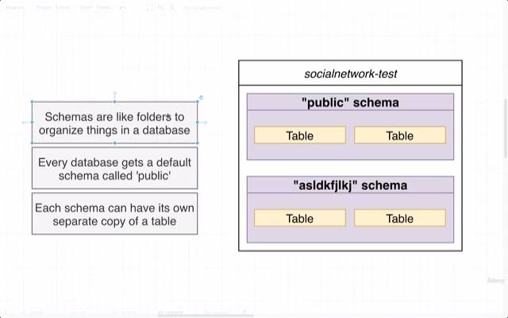
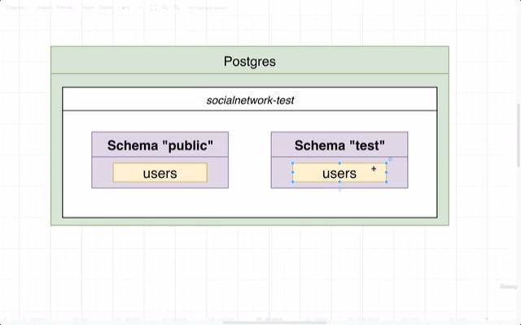
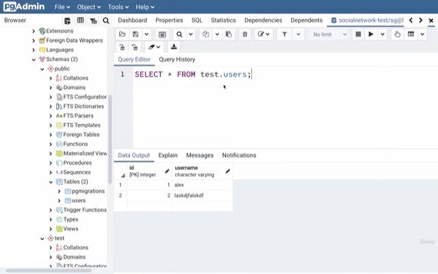
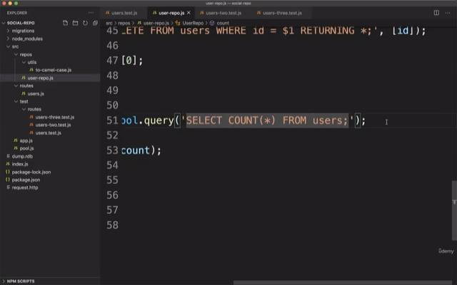
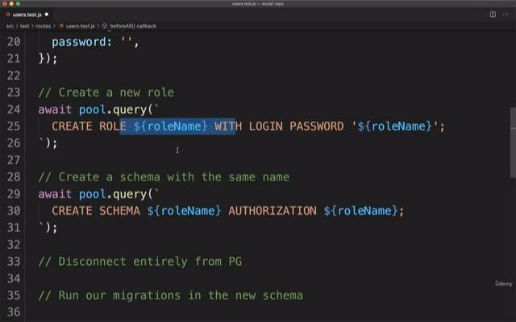
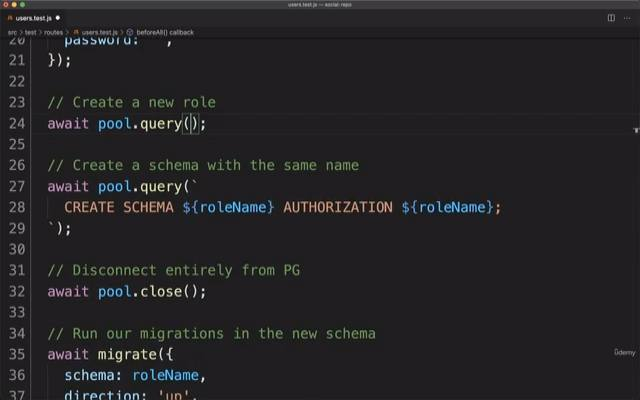
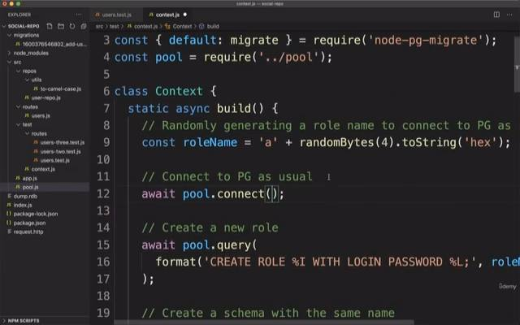
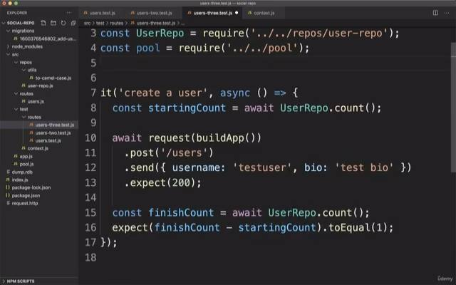

# SQL & PostgreSQL Guide（BV1qa3v6tEoC）P70–P79 复现文档

**用「一个测试文件一个 schema + 一个同名 role」让并行测试彻底隔离**

---

## 1. 这一节做什么

到 P70 的时候，项目里已经有三个测试文件（`users.test.js`、`users2.test.js`、`users3.test.js`），它们都在跑同一套 Node + PostgreSQL 的测试。问题出在：三个文件被并行执行时，全都去访问 `social_network_test` 这个数据库**同一个 `public` schema 下的 `users` 表**。于是出现「A 文件刚插入一行，B 文件正在 count，数字对不上」这类看起来很玄学的失败。

P70–P79 这十集就解决一件事：**给每个测试文件一套完全独立的表空间**，让三个文件可以随便并行跑，互不打架，并且跑完之后自动把创建出来的东西删掉。

讲师给了两个方案，并且明确比较过：

| 方案 | 做法 | 缺点 |
|---|---|---|
| 方案一 | 每个测试文件连一个**独立的数据库**（`social_network_test_a/b/c`） | 每新增一个测试文件，就要去 pgAdmin 手动建库、跑 schema migration，很快就烦死人 |
| 方案二（最终采用） | 每个测试文件连一个**独立的 schema**，schema 名和连接用的 role 名相同 | 需要写一点稍微绕的初始化代码 |

方案二能成立，全靠 PostgreSQL 的 `search_path` 里有一个你平时不会注意的 `"$user"` 项：**当你连库用的用户名，正好和库里某个 schema 同名时，你不写 schema 前缀的 SQL（比如 `SELECT COUNT(*) FROM users`）会自动落到那个 schema 上**。所以整套机制的骨架是：

```
每个测试文件：
  1. 生成随机字符串 roleName（例如 a3f9c1b2）
  2. 用 root 凭据连库
  3. CREATE ROLE roleName WITH LOGIN PASSWORD 'roleName'
  4. CREATE SCHEMA roleName AUTHORIZATION roleName
  5. 断开
  6. 以 roleName 身份把 migrations 跑进这个 schema（此时里面才有 users 表）
  7. 以 roleName 身份重新连库
  → 之后这个文件里所有不带 schema 前缀的 SQL 都落在 roleName 这个 schema
  8. 测试全部结束后：断开 → 用 root 连 → DROP SCHEMA roleName CASCADE → DROP ROLE roleName → 断开
```

这节课最终产出的是一个 `test/context.js`，里面有一个 `Context` 类，封装了「建 role、建 schema、跑迁移、连库」和「清库、删 schema、删 role」两组动作，三个测试文件各 `require` 一份就能用。



---

## 2. 讲师原话（关键判断点）

> "当我们尝试并行运行三个不同的测试文件时……它们都会尝试访问 social_network_test 数据库中的同一张 user 表。"
> —— p070 [00:00]

> "不过，这种做法有一个缺点：如果有很多不同的测试文件，我们就得在本地 Postgres 实例中创建许多不同的测试数据库。而且这很快就会变得非常繁琐。"
> —— p070 [01:27]（讲方案一为什么被放弃）

> "我们目前是在 public 模式下工作。创建这些模式的好处在于，每个模式都可以拥有指定表的一份独立副本。"
> —— p070 [03:21]

> "而不是只写表名，我会先写出希望在其中创建这张表的模式名……然后加一个点，再写实际的表名。"
> —— p071 [01:53]（`schema.表名` 的点号前缀语法）

> "Postgres 内部使用一个名为 search_path 的小设置。如果我们没有在查询中明确指定模式，search_path 会控制 Postgres 默认访问哪个模式。"
> —— p072 [01:24]

> "这里的 $user 表示：如果数据库中存在一个模式，其名称与我们当前登录的用户完全相同，那么我们就应该优先尝试访问这个模式。"
> —— p072 [02:51]（整节课的技术支点）

> "因此默认情况下，查询不会连接到 public 模式并在其上运行，而是会改为在与我们连接数据库时所用用户同名的那个模式上执行。"
> —— p074 [02:50]

> "每当我们在 Postgres 中创建一个角色时，它都必须有一个以字母开头的名称。角色名不能以数字开头。"
> —— p075 [03:21]（所以代码里要拼一个 `'a'` 在前面）

> "默认情况下，我们应该一次只运行一组迁移；但这里我们尝试并行运行多个不同的测试文件，因此可能会遇到同时运行多组不同迁移的情况。通常这会导致错误，所以我们会通过传入 noLock: true 来覆盖该行为。"
> —— p075 [08:24]

> "只有在尝试把字面值放入查询时，我们才能使用这种参数化方式……我们不能用这种方式注入本应作为标识符的参数。"
> —— p076 [01:22]（为什么 `$1` 不能拿来填 schema 名，必须换 `pg-format`）

> "我们不能删除当前正在用于连接的角色。"
> —— p078 [00:55]（解释 `close()` 里为什么先断开再重连）

> "现在我们应该会看到三个测试全部通过，因为它们现在都在各自独立的模式中完全隔离运行。"
> —— p079 [00:36]

---

## 3. 从零复现

### 3.1 前置条件

- 本地已经装了 PostgreSQL（课程里用 pgAdmin 管理，服务默认跑在 `5432`）。
- Node.js 18+。
- 本地已经有一个 **超级用户**（Windows 上通常是 `postgres`，macOS 上通常是你的系统用户名）。这一步很关键，因为 `CREATE ROLE` 需要超级用户权限——课里没提权限要求，但你不给超级用户会直接报 `permission denied to create role`。
- 已经有课程前几集做出来的 `src/pool.js`、`src/repos/user-repo.js`、`migrations/` 目录。如果没有，第 4 节给了完整可运行版本。

### 3.2 目录结构

```
sql-social-network/
├── .env
├── package.json
├── jest.config.js
├── migrations/
│   └── 1708000000000_create-users-table.js
├── src/
│   ├── pool.js
│   └── repos/
│       └── user-repo.js
└── test/
    ├── context.js            ← 本节课的产物
    ├── users.test.js
    ├── users2.test.js
    └── users3.test.js
```

> 讲师在 p077 [00:29] 说的是「inside of my test directory, I'm going to make a new file called context.js」。文件名和位置照抄即可。`test/` 下的 `context.js` 不会被 Jest 当成测试文件，因为 Jest 默认只匹配 `*.test.js` / `__tests__/**`——这一点见第 7 节。

### 3.3 建库

课里是打开 pgAdmin 右键建 `social_network_test`。命令行等价：

```bash
# macOS / Linux
createdb social_network_test

# 或者用 psql（Windows 上更常见）
psql -U postgres -c "CREATE DATABASE social_network_test;"
```

### 3.4 环境变量

课里是把 host / port / database / user / password 直接写在代码里的（p078 [01:53] 讲师把它们抽成了 `defaultOptions` 变量）。**课里没有讲用 `.env`**，这里为了让文档可复现，抽成 `.env`（变量名是本文档自己定的，不是讲师念的）：

```dotenv
# .env
PGHOST=localhost
PGPORT=5432
PGDATABASE=social_network_test
PGUSER=postgres
PGPASSWORD=postgres
```

macOS 上把 `PGUSER` / `PGPASSWORD` 换成你自己的系统用户名和密码即可。

### 3.5 安装与运行

```bash
npm install
npm test
```

第一次跑完，去 pgAdmin 里右键 `Schemas` → Refresh，你应该**看不到**多出来的随机 schema（因为 `afterAll` 已经清理掉了）。这一点就是 p078 [04:47] 讲师做的验证：跑之前 9 个 schema，跑完还是 9 个。

---

## 4. 完整代码

下面 8 个文件都可以直接保存运行。`src/pool.js`、`src/repos/user-repo.js`、`migrations/` 是课程前几集的产物，逐字稿里没有完整贴出，这里给出**等价的最小可运行实现**（已标注）。

### 4.1 `package.json`

```json
{
  "name": "sql-social-network",
  "version": "1.0.0",
  "private": true,
  "scripts": {
    "test": "jest",
    "migrate": "dotenv -e .env -- node-pg-migrate"
  },
  "dependencies": {
    "dotenv": "^16.4.5",
    "node-pg-migrate": "^6.2.2",
    "pg": "^8.11.5",
    "pg-format": "^1.0.4"
  },
  "devDependencies": {
    "jest": "^29.7.0"
  }
}
```

> 版本号是本文档给出的可运行组合，**课里没有逐个念版本号**。`dotenv-cli` 没装的话，`npm run migrate` 会失败；只用 `npm test` 的话不需要它，可以直接 `npx node-pg-migrate` 配合自己的环境变量。

### 4.2 `jest.config.js`

```js
module.exports = {
  testEnvironment: 'node',
  setupFiles: ['dotenv/config'],
};
```

### 4.3 `src/pool.js`

```js
// 课程前几集写的 Pool 单例。逐字稿只提到「我们给了它一个 close 方法」，
// 这里给出等价实现，保证 connect / query / close 三个方法可用。
const { Pool } = require('pg');

class PoolSingleton {
  constructor() {
    this._pool = null;
  }

  connect(options = {}) {
    this._pool = new Pool({
      host: options.host || process.env.PGHOST,
      port: Number(options.port || process.env.PGPORT || 5432),
      database: options.database || process.env.PGDATABASE,
      user: options.user || process.env.PGUSER,
      password: options.password || process.env.PGPASSWORD,
    });
    // 预热一次，让连接错误立刻暴露在 connect 调用处
    return this._pool.query('SELECT 1;');
  }

  query(...args) {
    if (!this._pool) {
      throw new Error('Pool 尚未连接，请先调用 connect()');
    }
    return this._pool.query(...args);
  }

  async close() {
    if (!this._pool) {
      return;
    }
    const pool = this._pool;
    this._pool = null;
    await pool.end();
  }
}

module.exports = new PoolSingleton();
```

### 4.4 `src/repos/user-repo.js`

```js
const pool = require('../pool');

module.exports = {
  async find() {
    const result = await pool.query('SELECT * FROM users;');
    return result.rows;
  },

  async insert({ username }) {
    const result = await pool.query(
      'INSERT INTO users (username) VALUES ($1) RETURNING *;',
      [username]
    );
    return result.rows[0];
  },

  // 讲师在 p073 [00:57] 明确念过这个方法体：select count star from users
  async count() {
    const result = await pool.query('SELECT COUNT(*) FROM users;');
    return parseInt(result.rows[0].count, 10);
  },
};
```

### 4.5 `migrations/1708000000000_create-users-table.js`

```js
// 课里没有贴出 migrations 目录的内容（前面几集建的）。
// 这里给出一个能建出 users 表的最小迁移，node-pg-migrate 会自动执行它。
exports.up = (pgm) => {
  pgm.createTable('users', {
    id: 'id',
    username: { type: 'varchar(255)', notNull: true },
    created_at: { type: 'timestamp', default: pgm.func('now()') },
  });
};

exports.down = (pgm) => {
  pgm.dropTable('users');
};
```

### 4.6 `test/context.js`（本节课核心）

```js
const { randomBytes } = require('crypto');
const migrate = require('node-pg-migrate').default;
const format = require('pg-format');
const pool = require('../src/pool');

// 讲师在 p078 [01:53] 把重复出现的 root 连接参数抽成了这个变量
const defaultOptions = {
  host: process.env.PGHOST || 'localhost',
  port: Number(process.env.PGPORT || 5432),
  database: process.env.PGDATABASE || 'social_network_test',
  user: process.env.PGUSER || 'postgres',
  password: process.env.PGPASSWORD || 'postgres',
};

class Context {
  static async build() {
    // 1. 生成随机 role 名。randomBytes(4) 出来 8 位小写十六进制。
    //    前面补一个 'a'，因为 Postgres 的 role 名不能以数字开头（p075 [03:21]）
    const roleName = 'a' + randomBytes(4).toString('hex');

    // 2. 用 root 凭据正常连库
    await pool.connect(defaultOptions);

    // 3. 建 role。%I = 标识符，%L = 字面量（p076 [02:48]）
    await pool.query(
      format('CREATE ROLE %I WITH LOGIN PASSWORD %L', roleName, roleName)
    );

    // 4. 建 schema，并把所有权给这个 role
    await pool.query(
      format('CREATE SCHEMA %I AUTHORIZATION %I', roleName, roleName)
    );

    // 5. 彻底断开
    await pool.close();

    // 6. 这个 schema 现在是空的，必须把迁移跑进去，users 表才会存在（p075 [01:25]）
    await migrate({
      schema: roleName,
      direction: 'up',
      log: () => {},
      noLock: true,
      dir: 'migrations',
      databaseUrl: {
        host: defaultOptions.host,
        port: defaultOptions.port,
        database: defaultOptions.database,
        user: roleName,
        password: roleName,
      },
    });

    // 7. 以 roleName 身份重新连库。此后不带 schema 前缀的 SQL 都会落到同名 schema
    await pool.connect({
      host: defaultOptions.host,
      port: defaultOptions.port,
      database: defaultOptions.database,
      user: roleName,
      password: roleName,
    });

    return new Context(roleName);
  }

  constructor(roleName) {
    this.roleName = roleName;
  }

  // 每个测试开始前清空数据（p079 [01:47]，可选但推荐）
  async reset() {
    return pool.query('DELETE FROM users;');
  }

  // 测试文件全部跑完后清理（p078）
  async close() {
    // 现在大概率是以 roleName 身份连着的，不能删自己正在用的 role
    await pool.close();

    // 用 root 身份重连
    await pool.connect(defaultOptions);

    await pool.query(
      format('DROP SCHEMA %I CASCADE', this.roleName)
    );
    await pool.query(
      format('DROP ROLE %I', this.roleName)
    );

    await pool.close();
  }
}

module.exports = Context;
```

### 4.7 `test/users.test.js`

```js
const Context = require('./context');
const UserRepo = require('../src/repos/user-repo');

let context;

beforeAll(async () => {
  context = await Context.build();
});

afterAll(async () => {
  await context.close();
});

beforeEach(async () => {
  await context.reset();
});

it('counts the users in the table', async () => {
  const startingCount = await UserRepo.count();
  await UserRepo.insert({ username: 'alex' });
  const endingCount = await UserRepo.count();
  expect(endingCount).toEqual(startingCount + 1);
});

it('inserts a user and reads it back', async () => {
  await UserRepo.insert({ username: 'kim' });
  const users = await UserRepo.find();
  expect(users.length).toEqual(1);
  expect(users[0].username).toEqual('kim');
});
```

### 4.8 `test/users2.test.js` / `test/users3.test.js`

课里 p079 [00:00] 的做法是「原样复制这段 beforeAll/afterAll 到另外两个文件」。为了让三个文件并行时不产生业务层面的歧义，这里让它们写入的用户名不同，其余结构完全一致：

```js
// test/users2.test.js
const Context = require('./context');
const UserRepo = require('../src/repos/user-repo');

let context;

beforeAll(async () => {
  context = await Context.build();
});

afterAll(async () => {
  await context.close();
});

beforeEach(async () => {
  await context.reset();
});

it('counts the users in the table', async () => {
  const startingCount = await UserRepo.count();
  await UserRepo.insert({ username: 'sam' });
  const endingCount = await UserRepo.count();
  expect(endingCount).toEqual(startingCount + 1);
});

it('inserts a user and reads it back', async () => {
  await UserRepo.insert({ username: 'nina' });
  const users = await UserRepo.find();
  expect(users.length).toEqual(1);
  expect(users[0].username).toEqual('nina');
});
```

```js
// test/users3.test.js
const Context = require('./context');
const UserRepo = require('../src/repos/user-repo');

let context;

beforeAll(async () => {
  context = await Context.build();
});

afterAll(async () => {
  await context.close();
});

beforeEach(async () => {
  await context.reset();
});

it('counts the users in the table', async () => {
  const startingCount = await UserRepo.count();
  await UserRepo.insert({ username: 'tom' });
  const endingCount = await UserRepo.count();
  expect(endingCount).toEqual(startingCount + 1);
});

it('inserts a user and reads it back', async () => {
  await UserRepo.insert({ username: 'lena' });
  const users = await UserRepo.find();
  expect(users.length).toEqual(1);
  expect(users[0].username).toEqual('lena');
});
```

> 逐字稿只说了「把同一套 context 粘到另外两个测试文件」，**没有逐个念出三个文件的断言内容**。上面的断言是按 p073 [00:27] 描述（`userRepo.count()` 被调用）反推出来的最小版本。

---

## 5. 逐行解释

### 5.1 先手工验证 schema 的行为（对应 p071）

在 pgAdmin 的 Query Tool 里连到 `social_network_test`，依次跑：

```sql
CREATE SCHEMA test;

CREATE TABLE test.users (
  id serial PRIMARY KEY,
  username varchar(255)
);
```

注意 `CREATE TABLE test.users` 里那个点号——讲师在 p071 [01:53] 强调的就是这一点：**schema 名 + 点 + 表名**。如果忘了写 `test.`，Postgres 会去 `public` 建表，而 `public.users` 已经存在，于是直接报错（p071 [02:52]）。

```sql
INSERT INTO test.users (username) VALUES ('alex');
SELECT * FROM users;        -- 走 public
SELECT * FROM test.users;   -- 走 test
```



### 5.2 `search_path` 到底是什么（对应 p072）

```sql
SHOW search_path;
```

输出是 `"$user", public` 这样的两段（讲师在 p072 [01:53] 念的就是这个）。含义按顺序解释：

1. `"$user"`：如果库里存在一个**和当前连接用户名同名**的 schema，先找它。
2. `public`：找不到就退回 `public`。

所以 `SELECT * FROM users` 在「用 `alex` 这个 role 连库、库里又有一个叫 `alex` 的 schema」时，实际执行的是 `alex.users`。**这就是整套隔离方案的全部魔法**，剩下的代码都只是在批量制造「role 名 == schema 名」这个条件。

讲师还演示了手动改：

```sql
SET search_path TO test, public;
-- 此时 SELECT * FROM users 会打到 test.users
SET search_path TO "$user", public;  -- 恢复默认
```



### 5.3 「不改 SQL 也能换 schema」为什么重要（对应 p073）

`UserRepo.count()` 里写的是 `SELECT COUNT(*) FROM users;`，没有 schema 前缀。讲师在 p073 [02:50] 提过一个「naive 方案」：给 `count()` 加一个 schema 参数再做字符串拼接。他自己否掉了——因为每个查询方法都要多传一个参数，很快就失控。

正确做法是把「往哪查」这件事下移到**连接层**：换连接用的用户，查询文本一个字都不用改。



### 5.4 `Context.build()` 七步逐条

1. **`randomBytes(4).toString('hex')`** —— Node 的 `crypto` 模块，输出 8 位小写十六进制。前面拼 `'a'` 是因为 role 名不能以数字开头（p075 [03:21]）。这一步的副作用是：role 名保证全小写，后面 `"$user"` 的字符串匹配才不会因为大小写或引号出问题。
2. **`pool.connect(defaultOptions)`** —— 用 root 身份连。`CREATE ROLE` 要超级用户权限。
3. **`CREATE ROLE %I WITH LOGIN PASSWORD %L`** —— 讲师在 p075 [05:08] 反复强调 `%L` 那个位置两侧要有单引号。用 `pg-format` 之后不需要手写引号，`%L` 会自己加。
4. **`CREATE SCHEMA %I AUTHORIZATION %I`** —— `AUTHORIZATION` 把 schema 的所有者设成刚建的 role，否则这个 role 在自己 schema 里建表会没权限。讲师特意提醒「double check the spelling of authorization」（p075 [06:04]）。
5. **`pool.close()`** —— 断开。p075 [06:55] 说的就是这一步，用前面写好的 `PoolSingleton.close()`。
6. **`migrate({...})`** —— 关键中的关键：新 schema 是**空的**，`users` 表还不存在。必须用 `node-pg-migrate` 的**编程式调用**（此前课程里只用过命令行）把 migrations 跑进去。七个选项逐个说：
   - `schema: roleName` —— 迁移文件跑在哪个 schema 里。
   - `direction: 'up'` —— 前进（`down` 是回滚）。
   - `log: () => {}` —— 传一个空函数，把所有日志吞掉。p075 [07:55] 给的理由很实在：迁移日志会把测试结果淹掉。
   - `noLock: true` —— 默认迁移会加锁，只允许一次跑一套；这里三个文件并行，会同时跑三套迁移，所以要关掉。**在 JS/Node 里的类比**：Node 是单线程，同一进程内你不用操心锁；但这里是**跨进程**（Jest 每个测试文件一个 worker）、跨连接，只有数据库层的锁能管住，所以必须显式关掉它。
   - `dir: 'migrations'` —— 迁移文件目录，相对 `process.cwd()`，所以 `npm test` 必须在项目根目录跑。
   - `databaseUrl` —— 可以是字符串，也可以是 pg 的连接对象。这里用对象，`user` / `password` 都是 `roleName`，也就是**以新 role 的身份跑迁移**，这样建出来的表天然归它所有。
7. **`pool.connect({... user: roleName, password: roleName })`** —— 以新 role 重连。到这里，这个测试进程后续所有 `pool.query` 都会自动落到 `roleName` 这个 schema。



### 5.5 为什么必须用 `pg-format` 而不是 `$1`

讲师在 p076 [01:22] 讲了一个很容易踩的坑：你可能想写

```js
// 错误示范：这样不行
await pool.query('CREATE SCHEMA $1', [roleName]);
```

`$1` 这种参数化只能替换**字面量**（值），不能替换**标识符**（表名、schema 名、role 名、列名）。`node-postgres` 的文档明确限制。所以换 `pg-format`：

```js
format('CREATE ROLE %I WITH LOGIN PASSWORD %L', roleName, roleName)
```

- `%I` = identifier，会按需加双引号并转义。
- `%L` = literal，会加单引号并转义。

两个占位符都是**大写字母**，讲师在 p076 [02:48] 特意提醒过。



### 5.6 `Context.close()` 为什么先断开再重连

p078 [00:55] 讲得很清楚：**不能删掉自己正在连接的那个 role**。而 `close()` 被调用时，当前连接大概率就是 `roleName`。所以顺序必须是：

1. `pool.close()` —— 断开当前（role 身份）连接
2. `pool.connect(defaultOptions)` —— 用 root 重连
3. `DROP SCHEMA %I CASCADE` —— `CASCADE` 会连带删掉 schema 里的 `users` 表、索引、以及 node-pg-migrate 自己建的迁移记录表
4. `DROP ROLE %I`
5. `pool.close()`

顺序反过来（先删 role 再删 schema）会失败，因为 role 还拥有 schema 里的对象。



### 5.7 `reset()` 与 `beforeEach`

p079 [01:47] 说这是**可选**优化。三个文件各自有自己的 schema，本来就不会互相污染；但同一个文件内，测试 A 插入的行会留给测试 B。所以在 `beforeEach` 里 `DELETE FROM users;`，让每个 `it` 都从干净状态开始。

注意 `DELETE FROM users;` 也没有 schema 前缀——它跑在当前 role 的连接上，自动落到自己的 schema。这正是 5.2 机制的又一次应用。如果后面加了 `posts`、`comments` 表，就往 `reset()` 里多加几条 `DELETE`（p079 [02:16]）。



---

## 6. 复现检查清单

按顺序打勾，每一步失败都能定位到具体环节：

- [ ] `psql -U postgres -c "\l"` 能看到 `social_network_test` 数据库。
- [ ] `psql -U postgres -c "\du"` 能看到你的连接用户，且它是超级用户（`rolsuper` 为 true）。
- [ ] `npm install` 没有 peer dependency 报错。
- [ ] `npx node-pg-migrate up`（可选）能在 `public` schema 里建出 `users` 表；不跑也行，测试会自己往随机 schema 里跑迁移。
- [ ] `npm test` 输出 **3 个 test suite、6 个 test 全部通过**。
- [ ] 再跑一次 `npm test`，仍然全绿（这一步验证「跑很多次也不会积累垃圾」）。
- [ ] 在 pgAdmin 里 `Schemas` 右键 Refresh：跑测试**前后** schema 数量一致（讲师在 p078 [04:04] 是 9 个 → 9 个）。
- [ ] 在 pgAdmin 里 `Login/Group Roles` 右键 Refresh：跑测试前后 role 数量一致。
- [ ] 故意把 `test/users2.test.js` 里 `beforeAll` 的 `Context.build()` 注释掉，`npm test` 应该在该文件里报错——证明隔离确实是靠这段代码在起作用，不是碰巧。
- [ ] 打开 pgAdmin 的 `social_network_test` → `public` → `users`，表里应该**没有**测试插入的 `alex` / `kim`（说明写入确实没打到 public）。

---

## 7. 课里没讲但你会撞上的

1. **`CREATE ROLE` 需要超级用户权限。** 课里默认你连的是 `postgres`（Windows）或本机用户名（macOS），没提这一点。如果你连的是普通用户，会在第 3 步就挂，报 `permission denied to create role`。临时授权可以 `ALTER ROLE 你的用户 WITH SUPERUSER;`，但生产环境绝对不要这么干。
2. **role 名长度上限 63 字符。** `randomBytes(4)` 出来 9 个字符（含前导 `a`），远没超。但如果换成 `randomBytes(32)` 就会截断甚至报错。
3. **role 名全小写的隐含依赖。** `"$user"` 在 `search_path` 里是**按名字精确匹配** schema。`toString('hex')` 只产生小写，所以安全；如果你手贱改成 `base64`，会出现大小写混排，而 Postgres 对未加引号的标识符会统一小写化，`roleName` 和 schema 名就对不上了，隔离会静默失效——测试不报错，但三个文件又打到同一个 schema 上了，非常难查。
4. **`test/context.js` 放在 `test/` 目录是安全的，但不要放进 `__tests__/`。** Jest 默认 `testMatch` 包含 `**/__tests__/**/*.js`，那样 `context.js` 会被当成一个没有 `it()` 的测试文件，直接报 `Your test suite must contain at least one test.`。
5. **`migrate` 的 `dir: 'migrations'` 是相对 `process.cwd()` 的。** 在子目录里跑 `jest` 会找不到迁移文件。
6. **`build()` 中途抛错会留下垃圾。** 课里的代码没有 `try/finally`，如果 `migrate()` 失败（比如迁移文件有语法错误），role 和 schema 就残留在库里了，而且 `afterAll` 里的 `close()` 可能因为 `context` 是 `undefined` 而二次报错。你会在 pgAdmin 里看到一堆 `a3f9c1b2` 这样的 schema。手工清理：对每个残留 schema 右键 `DROP