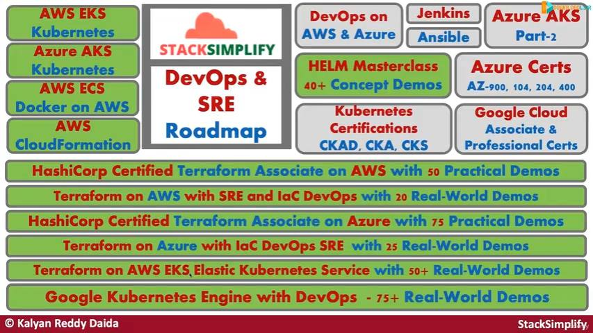
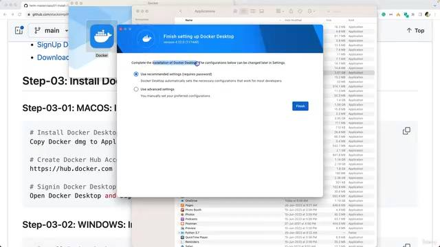
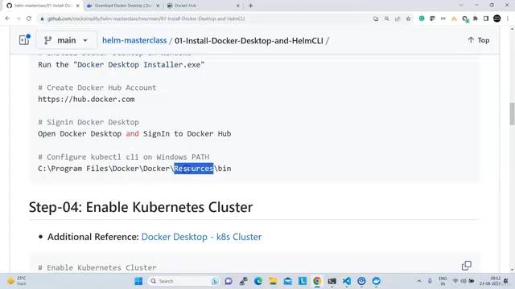
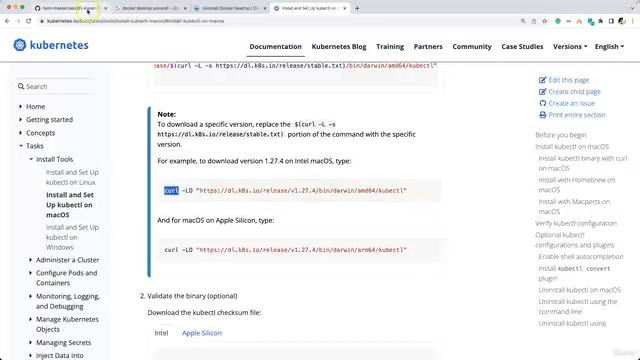
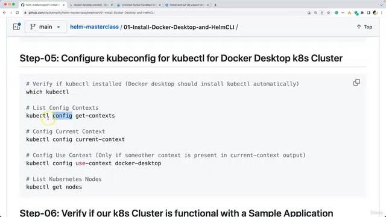
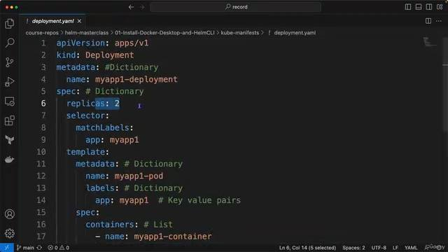
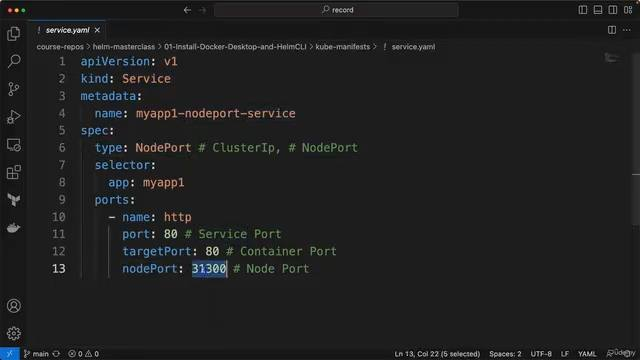
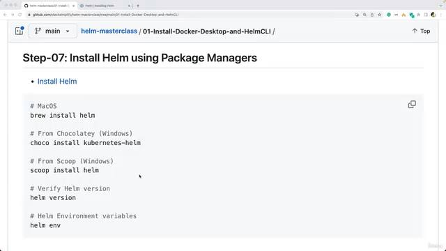
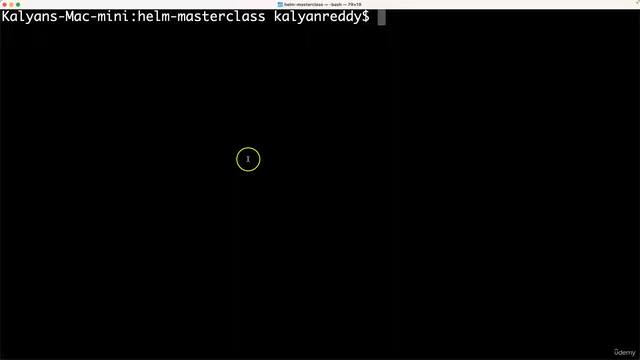

# Helm Masterclass P1–P7 复现文档：从 Docker Desktop 到 Helm CLI 的本地实验环境

> 本文只覆盖 P1–P7。P1 是课程地图，P2–P7 是环境搭建：注册 Docker Hub、安装 Docker Desktop、启用 Kubernetes、配置 kubectl、用示例 Deployment/Service 验证集群、安装 Helm CLI。后续 Helm 模板、依赖、hooks、签名、GitHub Pages 仓库、Artifact Hub、JSON Schema 校验等内容不在本文范围。

## 1. 这一节做什么

这一段的目标不是先写 Helm Chart，而是先把「能跑 Helm 的本地 Kubernetes 实验环境」搭出来。P1 里讲师先交代了整门课的地图：前面先练 Helm 命令，再做 Helm 开发 demo，包括内置对象、模板函数、流程控制、命名模板、依赖、starter/plugin、hooks、签名验证、GitHub Pages 仓库、Artifact Hub、values JSON Schema 校验等。但 P2–P7 只做一件事：让你的电脑上有一个可用的 Kubernetes 集群，并且 `kubectl` 和 `helm` 都能正常执行。

对前端转 AI 应用工程师来说，可以这样理解：`kubectl` 像直接操作容器平台的 CLI；Helm 更像 Kubernetes 的包管理器，类似 npm 在 Node 生态里的位置。P1 里讲师也明确说课程主题是 “Helm for Kubernetes package management”。不过这一节你暂时不需要理解 Chart 模板，只需要把下面这条链路跑通：

1. Docker Hub 账号可用；
2. Docker Desktop 安装并启动；
3. Docker Desktop 内置的 Kubernetes 单节点集群启动；
4. `kubectl` 能找到 kubeconfig、能切 context、能看到 node；
5. 用课程给的 Deployment/Service 示例验证集群能部署应用；
6. 安装 Helm CLI，并能执行 `helm version` 和 `helm env`。

课程录制时演示环境是 macOS Intel 芯片，Windows 单独演示，Linux 只提到 Helm 的 tarball/包管理器安装方式。版本上，逐字稿里明确出现的是 Kubernetes server `v1.27.2` 和 kubectl client `v1.27.2`；Docker Desktop 和 Helm CLI 的具体版本号课里没给，需要以你机器实际输出为准。



依赖版本与验证方式先列清楚，避免后面误判：

| 组件 | 课程中的版本/要求 | 验证命令 |
|---|---|---|
| Docker Hub | 需要一个账号，用于登录 Docker Desktop | Docker Desktop 右上角登录状态 |
| Docker Desktop | 课里没给固定版本号，需要带 Kubernetes engine | Docker Desktop 左下角 Docker Engine 状态 |
| Kubernetes | 录制时 server 为 `v1.27.2` | `kubectl version` / `kubectl version --short` |
| kubectl | 录制时 client 为 `v1.27.2`，随 Docker Desktop 安装 | `kubectl version` / `where kubectl` / `which kubectl` |
| Helm CLI | 课里没给固定版本号 | `helm version` |
| 示例镜像 | 课程 GitHub Packages 中有 `0.1.0`、`0.2.0`、`0.3.0`、`0.4.0` 等版本 | `kubectl get pods` 看镜像拉取结果 |

## 2. 讲师原话（带「—— pNNN [MM:SS]」）

这一段按原文引用关键节点，方便你核对本文的复现步骤是不是从课程里来的。

> "所以，我们将搭建 Helm 学习环境……我们会注册 Docker Hub，并在本地电脑上安装 Docker Desktop，同时安装 Helm CLI。"
> —— p002 [00:00]

> "我们先注册 Docker Hub，然后下载并安装 Docker Desktop……"
> —— p002 [00:00]

> "点击 Kubernetes，再点击启用 Kubernetes……点击应用并重启……点击安装……这个单节点 Kubernetes 集群大约需要 2 到 5 分钟才能上线。"
> —— p003 [05:51]

> "运行 kubectl config get-contexts、kubectl config current-context，并使用 kubectl config use-context，将上下文名称指定为 docker-desktop……"
> —— p005 [03:42]

> "运行 kubectl get nodes……在 Docker Desktop 中，我们只有这一个单节点集群。"
> —— p005 [05:34]

> "运行 kubectl version --short……会看到客户端版本和服务器版本……我的客户端版本是 1.27.2，服务器版本是 v1.27.2。"
> —— p006 [00:56]

> "运行 kubectl apply -f kube-manifest……部署和服务都已创建……运行 kubectl get deploy……my-app-1 部署已创建，2/2 就绪……运行 kubectl get pods……运行 kubectl get svc……服务端口是 80，节点端口是 31300。"
> —— p006 [05:16]

> "访问 localhost:31300……欢迎使用 Stack Simplify Kubernetes 基础演示应用 V1。"
> —— p006 [06:07]

> "在我的 macOS 上，我使用包管理器 Homebrew 安装了它……运行 helm version 命令……运行 helm env 命令，它会列出所有 Helm 环境变量……"
> —— p007 [00:00]

这些原话对应的操作，下面会按「先集群、再 kubectl、再示例应用、最后 Helm」的顺序重排。你不需要按视频播放顺序理解，按复现顺序执行即可。

## 3. 从零复现

### 3.1 准备目录

课程仓库里这一段目录名是 `01 install Docker desktop and Helm CLI`，里面有一个 `kube-manifest` 文件夹。为了命令里少踩空格坑，下面用等价的 `01-install-docker-desktop-and-helm-cli` 演示；如果你直接照课程仓库，请把路径换成原名并加引号。

```text
helm-masterclass/
└── 01-install-docker-desktop-and-helm-cli/
    └── kube-manifest/
        ├── deployment.yaml
        └── service.yaml
```

创建目录：

```bash
mkdir -p "01-install-docker-desktop-and-helm-cli/kube-manifest"
cd "01-install-docker-desktop-and-helm-cli"
```

### 3.2 注册 Docker Hub 并安装 Docker Desktop

1. 打开 `https://hub.docker.com`，注册账号。讲师说需要填写用户名、邮箱、密码，勾选相关选项后点 sign up。
2. 打开 Docker Desktop 下载页，按系统选择安装包。讲师在 macOS 上演示的是 Intel 芯片版本；如果你是 Apple Silicon，就选 Apple 芯片版本；Windows 下载 `.exe`；Linux 课里没有展开 Docker Desktop 的完整安装过程。
3. macOS 安装：打开 `.dmg`，把 Docker 拖到 Applications，启动 Docker，接受 subscription service agreement，选择推荐设置并完成安装。
4. Windows 安装：运行 Docker Desktop Installer，按屏幕提示安装；安装完成后可先不登录，讲师演示了 “continue without signing in” 的路径。但后续最好用 Docker Hub 账号登录。
5. 启动 Docker Desktop 后，确认左下角 Docker Engine 是 running。

讲师在 p003 里提到 Docker Desktop 的个人版计划里可以使用 Kubernetes engine，录制时个人版是免费的。实际许可政策请以 Docker 官网当前说明为准；本文只复现技术步骤。



### 3.3 在 Docker Desktop 中启用 Kubernetes

进入 Docker Desktop：

1. 点右上角 `Settings`；
2. 左侧选 `Kubernetes`；
3. 勾选 `Enable Kubernetes`；
4. 点 `Apply & Restart`；
5. 弹出安装提示时点 `Install`；
6. 等待 2 到 5 分钟，让单节点 Kubernetes 集群启动。

讲师原话里明确说这是 single node Kubernetes cluster，启动后 Docker Desktop 左下角会显示 Docker Engine 和 Kubernetes 的状态。你要等到 Kubernetes 变为 running，再执行下面的 kubectl 命令。

### 3.4 检查 kubectl 是否可用

macOS/Linux：

```bash
which kubectl
kubectl version
```

Windows CMD：

```bat
where kubectl
kubectl version
```

讲师说 Docker Desktop 安装时通常会自动安装 kubectl。如果 macOS 上 `which kubectl` 找不到，可以先卸载 Docker Desktop 再重装；如果仍然不行，按课程给的「additional optional step」手动安装 kubectl。Windows 上如果 `where kubectl` 找不到，需要把 Docker Desktop 的 kubectl 所在目录加入 PATH：

```text
C:\Program Files\Docker\Docker\resources\bin
```

设置方式：系统环境变量 -> Path -> 编辑 -> 新建，把上面的路径加进去，然后重新打开 CMD，执行：

```bat
kubectl version
where kubectl
```

讲师在 Windows 演示里执行 `kubectl version` 后看到 client version 为 `1.27.2`，并用 `where kubectl` 确认路径在 `C:\Program Files\Docker\Docker\resources\bin\kubectl.exe`。



### 3.5 配置并检查 kubeconfig context

kubeconfig 默认位置：

- macOS/Linux：`$HOME/.kube/config`
- Windows：`%USERPROFILE%\.kube\config`

先查看配置文件和 context：

```bash
cat $HOME/.kube/config
kubectl config get-contexts
kubectl config current-context
```

如果当前 context 不是 Docker Desktop，切换：

```bash
kubectl config use-context docker-desktop
```

讲师口述时说 `kubectl config get context`，标准命令是 `kubectl config get-contexts`。执行后应该能看到 Docker Desktop 相关 context，当前 context 前面会有星号。然后确认节点：

```bash
kubectl get nodes
```

Docker Desktop 是单节点集群，正常情况下会看到一个 node，状态应为 Ready。如果这里能看到 node，说明 kubeconfig 和集群连接都通了。





再检查版本：

```bash
kubectl version
kubectl version --short
kubectl version --client --output=yaml
```

讲师演示时 client 和 server 都是 `v1.27.2`。`kubectl version --short` 在部分新版 kubectl 中可能提示 deprecated 或行为变化；如果报错，就用 `kubectl version` 或 `kubectl version --client --output=yaml` 查看。课里也演示了 YAML 输出，能看到 GitVersion、major、minor、platform 等字段。

### 3.6 用示例 Deployment/Service 验证集群

在 `01-install-docker-desktop-and-helm-cli` 目录下执行：

```bash
kubectl apply -f kube-manifest
```

预期输出里会出现 Deployment created 和 Service created。然后检查：

```bash
kubectl get deploy
kubectl get pods
kubectl get svc
```

讲师演示时看到：

- Deployment `myapp1` 是 `2/2` ready；
- Pod 由 `myapp1` 创建并 Running；
- Service 是 NodePort 类型，service port 为 `80`，nodePort 为 `31300`。

浏览器访问：

```text
http://localhost:31300
```

应该看到讲师演示的欢迎页，文案大意是 “welcome to stack simplify Kubernetes fundamentals demo application V1”。看到页面就说明 Docker Desktop 的 Kubernetes 集群、Deployment、Service 和端口映射都正常。





验证完成后删除资源：

```bash
kubectl delete -f kube-manifest
```

讲师口述为删除/undeploy，逐字稿没有逐字给出删除命令；等价的清单删除命令是 `kubectl delete -f kube-manifest`。删除后再执行：

```bash
kubectl get deploy
kubectl get pods
kubectl get svc
```

确认 `myapp1` 相关资源消失。Docker Desktop 的 Containers 页面里也看不到对应容器，这是正常的。

### 3.7 安装 Helm CLI

讲师说 macOS 用 Homebrew，Windows 用 Chocolatey 或 Scoop，Linux 用 tarball 或包管理器。命令如下：

macOS：

```bash
brew install helm
```

Windows Chocolatey：

```bat
choco install kubernetes-helm -y
```

Windows Scoop：

```bat
scoop install helm
```

Linux Debian/Ubuntu（需要先按 Helm 官方文档配置 apt 源；课里只提到可以用 apt）：

```bash
sudo apt update
sudo apt install helm
```

Linux Fedora：

```bash
sudo dnf install helm
```

Linux tarball 方式（把 `<HELM_VERSION>` 换成 Helm 官方 release 页的实际版本号；课里没有给固定版本号）：

```bash
curl -LO https://get.helm.sh/helm-v<HELM_VERSION>-linux-amd64.tar.gz
tar -zxvf helm-v<HELM_VERSION>-linux-amd64.tar.gz
sudo mv linux-amd64/helm /usr/local/bin/helm
```

安装完成后验证：

```bash
helm version
helm env
```

`helm env` 会输出 Helm 的环境变量，例如 `HELM_BIN`、`HELM_BURST_LIMIT`、`HELM_CACHE_HOME`、`HELM_CONFIG_HOME`、`HELM_DATA_HOME` 等；具体字段和路径以你机器实际输出为准。讲师特别提到 macOS 下这些路径通常在 home 目录和 Library 下，plugins 目录也会在 `HELM_DATA_HOME` 下，后续讲插件时会用到。





## 4. 完整代码

> 说明：逐字稿没有逐行展示 `deployment.yaml` 和 `service.yaml` 的全文，只口述了关键字段：Deployment 两个 replicas、容器镜像 `ghcr.io/.../kubenginxhelm:0.1.0` 一类地址、selector `app: myapp1`、Service 为 NodePort、service port 80、nodePort 31300。下面按这些口述字段补全最小可运行 YAML。`apiVersion`、`containerPort`、`targetPort` 等是让文件能直接 apply 的必需补全；镜像地址如果拉取失败，请到课程 GitHub Packages 页面复制实际地址，只替换 image 一行。

### 4.1 `01-install-docker-desktop-and-helm-cli/kube-manifest/deployment.yaml`

```yaml
apiVersion: apps/v1
kind: Deployment
metadata:
  name: myapp1
  labels:
    app: myapp1
spec:
  replicas: 2
  selector:
    matchLabels:
      app: myapp1
  template:
    metadata:
      labels:
        app: myapp1
    spec:
      containers:
        - name: myapp1
          # 逐字稿口述的示例镜像；若拉取失败，请替换为课程 GitHub Packages 页中的实际地址
          image: ghcr.io/stacksimplify/kubenginxhelm:0.1.0
          ports:
            - containerPort: 80
```

### 4.2 `01-install-docker-desktop-and-helm-cli/kube-manifest/service.yaml`

```yaml
apiVersion: v1
kind: Service
metadata:
  name: myapp1
  labels:
    app: myapp1
spec:
  type: NodePort
  selector:
    app: myapp1
  ports:
    - name: http
      port: 80
      targetPort: 80
      nodePort: 31300
```

### 4.3 复现命令清单

```bash
# 1. 进入目录
cd "01-install-docker-desktop-and-helm-cli"

# 2. 部署示例应用
kubectl apply -f kube-manifest

# 3. 查看 Deployment / Pod / Service
kubectl get deploy
kubectl get pods
kubectl get svc

# 4. 浏览器访问
# http://localhost:31300

# 5. 删除示例资源
kubectl delete -f kube-manifest

# 6. 确认删除
kubectl get deploy
kubectl get pods
kubectl get svc
```

### 4.4 可选的本地检查脚本

> 课里没有这个脚本，下面只是把本文的检查命令串起来，方便你一次性确认环境。保存为 `verify.sh` 后执行 `bash verify.sh`。

```bash
#!/usr/bin/env bash
set -euo pipefail

echo "== current context =="
kubectl config current-context

echo "== contexts =="
kubectl config get-contexts

echo "== nodes =="
kubectl get nodes

echo "== kubectl version =="
kubectl version || true

echo "== helm version =="
helm version

echo "== helm env =="
helm env
```

## 5. 逐行解释

先解释 YAML 里真正决定「能不能跑通」的字段。

`apiVersion: apps/v1` 和 `kind: Deployment` 表示这是一个 Deployment 资源。逐字稿没有逐字展示这一行，但这是 Kubernetes 部署无状态应用的常用写法；如果你换成本地已有的其他示例，也可以按课程原文件为准。

`metadata.name: myapp1` 是 Deployment 名字，对应讲师在终端里看到的 `myapp1`。`metadata.labels.app: myapp1` 是给这个 Deployment 自己打的标签，方便查询。

`spec.replicas: 2` 是逐字稿明确说的「two replicas」。所以 `kubectl get deploy` 里应该看到 `2/2`。如果你只看到 `1/2`，通常是第二个 Pod 还在拉镜像或启动。

`spec.selector.matchLabels.app: myapp1` 是 Deployment 管理 Pod 的选择器。下面的 `template.metadata.labels.app: myapp1` 必须和它匹配，否则 Deployment 会找不到自己创建的 Pod。这个 `app: myapp1` 也是 Service 选择 Pod 的依据，所以三处标签要一致。

`containers[].name: myapp1` 是容器名；逐字稿没有专门讲容器名，这里用 `myapp1` 只是为了让文件可读。`image` 是课程示例镜像，逐字稿口述了 `ghcr.io/.../kubenginxhelm:0.1.0` 一类地址，并在 GitHub Packages 里能看到 `0.1.0`、`0.2.0`、`0.3.0`、`0.4.0` 等版本。如果拉取失败，先检查镜像地址和 tag，不要先怀疑 Kubernetes 集群。

`containerPort: 80` 表示容器暴露 80 端口。Service 的 `targetPort: 80` 会把流量转到容器 80 端口。逐字稿只明确说了 service port 80 和 nodePort 31300，`targetPort` 是按示例应用补全的；如果你的镜像实际监听端口不同，需要改这里。

Service 部分：`type: NodePort` 是逐字稿明确说的。`selector.app: myapp1` 让 Service 找到前面 Deployment 创建的 Pod。`port: 80` 是 Service 自身端口，`nodePort: 31300` 是节点上暴露的端口，所以浏览器访问 `http://localhost:31300`。Docker Desktop 会把 localhost 的 31300 映射到集群，因此本机浏览器能打开；换到云上 Kubernetes 时访问方式会不同，课里没有展开。

命令部分：`kubectl apply -f kube-manifest` 会读取目录里的 YAML 并创建资源。`kubectl get deploy` 看 Deployment 的 ready 副本数；`kubectl get pods` 看 Pod 是否 Running；`kubectl get svc` 看 Service 类型和端口。`kubectl delete -f kube-manifest` 是反向操作，按同一份清单删除资源。讲师口述删除但逐字稿没有逐字给命令，这里用清单删除是最稳的方式。

Helm 部分：`helm version` 只验证 CLI 可执行；`helm env` 输出 Helm 使用的环境变量和目录。讲师说后续插件会安装到 `HELM_DATA_HOME` 下的 plugins 目录，所以现在先记住这个输出，后面排查插件是否安装时有用。`HELM_BIN` 是 helm 可执行文件路径，`HELM_CACHE_HOME`、`HELM_CONFIG_HOME`、`HELM_DATA_HOME` 分别是缓存、配置、数据目录；不同 OS 路径不同，以实际输出为准。

## 6. 复现检查清单

按顺序打勾，任何一项不通过就先停下修环境，不要继续往后做 Helm 模板。

- [ ] Docker Hub 账号已注册。
- [ ] Docker Desktop 已安装并启动，Docker Engine 显示 running。
- [ ] Docker Desktop 已登录 Docker Hub，或至少确认可以拉取公开镜像。
- [ ] Docker Desktop 的 `Settings -> Kubernetes -> Enable Kubernetes` 已勾选，并点过 `Apply & Restart` / `Install`。
- [ ] Docker Desktop 左下角 Kubernetes 状态为 running。
- [ ] `which kubectl` 或 `where kubectl` 能找到 kubectl。
- [ ] `kubectl config current-context` 输出 Docker Desktop 相关 context。
- [ ] `kubectl config get-contexts` 能看到 context 列表，当前 context 有星号。
- [ ] `kubectl get nodes` 能看到一个 Ready 的 node。
- [ ] `kubectl version` 或 `kubectl version --short` 能看到 client/server 版本；录制时示例为 `v1.27.2`，你的实际版本以输出为准。
- [ ] `kubectl apply -f kube-manifest` 输出 Deployment created 和 Service created。
- [ ] `kubectl get deploy` 看到 `myapp1` 为 `2/2`。
- [ ] `kubectl get pods` 看到两个 Pod Running。
- [ ] `kubectl get svc` 看到 `myapp1`，类型 NodePort，port 80，nodePort 31300。
- [ ] 浏览器访问 `http://localhost:31300` 能看到示例欢迎页。
- [ ] `kubectl delete -f kube-manifest` 后，相关 Deployment/Pod/Service 消失。
- [ ] `helm version` 有正常输出。
- [ ] `helm env` 能输出 `HELM_BIN`、`HELM_CACHE_HOME`、`HELM_CONFIG_HOME`、`HELM_DATA_HOME` 等变量；字段以实际输出为准。
- [ ] 记录下你的 Kubernetes、kubectl、Helm 版本，后面课程出现命令差异时先对照版本。

## 7. 课里没讲但你会撞上的

下面这些不是讲师在 P1–P7 里逐字讲过的内容，但你实际复现时很可能遇到。

**Docker Desktop 许可政策会变。** 课里说录制时个人版可以使用 Kubernetes engine，但 Docker Desktop 的订阅条款可能调整。学习前建议看 Docker 官网当前说明，别把课程里的许可描述当成永久承诺。

**Docker Hub / GHCR 拉取慢或失败。** 课程示例镜像在 `ghcr.io` 上，国内网络可能拉取失败。先确认镜像地址和 tag 是否正确，再检查网络和代理。课里没有讲镜像加速器配置，本文也不把加速器地址安到讲师头上。

**Windows 家庭版可能需要 WSL2。** Docker Desktop 在 Windows 上通常依赖 WSL2 或 Hyper-V。课里只演示了安装和 PATH 配置，没有展开 WSL2 故障排查。安装 Docker Desktop 时如果提示 WSL2 相关错误，先按 Docker 官方文档处理 WSL2，再回来启用 Kubernetes。

**Apple Silicon 与 amd64 镜像。** 讲师录制时用 macOS Intel。Apple Silicon 上运行 amd64 镜像可能走模拟层，启动会慢，甚至个别镜像会报架构不匹配。如果你在 Apple Silicon 上拉不起 Pod，用 `kubectl describe pod` 看事件，不要只看 Docker Desktop 界面。

**31300 端口可能被占用。** NodePort 31300 如果被你本机其他进程占用，浏览器访问会失败。可以先把 Service 的 `nodePort` 改成 30000–32767 范围内的其他端口，再重新 apply；课里用的是 31300，改端口属于排障，不是课程原始步骤。

**context 名字不一定叫 `docker-desktop`。** 不同 Docker Desktop 版本、不同系统上 context 名可能不同。不要硬背 `docker-desktop`，先用 `kubectl config get-contexts` 看实际名字，再 `kubectl config use-context <实际名字>`。

**`kubectl version --short` 在新版可能不可用。** 逐字稿里也提到这个输出是 deprecated。如果 `--short` 报错或提示废弃，改用 `kubectl version`，或者用讲师也演示过的 `kubectl version --client --output=yaml`。

**Helm 版本不同，`helm env` 字段可能略有差异。** 课里没给固定 Helm 版本号。你只要确认 `helm version` 和 `helm env` 能正常输出即可；如果字段名和本文不完全一样，以你的实际输出为准。

**Linux 下没有 Docker Desktop Kubernetes 的完整替代步骤。** 讲师只提到 Linux 安装 Helm 用 tarball/包管理器，kubectl 在 Linux 上可能需要手动安装，没有展开 Linux 下如何获得 Kubernetes 集群。如果你用 Linux，需要自己准备一个 Kubernetes 集群，或者按 Docker Desktop Linux 版的实际菜单操作；课里没给这部分详细步骤。

**删除资源后 Docker Desktop Containers 页面为空是正常的。** 你删除的是 Kubernetes 的 Deployment/Service，Pod 会被回收，Docker Desktop 的 Containers 页面看不到对应容器并不代表删除失败。以 `kubectl get deploy`、`kubectl get pods`、`kubectl get svc` 的输出为准。