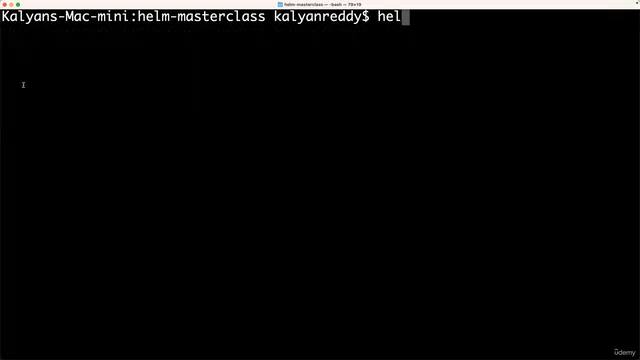
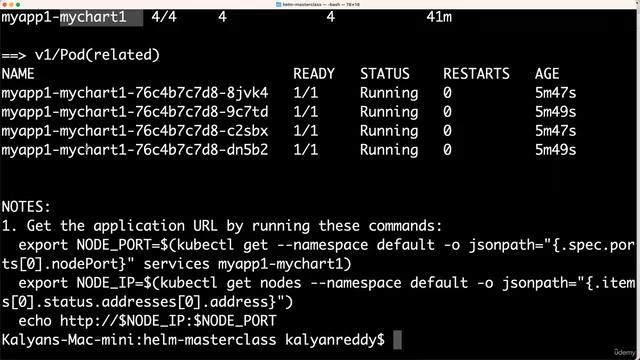
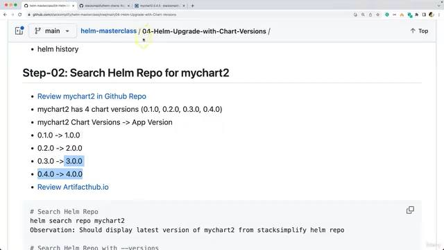
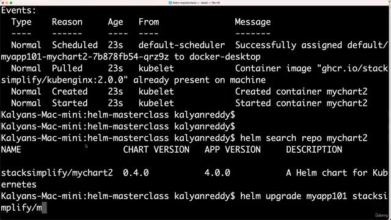
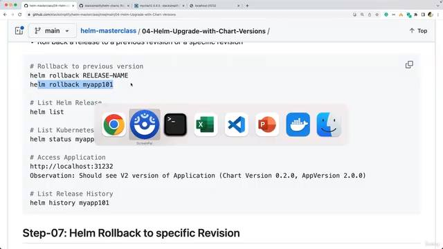
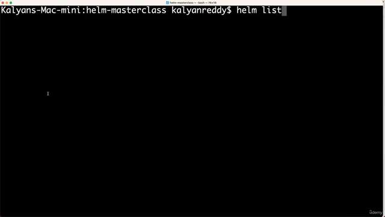
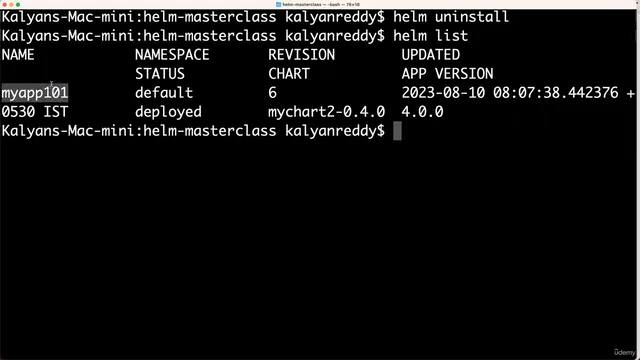
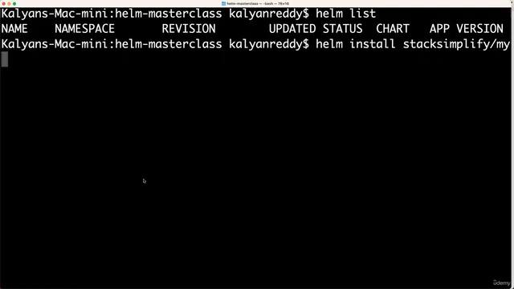
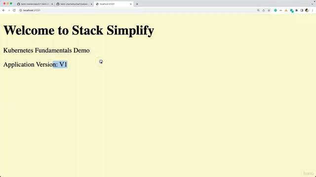
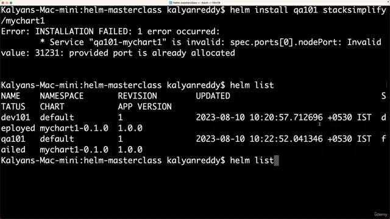

# Helm Masterclass 复现文档（P16–P26）：升级、版本、历史、回滚、卸载与原子安装

> 覆盖课程：BV1WNas6ZESg 第 16–26 集
> 读者定位：前端转 AI 应用工程师，无后端/K8s 深度背景
> 复现目标：在一套本地 Kubernetes 上，完整走通一次 Helm Release 的「升级 → 查历史 → 查状态 → 回滚 → 卸载 → 保留历史再回滚 → 生成随机名安装 → atomic 安装」全生命周期

---

## 1. 这一节做什么

P16–P26 这十一集不是零散命令合集，而是一条完整的**发布生命周期主线**。讲师在做的事情可以概括成一句话：**把一个已经用 `helm install` 装好的应用，反复折腾一遍，看 Helm 在每一步到底记住了什么、丢掉了什么。**

具体拆成五块能力：

| 能力块 | 涉及集数 | 你要做出来的结果 |
|---|---|---|
| A. 值覆盖式升级 | P16 | 用 `--set` 把 `replicaCount` 从 1 改成 4，Pod 真的变 4 个 |
| B. 历史与状态查询 | P16 | 用 `helm history` / `helm status` 看到每一次 revision |
| C. 版本驱动的安装/升级/回滚 | P18–P21 | 装 v0.1.0 → 升 v0.2.0 → 不指定版本直冲最新 v0.4.0 → 回滚到 v2 → 再回滚到 v1 |
| D. 卸载与保留历史 | P22–P23 | `--keep-history` 卸载后还能回滚回来；不带这个 flag 则彻底消失 |
| E. 特殊安装方式 | P24–P26 | `--generate-name` 自动起名；`--atomic` 失败即自动回收 |

学完这套东西你手上会有一个**可反复重放的实验脚本**，而不是一堆背不下来的命令。

**前置条件**（这些是课里默认你已经有、但没有从头演示的东西）：

- 一个能用的 Kubernetes 集群，`kubectl get pods` 有输出
- Helm 3 已安装，`helm version` 有输出
- 本地能访问到讲师演示用的 chart 仓库 `stacksimplify/mychart1` 和 `stacksimplify/mychart2`

> 注意：课里从 P16 直接开始敲 `helm upgrade myapp1 stacksimplify/mychart1`，**没有演示 `helm repo add stacksimplify ...` 这一步**。这意味着讲师在前面某一集里已经加过仓库了。你如果直接照抄命令会报 `repo stacksimplify not found`，解决办法见第 7 章第 1 条。

---

## 2. 讲师原话

下面是我从逐字稿里挑出的、决定了整节骨架的原句。按项目逻辑排序，不按集数顺序。

**关于 `--set` 覆盖 value —— p016 [00:29]**

> "我会说 `--set replicaCount=4`……现在如果我执行 `kubectl get pods`，可以看到有四个 Pod 在运行，所以我们通过 `helm upgrade` 命令使用 `--set` 成功地将 values.yml 中 replicaCount 从 1 覆盖为 4。"

这句定下了 P16 的第一个动作：**values.yaml 里的值是默认值，`--set` 是运行时覆盖**。

**关于 `helm history` 到底看什么 —— p016 [00:58]、[01:27]**

> "`helm history` 命令会打印给定 release 的历史修订版本。"

> "修订版本是 1，描述显示安装已完成……状态是 superseded，表示这是之前的 release，chart 是 my-chart-1.0.1.0，app 版本可以看到是 1.0.0……对于修订版本 2、3、4 和 5，你使用的是 upgrade complete。"

**关于为什么 chart 版本和 app 版本一直不变 —— p016 [03:21]**

> "你始终只使用了 my-chart-1.0.1.0 这个版本，app 版本也只使用了 1.0.0。所以你没有通过 chart 版本或 app 版本来升级。我们是通过 values.yaml 文件将 replicaCount 覆盖为 4，或者通过 `--set image.tag=2.0、3.0、4.0` 来覆盖的。所以这就是 chart 和 app 版本没有变化的原因。"

这是整个 P16 最容易被忽略的一句，也是理解 `helm history` 那张表的关键：**五次 revision 里 CHART 和 APP VERSION 两列完全不动，因为改的只是 value，不是 chart 包本身。**

**关于 `helm status --show-resources` 的价值 —— p016 [04:47]、[05:16]**

> "在所有 helm status 命令中，`--show-resources` 命令是非常重要的一个。"

> "你需要运行 `kubectl get pods`、`kubectl get svc` 和 `kubectl get deploy`，因为我们有三种类型的服务，但在这里使用 `helm status myapp1 --show-resources`，它会在一个命令中为我们提供所有信息。"

**关于 P18 这一集的定位（纯规划，没有敲命令）—— p018 [00:29]–[01:28]**

> "之后我们会用 chart 版本升级我们的应用……所以此时，我们的应用已经安装了 V1 版本并升级到了 V2 版本。如果我们不提供任何 chart 版本号，它会升级到 chart 上可用的最新版本。此时最新版本是 V4。所以在第五步中，它会直接从 V2 升级到 V4。"

> "每当我们执行这个 `helm rollback` 命令时，就会从这个 v4 版本回滚到 v2 版本。"

P18 全程是预告片，一行业务命令都没执行，所以第 3 章里我不会把它单列成一个复现步骤，而是把它拆散进 Step 5–Step 10 的说明中。

**关于 `--keep-history` 到底保留了啥 —— p022 [00:25]、[00:54]**

> "使用 `helm uninstall <release name>` 时，我们还会添加一个名为 `--keep-history` 的标志……它会移除所有关联资源并将 release 标记为已删除。"

> "它会保留 release 历史记录，帮助我们回滚到已删除的 release 修订版本。"

**关于不带 flag 的后果 —— p023 [00:28]、[00:54]、[01:23]**

> "如果你运行 `helm list --uninstalled`，什么都不会显示，因为你没有加 keep-history 标志，所以它的引用根本不存在，我们无法追踪。"

> "如果你运行 `helm history myapp101`，什么都不会显示……因为它已被完全移除。"

> "`helm rollback myapp101`……它会提示 release 本身未找到，甚至无法执行回滚。"

**关于 `--generate-name` 用在哪儿 —— p024 [00:00]、[00:29]**

> "这个 `--generate-name` 标志会自动为我们生成 release 名称。所以当我们在使用 `helm install` 命令并带上 generate-name 标志时，确实不需要提供 release 名称。"

> "当我们在实现 DevOps 流水线时，如果我们想生成唯一的 release 名称而不抛出任何重复 release 错误，就可以使用这个设置。"

**关于 atomic 的定义 —— p025 [00:00]、[00:28]**

> "当我们使用这个 atomic 标志时，安装过程会在失败时删除安装。"

> "如果我们不使用 atomic 标志，会发生什么？它会创建 release，但状态为 failed release。"

**关于 atomic 会顺手打开 wait —— p025 [00:57]、[01:25]**

> "当你使用 atomic 标志时，同时也会设置 wait 标志。这个 wait 标志是做什么的？wait 会等待直到所有 Kubernetes 资源，比如 Pod、Deployment、StatefulSet、Service、Ingress，以及 Helm chart 中存在的所有内容……它会等到所有这些资源创建完成并处于就绪状态后，才将 release 标记为成功。"

> "如果某个资源处于挂起状态，那么它会等待多长时间取决于 Kubernetes 默认的资源超时时间，即 5 分钟。"

**关于失败的根本原因：nodePort 冲突 —— p025 [02:24]、[02:51]**

> "这里有 my-chart-1，在 my-chart-1 中如果你看 values.yaml，在 service 的 type 中配置了 nodePort，你将 nodePort 设置为 31231。"

> "它会尝试创建一个使用 31231 的 NodePort 服务，但 31231 端口已经被占用了。所以这个 QA101 会失败。"

**关于 P26 的实测结果 —— p026 [02:15]、[02:44]、[04:07]**

> "它显示安装失败，发生了一个错误，服务 QA101-my-chart-1 无效。具体是 spec.ports.nodePort 的值 31231 无效，该端口已被分配。"

> "Release QA101 失败并已因设置了 atomic 而被卸载，发生了一个错误，错误信息是 31231 端口已被分配，其他一切正常，但由于我们使用了 atomic，该 release 被立即卸载了。"

---

## 3. 从零复现

下面每一步都对应你能在终端里直接粘的命令。**顺序不能乱**，因为后一步依赖前一步留下的 release 状态。中间的 `helm list` / `helm history` 是用来肉眼验证的，别跳过。

### Step 0 · 环境自检

```bash
kubectl get pods
helm version
helm list
```

三条都要有输出。`helm list` 最好显示 "no releases"，说明起跑线是干净的。

> 这里补一个 JS 类比：`helm list` 相当于 `npm ls -g`，看清楚全局现在都装了什么，再动手。

### Step 1 · 用 `--set` 覆盖 values 做一次升级（P16）

```bash
kubectl get pods
helm upgrade myapp1 stacksimplify/mychart1 --set replicaCount=4
kubectl get pods
```

第二条命令跑完，第三条应该能从 1 个 Pod 变成 4 个。这是全节最直观的一步：**`--set` 是命令行的临时覆盖，不写回 `values.yaml`。** 注意这个 `myapp1` release 是讲师在前面的集数里就已经 install 过的，课里没有演示它最初是怎么装上去的。你如果集群是干净的，需要先补一句：

```bash
helm install myapp1 stacksimplify/mychart1
```

然后才能做上面的 upgrade。

### Step 2 · 看历史：`helm history`（P16）

```bash
helm list
helm history myapp1
```

讲师先 `helm list` 拿 release 名，再拿这个名字去查 history。history 表里你会看到五次 revision，前四次状态是 `superseded`，最后一次是 `deployed`，每一次的 DESCRIPTION 分别是 `Install complete` 和 `Upgrade complete`。



**关键观察点**：五次 revision 的 CHART 列一直是 `mychart1-0.1.0`，APP VERSION 列一直是 `1.0.0`。原因就是第 2 章引的那句原话——你只改了 value，没换 chart 包。

### Step 3 · 看状态三连：`helm status` / `--show-desc` / `--show-resources`（P16）

```bash
helm status myapp1
helm status myapp1 --show-desc
helm status myapp1 --show-resources
```

三条命令的输出是包含关系：第一条是完整状态（name、last deployed、namespace、status、revision、notes），第二条只截取 description 部分，第三条额外把这一版涉及的所有 K8s 资源列出来——Service、Deployment、Pod。



这条 `--show-resources` 是本集最有实用价值的一条命令。平时查一个 release 是不是真跑起来了，你要跑 `kubectl get pods` + `kubectl get svc` + `kubectl get deployment` 三条，现在一条就够。

### Step 4 · 清理，回到干净状态（P17）

```bash
helm uninstall myapp1
helm list
```

P17 只有 23 秒，就是做这一件事。`helm list` 应该显示 no releases。

### Step 5 · 版本查询三件套（P19）

```bash
helm search repo mychart2
helm search repo mychart2 --versions
helm search repo mychart2 --version 0.3.0
```

三条命令的区别：

- 不带 flag：只显示**最新**那个版本（课里是 `0.4.0`，对应 APP VERSION `4.0.0`）
- `--versions`（复数）：列出这个 chart 的**所有版本**，你会看到 0.1.0 / 0.2.0 / 0.3.0 / 0.4.0 四行
- `--version 0.3.0`（单数）：精确查某一个版本



讲师在 P19 里还去 GitHub 和 Artifact Hub 上核对了 `mychart2` 的四个包：chart 0.1.0 ↔ appVersion 1.0.0，0.2.0 ↔ 2.0.0，0.3.0 ↔ 3.0.0，0.4.0 ↔ 4.0.0。**这个一一对应关系是后面判断「升级成功没有」的唯一依据。**

### Step 6 · 指定版本安装（P20）

```bash
helm list
helm install myapp101 stacksimplify/mychart2 --version 0.1.0
helm list
helm status myapp101 --show-resources
kubectl describe pod <上面输出里的 pod 名>
```

`helm list` 里应该出现 `myapp101`，REVISION 是 1，CHART 是 `mychart2-0.1.0`，APP VERSION 是 `1.0.0`。

`kubectl describe pod` 里能看到容器镜像是 1.0.0 那一版。

然后取到 Service 的 NodePort：

```bash
kubectl get svc
```

课里 `mychart2` 的 NodePort 是 `31232`。浏览器打开 `localhost:31232`，页面应该显示 v1。

### Step 7 · 指定版本升级（P20）

```bash
helm upgrade myapp101 stacksimplify/mychart2 --version 0.2.0
helm status myapp101 --show-resources
kubectl describe pod <新 pod 名>
```

REVISION 变成 2，状态 `deployed`。刷新 `localhost:31232`，页面变 v2。

### Step 8 · 不指定版本升级 = 直冲最新（P20）

```bash
helm search repo mychart2
helm upgrade myapp101 stacksimplify/mychart2
helm status myapp101 --show-resources
kubectl describe pod <新 pod 名>
```

注意这次**故意不加 `--version`**。Helm 会取仓库里的最新版，也就是 0.4.0，**直接从 0.2.0 跳到 0.4.0，跳过 0.3.0**。这是 P18 预告片里就点明的行为，P20 落地验证。

REVISION 变成 3，页面变 v4。



### Step 9 · 回滚到上一版：`helm rollback` 不带参数（P21）

```bash
helm history myapp101
helm rollback myapp101
helm history myapp101
helm status myapp101 --show-resources
kubectl describe pod <新 pod 名>
```

第一条 `helm history` 让你看清当前是 revision 3（v4）。第二条回滚，**不写 revision 号就等于退回上一个 revision**，也就是 revision 2（v2）。

第三条 `helm history` 是全节最反直觉的一幕：**现在是 4 条记录，第 4 条是「Rollback to 2」**。Helm 不会删掉 revision 3，而是新增一条 revision 4，把状态指回 v2。



> 这里给个前端类比：`helm rollback` 更像 `git revert` 而不是 `git reset --hard`。历史只增不减，所以你能一路往回倒，也能再倒回来。

### Step 10 · 回滚到指定 revision（P21）

```bash
helm rollback myapp101 1
helm status myapp101 --show-resources
kubectl describe pod <新 pod 名>
```

这次明确指定目标是 revision 1，也就是 v1。刷新浏览器页面变 v1。

> 讲师在 P21 结尾特意说了一句：**这个 `myapp101` 不要卸载**，下一集（P22）要接着用。所以这里别顺手 `helm uninstall`。

### Step 11 · `--keep-history` 卸载 + 从已卸载状态回滚回来（P22）

```bash
helm list
helm history myapp101
helm uninstall myapp101 --keep-history
helm list
helm list --uninstalled
helm history myapp101
helm rollback myapp101 3
helm list
helm history myapp101
helm status myapp101 --show-resources
```

这段是整节信息密度最高的一段，拆开看：

1. `helm uninstall myapp101 --keep-history` —— 资源全删了，但 release 记录保留，状态标为 `uninstalled`
2. `helm list` —— 空，因为默认不显示 uninstalled 的
3. `helm list --uninstalled` —— 能看到 `myapp101`，状态 `uninstalled`
4. `helm history myapp101` —— 历史还在！最后一条记录状态是 `uninstalled`
5. `helm rollback myapp101 3` —— **从已卸载状态回滚到 revision 3**，那条 revision 里存的是 v4
6. `helm list` —— 回来了，而且 REVISION 变成 6（不是 4，因为回滚本身也占一个 revision）



验证页面：

```bash
kubectl get pods
kubectl get svc
kubectl get deployment
curl http://localhost:31232
```

讲师特别提醒了一句：浏览器可能有缓存，看到旧内容别慌，**用 `curl` 或者开无痕窗口**才是可信的验证手段。

### Step 12 · 对照组：不带任何 flag 的卸载（P23）

```bash
helm list
helm uninstall myapp101
helm list --uninstalled
helm history myapp101
helm rollback myapp101 1
```

四条验证命令全部失败或为空：

- `helm list --uninstalled` —— 什么都没有
- `helm history myapp101` —— 什么都没有
- `helm rollback myapp101 1` —— `release: not found`

这一步存在的意义只有一个：**让你亲眼看见 `--keep-history` 到底保住了什么。** 没有它，release 在 Helm 眼里从来没有存在过。



### Step 13 · `--generate-name` 自动生成 release 名（P24）

```bash
helm list
helm install stacksimplify/mychart1 --generate-name
helm list
helm list --output yaml
helm status <上面生成的随机名> --show-resources
curl http://localhost:31231
```

注意 `helm install` 后面**第一个位置参数直接就是 chart 名**，没有 release 名。Helm 会生成一个 `mychart1-1680000000` 这种形式的随机名。

`--output yaml` 是为了看清楚结构化的 release 对象——讲师说表格输出太宽看不清，所以切成 YAML 看。

`mychart1` 的 NodePort 是 `31231`，和 `mychart2` 的 `31232` 不同，这是后面 atomic 实验能成立的前提。



最后清理：

```bash
helm list
helm uninstall <刚才那个随机名>
```

### Step 14 · `--atomic`：失败自动回收（P25 讲解 + P26 实操）

先用 `mychart1` 装一个正常 release，占住 `31231` 端口：

```bash
helm list
helm install dev101 stacksimplify/mychart1
helm list
helm status dev101 --show-resources
curl http://localhost:31231
```

`dev101` 部署成功，NodePort 31231 被占。然后**故意**再装一个同名 chart 的第二个 release：

```bash
helm install qa101 stacksimplify/mychart1
helm list
helm list --output yaml
```

第二条必然失败，报错大意是 `service "qa101-mychart1" is invalid: spec.ports[0].nodePort: Invalid value: 31231: provided port is already allocated`。

（上面这条报错的字段名是我按讲师念出来的原文还原的，**你的实际输出字段顺序可能不同，以终端为准**。）

关键在于第三条 `helm list`：**`qa101` 出现在列表里，状态是 `failed`**。这就是没有 atomic 的后果——失败留个烂摊子。



清理掉这个 failed release，然后用 atomic 重来：

```bash
helm uninstall qa101
helm list
helm install qa101 stacksimplify/mychart1 --atomic
helm list
```

这次报错信息变成「Release "qa101" failed and has been uninstalled due to atomic being set」，然后 `helm list` 里**只剩 dev101**，`qa101` 干干净净没留下任何痕迹。



最后收尾：

```bash
helm uninstall dev101
helm list
```

---

## 4. 完整代码

### 4.1 一键复现脚本 `helm-lab.sh`

把下面整个文件保存成 `helm-lab.sh`，`chmod +x helm-lab.sh` 后执行。它把第 3 章的 Step 0–Step 14 串起来，中间用 `read -p` 断点，方便你一步一停观察。

```bash
#!/usr/bin/env bash
# helm-lab.sh
# Helm Masterclass P16-P26 全流程复现脚本
# 用法：./helm-lab.sh          （逐步暂停）
#      ./helm-lab.sh --auto   （不暂停，直冲到底，仅用于 CI 冒烟）

set -u

PAUSE=1
if [ "${1:-}" = "--auto" ]; then
  PAUSE=0
fi

step() {
  echo ""
  echo "=================================================="
  echo ">>> $1"
  echo "=================================================="
}

pause() {
  if [ "$PAUSE" -eq 1 ]; then
    read -r -p "按回车继续（Ctrl+C 中止）..." _
  fi
}

# ---------------------------------------------------------------
# Step 0 环境自检
# ---------------------------------------------------------------
step "Step 0 环境自检"
kubectl get pods
helm version
helm list
pause

# ---------------------------------------------------------------
# Step 1 先装一个初始 release（课里默认已存在 myapp1）
# ---------------------------------------------------------------
step "Step 1 安装 myapp1 作为后续升级的起点"
helm install myapp1 stacksimplify/mychart1
kubectl get pods
pause

# ---------------------------------------------------------------
# Step 2 用 --set 覆盖 replicaCount 做升级
# ---------------------------------------------------------------
step "Step 2 helm upgrade --set replicaCount=4"
helm upgrade myapp1 stacksimplify/mychart1 --set replicaCount=4
kubectl get pods
pause

# ---------------------------------------------------------------
# Step 3 历史与状态三连
# ---------------------------------------------------------------
step "Step 3 helm history / helm status 三种形态"
helm list
helm history myapp1
helm status myapp1
helm status myapp1 --show-desc
helm status myapp1 --show-resources
pause

# ---------------------------------------------------------------
# Step 4 清理
# ---------------------------------------------------------------
step "Step 4 helm uninstall myapp1（回到干净状态）"
helm uninstall myapp1
helm list
pause

# ---------------------------------------------------------------
# Step 5 版本查询三件套
# ---------------------------------------------------------------
step "Step 5 helm search repo mychart2 的三种查法"
helm search repo mychart2
helm search repo mychart2 --versions
helm search repo mychart2 --version 0.3.0
pause

# ---------------------------------------------------------------
# Step 6 指定版本安装
# ---------------------------------------------------------------
step "Step 6 helm install --version 0.1.0"
helm install myapp101 stacksimplify/mychart2 --version 0.1.0
helm list
helm status myapp101 --show-resources
kubectl get pods
kubectl get svc
echo "现在浏览器访问 http://localhost:31232 应看到 v1"
pause

# ---------------------------------------------------------------
# Step 7 指定版本升级
# ---------------------------------------------------------------
step "Step 7 helm upgrade --version 0.2.0"
helm upgrade myapp101 stacksimplify/mychart2 --version 0.2.0
helm list
helm status myapp101 --show-resources
echo "现在浏览器访问 http://localhost:31232 应看到 v2"
pause

# ---------------------------------------------------------------
# Step 8 不指定版本升级，直冲最新
# ---------------------------------------------------------------
step "Step 8 helm upgrade 不带 --version，应跳到 0.4.0"
helm search repo mychart2
helm upgrade myapp101 stacksimplify/mychart2
helm list
helm status myapp101 --show-resources
echo "现在浏览器访问 http://localhost:31232 应看到 v4"
pause

# ---------------------------------------------------------------
# Step 9 回滚到上一版
# ---------------------------------------------------------------
step "Step 9 helm rollback myapp101（回上一个 revision）"
helm history myapp101
helm rollback myapp101
helm history myapp101
helm status myapp101 --show-resources
echo "现在浏览器访问 http://localhost:31232 应看到 v2"
pause

# ---------------------------------------------------------------
# Step 10 回滚到指定 revision
# ---------------------------------------------------------------
step "Step 10 helm rollback myapp101 1（回到 revision 1）"
helm rollback myapp101 1
helm history myapp101
helm status myapp101 --show-resources
echo "现在浏览器访问 http://localhost:31232 应看到 v1"
pause

# ---------------------------------------------------------------
# Step 11 --keep-history 卸载并从已卸载状态回滚
# ---------------------------------------------------------------
step "Step 11 helm uninstall --keep-history + rollback 回 revision 3"
helm list
helm history myapp101
helm uninstall myapp101 --keep-history
helm list
helm list --uninstalled
helm history myapp101
helm rollback myapp101 3
helm list
helm history myapp101
helm status myapp101 --show-resources
echo "现在浏览器访问 http://localhost:31232 应看到 v4"
echo "如果看到旧版本，用 curl 验证：curl http://localhost:31232"
pause

# ---------------------------------------------------------------
# Step 12 对照组：不带 flag 的卸载
# ---------------------------------------------------------------
step "Step 12 helm uninstall 不带任何 flag，全部痕迹消失"
helm list
helm uninstall myapp101
helm list --uninstalled
helm history myapp101 || echo "预期失败：release not found"
helm rollback myapp101 1 || echo "预期失败：release not found"
pause

# ---------------------------------------------------------------
# Step 13 --generate-name
# ---------------------------------------------------------------
step "Step 13 helm install --generate-name（自动生成 release 名）"
helm list
helm install stacksimplify/mychart1 --generate-name | tee /tmp/helm-generate-name.out
GEN_NAME="$(grep -oE 'mychart1-[0-9]+' /tmp/helm-generate-name.out | head -n1)"
echo "自动生成的 release 名：${GEN_NAME}"
helm list
helm list --output yaml
helm status "${GEN_NAME}" --show-resources
echo "现在浏览器访问 http://localhost:31231 应看到 v1"
curl http://localhost:31231 || true
pause

step "Step 13b 清理上一步生成的 release"
helm uninstall "${GEN_NAME}"
helm list
pause

# ---------------------------------------------------------------
# Step 14 --atomic
# ---------------------------------------------------------------
step "Step 14a 安装 dev101 占住 NodePort 31231"
helm list
helm install dev101 stacksimplify/mychart1
helm list
helm status dev101 --show-resources
curl http://localhost:31231 || true
pause

step "Step 14b 故意让 qa101 失败（不带 atomic）"
helm install qa101 stacksimplify/mychart1 || echo "预期失败：nodePort 31231 已被占用"
helm list
helm list --output yaml
pause

step "Step 14c 清掉 failed 的 qa101，改用 --atomic 重装"
helm uninstall qa101
helm list
helm install qa101 stacksimplify/mychart1 --atomic || echo "预期失败：nodePort 31231 已被占用，且已自动 uninstall"
helm list
pause

step "Step 14d 收尾清理"
helm uninstall dev101
helm list
echo "全部实验完成。"
```

### 4.2 可选：本地等价 chart（课里没有代码，以下为示意）

课里从头到尾都是直接引用公开仓库 `stacksimplify/mychart1` / `stacksimplify/mychart2`，**讲师没有展示过 chart 目录结构，也没有展示过 `templates/` 里的内容**。如果你网络受限打不开那个仓库，想自己在本地复刻同等行为，下面是最小等价结构。**注意：镜像地址是占位符，课里没有讲他们用的镜像，你需要换成自己推送过的镜像，否则 Pod 起不来。**

```
my-chart/
├── Chart.yaml
├── values.yaml
└── templates/
    ├── deployment.yaml
    └── service.yaml
```

`my-chart/Chart.yaml`：

```yaml
apiVersion: v2
name: my-chart
version: 0.1.0
appVersion: "1.0.0"
```

`my-chart/values.yaml`：

```yaml
replicaCount: 1

image:
  repository: your-registry/my-app
  tag: "1.0.0"
  pullPolicy: IfNotPresent

service:
  type: NodePort
  port: 80
  nodePort: 31231
```

`my-chart/templates/deployment.yaml`：

```yaml
apiVersion: apps/v1
kind: Deployment
metadata:
  name: {{ .Release.Name }}-{{ .Chart.Name }}
  labels:
    app: {{ .Release.Name }}
spec:
  replicas: {{ .Values.replicaCount }}
  selector:
    matchLabels:
      app: {{ .Release.Name }}
  template:
    metadata:
      labels:
        app: {{ .Release.Name }}
    spec:
      containers:
        - name: {{ .Chart.Name }}
          image: "{{ .Values.image.repository }}:{{ .Values.image.tag }}"
          imagePullPolicy: {{ .Values.image.pullPolicy }}
          ports:
            - containerPort: {{ .Values.service.port }}
```

`my-chart/templates/service.yaml`：

```yaml
apiVersion: v1
kind: Service
metadata:
  name: {{ .Release.Name }}-{{ .Chart.Name }}
  labels:
    app: {{ .Release.Name }}
spec:
  type: {{ .Values.service.type }}
  ports:
    - port: {{ .Values.service.port }}
      targetPort: {{ .Values.service.port }}
      nodePort: {{ .Values.service.nodePort }}
  selector:
    app: {{ .Release.Name }}
```

打成本地包并安装：

```bash
helm package my-chart
# 生成 my-chart-0.1.0.tgz
helm install myapp1 ./my-chart-0.1.0.tgz
```

要模拟 `mychart2` 的四个版本，就改 `Chart.yaml` 里的 `version` 和 `appVersion`，改一次打一次包，把 `values.yaml` 里的 `nodePort` 改成 `31232`。**这样做的代价是：你无法用 `helm search repo` 查询本地 tgz，第 3 章 Step 5 那三条查询命令会没有对象。** 取舍自己判断。

---

## 5. 逐行解释

### `helm upgrade myapp1 stacksimplify/mychart1 --set replicaCount=4`

- `upgrade` 而不是 `install`：前提是 `myapp1` 这个 release 已经存在，否则报 `release: not found`，这时候要用 `install`
- 第二个位置参数是**该 release 的来源 chart**，Helm 默认沿用旧 chart 配置，不替换
- `--set key=value`：运行时覆盖 `values.yaml`，优先级高于文件里的值。在本例里，`values.yaml` 的 `replicaCount` 是 1，命令行覆盖成 4
- 注意 `--set` 的值是字符串，Helm 会做类型推断；数字 `4` 会被推断成 int，但 `image.tag=2.0` 这种会被当成字符串 `"2.0"`，不想要小数点的坑就显式加引号

> JS 类比：`values.yaml` 是 package.json 里的默认配置，`--set` 是 `npm i --legacy-peer-deps` 那种命令行临时改行为，不会写回文件。

### `helm history myapp1`

- 输出六列：REVISION / UPDATED / STATUS / CHART / APP VERSION / DESCRIPTION
- STATUS 只有两种你会反复见到的值：`deployed`（当前生效）、`superseded`（被后续版本顶掉的历史）
- 加上 P22 的 `uninstalled`，本节一共涉及三种状态
- **这一列为什么一直是 `mychart1-0.1.0`**：因为从头到尾都是升级 value，没有换 chart 包。什么时候会变，看 Step 7/8 的 `--version` 升级

### `helm status myapp1 --show-resources`

- 不带 flag 时输出的是 release 摘要：NAME / LAST DEPLOYED / NAMESPACE / STATUS / REVISION / NOTES
- `--show-desc` 只挑 DESCRIPTION 字段
- `--show-resources` 是本节最有用的一个：把这一版 release 关联的 Service / Deployment / Pod 连同名字一起列出来
- 讲师原话是 "通过单一方案为我们提供全部内容"，等价于把 `kubectl get pods` + `kubectl get svc` + `kubectl get deployment` 三条合并

### `helm search repo mychart2 --versions`

- `--versions`（复数）列出该 chart 的**全部**历史版本
- 不加这个 flag 只显示最新版（课里是 0.4.0）
- 单数 `--version 0.3.0` 是「查某个具体版本」+「安装/升级时锁定某个具体版本」两用，和 `search` 搭配就是查询，和 `install`/`upgrade` 搭配就是锁定

> 注意这个大小写/单复数不是笔误，`--versions` 和 `--version` 是两个不同语义的 flag。这是新手最容易打错的一处。

### `helm install myapp101 stacksimplify/mychart2 --version 0.1.0`

- 第一个位置参数是**你自己起的 release 名**，可以随便起，但同一 namespace 内不能重复
- 第二个位置参数是 chart
- `--version 0.1.0` 锁死版本；不写就装最新
- 装完之后 `helm list` 里 CHART 列显示 `mychart2-0.1.0`，APP VERSION 显示 `1.0.0`

### `helm upgrade myapp101 stacksimplify/mychart2 --version 0.2.0`

- 语法和 install 完全一致，只换了动词
- 从 0.1.0 升到 0.2.0，APP VERSION 从 1.0.0 变 2.0.0
- REVISION 自增到 2

### `helm upgrade myapp101 stacksimplify/mychart2`（不加 `--version`）

- 这是 P18 预告片里点明、P20 实测的关键行为：**省略 `--version` = 取仓库最新版**
- 结果是 0.2.0 直接跳到 0.4.0，**跳过 0.3.0 不经过**
- 这是 Helm 的默认行为，不是 bug。生产环境想避免这种意外跳跃，就应该显式写 `--version`
- JS 类比：类似 `npm i lodash` 不锁版本，`package.json` 里写 `^4.17.0`，某天重装就直接上到 4.x 的最新

### `helm rollback myapp101`

- 动词只有一个参数：release 名
- **不写 revision = 退回上一个 revision**（本例从 3 退到 2）
- 回滚本身会新增一条 revision，DESCRIPTION 里写 `Rollback to 2`
- 所以回滚不是「时光倒流」，是「用旧版本再发布一次」

> 前端类比的准确写法：`helm rollback` ≈ `git revert`（新增一个反向提交），而不是 `git reset --hard`（删除历史）。这个区别在评审、审计场景里非常关键——你能查到「谁在什么时候回滚到哪一版」。

### `helm rollback myapp101 1`

- 第二个位置参数是**目标 revision 号**，不是版本号，不是 chart 版本
- 本例中 revision 1 存的是 v1 的镜像
- 回滚后 `helm history` 里新增第 5 条：`Rollback to 1`

### `helm uninstall myapp101 --keep-history`

- 删掉所有 K8s 资源（Pod / Deployment / Service 全部消失）
- 但 release 对象本身保留，状态置为 `uninstalled`
- 效果：`helm list` 看不到，`helm list --uninstalled` 能看到，`helm history` 能看到完整历史，`helm rollback` 能救回来

### `helm uninstall myapp101`（无 flag）

- 资源 + release 对象**一起删**
- `helm list --uninstalled` 空、`helm history` 空、`helm rollback` 报 `release: not found`
- 讲师在 P23 结尾下的结论：重要 release 卸载时**建议带 `--keep-history`**，为审计和急救留后路

### `helm install stacksimplify/mychart1 --generate-name`

- 位置参数只给 chart，不给 release 名
- Helm 自动生成 `chart名-时间戳` 形式的唯一名字
- 讲师点明的使用场景：**DevOps pipeline 里并发安装，不想处理重名冲突**
- 注意：不加 `--generate-name` 也不给名字，Helm 会直接报错，它不会默默帮你生成

> JS 类比：相当于 `mkdir` 时用 `fs.mkdtempSync()` 自动挑一个不冲突的目录名。

### `helm install qa101 stacksimplify/mychart1 --atomic`

- 核心语义：**失败就整单撤销**，包括已经创建成功的部分资源
- 副作用一：自动打开 `--wait`，等到 Pod / Deployment / StatefulSet / Service / Ingress 全部 ready 才算成功
- 副作用二：自动打开超时控制，默认等待 5 分钟（讲师原话 "你的 Kubernetes 默认资源超时时间为 5 分钟"）
- 副作用三：失败后 `helm list` 里**不留 failed 记录**，`helm list --uninstalled` 也不留（因为它是被「撤销」而不是被「卸载」）

> JS 类比：这就是事务语义。`--atomic` ≈ `db.transaction()` 里抛异常自动 rollback；不加 `--atomic` ≈ 半途出错但已经写进去的那半条数据留着，变成脏数据。

### 关于那条 nodePort 报错

```
Error: INSTALLATION FAILED: Service "qa101-mychart1" is invalid:
spec.ports[0].nodePort: Invalid value: 31231: provided port is already allocated
```

- 这是 **Kubernetes API Server 拒绝的**，不是 Helm 拒绝的
- 原因：`mychart1` 的 `values.yaml` 里把 `service.nodePort` 写死成了 `31231`。第一个 release（`dev101`）已经用掉了这个端口，第二个 release 再用同一个端口，Service 创建失败
- NodePort 是**集群级别**的唯一资源，跨 namespace 也不允许重复

> JS 类比：这就是 `EADDRINUSE`——`listen(31231)` 的时候端口已被占用。区别只是这里的「端口表」在 K8s 控制面。

---

## 6. 复现检查清单

按顺序打勾，卡在哪一步就回第 3 章对应小节。

**环境准备**
- [ ] `kubectl get pods` 有输出，不是 `connection refused`
- [ ] `helm version` 是 v3（`v3.x.x`）
- [ ] `helm repo list` 里能看到 `stacksimplify`（看不到见第 7 章第 1 条）
- [ ] `helm search repo mychart1` 有结果，`helm search repo mychart2` 有结果
- [ ] `helm list` 是空的（起跑线干净）

**A 组 · 值覆盖升级（Step 1–4）**
- [ ] `--set replicaCount=4` 之后 `kubectl get pods` 真的是 4 个 Running
- [ ] `helm history myapp1` 里 5 条记录，前 4 条 `superseded`，最后 1 条 `deployed`
- [ ] 桌格里 CHART 列和 APP VERSION 列五次完全没变
- [ ] `helm status myapp1 --show-resources` 同时列出了 Service / Deployment / Pod
- [ ] `helm uninstall myapp1` 之后 `helm list` 为空

**B 组 · 版本驱动安装升级（Step 5–8）**
- [ ] `helm search repo mychart2` 只返回 1 行（0.4.0）
- [ ] `helm search repo mychart2 --versions` 返回 4 行（0.1.0 / 0.2.0 / 0.3.0 / 0.4.0）
- [ ] `--version 0.1.0` 装完，`helm list` 显示 CHART 是 `mychart2-0.1.0`、APP VERSION 是 `1.0.0`
- [ ] `localhost:31232` 显示 v1
- [ ] 升到 0.2.0 后 `localhost:31232` 显示 v2
- [ ] 不写 `--version` 升级后，**直接跳到 0.4.0**，不是 0.3.0
- [ ] `localhost:31232` 显示 v4

**C 组 · 历史与回滚（Step 9–10）**
- [ ] `helm history myapp101` 此时有 3 条
- [ ] `helm rollback myapp101`（不带参数）后，history 变 4 条，最后一条 DESCRIPTION 是 `Rollback to 2`
- [ ] 页面回到 v2
- [ ] `helm rollback myapp101 1` 后，页面回到 v1

**D 组 · 卸载与保留历史（Step 11–12）**
- [ ] `helm uninstall --keep-history` 后，`helm list` 空但 `helm list --uninstalled` 能看到 `myapp101`，STATUS 是 `uninstalled`
- [ ] `helm history myapp101` 仍然能查到全部记录
- [ ] `helm rollback myapp101 3` 成功，`helm list` 里 REVISION 显示 6
- [ ] 页面回到 v4（revision 3 存的是 0.3.0 那个包，对应 v4）
- [ ] 对照组：不带 flag 卸载后，`helm list --uninstalled` 空、`helm history` 空、`helm rollback` 报 `release: not found`

**E 组 · generate-name（Step 13）**
- [ ] `helm install stacksimplify/mychart1 --generate-name` 输出里有 `mychart1-<数字>`
- [ ] `helm list` 里能看到这个随机名，STATUS 是 `deployed`
- [ ] `helm status <随机名> --show-resources` 正常
- [ ] `curl http://localhost:31231` 返回 v1 内容

**F 组 · atomic（Step 14）**
- [ ] `helm install dev101 stacksimplify/mychart1` 成功
- [ ] `helm install qa101 stacksimplify/mychart1` **失败**，报 `provided port is already allocated`
- [ ] 此时 `helm list` 里 `qa101` 状态是 `failed`（这就是不加 atomic 的坏处）
- [ ] `helm uninstall qa101` 之后再 `helm install qa101 stacksimplify/mychart1 --atomic`，同样失败
- [ ] 失败后 `helm list` 里**只有 dev101**，qa101 没有任何残留
- [ ] `helm uninstall dev101` 收尾

**收尾**
- [ ] `helm list` 完全为空
- [ ] `helm list --uninstalled` 也为空（或只有你故意保留的）

---

## 7. 课里没讲但你会撞上的

### 1. `helm repo add stacksimplify ...` 这一步课里没讲

P16 一上来就 `helm upgrade myapp1 stacksimplify/mychart1`，默认你已经加过仓库。**仓库地址课里全程没有出现过**，我没法给你一个准确的 URL。解决办法有两个：

- 去讲师的 GitHub 仓库（P19 里提到过 `github.com/stacksimplify/helm-charts`）找 `helm repo add` 的说明
- 或者用第 4.2 节的本地等价 chart 自己打包，绕开远程仓库

在没加仓库的情况下，`helm search repo mychart2` 会报 `repo stacksimplify not found`，这是最常见的第一个卡点。

### 2. NodePort 31231 / 31232 可能已被别的服务占用

课里之所以 atomic 实验能成立，是因为 `mychart1` 把 nodePort **写死**成了 31231。你自己集群里如果已经有别的 NodePort Service 用了这个端口，Step 13 和 Step 14 会直接失败。

排查：

```bash
kubectl get svc --all-namespaces | grep 31231
kubectl get svc --all-namespaces | grep 31232
```

有冲突的话，两个选择：删掉占用者，或者用 `--set service.nodePort=31333` 覆盖。**注意 Helm 的 `--set` 能改 nodePort 这件事课里没讲，是我的补充。**

### 3. `localhost:31231` 打不开

课里默认你的 K8s 集群是跑在本机的（Docker Desktop / minikube / kind 之类），所以 `localhost:NodePort` 能直连。**如果你用的是远程集群、云厂商 K8s 或者 WSL2 里的集群，`localhost` 是连不上的。** 这种情况要么 `kubectl port-forward`，要么用节点 IP，要么在云控制台开安全组。课里没讲这块。

### 4. 浏览器缓存让你以为回滚失败

讲师在 P22 里专门提醒过：回滚到 v4 之后刷新浏览器还是旧内容，是因为缓存。**验证时优先用 `curl`，或者开无痕窗口。** 这条很实用，别忽略。

### 5. `helm rollback` 之后的 revision 号会「跳号」

不是 1 → 2 → 3 → 4 这么规整。P22 里 `helm uninstall --keep-history` 之后回滚，REVISION 直接变成 **6**。原因是：

- revision 1/2/3 是安装和两次升级
- revision 4/5 是两次 rollback
- uninstall 也算一次状态变更
- 所以下一次 rollback 就是 6

`helm history` 是流水账，不是版本的逻辑编号。想找「哪个 revision 对应哪个镜像版本」，只能看 DESCRIPTION 和当时的操作记录。

### 6. `--atomic` 会让你的部署变慢

因为 atomic 自动带上 `--wait`，Helm 要等到所有资源 ready 才返回，默认超时 5 分钟。**在 CI pipeline 里，一个 `--atomic` 的 install 可能卡住 5 分钟才失败，而不是 10 秒。**

想缩短等待，可以显式加 `--timeout`：

```bash
helm install qa101 stacksimplify/mychart1 --atomic --timeout 60s
```

> 这条 `--timeout` 是我的补充，课里只说了默认 5 分钟，没有演示改超时。

### 7. `--keep-history` 保留的是 Helm 记录，不是 K8s 资源

很多人第一反应是「带 keep-history 卸载后 Pod 还在吗」。**不在。** Pod / Deployment / Service 全部被删了，保留的只是 Helm 里那条 release 记录（存着当时用的 chart 版本和 values）。回滚的时候是**重新创建一遍资源**，不是恢复原对象。

所以 `helm rollback` 回滚后，Pod 是新的，`kubectl describe pod` 里 CREATION TIME 是刚刚。P22 里讲师输出 "Pod 在此之前已运行了 39 秒" 就是这个意思。

### 8. `helm list --uninstalled` 和 `helm list --all`

`--uninstalled` 只列 uninstalled 的。`--all` 会把 deployed + failed + uninstalled 全列出来。课里只讲了前者，后者在做故障排查时更好用。**（这两个参数名以你本地 `helm list --help` 为准。）**

### 9. `helm uninstall` 不会删 Namespace，也不会删 PVC

这是 Helm 的通用设计：release 决定它「自己创建过的」对象，但不会替你收拾 Namespace 级别的残留。**同一 namespace 里连着做几次实验之后，`helm list` 是空的，但 `kubectl get all` 里可能有孤儿资源。** 课里没讲这一块，但你反复跑上面的脚本时，遇到「端口被占但 helm list 是空的」几乎百分百是这个原因。

清场命令：

```bash
kubectl get all
kubectl get all -n <你的 namespace>
```

### 10. `--generate-name` 生成的 release 名不好记

它会生成 `mychart1-1680000000` 这种，几十次实验之后根本分不清哪个是哪个。**讲师的观点是「pipeline 里用」，你的本地实验别用。** 本地老老实实起 `myapp101` 这种名字，出问题好排查。

### 11. `--set` 的类型陷阱

`--set image.tag=2.0` 里的 `2.0` 会被 Helm 推断成 **float 2**，然后序列化成字符串 `"2"` 而不是 `"2.0"`。如果你的 image tag 恰好是 `2.0`，就会拉不到镜像。

安全写法：`--set-string image.tag=2.0`。**（这个 flag 课里没提，但它是 `--set` 系列里最常被坑的一个。）**

### 12. 关于「在 JS/Node 里对应什么」

这一节涉及的并发/冲突概念不多，能对应的只有两处：

- **nodePort 冲突** ↔ Node 的 `EADDRINUSE`，端口是在内核/控制面全局唯一
- **`--atomic`** ↔ 数据库事务，失败就整体回滚，不留半成品记录

其他命令（`helm history`、`helm rollback`、`helm search repo`）更接近 **npm 的版本体系 + git 的提交历史**，没有并发语义。

---

**文档结束。** 按第 3 章顺序跑一遍，卡在哪一步就回到第 6 章对应条目，第 7 章是踩坑手册。全部跑通之后，你手上应该只有一个空的 `helm list` 和一堆已经练过的肌肉记忆。