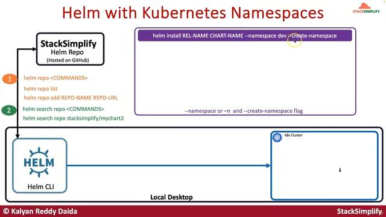
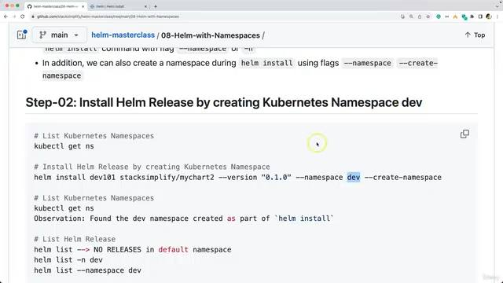
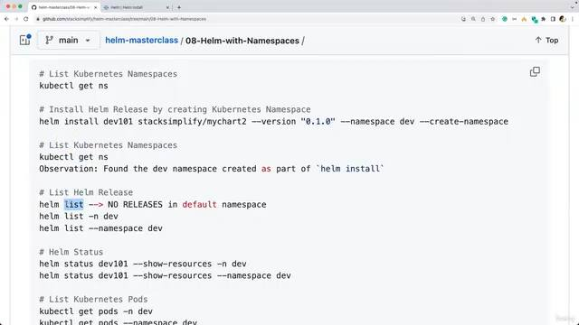
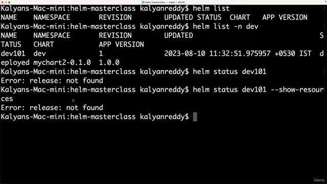
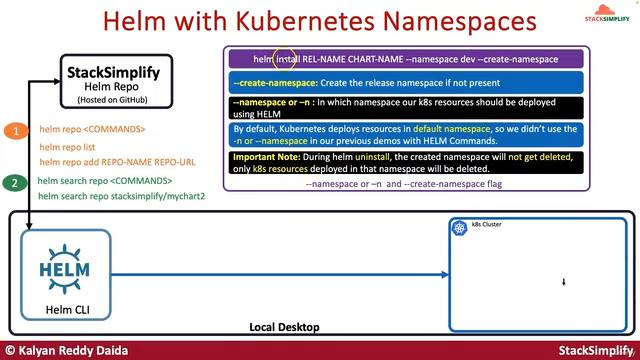
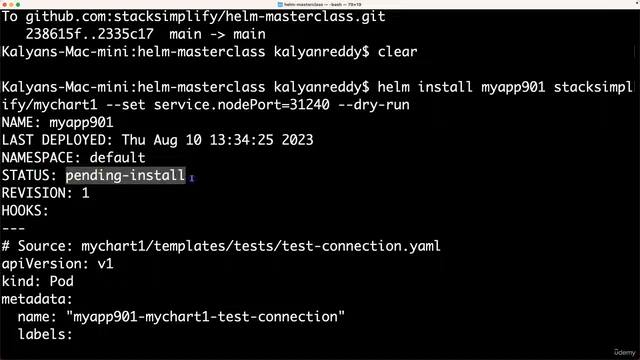
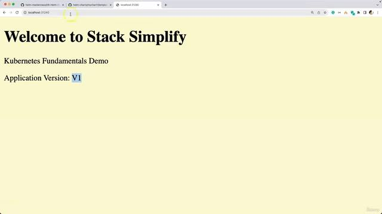
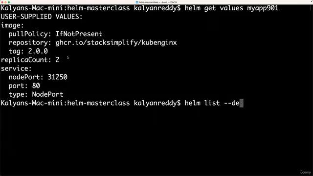
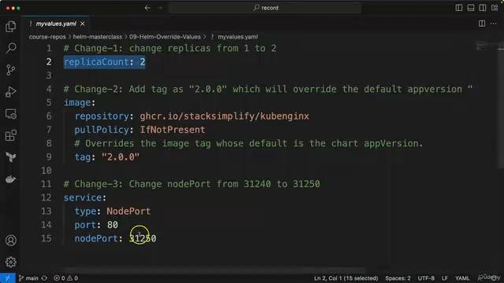

# Helm Masterclass P27–P32：命名空间部署、values 覆盖与 helm get 实战

> 适用人群：前端转 AI 应用工程师。本文所有命令都在终端执行，涉及并发/作用域的地方我会补一句 JS/Node 里的对应概念。
> 覆盖课时：P27（概念：Helm + Namespace）、P28（实操：装到 dev 命名空间）、P29（概念：覆盖 values、dry-run、debug、helm get）、P30（实操：`--set` + `--dry-run` + `--debug`）、P31（实操：`-f myvalues.yaml` 升级）、P32（实操：`helm get` 全家桶）。

---

## 1. 这一节做什么

这 6 节课合起来只干三件事，但每一件都是日常用 Helm 绕不过去的：

**第一件：把 release 装进指定的 namespace，并且理解 namespace 在 Helm 里是"作用域"而不是"标签"。**
默认情况下 `helm install` 把 release 和它创建的所有 K8s 资源都放进 `default` 命名空间。这一节演示怎么用 `--namespace dev --create-namespace` 一次性建好命名空间并装进去；更关键的是，装进去之后 **`helm list`、`helm status`、`helm upgrade`、`helm uninstall` 每一条命令都必须重新带上 `-n dev`**，否则 Helm 会去 default 里找，然后告诉你"没有这个 release"。这是本节最大的坑，讲师在 P28 里连续踩了三次（list 一次、status 一次、upgrade 一次），我们照着他的失败过程复现一遍，比看十遍文档都记得住。

**第二件：覆盖 chart 的默认 values，并且在真正提交给集群之前先看一眼渲染结果。**
两条覆盖路径：命令行 `--set service.nodePort=31240`（临时、单点覆盖），以及 `-f myvalues.yaml`（成组、可提交到 git 的覆盖）。配套两个观察工具：`--dry-run` 让你看到 Helm 最终要发给 API Server 的完整 YAML，`--debug` 在 dry-run 基础上多打印两段——"用户显式提供的值"（user supplied values）和"合并后的最终值"（computed values）。这两个开关组合起来，等于 Helm 世界的 `terraform plan`，是排查"为什么装上去跟我预期不一样"的第一手段。

**第三件：装完之后回读。**
`helm get values` 查这个 release 到底用了哪些用户值（还能用 `--revision 1` 翻旧版本的值），`helm get manifest` 查它当时真正提交给集群的 YAML 长什么样，`helm get all` 一次性把 values / manifest / notes / hooks 全吐出来。

最终产物：一个跑在 `dev` 命名空间里的 NodePort 应用，经历两次 revision（v1 → v2），能查到历史、能回读旧版本的 manifest，卸载后命名空间仍然存在、需要手动 `kubectl delete ns` 清掉。

---

## 2. 讲师原话

下面是我从逐字稿里挑出的关键句，保留英文原文（讲师授课语言是英文），后面标时间戳。

> "创建命名空间，实际上就是在发布版本的命名空间不存在时将其创建出来。"
> —— p027 [00:54]

这句是 `--create-namespace` 的定义：只在 release 的命名空间不存在时才创建。也就是说它不是一个"保证存在"的幂等操作语义，而是"不存在就建"。

> "这里有一个非常重要的一点：执行 helm uninstall 时，已创建的命名空间不会被删除。只会删除部署在该命名空间中的 Kubernetes 资源。我们需要手动继续，然后用 kubectl delete ns 删除 dev 命名空间。"
> —— p027 [02:21]

这是本节最容易被忽略的一条：`--create-namespace` 创建的 ns 不归 Helm 管，卸载时不会被回收。

> "运行 helm list 命令时，它会在默认命名空间中查找发布版本，但我们的重点应该是在 dev 命名空间中查找，也就是 -n dev。"
> —— p028 [02:20]

> "升级失败，dev101 在这里没有已部署的发布版本。因此，由于你是在默认命名空间中查找它，我们需要使用 -n dev。"
> —— p028 [04:17]

这两句连起来看，就是 namespace 作用域最直观的证据：**同一个 release 名，在 default 里"不存在"，在 dev 里"存在且是 revision 2"**。

> "试运行无非就是模拟执行 helm install 或 helm upgrade 这类 Helm 操作。因此，将要发生的任何变化，都可以通过试运行来模拟。"
> —— p029 [02:43]

> "使用调试模式时……我们在这里还会获取配置值信息。"
> —— p030 [04:48]

以及 P30 里他对 dry-run + debug 输出的拆解：一段是 "用户提供的值"（你用 `--set` 传的那一个键值），一段是 "computed values"（从默认 values.yaml 合并计算出来的完整值集），最后才是渲染出来的 templates。

> "每当我们运行 helm install 命令时，它会处理 templates 文件夹中的模板，生成 deployment.yaml 和 service.yaml 文件，并将这些文件提交给 Kubernetes API 服务器。"
> —— p032 [03:53]

这句解释了 `helm get manifest` 到底在取什么：取的不是 templates 目录里的模板源文件，而是**模板被渲染、值被替换之后，实际提交给 API Server 的那份 YAML**。

> "在第 1 个修订版本中，我们只设置了 nodePort 31240……但在第 2 个修订版本中，你设置了很多内容。"
> —— p032 [02:02]

`helm get values --revision N` 能分别回读每个 revision 的用户值，这一点很多人不知道。

---

## 3. 从零复现

### 3.0 前置检查

```bash
# 集群要活着
kubectl get nodes

# helm 要在 PATH 里，v3
helm version
```

课里没有讲 Helm 的具体版本号，也没有讲集群是怎么搭的（kind / minikube / 云上都没提）。本文所有命令都是 Helm 3 语法；`--create-namespace`、`--dry-run`、`--debug` 这几个 flag 在 Helm 3 全系可用。

课程里讲师直接用了 `stacksimplify/mychart1`、`stacksimplify/mychart2` 这种"repo 名/chart 名"的写法，说明他本地已经加过 chart 仓库。**这一步 P27–P32 没有演示**，你如果直接抄命令会报 chart not found。先补上：

```bash
helm repo add stacksimplify https://stacksimplify.github.io/helm-charts/
helm repo update
helm search repo stacksimplify
```

> 仓库地址课里没讲，我是按讲师 chart 的命名习惯补的。如果你执行 `helm search repo stacksimplify` 什么也搜不到，说明地址不对，请以讲师 GitHub 仓库 README 里的实际地址为准。**仓库拉不通也不影响你复现整条流程**——第 4 节给了完整的本地 chart 源码，把命令里的 `stacksimplify/mychart1` 换成 `./mychart1` 即可。



### 3.1 线 A：把 mychart2 装进 dev 命名空间（P28 主线）

**Step 1 — 先看清现状**

```bash
kubectl get ns
```

预期能看到 `default`、`kube-node-lease`、`kube-public`、`kube-system` 这几项（讲师机器上就是这四个）。此刻没有 `dev`。

**Step 2 — 一条命令建 ns + 安装**

```bash
helm install dev101 stacksimplify/mychart2 \
  --version 0.1.0 \
  --namespace dev \
  --create-namespace
```

注意 `--version 0.1.0`：讲师特意说明，**不写 `--version` 的话 Helm 会取最新版**（他当时的最新版是 `0.4.0`），而他要用 `0.1.0` 来对应应用的 v1 界面。

预期输出里 `STATUS: deployed`、`REVISION: 1`（字段名以你本地实际输出为准）。



**Step 3 — 确认 ns 建出来了**

```bash
kubectl get ns
# 或者用别名
kubectl get ns dev
```

`dev` 出现在列表里。

**Step 4 — 踩坑：`helm list` 看不到刚装的 release**

```bash
helm list
```

输出是空的。不是装失败了，是 Helm 只在 **default** 里找。补上命名空间：

```bash
helm list -n dev
```

`dev101` 出现，状态 deployed。讲师在这里的原话是"不仅用于 helm install 命令，helm list 命令也一样……你需要提供 -n dev"。



**Step 5 — `helm status` 同样要带 `-n`**

```bash
# 先演示错误姿势
helm status dev101 --show-resources
# 报 release not found

# 正确姿势
helm status dev101 --show-resources -n dev
```

预期能看到 Release 的 deployed 状态，以及 PODS / DEPLOYMENTS / SERVICES 三块资源清单，全部 running。



**Step 6 — 用 kubectl 交叉验证**

```bash
kubectl get pods -n dev
kubectl get deployments -n dev
kubectl get svc -n dev
```

讲师这一步是刻意重复的：他已经用 `helm status` 看过了，但仍要用 kubectl 再看一遍，确认"Helm 看到的"和"集群里真实存在的"是一回事。

**Step 7 — 浏览器验收**

课里 mychart2 的 Service 是 NodePort，端口 `31232`。访问 `http://localhost:31232`，页面显示 v1。

> `localhost` 能通的前提是你在本机跑单节点集群（kind / minikube + docker driver）。这一点**课里没讲**，云端集群请换成节点 IP 或 `kubectl port-forward`。

**Step 8 — 升级到 0.2.0（再次踩同一个坑）**

```bash
# 错误姿势：不带 -n
helm upgrade dev101 stacksimplify/mychart2 --version 0.2.0
# 输出：Upgrade failed, dev101 has no deployed releases

# 正确姿势
helm upgrade dev101 stacksimplify/mychart2 --version 0.2.0 -n dev
```

成功后会看到 deployed、revision 2。再用 `helm list -n dev` 确认 revision 变成 2。刷新浏览器，页面变成 v2。`helm status dev101 --show-resources -n dev` 里能看到一个"刚创建几十秒"的新 Pod。

**Step 9 — 卸载，并验证命名空间不会跟着消失**

```bash
helm uninstall dev101 -n dev
```

预期输出 release 被 uninstall。然后：

```bash
kubectl get pods -n dev      # 空了
kubectl get deploy -n dev    # 空了
kubectl get svc -n dev       # 空了
kubectl get ns               # dev 还在！
```

必须手动清：

```bash
kubectl delete ns dev
kubectl get ns
```

到这里 `dev` 消失，只剩 default 和 kube-* 系列。



### 3.2 线 B：用 mychart1 练 `--set` / `--dry-run` / `--debug`（P30）

**Step 1 — 看清默认值**

打开 chart 的 `values.yaml`，确认 `service.nodePort` 是 `31231`。这一步是后面判断"覆盖有没有生效"的基准线。

**Step 2 — dry-run：不创建 release，只看渲染结果**

```bash
helm install myapp901 stacksimplify/mychart1 \
  --set service.nodePort=31240 \
  --dry-run
```

预期输出：一段 Release 信息（`STATUS: pending install`，`REVISION: 1`，命名空间 default），然后是 `# Source: mychart1/templates/service.yaml`、`# Source: mychart1/templates/deployment.yaml` 这样的分隔，接着是渲染好的 YAML。

在 service 那段里找到 `nodePort: 31240`——你 `--set` 的值已经被替换进去了。deployment 那段里的镜像、副本数等则来自 chart 的默认 values。

> 输出里还会出现 `mychart1/templates/tests/test-connection.yaml`，讲师明确说"这个 test 文件夹里的内容你都可以忽略，我们为此准备了一个专门的演示"，本节跳过。



**Step 3 — 加 `--debug`，多看两段**

```bash
helm install myapp901 stacksimplify/mychart1 \
  --set service.nodePort=31240 \
  --dry-run --debug
```

跟 Step 2 相比，输出里多了两段关键内容：

- **user supplied values**：只列出你命令行传的那部分，即 `service.nodePort: 31240`；
- **computed values**：把默认 values 和你传的值合并后的完整结果——里面能看到 `nodePort: 31240`（默认的 31231 已被顶掉）、镜像仓库、副本数等全量字段。

这就是排查"值到底有没有生效"的标准动作：先看 user supplied 里有没有你要的键，再看 computed 里最终值对不对。

**Step 4 — 真装**

去掉 `--dry-run` 和 `--debug`，原样执行：

```bash
helm install myapp901 stacksimplify/mychart1 --set service.nodePort=31240
```

> 如果你之前测试时已经装过同名 release，会报 `cannot reuse a name that is still in use`。讲师在 P30 就撞上了这个错误，处理方式是 `helm uninstall myapp901` 后重装。这不是 dry-run 造成的——`--dry-run` 不会创建 release。

**Step 5 — 验证端口与页面**

```bash
helm list
kubectl get svc
```

Service 的 NodePort 应该是 31240。浏览器访问 `http://localhost:31240`，页面是 v1。

### 3.3 线 B 续：用 `-f myvalues.yaml` 成组覆盖（P31）

**Step 1 — 记录升级前的状态**

```bash
kubectl get pods        # 1 个 Pod
# 浏览器 localhost:31240 → v1
```

**Step 2 — 写 myvalues.yaml**

见第 4 节完整文件。三个意图：副本数 1→2、镜像 tag 1.0.0→2.0.0（页面变 v2）、NodePort 31240→31250。

**Step 3 — 先 dry-run + debug 看一遍**

```bash
helm upgrade myapp901 stacksimplify/mychart1 \
  -f myvalues.yaml \
  --dry-run --debug
```

预期：`STATUS: pending upgrade`（因为 dry-run，讲师的原话是"它并没有真正升级，这是一次试运行，所以显示才会是这样"）。输出里的 user supplied values 显示 `replicaCount: 2`、`tag: 2.0.0`、`nodePort: 31250`；computed values 里同样能看到这三个终值；再往下渲染出的 service YAML 里 `nodePort: 31250`，deployment YAML 里镜像是 `...:2.0.0`。



**Step 4 — 真升级**

```bash
helm upgrade myapp901 stacksimplify/mychart1 -f myvalues.yaml
```

预期 deployed、revision 2。

**Step 5 — 验证三件事**

```bash
helm status myapp901 --show-resources
```

- Pod 变成 2 个，都是刚启动的（十几秒）；
- Service 的 NodePort 是 31250；
- 浏览器访问 `http://localhost:31240` **不通**（旧端口已释放），访问 `http://localhost:31250` **通**，页面是 v2。

### 3.4 线 C：helm get 全家桶（P32）

```bash
# 1) 当前版本的用户值
helm get values myapp901

# 2) 看所有 revision 的状态
helm history myapp901
helm list --superseded

# 3) 回读 revision 1 的用户值（应该只有 nodePort: 31240）
helm get values myapp901 --revision 1

# 4) 当前版本的最终 manifest（replicas 2 / tag 2.0.0 / nodePort 31250）
helm get manifest myapp901

# 5) 回读 revision 1 的最终 manifest（tag 1.0.0 / nodePort 31240）
helm get manifest myapp901 --revision 1

# 6) notes 与 hooks
helm get notes myapp901
helm get hooks myapp901

# 7) 四合一
helm get all myapp901
```

关键对比：`get values --revision 1` 只回显一个键（`service.nodePort: 31240`），因为 rev1 是纯 `--set` 装的；`--revision 2`（默认取当前）回显 myvalues.yaml 里那一整组。`get manifest --revision 1` 里的镜像是 1.0.0、端口是 31240；不带 `--revision` 的是 2.0.0 / 31250。





---

## 4. 完整代码

### 4.1 目录结构

```text
helm-ns-demo/
├── myvalues.yaml
└── mychart1/
    ├── Chart.yaml
    ├── values.yaml
    └── templates/
        ├── deployment.yaml
        └── service.yaml
```

> **重要声明**：P27–P32 全程在终端里操作 `stacksimplify/mychart1`，**讲师没有把 chart 的完整源码贴出来**，只零散展示了 `values.yaml` 里的 `service.nodePort: 31231`、模板里存在 `values.image.repository`、`values.image.tag`、`values.service.nodePort`、以及存在 `livenessProbe` 这几处。下面这套本地 chart 是我为了让读者**在没有讲师仓库的情况下也能一字不改跑通全流程**而写的等价实现，不是课程原文。dry-run 输出的资源名 `myapp901-mychart1` 与讲师 P30 演示里看到的命名一致，说明命名规则对得上。

### 4.2 myvalues.yaml

```yaml
# 用于 P31：helm upgrade myapp901 ./mychart1 -f myvalues.yaml
replicaCount: 2

image:
  repository: ghcr.io/stacksimplify/kube-nginx
  tag: "2.0.0"

service:
  type: NodePort
  port: 80
  nodePort: 31250
```

### 4.3 mychart1/Chart.yaml

```yaml
apiVersion: v2
name: mychart1
description: Helm Masterclass P27-P32 复现用最小 chart
type: application
version: 0.1.0
appVersion: "1.0.0"
```

### 4.4 mychart1/values.yaml

```yaml
replicaCount: 1

image:
  repository: ghcr.io/stacksimplify/kube-nginx
  tag: "1.0.0"
  pullPolicy: IfNotPresent

service:
  type: NodePort
  port: 80
  nodePort: 31231
```

### 4.5 mychart1/templates/deployment.yaml

```yaml
apiVersion: apps/v1
kind: Deployment
metadata:
  name: {{ .Release.Name }}-{{ .Chart.Name }}
  labels:
    app: {{ .Release.Name }}-{{ .Chart.Name }}
spec:
  replicas: {{ .Values.replicaCount }}
  selector:
    matchLabels:
      app: {{ .Release.Name }}-{{ .Chart.Name }}
  template:
    metadata:
      labels:
        app: {{ .Release.Name }}-{{ .Chart.Name }}
    spec:
      containers:
        - name: {{ .Chart.Name }}
          image: "{{ .Values.image.repository }}:{{ .Values.image.tag }}"
          imagePullPolicy: {{ .Values.image.pullPolicy }}
          ports:
            - name: http
              containerPort: 80
              protocol: TCP
          livenessProbe:
            httpGet:
              path: /
              port: 80
            initialDelaySeconds: 10
            periodSeconds: 10
          readinessProbe:
            httpGet:
              path: /
              port: 80
            initialDelaySeconds: 5
            periodSeconds: 5
```

### 4.6 mychart1/templates/service.yaml

```yaml
apiVersion: v1
kind: Service
metadata:
  name: {{ .Release.Name }}-{{ .Chart.Name }}
  labels:
    app: {{ .Release.Name }}-{{ .Chart.Name }}
spec:
  type: {{ .Values.service.type }}
  ports:
    - name: http
      port: {{ .Values.service.port }}
      targetPort: 80
      nodePort: {{ .Values.service.nodePort }}
      protocol: TCP
  selector:
    app: {{ .Release.Name }}-{{ .Chart.Name }}
```

### 4.7 配套命令（本地 chart 版，可直接复制）

```bash
# 0. 进目录
cd helm-ns-demo

# 1. 语法自检（课里没讲，但强烈建议）
helm lint ./mychart1

# 2. 渲染预览：等价于讲师的 --set + --dry-run
helm install myapp901 ./mychart1 \
  --set service.nodePort=31240 \
  --dry-run

# 3. 渲染预览 + 调试信息（user supplied / computed values）
helm install myapp901 ./mychart1 \
  --set service.nodePort=31240 \
  --dry-run --debug

# 4. 真装
helm install myapp901 ./mychart1 --set service.nodePort=31240

# 5. 用 myvalues.yaml 升级
helm upgrade myapp901 ./mychart1 -f myvalues.yaml --dry-run --debug
helm upgrade myapp901 ./mychart1 -f myvalues.yaml

# 6. 回读
helm get values myapp901
helm get values myapp901 --revision 1
helm get manifest myapp901
helm get manifest myapp901 --revision 1
helm get all myapp901

# 7. 清理
helm uninstall myapp901
# 如果之前用的是 --create-namespace 装的，还要手动删 ns
kubectl delete ns dev
```

---

## 5. 逐行解释

**`--namespace dev` 与 `-n dev` 是同一个参数的两种写法。**
讲师在 P27 明确说了"命名空间也可以写成 -n"。Helm 的 flag 普遍支持这种长短双写（`--values` / `-f` 同理）。建议脚本里用长写法、手敲用短写法，别混着写进 CI。

**`--create-namespace` 只对 `install` 有意义。**
`helm upgrade` 没有这个 flag——因为 upgrade 的前提是 release 已经存在，release 存在就说明它所在的 ns 一定存在。你在 P28 Step 8 里会看到讲师 upgrade 时只加了 `-n dev`，没加 `--create-namespace`，就是这个原因。

**为什么每条命令都要重复 `-n dev`？**
在 JS/Node 里你可以类比成模块作用域：`default` 和 `dev` 是两个独立的 Map，`helm list` 本质是 `Map.get(currentNamespace)`，当前 namespace 默认是 `default`，它不会去猜你想看哪个。Helm 3 把 release 记录存成集群里对应 namespace 下的 Secret，**物理上就在那个 namespace 里**，跨 namespace 查不到是设计使然，不是 bug。讲师连着三次踩坑（list / status / upgrade），本质是同一个认知缺口。

**`--version 0.1.0` 不写会怎样？**
讲师原话：不提供 `--version` 就会取最新的 chart（他当时是 `0.4.0`）。这在生产里非常危险——同一个 `helm upgrade` 命令今天跑和明天跑，装的可能是两个不同版本。复现时请务必显式带上。

**`--set service.nodePort=31240` 里的点是什么？**
是 YAML 层级路径的扁平写法，等价于在 values 里写：
```yaml
service:
  nodePort: 31240
```
前端同学可以理解成 `lodash.set(values, 'service.nodePort', 31240)`。注意 **键名大小写敏感**：Helm 不会把 `nodeport` 自动纠正成 `nodePort`，也不会报错——它会安静地新增一个没人读的键，然后你 dry-run 一看端口还是 31231，白排查半小时。这就是为什么第 4 节我把 `--set` 的写法固定成 `service.nodePort`，并且强烈建议先 dry-run。

**`-f myvalues.yaml` 和 `--set` 谁说了算？**
讲师在 P29 的表述是："这个自定义值文件中定义的值，会被你的 Helm 图表里的 values.yml 覆盖"——这句话字面有点绕（他说反了主客体），**以 P31 的实际演示为准**：myvalues.yaml 里的 `nodePort: 31250` 最终覆盖掉了 chart 默认的 `31231`，dry-run 的 computed values 里显示 31250。所以正确的心智模型是：**chart 的 values.yaml 是默认值，`-f` 和 `--set` 都是覆盖层，越靠后越优先**。多条 `-f` 时后面的覆盖前面的，`--set` 通常覆盖 `-f`（这一条课里没演示，写在这里是提醒你做覆盖实验时用 `--dry-run --debug` 自己验证一遍）。

**`--dry-run` 到底做了什么？**
它把 templates 目录下所有模板渲染成最终 YAML，但**不发送给 API Server**、**不创建 release 记录**。所以 P30 里讲师 dry-run 之后还要真装一次。输出里的 `STATUS: pending install` / `pending upgrade` 就是"没提交"的标志。

**`--debug` 为什么能显示 user supplied values？**
按讲师的说法，`--debug` 是 Helm 父命令上的全局 flag，"它是从父命令继承来的"，所以绝大多数子命令都带这个开关（他甚至拿 `helm create` 举例）。它打开的是 verbose 日志级别，额外打印用户输入值和计算后的值。这个能力**不是 dry-run 专属**，但因为 dry-run 场景下你最需要看它，所以两者常一起用。

**`helm get values` 和 `helm get manifest` 的区别，是本节最该记住的一条。**
- `get values` 返回的是**用户提供的值**（你 `--set` 或 `-f` 传进去的那部分），不是你 chart 里 values.yaml 的全量默认值。所以 rev1 只回显一个 `nodePort`，rev2 回显一整组。
- `get manifest` 返回的是**渲染后的最终 YAML**，值已经全部替换完，可以直接 `kubectl apply -f -` 的那种。
- 前端类比：`get values` 像 `git diff`（只看你改了什么），`get manifest` 像 `git show HEAD:file`（看最终产物）。
- 讲师在 P32 特意解释了 manifest 的来源："它会处理这些模板……然后把它们提交给 Kubernetes API 服务器"——所以 manifest 里的是"提交态"，不是"模板态"。

**`--revision 1` 这种历史回读靠什么支撑？**
靠 Helm 在 namespace 里保留的 release 历史。P32 里讲师先用 `helm history myapp901` 和 `helm list --superseded` 把 revision 1（状态 superseded）找出来，再用 `helm get values myapp901 --revision 1` 精确回读。这套组合在线上排障时非常好用：出问题时把上一个 revision 的 manifest 拉下来 diff 一下，就知道这次 upgrade 改了什么。

**`helm get all` 等于四个命令串联。**
讲师的原话是它会一次性提供 values、manifest、notes、hooks 四段输出。因为输出极长，实际使用时建议重定向到文件再翻（`helm get all myapp901 > dump.txt`）。课里没有演示重定向，这是我加的实用建议。

---

## 6. 复现检查清单

按顺序打勾，每一步都对得上再往下走：

- [ ] `kubectl get ns` 只看到 default + kube-* 系列，没有 dev
- [ ] `helm install dev101 stacksimplify/mychart2 --version 0.1.0 -n dev --create-namespace` 输出 deployed / revision 1
- [ ] `kubectl get ns` 里出现 dev
- [ ] `helm list` **看不到** dev101（这是预期，不是失败）
- [ ] `helm list -n dev` 能看到 dev101
- [ ] `helm status dev101 --show-resources` 报 release not found
- [ ] `helm status dev101 --show-resources -n dev` 能看到 pods/deployments/services 全 running
- [ ] `kubectl get pods -n dev` / `get deploy -n dev` / `get svc -n dev` 三者都有输出
- [ ] 浏览器 `localhost:31232` 显示 v1
- [ ] `helm upgrade dev101 ... --version 0.2.0` **不带 -n** 报 "没有已部署的发布版本"
- [ ] 带 `-n dev` 后 revision 变 2，页面变 v2
- [ ] `helm uninstall dev101 -n dev` 后 `kubectl get ns` 里 **dev 还在**
- [ ] `kubectl delete ns dev` 后 dev 消失
- [ ] `helm install myapp901 ... --set service.nodePort=31240 --dry-run` 的 service 段里是 `nodePort: 31240`
- [ ] 加 `--debug` 后能看到 "用户提供的值" 与 "computed values" 两段
- [ ] 真装后 `kubectl get svc` 显示 31240，`localhost:31240` 是 v1
- [ ] `helm upgrade ... -f myvalues.yaml --dry-run --debug` 里三项值都到位：replicaCount 2 / tag 2.0.0 / nodePort 31250
- [ ] 真升级后 revision 2，Pod 数量 2
- [ ] `localhost:31240` 不通，`localhost:31250` 通且是 v2
- [ ] `helm get values myapp901 --revision 1` 只有一个 nodePort 键
- [ ] `helm get manifest myapp901 --revision 1` 里镜像是 1.0.0、端口 31240
- [ ] `helm get all myapp901` 能同时吐出 values / manifest / notes / hooks

---

## 7. 课里没讲但你会撞上的

**1）`helm repo add` 这一步是隐形的。**
P27–P32 全程直接写 `stacksimplify/mychart1`，讲师本地的 repo 早就加好了。你照抄会报 chart not found。第 3.0 节给了补救命令，但仓库地址课里没讲，得自己找。

**2）`cannot reuse a name that is still in use` 的真正原因。**
P30 里讲师撞到这个错，解释是"我之前测试的时候装过"。更一般地说：Helm 3 不允许同名 release 在同一 namespace 里重复 install，哪怕上次装失败留下个半残的 release 也不行。标准处理是 `helm list -n <ns> --all` 把失败的也列出来（默认 `helm list` 会隐藏 failed/pending 状态的 release），再 `helm uninstall` 掉。`--all` 这个 flag 课里没提。

**3）NodePort 的取值范围。**
课程直接用 31231 / 31232 / 31240 / 31250，都能用。但 Kubernetes 默认 NodePort 范围是 30000–32767，超出会被 API Server 拒绝。这个约束课里没讲。

**4）localhost 不是万能的。**
P28 直接访问 `localhost:31232`。这只在单机集群（kind/minikube 用 docker driver 且做了端口映射）时成立。如果是远端集群，你需要节点公网 IP + 安全组放行，或者 `kubectl port-forward svc/<name> 8080:80`。课里没讲这两种情况。

**5）镜像拉不下来。**
第 4 节里的 `ghcr.io/stacksimplify/kube-nginx` 是我按逐字稿听写还原的（讲师口述为 "ghcr.io/tag-simplify/cube-engine-x"），**不保证精确**。如果 Pod 卡在 ImagePullBackOff，把 values.yaml 的 repository/tag 换成你有权限拉的任意镜像即可——代价是页面不会显示 v1/v2，但整条 Helm 流程（ns、--set、-f、dry-run、get）完全不受影响。用 `kubectl describe pod <name> -n dev` 看事件。

**6）`--dry-run` 的两种模式。**
较新的 Helm 版本里 `--dry-run` 有 `client` / `server` 两个取值，裸写 `--dry-run` 等价于 client（纯本地渲染，不连集群）。server 模式会把渲染结果发给 API Server 做校验但不落盘。课里用的是裸写法，你如果看到 deprecation 提示不用慌。

**7）`helm uninstall` 默认连历史一起删。**
讲师只强调了"namespace 不删"，没提 release 历史。默认情况下 uninstall 会把该 release 的所有 revision 记录清掉，之后 `helm history` 就查不到了。想保留历史加 `--keep-history`。这在"卸载后想对比排查"的场景很关键。

**8）`kubectl delete ns` 是核弹。**
它会连带删掉该 namespace 下的**所有**资源，包括讲师没提到的 PVC、Secret、以及别人装的 release。生产环境执行前务必 `kubectl get all -n dev` 确认一遍。

**9）`helm get all` 的输出会刷屏。**
四段内容串在一起，终端回滚区根本不够看。重定向到文件，或者用 `helm get manifest` / `helm get values` 分开查。

**10）values 键名写错不会报错。**
这是 Helm 最坑的行为之一：`--set service.nodeport=31240`（小写 p）不会报 unknown key，dry-run 里也不会提醒你，最终渲染出来还是默认值。所以第 6 节检查清单里我把"dry-run 里看到目标值"单独列成一条——**永远以 dry-run 输出为准，不要相信自己敲对了**。