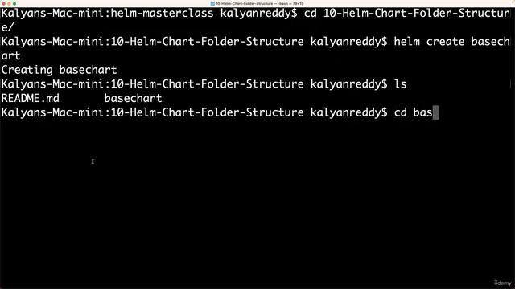
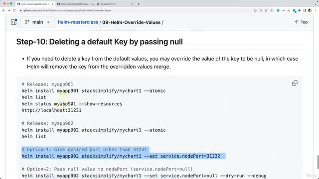
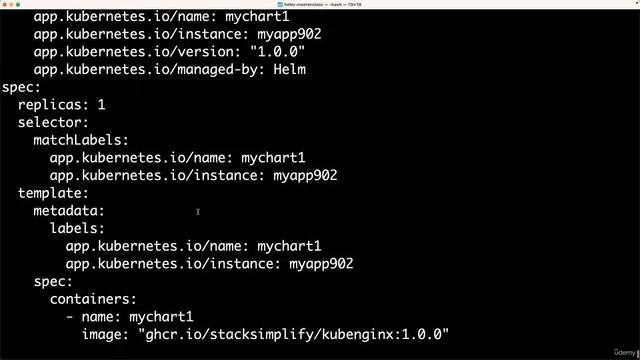
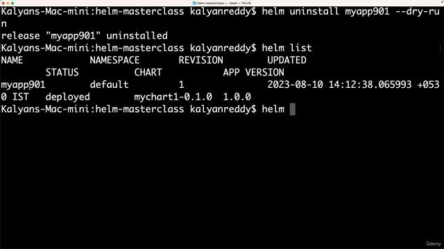
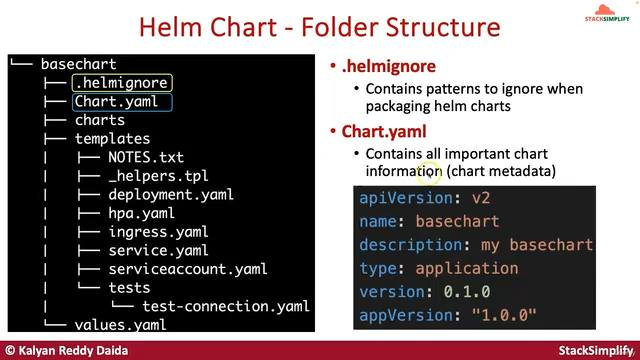
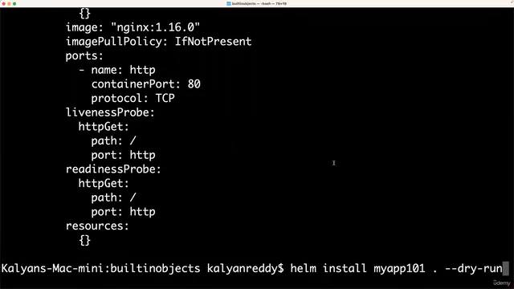

# Helm Masterclass（P033–P038）复现文档：卸载 release、values 覆盖层级、用 null 删键、Chart 目录结构、内置对象

---

## 1. 这一节做什么

这六集是「Helm 基础操作」和「Helm Dev」之间的过渡段落，目标很具体：把上一节装起来的 release 干净地卸掉，然后一次性把 Helm 的值覆盖规则和 chart 目录结构讲透，最后在 `NOTES.txt` 里打印内置对象，正式进入模板开发。

交付物有三个：

1. **一次完整的 release 生命周期**：`helm install --atomic` → 端口冲突失败 → 用 `--set` 改端口或用 `--set xxx=null` 删掉默认键 → K8s 自动分配 NodePort → `helm uninstall` 收尾，`helm list` 为空。
2. **一份可以逐文件对照的 chart 骨架**：`.helmignore`、`Chart.yaml`、`values.yaml`、`charts/`、`templates/`、`templates/_helpers.tpl`、`templates/NOTES.txt`、`templates/tests/`、`README.md`、`LICENSE`，每个文件干什么、什么时候会被读、什么时候会被打进 `.tgz`，都要能说清楚。
3. **第一个 Helm Dev 实验**：把 `templates/NOTES.txt` 清空，逐步写入注释 → 纯文本 → `{{ . }}`，每次都用 `helm install ... --dry-run` 在终端里看渲染结果，观察到 root object 里包含 `capabilities`、`chart`、`files`、`release`、`subcharts`、`template`、`values` 这一整套信息。

对前端背景的读者，可以先把三个概念对上号再往下看：

- **values 覆盖** ≈ 一次深层的 `Object.assign`／`lodash.merge`，右边的覆盖左边；
- **传 null 删键** ≈ merge 时遇到 `null` 不是「把值设成 null」，而是「把这条 key 从合并结果里摘掉」；
- **模板里的 `.`** ≈ JS 里的 `this`：默认指向 root object，一旦进了 `with` / `range` 块，`.` 就变成当前上下文，不再是根。

---

## 2. 讲师原话（带时间点）

关于「传 null 等于删键」这个核心规则，讲师说得很直白：

> "如果需要从默认值中删除某个键，可以将该键的值覆盖为 null。在这种情况下，Helm 会在合并覆盖值时移除该键。"
> —— p034 [00:00]

关于删掉 nodePort 之后 K8s 会做什么：

> "默认情况下，当把 Kubernetes Service 创建为 NodePort Service 时，它的行为是：如果没有定义任何 nodePort，此时它会从 30000 到 32767 这个范围内动态分配一个端口。"
> —— p034 [02:54]

关于 values 的四层优先级（这是整段的骨架）：

> "子图表的值可以由父图表的 values.yaml 覆盖，父图表的 values.yaml 可以由用户提供的值文件覆盖，用户提供的值文件还可以由 `--set` 参数覆盖。这就是值的层级关系。"
> —— p033 [02:22]

关于 `.helmignore` 的作用范围——只影响打包，不影响集群：

> "这里包含打包 Helm 图表时要忽略的模式。因此，无论我们使用 `helm package` 命令创建的是哪个图表，它都会生成一个名为包名.tgz 的文件。"
> —— p035 [01:57]

关于 `Chart.yaml` 里两个 version 的区别：

> "appVersion 实际上大多时候就是我们 Docker 镜像的标签版本；而这里的 version 指的是图表版本。"
> —— p035 [04:50]

关于 `templates/` 的地位：

> "Helm 图表的核心部分只存在于这个 templates 文件夹中。也就是说，这是一个模板目录，这些模板与值结合后会生成有效的 Kubernetes 文件。"
> —— p036 [02:22]

关于下划线开头的文件：

> "在 templates 目录中，任何以下划线开头的文件都不应输出 Kubernetes 清单文件。"
> —— p037 [00:28]

关于 `NOTES.txt` 为什么不会出现在集群里：

> "主要区别在于，notes.txt 渲染完成后不会发送到 Kubernetes 集群，而是把输出显示在命令行窗口中。"
> —— p037 [06:01]

关于 root object 里装了哪些键：

> "在顶层，Helm 会将 `.` 初始化为一个对象，其中包含 `.Release`、`.Values`、`.Chart`、`.Capabilities`、`.Template` 和 `.Files` 等键。"
> —— p038 [00:29]

以及一个很容易踩的例外——`.` 的作用域：

> "如果在 `range` 和 `with` 动作中使用 `.`，它表示相应代码块中的当前上下文，而不是根 Helm 对象。"
> —— p038 [11:48]

---

## 3. 从零复现

### 前置条件

课里没讲具体版本号，但从 `helm create` 生成的 `apiVersion: v2`（p035 [03:24] 提到的）可以看出用的是 Helm 3。准备：

- 一个本地 K8s 集群（Docker Desktop 自带的最省事，minikube / kind 也行），`kubectl get nodes` 能返回节点；
- Helm 3；
- 一个空的练手目录。

```bash
kubectl get nodes
helm version
```

### 步骤 1：创建 chart 目录骨架

```bash
mkdir -p ~/helm-masterclass/section10-chart-structure
cd ~/helm-masterclass/section10-chart-structure
helm create base-chart
tree -a base-chart
```

`tree -a` 会打印出 `.helmignore`、`Chart.yaml`、`values.yaml`、`templates/`、`charts/` 等一整套文件——讲师就是这么确认「`helm create` 到底生成了什么」的。



`helm create` 的默认 `values.yaml` 里 `service.type` 是 `ClusterIP`、`nodePort` 是注释掉的。但课里用的 `my-chart-1` 是 **NodePort + 31231**（p034 [00:57] 讲师原话：*"在 values.yaml 中，nodePort 现在是 31231。"*）。把 `base-chart/values.yaml` 改成第 4 章给出的版本，`service.type: NodePort`、`service.nodePort: 31231`，同时 `templates/service.yaml` 按第 4 章重写。

### 步骤 2：装第一个 release 并验证

```bash
helm install myapp901 ./base-chart --atomic
helm status myapp901
kubectl get svc
curl http://localhost:31231
```

能拿到 nginx 首页就说明链路通了（课里用的是讲师的 demo 镜像，返回 `v1` 字样；我们这里用 `nginx`，返回内容不同但验证目的相同）。

### 步骤 3：故意制造一次端口冲突

```bash
helm install myapp902 ./base-chart --atomic
```

预期失败。报错会指出 service 的 `nodePort` 31231 已经被占用（讲师原话里是 *"无效值 31231：该端口已被分配。"* —— p034 [01:55]）。因为带了 `--atomic`，失败后 Helm 会自动把半成品 release 卸掉，所以 `helm list` 里看不到它。这一步是本节所有后续操作的动机：**同一份 chart 不能同时装两次**，因为 NodePort 是集群级别的独占资源。

### 步骤 4：修法一 —— 直接换端口

```bash
helm install myapp902 ./base-chart --set service.nodePort=31240 --atomic
```

这是前面几节课已经用过的手段：`--set` 的优先级最高。

### 步骤 5：修法二 —— 传 null 把默认键删掉

```bash
# 先干跑，看渲染出来的 service.yaml
helm install myapp902 ./base-chart --set service.nodePort=null --dry-run --debug
```

在 `--dry-run --debug` 输出里翻到 Service 那一段，会看到 `nodePort` 不再是 31231。讲师当时看到的是字面量 `null`（*"我们传入的是 null，因此你在这里看到的就是同一个 null。"* —— p034 [03:49]）；在我们的模板里用 `{{- if .Values.service.nodePort }}` 包了一层，所以是整行不输出——对 K8s 来说两种写法效果一样：**字段没有值 → 动态分配**。



确认渲染没问题后真装：

```bash
helm install myapp902 ./base-chart --set service.nodePort=null
kubectl get svc
```

`kubectl get svc` 的 PORT(S) 列会显示一个 30000–32767 之间随机分配的端口（讲师那次拿到的是 31982）。



```bash
curl http://localhost:<上面查到的端口>
helm status myapp902 --show-resources
```

`--show-resources` 会把这次 release 创建的所有对象列出来，Pod、Deployment、Service 一目了然。**这一步是整段的重点**：不修改 chart、不升版本、不重打 `.tgz`，仅靠一次 `--set ...=null`，就把「写死的默认值」变回「交给平台决定」。

### 步骤 6：收尾卸载

```bash
helm uninstall myapp901
helm uninstall myapp902
helm list
```

讲师在这一步还提了一句：`helm uninstall` 本身也支持 dry run，可以先看一眼要删什么。



`helm list` 返回空表头即成功。

### 步骤 7：按依赖顺序走查目录

不要按文件名首字母顺序看，按「谁先被读、谁被谁覆盖」的顺序看：

1. `.helmignore` —— 打包时才用到，跟运行无关；
2. `Chart.yaml` —— chart 的元数据，`helm` 一切命令都要读它；
3. `values.yaml` —— 默认值，最低优先级；
4. `charts/` —— 子 chart，`helm dependency update` 之后才会有内容；
5. `templates/` —— 真正生成 K8s manifest 的地方；
6. `templates/_helpers.tpl` —— 定义可复用片段，本身不产出 manifest；
7. `templates/NOTES.txt` —— 渲染但只打印到终端；
8. `templates/tests/` —— `helm test` 才会跑；
9. `README.md` / `LICENSE` —— 给人看的。



`Chart.yaml` 里讲师特别点出的两组字段容易混：`version` 是**chart 自己的版本**（改模板就该递增），`appVersion` 通常是**容器镜像的 tag**（换镜像才递增）。

### 步骤 8：第一个 Helm Dev 实验 —— root object

进入 chart 目录，把 `templates/NOTES.txt` 清空：

```bash
cd base-chart
: > templates/NOTES.txt
```

**第一轮：写注释，确认注释不会出现在输出里。**

```gotemplate
{{/* root 或 dot 或 period object */}}
```

```bash
helm install myapp101 . --dry-run
```

在输出末尾的 `NOTES:` 段里什么都看不到——`{{/* */}}` 是 Helm 的注释，渲染完直接消失，连空行都不留。

**第二轮：写纯文本。**

```gotemplate
root object:
```

```bash
helm install myapp101 . --dry-run
```

`NOTES:` 下面出现 `root object:` 这一行，但因为冒号后面的 `{{ . }}` 还没写，没有数据。

**第三轮：打印整个 root object。**

```gotemplate
root object:
{{ . }}
```

```bash
helm install myapp101 . --dry-run
```



终端里会喷出一大坨**单行**的 map。把它复制到编辑器里格式化后再看，就能分辨出 `capabilities`、`chart`、`files`、`release`、`template`、`values` 这几段，以及 `chart` 里的 `apiVersion`、`name`、`version`、`description` 都能和 `Chart.yaml` 一一对上。`helm install --dry-run` 在这里的作用是**测试床**：讲师原话是 *"在开发 Helm 图表时，你可以把 notes.txt 当作测试平台来使用。"*（p038 [03:45]），改一行模板、跑一次 dry-run、立刻看结果，比反复真装快得多。

---

## 4. 完整代码

以下目录结构等价于 `helm create base-chart` 的产物做了两处减法（删掉 `ingress.yaml`、`hpa.yaml`-`serviceaccount.yaml`，因为本节实验用不到，且 `values.yaml` 里相关开关为 false 时它们本就不渲染）和一处加法（`service.type` 改成 NodePort，并显式给 `nodePort: 31231`，与课里 `my-chart-1` 的配置一致）。直接保存即可 `helm install`。

### 目录结构

```
base-chart/
├── .helmignore
├── Chart.yaml
├── README.md
├── values.yaml
├── myvalues.yaml
└── templates/
    ├── _helpers.tpl
    ├── deployment.yaml
    ├── service.yaml
    ├── NOTES.txt
    └── tests/
        └── test-connection.yaml
```

### `Chart.yaml`

```yaml
apiVersion: v2
name: base-chart
description: A Helm chart for Kubernetes
type: application
version: 0.1.0
appVersion: "1.25"
```

### `.helmignore`

```
# Patterns to ignore when building packages.
.DS_Store
.git/
.gitignore
.vscode/
*.tmp
*.tgz
```

### `values.yaml`

```yaml
replicaCount: 1

image:
  repository: nginx
  tag: "1.25"
  pullPolicy: IfNotPresent

service:
  type: NodePort
  port: 80
  nodePort: 31231

nameOverride: ""
fullnameOverride: ""

resources: {}
```

### `myvalues.yaml`（用户覆盖用，放在 chart 目录外侧也行）

```yaml
service:
  nodePort: 31500
```

### `templates/_helpers.tpl`

```gotemplate
{{/*
Expand the name of the chart.
*/}}
{{- define "base-chart.name" -}}
{{- default .Chart.Name .Values.nameOverride | trunc 63 | trimSuffix "-" }}
{{- end }}

{{/*
Create a default fully qualified app name.
*/}}
{{- define "base-chart.fullname" -}}
{{- if .Values.fullnameOverride }}
{{- .Values.fullnameOverride | trunc 63 | trimSuffix "-" }}
{{- else }}
{{- $name := default .Chart.Name .Values.nameOverride }}
{{- if contains $name .Release.Name }}
{{- .Release.Name | trunc 63 | trimSuffix "-" }}
{{- else }}
{{- printf "%s-%s" .Release.Name $name | trunc 63 | trimSuffix "-" }}
{{- end }}
{{- end }}
{{- end }}

{{/*
Common labels
*/}}
{{- define "base-chart.labels" -}}
helm.sh/chart: {{ .Chart.Name }}-{{ .Chart.Version }}
{{ include "base-chart.selectorLabels" . }}
app.kubernetes.io/managed-by: {{ .Release.Service }}
{{- end }}

{{/*
Selector labels
*/}}
{{- define "base-chart.selectorLabels" -}}
app.kubernetes.io/name: {{ include "base-chart.name" . }}
app.kubernetes.io/instance: {{ .Release.Name }}
{{- end }}
```

### `templates/deployment.yaml`

```yaml
apiVersion: apps/v1
kind: Deployment
metadata:
  name: {{ include "base-chart.fullname" . }}
  labels:
    {{- include "base-chart.labels" . | nindent 4 }}
spec:
  replicas: {{ .Values.replicaCount }}
  selector:
    matchLabels:
      {{- include "base-chart.selectorLabels" . | nindent 6 }}
  template:
    metadata:
      labels:
        {{- include "base-chart.selectorLabels" . | nindent 8 }}
    spec:
      containers:
        - name: {{ .Chart.Name }}
          image: "{{ .Values.image.repository }}:{{ .Values.image.tag }}"
          imagePullPolicy: {{ .Values.image.pullPolicy }}
          ports:
            - name: http
              containerPort: 80
              protocol: TCP
```

### `templates/service.yaml`

```yaml
apiVersion: v1
kind: Service
metadata:
  name: {{ include "base-chart.fullname" . }}
  labels:
    {{- include "base-chart.labels" . | nindent 4 }}
spec:
  type: {{ .Values.service.type }}
  ports:
    - name: http
      port: {{ .Values.service.port }}
      targetPort: http
      protocol: TCP
      {{- if .Values.service.nodePort }}
      nodePort: {{ .Values.service.nodePort }}
      {{- end }}
  selector:
    {{- include "base-chart.selectorLabels" . | nindent 4 }}
```

### `templates/NOTES.txt`（默认版，装完给人看的提示）

```gotemplate
Thank you for installing {{ .Chart.Name }}.

Release name: {{ .Release.Name }}
Chart version: {{ .Chart.Version }}
App version: {{ .Chart.AppVersion }}

1. Check the pods:
   kubectl get pods -l app.kubernetes.io/instance={{ .Release.Name }} -n {{ .Release.Namespace }}

2. Get the service port:
{{- if contains "NodePort" .Values.service.type }}
   kubectl get svc {{ include "base-chart.fullname" . }} -n {{ .Release.Namespace }}
{{- else }}
   kubectl port-forward svc/{{ include "base-chart.fullname" . }} {{ .Values.service.port }}:{{ .Values.service.port }}
{{- end }}
```

### `templates/NOTES.txt`（root object 实验版，第 8 步用）

```gotemplate
root object:
{{ . }}
```

### `templates/tests/test-connection.yaml`

```yaml
apiVersion: v1
kind: Pod
metadata:
  name: "{{ include "base-chart.fullname" . }}-test-connection"
  labels:
    {{- include "base-chart.labels" . | nindent 4 }}
  annotations:
    "helm.sh/hook": test
spec:
  restartPolicy: Never
  containers:
    - name: wget
      image: busybox
      command: ['wget']
      args: ['{{ include "base-chart.fullname" . }}:{{ .Values.service.port }}']
```

### `README.md`

```markdown
# base-chart

Helm Masterclass P033–P038 的练习 chart。

## 安装

    helm install myapp901 ./base-chart --atomic

## 覆盖值

    helm install myapp902 ./base-chart -f myvalues.yaml --set service.nodePort=31600

## 卸载

    helm uninstall myapp901
```

---

## 5. 逐行解释

### `Chart.yaml`

- `apiVersion: v2` —— 讲师在 p035 [03:24] 明确说这是「as on today that is the latest version」。v1 是 Helm 2 时代，v2 才支持 `type`、依赖放在 `dependencies:` 里这些能力。
- `type: application` —— 讲师把它和 `library` 对齐讲：application chart 产出 K8s 资源，library chart 只提供可复用的函数/模板，被 application chart 引用。他原话是「99 percent 的 case we use application charts」，所以本节和后面所有 demo 都用 application。
- `version: 0.1.0` vs `appVersion: "1.25"` —— 这一组是本节最容易混的点。`version` 是 chart 的版本，模板改了、`values.yaml` 结构改了就要递增，Helm 用它来管理 release 的历史；`appVersion` 只是个标记，讲师说它「most of the times it is going to be our Docker image tag version」，所以这里写成和 `values.yaml` 里 `image.tag` 一致的 `1.25`。二者不同步不会报错，只是会误导人。
- `description` —— 让 `helm search` / ArtifactHub 显示用，随便写。

### `.helmignore`

语法和 `.gitignore` 一样，但作用域完全不同：只影响 `helm package` 打 `.tgz` 时哪些文件被塞进去，跟 `helm install` 读哪些模板无关。讲师在 p035 [02:24] 举的例子是 macOS 的 `.DS_Store` 和 `.git/`——这俩进包只会让包变大、让别人 diff 出噪音。前端可以类比 `.npmignore` / `files` 字段。

### `values.yaml` 与 `myvalues.yaml`

- 覆盖优先级从低到高：**子 chart 的 `values.yaml` → 父 chart 的 `values.yaml` → `-f myvalues.yaml` → `--set`**。讲师在 p033 [02:22] 把这条链一口气讲完，然后说子 chart 那一段会有专门的 demo，本节只做「`-f` 和 `--set` 谁盖谁」的验证：

```bash
helm install myapp902 ./base-chart -f myvalues.yaml --set service.nodePort=31600 --dry-run --debug
```

最终渲染出的端口是 **31600**，不是 `myvalues.yaml` 里的 31500，也不是 `values.yaml` 里的 31231。这就是 `--set` 在最右边的直观证据。

- 前端类比：`Object.assign` 是浅合并，Helm 这里是**深合并**——`myvalues.yaml` 里只写 `service.nodePort`，不会把 `service.type` 和 `service.port` 冲掉。

### `templates/service.yaml` 里那段 `if`

```yaml
      {{- if .Values.service.nodePort }}
      nodePort: {{ .Values.service.nodePort }}
      {{- end }}
```

这是本节的核心。三行代码分别对应三种输入：

1. 什么都不传 → `.Values.service.nodePort` 是 `31231` → 输出 `nodePort: 31231`；
2. `-f myvalues.yaml` → 输出 `nodePort: 31500`；
3. `--set service.nodePort=null` → 合并阶段这条 key 被删掉 → `.Values.service.nodePort` 取不到值 → `if` 为假 → **整行不输出**。

第 3 种情况如果去掉外层的 `if`，直接写 `nodePort: {{ .Values.service.nodePort }}`，渲染结果会是字面量 `nodePort: null`——这正是讲师 dry run 时报出来的样子（p034 [03:49]）。K8s 对 `nodePort: null` 的处理等同于「没填」，所以两种写法都能让 apiserver 从 30000–32767 里挑一个空闲端口。

- 前端类比：这等价于 JSON Merge Patch（RFC 7386）的语义——`{"a": null}` 的意思是删掉 `a`，而不是把 `a` 设为 `null`。课里没讲这个 RFC，但 Helm 的行为和它一致。

- `targetPort: http` —— 指向 `deployment.yaml` 里容器的 `ports[0].name: http`，所以容器换端口时只改一个地方。这是 Helm 模板里常见的解耦手法。

### `templates/_helpers.tpl`

- 文件名的下划线是**约定**：讲师在 p037 [00:28] 说，`templates/` 下任何以下划线开头的文件都「not expected to output a Kubernetes manifest file」。Helm 会渲染它，但渲染结果不会提交给 apiserver。它的唯一用途是 `{{- define "名字" -}}...{{- end }}` 定义命名片段，别处用 `{{ include "名字" . }}` 调用。
- `{{- define "base-chart.name" -}}` 里前后的 `-` 是**空白裁剪**：`{{-` 吃掉左边的空白和换行，`-}}` 吃掉右边的。不加的话每个 label 之间会多出空行，YAML 缩进很容易错位。
- `include ... | nindent 4` —— `nindent` = 先换行再按 4 个空格缩进。这是 Helm 模板里最常用的组合，用来把 helper 渲染出来的多行文本正确嵌进当前 YAML 层级。
- `{{- if contains $name .Release.Name }}` —— 防止名字重复。`contains` 的签名是 `contains 子串 完整字符串`，所以这句读作「release 名里已经含有 chart 名了吗」。比如 `helm install base-chart ./base-chart`，资源名就不会变成 `base-chart-base-chart`。这种小细节课里没展开，是 `helm create` 自带的逻辑。

### `templates/NOTES.txt`

它在 `templates/` 目录里，所以走同一个 Go template 渲染引擎，能用 `.Values`、`.Chart`、`.Release`、`if`、`include`——但不能用 `_helpers.tpl` 之外的任何「运行时」信息。渲染完，**内容不会进入 apiserver**，只在命令行的 `NOTES:` 段打印出来。这就是讲师在 p037 [06:01] 强调的「rendered, but not sent to Kubernetes cluster」。它是整个 chart 里唯一「人类可读而非机器可读」的模板。

### `.` 在 `with` / `range` 里的语义变化

讲师在 p038 [11:48] 特意加了一段「reiterate」，因为这是模板调试时最常见的坑：

```gotemplate
{{- with .Values.image }}
image: {{ .repository }}:{{ .tag }}     {{/* 这里的 . 是 .Values.image */}}
{{- end }}

{{- range .Values.ingress.hosts }}
- host: {{ .host }}                      {{/* 这里的 . 是当前这个 host 对象 */}}
{{- end }}
```

块内 `.` 不再是 root object。要跳回根，用 `$`：`{{ $.Values.service.port }}`。前端类比：`with` / `range` 相当于 `Array.prototype.forEach` 里 `.bind(obj)` 改变了 `this`，想拿外层作用域就得提前用变量存住。

### root object 输出为什么是单行

`{{ . }}` 打印的是一个 Go 的 `map[string]interface{}`，Go 的 `%v` 格式化对 map 是紧凑输出，所以所有内容挤在一行里。复制到 VS Code 里 `Shift+Alt+F` 格式化（或丢进 jq 之外的任何 YAML/JSON 美化工具）就能看出层级：`capabilities` 在第一层，`chart` 在第二层，`chart.apiVersion`、`chart.name`、`chart.version` 在第三层，和 `Chart.yaml` 里的字段逐一对应。

---

## 6. 复现检查清单

- [ ] `kubectl get nodes` 有输出，`helm version` 是 v3
- [ ] `helm create base-chart` 之后 `tree -a base-chart` 能看到 `.helmignore` / `Chart.yaml` / `values.yaml` / `templates/` / `charts/`
- [ ] `values.yaml` 里 `service.type: NodePort`、`service.nodePort: 31231`
- [ ] `helm install myapp901 ./base-chart --atomic` 成功，`helm status myapp901` 显示 deployed
- [ ] `curl http://localhost:31231` 有响应
- [ ] `helm install myapp902 ./base-chart --atomic` **失败**，报错信息里有 31231 already allocated
- [ ] 失败后 `helm list` 里没有 myapp902（`--atomic` 自动回滚）
- [ ] `helm install myapp902 ./base-chart --set service.nodePort=null --dry-run --debug` 的输出里，Service 那段没有写死的 31231
- [ ] 真装之后 `kubectl get svc` 显示一个 30000–32767 之间的端口
- [ ] `curl http://localhost:<那个端口>` 能通
- [ ] `helm status myapp902 --show-resources` 能看到 Pod / Deployment / Service
- [ ] `helm install myapp902 ./base-chart -f myvalues.yaml --set service.nodePort=31600 --dry-run --debug` 渲染出 31600（验证 `--set` > `-f` > `values.yaml`）
- [ ] `helm uninstall myapp901 && helm uninstall myapp902 && helm list` 返回空
- [ ] 清空 `templates/NOTES.txt` 只写 `{{/* comment */}}` 时，`--dry-run` 输出的 `NOTES:` 段为空
- [ ] 写入 `{{ . }}` 后能观察到 `capabilities` / `chart` / `files` / `release` / `template` / `values` 这些键
- [ ] `chart` 里的 `name`、`version`、`description` 与 `Chart.yaml` 完全一致

---

## 7. 课里没讲但你会撞上的

**1）`helm uninstall --dry-run` 在部分 Helm 3 版本上不存在。**
讲师在 p033 [00:06] 说 uninstall 也可以先 dry run。但如果你的 helm 比较老，执行会直接报 `unknown flag: --dry-run`。课里没讲最低版本号——遇到这个错要么 `helm upgrade` 升级，要么跳过这一步直接 uninstall（本节的 release 都是自己装的，没有误删风险）。

**2）`localhost:<nodePort>` 只在本地集群成立。**
Docker Desktop 的 K8s、minikube（开了 tunnel）能这么访问；kind 默认访问不到，需要给集群做 `extraPortMappings`；云上集群（EKS/GKE/ACK）必须用**节点公网 IP**，而且安全组/防火墙要放行 30000–32767 这段。课里一律用 localhost，是因为讲师本地就是 Docker Desktop 型集群。

**3）31231 可能在你机器上已经被占用。**
装了两次 chart 忘了删、或者别人先占了，`helm install myapp901` 会直接失败。改 `values.yaml` 里的 `nodePort` 换一个 30000–32767 之间的数即可，别忘了所有后续命令里的 curl 端口跟着改。

**4）`--atomic` 让你看不到失败的 release。**
讲师在 p034 [01:26] 提到 myapp902 「failed and has been uninstalled because we have used the atomic flag」。如果你想去集群里亲自看看半成品长啥样，去掉 `--atomic` 再装一次，然后用 `helm list --all`（带 `failed` 状态的也要 `--all` 才显示）和 `helm status myapp902` 查。看完记得 `helm uninstall` 清掉，否则 NodePort 会一直被占。

**5）`helm list` 默认只看 deployed 状态。**
很多新手以为「`helm list` 没有就是没装过」，其实是失败/挂起的 release 被隐藏了。`helm list --all` 才是全量。

**6）`kind` 集群上跑这套实验会卡在 curl 那步。**
chart 本身、`helm status`、`kubectl get svc` 全都会正常，就是浏览器/curl 打不通。这是集群网络模型的问题，不是 Helm 的问题。想通就用 `kubectl port-forward svc/<name> 8080:80` 临时转发，或者在建集群时配 `extraPortMappings`。

**7）`NOTES.txt` 里写 `{{ . }}` 输出一大坨单行文本，看着像坏了。**
不是坏了，是 Go 的 map 打印格式。第 5 章解释过了。真要看结构，把它粘到支持 YAML/JSON 格式化的编辑器里，或者临时改成 `{{ .Chart | toYaml }}` 只打印一段（`toYaml` 这个函数课里没讲，是 Helm 内置的 Sprig 函数之一）。

**8）`helm create` 还会生成 `ingress.yaml`、`hpa.yaml`、`serviceaccount.yaml` 和 `_helpers.tpl` 里对应的几个模板。**
本节的代码刻意删掉了前三个，因为 `values.yaml` 里对应的开关（`ingress.enabled`、`autoscaling.enabled`、`serviceAccount.create`）保持默认 false 时它们根本不渲染，留着只会让 `tree` 输出变长、干扰阅读。但你如果直接跑未经修改的 `helm create base-chart`，这些文件都在，属于正常现象，不影响任何本节的实验。

**9）前端视角的一个常见误解：把 values 覆盖当成「替换文件」。**
`-f myvalues.yaml` 不是用你的文件替换 `values.yaml`，而是两份文件做**递归合并**。所以 `myvalues.yaml` 里只写 `service.nodePort: 31500` 时，`service.type` 仍然是 `NodePort`、`service.port` 仍然是 `80`。想整体替换某个子树，只能传 `null` 把它删掉再重建。